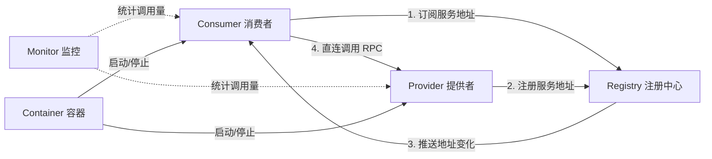
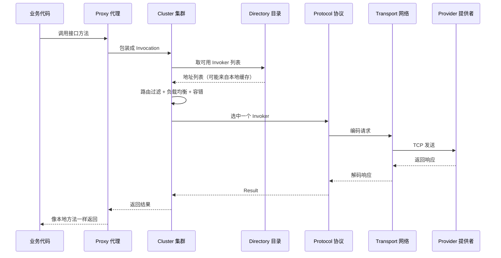
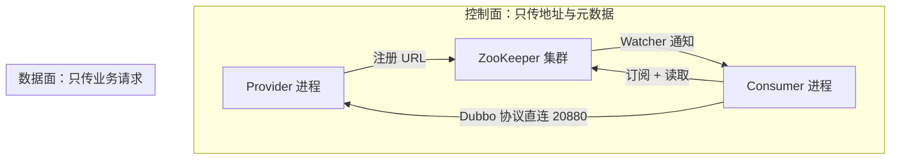

## 为什么 Dubbo 不能只有“服务端和客户端”？

先考虑一个最小的远程调用场景：订单服务要调用库存服务。最直接的做法是把库存服务的 IP 和端口写死在订单服务里，然后发一个 TCP 请求过去。单机开发时这能跑，但一旦部署到多台机器，问题会立刻出现：

- 库存服务扩到三台，订单服务该连哪一台？
- 库存服务换了机器，订单服务要不要重新打包？
- 库存服务某台机器挂了，订单服务怎么在几秒内知道？
- 新增一个调用方，难道要把所有提供者地址抄一遍？

RPC 框架真正要解决的不是“怎么把字节发过去”，而是**怎么让调用方在不认识提供者的前提下，仍然能找到它、调用它，并在它变化时自动跟上**。Dubbo 的架构就是围绕这件事分层拆出来的：有人负责暴露服务，有人负责注册地址，有人负责订阅变化，有人负责把地址变成可调用的代理，最后才轮到网络协议。

> ### 💡 新人小结：Dubbo 像一家有总台的连锁酒店
>
> - 客人（Consumer）不需要知道哪栋楼有空房，只要问总台（Registry）。
> - 酒店（Provider）开业时到总台登记，停业时注销。
> - 总台只给房号和路线，真正住店时客人是直接去那栋楼的，不会让总台帮忙搬行李。
>
> **注册中心负责“找到”，RPC 协议负责“到达”，两者不是同一条路。**



这张图里最容易被忽略的是第 4 步：业务请求并不经过注册中心。注册中心只参与“地址从哪里来”，不参与“请求怎么走”。这一点会在后文反复出现，因为它决定了很多故障的边界。

---

## 五种角色：谁在写地址、谁在读地址

Dubbo 官方把运行时角色分成五类。名字很直白，但每一类具体做什么、在什么时机介入，值得逐一对齐。

| 角色 | 典型形态 | 核心职责 | 在注册中心里的动作 |
|------|----------|----------|--------------------|
| Provider | 暴露 `@DubboService` 的 Spring Boot 进程 | 实现接口、监听 Dubbo 端口、处理请求 | 启动时写地址；停止时删地址或等待会话过期 |
| Consumer | 持有 `@DubboReference` 或编程式 `ReferenceConfig` 的进程 | 生成代理、订阅地址、发起 RPC | 订阅服务；接口级模式下还会写消费者节点 |
| Registry | ZooKeeper、Nacos、etcd 等 | 保存地址与元数据、通知变化 | 提供 znode 读写与监听能力 |
| Monitor | Dubbo Admin、Prometheus、自建统计 | 汇总调用次数、耗时、失败率 | 通常不参与调用决策 |
| Container | Spring Boot、Tomcat、独立 `main` | 管理 Provider/Consumer 的生命周期 | 不直接读写注册数据 |

一个进程可以同时是 Provider 和 Consumer。本地示例工程里的 `xxx-flow-service` 就是这种双重身份：它向 portal 暴露 `FlowEngineService`，同时又作为消费者，按业务类型动态引用两个仓库的 `FlowEventService`。所以“Provider/Consumer”是**逻辑角色**，不是“一台机器只能演一个角色”。

> ### 💡 新人小结：角色像公司里的岗位，不是工位
>
> - 同一个人可以既是对接客户的销售，也是向供应商下单的采购。
> - 判断角色看的是“这次交互里谁提供能力、谁发起调用”，不是看进程名。
> - 注册中心里的 provider 节点和 consumer 节点，记录的是同一条服务关系的两端。
>
> **先问“这次调用谁是提供方”，再谈它是 Provider 还是 Consumer。**

---

## 十层调用链：一次 RPC 经过了什么

Dubbo 把一次远程调用拆成十层。初学时不需要背全名，但要知道每一层解决什么问题，否则排障时只能看到一句 `No provider available`，不知道是地址没订阅到、路由被过滤了，还是网络连不上。

| 层 | 核心接口/概念 | 解决的问题 | 出问题时常见表现 |
|----|----------------|------------|------------------|
| Service | 业务接口 | 定义“能调什么” | 接口版本/分组不匹配 |
| Config | `ServiceConfig`、`ReferenceConfig` | 把配置组装成可执行的暴露/引用 | 配置没生效、参数冲突 |
| Proxy | 动态代理 | 让远程调用看起来像本地方法 | 代理没生成、方法签名不一致 |
| Registry | `Registry`、`RegistryDirectory` | 注册、订阅、地址列表维护 | 地址为空、订阅不到变化 |
| Cluster | `Cluster`、`Router`、`LoadBalance` | 多提供者下的容错、路由、负载均衡 | 路由过滤掉全部地址、重试打到坏节点 |
| Monitor | `Monitor` | 调用统计与监控 | 监控数据缺失，但不影响调用 |
| Protocol | `Protocol`、`Invoker` | 把调用封装成协议级请求 | 协议不匹配、端口未监听 |
| Exchange | `ExchangeClient`、`ExchangeServer` | 请求/响应语义、同步异步转换 | 请求超时、响应丢失 |
| Transport | Netty 等 | 真正收发字节 | 连接拒绝、连接断开 |
| Serialize | Hessian2、Fastjson2 等 | 对象与字节的转换 | 序列化失败、类版本不一致 |

这十层不是“每层都必须显式配置”，而是 Dubbo 内部的职责划分。一次调用大致沿着下面的顺序走：



把这张图和本地示例对上：portal 里的 `@DubboReference FlowEngineService` 在启动时生成代理；调用 `start()` 时，Cluster 从 Directory 拿到 flow-service 的地址，选中 20880 端口，经 Dubbo 协议发过去；flow-service 处理完再通过动态引用回调仓库。**整条链上只有 Directory 的地址来自 ZooKeeper，后面的步骤都由消费者本地完成。**

> ### 💡 新人小结：十层像寄快递的分工
>
> - 代理是“下单页面”，集群是“选哪家快递”，目录是“地址簿”。
> - 协议是“怎么打包”，传输是“货车怎么开”，序列化是“物品怎么装箱”。
> - 包裹真正上路后，地址簿就不参与运输了。
>
> **分层的目的不是增加复杂度，而是让每一类故障有明确的观察点。**

---

## 服务暴露与引用：启动阶段的两条路径

调用链是运行期的事，真正把服务“挂上去”和“接进来”发生在启动阶段。Provider 和 Consumer 走的是两条方向相反、但都经过注册中心的路径。

### Provider 的暴露路径

以本地示例的 flow-service 为例，核心步骤可以压缩成四步：

1. Spring 容器创建 `FlowEngineServiceImpl`，`@DubboService` 把它登记为待暴露服务。
2. `ServiceConfig` 根据配置生成 Dubbo URL，其中包含接口名、应用名、端口、超时、序列化方式等参数。
3. `Protocol.export()` 在 20880 端口启动 Dubbo 服务端，并把服务实现包装成 `Invoker`。
4. `RegistryProtocol.export()` 把服务地址写到注册中心；在 `register-mode=all` 下，会同时写接口级和应用级两套数据。

配置大致如下：

```yaml
dubbo:
  application:
    name: xxx-flow-service
    qos-enable: false
  registry:
    address: zookeeper://127.0.0.1:2181
  protocol:
    name: dubbo
    port: 20880
  provider:
    timeout: 5000
```

启动日志里能直接看到“暴露”和“注册”两个动作是分开的：

```text
[DUBBO] Export dubbo service com.xxx.xx.flow.api.FlowEngineService to url dubbo://192.168.3.103:20880/...
[DUBBO] Registered dubbo service com.xxx.xx.flow.api.FlowEngineService ... to registry zookeeper://127.0.0.1:2181/...
```

第一行说明本地端口已经能收请求；第二行说明地址已经写进注册中心。两件事都成功，别的进程才可能发现它。

### Consumer 的引用路径

Consumer 侧的顺序更绕一些：

1. `@DubboReference` 或 `ReferenceConfig` 生成引用配置。
2. `RegistryProtocol.refer()` 向注册中心订阅目标服务。
3. 注册中心返回初始地址列表，同时在本地注册监听器。
4. `RegistryDirectory` 把地址转换成 `Invoker`，Cluster 再包一层容错与负载均衡。
5. 代理对象返回给业务代码，第一次调用时才真正建立网络连接。

| 对比项 | Provider 暴露 | Consumer 引用 |
|--------|----------------|----------------|
| 触发时机 | Spring 容器启动、服务导出 | 注入代理或首次调用 |
| 注册中心动作 | 写地址 | 读地址 + 订阅变化 |
| 本地动作 | 启动 Dubbo 端口、创建 Invoker | 创建代理、构建 Directory |
| 失败后的默认行为 | 注册失败可重试；端口占用直接启动失败 | `check=true` 时启动失败；`check=false` 时延迟到调用期 |
| 关键配置 | `protocol.port`、`provider.timeout` | `check`、`timeout`、`retries`、`group` |

`check` 的差异很容易被忽略：它控制的是“取代理时要不要校验提供者存在”，不是“调用时要不要检查”。本地示例的动态引用用了 `setCheck(false)`，所以即使某个仓库没启动，flow-service 仍能正常启动并拿到代理，错误会延迟到真正回调时以 `RpcException` 的形式出现。这一点在集成实践篇会展开。

---

## ZooKeeper 在架构中的位置：控制面，而不是数据面

把 Dubbo 的十层和 ZooKeeper 放在一起看，职责边界很清楚：



| 操作 | 是否经过 ZooKeeper | 说明 |
|------|--------------------|------|
| 服务注册、注销 | 是 | 写 `/dubbo` 或 `/services` 下的节点 |
| 订阅地址变化 | 是 | 读节点并注册 Watcher |
| 读取元数据、映射 | 是 | `/dubbo/metadata`、`/dubbo/mapping` |
| 业务 RPC 调用 | 否 | Consumer 直接连 Provider 的 Dubbo 端口 |
| 负载均衡、路由、重试 | 否 | 在 Consumer 本地完成 |
| 超时、序列化 | 否 | 由 Dubbo 协议与配置决定 |

因此，“ZooKeeper 挂了”不等于“所有 RPC 立刻失败”。如果 Consumer 已经有地址缓存，并且 Provider 仍然可达，调用可以继续；但新的注册、地址变更和首次订阅会受影响。反过来，“ZooKeeper 正常”也不保证调用成功，因为数据面可能因为端口、网络、线程池或业务异常而失败。排障时必须先分清是哪条路出了问题。

> ### 💡 新人小结：注册中心像通讯录，不是电话线
>
> - 通讯录丢了，已经接通的电话不会立刻断。
> - 但你要找新号码、换号码，就必须查通讯录。
> - 电话打不通，也不代表通讯录写错了。
>
> **先判断是“找不到”还是“打不通”，再决定查 ZooKeeper 还是查网络与线程池。**

---

## 把架构映射到本地可运行工程

只看图容易悬空。本地示例工程把上述角色落成了四个 Spring Boot 进程和一个 ZooKeeper 实例：

| 进程/模块 | 应用名 | 角色 | 端口 | 暴露或引用的接口 |
|-----------|--------|------|------|------------------|
| `xxx-raw-warehouse-service` | `xxx-raw-warehouse-service` | Provider | 20881 | `RawWarehouseQueryService`、分组 `RAW_WAREHOUSE` 的 `FlowEventService` |
| `xxx-product-warehouse-service` | `xxx-product-warehouse-service` | Provider | 20882 | `ProductWarehouseQueryService`、分组 `PRODUCT_WAREHOUSE` 的 `FlowEventService` |
| `xxx-flow-service` | `xxx-flow-service` | Provider + Consumer | 20880 | 暴露 `FlowEngineService`；动态引用两个仓库的 `FlowEventService` |
| `xxx-portal` | `xxx-portal` | Consumer | 18080（HTTP） | 静态引用 `FlowEngineService` 与两个查询接口 |
| ZooKeeper | 无 | Registry | 2182（实验用） | 保存注册数据 |

实验时没有使用本机原有的 2181，而是用独立 `dataDir` 在 2182 启动了一个临时实例，并通过启动参数覆盖注册地址：

```bash
java -Ddubbo.registry.address=zookeeper://127.0.0.1:2182 \
  -jar xxx-flow/xxx-flow-service/target/xxx-flow-service-1.0.0-SNAPSHOT.jar
```

四个进程都启动后，ZooKeeper 的根节点下出现了三类数据：

```text
/dubbo
/services
/zookeeper
```

其中 `/dubbo` 下按接口组织，能看到 `FlowEngineService`、`FlowEventService`、`RawWarehouseQueryService`、`ProductWarehouseQueryService` 四个服务目录；`/services` 下只有三个提供者应用名，portal 作为纯消费者不在其中。这个差异不是巧合，而是接口级与应用级两套模型的结果，后续会在数据篇逐节点拆开。

通过 portal 发起一次真实调用：

```bash
curl -s -X POST http://127.0.0.1:18080/api/flows \
  -H "Content-Type: application/json" \
  -d '{"starter":"alice","businessId":"b-1001","businessType":"RAW_WAREHOUSE"}'
```

返回：

```json
{"flowInstanceId":"FI000001","businessType":"RAW_WAREHOUSE","businessId":"b-1001","status":"RUNNING","starter":"alice","approver":null,"dispatchResult":"start:OK","createdAt":1792940649674,"updatedAt":1792940649960}
```

这条响应证明的不只是“HTTP 通了”，而是整条链路都成立：portal 从注册中心拿到 flow-service 地址，flow-service 又从注册中心拿到 RAW 仓库地址，最后回调成功。注册中心只在两个“找地址”的瞬间出现，真正传递业务数据的仍是 20880 和 20881 上的 Dubbo 连接。

---

## 四个常见误解

| 误解 | 实际情况 | 判断方法 |
|------|----------|----------|
| “ZooKeeper 是请求中转站” | 业务请求不经过 ZooKeeper，只走 Consumer 到 Provider 的直连 | 抓包看 2181 是否有业务流量；正常情况下只有注册/订阅流量 |
| “注册中心挂了，服务一定不可用” | 已有地址缓存时，已有调用可能继续；新订阅和变更会受影响 | 查 Consumer 本地缓存与现有连接，而不是只看 ZK 进程 |
| “一个服务只有一个 znode” | 接口级有 providers/consumers/routers/configurators 多个类别，另有 metadata/mapping | 用 `ls -R` 看完整树，不要只看一个节点 |
| “应用级发现就是不再写 /dubbo” | `register-mode=all` 会写两套；`instance` 才只写 `/services` | 查启动参数和真实节点，不要凭版本号猜 |

这些误解的共同点是：把“注册”当成了“调用”的一部分。只要记住控制面与数据面的分界，大多数判断都会变得直接。

---

## 要点总结

- Dubbo 的运行时由 Provider、Consumer、Registry、Monitor、Container 五类角色协作，一个进程可以同时承担多个角色。
- 一次 RPC 从代理开始，经过集群、目录、协议、网络到达提供者；注册中心只负责地址和元数据，不转发业务请求。
- Provider 启动时先暴露本地端口，再向注册中心写地址；Consumer 启动时订阅地址并构建 Directory，调用时才建立连接。
- ZooKeeper 位于控制面。ZK 故障影响“发现与变更”，不等于所有数据面调用立刻中断。
- 本地示例用四个 Spring Boot 进程和一个临时 ZK 验证了完整链路；`/dubbo` 与 `/services` 同时存在，是默认 `register-mode=all` 的直接结果。

下一步建议按顺序阅读：[为什么 Dubbo 推荐 ZooKeeper](/docs/06-dubbo-integration/架构与选型/why-zookeeper/) 解释选型依据，[二者合用的运行时架构](/docs/06-dubbo-integration/架构与选型/runtime-architecture/) 把端口与故障域放回部署图，[Dubbo 在 ZooKeeper 中读写什么](/docs/06-dubbo-integration/注册与发现/data-in-zookeeper/) 则给出逐节点的真实样例。
