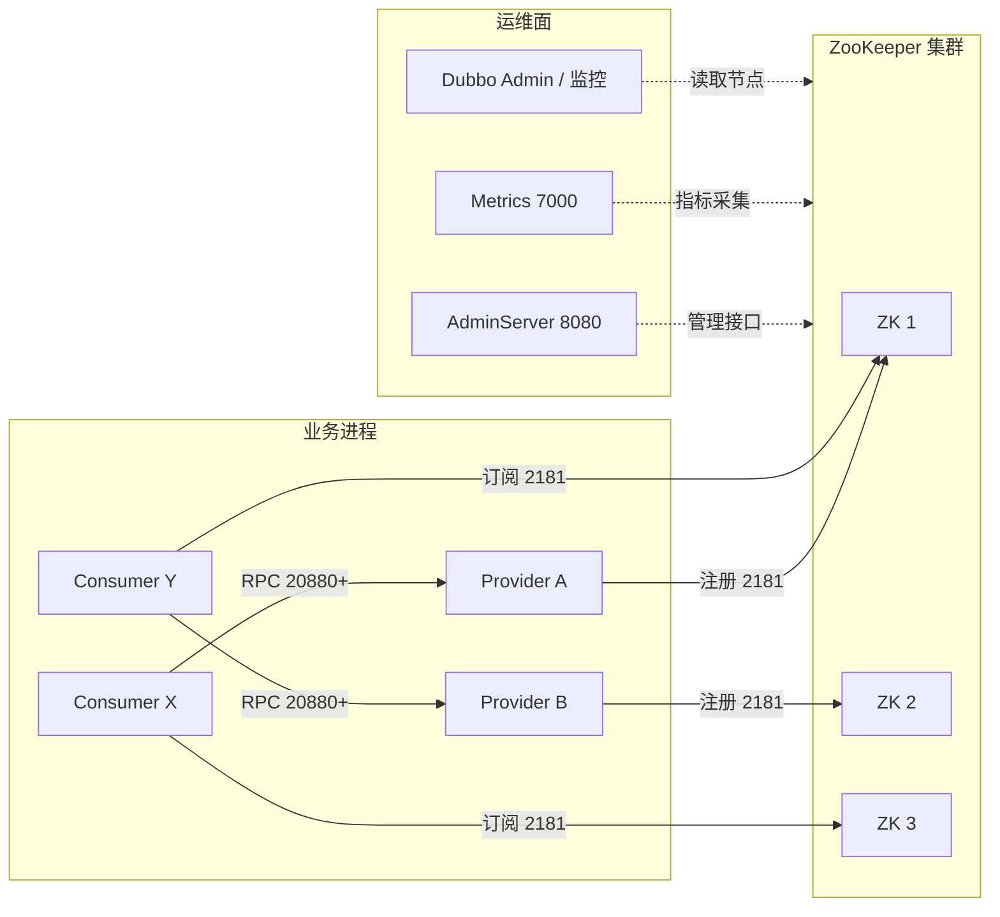
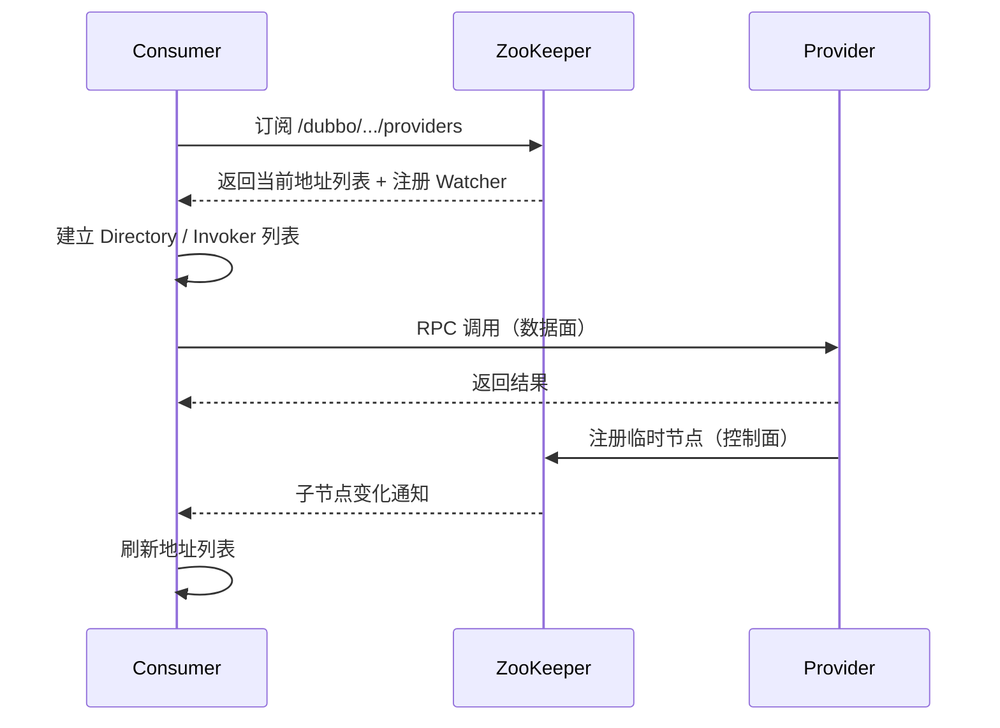
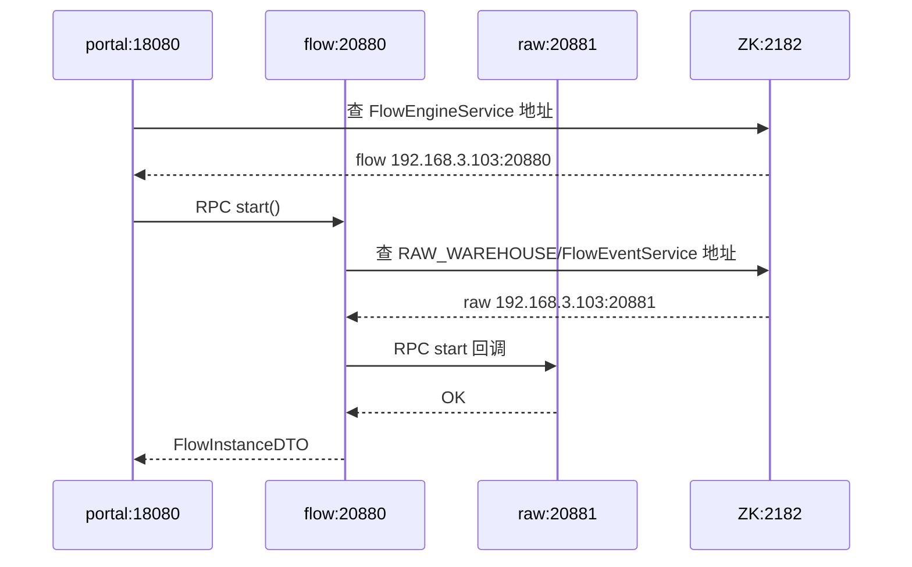

## 为什么“能注册”不等于“架构已经跑通”？

很多集成问题在启动日志里看起来已经解决了：提供者打印了 `Registered`，消费者拿到了代理，ZooKeeper 里也能 `ls` 到节点。可一旦上线，仍会遇到下面这些情况：

- 提供者明明在线，消费者却报 `No provider available`。
- ZooKeeper 里节点还在，调用却一直 `Connection refused`。
- 应用扩了三台，流量仍然只打到一台。
- ZooKeeper 集群挂了一台，注册突然全部失败。
- 监控显示调用量正常，但业务侧已经开始超时。

这些问题说明：注册成功只是“控制面写进去了”，离“数据面能稳定调用”还有距离。运行时架构要同时回答三个问题：**谁和谁通信、走哪条路、哪一段出故障会波及哪里**。

> ### 💡 新人小结：注册像在导航软件里标了地址
>
> - 地址标上去，不代表路一定通。
> - 导航软件（注册中心）只告诉你目的地，车（RPC 调用）要自己开过去。
> - 路上堵车、封路、车坏了，导航软件都不负责。
>
> **注册成功是“知道在哪”，调用成功才是“真的到达”。**



这张图里，ZooKeeper 集群、业务进程和运维面是三个独立的故障域。把它们混在一起看，就会误以为“ZK 挂了业务全挂”或者“ZK 正常业务就一定正常”。

---

## 一张部署图：进程、端口与两条数据流

先列清楚每个组件在运行时的位置。下表以单机实验和常见的三节点 ZK 部署为参照，端口是示例值，不是强制值。

| 组件 | 典型端口/地址 | 协议 | 作用 | 是否参与业务请求 |
|------|----------------|------|------|------------------|
| ZooKeeper 客户端口 | 2181 | ZooKeeper 协议 | 注册、订阅、读写节点 | 否 |
| ZooKeeper 集群通信 | 2888 | 内部 TCP | Leader/Follower 数据同步 | 否 |
| ZooKeeper 选举 | 3888 | 内部 TCP | Leader 选举 | 否 |
| ZooKeeper AdminServer | 8080 | HTTP | 管理端点，便于查看状态 | 否 |
| ZooKeeper MetricsProvider | 7000 | HTTP | Prometheus 指标 | 否 |
| Dubbo Provider | 20880、20881、20882 | Dubbo 协议 | 接收业务 RPC | 是 |
| Consumer HTTP 入口 | 18080 | HTTP | 对外提供 Web API | 是（业务入口） |
| Dubbo Admin | 8080 或其他 | HTTP | 服务查询、治理 | 否 |

端口冲突是集成阶段最常见的问题之一。ZooKeeper 3.5 起默认开启 AdminServer，会占用 8080；如果同一台机器上还有 Tomcat、前端 dev server 或 Dubbo Admin，就会撞端口。可以在 `zoo.cfg` 里改 `admin.serverPort`，或者关闭 AdminServer：

```properties
admin.enableServer=false
```

关闭管理端不会影响 Dubbo 的注册与调用，因为 Dubbo 走的是 2181 上的客户端协议。这个结论在站点前面的管理面文档里有完整验证。

---

## 控制面与数据面：分开看故障

把两条路分开之后，很多“玄学问题”会变得可解释。

### 控制面：应用与 ZooKeeper 之间

控制面负责：

- 提供者启动时写注册节点。
- 消费者启动时订阅节点。
- 地址变化时，ZooKeeper 通过 Watcher 通知消费者。
- 消费者断线重连后，重新拉取地址。
- 元数据、映射关系写入 `/dubbo/metadata` 和 `/dubbo/mapping`。

控制面的特点是**低频、带状态、对一致性敏感**。它不承载业务流量，但它的延迟会直接影响“新实例多久能被发现”“下线实例多久能被清理”。

### 数据面：消费者与提供者之间

数据面负责真正的 RPC：

- 消费者从本地 Directory 选一个 Invoker。
- 经过路由、负载均衡、容错后发起调用。
- 请求走 Dubbo 协议，直接连提供者的 20880 等端口。
- 超时、重试、线程池、序列化都在这一侧发生。

数据面的特点是**高频、无状态、对延迟敏感**。它不依赖 ZooKeeper 的实时可用性，只依赖消费者手里已经拿到的地址列表。



注意图中的方向：业务请求从 C 直接到 P，ZK 不在请求路径上。即使 ZK 在调用过程中不可用，只要 C 已有地址、P 仍可达，调用仍可能成功。反之，如果 P 已经挂了，ZK 里的节点可能还没消失，C 仍会尝试旧地址，于是出现连接失败。

| 故障 | 控制面影响 | 数据面影响 | 典型现象 |
|------|------------|------------|----------|
| ZooKeeper 少数节点故障 | 多数派仍在时可继续 | 基本无影响 | 注册/订阅短暂抖动 |
| ZooKeeper 失去多数派 | 新注册、变更失败 | 已有地址的调用可能继续 | 新实例上不了线，旧调用仍跑 |
| 提供者进程崩溃 | 会话超时后节点消失 | 旧连接断开，新调用可能打到旧地址 | `Connection refused` 先于 `No provider` 出现 |
| 消费者进程崩溃 | 消费者节点消失 | 该消费者不再发起调用 | 流量转移到其他消费者 |
| 网络分区 | 会话可能过期，节点被清理 | 跨区调用失败 | 双方都认为对方“失联” |

> ### 💡 新人小结：控制面是“更新通讯录”，数据面是“打电话”
>
> - 通讯录更新失败，不耽误你已经拨出去的电话。
> - 电话号码变了但通讯录没更新，你会打到旧号码。
> - 对方关机了，通讯录里仍然可能有他的名字。
>
> **控制面与数据面的故障要分开排查，不能用一个“服务不可用”概括。**

---

## 两套注册数据如何共存

Dubbo 3.x 同时支持接口级和应用级服务发现。在 ZooKeeper 上，它们落在两棵不同的子树里：

| 维度 | 接口级 | 应用级 |
|------|--------|--------|
| 根路径 | `/dubbo`（可由 `registry.group` 调整） | `/services`（可由分组调整） |
| 粒度 | 每个接口一个服务目录 | 每个应用一个服务名 |
| 提供者节点 | `/dubbo/{interface}/providers/{URL}` | `/services/{app}/{host:port}` |
| 消费者节点 | `/dubbo/{interface}/consumers/{URL}` | 通常不写消费者实例节点 |
| 地址内容 | 完整 URL，参数较多 | 实例 JSON，含元数据引用 |
| 适合 | 接口多、需要按接口精细治理 | 应用多、希望降低注册数据量 |
| 默认行为（3.2.20） | `register-mode=all` 时写入 | `register-mode=all` 时写入 |

`register-mode` 决定写哪一套：

```yaml
dubbo:
  registry:
    address: zookeeper://127.0.0.1:2181
    register-mode: all   # interface / instance / all
```

三种模式在本地实验里的真实差异：

| 模式 | `/dubbo` 提供者节点 | `/services` 实例节点 | 消费者能否调用 |
|------|----------------------|----------------------|----------------|
| `all`（默认） | 有 | 有 | 能 |
| `instance` | 无（但 metadata/mapping 仍在） | 有 | 能，走应用级发现 |
| `interface` | 有 | 无 | 能，走接口级发现 |

这张表解释了一个常见疑问：为什么切成 `instance` 后，`/dubbo` 下还能看到东西？因为元数据和映射不随注册模式消失，它们仍写在 `/dubbo/metadata` 和 `/dubbo/mapping`。真正的“提供者地址节点”才受 `register-mode` 控制。

两套数据共存并不意味着“重复两份完全一样的信息”。接口级的 URL 更完整，应用级的实例 JSON 更精简，消费者会根据订阅方式选择其中一套；元数据和映射则作为公共索引，帮助应用级发现把“接口”映射到“应用”。

> ### 💡 新人小结：两套注册数据像同一家公司的两种花名册
>
> - 接口级花名册按“项目”列人：谁参与了这个接口，写得最全。
> - 应用级花名册按“部门”列人：每个部门有哪些工位，数量更少。
> - 查项目去接口级，查部门去应用级；两本花名册的更新时机并不完全相同。
>
> **同一份组织关系，换一种粒度记录，就会得到两棵不同的树。**

---

## 典型拓扑与容量边界

运行时架构不是画得越复杂越好，而是要与服务规模匹配。下面给出三种常见形态，以及需要观察的容量信号。

| 形态 | 规模特征 | 推荐拓扑 | 主要风险 |
|------|----------|----------|----------|
| 单机实验 | 1 个 ZK、少量进程 | 单机 ZK + 本机 Dubbo | 单点故障，不能用于生产 |
| 中小生产 | 数十个应用、数百实例 | 3 节点 ZK，跨故障域部署 | 会话数、快照磁盘、监控缺失 |
| 较大规模 | 数百应用、上千实例、频繁变更 | 5 节点 ZK 或改用应用级发现 | 写入放大、Watcher 压力、容量治理 |

判断是否需要调整架构，可以盯住这些信号：

| 信号 | 说明 | 可能的方向 |
|------|------|------------|
| znode 总数持续增长 | 接口级 URL 节点太多 | 切到 `instance`，减少地址节点 |
| 单次快照/日志写入变大 | 节点数据大、变更频繁 | 精简 URL 参数，拆分注册中心 |
| 会话数接近上限 | 每台应用与 ZK 保持长连接 | 扩 ZK、减少客户端实例、复用连接 |
| Watcher 数量异常 | 重复订阅或监听未释放 | 检查客户端生命周期与订阅逻辑 |
| 注册延迟升高 | ZK 写入排队或磁盘慢 | 查磁盘、quorum、网络与快照 |
| 消费者地址更新滞后 | 通知丢失或会话异常 | 查连接、Watcher 重注册与本地缓存 |

ZooKeeper 的容量不是只看“能存多少节点”，还要看**写入频率、会话数量、Watcher 数量和快照/事务日志的磁盘 IO**。接口级注册把每个提供者的每个接口都写成一个 URL，服务数量一多，写入放大会非常明显；这也是官方建议新项目使用应用级发现的原因之一。

---

## 一次真实运行的拓扑快照

本地实验用四个 Spring Boot 进程和一个临时 ZooKeeper 实例，拓扑如下：

| 进程 | 应用名 | 角色 | 实际端口 | 注册模式 |
|------|--------|------|----------|----------|
| ZooKeeper | 无 | Registry | 2182 | 不适用 |
| 原料仓 | `xxx-raw-warehouse-service` | Provider | 20881 | 默认 `all` |
| 成品仓 | `xxx-product-warehouse-service` | Provider | 20882 | 默认 `all` |
| 流程服务 | `xxx-flow-service` | Provider + Consumer | 20880 | 默认 `all` |
| 门户 | `xxx-portal` | Consumer | 18080 | 默认 `all` |

启动后 ZooKeeper 的顶层结构：

```text
/
/dubbo
/services
/zookeeper
```

`/services` 下只有三个名字：`xxx-flow-service`、`xxx-raw-warehouse-service`、`xxx-product-warehouse-service`。portal 没有出现在这里，因为它只消费、不提供任何 Dubbo 服务。这个细节很重要：**应用级注册的是“有实例可被调用的应用”，不是“所有连上注册中心的应用”**。

而 `/dubbo` 下每个接口都有一个目录，portal 作为消费者会在对应接口的 `consumers` 下留下节点。于是同一个 portal，在接口级有消费者痕迹，在应用级没有实例痕迹。两套模型的差异，在同一个进程上就能观察到。

真实调用返回：

```json
{"flowInstanceId":"FI000001","businessType":"RAW_WAREHOUSE","businessId":"b-1001","status":"RUNNING","starter":"alice","approver":null,"dispatchResult":"start:OK","createdAt":1792940649674,"updatedAt":1792940649960}
```

这条链路跨越了两个控制面查询和两次数据面调用：



这条图也说明了为什么“注册中心挂了但业务还在跑”是可能的：只要两段地址都已经在本地缓存里，后续调用可以绕过 ZooKeeper 完成。

---

## 运行时需要盯住的四个边界

| 边界 | 发生了什么 | 观察点 | 处理方向 |
|------|------------|--------|----------|
| 会话超时 | 崩溃实例的临时节点延迟消失 | ZK 会话数、节点 `ephemeralOwner`、消费者连接失败日志 | 调整 `sessionTimeout`，应用层健康检查，消费者容错 |
| 多数派丢失 | ZK 无法完成写操作 | `srvr`/`mntr` 的 `Mode`、写请求延迟、日志 | 保证奇数节点、跨故障域、监控 quorum |
| 本地缓存过期 | 消费者仍持有已下线地址 | Directory 的 invoker 列表、`Connection refused` | 依赖通知刷新 + 连接失败剔除 + 重试策略 |
| 注册数据膨胀 | 节点多、URL 大、快照慢 | znode 数、dataDir 大小、注册延迟 | 切应用级、精简参数、容量规划 |

这四个边界里，只有“多数派丢失”是 ZooKeeper 自身的运维问题，其余三个都与 Dubbo 的消费者行为、注册模式和应用规模有关。把它们分开看，才能判断该扩 ZK、改配置，还是改应用。

---

## 要点总结

- 运行时架构要同时看控制面（应用与 ZK）和数据面（消费者与提供者），两者故障域不同。
- ZooKeeper 的 2181 承载注册/订阅（以及 4lw 诊断），不转发业务 RPC；业务 RPC 走提供者的 20880 等端口。
- 接口级 `/dubbo` 与应用级 `/services` 可以共存；`register-mode` 决定写哪一套，3.2.20 默认 `all`。
- 只有提供者应用会出现在 `/services`；纯消费者只在接口级留下消费者节点。
- 容量要关注 znode 数、会话数、Watcher 数、快照与事务日志磁盘 IO，而不只是“ZK 能不能启动”。
- 会话超时、多数派丢失、本地缓存过期、注册数据膨胀是运行时最需要盯住的四个边界。

下一步可以看 [服务注册与发现全流程](/docs/06-dubbo-integration/注册与发现/registration-discovery-flow/)，把这张部署图展开成一条带时间戳的链路；或者看 [Dubbo 在 ZooKeeper 中读写什么](/docs/06-dubbo-integration/注册与发现/data-in-zookeeper/)，直接检查每个节点的内容和生命周期。
