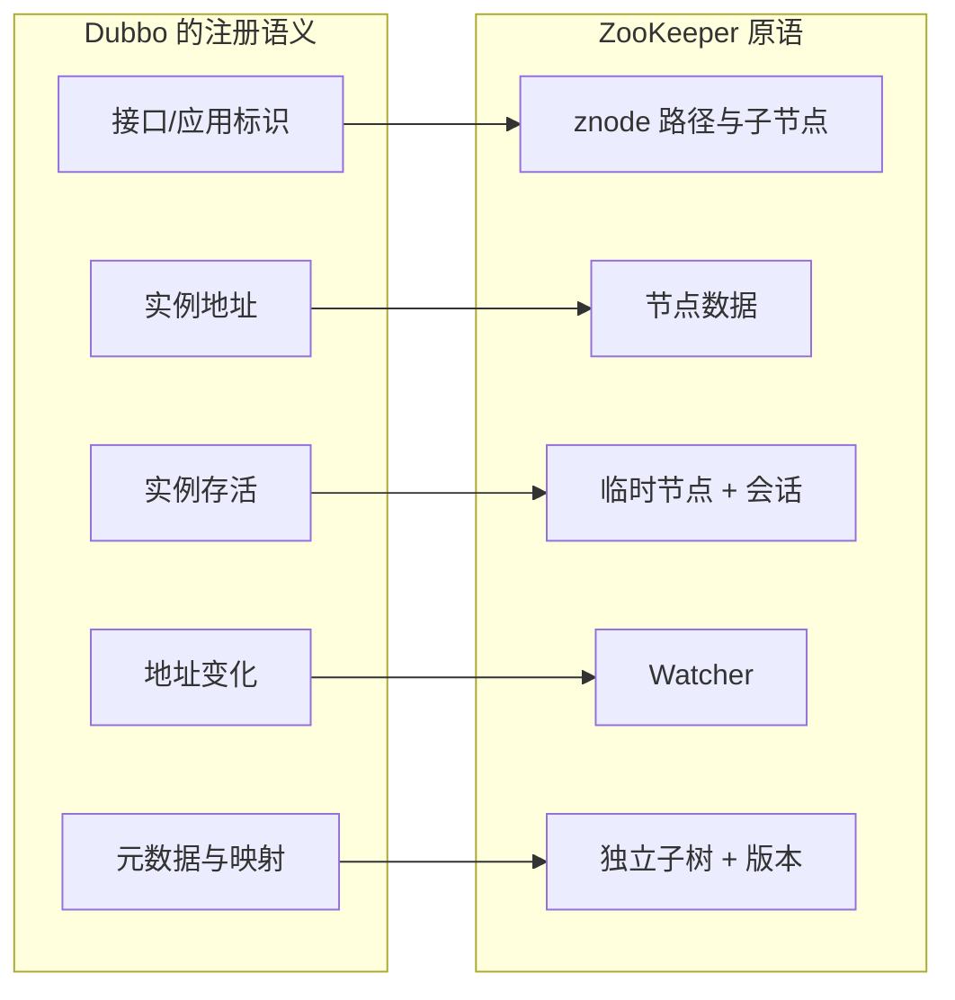
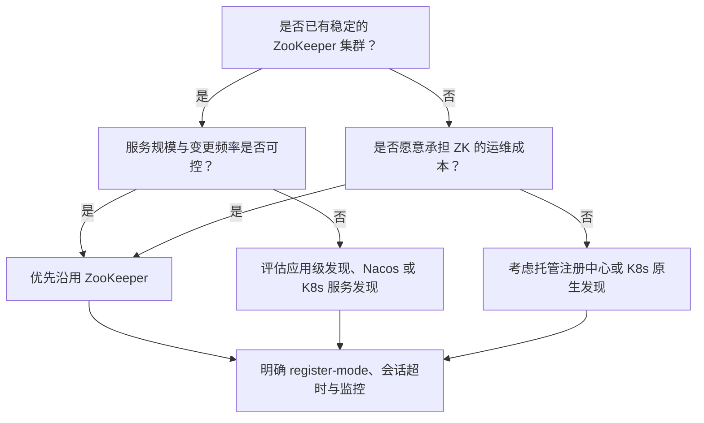

## 为什么注册中心不能只用一张“服务清单”表？

如果注册中心只需要保存一份“服务名到 IP 列表”的静态表格，那么用数据库、配置文件甚至一张 Excel 都能做。Dubbo 的场景比这复杂，因为服务清单一直在变：

- 提供者扩容，地址要增加。
- 提供者下线，地址要删除。
- 某个接口换了分组或版本，调用方要区分。
- 消费者需要知道地址变化，而不是等到下一次重启才更新。
- 提供者进程崩溃、机器断电、网络分区，注册中心要能在一段时间后把失效地址清掉。

这几件事合在一起，注册中心就不只是“存数据”，而是“**存数据 + 感知生命周期 + 主动通知 + 在异常时给出确定行为**”。ZooKeeper 被 Dubbo 长期推荐，正是因为它用少量原语同时覆盖了这四件事。

> ### 💡 新人小结：注册中心像小区门禁登记处
>
> - 住户入住要登记（注册），搬走要销户（注销）。
> - 门禁系统要在住户变化时通知保安（Watcher）。
> - 住户失联一段时间后，登记处要按规则标记为失效（会话超时）。
> - 它不负责把你送回家，只负责告诉别人你住在哪。
>
> **注册中心的核心不是“存名单”，而是“让名单跟着生命周期变化”。**


这张图里，任何一环缺失都会让“自动发现”退化成“手工配置”。ZooKeeper 的价值，就是把这四环做成可组合的基础能力。

---

## 注册中心的五项硬需求

把 Dubbo 对注册中心的要求拆开，可以得到五项很具体的判据。它们不是 CAP 之类的抽象口号，而是每天都会遇到的工程问题。

| 需求 | 具体含义 | 缺失时的后果 | ZooKeeper 的对应机制 |
|------|----------|----------------|----------------------|
| 服务注册 | 提供者能把接口、地址、分组、版本写进去 | 消费者无从发现 | znode 路径 + 节点数据 |
| 服务发现 | 消费者能按接口/应用读出地址列表 | 只能硬编码地址 | 按路径读取子节点 |
| 变更通知 | 地址增删时，消费者能及时知道 | 扩容/下线后仍调用旧地址 | Watcher + 客户端缓存 |
| 失效清理 | 进程崩溃后，旧地址最终会消失 | 流量持续打到死实例 | 临时节点 + 会话超时 |
| 一致性 | 不同消费者看到的地址集合大体一致 | 同一服务在不同消费者上表现不同 | Zab 协议、顺序写、单一视图 |

这五项里，前两项任何 KV 存储都能做，第三项开始出现门槛，第四项和第五项才真正决定注册中心的形态。ZooKeeper 的强项正是后三项：它用临时节点表达“实例还活着”，用 Watcher 表达“变化发生了”，用 Zab 让写入有明确的顺序和多数派确认。

### “存活”到底由谁判断？

这是选型时最容易混淆的一点。ZooKeeper 的临时节点并不能判断“应用是否健康”，它只能判断“客户端会话是否还活着”。两者之间的差距可能很大：

- 进程还在、TCP 连接还在，但线程池已经打满，业务请求全部超时。
- 进程被 `kill -9`，但 ZooKeeper 还没到会话超时时间，临时节点仍然存在。
- 机器网络分区，客户端与 ZooKeeper 断开，但客户端进程还在处理本地请求。

本地实验直接验证了第二种情况：杀掉一个提供者进程后，它在 `/dubbo` 下的提供者节点并没有立刻消失，而是又存在了约一分钟；在这段时间里，消费者仍可能拿到旧地址并发起连接，直到连接被拒绝。这说明 ZooKeeper 提供的是**会话级租约**，不是应用级健康检查。

> ### 💡 新人小结：临时节点像酒店的房卡
>
> - 房卡有效期内，系统认为你还在住。
> - 你把手机摔了（进程崩溃），房卡不会立刻失效，要等有效期结束。
> - 房卡失效只代表“联系不上”，不代表“房间里的服务一定坏了”。
>
> **临时节点解决“最终清理”，不解决“实时健康”。**

---

## ZooKeeper 的五件“刚好对口”的原语

ZooKeeper 的数据模型很简单：一棵 znode 树，每个节点有路径、数据、版本和子节点。Dubbo 不需要复杂的数据库表，只需要把服务关系映射到这棵树上。两者之间的对应关系可以画成下面这样：



逐项解释：

| 原语 | 在 ZooKeeper 里的表现 | 在 Dubbo 里的用途 | 关键边界 |
|------|------------------------|-------------------|----------|
| 树形路径 | `/dubbo/com.foo.BarService/providers` | 按接口、类别组织地址 | 路径越深，批量订阅的节点越多 |
| 节点数据 | 一个经过 URL 编码的字符串 | 保存地址、应用名、方法、超时等参数 | 数据越大，通知与快照成本越高 |
| 临时节点 | `ephemeralOwner` 非 0，绑定会话 | 表达提供者/消费者实例的存在 | 会话超时才清理，不是进程退出即清理 |
| Watcher | 一次性触发，需要重新注册 | 感知子节点增删、数据变化 | 通知不保证包含完整数据，要重新读取 |
| 版本号 | `dataVersion`、`cversion` | 乐观并发、变更检测 | 业务代码通常不直接使用 |

ZooKeeper 的 Watcher 是**一次性**的：触发一次后就失效，客户端必须重新注册。直接使用原生 Watcher 很容易漏事件，所以 Dubbo 在 ZooKeeper 客户端之上做了封装，应用级发现还用了 Curator X Discovery 的 `ServiceCache`，由它负责重新注册监听并维护本地缓存。理解这一点，才能解释为什么“ZooKeeper 通知了一次，消费者却能持续感知后续变化”。

### 为什么是树，而不是一张扁平表？

树形结构让“按接口列出所有提供者”变成一次子节点读取，也让权限、配额和批量清理有明确的边界。比如把某个接口下的 `providers` 整棵子树清掉，不会影响其他接口；把根节点从 `/dubbo` 换成别的分组，也能天然隔离不同环境。

代价是节点数量和路径长度会随着接口数增长。接口级注册尤其明显：一个提供者暴露多个接口，就会在多个 `/dubbo/{interface}/providers` 下各写一个 URL 节点。应用级注册把粒度收敛到“应用 + 实例”，缓解了这个问题。

---

## Dubbo 官方为什么把它放进推荐列表

Dubbo 官方对 ZooKeeper 的定位很明确：它是一个成熟的注册中心实现，接口级和应用级两套模型都支持。官方文档给出的关键事实包括：

- 接口级模式下，提供者向 `/dubbo/com.foo.BarService/providers` 写入 URL，消费者订阅该目录，并向 `/dubbo/com.foo.BarService/consumers` 写入自己的 URL。
- 应用级模式下，提供者向 `/services/app` 写入实例地址，消费者按应用名订阅实例列表。
- 根节点可以通过 `registry.group` 调整；不配置时接口级默认使用 `/dubbo`。
- `register-mode` 可选 `interface`、`instance`、`all`；官方建议新用户使用 `instance`。
- 官方对 ZooKeeper 的评价包含“工业强度较高，可用于生产环境”这类表述。

本地实测与这些描述一致，但有一个版本细节需要说清：**Dubbo 3.2.20 的代码默认值是 `all`，不是 `instance`**。在 `ConfigValidationUtils#genCompatibleRegistries` 中，普通注册中心（`zookeeper://`）的 `register-mode` 默认取 `DEFAULT_REGISTER_MODE_ALL`；只有 `service-discovery-registry://` 这种服务发现注册中心协议才默认 `instance`。所以“官方建议新用户用 instance”是**配置建议**，不是“3.2.20 的默认行为”。

| 来源 | 说法 | 适用口径 |
|------|------|----------|
| Dubbo 官方注册中心文档 | 新用户建议 `register-mode: instance` | 面向新项目的推荐配置 |
| Dubbo 3.2.20 源码 | 普通注册中心默认 `all` | 不写配置时的实际行为 |
| 本地实测 | 不写 `register-mode` 时 `/dubbo` 与 `/services` 都有数据 | 与源码默认值一致 |
| 本地实测 | 设为 `instance` 后只有 `/services` 有实例节点，`/dubbo` 仍保留 metadata/mapping | 与官方模式说明一致 |

这也解释了一个常见困惑：看文档以为只写 `/services`，实际用 `ls -R` 却看到两棵树。不是配置错了，而是默认值就是双写。

### 怎么确认当前用的是哪套

不要只凭文档或版本号推断，直接看配置和节点。配置里可以显式写：

```yaml
dubbo:
  registry:
    address: zookeeper://127.0.0.1:2181
    register-mode: all
```

启动后分别查看两棵树：

```bash
printf 'ls /services\nls /dubbo/com.foo.BarService/providers\nquit\n' \
  | zkCli.cmd -server 127.0.0.1:2181
```

| 观察结果 | 说明 |
|----------|------|
| `/services` 下有实例，`/dubbo/.../providers` 下也有 URL | `all` 模式，双写 |
| `/services` 下有实例，`/dubbo/.../providers` 为空 | `instance` 模式，只写应用级 |
| `/services` 下没有该应用，`/dubbo/.../providers` 有 URL | `interface` 模式，只写接口级 |
| `/dubbo/metadata`、`/dubbo/mapping` 仍有数据 | 元数据与映射不受注册模式影响 |

`register-mode` 既可能在配置文件里，也可能被启动参数覆盖。生产排障时应该看进程实际启动参数和注册中心里的节点，而不是只看仓库里的 YAML；同一份代码在不同环境使用不同启动参数，是很常见的情况。

> ### 💡 新人小结：默认值和推荐值不是一回事
>
> - 默认值是“你不写时它怎么做”，推荐值是“官方希望你新项目怎么做”。
> - 3.2.20 默认 `all`，所以两套节点都会出现。
> - 官方建议新项目设 `instance`，是为了减少接口级 URL 的数量。
>
> **排障先看实际配置，不要拿推荐值当默认值。**

---

## 它适合什么，不适合什么

ZooKeeper 不是“万能注册中心”，它的强项和短板都很清晰。把它放在合适的场景里，比争论“哪个中间件更好”更有意义。

| 场景 | 适合程度 | 原因 |
|------|----------|------|
| Java/Dubbo 技术栈，已有 ZK 运维能力 | 高 | 客户端成熟，接口级/应用级都支持，排障资料多 |
| 服务数量中等、实例变更不极端频繁 | 高 | 树形结构与 Watcher 足够，写入压力可控 |
| 需要强一致的地址视图 | 高 | Zab 多数派写入，消费者看到的顺序明确 |
| 需要应用级健康检查、配置中心、控制台 | 中 | ZK 本身不提供业务健康检查；配置与元数据要靠 Dubbo 其他组件 |
| 大规模、频繁扩缩容、海量接口 | 中低 | 接口级 URL 写入放大，Watcher 与节点数量上升 |
| 团队没有 ZK 运维经验 | 低 | 会话、磁盘、quorum、快照恢复都需要专门知识 |
| 只需要单机进程内调用 | 低 | 引入注册中心没有收益，反而增加故障点 |

### 三个真实的边界

**第一，失效检测有延迟。** 会话超时是租约，不是心跳探针。提供者崩溃后，临时节点要等到会话过期才删除；消费者在收到通知前仍可能持有旧地址。本地实验里，连接被拒绝先于节点消失发生，这就是“发现滞后”的具体表现。

**第二，ZooKeeper 是 CP 系统。** 多数派不可用时，写操作无法完成，新的注册和变更会失败。已有消费者可能靠本地缓存继续调用，但系统进入“不能变更”的状态。注册中心的高可用不是“每台 ZK 都能单独工作”，而是“多数派还在”。

**第三，注册中心不负责业务健康。** 线程池耗尽、下游数据库挂掉、接口逻辑异常，这些都不会让 ZooKeeper 会话立刻失效。需要业务健康检查时，应该在应用层做探活、在 Dubbo 层做超时与熔断，而不是期待临时节点替你做判断。

---

## 与其他注册中心的取舍

Dubbo 支持多种注册中心。选型时不必把它们排成一条“好坏”榜单，而应该看机制是否匹配你的运维现实。下表只比较机制，不做性能排名：

| 维度 | ZooKeeper | Nacos | etcd | Consul | Redis |
|------|-----------|-------|------|--------|-------|
| 一致性模型 | CP（Zab） | AP/CP 可配置 | CP（Raft） | CP（Raft） | 取决于部署与复制 |
| 实例失效表达 | 临时节点 + 会话 | 心跳 + 健康检查 | lease + TTL | 健康检查 | TTL / 自定义 |
| 变更通知 | Watcher | 推送/长轮询 | Watch | blocking query / DNS | Pub/Sub、Keyspace 通知 |
| 配置中心能力 | 无内置 | 有 | 可用 KV 自建 | 有 KV | 可用 KV 自建 |
| 控制台与生态 | 成熟但偏基础 | 较完整 | 偏基础设施 | 较完整 | 偏缓存 |
| 典型运维负担 | 中 | 中 | 中 | 中 | 低（但语义要自己补） |

如果团队已经在用 ZooKeeper 管 Dubbo，继续用它通常是最省成本的选择；如果新项目同时需要配置中心、服务治理控制台和更细的健康检查，Nacos 往往更顺手；如果基础设施已经以 Kubernetes 为中心，集群内服务发现可以交给 K8s，Dubbo 只负责协议与治理。**没有一种注册中心适合所有场景，关键是别让注册中心承担它不擅长的事。**

---

## 什么时候不该用 ZooKeeper

下面这些情况，应该认真考虑别的方案，或者干脆不引入注册中心：

- 单体应用，调用方和提供者在同一个进程里。此时注册中心只增加启动依赖。
- 服务实例非常少且地址稳定，配置中心或 DNS 足够。
- 需要按业务指标做健康检查、灰度、权重调整，而团队没有额外的治理层。
- 服务数量和变更频率已经让 ZooKeeper 的写入与通知成为瓶颈，且没有人力做容量治理。
- 团队无法保证 ZooKeeper 的多数派、磁盘和快照恢复，注册中心反而成为单点。
- 需要强多租户、配置管理、控制台一体化，而 Dubbo 侧没有配套组件。

反过来，如果团队已经有稳定的 ZooKeeper 集群、以 Java/Dubbo 为主、服务规模中等，那么继续使用 ZooKeeper 是合理且成熟的选择。它的“老”不等于“过时”，而是意味着边界和运维经验都比较清楚。

---

## 一个可执行的选型判据

把上面的讨论压缩成一张判断图：



无论最后选哪个，落地时都要明确四件事：注册模式（interface/instance/all）、会话超时、失效后的重试策略、监控入口。这四项比“选哪个产品”更容易决定系统是否稳定。

---

## 要点总结

- 注册中心的核心职责是“注册、发现、通知、失效清理、一致性”，不是简单的服务清单。
- ZooKeeper 的 znode 树、临时节点、Watcher 和 Zab 分别对应这五项需求，因此与 Dubbo 的模型高度契合。
- 临时节点只表达会话存活，不表达业务健康；失效检测存在会话超时级别的延迟。
- Dubbo 3.2.20 普通注册中心的 `register-mode` 默认是 `all`，官方建议新用户设置为 `instance`；两者不矛盾，但必须按实际配置判断节点布局。
- ZooKeeper 适合已有运维能力、规模中等的 Dubbo 体系；需要配置中心、健康检查或大规模变更时，应评估 Nacos、etcd、Consul 或 K8s 服务发现。
- 选型之后，注册模式、会话超时、重试策略和监控入口才是决定稳定性的关键配置。

接下来可以读 [二者合用的运行时架构](/docs/06-dubbo-integration/架构与选型/runtime-architecture/)，把 ZooKeeper 放回端口与故障域；或者直接看 [服务注册与发现全流程](/docs/06-dubbo-integration/注册与发现/registration-discovery-flow/)，用真实节点变化验证本文的结论。
