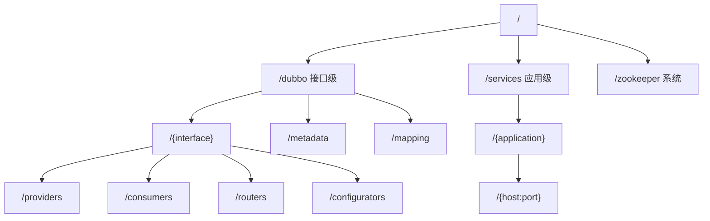

## 为什么 Dubbo 在 ZooKeeper 里不是“一个服务一个节点”？

第一次打开 Dubbo 使用的 ZooKeeper，常见反应是“节点怎么这么多”：

- 一个接口下面有 `providers`、`consumers`、`routers`、`configurators` 四个目录。
- 每个提供者地址是一长串 URL 编码后的字符串，肉眼几乎不可读。
- 除了 `/dubbo`，还有 `/services`、`/dubbo/metadata`、`/dubbo/mapping`。
- 同一个接口在不同分组下有多个提供者，节点名还不一样。

这些节点不是重复存储，而是分别回答不同问题：**谁提供了这个接口、谁在消费、路由和配置是什么、实例的元数据是什么、这个接口由哪些应用实现**。把它们合并在一个节点里，读取会简单，但订阅、变更通知和权限控制会变得非常笨重。

> ### 💡 新人小结：ZooKeeper 里的 Dubbo 像一座分层档案馆
>
> - 一楼按接口分房间（`/dubbo/{interface}`）。
> - 每个房间里再按用途分柜子（providers/consumers/routers/configurators）。
> - 另一栋楼按应用分房间（`/services/{app}`），只放入住实例。
> - 还有索引室（metadata/mapping）负责把接口翻译成应用。
>
> **节点多，是因为查询方式不止一种。**



---

## 先看全景：一棵真实的节点树

本地实验启动三个提供者和一个纯消费者后，`ls -R /` 的核心结果可以压缩成下面这样（省略了每个 URL 节点的完整内容）：

```text
/
/dubbo
/services
/zookeeper

/dubbo/com.xxx.xx.flow.api.FlowEngineService
/dubbo/com.xxx.xx.flow.api.FlowEventService
/dubbo/com.xxx.xx.productwarehouse.api.ProductWarehouseQueryService
/dubbo/com.xxx.xx.rawwarehouse.api.RawWarehouseQueryService
/dubbo/config
/dubbo/mapping
/dubbo/metadata

/dubbo/com.xxx.xx.flow.api.FlowEngineService/configurators
/dubbo/com.xxx.xx.flow.api.FlowEngineService/consumers
/dubbo/com.xxx.xx.flow.api.FlowEngineService/providers
/dubbo/com.xxx.xx.flow.api.FlowEngineService/routers
/dubbo/com.xxx.xx.flow.api.FlowEngineService/consumers/consumer%3A%2F%2F...
/dubbo/com.xxx.xx.flow.api.FlowEngineService/providers/dubbo%3A%2F%2F192.168.3.103%3A20880%2F...

/dubbo/mapping/com.xxx.xx.flow.api.FlowEngineService
/dubbo/mapping/com.xxx.xx.flow.api.FlowEventService
/dubbo/mapping/com.xxx.xx.productwarehouse.api.ProductWarehouseQueryService
/dubbo/mapping/com.xxx.xx.rawwarehouse.api.RawWarehouseQueryService

/dubbo/metadata/com.xxx.xx.flow.api.FlowEngineService/provider/xxx-flow-service
/dubbo/metadata/com.xxx.xx.flow.api.FlowEventService/RAW_WAREHOUSE/provider/xxx-raw-warehouse-service
/dubbo/metadata/com.xxx.xx.flow.api.FlowEventService/PRODUCT_WAREHOUSE/provider/xxx-product-warehouse-service
/dubbo/metadata/com.xxx.xx.rawwarehouse.api.RawWarehouseQueryService/consumer/xxx-portal

/services/xxx-flow-service
/services/xxx-product-warehouse-service
/services/xxx-raw-warehouse-service
/services/xxx-flow-service/192.168.3.103:20880
/services/xxx-product-warehouse-service/192.168.3.103:20882
/services/xxx-raw-warehouse-service/192.168.3.103:20881

/dubbo/config/DUBBO_SERVICEDISCOVERY_MIGRATION
/dubbo/config/dubbo
/zookeeper/config
/zookeeper/quota
```

这张树里有三个值得记住的事实：

| 事实 | 证据 | 含义 |
|------|------|------|
| 接口级与应用级同时存在 | `/dubbo` 和 `/services` 都有数据 | 默认 `register-mode=all` |
| `/services` 只有三个应用 | portal 不在其中 | 应用级只登记“可被调用的提供者实例” |
| 消费者节点只在 `/dubbo` 出现 | `FlowEngineService/consumers/...` | 接口级会登记消费者，应用级通常不登记 |

---

## 接口级注册：/dubbo 下到底有什么

接口级模型按“接口”组织数据。路径公式是：

```text
/dubbo/{URL 编码后的接口全名}/{category}/{URL 编码后的完整 URL}
```

其中 `category` 默认有四个：

| 类别 | 谁写入 | 内容 | 消费者用途 |
|------|--------|------|------------|
| `providers` | 提供者 | 完整的 `dubbo://` URL | 作为可调用地址 |
| `consumers` | 消费者 | 完整的 `consumer://` URL | 记录订阅关系，供治理与控制台使用 |
| `routers` | 治理端/应用 | 路由规则 URL | 条件路由、标签路由 |
| `configurators` | 治理端/应用 | 动态配置 URL | 超时、重试、权重等覆盖 |

### 一个真实的提供者 URL

把节点名做 URL 解码后，可以看到完整的提供者 URL：

```text
dubbo://192.168.3.103:20880/com.xxx.xx.flow.api.FlowEngineService
?application=xxx-flow-service
&deprecated=false
&dubbo=2.0.2
&dynamic=true
&generic=false
&interface=com.xxx.xx.flow.api.FlowEngineService
&methods=approve,get,reject,start
&prefer.serialization=fastjson2,hessian2
&release=3.2.20
&revision=1.0.0-SNAPSHOT
&service-name-mapping=true
&side=provider
&timeout=5000
&timestamp=1792940589288
```

这些参数不是装饰。消费者需要它们来构建 Invoker、选择协议、设置超时、判断分组和版本。几个关键参数：

| 参数 | 示例值 | 作用 |
|------|--------|------|
| `interface` | `com.xxx.xx.flow.api.FlowEngineService` | 目标接口 |
| `application` | `xxx-flow-service` | 提供者应用名，也是应用级发现的映射目标 |
| `group` | `RAW_WAREHOUSE` | 同一接口的多实现分组；没有分组时不出现 |
| `version` | `1.0.0` | 接口版本，与 group 一起参与匹配 |
| `methods` | `start,approve,...` | 暴露的方法列表 |
| `timeout` | `5000` | 提供者侧声明的超时参考值 |
| `side` | `provider` | 标识节点属于提供者 |
| `dynamic` | `true` | 是否动态节点，影响治理端能否自动删除 |
| `service-name-mapping` | `true` | 是否参与接口到应用的映射 |

### 一个真实的消费者 URL

`FlowEngineService/consumers` 下的节点解码后是：

```text
consumer://192.168.3.103/com.xxx.xx.flow.api.FlowEngineService
?application=xxx-portal
&category=consumers
&check=false
&interface=com.xxx.xx.flow.api.FlowEngineService
&methods=approve,get,reject,start
&pid=32136
&side=consumer
&timestamp=1792940611230
```

消费者 URL 记录的是“谁订阅了这个接口”，并不表示 portal 能提供该服务。它主要用于治理端展示依赖关系、计算消费者数量，以及某些动态配置的推送。

### 节点数据与临时属性

接口级的叶子 URL 节点是临时节点。对 `providers/{URL}` 执行 `stat`，可以看到：

```text
cZxid = 0x1b
ephemeralOwner = 0x100023158be0001
dataLength = 13
numChildren = 0
```

这里有两个容易误读的点：

- `ephemeralOwner` 非 0，说明叶子节点绑定会话；提供者正常注销或会话超时后会被删除。
- `dataLength = 13` 并不等于 URL 长度。完整地址在节点名里，节点数据本身很短；本机 `consumers` 类别节点的数据是注册者 IP（`192.168.3.103`，13 字节），`providers` 类别节点也观察到 13 字节的 `dataLength`。

**不要通过节点数据判断完整地址。** 完整信息在节点名里，必须做 URL 解码。

> ### 💡 新人小结：URL 节点像贴在门上的完整名片
>
> - 名字（节点名）上写满了地址、接口、参数。
> - 门牌里面（节点数据）只放了一张写着 IP 的小纸条。
> - 读取时要先看门牌，再决定要不要进屋。
>
> **接口级的关键信息在路径里，不在 `get` 的返回值里。**

---

## 应用级注册：/services 下为什么只有应用名和实例

应用级模型把粒度从“接口”提升到“应用”。路径是：

```text
/services/{application}/{host:port}
```

其中 `application` 是 Dubbo 应用名，`host:port` 是实例 ID。本地 `/services/xxx-flow-service/192.168.3.103:20880` 的数据是一个 JSON：

```json
{
  "name": "xxx-flow-service",
  "id": "192.168.3.103:20880",
  "address": "192.168.3.103",
  "port": 20880,
  "sslPort": null,
  "payload": {
    "@class": "org.apache.dubbo.registry.zookeeper.ZookeeperInstance",
    "id": "192.168.3.103:20880",
    "name": "xxx-flow-service",
    "metadata": {
      "dubbo.endpoints": "[{\"port\":20880,\"protocol\":\"dubbo\"}]",
      "dubbo.metadata-service.url-params": "{\"prefer.serialization\":\"fastjson2,hessian2\",\"timeout\":\"5000\",\"version\":\"1.0.0\",\"dubbo\":\"2.0.2\",\"release\":\"3.2.20\",\"side\":\"provider\",\"port\":\"20880\",\"protocol\":\"dubbo\"}",
      "dubbo.metadata.revision": "0381757806bb290147e21dbfa1b2fda1",
      "dubbo.metadata.storage-type": "local",
      "timestamp": "1792940589288"
    }
  },
  "registrationTimeUTC": 1792940590365,
  "serviceType": "DYNAMIC",
  "uriSpec": null
}
```

这个 JSON 是 Curator X Discovery 的 `ServiceInstance<ZookeeperInstance>` 序列化结果。几个字段的含义：

| 字段 | 含义 | 用途 |
|------|------|------|
| `name` | 应用名 | 消费者按应用订阅 |
| `id` | `host:port` | 实例唯一标识 |
| `address` / `port` | 实例地址与端口 | 构建调用地址 |
| `payload.metadata.dubbo.endpoints` | 协议与端口列表 | 支持多协议、多端口 |
| `payload.metadata.dubbo.metadata.revision` | 元数据版本 | 消费者据此取接口定义 |
| `payload.metadata.dubbo.metadata.storage-type` | 元数据存储方式 | `local` 表示存在 ZooKeeper 的 metadata 节点 |
| `serviceType` | `DYNAMIC` | 动态实例，区别于静态实例 |

应用级节点更精简，因为它不再为每个接口都写一份完整 URL。一个应用即使暴露十个接口，也只在这个应用名下列一个实例；接口级则需要十个接口目录各写一份。这就是应用级发现能显著降低注册数据量的原因。

### 应用级不登记消费者实例

portal 作为纯消费者，没有出现在 `/services` 下。这不是遗漏，而是模型设计：应用级发现以“提供者实例”为地址来源，消费者通过订阅获取实例列表，不需要反写自己的实例节点。接口级则会在 `consumers` 目录留下消费者 URL。

---

## 元数据与映射：/dubbo/metadata 与 /dubbo/mapping

接口级 URL 和实例 JSON 都只能承载一部分信息。方法的参数类型、返回类型、复杂对象结构，放在地址里会太大，于是 Dubbo 把它们放到元数据节点。

### /dubbo/metadata

本地 `FlowEngineService` 的提供者元数据路径是：

```text
/dubbo/metadata/com.xxx.xx.flow.api.FlowEngineService/provider/xxx-flow-service
```

节点数据是一段 JSON，包含：

```json
{
  "canonicalName": "com.xxx.xx.flow.api.FlowEngineService",
  "methods": [
    {
      "name": "start",
      "parameterTypes": ["java.lang.String", "java.lang.String", "java.lang.String"],
      "returnType": "com.xxx.xx.flow.api.FlowInstanceDTO"
    }
  ],
  "parameters": {
    "application": "xxx-flow-service",
    "side": "provider",
    "interface": "com.xxx.xx.flow.api.FlowEngineService",
    "timeout": "5000"
  },
  "types": []
}
```

实际数据还包含 `approve`、`reject`、`get` 等方法，以及 `FlowInstanceDTO`、`FlowStatus` 等类型定义。消费者用 `dubbo.metadata.revision` 找到对应版本，避免每次调用都传输完整的接口描述。

元数据节点是持久节点（`ephemeralOwner = 0x0`），即使提供者下线也可能保留。这解释了为什么提供者停止后，`/dubbo/metadata` 下仍能看到它的信息；它代表“曾经发布过的接口定义”，不是“实例仍在线”。

### /dubbo/mapping

映射节点记录“接口由哪些应用提供”。本地 `FlowEventService` 的映射数据是：

```text
/dubbo/mapping/com.xxx.xx.flow.api.FlowEventService
内容：xxx-raw-warehouse-service,xxx-product-warehouse-service
```

消费者在应用级发现时先读这个节点，得到应用名列表，再分别订阅 `/services/{app}`。这样即使接口和应用的对应关系变化，消费者也不需要重新认识所有应用。

映射数据有一个重要特性：**它可能比提供者活得更久**。本地实验里，RAW 提供者停止后，映射内容仍然包含 `xxx-raw-warehouse-service`。这不是错误，而是因为映射是持久索引，不做实时实例清理。消费者最终会订阅到空实例列表，因此不会调用到不存在的实例。

| 节点 | 数据类型 | 临时/持久 | 提供者下线后 |
|------|----------|-----------|----------------|
| `/dubbo/{interface}/providers/{URL}` | URL 字符串 | 临时 | 会话超时后删除 |
| `/dubbo/{interface}/consumers/{URL}` | URL 字符串 | 临时 | 消费者下线后删除 |
| `/services/{app}/{host:port}` | 实例 JSON | 临时 | 会话超时后删除 |
| `/dubbo/{interface}/providers` | 类别节点 | 持久 | 保留 |
| `/dubbo/metadata/...` | 元数据 JSON | 持久 | 保留 |
| `/dubbo/mapping/{interface}` | 应用名列表 | 持久 | 保留 |

---

## 三种 register-mode 的节点差异

`register-mode` 是理解“为什么树长得不一样”的关键。本地对同一个 RAW 提供者分别用三种模式启动，观察到的差异如下：

| 模式 | `/dubbo` 提供者 URL | `/services` 实例 | 元数据/映射 | 消费者调用 |
|------|----------------------|------------------|-------------|------------|
| `all` | 有 | 有 | 有 | 成功 |
| `instance` | 无 | 有 | 有 | 成功（走应用级） |
| `interface` | 有 | 无 | 有 | 成功（走接口级） |

配置方式：

```yaml
dubbo:
  registry:
    address: zookeeper://127.0.0.1:2181
    register-mode: instance
```

或者用启动参数覆盖：

```bash
java -Ddubbo.registry.address=zookeeper://127.0.0.1:2182 \
     -Ddubbo.registry.register-mode=instance \
     -jar xxx-raw-warehouse-service-1.0.0-SNAPSHOT.jar
```

三种模式的真实观察结果：

- `all`：`ls /services/xxx-raw-warehouse-service` 返回 `[192.168.3.103:20881]`，`ls /dubbo/.../providers` 也能看到 RAW 的 URL。
- `instance`：`/services` 下仍有实例，`/dubbo/.../providers` 只剩成品仓的 URL；RAW 的 metadata 和 mapping 仍在，说明元数据不随注册模式消失。
- `interface`：`/services` 下不再出现 RAW 的应用名，`/dubbo/.../providers` 重新出现 RAW 的 URL。

这三种模式都能被消费者成功调用，因为消费者默认 `all` 会同时准备两套发现路径；如果消费者被限制为单一模式，就必须保证提供者写了对应的数据。

---

## 怎么自己查看与解码

### 查看节点

```bash
# 看整棵树（输出可能较长）
printf 'ls -R /\nquit\n' | zkCli.cmd -server 127.0.0.1:2181

# 看某个接口的提供者子节点
printf 'ls /dubbo/com.foo.BarService/providers\nquit\n' | zkCli.cmd -server 127.0.0.1:2181

# 看节点数据与属性
printf 'get /services/xxx-flow-service/192.168.3.103:20880\nstat /services/xxx-flow-service/192.168.3.103:20880\nquit\n' | zkCli.cmd -server 127.0.0.1:2181
```

注意 `zkCli` 的 `ls` 与 `get` 语义不同：

| 命令 | 返回 | 用途 |
|------|------|------|
| `ls /path` | 子节点名列表 | 看有哪些实例/类别 |
| `get /path` | 节点数据 | 看实例 JSON、映射内容 |
| `stat /path` | 属性 | 看 `ephemeralOwner`、`dataLength`、版本 |
| `ls -R /path` | 递归子节点 | 快速了解整体结构 |

### 解码 URL 节点

节点名里的 `%3A`、`%2F`、`%3F` 等是 URL 编码，直接看很难读。可以用 Python 解码：

```python
import urllib.parse

name = "dubbo%3A%2F%2F192.168.3.103%3A20880%2Fcom.example.FooService%3Fapplication%3Ddemo"
print(urllib.parse.unquote(name))
```

输出：

```text
dubbo://192.168.3.103:20880/com.example.FooService?application=demo
```

ZooKeeper 的路径分隔符是 `/`，所以 Dubbo 必须把 URL 里的 `/` 编码成 `%2F`，否则一个 URL 会被拆成多层目录。这也意味着**不能直接对节点名做字符串截断**来判断接口名，必须先解码。

---

## 数据生命周期：哪些会消失，哪些会留下

| 数据 | 写入者 | 类型 | 何时消失 | 判断可用性时是否依赖 |
|------|--------|------|----------|----------------------|
| `/dubbo/{interface}/providers/{URL}` | 提供者 | 临时 | 正常注销或会话超时 | 是 |
| `/dubbo/{interface}/consumers/{URL}` | 消费者 | 临时 | 消费者注销或会话超时 | 否（仅表示订阅关系） |
| `/services/{app}/{host:port}` | 提供者 | 临时 | 正常注销或会话超时 | 是（应用级） |
| `/services/{app}` | Curator/客户端 | 持久 | 可能延迟清理 | 否，必须看子节点 |
| `/dubbo/metadata/...` | 提供者/消费者 | 持久 | 不随实例下线删除 | 否，用于构建调用 |
| `/dubbo/mapping/{interface}` | 提供者/MetadataReport | 持久 | 不随单个实例下线删除 | 否，需要结合实例列表 |
| `/dubbo/config/...` | 治理端 | 持久 | 由治理端删除 | 否 |

这张表可以直接回答几个常见疑问：

- **为什么提供者停了，`/dubbo/metadata` 还有数据？** 因为元数据是持久节点，记录接口定义，不是实例存活。
- **为什么 `/services/{app}` 还在，但没有实例？** 父节点可能尚未清理；要看 `ls /services/{app}` 是否为空。
- **为什么映射里还有已下线的应用？** 映射是应用名索引，不做实例级清理；消费者会以实例列表为准。
- **为什么 `consumers` 节点不能当健康检查？** 它只表示某个消费者订阅过，不代表消费者当前能正常工作。

> ### 💡 新人小结：ZooKeeper 里同时存着“现在”和“曾经”
>
> - 临时节点像今天的入住记录，退房后会消失。
> - 元数据和映射像历史档案，记录了曾经发布过什么。
> - 判断“现在有没有人”，要看出入住记录，不要看档案。
>
> **先分清节点是临时还是持久，再决定它能证明什么。**

---

## 要点总结

- 接口级数据在 `/dubbo`：`/{interface}/{category}/{URL}`，providers/consumers/routers/configurators 四类；完整地址在节点名里，需要 URL 解码。
- 应用级数据在 `/services`：`/{application}/{host:port}`，节点数据是实例 JSON，包含 endpoints 与 metadata revision；只登记提供者实例。
- 元数据在 `/dubbo/metadata`，映射在 `/dubbo/mapping`；两者是持久索引，可能比实例活得更久。
- 临时节点绑定会话，`ephemeralOwner` 非 0；持久节点 `ephemeralOwner` 为 0。
- `register-mode` 控制写哪套地址：`all` 双写、`instance` 只写 `/services`、`interface` 只写 `/dubbo`；3.2.20 默认 `all`。
- 查看时用 `ls` 看子节点、`get` 看数据、`stat` 看属性；判断实例可用性要看临时叶子节点，不要看持久父节点或映射。

读到这里，可以回到 [服务注册与发现全流程](/docs/06-dubbo-integration/注册与发现/registration-discovery-flow/) 对照时间线，或者进入 [Spring Boot 集成 ZooKeeper 与 Dubbo](/docs/06-dubbo-integration/集成实践/springboot-integration/) 自己跑一遍。
