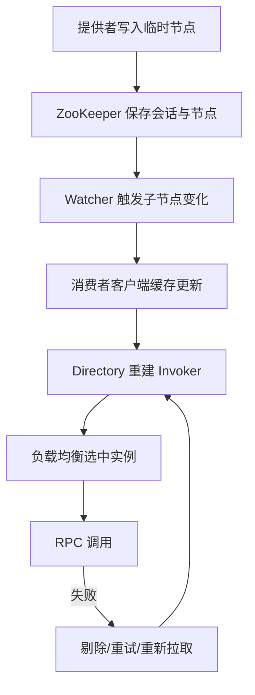
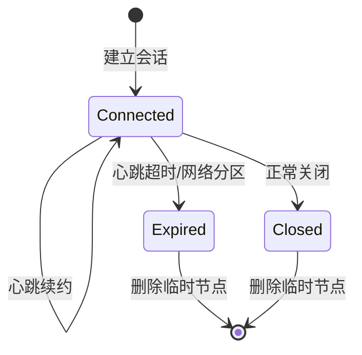

## 为什么“把地址写进 ZooKeeper”就能自动生效？

从表面看，Dubbo 的注册发现只做了一件事：提供者把地址写到 ZooKeeper，消费者从 ZooKeeper 读地址。但“写进去”和“自动生效”之间隔着四层机制：

1. **会话与临时节点**：让 ZooKeeper 知道实例还活着，并在失联后清理。
2. **Watcher 与客户端缓存**：让消费者知道地址变了，并持续监听。
3. **消费者本地目录**：把地址字符串转换成可调用的 Invoker。
4. **失败与重试**：在通知延迟、连接失败、注册中心抖动时保住调用。

只理解第一层，会以为“节点消失就立刻不可用”；只理解第三层，会以为“有地址就一定能调通”。把四层串起来，才能解释实际现象：节点还在但连接被拒、节点没了但调用仍成功、重启后自动恢复。

> ### 💡 新人小结：自动发现像快递柜的通知链
>
> - 快递员把包裹放进柜子（写地址），柜子系统记录状态（临时节点）。
> - 柜子给收件人发通知（Watcher），收件人刷新取件码（本地目录）。
> - 收件人没看到通知，包裹也不会消失；但取件码可能过期（缓存与超时）。
>
> **“写入”只是开始，通知、缓存和失败处理才决定最终效果。**



---

## 第一层：会话与临时节点，让“活着”有边界

ZooKeeper 客户端与服务端建立会话后，会周期性发送心跳。临时节点的生命周期绑定在这个会话上：

- 会话正常关闭，临时节点立即删除。
- 会话超时，服务端删除该会话创建的所有临时节点。
- 网络恢复后，客户端可能创建新会话，但旧会话的临时节点已经被清理。

本地 `stat` 输出可以直接看到这个绑定关系：

```text
cZxid = 0x3e
ctime = Sun Oct 25 23:03:10 CST 2026
mZxid = 0x3e
mtime = Sun Oct 25 23:03:10 CST 2026
pZxid = 0x3e
cversion = 0
dataVersion = 0
aclVersion = 0
ephemeralOwner = 0x100023158be0006
dataLength = 753
numChildren = 0
```

`ephemeralOwner` 不是 0，说明这是一个临时节点，值为创建它的会话 ID。持久节点的该字段是 `0x0`。同一个服务下，`/dubbo/{interface}/providers` 这种类别节点是持久的，叶子 URL 节点是临时的；应用级的 `/services/{app}/{host:port}` 也是临时的，而 `/services/{app}` 父节点可以是持久的。



### 会话超时不是“实时探针”

Dubbo 的默认会话超时是 60 秒（官方文档给出的默认值）。这意味着一个被强制杀死的进程，其临时节点可能继续存在接近一分钟。本地实验验证了这一点：

- 杀掉 RAW 提供者后，`/dubbo` 的提供者节点和 `/services` 的实例节点在约 20 秒时仍然存在。
- 此时调用会得到 `ConnectException: Connection refused`，因为消费者拿到的地址仍然有效，但端口已经没有进程监听。
- 约一分钟后节点消失，调用才变成 `No provider available from registry`。

这不是 ZooKeeper 的缺陷，而是租约模型的必然结果。**它保证“最终清理”，不保证“实时感知”。** 需要更快发现故障，应该在应用层做健康检查、在消费者侧做连接失败剔除和熔断，而不是无限调小会话超时（那会带来误判和频繁重连）。

> ### 💡 新人小结：会话像租房合同
>
> - 合同到期前，房东默认你还住着，即使你出差了。
> - 合同到期后，房东才会清理你的东西。
> - 合同不会每天派人去房间看你是否生病。
>
> **临时节点是租约，不是体检报告。**

---

## 第二层：Watcher 与 ServiceCache，让变化被看见

临时节点只负责“最终删除”，消费者还得知道“什么时候删了”。这由 Watcher 完成。

### 接口级：子节点监听

接口级实现会针对 `providers`、`consumers`、`routers`、`configurators` 分别注册子节点监听。子节点增删时，ZooKeeper 触发一次通知；客户端重新读取子节点列表，再重新注册监听。原生 Watcher 是一次性的，如果不重新注册，就只能收到第一次变化。

`ZookeeperRegistry` 在连接恢复时会重新拉取已订阅的地址，在新会话建立时会执行 `recover()`，重新注册 URL 和监听器。这保证了“网络短暂断开后，订阅关系不会永久丢失”。

### 应用级：Curator ServiceCache

应用级发现使用 Curator X Discovery 的 `ServiceCache`：

```java
ServiceCache<ZookeeperInstance> serviceCache =
        serviceDiscovery.serviceCacheBuilder().name(name).build();
ZookeeperServiceDiscoveryChangeWatcher watcher =
        new ZookeeperServiceDiscoveryChangeWatcher(this, serviceCache, name, latch);
serviceCache.addListener(watcher);
serviceCache.start();
```

`ServiceCache` 负责维护某个服务名下所有实例的本地视图，并在实例变化时通知监听器。Dubbo 把 `ServiceInstancesChangedListener` 注册进去，最终触发 `ServiceInstancesChangedEvent`，再由 `ServiceDiscoveryRegistryDirectory` 刷新地址。

本地日志中的这两行，就是通知链的落点：

```text
[DUBBO] Notify serviceKey: RAW_WAREHOUSE/com.xxx.xx.flow.api.FlowEventService:null,
listener: ServiceDiscoveryRegistryDirectory(...)
[DUBBO] Received invokers changed event from registry.
Registry type: instance. Service Key: RAW_WAREHOUSE/com.xxx.xx.flow.api.FlowEventService.
Urls Size : 1. Invokers Size : 1.
```

| 维度 | 接口级 Watcher | 应用级 ServiceCache |
|------|----------------|----------------------|
| 监听对象 | 每个接口类别下的子节点 | 每个应用名下的实例列表 |
| 原生机制 | ZooKeeper ChildListener | Curator ServiceCache |
| 重新注册 | 客户端负责 | ServiceCache 负责 |
| 通知内容 | 子节点列表变化 | 实例列表变化 |
| 消费者侧落点 | `RegistryDirectory` | `ServiceDiscoveryRegistryDirectory` |

> ### 💡 新人小结：Watcher 像门口的门铃
>
> - 有人按一次，门铃响一次，然后就不响了（一次性）。
> - 想持续知道有没有人，需要每次响完再按回去（重新注册）。
> - ServiceCache 相当于一个自动复位的门铃，省掉了手动重注册。
>
> **通知本身不携带完整状态，收到通知后必须重新读取。**

---

## 第三层：本地目录，让地址变成可调用对象

消费者从 ZooKeeper 拿到的是一串 URL 或实例 JSON。业务代码不能直接调用字符串，Dubbo 需要把它们转换成 `Invoker`：

1. `RegistryDirectory` 或 `ServiceDiscoveryRegistryDirectory` 接收地址列表。
2. 根据协议、接口、分组、版本等参数创建 `Invoker`。
3. 通过 Router 过滤不可用或不符合条件的地址。
4. 通过 LoadBalance 选择最终实例。
5. Cluster 负责失败重试、失败转移等容错策略。

这一层的关键是**本地化**：地址一旦进入 Directory，后续调用不再每次都访问 ZooKeeper。ZooKeeper 只负责“把地址送过来”，Directory 负责“把地址维护好”。

本地实验里，消费者在提供者已经死亡、但节点尚未删除时，仍然会尝试连接旧地址：

```text
[DUBBO] The invoker DefaultServiceInstance{serviceName='xxx-raw-warehouse-service',
host='192.168.3.103', port=20881, ...} has been added to invalidate list
due to connectivity problem. Will trying to reconnect to it in the background.
```

这说明消费者有“连接失败后标记不可用”的本地保护，但这个保护发生在**尝试连接之后**，不是提前预知。它不能替代注册中心的失效通知，只能缩短故障窗口。

`check=false` 又是另一层：它让引用在创建时不校验提供者是否存在，从而避免“提供者晚启动导致消费者启动失败”。代价是错误会延迟到调用期，表现为 `No provider available` 或连接异常。

---

## 第四层：失败与恢复，让抖动不致命

真实系统里，ZooKeeper 会抖动，网络会断，提供者会重启。Dubbo 在客户端做了几层兜底：

| 机制 | 作用 | 触发条件 | 代价 |
|------|------|----------|------|
| Failback 重试 | 注册/订阅失败后后台重试 | 注册中心暂时不可用 | 延迟恢复，可能重复注册 |
| 连接恢复回调 | 重新拉取地址、重新订阅 | 会话重连 | 短时间地址列表可能为空 |
| 本地文件缓存 | 注册中心不可用时读取上次地址 | 启动或刷新失败 | 地址可能过期 |
| 连接失败剔除 | 把不可用实例标记为无效 | 调用连接失败 | 需要额外重试或下次刷新 |
| 服务端健康检查 | 应用层探活 | 业务自定义 | 需要额外实现 |

`FailbackRegistry` 用时间轮维护失败任务；`AbstractRegistry` 会把已注册/已订阅的 URL 保存到本地文件，在注册中心不可用时提供备份。它们共同保证“短暂故障不至于让整个调用链崩溃”，但也带来一个新的问题：**本地缓存可能是旧的**。

本地实验的恢复过程可以说明这一点：

1. 提供者恢复后重新注册。
2. 消费者收到实例变更通知，刷新 Directory。
3. 下一次调用恢复成功。

如果消费者没有收到通知，它可能仍在用旧列表；但连接失败会触发剔除和重连，最终回到新列表。这套机制不是“强一致实时”，而是“**最终收敛 + 失败驱动**”。

---

## 这套机制的四个边界

| 边界 | 会发生什么 | 应对 |
|------|------------|------|
| 会话超时延迟 | 崩溃实例的地址继续存在，调用可能被拒绝 | 应用层健康检查、连接失败剔除、合理设置超时 |
| 通知丢失或延迟 | 消费者短时间使用旧地址 | 依赖 ServiceCache/重连恢复，监控地址刷新延迟 |
| 本地缓存过期 | 注册中心不可用时使用了旧地址 | 设置缓存过期策略，避免长期无刷新 |
| 注册中心失去多数派 | 新注册、变更失败 | 保证 ZK 奇数节点与跨故障域，监控 quorum |
| 健康语义缺失 | 进程活着但业务不可用，节点仍存在 | 业务探活、熔断、超时与重试策略 |

还有一个常被忽略的边界：**惊群与重试风暴**。当大量消费者同时收到某个提供者下线通知，或同时发现连接失败，可能会在同一时间重建连接、重新拉取元数据。合理的超时、退避和连接池配置比“把重试次数调大”更重要。

如果想验证本地缓存是否在起作用，可以在一次成功调用后观察消费者目录的 Invoker 数量，再对比 ZooKeeper 中的实际节点数。两者短时间不一致是正常的：目录刷新有延迟，连接失败剔除也需要触发条件。排查时应该把“注册数据”“消费者缓存”“实际连接”当成三个独立视图，而不是假设它们时刻一致。

> ### 💡 新人小结：自动恢复像电梯的备用电源
>
> - 停电时备用电源能撑一会，但不代表电梯能无限运行。
> - 备用电源切换需要时间，期间仍可能停顿。
> - 真正重要的是知道切换时间、能撑多久、什么时候必须人工介入。
>
> **高可用不是“永不失败”，而是“失败后能收敛”。**

---

## 把原理落到排查顺序

遇到“服务调用不到”时，可以按下面的顺序排查，避免一上来就重启 ZooKeeper：

1. **查提供者进程与端口**：`netstat` 看 20880 是否监听；`curl` 或 `telnet` 看能否建立连接。
2. **查提供者节点**：在 zkCli 中 `ls /dubbo/{interface}/providers`，确认 URL 节点是否存在。
3. **查应用级实例**：`ls /services/{app}`，确认实例子节点是否存在，而不是只看父节点。
4. **查消费者日志**：搜索 `Notify`、`Received invokers changed`、`invalidate`、`No provider`，判断是没订阅到还是连接失败。
5. **查网络与会话**：ZooKeeper 的 `srvr` 看模式与连接数，客户端日志看会话是否过期。
6. **查超时与重试**：`timeout` 是否小于提供者处理时间；`retries` 是否把非幂等操作重复执行。

可以直接使用的查看命令：

```bash
# 看提供者节点（把接口名替换成实际接口）
printf 'ls /dubbo/com.foo.BarService/providers\nquit\n' | zkCli.cmd -server 127.0.0.1:2181

# 看应用实例
printf 'ls /services/xxx-raw-warehouse-service\nquit\n' | zkCli.cmd -server 127.0.0.1:2181

# 看临时节点与会话绑定
printf 'stat /services/xxx-raw-warehouse-service/192.168.3.103:20881\nquit\n' | zkCli.cmd -server 127.0.0.1:2181
```

如果第 1 步就发现端口没监听，不必继续查 ZooKeeper；如果第 2、3 步有节点但第 1 步连接失败，问题在进程或网络，不在注册数据；如果节点为空，再回头查提供者是否启动、注册地址是否一致、`register-mode` 是否写到了你正在看的那棵树。

---

## 要点总结

- 临时节点把实例生命周期绑定到 ZooKeeper 会话，负责最终清理，不负责实时健康判断。
- Watcher 是一次性的，接口级靠客户端重注册，应用级靠 Curator `ServiceCache` 维护持续监听。
- 地址进入消费者后会变成 Directory 中的 Invoker，后续调用不再实时访问 ZooKeeper。
- Failback 重试、本地缓存、连接失败剔除共同提供最终收敛能力，但本地缓存可能过期。
- 会话超时、通知延迟、缓存过期、多数派丢失和健康语义缺失是这套机制的五个边界。
- 排查时先分清“没有地址”“地址过期”“有地址但连不上”，再决定查注册中心、网络还是应用。

下一步可以读 [Dubbo 在 ZooKeeper 中读写什么](/docs/06-dubbo-integration/注册与发现/data-in-zookeeper/)，把本文提到的会话、临时节点和元数据落到具体路径与数据格式；也可以回到 [服务注册与发现全流程](/docs/06-dubbo-integration/注册与发现/registration-discovery-flow/)，对照真实时间线复盘一次上下线。
