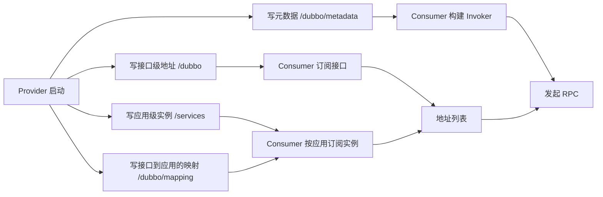
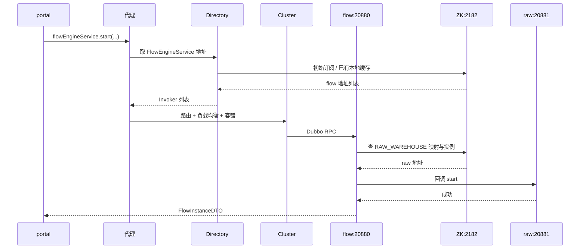

## 为什么一条服务上线要写这么多节点？

把一个 Dubbo 提供者启动起来，ZooKeeper 里通常会多出不止一个节点：

- 接口级：`/dubbo/{接口}/providers` 下出现一个 URL 节点。
- 应用级：`/services/{应用名}/{host:port}` 下出现一个实例节点。
- 元数据：`/dubbo/metadata/...` 下记录接口方法、参数类型、返回类型。
- 映射：`/dubbo/mapping/{接口}` 下记录“这个接口由哪些应用提供”。

初学者容易把这些节点当成“框架顺手写的冗余数据”，但它们各自解决不同问题：**地址用于找到实例，元数据用于构建调用，映射用于把接口翻译成应用**。少任何一类，消费者都可能拿不到完整信息。

> ### 💡 新人小结：开店不是一个动作，而是一串登记
>
> - 先去工商登记（地址注册），再去物业备案（实例注册）。
> - 门口贴上营业范围（元数据），前台记下“这个品牌在哪几栋楼”（映射）。
> - 顾客问前台时，前台才能把“品牌”翻译成“具体楼层”。
>
> **节点多不是重复，而是不同视角的索引。**



---

## 参与者与前置条件

本次流程的证据来自本地可运行工程，ZooKeeper 使用独立临时实例，没有接触本机已有数据。

| 组件 | 应用名 | 角色 | 地址 | 说明 |
|------|--------|------|------|------|
| ZooKeeper | 无 | Registry | `127.0.0.1:2182` | standalone，独立 `dataDir`，实验后停止并清理 |
| 原料仓 | `xxx-raw-warehouse-service` | Provider | `192.168.3.103:20881` | 暴露查询接口和分组 `RAW_WAREHOUSE` 的回调接口 |
| 成品仓 | `xxx-product-warehouse-service` | Provider | `192.168.3.103:20882` | 暴露查询接口和分组 `PRODUCT_WAREHOUSE` 的回调接口 |
| 流程服务 | `xxx-flow-service` | Provider + Consumer | `192.168.3.103:20880` | 暴露 `FlowEngineService`，运行期动态引用仓库回调 |
| 门户 | `xxx-portal` | Consumer | `127.0.0.1:18080` | 静态引用流程与仓库查询接口 |

所有进程都通过启动参数把注册地址覆盖为 2182：

```bash
java -Ddubbo.registry.address=zookeeper://127.0.0.1:2182 \
  -jar xxx-raw-warehouse-service-1.0.0-SNAPSHOT.jar
```

没有额外设置 `register-mode`，所以使用 Dubbo 3.2.20 普通注册中心的默认值 `all`。这意味着后面会同时看到接口级和应用级两套数据。

---

## 提供者启动：先开端口，再写地址

提供者的启动不是“启动 Spring 就完事”，而是先暴露本地协议端口，再向注册中心写地址。顺序很重要：如果端口没开就写地址，消费者会拿到一个连不上的目标；如果地址没写成功，端口开着也不会有人知道。

真实日志按时间顺序摘录如下：

```text
23:02:31.930 [DUBBO] Start registering instance address to registry.
23:02:31.943 [DUBBO] Registered dubbo service com.xxx.xx.rawwarehouse.api.RawWarehouseQueryService ... to registry service-discovery-registry://127.0.0.1:2182/...
23:02:31.949 [DUBBO] Registered dubbo service RAW_WAREHOUSE/com.xxx.xx.flow.api.FlowEventService ... to registry zookeeper://127.0.0.1:2182/...
23:02:31.961 [DUBBO] metadata revision changed: null -> 74f4ec4ed1eaa74e7d6cf3d7fbd4389c, app: xxx-raw-warehouse-service, services: 2
23:02:32.179 Started RawWarehouseApplication in 3.185 seconds
```

这段日志包含四个关键点：

| 时间点 | 动作 | 含义 |
|--------|------|------|
| 31.930 | 开始注册实例地址 | 应用级发现开始工作 |
| 31.943 | 注册到 `service-discovery-registry` | 写 `/services` 实例节点 |
| 31.949 | 注册到 `zookeeper` | 写 `/dubbo` 接口级提供者节点 |
| 31.961 | 元数据 revision 变化 | 接口方法、类型等信息已生成 |
| 32.179 | Spring Boot 启动完成 | 此时对外服务已可用 |

接口级注册的源码动作很直接：

```java
// ZookeeperRegistry#doRegister
zkClient.create(toUrlPath(url), url.getParameter(DYNAMIC_KEY, true), true);

// toUrlPath = /dubbo/{interface}/{category}/{URL.encode(url.toFullString())}
```

第三个参数 `true` 表示创建临时节点。也就是说，提供者节点绑定在 ZooKeeper 会话上，进程正常注销会删除它，进程崩溃则要等会话超时。

注册完成后，ZooKeeper 的顶层结构从空变成：

```text
/
/dubbo
/services
/zookeeper
```

`/services` 下出现了 `xxx-raw-warehouse-service`，`/dubbo` 下出现了 `RawWarehouseQueryService` 和 `FlowEventService` 两个接口目录。注意，`FlowEventService` 在 `/dubbo` 下只有一个接口目录，但两个提供者分别以不同 group 出现在它的 `providers` 子节点里，这是 Dubbo 用 URL 参数区分多实现的常见方式。

> ### 💡 新人小结：先开门，再挂牌
>
> - 门没开就挂牌，顾客来了会扑空（地址有了但端口没监听）。
> - 牌没挂，门开着也没人知道（端口可用但没有注册）。
> - 只有两件事都完成，服务才算真正“上线”。
>
> **“启动成功”与“可被发现”是两个独立的检查项。**

---

## 消费者启动：订阅不是查一次

消费者启动时最容易产生的误解是：“启动时查一次地址，之后就用这份列表。”实际并非如此。Dubbo 的订阅是持续的：先拿初始列表，再注册监听，后续地址变化会推送到消费者本地。

### 接口级订阅

接口级订阅会关注多个类别：

```text
/dubbo/{interface}/providers
/dubbo/{interface}/consumers
/dubbo/{interface}/routers
/dubbo/{interface}/configurators
```

提供者地址来自 `providers`，消费者自身会写 `consumers`，路由和动态配置分别来自 `routers` 与 `configurators`。`ZookeeperRegistry#doSubscribe` 对每个类别都注册子节点监听，初次读取后立即通知一次，然后由 Watcher 持续触发。

### 应用级订阅

应用级订阅不是直接盯着接口路径，而是先解决“这个接口由哪些应用提供”：

1. 读取 `/dubbo/mapping/{interface}`，得到应用名集合。
2. 对每个应用订阅 `/services/{app}` 的实例列表。
3. 从实例元数据中取出 `dubbo.metadata.revision`。
4. 根据 revision 获取接口元数据，构建可调用的 URL 与 Invoker。

本地第一次发起流程调用时，flow-service 才真正创建对 RAW 仓库的动态引用。日志里能看到订阅和通知：

```text
23:04:09.930 [DUBBO] Notify serviceKey: RAW_WAREHOUSE/com.xxx.xx.flow.api.FlowEventService:null,
listener: ServiceDiscoveryRegistryDirectory(...)-Directory(invokers: 1[192.168.3.103:20881], ...)
23:04:09.931 [DUBBO] Received invokers changed event from registry.
Registry type: instance. Service Key: RAW_WAREHOUSE/com.xxx.xx.flow.api.FlowEventService.
Urls Size : 1. Invokers Size : 1.
```

这两行说明：应用级发现最终仍然要落到“地址列表 → Invoker”这一步，和接口级没有本质区别，只是地址来源从接口节点变成了应用实例。

| 动作 | 接口级 | 应用级 |
|------|--------|--------|
| 找接口对应的应用 | 不需要 | 读 `/dubbo/mapping/{interface}` |
| 读地址 | `/dubbo/{interface}/providers` | `/services/{app}` 的实例列表 |
| 读元数据 | URL 参数 + `/dubbo/metadata` | 实例 metadata 中的 revision → metadata |
| 监听变化 | 子节点 Watcher | Curator `ServiceCache` |
| 消费者是否写节点 | 写 `/consumers` | 通常不写实例节点 |

> ### 💡 新人小结：订阅像关注公众号，不是下载一篇文章
>
> - 关注之后，新文章会推给你，而不是每次手动搜索。
> - 取关之前，列表会一直保持更新。
> - 推送可能延迟，也可能漏一条，所以还要能主动刷新。
>
> **“订阅”意味着持续关系，不是一次性查询。**

---

## 调用发生时：地址列表如何变成一次 RPC

消费者拿到地址后，并不会直接把 URL 交给业务代码。中间还要经过 Directory、Router、LoadBalance 和 Cluster：



真实调用：

```bash
curl -s -X POST http://127.0.0.1:18080/api/flows \
  -H "Content-Type: application/json" \
  -d '{"starter":"alice","businessId":"b-1001","businessType":"RAW_WAREHOUSE"}'
```

返回：

```json
{"flowInstanceId":"FI000001","businessType":"RAW_WAREHOUSE","businessId":"b-1001","status":"RUNNING","starter":"alice","approver":null,"dispatchResult":"start:OK","createdAt":1792940649674,"updatedAt":1792940649960}
```

这一次调用实际上发生了两次“发现”：

- portal 发现 flow-service 的地址。
- flow-service 发现 RAW 仓库的地址。

第二次发现是运行期动态引用触发的：flow-service 启动时并不知道 RAW 仓库的存在，直到收到 `businessType=RAW_WAREHOUSE`，才按 group 构造引用并订阅。这也是为什么第一次调用会比后续调用多一些初始化动作。

---

## 提供者下线：三种“消失”速度

提供者从注册中心消失的速度，取决于它怎么“死”。

| 下线方式 | 节点删除时机 | 消费者感知 | 典型现象 |
|----------|----------------|------------|----------|
| 正常注销（Spring 关闭、调用 `unregister`） | 立即删除 | 很快收到通知 | 地址列表减少，新调用不再选它 |
| 进程崩溃、`kill -9` | 会话超时后删除 | 先经历一段旧地址窗口 | 连接失败，随后地址被剔除 |
| 网络分区 | 会话超时后删除 | 取决于分区方向 | 双方可能都认为对方失联 |

本地实验用的是强制终止进程。时间线如下：

| 时间 | 事件 | 结果 |
|------|------|------|
| 停止 RAW 进程后立即调用 | 节点仍在，消费者仍拿到旧地址 | `ConnectException: Connection refused` |
| 停止后约 20 秒查看 | `/dubbo` 提供者节点与 `/services` 实例节点都还在，`ephemeralOwner` 非 0 | 会话尚未过期，旧地址仍可见 |
| 停止后约 1 分钟再调用 | 提供者节点已消失，`/services/{app}` 只剩空父节点 | `No provider available from registry` |
| 重新启动 RAW | 节点重新出现 | 下一次调用恢复 `start:OK` |

两个错误信息的含义不同，不能混为一谈：

```text
ConnectException: Connection refused
```

说明消费者**已经拿到地址并尝试连接**，但目标端口没有进程监听。这通常发生在“节点还没删、进程已经死”的窗口。

```text
RpcException: No provider available from registry ...
```

说明消费者**没有可用地址**，连连接都没发起。这通常发生在节点已删除、或本地 Directory 已刷新之后。

> ### 💡 新人小结：地址消失和进程死亡不是同一时刻
>
> - 进程死亡是“瞬间”的，注册中心感知是“延迟”的。
> - 延迟窗口里，消费者会拿到一个看似有效、实际连不上的地址。
> - 所以“有节点”不等于“能调用”，“没节点”也不等于“刚刚才挂”。
>
> **看到 `Connection refused` 先查目标端口，看到 `No provider` 再查注册数据。**

---

## 重新上线：恢复是重新注册

提供者重启后，注册中心不会“记住”它，而是把它当成一个新实例重新注册。本地实验里，RAW 重启完成后，ZooKeeper 中重新出现实例节点，portal 的下一次调用恢复成功：

```json
{"flowInstanceId":"FI000004","businessType":"RAW_WAREHOUSE","businessId":"b-1004","status":"RUNNING","starter":"dave","approver":null,"dispatchResult":"start:OK","createdAt":1792940755508,"updatedAt":1792940755563}
```

恢复过程中，消费者侧会经历：

1. 收到新的实例变更事件。
2. 拉取新实例的元数据 revision。
3. 用元数据构建新的 Invoker。
4. 把新 Invoker 加入 Directory。
5. 下一次调用时，负载均衡可能选中新实例。

这里没有“回滚”或“恢复旧连接”的概念。旧连接已经断开，旧节点已经删除；恢复的本质是**重新注册、重新订阅、重新构建地址列表**。

---

## 三个容易看错的细节

### 细节一：`/services` 下没有消费者

portal 是纯消费者，它不会出现在 `/services` 下。`/services` 记录的是“可被调用的应用实例”，不是“所有注册过的客户端”。消费者在接口级会留下 `consumers` 节点，但在应用级通常不会写实例节点。

### 细节二：映射数据可能比提供者活得更久

本地实验里，RAW 提供者已经下线，`/dubbo/mapping/com.xxx.xx.flow.api.FlowEventService` 的数据仍然是：

```text
xxx-raw-warehouse-service,xxx-product-warehouse-service
```

映射是“接口由哪些应用提供过”的持久记录，不会因为某个应用暂时没有实例就立刻删除。它只是索引，不是存活证明。消费者最终仍要以 `/services/{app}` 下是否有实例为准。

### 细节三：服务名节点可能短暂为空

实例节点消失后，`/services/{app}` 这个父节点可能还会存在一段时间，表现为“服务名还在，但下面没有实例”。随后它也可能被清理。判断服务是否可用时，应该看**实例子节点**，而不是父节点是否存在。

---

## 要点总结

- 提供者启动分两步：先暴露本地 Dubbo 端口，再向注册中心写接口级和应用级地址，同时写元数据与映射。
- 消费者的订阅是持续的：接口级监听 providers/consumers/routers/configurators，应用级通过 mapping 找到应用，再订阅实例列表与元数据。
- 一次业务调用可能触发多次发现；动态引用会在运行期首次使用时才建立订阅。
- 提供者正常注销会立即删节点；崩溃则要等会话超时，期间消费者可能先遇到 `Connection refused`，之后才变成 `No provider available`。
- 重启不是恢复旧节点，而是重新注册、重新订阅、重新构建 Invoker。
- `/services` 只记录提供者实例，映射数据可能长期保留，服务名父节点也可能短暂为空；判断可用性要看实例子节点。

如果想继续追问“为什么临时节点和 Watcher 能让这一切自动发生”，请读 [注册发现为什么能生效](/docs/06-dubbo-integration/注册与发现/discovery-principle/)；如果想直接查看节点内容和编码规则，请读 [Dubbo 在 ZooKeeper 中读写什么](/docs/06-dubbo-integration/注册与发现/data-in-zookeeper/)。
