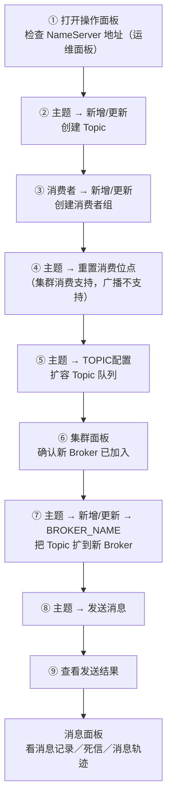
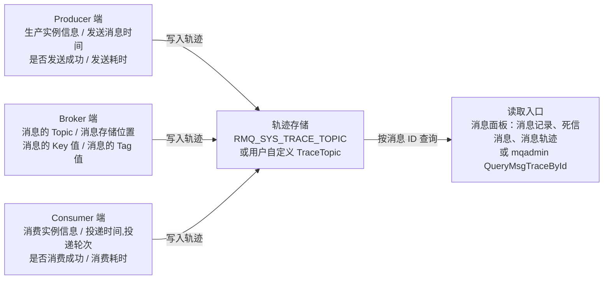

## 为什么需要控制台、消息轨迹与指标监控？（痛点引入）

「消息到底丢没丢」是消息队列运维里最贵的一句话。没有观测手段时，这句话只能靠吵：

1. **业务方说消息丢了，你手里没有任何链路证据。** 一条消息从生产者发出、经服务端存储、到消费者接收处理，中间经过 Producer、Broker、Consumer 三类节点——上游《消息轨迹》原文正是按这三端逐列给出「轨迹数据关键属性」的（见本文 3.1 表）。没有消息轨迹这份链路记录，你连「发成功了没有」都要靠猜。
2. **消费变慢，说不清是客户端还是服务端。** 上游明确区分「消息从拉取到被消费的时间」（`rocketmq_client_consume_rt`）与「客户端拉取消息的时间」（`rocketmq_client_consumer_pull_rt`）；没有这两类指标，只能看到「用户说慢」。
3. **堆积是假堆积还是真堆积？** 上游把堆积拆成「消费组消息堆积消息数」（`rocketmq_group_diff`）、「重试队列堆积」（`rocketmq_group_retrydiff`）、「死信队列堆积」（`rocketmq_group_dlqdiff`）三个口径，还有一个「已就绪消息的排队时间」与「消费处理滞后时间」两个时间口径。只盯一个数字会误判。
4. **日常运维全靠背命令。** 上游对 Dashboard 的定位是：为用户提供客户端和应用程序的各种事件、性能的统计信息，**支持以可视化工具代替 Topic 配置、Broker 管理等命令行操作**。

| 维度 | 没有轨迹与指标时的痛苦 | 有了 Dashboard / 轨迹 / Metrics 之后 |
|------|------------------------|--------------------------------------|
| 定责 | 「我发了」「我没收到」各执一词 | 轨迹里有生产实例信息、发送是否成功、发送耗时、投递时间与轮次、消费是否成功、消费耗时 |
| 定位层次 | 只能整体重启大法 | 服务端指标、生产端指标、消费端指标三族分开看 |
| 日常操作 | 记 mqadmin 参数、拼命令行 | 面板化：主题、消费者、消息、集群、驾驶舱、运维六个面板 |
| 趋势观察 | 单次抓包式排障 | Prometheus 抓取 + Grafana 看趋势（上游建议：为达到更好的可视化效果、观察指标值变化趋势，prometheus 搭配 grafana） |
| 版本适配 | 把 4.x exporter 与 5.x 原生 Metrics 混成一套 | 两套指标体系分别对待，见本文对照表 |

> ### 💡 新人小结：物流详情、行车记录仪和体检报告
>
> 把可观测性想成寄快递：
> - **Dashboard（控制台）** = 快递公司的官网后台：建单、查件、改地址都不用打客服电话——对应上游「以可视化工具代替命令行操作」。
> - **消息轨迹** = 单个包裹的物流详情：谁寄的、几点揽收、经过几个中转、几点送达、签收人是谁——对应上游「消息轨迹数据关键属性」表的三列（Producer 端 / Consumer 端 / Broker 端）。
> - **Metrics 指标** = 体检报告上的数字：不告诉你某一个人发生了什么，只告诉你「这一小时心跳多少、堆积多少、耗时分布如何」——对应 `rocketmq_group_diff`、`rocketmq_send_cost_time` 这类指标名。
> - **Exporter** = 把体温计读数抄给医院系统的记录员：它自己不产生数据，只把 Broker 里的数搬给 Prometheus。
>
> **三者分工不同：控制台管操作，轨迹管单条消息的故事，指标管整体的趋势。**

**学习路线图**

```text
Dashboard 部署 → 9 步操作流程 → 消息轨迹采集 → 轨迹字段与读法 → Exporter 接入 → 87 个指标 → 5.0 原生 Metrics → 告警口径
docker/源码      建 Topic/组/     traceTopicEnable  mqadmin 查轨迹     application.yml  三族清单     指标族与场景   只能基于上游指标名
                位点/扩容/发消息
```

本文只覆盖**控制台部署与操作、消息轨迹、Exporter 与 Metrics**。范围外事项：mqadmin 的完整参数与命令集在〈mqadmin命令参考-主题集群与Broker〉与〈mqadmin命令参考-消息消费与连接〉，本文只在需要时指向它们；参数默认值全量在〈客户端与服务端参数配置〉；死信与重试队列的产生机制在〈消费重试与死信队列〉。

---

## 先对齐术语（术语表）

| 术语 | 全称 | 通俗含义（用自己的话） | 在本文中的角色 |
|------|------|------------------------|----------------|
| Dashboard | RocketMQ Dashboard | 官方控制台，网页版运维台 | 本文第一大块，9 张截图按操作流程排布 |
| namesrvAddr | NameServer 地址 | 控制台去哪个登记处查路由 | Dashboard 启动参数 `--rocketmq.config.namesrvAddr`、docker 的 `rocketmq.namesrv.addr` |
| VIPChannel | VIP 通道 | 上游运维面板里的一个可选开关 | 面板「运维」项列出的两项能力之一 |
| 消息轨迹 | Message Trace | 一条消息从发出到被消费的全链路记录 | 本文第二大块 |
| traceTopicEnable | 轨迹开关（Broker 侧） | Broker 配置文件里的布尔开关，为 true 才支持轨迹特性 | 系统级 TraceTopic 自动创建的前提 |
| RMQ_SYS_TRACE_TOPIC | 系统级轨迹主题 | 默认存放轨迹数据的系统 Topic，Broker 启动时自动创建 | 轨迹数据落哪儿的第一种答案 |
| enableMsgTrace | 客户端轨迹开关 | 构造函数里传的布尔参数，控制这条链路是否上报轨迹 | 客户端实践的核心开关 |
| customizedTraceTopic | 自定义轨迹主题 | 把轨迹写进用户自己建普通 Topic 的那个参数 | 轨迹数据落哪儿的第二种答案 |
| ProducerGroup | 生产者分组 | 上游轨迹输出表头里的生产者组字段 | 读轨迹时的一列 |
| CostTimes | 耗时 | 轨迹表头里的耗时列（上游样例为 131ms） | 判断发送慢不慢的直接证据 |
| Exporter | 导出器（rocketmq-exporter） | 把 RocketMQ 内部指标翻译成 Prometheus 格式的那个进程 | 本文第三大块 |
| Prometheus | 开源监控与告警系统 | 按周期去抓 `/metrics` 的那个服务端 | exporter 的下游 |
| Grafana | 可视化面板 | 把抓到的指标画成曲线趋势的工具 | 上游建议的搭配 |
| PromQL | Prometheus Query Language | Prometheus 里查询与计算指标的表达式语言 | 告警口径要靠它写表达式（本文只给指标名，不编阈值） |
| 阈值 | Threshold | 触发告警的那条线 | 上游未给出任何告警阈值，本文一律标注为需按业务基线设定 |
| Metric | 指标实体类 | `org.apache.rocketmq.exporter.model.metrics` 包下的 14 个实体类，作为 cache 的 key | 理解 87 个指标怎么组织 |
| MetricFamilySamples | mfs | exporter 引入的 Prometheus client 包规定的「一组同类样本」结构 | Prometheus 拉取过程的数据形态 |
| cache | 带过期的缓存 | 取代旧版 concurrentHashMap 的结构，可过期删除 | 上游用它解释历史内存溢出问题 |
| label | 标签 | 指标上的维度标签，如 group、topic、msgModel | 指标行的实际区分方式，也是 PromQL 聚合依据 |
| Counter | 计数器 | 只增不减的指标类型 | 5.0 原生 Metrics 的三种类型之一 |
| Gauge | 瞬时值 | 可增可减的指标类型 | 5.0 原生 Metrics 的三种类型之一 |
| Histogram | 直方图 | 按区间统计分布的指标类型（le_1_ms 这类桶） | 耗时类指标的实现方式 |
| le_* | less than or equal | Histogram 的桶边界，如 le_1_kb、le_100_ms | 5.0 指标的分布区间清单 |
| OTLP | OpenTelemetry Protocol | 5.0 metrics 的一种导出协议（gRPC OTLP exporter） | 5.0 获取指标的两种方式之一 |
| Pull 模式 | 拉取模式 | 由 Prometheus 主动来抓，5.0 Prometheus exporter 仅支持这一种 | 与 OTLP 周期性主动上报相对 |
| Cumulative 聚合 | 累积聚合 | 5.0 Prometheus exporter 支持的聚合方式 | 上游明确的两项限制之一 |
| DLQ / Retry | 死信队列／重试队列 | 消费失败重投与最终不再投递的两类落点 | `rocketmq_group_dlqdiff`、`rocketmq_send_back_nums` 等指标的语义来源 |
| TPS / QPS | 每秒事务数／每秒查询数 | 速率口径 | broker 级与 topic 级速率指标名后缀 |
| RT | Response Time | 单请求耗时 | `rocketmq_brokeruntime_putmessage_entire_time_max` 这类指标的解释口径 |
| ACL | Access Control List，访问控制列表 | 集群鉴权；exporter 需配 ak/sk 才能取数 | `rocketmq.config.enableACL` 配置项 |
| cron | 定时表达式 | exporter 拉取指标的周期表达式 `15 0/1 * * * ?` | 决定指标新鲜度，也是阈值设置的时间粒度 |

---

## 第一层：RocketMQ Dashboard 是什么，怎么起

上游对 Dashboard 的定位一句话：`RocketMQ Dashboard` 是 RocketMQ 的管控利器，为用户提供客户端和应用程序的各种事件、性能的统计信息，支持以可视化工具代替 Topic 配置、Broker 管理等命令行操作。

功能概览（上游表 6 行逐行保留，4.x 与 5.0 两版该表内容一致）：

| 面板 | 功能 |
|------|------|
| 运维 | 修改 nameserver 地址；选用 `VIPChannel` |
| 驾驶舱 | 查看 broker, topic 消息量 |
| 集群 | 集群分布，broker 配置、运行信息 |
| 主题 | 搜索、筛选、删除、更新/新增主题，消息路由，发送消息，重置消费位点 |
| 消费者 | 搜索、删除、新增/更新消费者组，终端，消费详情，配置 |
| 消息 | 消息记录，死信消息，消息轨迹等消息详情 |

### 部署方式一：jar 直启（4.x 版文档给出的启动命令）

```bash
# ========== ✅ 推荐写法：显式指定 NameServer 地址 ==========
$ java -jar rocketmq-dashboard-*.jar --rocketmq.config.namesrvAddr=localhost:9876
# 输出: 上游未给出这条命令的运行输出样例（5.0 版 Dashboard 文档也没有这一段）
```

参数解释：`--rocketmq.config.namesrvAddr` 是 Dashboard 连接 NameServer 的配置项，上游示例值 `localhost:9876`；不指定时控制台拿不到路由，后面所有面板都是空的。

### 部署方式二：Docker 镜像

```bash
# ========== 第 1 步：拉取镜像 ==========
$ docker pull apacherocketmq/rocketmq-dashboard:latest
# 输出: 上游未给出拉取输出样例

# ========== 第 2 步：容器内运行（4.x 版文档写法：容器访问宿主机） ==========
$ docker run -d --name rocketmq-dashboard -e "JAVA_OPTS=-Drocketmq.namesrv.addr=host.docker.internal:9876" -p 8080:8080 -t apacherocketmq/rocketmq-dashboard:latest

# ========== 第 2 步（另一种写法，5.0 版文档写法：填本机的 namesrv 地址:端口） ==========
$ docker run -d --name rocketmq-dashboard -e "JAVA_OPTS=-Drocketmq.namesrv.addr=127.0.0.1:9876" -p 8080:8080 -t apacherocketmq/rocketmq-dashboard:latest
# 输出: 上游未给出容器启动输出样例；访问方式为浏览器打开 namesrv.addr:8080
```

参数解释：`-e "JAVA_OPTS=-Drocketmq.namesrv.addr=..."` 里的 `namesrv.addr:port` 要替换为 RocketMQ 中配置的 NameServer 地址与端口号；`-p 8080:8080` 把控制台端口映射出来。

两版文档的端口要求不一致，这是迁移时最容易踩的一处：

| 对比维度 | 4.x 版 Dashboard 文档 | 5.0 版 Dashboard 文档 |
|----------|----------------------|----------------------|
| jar 直启段落 | 有：`java -jar rocketmq-dashboard-*.jar --rocketmq.config.namesrvAddr=localhost:9876` | 无这一段 |
| docker 示例的 NameServer 地址 | `host.docker.internal:9876`（容器访问宿主机） | `127.0.0.1:9876` |
| 需开放端口 | 控制台 8080；namesrv 9876；broker 10909、10911 | 8080，9876，10911，11011 |
| 防火墙要求 | 云服务器设置安全组访问规则；本地虚拟机关闭防火墙或 `-add-port` | 同上（两版一致） |
| 结尾延伸链接 | 指向「阿里云知行动手实验室」的更多操作详情 | 无 |

### 部署方式三：源码安装

```bash
# 系统要求（上游四条逐条保留）：
#   1. Linux/Unix/Mac    2. 64bit JDK 1.8+    3. Maven 3.2.x    4. 已启动 RocketMQ
# 网络配置（上游三条逐条保留）：
#   1. 云服务器可远程访问或本地虚拟机可 PING 通外网
#   2. rocketmq 配置文件 broker.conf / broker-x.properties 设置 nameserver 地址和端口号
#   3. 用配置文件启动 broker

$ git clone https://github.com/apache/rocketmq-dashboard   # 源码地址（上游给出 apache/rocketmq-dashboard）
$ cd rocketmq-dashboard-master                              # 下载并解压后切换至源码目录
$ mvn clean package -Dmaven.test.skip=true                  # ① 编译
$ java -jar target/rocketmq-dashboard-1.0.1-SNAPSHOT.jar    # ② 运行
# 输出: Started App in x.xxx seconds (JVM running for x.xxx)   ← 上游以此判定启动成功
# 浏览器访问: namesrv.addr:8080
# 关闭: ctrl + c ；再次启动：重复执行 ②

# ========== 不推荐写法（仅展示） ==========
# ❌ 在 Windows 本机直接编译：上游 tips——下载后的源码需要上传到 Linux 系统上编译，本地编译可能会报错
```

参数解释：`-Dmaven.test.skip=true` 跳过测试打包；运行产物名上游写的是 `target/rocketmq-dashboard-1.0.1-SNAPSHOT.jar`，实际版本号以你拉到的源码为准；上游 tips 明确要求把源码上传到 Linux 系统编译。

> [!NOTE] 版本适用：Dashboard 与 Proxy 的关系
> 上游 Dashboard 文档通篇只谈「连 NameServer」，没有给出 Dashboard 连接 Proxy 的配置项；本文不推测 5.0 Proxy 接入下的控制台配置方式。部署模式本身（Local/Cluster）见〈部署模式与高可用容灾〉。

---

## 第二层：9 张截图按操作流程走一遍

下图是这 9 张图对应的操作主线（先看流程，再逐图对照界面）：



### 步骤 ①：操作面板总览


这张图说明什么：控制台首页长什么样，以及「运维／驾驶舱／集群／主题／消费者／消息」六个面板的入口位置——上游功能概览表里的每一项都能在这一页找到入口，改 NameServer 地址也在这一层（运维面板）。

### 步骤 ②：创建主题 Topic


这张图说明什么：路径是「主题 > 新增/更新」，对应功能概览里主题面板的「更新/新增主题」能力；上游把「创建主题 Topic」列为使用教程的第 1 步，即收发链路打通前先由控制台把主题建出来。

### 步骤 ③：创建消费者组 consumer


这张图说明什么：路径是「消费者 > 新增/更新」，对应消费者面板的「新增/更新消费者组」能力；上游把它列为使用教程第 2 步，紧随建主题之后——本文 3.4 节客户端示例里的 `CID_JODIE_1` 就是这样一个消费者组名。

### 步骤 ④：重置消费位点


这张图说明什么：路径是「主题 > 重置消费位点」（注意入口在主题面板而不是消费者面板）；上游给出两条硬约束——**集群消费支持重置消费位点，广播模式不支持；消费者不在线不能重置消费位点**。

### 步骤 ⑤：扩容 Topic 队列


这张图说明什么：路径是「主题 > TOPIC配置」，上游把这一步直接命名为「扩容 Topic 队列」；队列维度的生产速率可以在监控里对上看（`rocketmq_queue_producer_tps` 队列级别生产TPS、`rocketmq_queue_producer_message_size` 队列级别生产消息大小的TPS，见 4.6 生产端指标表）。

### 步骤 ⑥：扩容 Broker 后的集群确认


这张图说明什么：上游这一步的要求是「安装部署一个新的 broker，nameserver 地址和当前集群一样」，随后在集群面板确认它——集群面板提供的正是「集群分布，broker 配置、运行信息」，这也是判断新节点有没有按预期地址加入的那一页（Broker 侧的部署做法见〈部署模式与高可用容灾〉）。

### 步骤 ⑦：把 Topic 扩到新 Broker


这张图说明什么：路径是「主题 > 新增/更新 > BROKER_NAME」。上游把「扩容 Broker」写成两个动作——先「安装部署一个新的 broker，nameserver 地址和当前集群一样」，再「更新 Topic 的 BROKER_NAME」；第 6、7 张图分别对应这两个动作，只做第一个动作时 Topic 侧还没有指向新 Broker。

### 步骤 ⑧：向指定 Topic 发送消息


这张图说明什么：路径是「主题 > 发送消息」，对应功能概览里主题面板功能清单中的「发送消息」一项——不依赖业务客户端上线，也能在控制台里直接发起一次发送。

### 步骤 ⑨：查看发送结果


这张图说明什么：上游把「发送消息」与「发送结果」拆成第 8、9 两张图，即控制台在发出后会回显本次发送的结果；这份结果配合 3.5 节的「按消息 ID 查轨迹」（`mqadmin QueryMsgTraceById -i "some-message-id"`）就是最小闭环——先发一条、再按 ID 追一条。

> ### 💡 新人小结：控制台是一条「建货架 → 派收件人 → 发件 → 查件」的流水线
>
> 把 9 张图想成驿站开业第一天：
> - ②③ 先搭货架（Topic）、登记收件户口（消费者组）；
> - ④⑤⑥⑦ 是运营动作：货架不够长就加传送带（扩队列）、开新驿站（加 Broker）后必须把货架登记到新驿站（改 BROKER_NAME）；
> - ⑧⑨ 是寄一件试运营包裹并看回执；
> - 最后回到「消息」面板看这条包裹的物流详情（消息记录、死信消息、消息轨迹）。
>
> **顺序不能颠倒：没建组就重置位点、没改 BROKER_NAME 就以为扩容完成，都是这一步流程里最典型的错。**

---

## 第三层：消息轨迹怎么开、字段有什么、怎么读

### 3.1 轨迹数据的关键属性（上游表逐行保留）

| Producer 端 | Consumer 端 | Broker 端 |
|-------------|-------------|-----------|
| 生产实例信息 | 消费实例信息 | 消息的Topic |
| 发送消息时间 | 投递时间,投递轮次 | 消息存储位置 |
| 消息是否发送成功 | 消息是否消费成功 | 消息的Key值 |
| 发送耗时 | 消费耗时 | 消息的Tag值 |

这三列正好对应排障时最想问的三件事：**是谁发的、发成功了吗、慢在哪一段**（生产端 4 项），**投递了几次、消费成没成功、消费耗时多少**（消费端 4 项），以及**消息在存储侧的 Topic／位置／Key／Tag**（Broker 端 4 项）。

### 3.2 服务端开关：Broker 配置文件

```properties
# ========== ✅ 推荐写法：开启轨迹特性的 Broker properties（照抄上游样例） ==========
brokerClusterName=DefaultCluster
brokerName=broker-a
brokerId=0
deleteWhen=04
fileReservedTime=48
brokerRole=ASYNC_MASTER
flushDiskType=ASYNC_FLUSH
storePathRootDir=/data/rocketmq/rootdir-a-m
storePathCommitLog=/data/rocketmq/commitlog-a-m
autoCreateSubscriptionGroup=true
## if msg tracing is open,the flag will be true
traceTopicEnable=true          # 关键开关：要支持消息轨迹，这个标志置为 true
listenPort=10911
brokerIP1=XX.XX.XX.XX1
namesrvAddr=XX.XX.XX.XX:9876
# 输出: 上游未给出该配置文件的运行输出样例
```

参数解释：与轨迹直接相关的是 `traceTopicEnable`（上游注释原文「if msg tracing is open, the flag will be true」）；其余键与部署相关，语义与默认值以〈客户端与服务端参数配置〉为准，拓扑含义见〈部署模式与高可用容灾〉。

```bash
# ========== 启动开启消息轨迹的 Broker ==========
$ nohup sh mqbroker -c ../conf/2m-noslave/broker-a.properties &
# 输出: 上游未给出输出样例；上游给的部署校验口径是日志中的 The broker[...] boot success...
```

### 3.3 轨迹数据存在哪儿：两种存储模式与两种 Topic

| 对比维度 | 普通模式 | 物理 IO 隔离模式 |
|----------|----------|------------------|
| 轨迹数据落在哪 | 集群中每一个 Broker 节点都用于存储 Client 端收集并发送过来的轨迹数据 | 选择集群中一个 Broker 节点专门存储消息轨迹 |
| 对节点数量的要求 | 对 Broker 节点数量并无要求和限制 | 集群中至少有两个 Broker 节点，其中一个定义为存储轨迹数据的服务端 |
| 适合场景 | 一般规模 | 消息轨迹数据量较大的场景 |
| 收益 | 无额外节点成本 | 用户普通消息数据与轨迹数据的物理 IO 完全隔离、互不影响 |

| 对比维度 | 系统级 TraceTopic | 用户自定义 TraceTopic |
|----------|-------------------|-----------------------|
| 名称 | **RMQ_SYS_TRACE_TOPIC** | 用户自己定义的普通 Topic（上游举例 `Topic_test11111`） |
| 怎么来 | Broker 节点启动时自动创建，前提是 Broker 配置里 `traceTopicEnable=true` | 需要用户自己预先创建来保存消息轨迹 |
| 客户端怎么指定 | 只打开开关即可（`enableMsgTrace`） | 通过 `customizedTraceTopic` 参数指定 |
| 上游给出的适用口径 | 默认方式：无需为轨迹单独准备 Topic | 数据量较大时用它换取「普通消息数据与轨迹数据的物理 IO 完全隔离、互不影响」 |

### 3.4 客户端怎么开：一个开关参数 + 一个自定义参数

上游的设计取向写得明白：为了尽量减少用户业务系统使用消息轨迹特性的改造工作量，在原接口上增加一个开关参数（**enableMsgTrace**）来实现消息轨迹是否开启，并新增一个自定义参数（**customizedTraceTopic**）来把轨迹数据存到用户自建的用户级 Topic。

```java
// ========== ✅ 推荐写法：发送消息时开启消息轨迹（构造函数第二个参数即 enableMsgTrace） ==========
DefaultMQProducer producer = new DefaultMQProducer("ProducerGroupName", true); // 第二个入参 true = enableMsgTrace
producer.setNamesrvAddr("XX.XX.XX.XX1");
producer.start();
try {
    Message msg = new Message("TopicTest",     // 主题
                              "TagA",          // 标签
                              "OrderID188",    // 消息 Key（业务关键词，可用来反查轨迹）
                              "Hello world".getBytes(RemotingHelper.DEFAULT_CHARSET)); // 消息体
    SendResult sendResult = producer.send(msg);
    System.out.printf("%s%n", sendResult);
    // 输出: sendResult 的字符串形式（上游样例即此写法，未给出更细的回显内容）
} catch (Exception e) {
    e.printStackTrace();
}

// ========== 不推荐写法（仅展示） ==========
// ❌ 关键链路不开轨迹：DefaultMQProducer producer = new DefaultMQProducer("ProducerGroupName");
//    没有 enableMsgTrace，事后拿不到「发送耗时／是否成功」这段链路证据
```

```java
// ========== ✅ 推荐写法：订阅消息时开启消息轨迹 ==========
DefaultMQPushConsumer consumer = new DefaultMQPushConsumer("CID_JODIE_1", true); // 第二个入参 true = enableMsgTrace
consumer.subscribe("TopicTest", "*");                                            // 订阅 TopicTest 的全部标签
consumer.setConsumeFromWhere(ConsumeFromWhere.CONSUME_FROM_FIRST_OFFSET);         // 从队列起始位点开始消费
consumer.setConsumeTimestamp("20181109221800");                                   // 上游示例设置的消费时间戳
consumer.registerMessageListener(new MessageListenerConcurrently() {
    @Override
    public ConsumeConcurrentlyStatus consumeMessage(List<MessageExt> msgs, ConsumeConcurrentlyContext context) {
        System.out.printf("%s Receive New Messages: %s %n", Thread.currentThread().getName(), msgs);
        // 输出: <消费线程名> Receive New Messages: <消息列表 toString>
        return ConsumeConcurrentlyStatus.CONSUME_SUCCESS;                         // 返回成功，服务端据此推进位点
    }
});
consumer.start();
System.out.printf("Consumer Started.%n");
// 输出: Consumer Started.
```

参数解释：两处 `true` 都是 `enableMsgTrace`；`ProducerGroupName` 与 `CID_JODIE_1` 是上游示例的生产组与消费组名，未作改动；`ConsumeTimestamp("20181109221800")` 与 `CONSUME_FROM_FIRST_OFFSET` 是上游示例的组合，照搬展示。

```java
// ========== ✅ 自定义轨迹存储 Topic：把上面两处初始化各加第三个入参 ==========
// 其中 Topic_test11111 需要用户自己预先创建，用来保存消息轨迹
DefaultMQProducer producer = new DefaultMQProducer("ProducerGroupName", true, "Topic_test11111");
DefaultMQPushConsumer consumer = new DefaultMQPushConsumer("CID_JODIE_1", true, "Topic_test11111");
// 输出: 与不带第三个参数时一致；差异只在轨迹数据落到用户自建 Topic 而非 RMQ_SYS_TRACE_TOPIC

// ========== 不推荐写法（仅展示） ==========
// ❌ 传了一个没建过的 Topic 名：customizedTraceTopic 要求该 Topic 由用户预先创建
```

### 3.5 读一条轨迹：控制台路径与 mqadmin 查询

两条上游给出的读取途径：

1. **控制台**：功能概览表里「消息」面板负责展示「消息记录，死信消息，消息轨迹等消息详情」；前面第 9 步拿到的发送结果里就有消息 ID，用它定位这条消息的轨迹。上游文档只写到面板能力这一层，逐步点击的界面细节未给出，本文不补写。
2. **mqadmin**：上游在消息轨迹文档里直接给了两条命令与一段真实输出。

```bash
# ========== ① 用 mqadmin 发送一条带轨迹的消息 ==========
$ ./mqadmin sendMessage -m true --topic some-topic-name -n 127.0.0.1:9876 -p "your message content"
# 输出: 上游未给出发送命令的回显样例（轨迹证据在下一步的查询结果里）

# ========== ② 按消息 ID 查轨迹 ==========
$ ./mqadmin QueryMsgTraceById -n 127.0.0.1:9876 -i "some-message-id"
# 输出（照抄上游）:
# RocketMQLog:WARN No appenders could be found for logger (io.netty.util.internal.PlatformDependent0).
# RocketMQLog:WARN Please initialize the logger system properly.
# #Type      #ProducerGroup       #ClientHost          #SendTime            #CostTimes #Status
# Pub        1623305799667        xxx.xxx.xxx.xxx       2021-06-10 14:16:40  131ms      success
```

输出怎么读（逐列对应）：

| 列 | 上游样例值 | 含义 | 排障时先看什么 |
|----|------------|------|----------------|
| `#Type` | `Pub` | 这条轨迹记录的类型（上游样例为生产侧记录 Pub） | 只有 Pub 没有 Sub，说明消费侧根本没留下轨迹 |
| `#ProducerGroup` | `1623305799667` | 生产者分组字段（上游样例显示为这样一串数字） | 组名是否与代码里的一致 |
| `#ClientHost` | `xxx.xxx.xxx.xxx` | 客户端主机 | 定位是哪台机器发的 |
| `#SendTime` | `2021-06-10 14:16:40` | 发送时间 | 与业务日志对时间轴 |
| `#CostTimes` | `131ms` | 发送耗时 | 耗时异常时先分客户端／服务端 |
| `#Status` | `success` | 状态 | 非 success 就回到 3.1 表逐项核对 |

> [!NOTE] 命令细节的归属
> `sendMessage` 与 `QueryMsgTraceById` 的完整参数集合不在本文展开，请见〈mqadmin命令参考-主题集群与Broker〉与〈mqadmin命令参考-消息消费与连接〉；本文只保留消息轨迹文档里出现过的这两条命令与其真实输出。

下图是轨迹数据在链路里的产生位置（据上游「消息轨迹数据关键属性」的三列拆分绘制，节点不含未给出的实现细节）：



读图要点：轨迹不是某一个组件的日志，而是三端各自上报后**汇聚**出来的链路；所以「只有发送记录、没有消费记录」这种现象有两种解释——消费者压根没收到，或者消费侧没开 `enableMsgTrace`，这正是 3.1 那张三列表要逐列核对的原因。

---

## 第四层：RocketMQ Prometheus Exporter（4.x 与 5.0 一致）

上游 4.x 与 5.0 的 Exporter 文档除图片文件名与两处排版修正外内容一致（正文、指标表完全相同），因此本节合并表述，不再拆两版。

### 4.1 它是什么，为什么改成 cache

`Rocketmq-exporter` 是用于监控 RocketMQ broker 端和客户端所有相关指标的系统，通过 `mqAdmin` 从 broker 端获取指标值后封装成 **87 个 cache**。

> [!NOTE] 上游对历史坑的说明
> 过去版本曾是 87 个 concurrentHashMap，由于 Map 不会删除过期指标，所以一旦有 label 变动就会生成一个新的指标，旧的无用指标无法自动删除，久而久之造成内存溢出；而使用 Cache 结构可以实现过期删除，且过期时间可配置。

获取流程（上游图）：Exporter 通过 MQAdminExt 向 MQ 集群请求数据，请求到的数据通过 MetricService 规范化成 Prometheus 需要的格式，然后通过 `/metrics` 接口暴露给 Prometheus。


### 4.2 Metric 结构：14 个实体类 + 三类 label 维度

`Metric` 类位于 `org.apache.rocketmq.exporter.model.metrics` 包下，实质上是一些实体类，每个实体类代表一类指标，**总共 14 个 Metric 类**；这些类作为 87 个 Cache 的 key，用不同的 label 值进行区分。实体类包含 label 的三个维度（上游清单逐条保留）：

| label 维度 | Metric 类（上游点名清单） | 类数 |
|------------|---------------------------|------|
| broker 相关 | BrokerRuntimeMetric、BrokerMetric、DLQTopicOffsetMetric、TopicPutNumMetric | 4 |
| 消费者相关 | ConsumerRuntimeConsumeFailedMsgsMetric、ConsumerRuntimeConsumeFailedTPSMetric、ConsumerRuntimeConsumeOKTPSMetric、ConsumerRuntimeConsumeRTMetric、ConsumerRuntimePullRTMetric、ConsumerRuntimePullTPSMetric、ConsumerCountMetric、ConsumerMetric、ConsumerTopicDiffMetric | 9 |
| 生产者相关 | ProducerMetric | 1 |

### 4.3 Prometheus 拉取 metrics 的过程

`RocketMQ-exporter` 项目与 `Prometheus` 相当于服务器和客户端的关系：项目引入了 Prometheus 的 client 包，该包规定了需要获取的信息的类型（即 MetricFamilySamples 类）；Prometheus 向 exporter 请求 metrics，exporter 把信息封装成相应类型后返回。exporter 启动后会获取 RocketMQ 的各项 metrics 收集到 mfs 对象中，当浏览器或 Prometheus 访问接口时，通过 service 将 mfs 中的 samples 生成 Prometheus 支持的数据。

```java
// 浏览器访问 ip:5557/metrics 时，调用 RMQMetricsController 类下的 metrics 方法（ip 为 exporter 运行主机 ip）
private void metrics(HttpServletResponse response) throws IOException {
    StringWriter writer = new StringWriter();                 // 用 StringWriter 收集指标
    metricsService.metrics(writer);                           // 调用 MetricsService 把提取到的指标写入 writer
    response.setHeader("Content-Type", "text/plain; version=0.0.4; charset=utf-8"); // Prometheus 文本 exposition 格式
    response.getOutputStream().print(writer.toString());      // 输出到调用方
}
// 输出: 响应体形如
//   rocketmq_group_diff{group="rmq_group_test_20220114",topic="fusion_console_tst",countOfOnlineConsumers="0",msgModel="1",} 23.0
```

收集到的指标格式为 `<metric name>{<label name>=<label value>, ...} <metric value>`，上游给的实例：

```javascript
rocketmq_group_diff{group="rmq_group_test_20220114",topic="fusion_console_tst",countOfOnlineConsumers="0",msgModel="1",} 23.0
// 输出: 即上一行本身——一个指标名 + 四个 label + 值 23.0
```

参数解释：`group` 是消费组名、`topic` 是主题名、`countOfOnlineConsumers` 与 `msgModel` 是上游实例里带的标签；同一个指标名靠 label 区分不同消费组/主题，这也正是 4.1 那个「label 变动会生成新指标」内存问题的来源。

### 4.4 五个定时任务与 collectTopicOffset 的完整链路

`MetricCollectTask` 类中有 5 个定时任务，分别为 `collectTopicOffset`、`collectConsumerOffset`、`collectBrokerStatsTopic`、`collectBrokerStats` 和 `collectBrokerRuntimeStats`，用于收集消费位点信息以及 Broker 状态信息等；cron 表达式为 `15 0/1 * * * ?`，表示每分钟会收集一次。核心功能是通过 `mqAdminExt` 对象从集群获取 Broker 信息，然后添加到对应的 87 个监控指标中。

以 `collectTopicOffset` 为例，上游给出四步：

```java
// 以下为上游给出的 collectTopicOffset 方法主体，按四步整理（类名、方法名、参数名与日志文案均照搬上游）
TopicList topicList = null;
try {
    topicList = mqAdminExt.fetchAllTopicList();   // 第 1 步：取集群全量主题列表
} catch (Exception ex) {
    log.error(String.format("collectTopicOffset-exception comes getting topic list from namesrv, address is %s",
        JSON.toJSONString(mqAdminExt.getNameServerAddressList())));
    return;                                       // 取不到主题列表就直接结束本轮采集
}
// 输出（异常场景）: collectTopicOffset-exception comes getting topic list from namesrv, address is <NameServer 地址 JSON>

Set<String> topicSet = topicList != null ? topicList.getTopicList() : null;
for (String topic : topicSet) {                   // 第 2 步：逐个 topic 检查状态
    TopicStatsTable topicStats = null;
    try {
        topicStats = mqAdminExt.examineTopicStats(topic);   // 取该主题的统计（位点表）
    } catch (Exception ex) {
        log.error(String.format("collectTopicOffset-getting topic(%s) stats error. the namesrv address is %s",
            topic, JSON.toJSONString(mqAdminExt.getNameServerAddressList())));
        continue;                                 // 单个 topic 失败不影响其它 topic 的采集
    }

    // 第 3 步：按 broker 归并位点与更新时间戳
    Set<Map.Entry<MessageQueue, TopicOffset>> topicStatusEntries = topicStats.getOffsetTable().entrySet();
    HashMap<String, Long> brokerOffsetMap = new HashMap<>();           // key=brokerName，value=各队列 maxOffset 累加
    HashMap<String, Long> brokerUpdateTimestampMap = new HashMap<>();  // key=brokerName，value=取到的最大 lastUpdateTimestamp
    for (Map.Entry<MessageQueue, TopicOffset> topicStatusEntry : topicStatusEntries) {
        MessageQueue q = topicStatusEntry.getKey();
        TopicOffset offset = topicStatusEntry.getValue();
        if (brokerOffsetMap.containsKey(q.getBrokerName())) {
            brokerOffsetMap.put(q.getBrokerName(), brokerOffsetMap.get(q.getBrokerName()) + offset.getMaxOffset());
        } else {
            brokerOffsetMap.put(q.getBrokerName(), offset.getMaxOffset());
        }
        if (brokerUpdateTimestampMap.containsKey(q.getBrokerName())) {
            if (offset.getLastUpdateTimestamp() > brokerUpdateTimestampMap.get(q.getBrokerName())) {
                brokerUpdateTimestampMap.put(q.getBrokerName(), offset.getLastUpdateTimestamp());  // 只保留最新时间戳
            }
        } else {
            brokerUpdateTimestampMap.put(q.getBrokerName(), offset.getLastUpdateTimestamp());
        }
    }

    // 第 4 步：写入 87 个指标对应的 cache 之一
    Set<Map.Entry<String, Long>> brokerOffsetEntries = brokerOffsetMap.entrySet();
    for (Map.Entry<String, Long> brokerOffsetEntry : brokerOffsetEntries) {
        metricsService.getCollector().addTopicOffsetMetric(clusterName, brokerOffsetEntry.getKey(), topic,
            brokerUpdateTimestampMap.get(brokerOffsetEntry.getKey()), brokerOffsetEntry.getValue());
    }
}
log.info("topic offset collection task finished...." + (System.currentTimeMillis() - start));
// 输出（每轮采集结束）: topic offset collection task finished....<耗时毫秒>
```

参数解释：`fetchAllTopicList` 取主题全集、`examineTopicStats` 取主题位点表、`addTopicOffsetMetric` 把归并结果写进 `RMQMetricsCollector` 的对应 cache；两个 HashMap 分别负责「按 broker 累加 maxOffset」和「按 broker 取最大 lastUpdateTimestamp」。


### 4.5 部署与配置：application.yml 的关键五项

| 配置项 | 作用 | 上游给的取值口径 |
|--------|------|------------------|
| `server.port` | 设置 prometheus 监听 rocketmq-exporter 的端口 | 默认为 **5557** |
| `rocketmq.config.webTelemetryPath` | 配置 prometheus 获取指标的路径 | 默认为 **/metrics**，使用默认值即可 |
| `rocketmq.config.enableACL` | RocketMQ 集群开启了 ACL 验证时需要配置为 true | 同时要并在 `accessKey` 和 `secretKey` 中配置相应的 ak、sk |
| `rocketmq.config.outOfTimeSeconds` | 存储指标及对应值的过期时间；超过该时间 cache 中 key 对应节点没有发生写更改则会删除 | 一般配置为 **60s** 即可（按 prometheus 获取指标的时间间隔合理配置，只要保证过期时间大于等于 prometheus 收集指标的时间间隔） |
| `task.*.cron` | exporter 从 broker 拉取指标的定时任务时间间隔 | 默认值 `15 0/1 * * * ?`，即每分钟的 15s 拉取一次指标 |

```yaml
# ========== ✅ 推荐写法：最小可用 application.yml 关键项 ==========
server:
  port: 5557                                   # Prometheus 来抓 exporter 的端口（上游默认值）
rocketmq:
  config:
    webTelemetryPath: /metrics                 # Prometheus 取指标的路径（上游默认值）
    enableACL: false                           # 集群开启 ACL 验证时置 true，并配置 accessKey / secretKey
    outOfTimeSeconds: 60                       # 指标过期时间，需 >= Prometheus 抓取间隔（上游口径）
task:
  collectTopicOffset:
    cron: "15 0/1 * * * ?"                     # 上游默认值：每分钟第 15 秒拉取一次
# 输出: 配置本身无输出；生效与否看 Prometheus 侧能否抓到 /metrics
```

参数解释：`task.*` 是上游文档里对五个定时任务配置项的写法（`*` 代表任务名），上面用 `collectTopicOffset` 作为示例任务名；`outOfTimeSeconds` 必须不小于 Prometheus 的抓取间隔，否则会出现指标被提前删除的情况——这正是上游把它单独列出来的原因。

```bash
# ========== 按 Prometheus 官网配置启动后，抓一次指标验证 ==========
$ curl http://localhost:5557/metrics           # 上游未给出该命令的响应体样例
# 输出（上游给的单行格式实例）:
# rocketmq_group_diff{group="rmq_group_test_20220114",topic="fusion_console_tst",countOfOnlineConsumers="0",msgModel="1",} 23.0

# ========== 不推荐写法（仅展示） ==========
# ❌ Prometheus 抓取间隔设得比 outOfTimeSeconds 还长：cache 里的节点会被提前删除，指标出现空洞
```

Prometheus 侧：配置 `static_config`，targets 填 exporter 的启动 IP 和端口，如 `localhost:5557`；本地启动 Prometheus 默认 `localhost:9090`，即可对收集到的指标值进行查看。


> [!NOTE] 上游的可视化建议
> 为了达到更好的可视化效果、观察指标值变化趋势，prometheus 搭配 grafana 效果更佳。

### 4.6 可抓取指标清单（87 个，逐行保留）

可观测性指标主要分两大类：服务端指标和客户端指标；服务端指标由服务端直接生成，客户端指标在客户端产生、由服务端通过 rpc 请求客户端获取；客户端指标又可细分为生产端指标和消费端指标。

**服务端指标（63 行）**。「含义」列为空的行是上游原文即留空，本文不做推测补写；`rocketmq_brokeruntime_msg_puttotal_todaymorning` 的第三列上游写作 `putMessageTimesTotal`、`rocketmq_brokeruntime_msg_gettotal_todaymorning` 的含义上游写作「到今晚12点为止」，均按原文保留。上游原文把这张表重复贴了两次、内容完全相同，本文保留一份完整清单（63 行 + 生产端 7 行 + 消费端 17 行 = 87 行，与「87 个可观测性指标」对应）。

| 指标名称 | 含义 | 对应 Broker 指标名 |
|----------|------|--------------------|
| rocketmq_broker_tps | Broker级别的生产TPS |  |
| rocketmq_broker_qps | Broker级别的消费QPS |  |
| rocketmq_broker_commitlog_diff | Broker组从节点同步落后消息size |  |
| rocketmq_brokeruntime_pmdt_0ms | 服务端开始处理写请求到完成写入的耗时（0ms） | putMessageDistributeTime |
| rocketmq_brokeruntime_pmdt_0to10ms | 服务端开始处理写请求到完成写入的耗时（0~10ms） |  |
| rocketmq_brokeruntime_pmdt_10to50ms | 服务端开始处理写请求到完成写入的耗时（10~50ms） |  |
| rocketmq_brokeruntime_pmdt_50to100ms | 服务端开始处理写请求到完成写入的耗时（50~100ms） |  |
| rocketmq_brokeruntime_pmdt_100to200ms | 服务端开始处理写请求到完成写入的耗时（100~200ms） |  |
| rocketmq_brokeruntime_pmdt_200to500ms | 服务端开始处理写请求到完成写入的耗时（200~500ms） |  |
| rocketmq_brokeruntime_pmdt_500to1s | 服务端开始处理写请求到完成写入的耗时（500~1000ms） |  |
| rocketmq_brokeruntime_pmdt_1to2s | 服务端开始处理写请求到完成写入的耗时（1~2s） |  |
| rocketmq_brokeruntime_pmdt_2to3s | 服务端开始处理写请求到完成写入的耗时（2~3s） |  |
| rocketmq_brokeruntime_pmdt_3to4s | 服务端开始处理写请求到完成写入的耗时（3~4s） |  |
| rocketmq_brokeruntime_pmdt_4to5s | 服务端开始处理写请求到完成写入的耗时（4~5s） |  |
| rocketmq_brokeruntime_pmdt_5to10s | 服务端开始处理写请求到完成写入的耗时（5~10s） |  |
| rocketmq_brokeruntime_pmdt_10stomore | 服务端开始处理写请求到完成写入的耗时（> 10s） |  |
| rocketmq_brokeruntime_dispatch_behind_bytes | 到现在为止，未被分发（构建索引之类的操作）的消息bytes | dispatchBehindBytes |
| rocketmq_brokeruntime_put_message_size_total | broker写入消息size的总和 | putMessageSizeTotal |
| rocketmq_brokeruntime_put_message_average_size | broker写入消息的平均大小 | putMessageAverageSize |
| rocketmq_brokeruntime_remain_transientstore_buffer_numbs | TransientStorePool 中队列的容量 | remainTransientStoreBufferNumbs |
| rocketmq_brokeruntime_earliest_message_timestamp | broker存储的消息最早的时间戳 | earliestMessageTimeStamp |
| rocketmq_brokeruntime_putmessage_entire_time_max | broker自运行以来，写入消息耗时的最大值 | putMessageEntireTimeMax |
| rocketmq_brokeruntime_start_accept_sendrequest_time | 开始接受发送请求的时间 | startAcceptSendRequestTimeStamp |
| rocketmq_brokeruntime_putmessage_times_total | broker写入消息的总次数 | putMessageTimesTotal |
| rocketmq_brokeruntime_getmessage_entire_time_max | broker自启动以来，处理消息拉取的最大耗时 | getMessageEntireTimeMax |
| rocketmq_brokeruntime_pagecache_lock_time_mills |  | pageCacheLockTimeMills |
| rocketmq_brokeruntime_commitlog_disk_ratio | commitLog所在磁盘的使用比例 | commitLogDiskRatio |
| rocketmq_brokeruntime_dispatch_maxbuffer | broker没有计算，一直为0 | dispatchMaxBuffer |
| rocketmq_brokeruntime_pull_threadpoolqueue_capacity | 处理拉取请求线程池队列的容量 | pullThreadPoolQueueCapacity |
| rocketmq_brokeruntime_send_threadpoolqueue_capacity | 处理发送请求线程池队列的容量 | sendThreadPoolQueueCapacity |
| rocketmq_brokeruntime_query_threadpool_queue_capacity | 处理查询请求线程池队列的容量 | queryThreadPoolQueueCapacity |
| rocketmq_brokeruntime_pull_threadpoolqueue_size | 处理拉取请求线程池队列的实际size | pullThreadPoolQueueSize |
| rocketmq_brokeruntime_query_threadpoolqueue_size | 处理查询请求线程池队列的实际size | queryThreadPoolQueueSize |
| rocketmq_brokeruntime_send_threadpool_queue_size | 处理send请求线程池队列的实际size | sendThreadPoolQueueSize |
| rocketmq_brokeruntime_pull_threadpoolqueue_headwait_timemills | 处理拉取请求线程池队列的队头任务等待时间 | pullThreadPoolQueueHeadWaitTimeMills |
| rocketmq_brokeruntime_query_threadpoolqueue_headwait_timemills | 处理查询请求线程池队列的队头任务等待时间 | queryThreadPoolQueueHeadWaitTimeMills |
| rocketmq_brokeruntime_send_threadpoolqueue_headwait_timemills | 处理发送请求线程池队列的队头任务等待时间 | sendThreadPoolQueueHeadWaitTimeMills |
| rocketmq_brokeruntime_msg_gettotal_yesterdaymorning | 到昨晚12点为止，读取消息的总次数 | msgGetTotalYesterdayMorning |
| rocketmq_brokeruntime_msg_puttotal_yesterdaymorning | 到昨晚12点为止，写入消息的总次数 | msgPutTotalYesterdayMorning |
| rocketmq_brokeruntime_msg_gettotal_todaymorning | 到今晚12点为止，读取消息的总次数 | msgGetTotalTodayMorning |
| rocketmq_brokeruntime_msg_puttotal_todaymorning | 到昨晚12点为止，写入消息的总次数 | putMessageTimesTotal |
| rocketmq_brokeruntime_msg_put_total_today_now | 每个broker到现在为止，写入的消息次数 | msgPutTotalTodayNow |
| rocketmq_brokeruntime_msg_gettotal_today_now | 每个broker到现在为止，读取的消息次数 | msgGetTotalTodayNow |
| rocketmq_brokeruntime_commitlogdir_capacity_free | commitLog所在目录的可用空间 | commitLogDirCapacity |
| rocketmq_brokeruntime_commitlogdir_capacity_total | commitLog所在目录的总空间 |  |
| rocketmq_brokeruntime_commitlog_maxoffset | commitLog的最大offset | commitLogMaxOffset |
| rocketmq_brokeruntime_commitlog_minoffset | commitLog的最小offset | commitLogMinOffset |
| rocketmq_brokeruntime_remain_howmanydata_toflush |  | remainHowManyDataToFlush |
| rocketmq_brokeruntime_getfound_tps600 | 600s内getMessage时get到消息的平均TPS | getFoundTps |
| rocketmq_brokeruntime_getfound_tps60 | 60s内getMessage时get到消息的平均TPS |  |
| rocketmq_brokeruntime_getfound_tps10 | 10s内getMessage时get到消息的平均TPS |  |
| rocketmq_brokeruntime_gettotal_tps600 | 600s内getMessage次数的平均TPS | getTotalTps |
| rocketmq_brokeruntime_gettotal_tps60 | 60s内getMessage次数的平均TPS |  |
| rocketmq_brokeruntime_gettotal_tps10 | 10s内getMessage次数的平均TPS |  |
| rocketmq_brokeruntime_gettransfered_tps600 |  | getTransferedTps |
| rocketmq_brokeruntime_gettransfered_tps60 |  |  |
| rocketmq_brokeruntime_gettransfered_tps10 |  |  |
| rocketmq_brokeruntime_getmiss_tps600 | 600s内getMessage时没有get到消息的平均TPS | getMissTps |
| rocketmq_brokeruntime_getmiss_tps60 | 60s内getMessage时没有get到消息的平均TPS |  |
| rocketmq_brokeruntime_getmiss_tps10 | 10s内getMessage时没有get到消息的平均TPS |  |
| rocketmq_brokeruntime_put_tps600 | 600s内写入消息次数的平均TPS | putTps |
| rocketmq_brokeruntime_put_tps60 | 60s内写入消息次数的平均TPS |  |
| rocketmq_brokeruntime_put_tps10 | 10s内写入消息次数的平均TPS |  |

**生产端指标（7 行）**

| 指标名称 | 含义 |
|----------|------|
| rocketmq_producer_offset | topic当前时间的最大offset |
| rocketmq_topic_retry_offset | 重试Topic当前时间的最大offset |
| rocketmq_topic_dlq_offset | 死信Topic当前时间的最大offset |
| rocketmq_producer_tps | Topic在一个Broker组上的生产TPS |
| rocketmq_producer_message_size | Topic在一个Broker组上的生产消息大小的TPS |
| rocketmq_queue_producer_tps | 队列级别生产TPS |
| rocketmq_queue_producer_message_size | 队列级别生产消息大小的TPS |

**消费端指标（17 行）**

| 指标名称 | 含义 |
|----------|------|
| rocketmq_group_diff | 消费组消息堆积消息数 |
| rocketmq_group_retrydiff | 消费组重试队列堆积消息数 |
| rocketmq_group_dlqdiff | 消费组死信队列堆积消息数 |
| rocketmq_group_count | 消费组内消费者个数 |
| rocketmq_client_consume_fail_msg_count | 过去1h消费者消费失败的次数 |
| rocketmq_client_consume_fail_msg_tps | 消费者消费失败的TPS |
| rocketmq_client_consume_ok_msg_tps | 消费者消费成功的TPS |
| rocketmq_client_consume_rt | 消息从拉取到被消费的时间 |
| rocketmq_client_consumer_pull_rt | 客户端拉取消息的时间 |
| rocketmq_client_consumer_pull_tps | 客户端拉取消息的TPS |
| rocketmq_consumer_tps | 每个Broker组上订阅组的消费TPS |
| rocketmq_group_consume_tps | 订阅组当前消费TPS（对rocketmq_consumer_tps按broker聚合） |
| rocketmq_consumer_offset | 订阅组在一个broker组上当前的消费Offset |
| rocketmq_group_consume_total_offset | 订阅组当前消费的Offset（对rocketmq_consumer_offset按broker聚合） |
| rocketmq_consumer_message_size | 订阅组在一个broker组上消费消息大小的TPS |
| rocketmq_send_back_nums | 订阅组在一个broker组上消费失败，写入重试消息的次数 |
| rocketmq_group_get_latency_by_storetime | 消费组消费延时，exporter get到消息后与当前时间相减 |

---

## 第五层：5.0 原生 Metrics（从 5.1.0 开始支持）

> [!NOTE] 版本适用
> 上游 5.0 观测篇明确：以下指标 Metrics 是从 **5.1.0** 版本开始支持。这套原生 Metrics 与上一节的 rocketmq-exporter（87 个指标、通过 mqAdmin 拉取）不是同一套东西。

RocketMQ 以 Prometheus 格式公开三类指标：服务端 Metrics 指标、生产者 Metrics 指标、消费者 Metrics 指标。定义的 Metrics 完全兼容开源 Prometheus 的标准，提供的类型为 **Counter、Gauge 和 Histogram**。

### 5.1 服务端 Metrics 指标

Label 说明（上游逐条）：`cluster` 是 RocketMQ 集群名称；`node_type` 是服务节点类型，枚举值包含 proxy、broker、nameserver；`node_id` 是服务节点 ID；`topic` 是主题；`message_type` 是消息类型（Normal 普通消息、FIFO 顺序消息、Transaction 事务消息、Delay 定时/延时消息）；`consumer_group` 是消费者 ID；`invocation_status` 是创建主题或消费者组接口调用结果，枚举值包含 success 和 failure。

| Metrics 类型 | Metrics name | 单位 | 指标说明 | Label |
|--------------|--------------|------|----------|-------|
| counter | rocketmq_messages_in_total | count | 消息生产数量。 | cluster,node_type,node_id,topic,message_type |
| counter | rocketmq_messages_out_total | count | 消息消费数量。 | cluster,node_type,node_id,topic, consumer_group |
| counter | rocketmq_throughput_in_total | byte | 消息生产流入服务端的吞吐量。 | cluster,node_type,node_id,topic,message_type |
| counter | rocketmq_throughput_out_total | byte | 消息消费从服务端流出的吞吐量。 | cluster,node_type,node_id,topic, consumer_group |
| histogram | rocketmq_message_size | byte | 消息大小的分布情况，发送成功时统计。分布区间：le_1_kb ≤ 1 KB；le_4_kb ≤ 4 KB；le_512_kb ≤ 512 KB；le_1_mb ≤ 1 MB；le_2_mb ≤ 2 MB；le_4_mb ≤ 4 MB；le_overflow > 4 MB | cluster,node_type,node_id,topic,message_type |
| gauge | rocketmq_consumer_ready_messages | count | 已就绪消息量。 | cluster,node_type,node_id,topic, consumer_group |
| gauge | rocketmq_consumer_inflight_messages | count | 处理中消息量。 | cluster,node_type,node_id,topic, consumer_group |
| gauge | rocketmq_consumer_queueing_latency | millisecond | 已就绪消息排队延迟时间。 | cluster,node_type,node_id,topic, consumer_group |
| gauge | rocketmq_consumer_lag_latency | millisecond | 消费处理延迟时间。 | cluster,node_type,node_id,topic, consumer_group |
| counter | rocketmq_send_to_dlq_messages_total | count | 转为死信状态的消息量。（变成死信状态指的是消息达到最大重投次数后不再投递） | cluster,node_type,node_id,topic, consumer_group |
| histogram | rocketmq_rpc_latency | millisecond | rpc 调用耗时：le_1_ms、le_3_ms、le_5_ms、le_10_ms、le_100_ms、le_1_s、le_3_s、le_overflow | cluster,node_typ,node_id,protocol_type,request_code,response_code |
| gauge | rocketmq_storage_message_reserve_time | millisecond | 储存层消息保存时间（broker 硬盘上最早一条消息储存时间和当前时间作差） | cluster,node_type,node_id |
| gauge | rocketmq_storage_dispatch_behind_bytes | byte | dispatch 落后大小 | cluster,node_type,node_id |
| gauge | rocketmq_storage_flush_behind_bytes | byte | 刷盘落后大小。 | cluster,node_type,node_id |
| gauge | rocketmq_thread_pool_wartermark | count | 线程池排队数 | cluster,node_type,node_id,name |
| histogram | rocketmq_topic_create_execution_time | millisecond | 创建主题执行耗时：le_10_ms、le_100_ms、le_1_s、le_3_s、le_5_s、le_overflow | cluster,node_type,node_id,invocation_status,is_system |
| histogram | rocketmq_consumer_group_create_execution_time | millisecond | 创建消费者组执行耗时：le_10_ms、le_100_ms、le_1_s、le_3_s、le_5_s、le_overflow | cluster,node_type,node_id,invocation_status |
| gauge | rocketmq_topic_number | count | 主题数量 | cluster,node_type,node_id |
| gauge | rocketmq_consumer_group_number | count | 消费者组数量 | cluster,node_type,node_id |

（`rocketmq_rpc_latency` 的 Label 上游原文写作 `node_typ`，本文按原文保留。）

### 5.2 生产者 Metrics 指标

Label 说明（上游逐条）：`cluster` 集群名称；`node_type` 服务节点类型（proxy、broker、nameserver）；`node_id` 服务节点 ID；`topic` 主题；`message_type` 消息类型（Normal/FIFO/Transaction/Delay）；`client_id` 客户端 ID；`invocation_status` 消息发送接口调用结果，枚举值包含 success 和 failure。

| Metrics 类型 | Metrics name | 单位 | 指标说明 | Label |
|--------------|--------------|------|----------|-------|
| Histogram | rocketmq_send_cost_time | millisecond | 调用消息发送接口成功的耗时分布情况。分布区间：le_1_ms、le_5_ms、le_10_ms、le_20_ms、le_50_ms、le_200_ms、le_500_ms、le_overflow | topic,client_id,invocation_status |

### 5.3 消费者 Metrics 指标

Label 说明（上游逐条）：`topic` 主题；`consumer_group` 消费者分组 ID；`client_id` 客户端 ID；`invocation_status` 消费结果，枚举值包含 success 和 failure。

| Metrics 类型 | Metrics name | 单位 | 指标说明 | Label |
|--------------|--------------|------|----------|-------|
| Histogram | rocketmq_process_time | millisecond | PushConsumer 的消息处理耗时分布情况。分布区间：le_1_ms、le_5_ms、le_10_ms、le_100_ms、le_10000_ms、le_60000_ms、le_overflow | topic,consumer_group,client_id,invocation_status |
| gauge | rocketmq_consumer_cached_messages | message | PushConsumer 本地缓冲队列中的消息条数。 | topic,consumer_group,client_id |
| gauge | rocketmq_consumer_cached_bytes | byte | PushConsumer 本地缓冲队列中消息的总大小。 | topic,consumer_group,client_id |
| Histogram | rocketmq_await_time | millisecond | 消息在 PushConsumer 本地缓冲队列中的排队时间的分布情况：le_1_ms、le_5_ms、le_20_ms、le_100_ms、le_1000_ms、le_5000_ms、le_10000_ms、le_overflow | topic,consumer_group,client_id |

### 5.4 指标业务场景一：消息堆积


上图表示指定主题的某一队列中各消息的状态；RocketMQ 将处于不同处理阶段的消息数量和耗时进行统计，这些指标可直接反映队列中消息的处理速率和堆积情况，通过观察这些指标可初步判断业务的消费是否异常。具体指标含义与计算公式（上游 5 行逐条保留）：

| 名称 | 描述 | 计算公式 |
|------|------|----------|
| 处理中的消息（inflight messages） | 在消费者客户端正在处理，但客户端还未返回消费结果的消息。 | 最晚一条拉取消息的位点－最晚一条提交消息的位点 |
| 已就绪消息（ready messages） | 消息在服务端已就绪，对消费者可见可被消费的消息。 | 最大消费位点－最晚一条拉取消息的位点 |
| 已就绪消息的就绪时间（ready time） | 普通消息、顺序消息：消息存储到服务端的时间；定时/延时消息：消息定时或延时结束的时间；事务消息：事务提交的时间。 | -- |
| 已就绪消息的排队时间（ready message queue time） | 该时间反应消费者拉取消息的及时性。 | 当前时间－最早一条就绪消息的就绪时间 |
| 消费处理滞后时间（consumer lag time） | 该时间反应消费者完成消息处理的及时性。 | 当前时间－最早一条未提交消息的就绪时间 |

### 5.5 指标业务场景二：PushConsumer 消费


在 PushConsumer 类型中，消息的实时处理能力是基于 SDK 内部的典型 Reactor 线程模型实现的：SDK 内置一个长轮询线程，先将消息异步拉取到 SDK 内置的缓存队列中，再分别提交到消费线程中，触发监听器执行本地消费逻辑。该场景下的本地缓冲队列相关指标（上游三条）：

- **本地缓冲队列中的消息量**：本地缓冲队列中的消息总条数。
- **本地缓冲队列中的消息大小**：本地缓冲队列中所有消息大小的总和。
- **消息等待处理时间**：消息暂存在本地缓冲队列中的时间。

对应到指标名：这三条分别是 `rocketmq_consumer_cached_messages`、`rocketmq_consumer_cached_bytes`、`rocketmq_await_time`。

### 5.6 指标业务场景三：发送耗时

发送侧只有一个 Histogram：`rocketmq_send_cost_time`（统计「调用消息发送接口成功的耗时分布情况」，单位 millisecond，label 为 `topic,client_id,invocation_status`）。它的桶边界本身就是现成的判据刻度：`le_1_ms、le_5_ms、le_10_ms、le_20_ms、le_50_ms、le_200_ms、le_500_ms、le_overflow`。

> ### 💡 新人小结：Histogram 已经替你画好了刻度尺
>
> 把 Histogram 想成医院体检的量血压袖带：
> - 它不给你一个「平均值」，而是告诉你「有多少人次落在 0~10ms、多少落在 10~50ms」——对应 `pmdt_0to10ms`、`le_10_ms` 这些桶。
> - 桶是提前定好的，你只能在这些档位上判断，不能自己临时造一个档位——所以 5.0 指标文档里那张 `le_*` 清单就是可用的判据边界。
> - 「平均值」会被极端值拉平，桶分布不会——这就是上游把耗时类指标都做成 Histogram 的原因。
>
> **看耗时不要只问「多少毫秒」，要问「哪一档的数量涨了」。**

---

## 两套指标体系对照：exporter 与 5.0 原生 Metrics

| 对比维度 | RocketMQ Prometheus Exporter（rocketmq-exporter） | 5.0 原生 Metrics（5.1.0 起） |
|----------|--------------------------------------------------|-------------------------------|
| 形态 | 独立进程，用 mqAdmin 从集群取数 | Broker 自己按 Prometheus 格式暴露 |
| 取数方式 | 5 个定时任务（`collectTopicOffset` 等）以 cron `15 0/1 * * * ?` 每分钟拉一次 | 由 Prometheus 抓取，或 OTLP 周期性主动上报 |
| 指标数量 | 87 个可观测性指标（63 服务端 + 7 生产端 + 17 消费端） | 三类清单：服务端 19 项、生产者 1 项、消费者 4 项 |
| 指标类型口径 | 以 Prometheus 文本格式 `<name>{labels} value` 暴露 | 明确声明兼容开源 Prometheus，类型为 Counter / Gauge / Histogram |
| 暴露地址 | `ip:5557/metrics`（`server.port` 默认 5557、`webTelemetryPath` 默认 `/metrics`） | `http://<broker-ip>:5557/metrics`（`metricsPromExporterPort` 默认 5557） |
| 维度标签 | 由 Metric 实体类的 broker / consumer / producer 三类 label 维度决定 | `cluster`、`node_type`（proxy/broker/nameserver）、`node_id`、`topic`、`message_type`、`consumer_group`、`client_id`、`invocation_status` 等 |
| 过期与内存 | 87 个 cache，`outOfTimeSeconds` 控制过期删除（历史 concurrentHashMap 有内存溢出问题） | 上游未描述同类机制 |
| 鉴权 | `enableACL` 为 true 时需配 `accessKey` / `secretKey` | 上游 Metrics 篇未描述鉴权配置 |
| 是否覆盖 Proxy | 上游 exporter 文档按 NameServer/Broker/mqAdmin 链路描述，未提 Proxy | 5.0 原生 Metrics 的 `node_type` 枚举显式包含 proxy |
| 客户端指标来源 | 客户端指标在客户端产生，由服务端通过 rpc 请求客户端获取 | 消费者/生产者指标自带 `client_id` label，按 topic / consumer_group / client_id 维度组织 |

> [!NOTE] 端口撞车要自己规划
> exporter 的 `server.port` 默认 5557，5.0 原生 Metrics 的 `metricsPromExporterPort` 默认也是 5557；两者若同机部署需要改端口。上游未给出两者共存时的部署指导，本文不编造方案。

### Metrics 的两种获取方式（5.0）

| 方式 | 支持范围 | 开启步骤（上游原文） | 可选配置（上游原文） |
|------|----------|----------------------|----------------------|
| gRPC OTLP exporter | 周期性向指定的 OpenTelemetry Collector 上报 metrics；前置条件是需要部署支持 GRPC OpenTelemetry Protocol 的 OpenTelemetry Collector | 1) `metricsExporterType` 设置为 `OTLP_GRPC`；2) `metricsGrpcExporterTarget` 设置为 Collector 提供的 endpoint | `metricsGrpcExporterHeader`（附加请求头，格式 key1:value1,key2:value2）、`metricGrpcExporterTimeOutInMills`（请求超时时间）、`metricGrpcExporterIntervalInMills`（上报间隔） |
| Prometheus exporter | 仅支持 Pull 模式和 Cumulative 聚合 | 1) `metricsExporterType` 设置为 `PROM`；随后访问 `http://<broker-ip>:5557/metrics` 查看 metrics，在 Prometheus 中配置服务发现或手动配置拉取任务即可采集 | `metricsPromExporterPort`（暴露 metrics 服务的端口号，默认 `5557`）、`metricsPromExporterHost`（暴露 metrics 服务的主机名，默认为 Broker 向 NameServer 注册的地址，即 `brokerIP1`） |

```properties
# ========== ✅ 推荐写法：Broker 侧开启 5.0 原生 Metrics 的 Prometheus exporter ==========
metricsExporterType=PROM                    # 上游给的取值：PROM（OTLP 方式为 OTLP_GRPC）
# metricsPromExporterPort=5557              # 可选：暴露端口，默认 5557（上游口径）
# metricsPromExporterHost=                  # 可选：默认取 Broker 向 NameServer 注册的地址，即 brokerIP1
# 输出: 配置生效后访问 http://<broker-ip>:5557/metrics 可看到指标（上游给出该访问方式）

# ========== 不推荐写法（仅展示） ==========
# ❌ 只改 metricsPromExporterHost 不改 brokerIP1：上游说该值默认就是 brokerIP1，
#    而 brokerIP1 错会让客户端与控制台都拿不到可达地址（broker.conf 见〈部署模式与高可用容灾〉）
```

```properties
# ========== ✅ 走 OTLP 主动上报 ==========
metricsExporterType=OTLP_GRPC                       # 上游给的取值
metricsGrpcExporterTarget=<OpenTelemetry Collector endpoint>  # 前置条件：Collector 需支持 GRPC OpenTelemetry Protocol
# 输出: 上游未给出上报成功的日志样例；需到 Collector 侧确认收到 metrics
```

---

## 告警口径怎么定（只用上游指标名，不编阈值）

先说清楚一件事：**上游文档没有给出任何一条告警阈值**。下面这张表的「判据来源」列要么引用上游对指标语义的描述，要么引用上游 Histogram 的桶边界；「阈值」列全部标注为需要按业务基线设定。PromQL 在这里的作用是把这些指标按 label 聚合，具体表达式与阈值上线前请用你们自己的历史数据回归。

| 业务场景 | 首选指标（上游名称） | 判据依据（全部来自上游语义） | 阈值怎么定 |
|----------|----------------------|------------------------------|------------|
| 消费堆积（条数） | `rocketmq_group_diff`（消费组消息堆积消息数）；`rocketmq_group_retrydiff`（重试队列堆积）；`rocketmq_group_dlqdiff`（死信队列堆积） | 上游把三类堆积分开定义，因此告警也要分开：主队列堆积是消费慢，重试队列堆积是消费失败在重投，死信堆积是已达最大重投次数不再投递 | 需按业务基线设定；上游未给出数值 |
| 堆积（时间与就绪度，5.0） | `rocketmq_consumer_queueing_latency`（已就绪消息排队延迟时间）、`rocketmq_consumer_lag_latency`（消费处理延迟时间）、`rocketmq_consumer_ready_messages`（已就绪消息量）、`rocketmq_consumer_inflight_messages`（处理中消息量） | 上游给的计算公式即判据：排队时间 = 当前时间－最早一条就绪消息的就绪时间；滞后时间 = 当前时间－最早一条未提交消息的就绪时间；两者拉开说明拉取及时但处理跟不上 | 需按业务基线设定；上游未给出数值 |
| 消费耗时（PushConsumer 本地） | `rocketmq_process_time`（消息处理耗时分布）、`rocketmq_await_time`（本地缓冲队列排队时间）、`rocketmq_consumer_cached_messages`、`rocketmq_consumer_cached_bytes` | 上游桶边界（`le_1_ms…le_60000_ms、le_overflow`）可直接作为档位；处理耗时涨 vs 排队时间涨指向不同环节 | 用上游桶名做档位（如以 `le_100_ms` 以上占比为观察口径）；具体百分比需按业务基线设定 |
| 发送耗时 | `rocketmq_send_cost_time`（发送接口成功耗时分布，label 含 `client_id`、`invocation_status`）；服务端对照 `rocketmq_brokeruntime_pmdt_*` 全档位、`rocketmq_brokeruntime_putmessage_entire_time_max` | 上游桶边界 `le_1_ms…le_500_ms、le_overflow`；服务端 pmdt 系列给出 0ms 到 >10s 的完整分档，两端一起看才能区分「客户端慢」还是「服务端写慢」 | 需按业务基线设定；上游未给出数值 |
| 消费失败与死信 | `rocketmq_client_consume_fail_msg_count`（过去 1h 消费失败次数）、`rocketmq_client_consume_fail_msg_tps`、`rocketmq_client_consume_ok_msg_tps`、`rocketmq_send_back_nums`（消费失败写入重试消息次数）、`rocketmq_send_to_dlq_messages_total`（5.0，转为死信状态的消息量） | 上游语义即判据；失败与成功 TPS 一起看才能区分绝对量与比例 | 需按业务基线设定；上游未给出数值 |
| 主备同步落后 | `rocketmq_broker_commitlog_diff`（Broker 组从节点同步落后消息 size）；5.0 `rocketmq_storage_flush_behind_bytes`（刷盘落后大小）、`rocketmq_storage_dispatch_behind_bytes`（dispatch 落后大小）、`rocketmq_brokeruntime_dispatch_behind_bytes` | 上游对指标的定义就是「落后多少」，与容灾模式的关系见〈部署模式与高可用容灾〉（异步复制毫秒级延迟、同步双写无延迟） | 需按业务基线设定；上游未给出数值 |
| 存储水位 | `rocketmq_brokeruntime_commitlog_disk_ratio`（磁盘使用比例）、`rocketmq_brokeruntime_commitlogdir_capacity_free` / `_total`（目录可用与总空间）、`rocketmq_brokeruntime_commitlog_maxoffset` / `_minoffset`、`rocketmq_brokeruntime_earliest_message_timestamp`、`rocketmq_storage_message_reserve_time`（5.0，消息保存时间） | 上游语义即判据；`earliestMessageTimeStamp` 与 `message_reserve_time` 决定「还能回溯到什么时候」 | 需按业务基线设定；上游未给出数值 |
| 线程池排队 | `rocketmq_brokeruntime_send/pull/query_threadpoolqueue_size` 与对应 `_capacity`、三个 `_headwait_timemills`（队头等待时间）；5.0 `rocketmq_thread_pool_wartermark`（线程池排队数） | size 接近 capacity、队头等待时间上涨，就是请求在排队 | 需按业务基线设定；上游未给出数值 |
| 资源与配置类容量 | `rocketmq_topic_number`、`rocketmq_consumer_group_number`（5.0 主题数／消费者组数）；`rocketmq_group_count`（消费组内消费者个数） | 上游语义即判据；主题与消费组数量是运维侧容量指标 | 需按你们集群规模基线设定；上游未给出数值 |
| 接口调用成败 | `invocation_status`（success/failure）标签，配合 `rocketmq_topic_create_execution_time`、`rocketmq_consumer_group_create_execution_time`、`rocketmq_rpc_latency` | 上游把调用结果做成 label 而非独立指标，按 label 聚合即可区分成功/失败 | 需按业务基线设定；上游未给出数值 |
| 观测链路自身健康 | exporter 侧：指标新鲜度受 cron `15 0/1 * * * ?` 与 `outOfTimeSeconds`（一般 60s，需 ≥ Prometheus 抓取间隔）共同决定 | 上游对这两个参数的定义就是「多久采一次」「多久过期」；抓取间隔大于过期时间会出现指标缺失 | 按上游约束设定：Prometheus 抓取间隔 ≤ `outOfTimeSeconds` |

配套的两条纪律：

1. **先用上游语义定「看哪一列」，再谈阈值。** 例如「堆积」在 4.x exporter 里是条数（`rocketmq_group_diff`），在 5.0 原生 Metrics 里是时间（`rocketmq_consumer_queueing_latency` / `rocketmq_consumer_lag_latency`），两者不能互相换算成同一个告警。
2. **采样与抓取口径要写进告警说明。** exporter 是每分钟采集一次；5.0 侧 `metricGrpcExporterIntervalInMills` 是上报间隔、Prometheus exporter 是 Pull。任何「连续 N 个周期」的告警条件，N 都必须按上面的采集周期解释。

---

## 观测侧常见问题清单

| 现象 | 先查什么 | 依据（上游原文） |
|------|----------|------------------|
| 控制台所有面板都是空的 | NameServer 地址是否填对（`--rocketmq.config.namesrvAddr` 或 `-Drocketmq.namesrv.addr`） | 上游要求把 `namesrv.addr:port` 替换为 RocketMQ 中配置的地址与端口 |
| 页面打不开 | 端口有没有放行 | 4.x 版：控制台 8080、namesrv 9876、broker 10909、10911；5.0 版：8080、9876、10911、11011；云服务器设安全组、本地虚拟机关防火墙或 `-add-port` |
| 建 Topic／建消费组点了没生效 | 是否用了正确的路径（主题 > 新增/更新；消费者 > 新增/更新） | 上游操作教程第 1、2 步即为这两条路径 |
| 重置位点失败 | 是否广播消费、消费者是否在线 | 上游 tips：集群消费支持重置消费位点，广播模式不支持；消费者不在线不能重置消费位点 |
| 加了新 Broker 但吞吐没涨 | Topic 的 BROKER_NAME 有没有更新 | 上游第 5 步「扩容 Broker」第二条就是「更新 Topic 的 BROKER_NAME」 |
| 查不到轨迹 | Broker 的 `traceTopicEnable` 是否为 true、客户端是否传了 `enableMsgTrace=true`、自定义 Topic 是否预先建好 | 系统级 TraceTopic 在 Broker 启动时自动创建（需 `traceTopicEnable=true`）；`customizedTraceTopic` 要求用户预先创建 Topic |
| `QueryMsgTraceById` 只有 Pub 没有 Sub | 消费侧是否开轨迹、消费是否真的发生 | 上游轨迹属性表把 Producer／Consumer／Broker 三端分开记录，缺一端即该端未留下证据 |
| Prometheus 抓不到指标 | `server.port`（默认 5557）、`webTelemetryPath`（默认 `/metrics`）是否与 Prometheus 的 targets 一致；ACL 开启时 ak/sk 是否配了 | 上游配置项说明逐条给出 |
| 某些指标时有时无 | `outOfTimeSeconds` 是否小于 Prometheus 抓取间隔；cron 是否被改得太稀 | 上游：cache 到期即删；过期时间需 ≥ Prometheus 收集间隔；默认每分钟第 15 秒采集 |
| exporter 内存持续上涨 | 是否还在用旧结构；label 是否频繁变动 | 上游 caution：旧版 87 个 concurrentHashMap 不删过期指标，label 一变就生成新指标，久而久之内存溢出；改用 cache 可过期删除且时间可配 |
| 5.0 里看不到 `rocketmq_messages_in_total` 等指标 | 版本是否 ≥ 5.1.0、`metricsExporterType` 是否设成 `PROM` 或 `OTLP_GRPC` | 上游明确这些指标从 5.1.0 开始支持，并给出两个 exporter 的开启步骤 |
| 想确认 Broker 暴露地址对不对 | 看 `brokerIP1`（5.0 的 `metricsPromExporterHost` 默认取它） | 上游：默认主机名为 Broker 向 NameServer 注册的地址，即 `brokerIP1` |

---

## 要点总结

1. **三层观测各司其职**：Dashboard 替代命令行做 Topic／消费组／位点／扩容／发消息等运维动作（六个面板：运维、驾驶舱、集群、主题、消费者、消息）；消息轨迹讲清「某一条消息」的全链路；Metrics 讲清「一段时间」的整体趋势。
2. **Dashboard 有三种起法、两处版本差异**：jar 直启（`--rocketmq.config.namesrvAddr`，仅 4.x 版文档给出）、docker（`-Drocketmq.namesrv.addr`，4.x 用 `host.docker.internal:9876`、5.0 用 `127.0.0.1:9876`）、源码（`mvn clean package -Dmaven.test.skip=true` → `java -jar target/rocketmq-dashboard-1.0.1-SNAPSHOT.jar`，成功提示 `Started App in x.xxx seconds`）；需放行端口两版口径不同，务必按你所在版本核对。
3. **消息轨迹的开关有两处**：Broker 侧 `traceTopicEnable=true`（决定系统级 `RMQ_SYS_TRACE_TOPIC` 是否自动创建），客户端侧构造函数里的 `enableMsgTrace`，需要隔离时用第三个参数 `customizedTraceTopic` 指向自建 Topic；读轨迹可走「消息」面板，也可用 `mqadmin QueryMsgTraceById`，上游给的真实输出列是 `#Type / #ProducerGroup / #ClientHost / #SendTime / #CostTimes / #Status`。
4. **4.x exporter 是「搬数员」，87 个指标是硬清单**：5 个定时任务以 `15 0/1 * * * ?` 每分钟从 mqAdmin 取数，写进 87 个 cache（63 服务端 + 7 生产端 + 17 消费端），经 `ip:5557/metrics` 暴露；`outOfTimeSeconds`（一般 60s）必须 ≥ Prometheus 抓取间隔，否则会丢点；历史 concurrentHashMap 版本有内存溢出问题。
5. **5.0 原生 Metrics 从 5.1.0 起，且与 exporter 不同源**：分服务端／生产者／消费者三类（19 + 1 + 4 项），类型是 Counter／Gauge／Histogram，维度靠 `cluster / node_type / node_id / topic / message_type / consumer_group / client_id / invocation_status` 等 label；获取方式两种（`OTLP_GRPC` 主动上报到 Collector、`PROM` 由 Prometheus 拉 `http://<broker-ip>:5557/metrics`）；告警只能用这些指标名 + 上游给的桶边界，阈值一律按业务基线自行设定。

---

> ### 💡 新人小结：可观测三件套学完了，记住这 5 点
>
> 1. **先分层再排障**：整体趋势看 Metrics，单条消息看轨迹，动手改配置去控制台；三者混用会浪费时间。
> 2. **轨迹有两个开关**：服务端 `traceTopicEnable` 与客户端 `enableMsgTrace`，少一个就只有一半证据；不想和系统 Topic 混用就用 `customizedTraceTopic`（记得自己先建）。
> 3. **控制台的操作顺序是设计好的**：建 Topic → 建消费组 → 重置位点（集群消费才行、消费者要在线）→ 扩队列 → 加 Broker 后改 BROKER_NAME → 试发消息 → 看结果与轨迹。
> 4. **两套指标体系别混**：4.x exporter 的 87 个指标名（`rocketmq_group_diff` 这类）和 5.0 原生 Metrics（`rocketmq_consumer_ready_messages` 这类）不同源，跨版本迁移时要重建面板与告警。
> 5. **阈值是自己定的，指标名不是**：上游只给语义与 Histogram 的桶边界，任何告警数字都必须写清「依据哪个指标语义 + 我们业务的基线是多少」。
