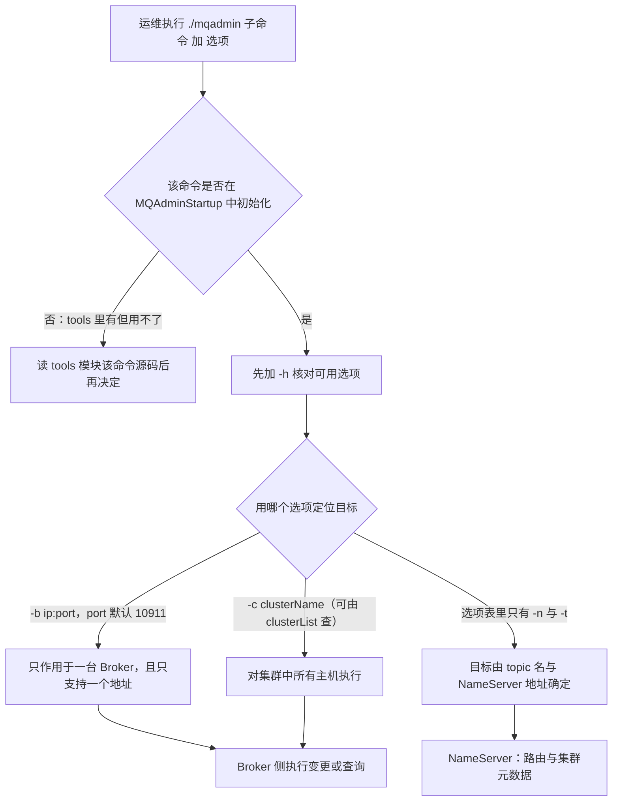

## 为什么需要 mqadmin？（痛点引入）

线上出问题时，最尴尬的不是「不会修」，而是「连现场都看不到」。刚接手 RocketMQ 集群的同事通常卡在这几件事上：

- 业务方报「Topic 发不出消息」，你想确认它到底落在哪个集群、哪几台 Broker、有几条队列、权限是几，控制台没部署，只能去翻 Broker 的配置文件，一台一台看。
- 想给一个 Topic 加读队列分摊消费压力，不知道默认队列数是多少、改完会不会影响已有消费者，只能等凌晨窗口赌一把。
- 有人在测试集群建了 300 个 Topic，生产集群里也有同名残留，你想列出「这个 Topic 到底属于哪个集群、被哪些消费组订阅过」，靠 grep 日志根本查不清。
- NameServer 的配置项想核对一下当前生效值，没有 HTTP 接口可查，只能去机器上看启动参数。
- 怀疑某台 Broker 写入变慢，想量化「每台 Broker 的平均耗时」，业务侧指标只能看到整体抖动，定位不到是哪台。

| 维度 | 没有 mqadmin 时的痛苦 | 有了 mqadmin 之后 |
|------|----------------------|-------------------|
| 看集群家底 | 登录每台机器翻配置文件、数进程 | `clusterList` 一条命令列出集群、BrokerName、BrokerId、TPS |
| 看单个 Topic | 靠业务代码反推队列数与权限 | `topicRoute`、`topicStatus`、`topicClusterList` 直接查 |
| 改 Topic 配置 | 停服改配置文件再重启 | `updateTopic`、`updateTopicPerm` 在线下发 |
| 排查订阅关系 | 问遍所有下游才敢动手 | `topicList -c`、`statsAll` 打印所属集群与订阅关系 |
| 量化 Broker 耗时 | 只看业务整体指标，抓不出慢节点 | `clusterRT` 按集群逐台探测 |
| 核对 NameServer | 上机器看启动参数 | `getNamesrvConfig` 直接取配置 |

> ### 💡 新人小结：mqadmin 到底是什么？
>
> 把 mqadmin 想象成「物业带的万能门禁遥控器」，而不是业主家里的门铃：
> - `-n ip:port` = 遥控器要先对准「物业总台」（NameServer），不然它不知道该去哪个小区。
> - `-b ip:port` = 你直接点名「3 栋 1 单元那扇门」，只开这一台，上游明确写着一句话：只支持单台 Broker。
> - `-c clusterName` = 你说「3 栋所有门」，于是这个集群里每台门都被执行一遍。
> - `-h` = 每把钥匙背面贴的小标签，写清了这把钥匙能开哪些锁。
> - 遥控器不是所有功能都通了电：tools 里能看到一堆命令，但只有在 `MQAdminStartup` 中初始化过的才真能按。
>
> **mqadmin 是「对着 NameServer 和 Broker 喊话」的运维遥控器：先报总台地址，再点名目标，最后说干什么。**

**学习路线图**（本文按六段推进）

```
全局约定 → 选型速查 → Topic 十条 → 集群两条 → Broker 段缺陷 → NameServer 与其他
先读 6 条  按场景挑    建/查/改/删   看与探      上游没写     KV 与监控
```

**本文覆盖范围（显式声明，避免读到一半找不到）**

| 内容 | 在本文？ | 依据 |
|------|----------|------|
| 源文件全局约定（1–18 行，共 6 条） | 是，逐条落地 | 上游 `:::tip 注意` 块 |
| Topic 相关 10 条命令（19–785 行） | 是 | 上游「Topic 相关」表 |
| 集群相关 2 条命令（786–1012 行） | 是 | 上游「集群相关」表 |
| Broker 相关段（1013–2118 行） | 以「上游文档缺陷」形式说明，不搬运 | 实测该表与「消息相关」表逐行相同 |
| NameServer 相关 4 条命令（4016–4307 行） | 是 | 上游「NameServer 相关」表 |
| 其他 1 条命令（4308–4378 行） | 是 | 上游「其他」表 |
| 消息、消费、连接类命令（2119–4015 行） | 否，归下篇 [mqadmin 命令参考：消息、消费与连接](/docs/06-operations/命令行工具/mqadmin命令参考-消息消费与连接/) | 分工切分，不重复解释 |

---

## 全局约定：动手前必须读完的 6 条

这 6 条来自源文件开头 `:::tip 注意` 块（1–18 行），是后文所有命令示例的前提。上游原文里存在 OCR 造成的异体字（例如「⽤」「⾏」），本文按正常汉字誊写，句式与措辞保持原意。

| 序号 | 上游约定（原文要点） | 落到操作上的意思 | 违反后的典型现象 |
|------|---------------------|------------------|------------------|
| 1 | 执行命令方法：`./mqadmin {command} {args}` | 子命令在前、选项在后，统一以 `./mqadmin` 为入口 | 把选项写在子命令前面、或漏掉 `./` 导致命令找不到 |
| 2 | 几乎所有命令都需要配置 `-n` 表示 NameServer 地址，格式为 `ip:port` | 本文 17 条命令的选项列里都列出了 `-n`，执行时要显式带上 NameServer 地址 | 不带 `-n` 时无从定位 NameServer，命令无法执行 |
| 3 | 几乎所有命令都可以通过 `-h` 获取帮助 | 拿不准选项就先 `-h`，这是本篇唯一的「权威选项清单」来源 | 凭记忆写选项，写出不存在的字母 |
| 4 | 既有 Broker 地址（`-b`）又有 clusterName（`-c`）时，优先以 Broker 地址执行；不配置 Broker 地址则对集群中所有主机执行；只支持一个 Broker 地址；`-b` 格式为 `ip:port`，port 默认是 10911 | `-b` 是「点名单台」，`-c` 是「全集群广播」，两个同时给时 `-b` 生效 | 想批量刷全集群却带了 `-b`，结果只改了一台；以为能写多个地址，实际只支持一个 |
| 5 | 在 tools 下可以看到很多命令，但并非都能用：只有在 `MQAdminStartup` 中初始化的命令才能用；也可以修改这个类来增加或自定义命令 | 「tools 里有」不等于「能执行」；判断可用性的依据是 `MQAdminStartup` 的初始化清单 | 照社区文章执行某命令，报命令不存在 |
| 6 | 由于版本更新问题，少部分命令可能未及时更新，遇到错误请直接阅读相关命令源码 | 文档与代码冲突时，以 `tools` 模块源码为准 | 按文档写的选项拼命令始终报错 |

约定 1 的骨架，配合约定 3 取帮助：

```bash
# ========== ✅ 推荐写法：先问 -h，再拼正式命令 ==========
./mqadmin topicList -h          # 约定 3：几乎所有命令都可以用 -h 获取帮助（源文件第 7 行）
./mqadmin topicList -n 127.0.0.1:9876   # 约定 2：-n 是 NameServer 地址，格式 ip:port（源文件第 6 行）

# ========== 不推荐写法（仅展示） ==========
# ❌ 凭记忆拼选项、不带 -h 核对，也不带 -n：目标地址与可用选项都不知道，命令无法定位 NameServer
./mqadmin topicList
```

上游未给出输出样例：`-h` 会打印什么、`topicList` 成功后的输出格式，源文件里没有任何示例，本文因此不写任何「预期输出」。

> ### 💡 新人小结：为什么 `-b` 和 `-c` 同时出现时只改了一台？
>
> 把它想成「给一栋楼发通知」：
> - `-c DefaultCluster` = 按「楼号」发，这栋楼里每一户都收到（对集群中所有主机执行）。
> - `-b 192.168.0.1:10911` = 按「门牌号」发，只敲这一户的门（只支持单台 Broker、只支持一个地址）。
> - 两个同时写 = 门牌号更具体，于是按门牌号执行（`-b` 优先）。
>
> **凡是带「影响面」的命令，动手前先确认自己用的是 `-b` 还是 `-c`——这一个字母决定了是改 1 台还是改 N 台。**

> [!NOTE] 版本适用：4.x 与 5.0 完全同一份内容
> 本文唯一源文件 `docs/04-deployment/02admintool.md` 与 5.0 版 `versioned_docs/version-5.0/05-deploymentOperations/02admintool.md` 大小均为 111,737 字节，SHA256 摘要一致（前 16 位 `825df0d5cb44bb98`）。
> 也就是说 mqadmin 这一整套命令在两代文档里没有任何差异，本文的每条选项对 4.x 与 5.0 同样成立，不存在「旧写法／新写法」对照。
> 同一份缺陷也同时存在于两个版本，见后文「Broker 相关」一节。

---

## 按场景选命令：决策树与速查表

先看决策树（本文 17 条命令的选择路径）：

```
你要做什么？

① 看家底      → 查 Topic 清单 topicList ／ 查所属集群 topicClusterList ／ 查路由 topicRoute
                → 查队列 offset topicStatus ／ 查订阅关系与吞吐 statsAll
② 看集群      → 看集群与每台 Broker 概况 clusterList ／ 量化每台耗时 clusterRT（会真实发消息）
③ 算负载      → 给定消费者 ip 列表，看队列怎么分 allocateMQ
④ 建与改      → 建 Topic 或改队列数与权限 updateTopic ／ 只改权限 updateTopicPerm
⑤ 删          → 删 Topic deleteTopic
⑥ 动 NameServer → 读配置 getNamesrvConfig ／ 改配置 updateNamesrvConfig
                  读写 kv 配置 updateKvConfig ／ deleteKvConfig（上游标注「目前还未使用」）
⑦ 顺序配置 kv  → updateOrderConf（上游标注「目前还未启用」）
⑧ 起常驻进程   → startMonitoring
```

**场景 → 命令 → 关键选项速查表**

| 业务场景 | 首选命令 | 上游给出的关键选项 | 读还是写 |
|----------|----------|--------------------|----------|
| 列出所有 Topic | `topicList` | `-n`；加 `-c` 才返回所属集群与订阅关系 | 读 |
| 看某 Topic 的路由 | `topicRoute` | `-n`、`-t` | 读 |
| 看某 Topic 各队列的 offset | `topicStatus` | `-n`、`-t` | 读 |
| 看某 Topic 在哪些集群 | `topicClusterList` | `-n`、`-t` | 读 |
| 看订阅关系、TPS、积累量、24h 读写总量 | `statsAll` | `-n`；`-a` 只打印活跃 topic；`-t` 指定 topic | 读 |
| 看集群、BrokerName、BrokerId、TPS | `clusterList` | `-n`；`-m` 打印更多信息；`-i` 打印间隔（秒） | 读 |
| 量化集群各 Broker 的 RT | `clusterRT` | `-n`、`-c`、`-a`、`-s`、`-i`、`-m`、`-p` | 写（发消息） |
| 算消费者列表的队列负载结果 | `allocateMQ` | `-n`、`-t`、`-i`（逗号分隔 ip 列表） | 读 |
| 创建或更新 Topic 配置 | `updateTopic` | `-n`，`-b` 或 `-c`，`-t`，`-r`/`-w`/`-p` | 写 |
| 只改 Topic 读写权限 | `updateTopicPerm` | `-n`，`-b` 或 `-c`，`-t`，`-p` | 写 |
| 删除某集群下的某 Topic | `deleteTopic` | `-n`、`-c`、`-t`（选项列里没有 `-b`） | 删 |
| 更新 NameServer 的 kv 配置 | `updateKvConfig` | `-n`、`-s`、`-k`、`-v` | 写（上游标注未使用） |
| 删除 NameServer 的 kv 配置 | `deleteKvConfig` | `-n`、`-s`、`-k` | 删 |
| 获取 NameServer 配置 | `getNamesrvConfig` | `-n`（选项列只有 `-n` 与 `-h`） | 读 |
| 修改 NameServer 配置 | `updateNamesrvConfig` | `-n`、`-k`、`-v` | 写 |
| 读写特定命名空间的顺序配置 kv | `updateOrderConf` | `-n`、`-t`、`-v`、`-m`（get/put/delete） | 写（上游标注未启用） |
| 开启监控进程 | `startMonitoring` | `-n` | 起进程 |

mqadmin 本身不存数据，它把一次「点名 + 动作」送到 NameServer 与 Broker。下图是本文 17 条命令的调用路径与 `-b`/`-c` 的分叉关系（只画上游约定与选项表能证实的部分，上游未描述的部分不画）。



图后解读三句：

1. **先过「可用性」这道门**：约定 5 说得很直白，tools 里能看到很多命令，但只有 `MQAdminStartup` 初始化过的才能用；这也是后文处理「Broker 相关」段缺陷时给读者的第一条替代路径。
2. **`-b` 与 `-c` 是分叉点而不是可选项**：`-b` 单台（且只支持一个地址）、`-c` 全集群，同时给出时 `-b` 优先。凡是写类命令（`updateTopic`、`updateTopicPerm`），走错这一支就是「漏改 N-1 台」或「多改 N-1 台」。
3. **只带 `-n` 与 `-t` 的那批命令（`topicList`、`topicRoute`、`topicStatus`、`topicClusterList`）选项表里根本没有 `-b`**，目标只能靠 topic 名和 NameServer 地址确定；上游没有再说明请求最终落到哪一端，本文不做推测。

---

## Topic 相关：10 条命令逐条拆解

源文件「Topic 相关」段（19–785 行）是一张四列表（名称 / 含义 / 命令选项 / 说明），名称与含义用 rowSpan 合并。本文把它拆成「一条命令一个小节」，每节给「命令选项 / 说明」两列表格，rowSpan 展开为重复填写所属命令名，选项与说明一律用上游原句（HTML 里的 `className`、`style`、`width` 属于排版残留，一律丢弃）。

> ### 💡 新人小结：同一封信，为什么要抄送给全公司？
>
> 把 Topic 的元数据想成「员工手册的适用范围声明」：
> - 一条 `updateTopic`/`updateTopicPerm` 加 `-c DefaultCluster` = 手册抄送全公司每台 Broker，一处改处处一致，漏一台就出现「同一 Topic 在 A 机能写、在 B 机不能写」。
> - `deleteTopic` = 公告作废，`-c` 写明在哪个集群作废。
> - 手册上那条 `perm` 就是「可写(2)／只读(4)／读写(6)」，即权限不是开关，而是三个数值档位。
>
> **Topic 类命令的关键不是会不会写，而是「这次动了几台 Broker」。**

### updateTopic —— 创建或更新 Topic 配置

上游「含义」列原文：**创建更新Topic配置**。

| 名称 | 命令选项 | 说明（上游原文） |
|------|----------|------------------|
| updateTopic | `-b` | Broker 地址，表示 topic 所在 Broker，只支持单台 Broker，地址为 ip:port |
| updateTopic | `-c` | cluster 名称，表示 topic 所在集群（集群可通过 clusterList 查询） |
| updateTopic | `-h-` | 打印帮助 |
| updateTopic | `-n` | NameServer 服务地址，格式 ip:port |
| updateTopic | `-p` | 指定新 topic 的读写权限(W=2\|R=4\|WR=6) |
| updateTopic | `-r` | 可读队列数（默认为 8） |
| updateTopic | `-w` | 可写队列数（默认为 8） |
| updateTopic | `-t` | topic 名称（名称只能使用字符 `^[a-zA-Z0-9_-]+$`） |

```bash
# ========== ✅ 推荐写法：按集群批量下发，队列数与权限一次说清 ==========
# -n NameServer 地址，格式 ip:port（约定 2）
# -c cluster 名称：不配 -b 时对集群中所有主机执行（约定 4）
# -t topic 名称，只允许字符 ^[a-zA-Z0-9_-]+$
# -w / -r 可写队列数 / 可读队列数，上游标注默认都是 8
# -p 读写权限，上游给的是 W=2|R=4|WR=6，此处 6 即 WR
./mqadmin updateTopic -n 127.0.0.1:9876 -c DefaultCluster -t OrderMsg -w 8 -r 8 -p 6

# ========== 不推荐写法（仅展示） ==========
# ❌ 同时给 -b 与 -c：按约定 4，-b 优先且只支持一个 Broker 地址，
#    本想刷全集群，实际只会改到 -b 那一台
./mqadmin updateTopic -n 127.0.0.1:9876 -c DefaultCluster -b 192.168.0.1:10911 -t OrderMsg
```

上游未给出输出样例。

参数解释与踩坑：

- `-r`/`-w` 的默认值是上游明写的「默认为 8」，这是本文出现的唯一队列数默认值；不要按「一般消息队列都是 4」去推定别的数字。
- `-p` 与 `updateTopicPerm` 的 `-p` 用的是同一套取值（W=2|R=4|WR=6）；本文不解释这些数字以外的权限位，上游没给。
- 选项列里 `-h-` 是上游原样（源文件第 99 行），其余 16 条命令都写 `-h`，这个多出来的横线上游未解释，疑为上游排版缺陷；需要帮助时按约定 3 处理，并以 `-h` 打印结果为准。
- 风险定位：变更类，需要走变更流程；改 `-w`/`-r` 会改变队列个数分布，务必先确认影响面是 `-b` 单台还是 `-c` 全集群。

### deleteTopic —— 删除 Topic

上游「含义」列原文：**删除Topic**。

| 名称 | 命令选项 | 说明（上游原文） |
|------|----------|------------------|
| deleteTopic | `-c` | cluster 名称，表示删除某集群下的某个 topic（集群可通过 clusterList 查询） |
| deleteTopic | `-h` | 打印帮助 |
| deleteTopic | `-n` | NameServer 服务地址，格式 ip:port |
| deleteTopic | `-t` | topic 名称（名称只能使用字符 `^[a-zA-Z0-9_-]+$`） |

```bash
# ========== ✅ 推荐写法：删除前先把「查」的三条做完 ==========
./mqadmin topicClusterList -n 127.0.0.1:9876 -t OrderMsg   # 先确认它在哪些集群
./mqadmin topicList -n 127.0.0.1:9876 -c                   # 再确认它的所属集群与订阅关系
./mqadmin deleteTopic -n 127.0.0.1:9876 -c DefaultCluster -t OrderMsg

# ========== 不推荐写法（仅展示） ==========
# ❌ 跳过订阅关系核对直接删：topicList -c 会返回 consumerGroup 信息，
#    不看就删，等于给仍在消费它的下游悄悄断了数据源
./mqadmin deleteTopic -n 127.0.0.1:9876 -t OrderMsg   # 漏掉 -c：本命令只能按「集群名 + topic 名」定位
```

上游未给出输出样例。

踩坑与风险：

- 选项表里**没有 `-b`**：删除的目标由「集群名 + topic 名」确定，别指望像 `updateTopic` 那样点名单台。
- 上游「含义」列就一句话「删除Topic」，没有描述是否可回滚、是否级联清理队列；本文因此不作任何安全性描述。
- 风险定位：**高危**（删除类），必须先有集群归属与订阅关系查询结果，并走变更流程。

### topicList —— 查看 Topic 列表信息

上游「含义」列原文：**查看 Topic 列表信息**。

| 名称 | 命令选项 | 说明（上游原文） |
|------|----------|------------------|
| topicList | `-h` | 打印帮助 |
| topicList | `-c` | 不配置 `-c` 只返回 topic 列表，增加 `-c` 返回 clusterName、topic、consumerGroup 信息，即 topic 的所属集群和订阅关系，没有参数 |
| topicList | `-n` | NameServer 服务地址，格式 ip:port |

```bash
# ========== ✅ 推荐写法：两种形态都跑一遍，看清 -c 的差别 ==========
./mqadmin topicList -n 127.0.0.1:9876              # 不带 -c：只返回 topic 列表
./mqadmin topicList -n 127.0.0.1:9876 -c           # 带 -c：额外返回 clusterName / topic / consumerGroup

# ========== 不推荐写法（仅展示） ==========
# ❌ 把 -c 当「cluster 名称」用：这里的 -c 是「没有参数」的开关，
#    与 updateTopic/deleteTopic 里 -c 后面要接集群名完全不同
./mqadmin topicList -n 127.0.0.1:9876 -c DefaultCluster
```

上游未给出输出样例。

踩坑：这是本文最容易踩的「同名选项漂移」现场——同样是 `-c`，在 `updateTopic`、`deleteTopic`、`updateTopicPerm` 里是「cluster 名称」（要接集群名），在 `clusterRT` 里是「探测哪个集群」，在 `topicList` 里却是**上游明写「没有参数」的开关**；而 `statsAll`、`topicRoute`、`topicStatus`、`topicClusterList` 的选项列里根本没有 `-c`。写命令前先 `-h`（约定 3）。

风险定位：只读，低。

### topicRoute —— 查看 Topic 路由信息

上游「含义」列原文：**查看 Topic 路由信息**。

| 名称 | 命令选项 | 说明（上游原文） |
|------|----------|------------------|
| topicRoute | `-t` | topic 名称 |
| topicRoute | `-h` | 打印帮助 |
| topicRoute | `-n` | NameServer 服务地址，格式 ip:port |

```bash
# ========== ✅ 推荐写法：排查「发不出/收不到」的第一步 ==========
./mqadmin topicRoute -n 127.0.0.1:9876 -t OrderMsg   # 选项表只有 -t/-h/-n，没有 -b、没有 -c

# ========== 不推荐写法（仅展示） ==========
# ❌ 想只看某台 Broker 的路由就把 Broker 名称填进 -t：本命令的 -t 是「topic 名称」，
#    且选项列里只有 -t/-h/-n，按 Broker 定位不是这条命令能做的事
./mqadmin topicRoute -n 127.0.0.1:9876 -t broker-a
```

上游未给出输出样例。

踩坑：`topicRoute` 与 `topicStatus` 的选项列都只有 `-h/-n/-t`，因此「限定到某台 Broker」不是这两条命令能做的事；需要按 Broker 名称定位时，去看下篇的 `printMsgByQueue`（本文不展开）。

风险定位：只读，低。

### topicStatus —— 查看 Topic 消息队列 offset

上游「含义」列原文：**查看 Topic 消息队列offset**。

| 名称 | 命令选项 | 说明（上游原文） |
|------|----------|------------------|
| topicStatus | `-t` | topic 名称 |
| topicStatus | `-h` | 打印帮助 |
| topicStatus | `-n` | NameServer 服务地址，格式 ip:port |

```bash
# ========== ✅ 推荐写法：看每个队列的两端位置 ==========
./mqadmin topicStatus -n 127.0.0.1:9876 -t OrderMsg   # 含义列：查看 Topic 消息队列 offset

# ========== 不推荐写法（仅展示） ==========
# ❌ 把 -t 填成消费者分组名，指望它报「消费进度」：本命令的 -t 是「topic 名称」，
#    含义列写的是「查看 Topic 消息队列offset」；消费进度属于下篇的 consumerProgress
./mqadmin topicStatus -n 127.0.0.1:9876 -t SomeConsumerGroup
```

上游未给出输出样例。

踩坑：本命令的 `-t` 只接受 topic 名称；消费侧进度是「消费者分组 × topic」两个维度的量，需要下篇的 `consumerProgress`（本文不重复解释）。

风险定位：只读，低。

### topicClusterList —— 查看 Topic 所在集群列表

上游「含义」列原文：**查看 Topic 所在集群列表**。

| 名称 | 命令选项 | 说明（上游原文） |
|------|----------|------------------|
| topicClusterList | `-t` | topic 名称 |
| topicClusterList | `-h` | 打印帮助 |
| topicClusterList | `-n` | NameServer 服务地址，格式 ip:port |

```bash
# ========== ✅ 推荐写法：删 Topic 之前先问「它在几个集群」 ==========
./mqadmin topicClusterList -n 127.0.0.1:9876 -t OrderMsg

# ========== 不推荐写法（仅展示） ==========
# ❌ 拿 clusterList 当 topicClusterList 用：前者看集群与 Broker 概况，
#    不看 topic，回答不了「这个 Topic 落在哪几个集群」
./mqadmin clusterList -n 127.0.0.1:9876
```

上游未给出输出样例。

踩坑：与 `clusterList` 是「按 topic 反查集群」与「按集群看全貌」两个方向，别混用。

风险定位：只读，低。

### updateTopicPerm —— 更新 Topic 读写权限

上游「含义」列原文：**更新 Topic 读写权限**。

| 名称 | 命令选项 | 说明（上游原文） |
|------|----------|------------------|
| updateTopicPerm | `-t` | topic 名称 |
| updateTopicPerm | `-h` | 打印帮助 |
| updateTopicPerm | `-n` | NameServer 服务地址，格式 ip:port |
| updateTopicPerm | `-b` | Broker 地址，表示 topic 所在 Broker，只支持单台 Broker，地址为 ip:port |
| updateTopicPerm | `-p` | 指定新 topic 的读写权限(W=2\|R=4\|WR=6) |
| updateTopicPerm | `-c` | cluster 名称，表示 topic 所在集群（集群可通过 clusterList 查询），`-b` 优先，如果没有 `-b`，则对集群中所有 Broker 执行命令 |

```bash
# ========== ✅ 推荐写法：只降级权限，不动队列数 ==========
./mqadmin updateTopicPerm -n 127.0.0.1:9876 -c DefaultCluster -t OrderMsg -p 4   # 4 = R，只读

# ========== 不推荐写法（仅展示） ==========
# ❌ 以为 -b 和 -c 会「合并生效」：本命令说明列原话是「-b 优先，如果没有 -b，
#    则对集群中所有 Broker 执行命令」，同时给两个时 -c 被忽略，权限只改了一台
./mqadmin updateTopicPerm -n 127.0.0.1:9876 -c DefaultCluster -b 192.168.0.1:10911 -t OrderMsg -p 4
```

上游未给出输出样例。

踩坑：本命令 `updateTopicPerm -c` 的说明列把「`-b` 优先」这条全局约定在命令级别又写了一遍，是全文最明确的一条影响面描述；`-p` 取值与 `updateTopic` 完全同一套（W=2|R=4|WR=6）。

风险定位：**高危**（写权限类）。判据是上游「含义」列「更新 Topic 读写权限」与 `-p` 的三档取值（W=2|R=4|WR=6）——这条命令改的就是 Topic 的可读/可写档位，且没有提供任何「改回原值」的自动手段（要回退只能再执行一次并自行记住原值）。必须在变更窗口执行，执行后立即用 `topicRoute`、`topicList -c` 复核结果。

### updateOrderConf —— 创建/删除/获取特定命名空间的 kv 配置（未启用）

上游「含义」列原文：**从NameServer上创建、删除、获取特定命名空间的kv配置，目前还未启用**。

| 名称 | 命令选项 | 说明（上游原文） |
|------|----------|------------------|
| updateOrderConf | `-h` | 打印帮助 |
| updateOrderConf | `-n` | NameServer 服务地址，格式 ip:port |
| updateOrderConf | `-t` | topic，键 |
| updateOrderConf | `-v` | orderConf，值 |
| updateOrderConf | `-m` | method，可选 get、put、delete |

```bash
# ========== ✅ 推荐写法：只做读（-m get），先看清现状 ==========
./mqadmin updateOrderConf -n 127.0.0.1:9876 -m get -t OrderMsg   # -m 只有 get/put/delete 三种取值

# ========== 不推荐写法（仅展示） ==========
# ❌ 在未启用的命令上做写操作：上游「含义」列写明「目前还未启用」，
#    把 put/delete 当成生产可用手段，等于依赖一个文档声明未启用的能力
./mqadmin updateOrderConf -n 127.0.0.1:9876 -m delete -t OrderMsg
```

上游未给出输出样例。

踩坑：本命令一个 `-m` 装了三种动作（get/put/delete），`-t` 是「键」、`-v` 是「值」；上游没有说明 `-v` 的合法取值格式，本文不猜测。

风险定位：**高危**——判据是上游原文：它同时提供 `delete` 语义（`-m delete`）、且明确标注「目前还未启用」。既未启用又能删除，任何写操作都必须走变更流程，并先确认命令在 `MQAdminStartup` 里是否初始化（约定 5）。

### allocateMQ —— 计算消费者列表的队列负载结果

上游「含义」列原文：**以平均负载算法计算消费者列表负载消息队列的负载结果**。

| 名称 | 命令选项 | 说明（上游原文） |
|------|----------|------------------|
| allocateMQ | `-t` | topic 名称 |
| allocateMQ | `-h` | 打印帮助 |
| allocateMQ | `-n` | NameServer 服务地址，格式 ip:port |
| allocateMQ | `-i` | ipList，用逗号分隔，计算这些 ip 去负载 Topic 的消息队列 |

```bash
# ========== ✅ 推荐写法：扩容前先看队列会怎么分 ==========
./mqadmin allocateMQ \
  -n 127.0.0.1:9876 \
  -t OrderMsg \
  -i "192.168.0.11,192.168.0.12,192.168.0.13"   # -i 是逗号分隔的 ip 列表，不是「打印间隔」

# ========== 不推荐写法（仅展示） ==========
# ❌ 把 -i 当数字传：本命令的 -i 是 ipList，
#    而 clusterList / clusterRT 的 -i 才是「间隔，单位秒」
./mqadmin allocateMQ -n 127.0.0.1:9876 -t OrderMsg -i 5
```

上游未给出输出样例。

踩坑：`-i` 是本命令与 `clusterList`/`clusterRT` 之间最容易串味的选项；本命令的 `-i` 要 ip 列表，那两条的 `-i` 要秒数。

风险定位：只读计算，低。它不改变线上任何分配，只是「算给你看」，因此适合在扩容前当作演练。

### statsAll —— 打印 Topic 的订阅关系与吞吐统计

上游「含义」列原文：**打印Topic订阅关系、TPS、积累量、24h读写总量等信息**。

| 名称 | 命令选项 | 说明（上游原文） |
|------|----------|------------------|
| statsAll | `-h` | 打印帮助 |
| statsAll | `-n` | NameServer 服务地址，格式 ip:port |
| statsAll | `-a` | 是否只打印活跃 topic |
| statsAll | `-t` | 指定 topic |

```bash
# ========== ✅ 推荐写法：先看全量，再按 topic 收敛，再只看活跃 ==========
./mqadmin statsAll -n 127.0.0.1:9876               # 含义列：订阅关系、TPS、积累量、24h 读写总量
./mqadmin statsAll -n 127.0.0.1:9876 -t OrderMsg   # -t：指定 topic
./mqadmin statsAll -n 127.0.0.1:9876 -a            # -a：是否只打印活跃 topic

# ========== 不推荐写法（仅展示） ==========
# ❌ 在几百个 topic 的集群上习惯性不带 -a/-t 全量跑：
#    上游给出的收敛手段只有 -a 与 -t，不带就等于全量打印
./mqadmin statsAll -n 127.0.0.1:9876
```

上游未给出输出样例，因此「积累量」「24h 读写总量」的字段顺序与单位上游均未说明。

风险定位：只读，低。

---

## 集群相关：2 条命令

源文件「集群相关」段（786–1012 行）。这两条是运维看板的起点：一条看「有什么」，一条看「快不快」。

### clusterList —— 查看集群信息

上游「含义」列原文：**查看集群信息，集群、BrokerName、BrokerId、TPS等信息**。

| 名称 | 命令选项 | 说明（上游原文） |
|------|----------|------------------|
| clusterList | `-m` | 打印更多信息（增加打印出如下信息 #InTotalYest, #OutTotalYest, #InTotalToday, #OutTotalToday） |
| clusterList | `-h` | 打印帮助 |
| clusterList | `-n` | NameServer 服务地址，格式 ip:port |
| clusterList | `-i` | 打印间隔，单位秒 |

```bash
# ========== ✅ 推荐写法：巡检时循环打印并带上昨日/今日总量 ==========
./mqadmin clusterList -n 127.0.0.1:9876            # 基本形态：集群、BrokerName、BrokerId、TPS
./mqadmin clusterList -n 127.0.0.1:9876 -m         # -m：多打 #InTotalYest/#OutTotalYest/#InTotalToday/#OutTotalToday
./mqadmin clusterList -n 127.0.0.1:9876 -m -i 5    # -i：打印间隔，单位秒

# ========== 不推荐写法（仅展示） ==========
# ❌ 把 -m 当「机房（machine room）」用：clusterList 的 -m 是「更多信息」，
#    而 clusterRT 的 -m 才是「所属机房，打印使用」——同一个字母两种含义
./mqadmin clusterList -n 127.0.0.1:9876 -m zoneA
```

上游未给出输出样例。

参数解释：`-m` 额外打印的四个字段名是上游原样（`#InTotalYest`、`#OutTotalYest`、`#InTotalToday`、`#OutTotalToday`），语义上游未展开，本文不解释成「入/出方向昨日与今日总量」之外的内容。`clusterList` 的「含义」列同时是 `-c` 的取值来源：其它命令要填的 clusterName、以及 BrokerName/BrokerId，都从这里读。

风险定位：只读，低。

### clusterRT —— 探测集群各 Broker 的 RT

上游「含义」列原文：**发送消息检测集群各 Broker RT。消息发往 `${BrokerName}` Topic。**

| 名称 | 命令选项 | 说明（上游原文） |
|------|----------|------------------|
| clusterRT | `-a` | amount，每次探测的总数，RT = 总时间 / amount |
| clusterRT | `-s` | 消息大小，单位 B |
| clusterRT | `-c` | 探测哪个集群 |
| clusterRT | `-p` | 是否打印格式化日志，以 \| 分割，默认不打印 |
| clusterRT | `-h` | 打印帮助 |
| clusterRT | `-m` | 所属机房，打印使用 |
| clusterRT | `-i` | 发送间隔，单位秒 |
| clusterRT | `-n` | NameServer 服务地址，格式 ip:port |

```bash
# ========== ✅ 推荐写法：小样本试跑，确认量级后再放大 ==========
# -c 探测哪个集群（集群名从 clusterList 取）
# -a amount：每次探测的总数，上游给的算法是 RT = 总时间 / amount
# -s 消息大小，单位 B；-i 发送间隔，单位秒
./mqadmin clusterRT -n 127.0.0.1:9876 -c DefaultCluster -a 10 -s 128 -i 1

# ========== 不推荐写法（仅展示） ==========
# ❌ 在业务高峰用大 -a 直接压全集群：本命令「含义」列写明是「发送消息检测」，
#    消息真实发往 ${BrokerName} Topic，等于主动注入一批探测流量
./mqadmin clusterRT -n 127.0.0.1:9876 -c DefaultCluster -a 1000000 -s 4096
```

上游未给出输出样例。

踩坑三条，全部有据：

1. 它是**写操作**：上游「含义」列直接说「发送消息」，所以不要把 clusterRT 当纯只读巡检混进只读白名单。
2. 探测消息发往 `${BrokerName}` Topic（上游原话），意味着这个命令会用到以 BrokerName 命名的 topic，别在严禁多余流量的集群上随手跑。
3. RT 的口径上游已定义为「总时间 / amount」（`-a` 的说明列），不是分位数；上游没有提供 P99 之类的统计口径，本文不编。

风险定位：**中—高**（写操作 + 主动注入流量）；判据来自上游「含义」列「发送消息检测集群各 Broker RT」与 `-a`「RT = 总时间 / amount」，建议在低峰窗口执行、`-a` 从小值递增。

### clusterList 与 clusterRT：看 vs 探

| 对比维度 | `clusterList` | `clusterRT` |
|----------|---------------|-------------|
| 上游「含义」原话 | 查看集群信息，集群、BrokerName、BrokerId、TPS 等信息 | 发送消息检测集群各 Broker RT。消息发往 `${BrokerName}` Topic。 |
| 是否产生消息 | 说明里没有发送动作 | 「含义」列明写「发送消息」 |
| 关键选项 | `-m` 更多信息、`-i` 打印间隔（秒） | `-a` 探测总数、`-s` 消息大小（B）、`-i` 发送间隔（秒）、`-c` 探测哪个集群 |
| `-m` 的含义 | 打印更多信息（四个 #InTotal/#OutTotal 字段） | 所属机房，打印使用 |
| `-p` 是否存在 | 不存在于选项列 | 存在：是否打印格式化日志，以 \| 分割，默认不打印 |
| 指标口径 | TPS（上游未给计算方式） | RT = 总时间 / amount（上游给出） |
| 什么时候用 | 日常巡检、找 clusterName/BrokerName | 已知慢、要量化是哪台 Broker 耗时高 |

---

## Broker 相关：上游文档缺陷（本篇不搬运）

### 缺陷事实与判据

> [!WARNING] 上游文档缺陷：「Broker 相关」段落里没有 Broker 侧命令
> 源文件 `## Broker相关` 段（1013–2118 行）折叠块标题为「Broker 相关参数」，但其表格内容与紧随其后的 `## 消息相关` 段（2119–3220 行）**逐行完全相同**：两张表都是「名称 / 含义 / 命令选项 / 说明」四列，展开 rowSpan 后都是 1 行表头加 69 行数据（共 70 行），对应 10 条命令、每条命令若干选项行。
> 判据（机器可核）：把两段表格的 rowSpan 展开为逐行四元组后做等值比较，「Broker 相关」的 70 行与「消息相关」表格的前 70 行**完全相等**；10 条命令的名称、含义、选项、说明四列两两相同——`queryMsgById`、`queryMsgByKey`、`queryMsgByOffset`、`queryMsgByUniqueKey`、`checkMsgSendRT`、`sendMessage`、`consumeMessage`、`printMsg`、`printMsgByQueue`、`resetOffsetByTime`。
> 结论：上游根本没写 Broker 侧命令，这个段是一次复制粘贴的产物。本篇不重复搬运这 10 条命令，也不把它们当 Broker 命令解释。
> 同源复制痕迹还有两处：`## NameServer 相关`（4017 行）与 `## 其他`（4309 行）的折叠块标题都仍写成「连接相关参数」，与其内容无关。
> 4.x 与 5.0 两份源文件 SHA256 相同，所以这个缺陷同时存在于两个版本，不是某一版独有。

**那 10 条命令归下篇**：它们属于消息/消费语义，本篇只列名、不解释。逐条参数与示例请看 [mqadmin 命令参考：消息、消费与连接](/docs/06-operations/命令行工具/mqadmin命令参考-消息消费与连接/)。

| 上游「Broker 相关」段实际列出的命令（=消息类命令，归下篇） | 上游「含义」列原文（节选） |
|---|---|
| `queryMsgById` | 根据 offsetMsgId 查询 msg |
| `queryMsgByKey` | 根据消息 Key 查询消息 |
| `queryMsgByOffset` | 根据 Offset 查询消息 |
| `queryMsgByUniqueKey` | 根据 msgId 查询 msg |
| `checkMsgSendRT` | 检测向 topic 发消息的 RT，功能类似 clusterRT |
| `sendMessage` | 发送一条消息 |
| `consumeMessage` | 消费消息 |
| `printMsg` | 从 Broker 消费消息并打印，可选时间段 |
| `printMsgByQueue` | 类似 printMsg，但指定 Message Queue |
| `resetOffsetByTime` | 按时间戳重置 offset，Broker 和 consumer 都会重置 |

### 读者真正会问的 Broker 侧操作：上游未收录，不得编造

「改 Broker 配置」「看 Broker 运行状态」「清理过期 CommitLog」这类 Broker 侧操作，**在本篇唯一源文件里没有任何对应命令与选项**，因此本文不给出命令名、不给出选项字母、不给出参数取值——编一条出来就是造假。

可行的替代路径只有下面三条，它们全部出自源文件开头 6 条约定中的第 5、6 条（可核实，不是猜测）：

```bash
# ========== 路径一：直接跑 ./mqadmin，以它自己认账的清单为准 ==========
./mqadmin
# 判据：约定 5「在 tools 下可以看到很多命令，但并不是所有命令都能使用，
#        只有在 MQAdminStartup 中初始化的命令才能使用」
# 上游未给出输出样例，因此本文不描述它会打印哪些命令。

# ========== 路径二：对候选命令先取帮助，再决定用不用 ==========
./mqadmin {command} -h
# 判据：约定 3「几乎所有命令都可以通过 -h 获取帮助」（此处沿用约定 1 的 {command} 占位写法）；
#        帮助里列出的选项才是该命令真支持的选项，比文档更可信。

# ========== 路径三：读 tools 模块源码（含 MQAdminStartup 的初始化清单） ==========
# 判据：约定 5「你也可以修改这个类，增加或自定义命令」
#        约定 6「由于版本更新问题，少部分命令可能未及时更新，遇到错误请直接阅读相关命令源码」
```

| 想做的 Broker 侧操作 | 上游本篇是否给出命令 | 本文建议的动作路径 |
|----------------------|---------------------|--------------------|
| 修改 Broker 配置项 | 未收录 | 路径一 → 路径二 → 路径三，三处都没有就不做，并回到 Broker 配置文件本身 |
| 查看 Broker 运行状态 | 部分可用：`clusterList` 能给出集群、BrokerName、BrokerId、TPS（加 `-m` 多出四个总量字段） | 先用 `clusterList`，不够再走三条路径 |
| 清理过期 CommitLog | 未收录 | 不得凭印象拼命令；走三条路径确认后再决定是否属于 Broker 配置范畴 |
| 探测 Broker 耗时 | 已收录：`clusterRT`（会真实发消息） | 见上一节，低峰小 `-a` 起步 |

---

## NameServer 相关：4 条命令

源文件「NameServer 相关」段（4016–4307 行）。注意上游把 kv 配置类命令放在这一段，且对「写」类命令明确标注了「目前还未使用」。

> ### 💡 新人小结：kv 配置就像「物业公告栏上的便签」
>
> - `-s 命名空间` = 公告栏分区：A 区的便签和 B 区的便签互不干扰。
> - `-k key` = 便签标题，`-v value` = 便签内容。
> - `updateKvConfig` = 贴一张新便签，`deleteKvConfig` = 撕掉一张便签。
> - `getNamesrvConfig` = 拍照存证据，`updateNamesrvConfig` = 改写便签。
> - 但上游给 `updateKvConfig` 的「含义」列结尾多了一句「目前还未使用」，相当于公告栏旁边写着「本区暂不生效」——能贴，但别指望有人看。
>
> **把 NameServer 侧 4 条命令分成两类：只读的 1 条（`getNamesrvConfig`）随时可用；写与删的 3 条（`updateKvConfig`、`deleteKvConfig`、`updateNamesrvConfig`）里，前两条上游分别明写「目前还未使用」「删除」，动手前务必先留档并走变更流程。**

### updateKvConfig —— 更新 NameServer 的 kv 配置（上游标注未使用）

上游「含义」列原文：**更新NameServer的kv配置，目前还未使用**。

| 名称 | 命令选项 | 说明（上游原文） |
|------|----------|------------------|
| updateKvConfig | `-s` | 命名空间 |
| updateKvConfig | `-k` | key |
| updateKvConfig | `-v` | value |
| updateKvConfig | `-n` | NameServer 服务地址，格式 ip:port |
| updateKvConfig | `-h` | 打印帮助 |

```bash
# ========== ✅ 推荐写法：三元组（命名空间 + key + value）一次给全 ==========
# -s 命名空间 ｜ -k key ｜ -v value（取值清单上游未给出，此处为占位符）
./mqadmin updateKvConfig -n 127.0.0.1:9876 -s "example-ns" -k "demo-key" -v "demo-value"

# ========== 不推荐写法（仅展示） ==========
# ❌ 把未使用的能力当生产依赖：上游「含义」列明写「目前还未使用」，
#    任何业务链路依赖它都可能落空
./mqadmin updateKvConfig -n 127.0.0.1:9876 -s "example-ns" -k "brokerClusterName" -v "DefaultCluster"
```

上游未给出输出样例。命名空间与 key 的合法取值清单上游未给出，示例中的 `example-ns` / `demo-key` 只是占位符，不代表真实可取值。

风险定位：**中—高**（写 NameServer 配置，且上游标注「目前还未使用」）。删除它的配套命令是 `deleteKvConfig`，两者要成对规划。

### deleteKvConfig —— 删除 NameServer 的 kv 配置

上游「含义」列原文：**删除NameServer的kv配置**。

| 名称 | 命令选项 | 说明（上游原文） |
|------|----------|------------------|
| deleteKvConfig | `-s` | 命名空间 |
| deleteKvConfig | `-k` | key |
| deleteKvConfig | `-n` | NameServer 服务地址，格式 ip:port |
| deleteKvConfig | `-h` | 打印帮助 |

```bash
# ========== ✅ 推荐写法：删之前先按同 (命名空间, key) 确认存在性 ==========
./mqadmin deleteKvConfig -n 127.0.0.1:9876 -s "example-ns" -k "demo-key"   # 只给 -s 与 -k 定位

# ========== 不推荐写法（仅展示） ==========
# ❌ 靠猜 key 删除：本命令只有 -s/-k/-n/-h 四个选项，
#    没有「列出全部 key」的选项，列不出就无从确认，删错代价不可估
./mqadmin deleteKvConfig -n 127.0.0.1:9876 -s "example-ns" -k "guess-key"
```

上游未给出输出样例。

风险定位：**高危**（删除类）。判据来自上游「含义」列的「删除」二字，且该命令的选项列里不存在任何列举手段（只有 `-s`/`-k`/`-n`/`-h`）——删之前无法用同一条命令自查目标是否存在，必须走变更流程。

### getNamesrvConfig —— 获取 NameServer 配置

上游「含义」列原文：**获取NameServer配置**。

| 名称 | 命令选项 | 说明（上游原文） |
|------|----------|------------------|
| getNamesrvConfig | `-n` | NameServer 服务地址，格式 ip:port |
| getNamesrvConfig | `-h` | 打印帮助 |

```bash
# ========== ✅ 推荐写法：全文最短的一条，两个选项就够 ==========
./mqadmin getNamesrvConfig -n 127.0.0.1:9876

# ========== 不推荐写法（仅展示） ==========
# ❌ 漏掉 -n：本命令选项列里只有 -n 与 -h，没有任何筛选类选项，
#    按约定 2 不报 NameServer 地址就定位不到目标，更谈不上只看某一项
./mqadmin getNamesrvConfig
```

上游未给出输出样例；具体会返回哪些配置键，上游未列出，本文不猜。

风险定位：只读，低。它是 `updateNamesrvConfig` 的「改前留档」手段。

### updateNamesrvConfig —— 修改 NameServer 配置

上游「含义」列原文：**修改NameServer配置**。

| 名称 | 命令选项 | 说明（上游原文） |
|------|----------|------------------|
| updateNamesrvConfig | `-n` | NameServer 服务地址，格式 ip:port |
| updateNamesrvConfig | `-h` | 打印帮助 |
| updateNamesrvConfig | `-k` | key |
| updateNamesrvConfig | `-v` | value |

```bash
# ========== ✅ 推荐写法：先读后改，改完再读回核对 ==========
./mqadmin getNamesrvConfig -n 127.0.0.1:9876                       # 改前留档
./mqadmin updateNamesrvConfig -n 127.0.0.1:9876 -k "some-key" -v "some-value"
./mqadmin getNamesrvConfig -n 127.0.0.1:9876                       # 改回复核

# ========== 不推荐写法（仅展示） ==========
# ❌ 不先 get 就 update：键名合法清单上游未给出，
#    凭记忆写 -k 等于在最核心的元数据节点上盲改
./mqadmin updateNamesrvConfig -n 127.0.0.1:9876 -k "orderTopicConf" -v "broker-a"
```

上游未给出输出样例。

风险定位：**高危**。判据是上游「含义」列「修改NameServer配置」——被改的是 NameServer 本身；`-k` 的合法键名与取值范围上游均未列出，改前必须用 `getNamesrvConfig` 留档、改后立即复核。

---

## 其他：1 条命令

源文件「其他」段（4308–4378 行）只有 1 条命令，选项列只有 2 项。

### startMonitoring —— 开启监控进程

上游「含义」列原文：**开启监控进程，监控消息误删、重试队列消息数等**。

| 名称 | 命令选项 | 说明（上游原文） |
|------|----------|------------------|
| startMonitoring | `-n` | NameServer 服务地址，格式 ip:port |
| startMonitoring | `-h` | 打印帮助 |

```bash
# ========== ✅ 推荐写法：当作常驻进程看待 ==========
./mqadmin startMonitoring -n 127.0.0.1:9876   # 选项列只有 -n 与 -h，没有 topic / 集群类选项

# ========== 不推荐写法（仅展示） ==========
# ❌ 把它当一次性查询命令随手在前台跑、并且以为能像其他命令那样指定 topic：
#    本命令选项列里只有 -n 与 -h，没有任何 topic 类筛选选项；
#    「含义」列写的是「开启监控进程」——不带 -n 连 NameServer 都定位不到（违反约定 2）
./mqadmin startMonitoring
```

上游未给出输出样例。监控项范围上游只写了「消息误删、重试队列消息数等」，「等」之前的两项是原文，其余内容未展开，本文不做补充列举。

风险定位：**中**（起常驻进程，不是查询）。它是长驻进程，重复启动的累计效应上游未描述。

---

## 同名选项跨命令含义对照（本篇 17 条内）

mqadmin 的选项字母**不是全局语义**，而是每条命令各自定义的局部语义。下表全部取自本篇 17 条命令的「命令选项 / 说明」列原文，是本文最实用的一张对照表。

| 选项字母 | 在哪些命令里出现 | 上游给的说明（原句） | 踩坑点 |
|----------|------------------|----------------------|--------|
| `-b` | `updateTopic`、`updateTopicPerm` | Broker 地址，表示 topic 所在 Broker，只支持单台 Broker，地址为 ip:port | 与 `-c` 同时给时 `-b` 优先（约定 4）；`deleteTopic`/`clusterRT` 选项列里根本没有 `-b` |
| `-c` | `updateTopic`、`deleteTopic`、`updateTopicPerm`、`topicList`、`clusterRT` | cluster 名称 / 探测哪个集群（集群可通过 clusterList 查询）；`topicList` 处为「不配置 -c 只返回 topic 列表，增加 -c 返回 clusterName、topic、consumerGroup 信息」 | 在 `topicList` 里是**不带值的开关**，在另外三条里要接集群名；`statsAll`、`topicRoute`、`topicStatus`、`topicClusterList`、`allocateMQ`、`clusterList` 的选项列里没有 `-c` |
| `-h` | 全部 17 条 | 打印帮助 | `updateTopic` 的上游原文写作 `-h-`（第 99 行），其余 16 条为 `-h` |
| `-n` | 全部 17 条 | NameServer 服务地址，格式 ip:port | 约定 2 说「几乎所有命令都需要」，不是「所有」，最终以 `-h` 为准 |
| `-i` | `allocateMQ`、`clusterList`、`clusterRT` | ipList，用逗号分隔 / 打印间隔，单位秒 / 发送间隔，单位秒 | 三种语义：ip 列表、打印间隔、发送间隔 |
| `-m` | `updateOrderConf`、`clusterList`、`clusterRT` | method，可选 get、put、delete / 打印更多信息 / 所属机房，打印使用 | 一条命令里 `-m` 决定做增删还是查，另两条只是打印开关 |
| `-p` | `updateTopic`、`updateTopicPerm`、`clusterRT` | 指定读写权限（W=2\|R=4\|WR=6） / 是否打印格式化日志，以 \| 分割，默认不打印 | 权限值 vs 打印开关，完全不同的东西 |
| `-s` | `clusterRT`、`updateKvConfig` | 消息大小，单位 B / 命名空间 | 数字 vs 字符串，且语义无关 |
| `-a` | `statsAll`、`clusterRT` | 是否只打印活跃 topic / amount，每次探测的总数，RT = 总时间 / amount | 开关 vs 数值 |
| `-v` | `updateOrderConf`、`updateKvConfig`、`updateNamesrvConfig` | orderConf，值 / value | `updateOrderConf` 里叫 orderConf，另两条叫 value |
| `-t` | `updateTopic`、`deleteTopic`、`topicRoute`、`topicStatus`、`topicClusterList`、`updateTopicPerm`、`updateOrderConf`、`allocateMQ`、`statsAll` | topic 名称（名称只能使用字符 `^[a-zA-Z0-9_-]+$`） / topic，键 / 指定 topic | 出现面最广；`updateOrderConf` 里它兼任「键」的角色 |
| `-r` / `-w` | 仅 `updateTopic` | 可读队列数（默认为 8） / 可写队列数（默认为 8） | 只有 `updateTopic` 有；`updateTopicPerm` 改不了队列数 |
| `-k` | `updateKvConfig`、`deleteKvConfig`、`updateNamesrvConfig` | key | 键名合法清单上游未给出 |
| `-o` `-d` `-f` `-g` | 本篇 17 条里不存在 | — | 属于下篇命令；在本篇示例里出现即为越界 |

---

## 风险分级与变更流程（判据全部来自上游措辞）

分级只依据上游「含义」列与「说明」列的措辞（是否含「删除」「修改/更新」「发送消息」「目前还未启用/使用」），不掺入本文自己的推测。

| 级别 | 命令 | 上游判据原文（摘录） | 操作要求 |
|------|------|----------------------|----------|
| 高危：删除 | `deleteTopic` | 「删除Topic」「表示删除某集群下的某个 topic」 | 先 `topicClusterList` + `topicList -c` 确认归属与订阅关系，走变更流程，双人复核 |
| 高危：删除 | `deleteKvConfig` | 「删除NameServer的kv配置」 | 选项列里无列举手段，必须先确认 (命名空间, key) 存在，走变更流程 |
| 高危：写权限 | `updateTopicPerm` | 「更新 Topic 读写权限」，`-p` 为 W=2\|R=4\|WR=6 | 变更窗口执行，执行后立即 `topicRoute`/`topicList -c` 复核 |
| 高危：改核心配置 | `updateNamesrvConfig` | 「修改NameServer配置」 | 先 `getNamesrvConfig` 留档，改完读回复核 |
| 高危：未启用却含 delete | `updateOrderConf` | 「目前还未启用」且 `-m` 可选 get、put、delete | 只做 `-m get`；写与删一律走变更流程并确认命令已初始化 |
| 中—高：写 + 未使用 | `updateKvConfig` | 「更新NameServer的kv配置，目前还未使用」 | 与 `deleteKvConfig` 成对规划，不进业务依赖 |
| 中—高：主动注入流量 | `clusterRT` | 「发送消息检测集群各 Broker RT。消息发往 `${BrokerName}` Topic。」 | 低峰执行，`-a` 从小到大递增 |
| 中：变更类 | `updateTopic` | 「创建更新Topic配置」 | 明确影响面是 `-b` 单台还是 `-c` 全集群后再执行 |
| 中：常驻进程 | `startMonitoring` | 「开启监控进程，监控消息误删、重试队列消息数等」 | 按进程对待，禁止随手重复启动 |
| 低：只读 | `topicList`、`topicRoute`、`topicStatus`、`topicClusterList`、`statsAll`、`allocateMQ`、`clusterList`、`getNamesrvConfig` | 「查看」「打印」「获取」「计算」 | 可直接执行；`statsAll` 在大集群上建议加 `-a` 或 `-t` 收敛 |

---

## 常见误区自检（✅ 与 ❌ 对照）

| 场景 | ❌ 容易做错的判断 | ✅ 本篇依据给出的正确判断 |
|------|-------------------|--------------------------|
| 想改整个集群的 Topic 权限 | 同时写 `-c 集群名` 与 `-b ip:port`，以为两者叠加 | 约定 4 与 `updateTopicPerm -c` 说明都写明 `-b` 优先且只支持一个 Broker 地址；只给 `-c` 才是全集群 |
| 想看 Topic 的所属集群和订阅关系 | 以为 `topicList` 默认就会输出集群与消费组 | `-c` 的说明原话：不配置只返回 topic 列表，增加才返回 clusterName、topic、consumerGroup |
| 想按 Broker 定位路由 | 给 `topicRoute` 加 `-b` | `topicRoute` 选项列只有 `-t/-h/-n`，没有 `-b`；按队列定位得用下篇命令 |
| 把 `clusterRT` 当只读巡检 | 在业务高峰跑大 `-a` | 上游「含义」列写明「发送消息检测」，它是写操作 |
| 想查 Broker 侧运维命令 | 直接照着「Broker 相关」段执行 | 该段内容与「消息相关」段逐行相同，没有 Broker 命令；按三条替代路径处理 |
| 使用 kv/顺序配置类命令 | 当作生产可用能力接进业务 | `updateKvConfig`「目前还未使用」、`updateOrderConf`「目前还未启用」，都是上游原话 |
| 照社区文章跑某个 tools 里看到的命令 | 以为 tools 目录里列出来的都能用 | 约定 5：只有在 `MQAdminStartup` 中初始化的命令才能使用 |
| 文档与执行结果冲突 | 坚持按文档反复试 | 约定 6：少部分命令未及时更新，遇到错误请直接阅读相关命令源码 |

---

## 术语表

| 术语 | 全称 | 含义（用自己的话） | 在本文中的角色 |
|------|------|--------------------|----------------|
| mqadmin | Admin Tool（源文件一级标题原文） | 上游给的执行入口是 `./mqadmin {command} {args}`（约定 1），可用命令以 `MQAdminStartup` 的初始化清单为准（约定 5） | 本文全部 17 条命令的执行主体 |
| NameServer | Name Server | 地址/路由元数据服务；约定 2 说几乎所有命令都要用 `-n ip:port` 指向它 | 本文多数命令的定位入口，也是 4 条 NameServer 命令的直接目标 |
| Broker | Broker | 上游口径：`-b` 是「Broker 地址，表示 topic 所在 Broker」，格式 `ip:port`，port 默认 10911（约定 4）；`-c` 时「对集群中所有 Broker 执行命令」 | `-b`/`-c` 影响面的承载者；本文不描述其内部存储机制 |
| BrokerId | Broker 编号 | 上游只把它列为 `clusterList` 的输出项之一（与集群、BrokerName、TPS 并列），未说明编号规则 | 巡检时读集群拓扑要用到的字段名 |
| Proxy | Proxy | 本文唯一源文件全文没有出现该词（出现次数为 0），因此本文不推断 mqadmin 是否经它转发 | 本文不涉及 |
| Topic | 主题 | 一类消息的命名容器，`-t` 指定；上游规定名称只能用字符 `^[a-zA-Z0-9_-]+$` | 10 条 Topic 命令的操作对象 |
| QueueId | 队列编号 | Topic 内消息队列的编号；上游以 `-i queueId` 的形式出现在下篇的 `printMsgByQueue`/`consumeMessage` 中 | 本文只在 `allocateMQ` 的「负载消息队列」语境里引用到队列这一层级 |
| 可读队列数 / 可写队列数 | `-r` / `-w` | 一个 Topic 分别可被读、可被写的队列个数，上游标注默认都是 8 | `updateTopic` 的扩容入口 |
| BrokerName | Broker 名称 | `clusterList` 输出的集群成员名称；`clusterRT` 明确消息发往 `${BrokerName}` Topic | 集群拓扑里「哪台机器」的名字 |
| perm（读写权限） | permission | 上游用数值表达：W=2、R=4、WR=6，通过 `-p` 下发 | `updateTopic` 与 `updateTopicPerm` 共用的权限模型 |
| clusterName | 集群名称 | 一组 Broker 的归属名，`-c` 使用；上游说「集群可通过 clusterList 查询」 | 把「改一台」变成「改全集群」的坐标 |
| offset | 偏移量 | 消息在队列中的位置刻度；`topicStatus` 的「含义」就是「查看 Topic 消息队列 offset」 | 本文只到 Topic/队列层，位点重置类在下篇 |
| TPS | 上游未展开缩写 | `clusterList` 与 `statsAll` 的「含义」列都把它列为输出指标，计算口径上游未给 | 集群与 Topic 的吞吐观测值 |
| RT | 上游未展开缩写 | 上游给出算法：`RT = 总时间 / amount`（`clusterRT -a` 的说明） | `clusterRT` 的度量对象 |
| amount | `-a` | 每次探测的总数，RT 的分母 | `clusterRT` 的压力规模参数 |
| KV 配置 | Key-Value 配置 | 以「命名空间 + key + value」三元组存取的配置；`-s`/`-k`/`-v` | `updateKvConfig`、`deleteKvConfig`、`updateNamesrvConfig` 的数据形态 |
| 命名空间 | namespace（`-s`） | kv 配置的分区名，上游只写「命名空间」四字 | 隔离不同用途的 kv 键 |
| 积累量 | 上游用词 | `statsAll` 「含义」列中与订阅关系、TPS、24h 读写总量并列的一项输出 | 堆积观测的入口指标 |
| 24h 读写总量 | 上游用词 | `statsAll` 的「含义」列明确列出的统计项 | 日用量与容量评估依据 |
| 平均负载算法 | allocateMQ 用的算法 | `allocateMQ` 的「含义」：以平均负载算法计算消费者列表负载消息队列的负载结果 | 扩容前的分配预演 |
| ipList | `-i` 在 `allocateMQ` 里的名字 | 用逗号分隔的 ip 列表，用来计算这些 ip 负载 Topic 的消息队列 | 负载演练的输入 |
| startMonitoring | 监控进程 | 上游「含义」：开启监控进程，监控消息误删、重试队列消息数等；选项只有 `-n` 与 `-h` | 本文唯一的常驻进程类命令 |
| MQAdminStartup | 命令初始化类 | 约定 5 指出：只有在 `MQAdminStartup` 中初始化的命令才能使用，也可改它来增加或自定义命令 | 判断「命令能不能用」的权威依据 |
| tools 模块 | 上游称「在 tools 下」 | 命令实现的所在模块；约定 6 要求文档与代码冲突时读源码 | Broker 侧操作缺失时的第三条替代路径 |

---

## 本篇 17 条命令总表

「必填选项」一列的口径说明：上游没有逐条声明哪个选项必填，唯一能作为「必填」依据的是约定 2（几乎所有命令都需要 `-n`）；剩下的按该条命令的选项表里「定位目标所必需」的选项填写，标注为「按选项表推定的定位项」，不代表上游的强校验。

| 命令 | 用途（上游「含义」原话） | 定位目标所需选项 | 风险等级 |
|------|--------------------------|------------------|----------|
| `updateTopic` | 创建更新 Topic 配置 | `-n` +（`-b` 或 `-c`）+ `-t`，配 `-r`/`-w`/`-p` | 中（变更） |
| `deleteTopic` | 删除 Topic | `-n`、`-c`、`-t`（选项列无 `-b`） | 高危（删除，走变更流程） |
| `topicList` | 查看 Topic 列表信息 | `-n`；`-c` 为开关，额外返回集群与订阅关系 | 低（只读） |
| `topicRoute` | 查看 Topic 路由信息 | `-n`、`-t` | 低（只读） |
| `topicStatus` | 查看 Topic 消息队列 offset | `-n`、`-t` | 低（只读） |
| `topicClusterList` | 查看 Topic 所在集群列表 | `-n`、`-t` | 低（只读） |
| `updateTopicPerm` | 更新 Topic 读写权限 | `-n` +（`-b` 或 `-c`）+ `-t`、`-p` | 高危（写权限，走变更流程） |
| `updateOrderConf` | 从 NameServer 上创建、删除、获取特定命名空间的 kv 配置，目前还未启用 | `-n`、`-m`、`-t`（写时再加 `-v`） | 高危（未启用却含 delete，走变更流程） |
| `allocateMQ` | 以平均负载算法计算消费者列表负载消息队列的负载结果 | `-n`、`-t`、`-i` | 低（只读计算） |
| `statsAll` | 打印 Topic 订阅关系、TPS、积累量、24h 读写总量等信息 | `-n`；`-a` 或 `-t` 可收敛 | 低（只读） |
| `clusterList` | 查看集群信息，集群、BrokerName、BrokerId、TPS 等信息 | `-n`；`-m`、`-i` 可选 | 低（只读） |
| `clusterRT` | 发送消息检测集群各 Broker RT。消息发往 `${BrokerName}` Topic。 | `-n`、`-c`，配 `-a`/`-s`/`-i` | 中—高（真实发消息） |
| `updateKvConfig` | 更新 NameServer 的 kv 配置，目前还未使用 | `-n`、`-s`、`-k`、`-v` | 中—高（写，上游标注未使用） |
| `deleteKvConfig` | 删除 NameServer 的 kv 配置 | `-n`、`-s`、`-k` | 高危（删除，走变更流程） |
| `getNamesrvConfig` | 获取 NameServer 配置 | `-n` | 低（只读） |
| `updateNamesrvConfig` | 修改 NameServer 配置 | `-n`、`-k`、`-v` | 高危（改 NameServer，走变更流程） |
| `startMonitoring` | 开启监控进程，监控消息误删、重试队列消息数等 | `-n` | 中（起常驻进程） |

---

## 要点总结

1. **先用 6 条全局约定校准预期**：入口是 `./mqadmin {command} {args}`；几乎所有命令都要 `-n ip:port`；几乎都能用 `-h` 取帮助；`-b` 与 `-c` 同时存在时 `-b` 优先且只支持一个 Broker 地址（`-b` 的 port 默认 10911），不给 `-b` 就对集群中所有主机执行；tools 里能看到的命令只有在 `MQAdminStartup` 初始化过的才能用；少部分命令未及时更新，遇到错误请直接阅读相关命令源码。
2. **读写分离要按上游措辞判定**：`clusterRT` 的「含义」列写着「发送消息」，它是写操作；`deleteTopic`、`deleteKvConfig`、`updateTopicPerm`、`updateNamesrvConfig`、`updateOrderConf` 属于高危，必须走变更流程；只读的 8 条可以直接执行。
3. **影响面靠 `-b`/`-c` 一个字母决定**：单台 vs 全集群，同时给时 `-b` 优先。写类命令执行前先用 `clusterList` 拿到 clusterName、`topicClusterList`/`topicList -c` 拿到归属与订阅关系。
4. **「Broker 相关」段是上游缺陷**：它的表格与「消息相关」段 10 条命令名与含义逐行相同，上游没有 Broker 侧命令；需要 Broker 操作时走「跑 `./mqadmin` 看可用命令 → 用 `-h` 取单命令帮助 → 读 `tools` 模块源码」三条有据可依的路径，不得编造命令与选项。那 10 条消息类命令的解释在下篇。
5. **同名选项不等于同义**：`-c` 在 `topicList` 里是不带值的开关、在 `updateTopic` 里是集群名；`-i` 在 `allocateMQ` 是 ip 列表、在 `clusterList`/`clusterRT` 是秒；`-m`、`-p`、`-a`、`-s` 都各有两种以上语义。拿不准就先 `-h`。
6. **上游给的两个默认值与一条字符规则要记牢**：`-r`/`-w` 默认都是 8；`-b` 的 port 默认 10911；topic 名称只能用字符 `^[a-zA-Z0-9_-]+$`。此外源文件全文没有任何输出样例，本文所有示例后一律标注「上游未给出输出样例」。

---

> ### 💡 新人小结：mqadmin 上篇学完了，记住这 6 点
>
> 1. **先报总台、再点名、最后说动作**：`-n` 是物业总台，`-b`/`-c` 是门牌号或楼号，子命令才是你要干的活。
> 2. **改之前先查三样**：`clusterList` 拿集群名、`topicClusterList` 拿归属、`topicList -c` 拿订阅关系；这三条都是只读，成本几乎为零。
> 3. **删除与权限类命令一律走变更流程**：`deleteTopic`、`deleteKvConfig`、`updateTopicPerm`、`updateNamesrvConfig`、`updateOrderConf` 都属于「一步下去收不回来」的那类。
> 4. **`clusterRT` 不是只读**：上游原话「发送消息检测集群各 Broker RT」，它就是往 `${BrokerName}` Topic 里注入流量。
> 5. **看到文档缺内容要分清是「没有」还是「没写」**：Broker 侧命令属于上游根本没写（那段是复制粘贴的产物）；用 `-h` 和 `tools` 源码自证，别抄别人的猜测。
> 6. **4.x 与 5.0 在这一篇完全相同**：两份源文件 SHA256 一致，所以本文每条选项对两版都成立；消息、消费、连接类命令请到下篇 [mqadmin 命令参考：消息、消费与连接](/docs/06-operations/命令行工具/mqadmin命令参考-消息消费与连接/) 继续。
