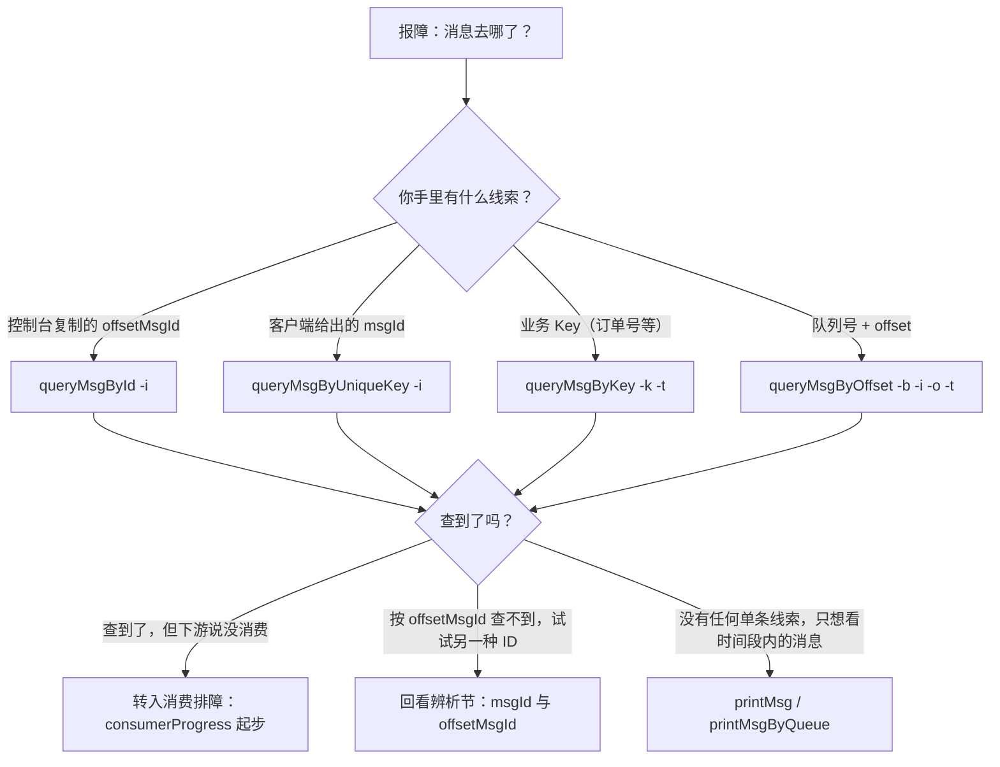
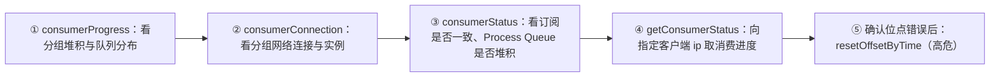
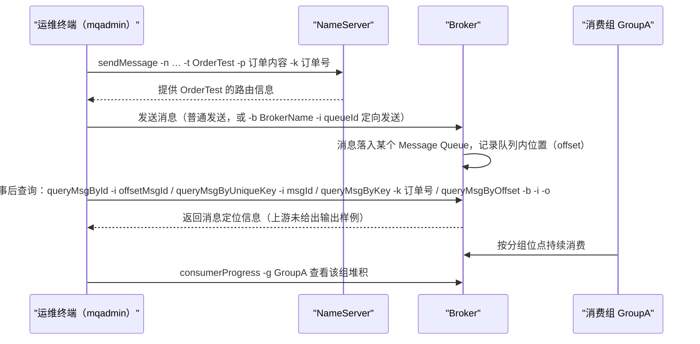

## 为什么需要 mqadmin 消息与消费命令？（痛点引入）

先看两个几乎每个 RocketMQ 运维都会撞上的现场。

**现场一：「订单消息没收到」。** 业务同学说某笔订单的状态变更消息下游没消费到。你要回答三个问题：这条消息**到底有没有进 Broker**？如果进来了，它**躺在哪个 Broker、哪个队列、哪个 offset 上**？如果消息在，**消费组为什么没动**？没有 mqadmin 的消息与消费命令，这三问只能靠写一次性客户端代码、翻 commitlog 二进制文件来回答——每一问都是半小时起步。

**现场二：消费事故后的「倒带」。** 消费组带 bug 上线，把最近两小时的消息全部标记成功消费掉了；修复后要做的第一件事，是把该消费组的消费位点**重置回两小时前的时间戳**，让它重新消费。这件事由 `resetOffsetByTime` 一条命令完成，但它会同时重置 Broker 与 consumer 两侧的位点（上游含义列原文：**「按时间戳重置offset，Broker和consumer都会重置」**），属于典型的高危操作，参数含义与影响范围必须先搞清楚再动手。

| 维度 | 没有这 18 条命令时的痛苦 | 有了这 18 条命令之后 |
|------|--------------------------|----------------------|
| 消息定位 | 写临时消费代码、全队列扫消息体 | `queryMsgById` / `queryMsgByKey` / `queryMsgByOffset` / `queryMsgByUniqueKey` 按四种线索直达 |
| 消息内容核查 | 只能等业务方把收到的内容贴出来 | `printMsg` / `printMsgByQueue` 按时间段从 Broker 拉出来打印 |
| 发送链路探测 | 靠业务流量「试错」才知道链路慢 | `checkMsgSendRT` 主动检测向 topic 发消息的 RT；`sendMessage` 造一条测试消息 |
| 消费故障 | 分不清「没连上」还是「堆积」还是「订阅不一致」 | `consumerProgress` / `consumerStatus` / `getConsumerStatus` / `consumerConnection` 分层排查 |
| 位点与订阅管理 | 只能改代码重启碰运气 | `resetOffsetByTime` / `cloneGroupOffset` 调整位点，`updateSubGroup` / `deleteSubGroup` 管理订阅关系（高危，见后文清单） |

> ### 💡 新人小结：mqadmin 的消息与消费命令像什么？
>
> 把 Broker 想象成一座**图书馆**：
> - offsetMsgId = 馆藏坐标编号：这本书此刻在哪个馆、哪排架，按坐标调卷（`queryMsgById`）。
> - msgId = 书脊上的流水号：书换个架子流水号不变，但要按另一套目录找（`queryMsgByUniqueKey`）。
> - Key = 书里夹的索引卡：读者只记得「卡上写了订单号」，按卡片找（`queryMsgByKey`）。
> - offset = 第几格书架：知道队列号和格数，直接抽出来（`queryMsgByOffset`）。
> - 消费位点 = 借阅台账：记录每个读书小组（消费组）读到第几格了；`consumerProgress` 查台账，`resetOffsetByTime` 把台账翻回某天的页码。
>
> **这 18 条命令的本质，是给你一套「按任何一条线索调卷、并按分组管理阅读进度」的图书馆管理员工具箱。**

**学习路线图**（本文按八段推进）

```
痛点引入 → 决策树/速查表 → msgId与offsetMsgId辨析 → 术语表 → 消息相关10条 → 消费相关6条 → 连接相关2条 → 高危检查清单+总表
找场景      选命令          先解开最高频困惑          对齐词汇   查/发/打印     进度/状态/订阅   网络连接      位点重置守则
```

### 本篇范围、上下篇分工与两条通用前提

本文覆盖上游源文件「消息相关」「消费相关」「连接相关」三个小节的全部 18 条命令；Topic、集群、Broker、NameServer 及其它命令由上篇负责。

> [!NOTE] 上游缺陷提示
> 上游源文件的「Broker相关」小节表格与「消息相关」小节逐行相同，即 Broker 侧命令上游实际未撰写；该问题的完整论证与记录见上篇《[mqadmin 命令参考：主题、集群与 Broker](/docs/06-operations/命令行工具/mqadmin命令参考-主题集群与broker/)》。本篇只解释消息侧命令，不再重复论证。

> [!NOTE] 版本适用：4.x 与 5.0 无差异
> 本篇覆盖的「消息相关／消费相关／连接相关」区间，上游 4.x 与 5.0 两份源文件逐字节相同，命令名与选项无版本差异，因此合并为一份写。

阅读本文示例前需要三条通用前提（上游源文件开头的注意事项原文口径，全量解读见上篇）：

1. **执行方法**：`./mqadmin {command} {args}`。
2. **几乎所有命令都需要 `-n`**（NameServer 地址，格式 ip:port）并支持 **`-h`** 打印帮助；示例中的 `127.0.0.1:9876` 为占位地址，请换成你的真实值。
3. **`-b` 与 `-c` 同时存在时优先按 `-b`（Broker 地址）执行**；不配 `-b` 则对集群中所有主机执行，只支持一个 Broker 地址，`-b` 格式 ip:port、port 默认 10911。这条规则直接约束 `updateSubGroup` / `deleteSubGroup` 的影响范围。

---

## 按排查场景选命令（决策树与场景速查表）

一切从「消息去哪了」出发。下图是选命令的决策流：先看你手里有什么线索，再决定用哪条 `queryMsgBy*`；查到了但业务说没消费，转入消费排障。



图后解读：

- 四条 `queryMsgBy*` 是**并列的四条线索入口**，不是先后关系；哪条线索在手就用哪条。
- `queryMsgById` 与 `queryMsgByUniqueKey` 用错 ID 类型是查不到的第一大原因，所以决策树里专门画了一条「换一种 ID 再查」的回边，详见下一节辨析。
- 「只想看一批消息」时不走单条查询，用 `printMsg`（按 topic＋时间段）或 `printMsgByQueue`（再指定到具体队列）。

消费侧「消费不到／堆积」的排查有明确先后顺序：**先确认消息在（上面四条查询）→ `consumerProgress` 看堆积分布 → `consumerConnection` 看实例是否连在服务端 → `consumerStatus` 看订阅一致性与 Process Queue → 确认是位点问题才动用 `resetOffsetByTime`**。下图把这个顺序画出来，虚线左侧全部只读，只有最后一步是高危写操作。



场景速查表：

| 排查场景 | 首选命令 | 常配合的命令 | 风险 |
|----------|----------|--------------|------|
| 客户/控制台给出了一个 ID，要看这条消息 | `queryMsgById`（offsetMsgId）或 `queryMsgByUniqueKey`（msgId） | `printMsg` 交叉核对内容 | 低；`queryMsgByUniqueKey` 配 `-g`/`-d` 会真实消费，为中 |
| 只记得业务主键（订单号） | `queryMsgByKey` | `queryMsgByOffset` 取同队列邻居消息 | 低 |
| 从进度/日志里拿到了队列号与 offset | `queryMsgByOffset` | `consumerProgress` 提供队列与 offset 线索 | 低 |
| 怀疑发送链路本身变慢 | `checkMsgSendRT` | 上篇的 `clusterRT`（上游原文：功能类似 clusterRT） | 中：检测即向 topic 发消息 |
| 手工造一条测试消息 | `sendMessage` | `queryMsgByKey`（发送时带上 `-k`，事后按键找回） | 中：真实写入 |
| 验证某条消息能否被指定消费者消费 | `queryMsgByUniqueKey -g -d` | `consumerConnection` 先拿 clientId | 中：让特定消费者真实消费 |
| 按时间段抽查消息内容 | `printMsg` | `printMsgByQueue` 缩小到单队列 | 中：上游含义列为「从Broker消费消息并打印」 |
| 消费堆积，先看全局 | `consumerProgress` | `-s` 打印 client IP 定位到实例 | 低 |
| 怀疑组内订阅不一致 / Process Queue 堆积 | `consumerStatus` | `-s` 返回消费者 jstack 结果 | 低 |
| 看某个消费实例的消费进度 | `getConsumerStatus` | `consumerConnection` 先确认该 ip 在线 | 低 |
| 事故后要回拨消费位点 | `resetOffsetByTime` | 执行前先跑 `consumerProgress` 留底 | **高**：Broker 与 consumer 都重置 |
| 新消费组要沿用老组的进度 | `cloneGroupOffset` | `updateSubGroup` 保证目标组订阅关系就绪 | **高** |
| 调整消费组订阅属性（允许消费/广播/重试等） | `updateSubGroup` | `deleteSubGroup` 为反向操作 | **高** |
| 删除某组在 Broker 上的订阅关系 | `deleteSubGroup` | 先确认执行范围（`-b`/`-c`） | **高** |
| 消费者是否连在服务端 | `consumerConnection` | `consumerStatus -i clientId` 深挖单实例 | 低 |
| 生产者是否连在服务端 | `producerConnection` | `checkMsgSendRT` 验证发送链路 | 低 |

### 一条消息从发送到查回的完整链路

下图用本文自己的命令串起「发送 → 存储 → 按线索查回」的时序，示例 topic 统一用 `OrderTest`（占位名）：



图后解读：`sendMessage` 产生的消息同时留下多种可查线索（队列内的 offset、消息 Key、两个 ID），事后四条 `queryMsgBy*` 分别吃其中一种线索；`-k`（keys）在发送时就写入，这正是「发送时带上业务 Key，事后才查得回来」这条实践习惯在命令层面的依据。

---

## msgId 与 offsetMsgId：为什么两条命令查不到同一条消息？（痛点辨析）

**痛点场景。** 开发同学从业务日志里贴给你一个 ID，说「这就是那条订单消息」；你顺手把它传给 `queryMsgByUniqueKey -i` 的另一半同事却从开源控制台里复制了一个 ID 传给 `queryMsgById -i`。两人都坚信自己查的是同一条消息，结果一个查到、一个查不到，来回扯皮半小时。根源在于：**RocketMQ 的一条消息对应两个不同的 ID，上游在两条命令的含义列里明确把它们分给了不同命令**——上游原文：

> `queryMsgById` 含义列：「根据offsetMsgId查询msg，如果使用开源控制台，应使用offsetMsgId，此命令还有其他参数，具体作用请阅读QueryMsgByIdSubCommand。」
> `queryMsgByUniqueKey` 含义列：「根据msgId查询，msgId不同于offsetMsgId，区别详见常见运维问题。-g，-d配合使用，查到消息后尝试让特定的消费者消费消息并返回消费结果」

把上游这两段含义列与各自的选项表放在一起，就是本篇最重要的对照表：

| 对比维度 | msgId | offsetMsgId |
|----------|-------|-------------|
| 上游锚定的查询命令 | `queryMsgByUniqueKey`（含义列：根据 msgId 查询） | `queryMsgById`（含义列：根据 offsetMsgId 查询） |
| 该命令选项表中 `-i` 的说明原文 | `-i`：unique msg id | `-i`：msgId（注意：选项说明列只写「msgId」，含义列明确要传 offsetMsgId，以下一节解释） |
| 开源控制台场景 | 上游未展开 | 上游明确：「如果使用开源控制台，应使用 offsetMsgId」 |
| 两 ID 的底层区别 | 上游本篇未展开，原文指向「常见运维问题」文档（见本站《[常见问题 FAQ](/docs/10-community/常见问题/常见问题faq/)》） | 同左 |
| 格式、长度、构成 | 上游本篇未给出 | 上游本篇未给出 |
| 典型失败原因 | 把控制台复制来的 offsetMsgId 传给本命令 | 把客户端给出的 msgId 传给本命令 |

**为什么 `queryMsgById` 的选项表里 `-i` 写的是「msgId」？** 这是上游文本自身的一处易混点：选项说明列只写了「msgId」三个字，而含义列明确说本命令「根据 offsetMsgId 查询 msg，如果使用开源控制台，应使用 offsetMsgId」。本文按含义列为使用口径——`queryMsgById` 传 offsetMsgId；两处文字的差异如实呈现如上表，不替上游强行圆场。

**「为什么两条命令查不到同一条消息」的完整回答：** 两条命令各自只认一种 ID；把 A 类型的 ID 塞进只认 B 类型 ID 的命令，查询自然落空。所以排障第一步不是反复重试，而是**先确认你手里的 ID 到底是哪一个**：来自开源控制台的是 offsetMsgId（上游口径），来自客户端侧的是 msgId；拿不准时两种 ID 把两条命令各跑一次，谁查到算谁。

> ### 💡 新人小结：msgId 和 offsetMsgId 到底怎么区分？
>
> 想象你在图书馆找同一本书：
> - msgId 像**书脊上的流水号**：这本书自己带的编号，读者（客户端）借出去时抄下的就是它。
> - offsetMsgId 像**馆藏坐标编号**：编号里隐含「在哪个馆、哪排架」，图书馆自己的检索台（控制台）登记的是它。
> - 两条检索通道各认一种编号：拿书脊号去架位检索机（queryMsgById）查不到，反过来也一样。
> - 书只有一本，编号却有两个——「查不到」不代表消息丢了，只代表你用错了号码和机器的组合。
>
> **一条消息、两把钥匙；先认清手里是哪把，再决定开哪条命令的锁。**

---

## 术语表：先对齐词汇，再读 18 条命令

下表覆盖本篇出现的专名与缩写。「全称」列中上游原文未出现的英文术语以「—」标注，对应关系写在「在本文中的角色」列，不做版本外推定。

| 术语 | 全称 | 含义（用自己的话） | 在本文中的角色 |
|------|------|--------------------|----------------|
| NameServer | — | RocketMQ 的路由注册中心，命令里 `-n` 要填它的地址（格式 ip:port） | 几乎所有命令的定位入口参数 |
| Broker | — | 真正存储与收发消息的服务端进程 | 消息查询、位点重置的作用对象 |
| BrokerName / Broker地址 | — | Broker 的名字（可在 clusterList 查到）与它的 ip:port 访问地址，是两回事 | `queryMsgByOffset -b` 填名称，`updateSubGroup -b` 填地址，见同名选项陷阱节 |
| BrokerId | — | 同一 Broker 名称下主备机的编号（上游 updateSubGroup -w 说明举例「例如1」） | 出现在 `updateSubGroup -i/-w` 的备机消费配置里 |
| Topic | 主题 | 一类业务消息的分组容器，命令里用 `-t` 指定名称 | 绝大多数消息命令的必带定位信息 |
| MessageQueue / QueueId | 消息队列 / 队列编号 | Topic 下的实际存储单元及其编号 | `queryMsgByOffset -i`、`sendMessage -i`、`printMsgByQueue -i` 的对象 |
| Offset / BrokerOffset | 队列内位置编号 / Broker 侧位点 | 消息在队列里按到达先后的位置值；`queryMsgByOffset -o` 传的「offset 值」就是它 | 「按坐标调卷」的坐标；位点重置改的就是各组指向各队列 offset 的进度 |
| ConsumerOffset / consumeOffset | 消费位点 | 消费组在一个队列上「读到哪了」的进度值；上游在 `resetOffsetByTime -f` 说明原文中以 consumeOffset 出现 | 决定堆积量；位点重置类命令的直接作用对象 |
| ConsumeFromWhere | 起始消费位置策略 | 消费组第一次开始消费时从哪里起点的策略；上游本篇未出现该英文术语，对应选项是 `updateSubGroup -m`「是否从最小offset开始消费」 | 理解 `updateSubGroup -m` 与位点语义的桥 |
| msgId | 消息 ID（客户端侧） | 与消息自身关联的标识，上游把它分配给 `queryMsgByUniqueKey` 作查询键（选项说明「unique msg id」） | 辨析节双钥匙之一 |
| offsetMsgId | 消息 ID（存储位置侧） | 上游分配给 `queryMsgById` 的查询键，开源控制台场景应使用它 | 辨析节双钥匙之二 |
| UniqueKey | 唯一键（unique msg id） | `queryMsgByUniqueKey` 中 `-i` 要传的 msgId 在上游选项表里的叫法 | 命令名与选项说明的对应关系 |
| MessageKey / keys | 消息键 | 发送时以 `-k` 写入的业务索引（如订单号），可按它检索消息 | `queryMsgByKey -k`、`sendMessage -k` |
| Tag / tags | 消息标签 | 主题之下的一级细分标记，发送 `-c tags`、过滤表达式与之相关 | `sendMessage -c`；与 subExpress 配合使用 |
| subExpress | 订阅过滤表达式 | `printMsg`/`printMsgByQueue` 的 `-s`：按表达式过滤要打印的消息 | 时间段抽查时的过滤器 |
| 订阅关系 | Subscription | 消费组订阅主题的规则与状态配置；`updateSubGroup`「更新或创建订阅关系」、`deleteSubGroup`「从Broker删除订阅关系」操作的就是它 | 本篇高危命令的两条作用对象 |
| consumerGroup | 消费者分组 | 一组消费逻辑一致的消费者的共同身份，命令里 `-g` 多指它 | 消费排查与位点操作的定位键 |
| producerGroup | 生产者分组 | 生产者侧的组身份，`producerConnection -g` 要填「生产者所属组名」 | 连接排查命令的键，注意与消费侧 `-g` 含义不同 |
| clientId | 客户端标识 | 消费者实例在组内的身份标识（`consumerStatus -i` 传它；`queryMsgByUniqueKey -d` 用它指定让哪个实例消费） | 把排查从「组」缩小到「实例」的钥匙 |
| Process Queue | — | 消费者实例内部的处理队列；`consumerStatus` 的含义列称其可「分析Process Queue是否堆积」 | 判断瓶颈在实例内部还是服务端的线索 |
| jstack | Java 线程栈快照 | `consumerStatus -s` 可返回消费者 jstack 结果 | 深挖单实例线程状态的输出 |
| RT | Response Time，响应时间 | `checkMsgSendRT`「检测向topic发消息的RT」的观测对象 | 发送链路健康度指标 |
| slaveReadEnable | 从备机读开关 | 上游 `updateSubGroup -i` 说明中提到的开关，开启时 `-i` 才有效 | 解释 `-i` 选项生效条件 |
| 广播模式 | — | `updateSubGroup -d`「是否是广播模式」所设置的消费方式 | 订阅关系属性之一 |
| c++ 客户端 | — | 除 Java 外的另一类客户端；`resetOffsetByTime -c` 决定是否重置其 offset | 位点重置时容易漏掉的第二批消费者 |

---

## 消息相关命令（10 条）

对应上游小节「## 消息相关」。每条命令一节：含义（上游原文）→ 选项表（由上游 HTML 表格转换，已丢弃全部样式）→ 仅使用该命令真实选项的 bash 示例。上游全篇没有输出样例，每条示例后如实标注。

### queryMsgById —— 按 offsetMsgId 定位一条消息

含义（上游原文）：

> 根据offsetMsgId查询msg，如果使用开源控制台，应使用offsetMsgId，此命令还有其他参数，具体作用请阅读QueryMsgByIdSubCommand。

| 命令选项 | 说明 |
|----------|------|
| -i | msgId |
| -h | 打印帮助 |
| -n | NameServer 服务地址，格式 ip:port |

```bash
# ========== ✅ 推荐：开源控制台复制来的 ID 走这条命令 ==========
./mqadmin queryMsgById -n 127.0.0.1:9876 -i <offsetMsgId>   # -i 传入 offsetMsgId（依据含义列，见辨析节）

# ========== 不推荐写法（仅展示） ==========
# ❌ 把客户端侧的 msgId 塞给本命令：msgId 应使用 queryMsgByUniqueKey，两种 ID 混用是「查不到」的头号原因
```

上游未给出输出样例。含义列提到「此命令还有其他参数」，上游未在本表格展开、只让阅读 QueryMsgByIdSubCommand，因此本表仅列上游给出的三个选项。

### queryMsgByKey —— 按业务 Key（如订单号）查消息

含义（上游原文）：

> 根据消息 Key 查询消息

| 命令选项 | 说明 |
|----------|------|
| -k | msgKey |
| -t | Topic 名称 |
| -h | 打印帮助 |
| -n | NameServer 服务地址，格式 ip:port |

```bash
# ✅ 业务方只记得订单号（发送方用 sendMessage -k 或客户端写入的 Key）时：
./mqadmin queryMsgByKey -n 127.0.0.1:9876 -t OrderTest -k ORDER_20261001_0001   # -k 传 msgKey，-t 限定主题

# ========== 不推荐写法（仅展示） ==========
# ❌ 漏掉 -t：Key 检索离不开主题定位，上游选项表同时给出 -k 与 -t，二者配套使用
```

上游未给出输出样例。

### queryMsgByOffset —— 按「Broker＋队列＋offset」坐标抽出一条消息

含义（上游原文）：

> 根据 Offset 查询消息

| 命令选项 | 说明 |
|----------|------|
| -b | Broker 名称，（这里需要注意 填写的是 Broker 的名称，不是 Broker 的地址，Broker 名称可以在 clusterList 查到） |
| -i | query 队列 id |
| -o | offset 值 |
| -t | topic 名称 |
| -h | 打印帮助 |
| -n | NameServer 服务地址，格式 ip:port |

```bash
# ✅ 三个坐标一个都不能少：Broker 名称（不是地址！名称可在 clusterList 查到，见上篇）+ 队列 id + offset 值
./mqadmin queryMsgByOffset -n 127.0.0.1:9876 -t OrderTest -b <brokerName> -i <queueId> -o <offset>

# ========== 不推荐写法（仅展示） ==========
# ❌ -b 填成 ip:port：上游在说明列专门提醒「填写的是 Broker 的名称，不是 Broker 的地址」
```

上游未给出输出样例。参数解释：`-b`/`-i`/`-o` 合起来就是辨析节类比里的「哪个馆、哪排架、第几格」；其中 offset 值可从 `printMsgByQueue`、消费进度等命令的输出里获得（本文后续示例链路即用到了这一配合）。

### queryMsgByUniqueKey —— 按 msgId 查消息，可指定消费者试消费

含义（上游原文）：

> 根据msgId查询，msgId不同于offsetMsgId，区别详见常见运维问题。-g，-d配合使用，查到消息后尝试让特定的消费者消费消息并返回消费结果

| 命令选项 | 说明 |
|----------|------|
| -h | 打印帮助 |
| -n | NameServer 服务地址，格式 ip:port |
| -i | unique msg id |
| -g | consumerGroup |
| -d | clientId |
| -t | topic名称 |

```bash
# ✅ 常规用法：只按 msgId 查询
./mqadmin queryMsgByUniqueKey -n 127.0.0.1:9876 -t OrderTest -i <msgId>

# ✅ 进阶用法：-g 与 -d 配合，查到消息后尝试让特定消费者消费并返回消费结果（上游含义列原文口径；clientId 可先用 consumerConnection 拿）
./mqadmin queryMsgByUniqueKey -n 127.0.0.1:9876 -t OrderTest -i <msgId> -g <consumerGroup> -d <clientId>

# ========== 不推荐写法（仅展示） ==========
# ❌ 随手加 -g/-d 做「验证」：这一步会让真实消费者消费这条消息，属于有副作用的操作，风险级别见总表
```

上游未给出输出样例。注意本命令的 `-d` 是 clientId，与其他命令中的 `-d`（结束时间戳/广播模式/目标消费者组）含义完全不同。

### checkMsgSendRT —— 检测向某 topic 发消息的 RT

含义（上游原文）：

> 检测向topic发消息的RT，功能类似clusterRT

| 命令选项 | 说明 |
|----------|------|
| -h | 打印帮助 |
| -n | NameServer 服务地址，格式 ip:port |
| -t | topic名称 |
| -a | 探测次数 |
| -s | 消息大小 |

```bash
# ✅ 探测 10 次、消息大小 1024 字节（两个数值均为示例值，上游未给默认值）
./mqadmin checkMsgSendRT -n 127.0.0.1:9876 -t OrderTest -a 10 -s 1024

# ========== 不推荐写法（仅展示） ==========
# ❌ 在业务高峰期对核心 topic 拉大 -a：本命令每次探测都真实向 topic 发消息，等于叠加一波发送流量
```

上游未给出输出样例。RT 即 Response Time（响应时间）；上游把本命令与 `clusterRT` 类比，后者属上篇「集群相关」范围。

### sendMessage —— 手工发一条消息（普通发送或定向到指定队列）

含义（上游原文）：

> 发送一条消息，可以根据配置发往特定Message Queue，或普通发送。

| 命令选项 | 说明 |
|----------|------|
| -h | 打印帮助 |
| -n | NameServer 服务地址，格式 ip:port |
| -t | topic名称 |
| -p | body，消息体 |
| -k | keys |
| -c | tags |
| -b | BrokerName |
| -i | queueId |

```bash
# ✅ 普通发送：务必带上 -k，事后可用 queryMsgByKey 找回这条测试消息
./mqadmin sendMessage -n 127.0.0.1:9876 -t OrderTest -p "hello-rocketmq" -k "SMOKE_TEST_001" -c TagTest

# ✅ 定向发送：加 -b BrokerName 与 -i queueId，把消息指定投到某个队列（复现「某队列有问题」时使用）
./mqadmin sendMessage -n 127.0.0.1:9876 -t OrderTest -p "hello-rocketmq" -b <brokerName> -i <queueId>

# ========== 不推荐写法（仅展示） ==========
# ❌ 不带 -k 的测试消息：事后只剩 ID 或坐标两条线索，失去了 queryMsgByKey 这条最省事的找回通道
```

上游未给出输出样例。参数解释：`-p` 是消息体；`-k`/`-c` 对应消息的 keys/tags；`-b` 在这里是 **BrokerName（名称）**，与 `updateSubGroup -b` 的「Broker地址」不同。

### consumeMessage —— 以指定分组按坐标或时间段真实消费消息

含义（上游原文）：

> 消费消息。可以根据offset、开始&结束时间戳、消息队列消费消息，配置不同执行不同消费逻辑，详见ConsumeMessageCommand。

| 命令选项 | 说明 |
|----------|------|
| -h | 打印帮助 |
| -n | NameServer 服务地址，格式 ip:port |
| -t | topic名称 |
| -b | BrokerName |
| -o | 从offset开始消费 |
| -i | queueId |
| -g | 消费者分组 |
| -s | 开始时间戳，格式详见-h |
| -d | 结束时间戳 |
| -c | 消费多少条消息 |

```bash
# ✅ 方式一：按坐标消费——指定分组、Broker 名称、队列与起点 offset，消费固定条数
./mqadmin consumeMessage -n 127.0.0.1:9876 -t OrderTest -g GroupA -b <brokerName> -i <queueId> -o <offset> -c 5

# ✅ 方式二：按时间段消费——用 -s 开始时间戳与 -d 结束时间戳圈定窗口（时间戳格式详见 -h，上游未给出格式）
./mqadmin consumeMessage -n 127.0.0.1:9876 -t OrderTest -g GroupA -b <brokerName> -i <queueId> -s <开始时间戳> -d <结束时间戳>

# ========== 不推荐写法（仅展示） ==========
# ❌ 对线上正式消费组随手执行：本命令以 -g 指定的分组身份真实消费，含义列明确「配置不同执行不同消费逻辑」，用错分组会动到业务进度
```

上游未给出输出样例。上游把细节指向 ConsumeMessageCommand（源码类名，上游如此表述，本文照录）。

### printMsg —— 按 topic 和时间段从 Broker 消费并打印消息

含义（上游原文）：

> 从Broker消费消息并打印，可选时间段

| 命令选项 | 说明 |
|----------|------|
| -h | 打印帮助 |
| -n | NameServer 服务地址，格式 ip:port |
| -t | topic名称 |
| -c | 字符集，例如UTF-8 |
| -s | subExpress，过滤表达式 |
| -b | 开始时间戳，格式参见-h |
| -e | 结束时间戳 |
| -d | 是否打印消息体 |

```bash
# ✅ 抽查一个时间窗内带某过滤表达式的消息，并打印消息体
./mqadmin printMsg -n 127.0.0.1:9876 -t OrderTest -c UTF-8 -s <subExpress> -b <开始时间戳> -e <结束时间戳> -d true

# ========== 不推荐写法（仅展示） ==========
# ❌ 不加时间窗与大范围 -s 过滤直接「全打一遍」：上游含义列写明这是「从 Broker 消费消息并打印」，范围过大会把排查终端刷到不可用
```

上游未给出输出样例。本命令的 `-b` 是**开始时间戳**而不是 Broker——这正是下一篇「同名选项陷阱」表里最典型的一行。

### printMsgByQueue —— 同 printMsg，但收敛到指定 Message Queue

含义（上游原文）：

> 类似printMsg，但指定Message Queue

| 命令选项 | 说明 |
|----------|------|
| -h | 打印帮助 |
| -n | NameServer 服务地址，格式 ip:port |
| -t | topic名称 |
| -i | queueId |
| -a | BrokerName |
| -c | 字符集，例如UTF-8 |
| -s | subExpress，过滤表达式 |
| -b | 开始时间戳，格式参见-h |
| -e | 结束时间戳 |
| -p | 是否打印消息 |
| -d | 是否打印消息体 |
| -f | 是否统计tag数量并打印 |

```bash
# ✅ 只翻一个队列：-a 指定 Broker 名称、-i 指定队列 id，再按 tag 统计数量辅助判断分布
./mqadmin printMsgByQueue -n 127.0.0.1:9876 -t OrderTest -a <brokerName> -i <queueId> -b <开始时间戳> -e <结束时间戳> -f true

# ========== 不推荐写法（仅展示） ==========
# ❌ 想按队列翻消息却用 printMsg：printMsg 没有队列定位选项；上游给「指定 Message Queue」的场景单开了本命令
```

上游未给出输出样例。与 `printMsg` 的差异集中在三处：多 `-i`/`-a`（队列与 Broker 定位）、多 `-p`（是否打印消息）与 `-f`（是否统计 tag 数量并打印）、Broker 名称的选项字母从 `-b` 换成了 `-a`。

### resetOffsetByTime —— 按时间戳重置消费位点（高危）

含义（上游原文）：

> 按时间戳重置offset，Broker和consumer都会重置

| 命令选项 | 说明 |
|----------|------|
| -h | 打印帮助 |
| -n | NameServer 服务地址，格式 ip:port |
| -g | 消费者分组 |
| -t | topic名称 |
| -s | 重置为此时间戳对应的offset |
| -f | 是否强制重置，如果false，只支持回溯offset，如果true，不管时间戳对应offset与consumeOffset关系 |
| -c | 是否重置c++客户端offset |

```bash
# ✅ 事故回拨：把 GroupA 对 OrderTest 的位点重置到指定时间戳对应的 offset（false 语义下仅支持回溯，见 -f 说明）
./mqadmin resetOffsetByTime -n 127.0.0.1:9876 -g GroupA -t OrderTest -s <时间戳>

# ========== 危险用法（仅展示，务必先读「高危检查清单」一节） ==========
# ❌ 不加核实就上 -f true：上游 -f 说明明确 true 时「不管时间戳对应offset与consumeOffset关系」，即跳过前后关系直接强改
# ❌ 组里有 c++ 客户端却漏掉 -c：上游 -c 说明为「是否重置c++客户端offset」，漏掉会造成两类客户端进度不一致
```

上游未给出输出样例。影响范围以含义列为准：**Broker 和 consumer 都会重置**，操作前检查项见后文高危清单节。

> ### 💡 新人小结：位点重置为什么高危？
>
> 把消费位点想象成**电子书的阅读进度**：
> - 正常消费 = 每读一页，App 帮你把进度页码往后记一格（ConsumerOffset 前进）。
> - `resetOffsetByTime -s 时间戳` = 把进度**翻回某天读到的页码**，之后的内容全部重读一遍。
> - 「Broker 和 consumer 都会重置」意味着**书架的存档和你的 App 进度同时被改**——只改一边就会两边对不上。
> - `-f true` 相当于无视「当前读到哪」强行定位；上游明确 false 时只支持回溯，就是这个安全阀。
>
> **重置位点不是「让消费组重试一下」，而是改写存档——先确认对象（-g/-t）、时间点（-s）、安全阀（-f）和客户端范围（-c）四件事再动手。**

---

## 消费相关命令（6 条）

对应上游小节「## 消费相关」。前两条与 getConsumerStatus 是只读排查三件套，后三条动的是订阅关系与位点，属高危。

### consumerProgress —— 看消费组的堆积全景，可下钻到 client IP

含义（上游原文）：

> 查看订阅组消费状态，可以查看具体的client IP的消息积累量

| 命令选项 | 说明 |
|----------|------|
| -g | 消费者所属组名 |
| -s | 是否打印client IP |
| -h | 打印帮助 |
| -n | NameServer 服务地址，格式 ip:port |

```bash
# ✅ 排障第一站：看分组每个队列的积累量
./mqadmin consumerProgress -n 127.0.0.1:9876 -g GroupA

# ✅ 下钻到实例：加 -s 打印 client IP，看积压具体落在哪个消费者实例上
./mqadmin consumerProgress -n 127.0.0.1:9876 -g GroupA -s true

# ========== 不推荐写法（仅展示） ==========
# ❌ 只盯总量不下钻：上游说明本命令「可以查看具体的client IP的消息积累量」，放弃这条线索等于放弃了「单实例拖后腿」的定位手段
```

上游未给出输出样例。

### consumerStatus —— 组内订阅一致性、Process Queue 堆积与 jstack

含义（上游原文）：

> 查看消费者状态，包括同一个分组中是否都是相同的订阅，分析Process Queue是否堆积，返回消费者jstack结果，内容较多，使用者参见ConsumerStatusSubCommand

| 命令选项 | 说明 |
|----------|------|
| -h | 打印帮助 |
| -n | NameServer 服务地址，格式 ip:port |
| -g | consumer group |
| -i | clientId |
| -s | 是否执行jstack |

```bash
# ✅ 先检查组内订阅是否一致（内容较多，上游把细节指向 ConsumerStatusSubCommand）
./mqadmin consumerStatus -n 127.0.0.1:9876 -g GroupA

# ✅ 再对单个实例开 jstack：clientId 可从 consumerConnection 的输出获取
./mqadmin consumerStatus -n 127.0.0.1:9876 -g GroupA -i <clientId> -s true

# ========== 不推荐写法（仅展示） ==========
# ❌ 不带 -i 直接全组 -s：本命令返回内容多，对全部实例执行 jstack 会产生大量输出，建议先缩小到单实例
```

上游未给出输出样例。本命令的 `-s` 是「是否执行jstack」，与 consumerProgress 的 `-s`（是否打印client IP）字母相同、含义不同。

### getConsumerStatus —— 向指定消费实例取消费进度

含义（上游原文）：

> 获取 Consumer 消费进度

| 命令选项 | 说明 |
|----------|------|
| -g | 消费者所属组名 |
| -t | 查询主题 |
| -i | Consumer 客户端 ip |
| -n | NameServer 服务地址，格式 ip:port |
| -h | 打印帮助 |

```bash
# ✅ 定位到「组 × 主题 × 实例 ip」三元组的进度（-i 在这里是客户端 ip，不是 clientId）
./mqadmin getConsumerStatus -n 127.0.0.1:9876 -g GroupA -t OrderTest -i <consumer客户端ip>

# ========== 不推荐写法（仅展示） ==========
# ❌ 拿 consumerProgress 的 client IP 列表却不带 -t：本命令按主题维度取进度，上游选项表同时给出 -t
```

上游未给出输出样例。三个消费排查命令的分工见下表：

| 对比项 | consumerProgress | consumerStatus | getConsumerStatus |
|--------|------------------|----------------|-------------------|
| 回答的问题 | 组堆积了多少、积压在哪些队列/实例 | 组内订阅是否一致、实例内部 Process Queue 是否堆积、线程栈 | 某个实例在某个主题上的消费进度 |
| 定位维度 | `-g`（组），可选 `-s` 打印 client IP | `-g`，可选 `-i` clientId、`-s` 执行 jstack | `-g` + `-t` + `-i` 客户端 ip |
| 输出体量 | 常规 | 上游明确「内容较多」 | 上游未提示体量 |
| 在决策树中的位置 | 消费排障第 ① 步 | 第 ③ 步 | 第 ④ 步 |

### updateSubGroup —— 更新或创建订阅关系（高危）

含义（上游原文）：

> 更新或创建订阅关系

| 命令选项 | 说明 |
|----------|------|
| -n | NameServer 服务地址，格式 ip:port |
| -h | 打印帮助 |
| -b | Broker地址 |
| -c | 集群名称 |
| -g | 消费者分组名称 |
| -s | 分组是否允许消费 |
| -m | 是否从最小offset开始消费 |
| -d | 是否是广播模式 |
| -q | 重试队列数量 |
| -r | 最大重试次数 |
| -i | 当slaveReadEnable开启时有效，且还未达到从slave消费时建议从哪个BrokerId消费，可以配置备机id，主动从备机消费 |
| -w | 如果Broker建议从slave消费，配置决定从哪个slave消费，配置BrokerId，例如1 |
| -a | 当消费者数量变化时是否通知其他消费者负载均衡 |

```bash
# ✅ 新建/更新一个分组的订阅关系；不带 -b 时按集群名对集群所有主机执行（上游通用规则：-b 与 -c 并存优先 -b）
./mqadmin updateSubGroup -n 127.0.0.1:9876 -c DefaultCluster -g GroupA -s true

# ✅ 调整起始消费位置与重试策略：是否从最小 offset 开始消费（-m）、重试队列数量（-q）、最大重试次数（-r）
./mqadmin updateSubGroup -n 127.0.0.1:9876 -b <ip:port> -g GroupA -m true -q <重试队列数量> -r <最大重试次数>

# ========== 不推荐写法（仅展示） ==========
# ❌ 用 -s false「暂停消费」却忘了事后恢复：该选项语义是「分组是否允许消费」，直接影响线上消费
# ❌ 备机相关选项 -i/-w 在不了解 slaveReadEnable 状态时随手配：上游明确 -i「当slaveReadEnable开启时有效」
```

上游未给出输出样例。`-i` 与 `-w` 都涉及「从 slave（备机）消费」：前者是**建议**从哪个 BrokerId 消费，后者是当 Broker 已建议从 slave 消费时**决定**从哪个 slave 消费（配置 BrokerId，上游举例 1）。

### deleteSubGroup —— 从 Broker 删除订阅关系（高危）

含义（上游原文）：

> 从Broker删除订阅关系

| 命令选项 | 说明 |
|----------|------|
| -n | NameServer 服务地址，格式 ip:port |
| -h | 打印帮助 |
| -b | Broker地址 |
| -c | 集群名称 |
| -g | 消费者分组名称 |

```bash
# ✅ 只删一台 Broker 上的订阅关系：显式给 -b（格式 ip:port，port 默认 10911）
./mqadmin deleteSubGroup -n 127.0.0.1:9876 -b <ip:10911> -g GroupOld

# ✅ 对集群全部主机执行：不给 -b，只给 -c 集群名称（上游通用规则第 4 条）
./mqadmin deleteSubGroup -n 127.0.0.1:9876 -c DefaultCluster -g GroupOld

# ========== 不推荐写法（仅展示） ==========
# ❌ 分不清 -b/-c 作用范围就执行删除：漏 -b 时影响面是「集群中所有主机」，与只删一台完全是两种事故规模
```

上游未给出输出样例。

### cloneGroupOffset —— 让目标组直接沿用源组的位点（高危）

含义（上游原文）：

> 在目标群组中使用源群组的offset

| 命令选项 | 说明 |
|----------|------|
| -n | NameServer 服务地址，格式 ip:port |
| -h | 打印帮助 |
| -s | 源消费者组 |
| -d | 目标消费者组 |
| -t | topic名称 |
| -o | 暂未使用 |

```bash
# ✅ 新消费组要接着老组的进度消费：把源组 GroupA 在 OrderTest 上的 offset 克隆给目标组 GroupB
./mqadmin cloneGroupOffset -n 127.0.0.1:9876 -s GroupA -d GroupB -t OrderTest

# ========== 不推荐写法（仅展示） ==========
# ❌ 给 -o 赋予任何期望：上游说明列原文为「暂未使用」，该选项目前没有行为语义
```

上游未给出输出样例。源组/目标组方向由 `-s`/`-d` 决定，写反即把新组进度克隆给老组，属于典型的「一字之差、事故翻倍」。

---

## 连接相关命令（2 条）

对应上游小节「## 连接相关」。两条命令结构极简，是消费/发送排障里「先确认人在不在线」的第一步。

### consumerConnection —— 查询 Consumer 的网络连接

含义（上游原文）：

> 查询 Consumer 的网络连接

| 命令选项 | 说明 |
|----------|------|
| -g | 消费者所属组名 |
| -n | NameServer 服务地址，格式 ip:port |
| -h | 打印帮助 |

```bash
# ✅ 列出分组当前连在服务端上的消费者实例（clientId 从这里拿，供 consumerStatus -i 与 queryMsgByUniqueKey -d 使用）
./mqadmin consumerConnection -n 127.0.0.1:9876 -g GroupA

# ========== 不推荐写法（仅展示） ==========
# ❌ 用它替代 consumerProgress 看堆积：本命令只回答「连接是否存在」，不带消费进度信息
```

上游未给出输出样例。

### producerConnection —— 查询 Producer 的网络连接

含义（上游原文）：

> 查询 Producer 的网络连接

| 命令选项 | 说明 |
|----------|------|
| -g | 生产者所属组名 |
| -t | 主题名称 |
| -n | NameServer 服务地址，格式 ip:port |
| -h | 打印帮助 |

```bash
# ✅ 确认某生产者组是否连着、并按主题维度查询
./mqadmin producerConnection -n 127.0.0.1:9876 -g GroupP -t OrderTest

# ========== 不推荐写法（仅展示） ==========
# ❌ 把 -g 当成消费者组填：本命令的 -g 上游说明为「生产者所属组名」，与消费侧命令的 -g 不同义
```

上游未给出输出样例。

---

## 同名选项陷阱：一张表避开 80% 的「参数没报错但做错了事」

mqadmin 的选项字母**按命令独立定义**，同一个字母在不同命令里语义完全不同。本篇 18 条命令里最容易踩的对照如下（全部取自各命令「说明」列原文口径）：

| 选项 | 命令 | 该命令中的含义（上游说明列） |
|------|------|------------------------------|
| -b | queryMsgByOffset | Broker 名称（明确提醒不是地址，名称可在 clusterList 查到） |
| -b | sendMessage / consumeMessage | BrokerName |
| -b | updateSubGroup / deleteSubGroup | Broker地址 |
| -b | printMsg / printMsgByQueue | 开始时间戳，格式参见-h（注意：consumeMessage 的开始时间戳在 -s，其 -b 仍是 BrokerName） |
| -i | queryMsgByOffset / sendMessage / consumeMessage / printMsgByQueue | 队列 id / queueId |
| -i | consumerStatus | clientId |
| -i | getConsumerStatus | Consumer 客户端 ip |
| -i | updateSubGroup | slaveReadEnable 开启时，建议从哪个 BrokerId 消费 |
| -s | checkMsgSendRT | 消息大小 |
| -s | consumeMessage | 开始时间戳，格式详见-h |
| -s | printMsg / printMsgByQueue | subExpress，过滤表达式 |
| -s | resetOffsetByTime | 重置为此时间戳对应的offset |
| -s | consumerProgress | 是否打印client IP |
| -s | consumerStatus | 是否执行jstack |
| -s | updateSubGroup | 分组是否允许消费 |
| -s | cloneGroupOffset | 源消费者组 |
| -d | consumeMessage | 结束时间戳 |
| -d | printMsg / printMsgByQueue | 是否打印消息体 |
| -d | queryMsgByUniqueKey | clientId |
| -d | updateSubGroup | 是否是广播模式 |
| -d | cloneGroupOffset | 目标消费者组 |
| -a | checkMsgSendRT | 探测次数 |
| -a | printMsgByQueue | BrokerName |
| -a | updateSubGroup | 当消费者数量变化时是否通知其他消费者负载均衡 |
| -c | sendMessage | tags |
| -c | printMsg / printMsgByQueue | 字符集，例如UTF-8 |
| -c | consumeMessage | 消费多少条消息 |
| -c | resetOffsetByTime | 是否重置c++客户端offset |
| -c | updateSubGroup / deleteSubGroup | 集群名称 |
| -o | queryMsgByOffset / consumeMessage | offset 值 / 从offset开始消费 |
| -o | cloneGroupOffset | 暂未使用 |

使用方法上的自保三式：

1. **每条命令先 `-h` 再看选项**——上游通用规则明确「几乎所有命令都可以通过 -h 获取帮助」，本表也替代不了当次执行前的那次帮助打印。
2. **复制示例时逐字母核对上表**——尤其是 `-b`（名称/地址/时间戳三种）、`-s`（七种含义）、`-d`（五种含义）。
3. **写操作前先跑同目标的只读命令留底**——如位点操作前跑 `consumerProgress`，连接类判断先跑 `consumerConnection`。

---

## 位点重置与订阅变更：高危操作前检查清单

四条高危命令（`resetOffsetByTime`、`cloneGroupOffset`、`updateSubGroup`、`deleteSubGroup`）共同特点：**改动的是服务端保存的分组位点或订阅关系**。以下语义与检查项全部取自上游「含义」「说明」列，不外推、不夸大。

| 命令 | 语义（上游原文要点） | 影响范围（上游原文依据） | 操作前检查项 |
|------|----------------------|--------------------------|--------------|
| resetOffsetByTime | 按时间戳重置offset | 含义列原文：**Broker和consumer都会重置** | ① `-g` 分组与 `-t` 主题逐一确认；② `-s` 重置为此时间戳对应的offset，时间戳本身要核；③ 是否加 `-f`：false 只支持回溯offset，true 不管时间戳对应offset与consumeOffset关系；④ 组内是否有 c++ 客户端、是否需 `-c` 一并重置 |
| cloneGroupOffset | 在目标群组中使用源群组的offset | 作用对象为 `-d` 目标消费者组 | ① `-s` 源组、`-d` 目标组方向别写反；② `-t` 主题确认；③ `-o` 上游标注「暂未使用」，不要依赖它 |
| updateSubGroup | 更新或创建订阅关系 | `-b` Broker地址 与 `-c` 集群名称二选一决定执行面：通用规则为「优先以 Broker 地址执行；不配置则对集群中所有主机执行」 | ① `-g` 分组名；② 逐项核对要改的属性：`-s` 是否允许消费、`-m` 是否从最小offset开始消费、`-d` 是否广播模式、`-q` 重试队列数量、`-r` 最大重试次数、`-a` 是否通知其他消费者负载均衡；③ 涉及备机消费时确认 slaveReadEnable 状态再看 `-i`/`-w` |
| deleteSubGroup | 从Broker删除订阅关系 | 同上条执行面规则（-b/-c） | ① `-g` 分组名二次确认；② 明确执行面：给 `-b` 只动一台，只给 `-c` 动集群所有主机 |

清单执行顺序建议（编号步骤）：

```
执行高危命令的标准动作
① 留底: 先跑对应只读命令（consumerProgress / consumerConnection / consumerStatus）
② 定面: 确认 -b/-c 决定的执行范围，是单机还是整个集群
③ 对键: -g/-t/-s/-d 等标识类选项逐字符核对，杜绝复制串行
④ 读回: 把 -f/-m/-d/-s 等开关的取值念一遍，与意图比对（false/true 语义以本篇选项表原文为准）
⑤ 执行: 一次只改一个对象；执行后立即用只读命令复查
```

> ### 💡 新人小结：这四条命令为什么被单列成「高危」？
>
> 把它们想象成**小区物业的四把钥匙**：
> - `resetOffsetByTime` = 全体住户的取件台账一起翻回上周（Broker 和 consumer 都会重置）。
> - `cloneGroupOffset` = 把 A 户的台账复印给 B 户，B 户从此「以为」自己读到哪了。
> - `updateSubGroup` = 改写住户的取件规则（允不允许取、按什么模式取、失败补几次）。
> - `deleteSubGroup` = 直接销户；只给 `-c` 时是整个集群范围的销户。
>
> **台账与规则类操作没有「顺便试一下」：影响范围写在 -b/-c 里，出错成本写在业务方脸上。**

---

## 本篇 18 条命令总表

风险分级口径：**低**＝上游含义为只读查询/状态打印；**中**＝会真实发送或真实消费（`queryMsgByUniqueKey -g/-d`、`consumeMessage`、`sendMessage`、`checkMsgSendRT`、`printMsg`、`printMsgByQueue`）；**高**＝改写服务端位点或订阅关系。所谓「核心定位选项」指执行该命令时用于锁定对象、且本文示例使用的选项；上游未标注必填项，通用规则「几乎所有命令都需要 -n」对下表全部成立。

| 命令 | 用途（一句话） | 核心定位选项 | 风险等级 |
|------|----------------|--------------|----------|
| queryMsgById | 按 offsetMsgId 查询一条消息 | -i, -n | 低 |
| queryMsgByKey | 按消息 Key 查询消息 | -k, -t, -n | 低 |
| queryMsgByOffset | 按 Broker 名称＋队列＋offset 查询消息 | -b, -i, -o, -t, -n | 低 |
| queryMsgByUniqueKey | 按 msgId 查询消息；-g/-d 配合可让指定消费者试消费 | -i, -t, -n（可选 -g, -d） | 中 |
| checkMsgSendRT | 检测向 topic 发消息的 RT，功能类似 clusterRT | -t, -n（可选 -a, -s） | 中 |
| sendMessage | 发送一条消息，可定向到指定 Message Queue | -t, -p, -n（可选 -k, -c, -b, -i） | 中 |
| consumeMessage | 按 offset 或起止时间戳以指定分组消费消息 | -t, -g, -n（坐标用法 -b/-i/-o/-c；时间用法 -s/-d） | 中 |
| printMsg | 从 Broker 消费消息并打印，可选时间段 | -t, -n（可选 -b, -e, -s, -c, -d） | 中 |
| printMsgByQueue | 类似 printMsg，但指定 Message Queue | -t, -i, -n（可选 -a, -b, -e, -s, -c, -p, -d, -f） | 中 |
| resetOffsetByTime | 按时间戳重置位点，Broker 和 consumer 都会重置 | -g, -t, -s, -n（可选 -f, -c） | 高 |
| consumerProgress | 查看订阅组消费状态，可看具体 client IP 的积累量 | -g, -n（可选 -s） | 低 |
| consumerStatus | 查组内订阅一致性、Process Queue 堆积、jstack 结果 | -g, -n（可选 -i, -s） | 低 |
| getConsumerStatus | 获取指定 Consumer 实例的消费进度 | -g, -t, -i, -n | 低 |
| updateSubGroup | 更新或创建订阅关系 | -g, -n（执行范围 -b 或 -c） | 高 |
| deleteSubGroup | 从 Broker 删除订阅关系 | -g, -n（执行范围 -b 或 -c） | 高 |
| cloneGroupOffset | 在目标群组中使用源群组的 offset | -s, -d, -t, -n | 高 |
| consumerConnection | 查询 Consumer 的网络连接 | -g, -n | 低 |
| producerConnection | 查询 Producer 的网络连接 | -g, -t, -n | 低 |

---

## 要点总结

1. **两条 ID、两条命令，先认 ID 再选锁**：`queryMsgById` 按 offsetMsgId 查（开源控制台场景上游明确用 offsetMsgId），`queryMsgByUniqueKey` 按 msgId 查；两 ID 的进一步区别指向上游「常见运维问题」。混用 ID 是「消息明明在却查不到」的第一大原因。
2. **四条查询入口按线索并列**：offsetMsgId／msgId／Key／Broker＋队列＋offset 各配一条命令；没有单条线索时按时间段用 `printMsg`／`printMsgByQueue` 批量抽查。
3. **消费排障有固定先后**：`consumerProgress`（组堆积与 client IP）→ `consumerConnection`（实例在线与 clientId）→ `consumerStatus`（订阅一致性、Process Queue、jstack）→ `getConsumerStatus`（单实例进度）；确认位点错误之前不碰重置命令。
4. **位点与订阅是服务端存档，四条命令皆高危**：`resetOffsetByTime` 上游含义「Broker和consumer都会重置」，false/true 由 `-f` 控制、c++ 客户端由 `-c` 决定；`cloneGroupOffset` 的 `-o` 上游标注暂未使用；`updateSubGroup`/`deleteSubGroup` 的作用面由 `-b`/`-c` 按通用规则决定——不给 `-b` 就是集群所有主机。
5. **选项字母按命令独立定义**：`-b` 可能是 Broker 名称、Broker 地址或开始时间戳，`-s` 在本篇有七种含义；执行前 `-h` 打印帮助是唯一万金油，示例后「上游未给出输出样例」处也提醒：本文不虚构任何输出。

---

> ### 💡 新人小结：本篇 18 条命令学完了，记住这 5 点
>
> 1. **先问「手里是什么线索」再敲命令**：控制台号码走 `queryMsgById`，客户端号码走 `queryMsgByUniqueKey`，订单号走 `queryMsgByKey`，坐标走 `queryMsgByOffset`。
> 2. **查到 ≠ 消费到**：消息在库不等于读者翻到了；`consumerProgress` → `consumerConnection` → `consumerStatus` → `getConsumerStatus` 四步把「谁没读、为什么没读」钉死。
> 3. **高危四条背下来**：`resetOffsetByTime` 双侧重置、`cloneGroupOffset` 复制台账、`updateSubGroup` 改规则、`deleteSubGroup` 销户；动手前跑一遍本篇检查清单的五个编号步骤。
> 4. **同一字母不是同一个意思**：`-b`/`-s`/`-d` 的含义随命令切换，抄示例前先对照同名选项陷阱表，再 `-h` 确认一次。
> 5. **尊重上游的边界**：上游没给的输出样例本文一律标注「未给出」，上游指向 QueryMsgByIdSubCommand、ConsumeMessageCommand、ConsumerStatusSubCommand 的细节按其原文去读源码文档，其余主题/集群/Broker/NameServer 命令请接上篇。
