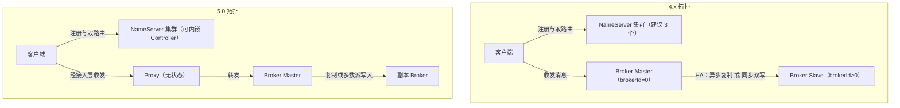
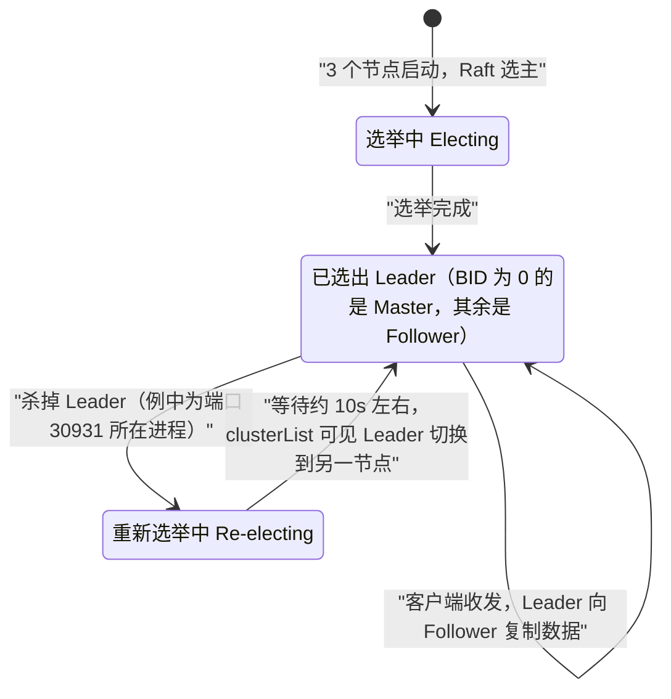
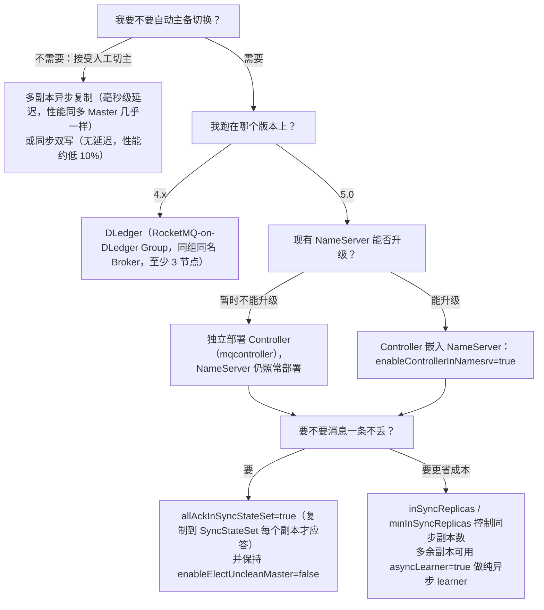

## 为什么需要生产级部署模式与容灾方案？（痛点引入）

单机跑起来只是「它能工作」；生产拓扑要回答的是「它坏的时候怎么办」。下面四件事都来自上游文档明确写出的风险，不是假想：

1. **单 Master 宕机 = 整个服务不可用。** 上游对「单组节点单副本模式」的原文告警是：Broker 只有一个节点，一旦 Broker 重启或者宕机时，会导致整个服务不可用，不建议线上环境使用，可以用于本地测试。
2. **同步双写虽然不丢消息，但主节点宕机后备机不能自动切换为主机。** 上游在同步双写模式的缺点里明确写了这条，且限定「目前版本」——意味着凌晨三点你必须自己爬起来切主。
3. **旧集群升级到 DLedger 时，主备 CommitLog 不对齐可能丢消息。** 上游要求用 `md5sum` 检查最近的至少 2 个 Commitlog 文件，不一致要通过拷贝对齐。
4. **Controller 模式下组件版本没配对，Broker 会「无法正常上线」。** 上游兼容性表里，「新版 Broker 开启 Controller 模式」遇上「旧版 Nameserver」或「新版 Nameserver 关闭 controller 功能」这两格写的就是无法正常上线。

| 维度 | 没有部署模式与容灾规划时的痛苦 | 规划之后的状态 |
|------|--------------------------------|----------------|
| 宕机影响面 | 一台 Broker 挂了整个服务不可用 | 副本组内仍有节点可读写，或自动选出新主 |
| 切换耗时 | 人工登录改配置、重启，时长取决于谁在线 | DLedger 自动切换，上游实测口径「等待约 10s 左右」可见 Leader 迁移 |
| 丢消息风险 | 出事后只能猜「到底丢没丢」 | 事先按模式定性：异步复制在 Master 宕机且磁盘损坏时丢少量；同步双写与 `allAckInSyncStateSet=true` 面向不丢 |
| 性能代价 | 上线后才发现吞吐掉了一截 | 上游给出同步双写「比异步复制模式略低（大约低 10% 左右）」这类可预算的代价 |
| 升级路径 | 原地升级把数据搞坏 | 上游分别给出 Master-Slave 可带数据原地升级、DLedger 需空盘升级的明确路径 |

> ### 💡 新人小结：手术室的供电方案
>
> 把 Broker 集群想成医院手术室的供电：
> - 单路市电（单 Master 单副本）：电闸一跳，手术台全黑——对应上游「会导致整个服务不可用」。
> - 双路市电但要跑配电房手动切（Master-Slave 异步复制／同步双写）：备用线路确实在，可是「备机不能自动切换为主机」这句话就是那句「得有人去合闸」。
> - 自动切换开关 + 柴油发电机（DLedger／Controller）：断电后系统自己选新主，上游给的口径是杀掉 Leader 后约 10s 左右能看到 Leader 切到另一个节点。
> - 发电机自己也要有冗余（Controller 三副本及以上）：只有一台控制器时，控制器一坏，切不了但存量手术还能继续——上游原话是「会影响切换能力，但不会影响存量集群的正常收发」。
>
> **部署模式选的不是「性能」，而是「坏的时候要不要人守着」。**

**学习路线图**

```text
拓扑差异 → 四种部署模式 → 风险对比 → DLedger → Controller → 选型决策树 → 排查清单
Local/    单副本/多组/   一致性/可用性/ Raft     自动主备     何时用哪套   起不来/不切
Cluster   异步/同步双写  丢消息风险     多数派     切换                     /丢消息
```

本文只覆盖**生产拓扑与容灾方案**。范围外的事项如下：单机跑起来的步骤在〈本地二进制部署与消息收发〉；mqadmin 的参数与示例在〈mqadmin 命令参考-主题集群与Broker〉；全量参数默认值大表在〈客户端与服务端参数配置〉；Kubernetes/Helm 的编排与端口清单在〈Kubernetes与Helm部署〉，上游部署篇本身没有给出编排细节，本文也不凭推测补写。

---

## 先对齐术语（术语表）

| 术语 | 全称 | 通俗含义（用自己的话） | 在本文中的角色 |
|------|------|------------------------|----------------|
| NameServer | 名字服务 | 存路由信息的轻量登记处，Broker 来登记、客户端来查询 | 所有部署模式都要先起它，上游建议生产起 3 个 |
| Broker | 消息服务器 | 真正把消息写到磁盘的那个进程 | 本文的主角，副本都长在它身上 |
| Proxy | 代理层 | 5.0 新增的接入层，客户端连它、由它对接 Broker | Local/Cluster 模式的区别就是它跟谁同进程 |
| Local 模式 | Broker 与 Proxy 同进程部署 | 在原有 Broker 配置基础上新增 Proxy 的简易配置就能跑 | 5.0 的默认推荐（无特殊需求或平滑升级时） |
| Cluster 模式 | Broker 与 Proxy 分别部署 | 在原有集群基础上额外再部署 Proxy | Proxy 需要独立扩容／隔离时用 |
| Master / Slave | 主／备 | 一组副本里对外写的那个和跟着复制的那个 | 异步复制、同步双写的两个角色 |
| brokerName | Broker 名称 | 同名的 Broker 属于同一副本组，靠它配对主备 | 配对规则的核心：主备同名 |
| brokerId | Broker 标识号 | Master 必须是 0，Slave 必须大于 0 | 手工指定；Controller 模式下改由 Controller 分配 |
| HA | High Availability，高可用 | 节点坏了服务还能继续的那套机制 | 上游用「HA 采用异步复制方式」描述主备复制 |
| 异步复制 | Async Replication | Master 先应答客户端，再慢慢把数据同步给 Slave | 主备有毫秒级短暂消息延迟 |
| 同步双写 | Sync Double Write | 主备都写成功才向应用返回成功 | 无延迟，但性能略低、不能自动切换 |
| 刷盘 | Flush | 数据从内存落到磁盘那一步 | 异步刷盘丢少量消息、同步刷盘一条不丢（上游口径） |
| RAID10 | 磁盘冗余阵列级别 10 | 既条带又镜像的磁盘阵列，坏一块盘数据还在 | 上游用它解释「机器不可恢复时消息也不丢」的前提 |
| CommitLog | 提交日志 | Broker 侧存放消息的日志文件（配置项 `storePathCommitLog` 指向它） | 升级容灾方案前必须确认主备它是一致的（上游要求用 md5sum 比对最近至少 2 个文件） |
| DLedger | 基于 Raft 协议的分布式日志存储组件 | 把「谁是主」交给 Raft 投票决定，可替换原生副本存储机制 | 4.x 时代的自动容灾方案 |
| Raft | 共识算法 | 一堆节点投票选 leader、多数派点头才算写成功 | DLedger 与 Controller 的地基 |
| RocketMQ-on-DLedger Group | DLedger 副本组 | 一组相同名称的 Broker，至少 3 节点，Raft 选 1 个 Leader 其余 Follower | 本文 DLedger 章节的部署单位 |
| Quorum / 多数派 | 多数派 | n 个节点里超过半数（`2n + 1` 至少 3 个才能容忍 1 个宕机） | 决定「还选不选出主」的那条线 |
| Leader / Follower |  leader／跟随者 | DLedger 组里被选出来的主和其余节点 | 上游口径：clusterList 结果中 BID 为 0 的是 Master，其余是 Follower |
| Controller | 主控组件 | 5.0 新增的选主组件，负责给 Broker 副本组分配角色 | 本文自动主备切换章节的主角 |
| SyncStateSet | 同步状态副本集合 | 当前跟得上 Master 的那批副本，选举与「够不够副本」都看它 | `minInSyncReplicas`、`haMaxTimeSlaveNotCatchup` 都作用在它身上 |
| epoch 文件 | 纪元文件 | 记录主备角色代际的元数据文件，Controller 模式引入 | 上游写明「非常重要，不可以随意删除」 |
| Failover | 故障切换 | 主节点故障时把备节点变成主节点 | 上游说 Controller 单副本也能完成 Broker Failover |
| RPO | Recovery Point Objective，恢复点目标 | 允许丢多少数据（丢 0 条还是丢少量） | 本文用它组织四种模式的丢消息差异 |
| RTO | Recovery Time Objective，允许不可用多久 | 故障到恢复之间的时间预算 | 本文唯一可引用的数值是 DLedger「约 10s 左右」切换 |
| TPS / QPS | Transactions/Queries Per Second | 每秒收发条数 | 上游用 `rocketmq_broker_tps` 等指标名描述生产/消费速率（详见监控篇） |
| RT | Response Time，响应时间 | 单条请求耗时 | 上游说同步双写「发送单个消息的 RT 会略高」 |
| 空盘升级 | 清数据后升级 | 清掉 store 目录下除元数据外的文件再上线 | DLedger 升级到 Controller 的唯一路径 |
| 原地升级 | In-place Upgrade | 带着数据停机—换包—启动 | Master-Slave 升级到 Controller 可走这条路 |

---

## 组件拓扑：4.x 与 5.0 差在哪

下图是两代拓扑的差异：左边 4.x 客户端直接面对 NameServer + Broker；右边 5.0 多了 Proxy 接入层，而 Proxy 自身无状态。



读图三条要点：

- 4.x 里客户端与 Broker 之间没有中间层，主备关系靠 `brokerName` + `brokerId` 手工配对。
- 5.0 里 Proxy 是新增的接入层。上游明确：Local 模式下 Proxy 和 Broker 同进程，**Proxy 本身无状态，因此主要的集群配置仍然以 Broker 为基础进行即可**；Cluster 模式下 Broker 与 Proxy 分别部署。
- 5.0 部署篇在 Local 与 Cluster 两种模式末尾都用同一句话指向「5.0 HA 新模式」：提供更具灵活性的 HA 机制，让用户更好地平衡成本、服务可用性、数据可靠性，同时支持业务消息和流存储的场景——这就是本文的 Controller 章节。

Local 与 Cluster 的取舍对照：

| 对比维度 | Local 模式 | Cluster 模式 |
|----------|------------|--------------|
| 进程组成 | Broker 与 Proxy 同进程 | Broker 与 Proxy 分开进程 |
| 配置成本 | 在原有 Broker 配置基础上新增 Proxy 的简易配置 | 在原有集群基础上额外再部署 Proxy |
| 上游建议 | 没有特殊需求或希望从早期版本平滑升级时选用 | 需要把接入层与存储层分开时选用 |
| Proxy 与集群对应关系 | 同进程，无需额外声明 | 一个 Proxy 集群和一个 Broker 集群**一一对应**，在 `rmq-proxy.json` 中用 `rocketMQClusterName` 配置 |
| 部署时机 | 与 Broker 一起启动 | 可在 NameServer 与 Broker 都启动完成之后再部署 Proxy |
| 无状态性 | Proxy 本身无状态，集群配置仍以 Broker 为基础 | 同左；可以在多台机器启动多个 Proxy |

### 同一场景的新旧启动写法对照（原则五）

场景固定为：**Local 模式下的单组节点单副本，启动 Broker+Proxy 并验证**。

旧写法（上游 4.x 目录版部署篇）：

```bash
# ========== 旧写法：4.x 目录版部署篇的启动命令 ==========
$ nohup sh mqproxy -n localhost:9876 &            # 直接用 mqproxy 脚本拉起 Broker+Proxy

### 验证 Broker 是否启动成功，例如 Broker 的 IP 为：192.168.1.2，且名称为 broker-a
$ tail -f ~/logs/rocketmqlogs/Broker.log          # 注意日志文件名首字母大写
The broker[xxx, 192.169.1.2:10911] boot success...
# 输出: The broker[xxx, 192.169.1.2:10911] boot success...（上游原文照抄）
```

新写法（上游 5.0 部署篇）：

```bash
# ========== ✅ 推荐写法（5.0 Local 模式）：Broker 脚本 + --enable-proxy ==========
$ nohup sh bin/mqbroker -n localhost:9876 --enable-proxy &   # 由 Broker 进程内启用 Proxy

### 验证 Broker 是否启动成功，例如 Broker 的 IP 为：192.168.1.2，且名称为 broker-a
$ tail -f ~/logs/rocketmqlogs/broker_default.log              # 日志文件名为 broker_default.log
The broker[xxx, 192.169.1.2:10911] boot success...
# 输出: The broker[xxx, 192.169.1.2:10911] boot success...（上游原文照抄）

# ========== 不推荐写法（仅展示） ==========
# ❌ 在线上只起这一个节点：上游 caution 原文——Broker 只有一个节点，一旦重启或宕机会导致整个服务不可用
```

逐维度对比：

| 对比维度 | 旧写法（4.x 目录版部署篇） | 新写法（5.0 部署篇 Local 模式） |
|----------|---------------------------|---------------------------------|
| 启动脚本 | `sh mqproxy -n localhost:9876` | `sh bin/mqbroker -n localhost:9876 --enable-proxy` |
| 语义 | 用 proxy 脚本一次把 Broker+Proxy 拉起来 | 显式在 Broker 上开 Proxy 开关，Local 模式含义写在命令里 |
| 验证日志文件 | `~/logs/rocketmqlogs/Broker.log` | `~/logs/rocketmqlogs/broker_default.log` |
| 校验输出 | 两者一致：`The broker[xxx, 192.169.1.2:10911] boot success...` | 同左 |
| 多组节点单副本 | `sh mqproxy -n 192.168.1.1:9876 -c $ROCKETMQ_HOME/conf/2m-noslave/broker-a.properties` | `sh bin/mqbroker -n 192.168.1.1:9876 -c $ROCKETMQ_HOME/conf/2m-noslave/broker-a.properties --enable-proxy` |
| 异步复制／同步双写 | `sh mqbroker ... -c $ROCKETMQ_HOME/conf/2m-2s-async(broker-a.properties)` | 同一路径，但追加 `--enable-proxy` |
| Cluster 模式整节 | 该版部署篇没有 Cluster 模式独立小节 | 有：NameServer → Broker → Proxy 三段，另有 `-pc` / `--proxyConfigPath` 指定配置文件 |
| 迁移成本与风险 | 旧脚本仍指向 proxy 入口，与 5.0 部署篇的示例不一致 | 按 5.0 写法可照抄官方示例；两套日志文件名要同步改到监控与采集里 |
| 旧写法仍适用之处 | 沿用旧版部署手册、按 `mqproxy` 单命令拉起的现网脚本 | 新集群、需要 Local 模式语义显式化的场景 |

> [!NOTE] 版本适用：两版部署篇的正文关系
> 上游 4.x 目录下的 `04-deployment/01deploy.md` 开头同样写了「Apache RocketMQ 5.0 版本完成基本消息收发，包括 NameServer、Broker、Proxy 组件」与 Local/Cluster 模式说明，即该页在 4.x 分支上已同步了 5.0 的说法；两版的**差异集中在启动命令（`mqproxy` 与 `mqbroker --enable-proxy`）、日志文件名、以及 Cluster 模式小节是否存在**。本文按「同一场景两套写法」并列给出，不把任一版当成通用结论。

---

## 部署模式的四级台阶：从单副本到同步双写

上游把非 DLedger 的部署方案排成四个台阶，台阶越高可用性越强、性能代价越大。下面逐台阶给命令与代价。

### 台阶 1：单组节点单副本（只用于本地测试）

> [!WARNING] 上游原文告警
> 这种方式风险较大，因为 Broker 只有一个节点，一旦 Broker 重启或者宕机时，会导致整个服务不可用。不建议线上环境使用，可以用于本地测试。

```bash
### 首先启动 Name Server
$ nohup sh mqnamesrv &
### 验证 Name Server 是否启动成功
$ tail -f ~/logs/rocketmqlogs/namesrv.log
The Name Server boot success...
# 输出: The Name Server boot success...（上游原文照抄）

### 再启动 Broker+Proxy（5.0 Local 模式写法见上一节）
```

NameServer 与 Broker 的启动顺序是有要求的：上游写明 **NameServer 需要先于 Broker 启动**；如果在生产环境使用，为了保证高可用，建议一般规模的集群启动 **3 个 NameServer**，各节点的启动命令相同。

### 台阶 2：多组节点（集群）单副本，全部 Master

一个集群内全部部署 Master 角色、不部署 Slave 副本，例如 2 个 Master 或 3 个 Master。

| 维度 | 上游结论（逐条保留） |
|------|----------------------|
| 优点 | 配置简单；单个 Master 宕机或重启维护对应用无影响；磁盘配置为 RAID10 时，即使机器宕机不可恢复，由于 RAID10 磁盘非常可靠，消息也不会丢（异步刷盘丢失少量消息，同步刷盘一条不丢）；性能最高 |
| 缺点 | 单台机器宕机期间，这台机器上未被消费的消息在机器恢复之前不可订阅，消息实时性会受到影响 |

```bash
### 在机器A，启动第一个Master，例如NameServer的IP为：192.168.1.1
$ nohup sh bin/mqbroker -n 192.168.1.1:9876 -c $ROCKETMQ_HOME/conf/2m-noslave/broker-a.properties --enable-proxy &

### 在机器B，启动第二个Master，例如NameServer的IP为：192.168.1.1
$ nohup sh bin/mqbroker -n 192.168.1.1:9876 -c $ROCKETMQ_HOME/conf/2m-noslave/broker-b.properties --enable-proxy &
# 上游示例在第二个 Master 之后以一行 ... 表示：后续 Master 沿用同样命令，只换配置文件
# 输出（逐个验证）: The broker[xxx, 192.169.1.2:10911] boot success...
```

参数解释：`-n` 指定 NameServer 地址，`-c` 指定 Broker 配置文件，`--enable-proxy` 是 5.0 Local 模式开关；`$ROCKETMQ_HOME` 指 RocketMQ 安装目录，需要用户自己设置此环境变量（上游 tip 原文）。

多个 NameServer 时怎么写地址：

```bash
# ========== ✅ 推荐写法：多 NameServer 地址用分号隔开 ==========
# 上游给的规则是：Broker 启动命令中 -n 后面的地址列表用分号隔开，示例串为
#   192.168.1.1:9876;192.161.2:9876（第二个地址上游原文如此，照抄不改）
# 落到 shell 里要把这个串加引号，否则分号会被 shell 当成命令分隔符截断
$ nohup sh bin/mqbroker -n "192.168.1.1:9876;192.161.2:9876" -c $ROCKETMQ_HOME/conf/2m-noslave/broker-a.properties --enable-proxy &
# 输出: 上游未给出这条多地址命令的运行输出样例；上游给出的 Broker 启动成功校验口径是
#       日志中出现 The broker[xxx, 192.169.1.2:10911] boot success...

# ========== 不推荐写法（仅展示） ==========
# ❌ 生产环境只起 1 个 NameServer：上游的口径是「如果在生产环境使用，为了保证高可用，
#    建议一般规模的集群启动 3 个 NameServer」，多地址正是为了让 Broker 与客户端能写全列表
# ❌ 不加引号直接写分号串：命令会被 shell 从分号处截断，后半段地址丢失
```

### 台阶 3：多节点多副本 —— 异步复制

每个 Master 配置一个 Slave，有多组 Master-Slave，HA 采用异步复制方式，**主备有短暂消息延迟（毫秒级）**。

| 维度 | 上游结论（逐条保留） |
|------|----------------------|
| 优点 | 即使磁盘损坏，消息丢失的非常少；消息实时性不会受影响；Master 宕机后消费者仍然可以从 Slave 消费，且此过程对应用透明、不需要人工干预；性能同多 Master 模式几乎一样 |
| 缺点 | Master 宕机、磁盘损坏情况下会丢失少量消息 |

```bash
### 在机器A，启动第一个Master，例如NameServer的IP为：192.168.1.1
$ nohup sh bin/mqbroker -n 192.168.1.1:9876 -c $ROCKETMQ_HOME/conf/2m-2s-async/broker-a.properties --enable-proxy &
### 在机器B，启动第二个Master
$ nohup sh bin/mqbroker -n 192.168.1.1:9876 -c $ROCKETMQ_HOME/conf/2m-2s-async/broker-b.properties --enable-proxy &
### 在机器C，启动第一个Slave
$ nohup sh bin/mqbroker -n 192.168.1.1:9876 -c $ROCKETMQ_HOME/conf/2m-2s-async/broker-a-s.properties --enable-proxy &
### 在机器D，启动第二个Slave
$ nohup sh bin/mqbroker -n 192.168.1.1:9876 -c $ROCKETMQ_HOME/conf/2m-2s-async/broker-b-s.properties --enable-proxy &
# 输出: 每台以 tail -f ~/logs/rocketmqlogs/broker_default.log 校验，形如
#       The broker[xxx, 192.169.1.2:10911] boot success...
```

### 台阶 4：多节点多副本 —— 同步双写

每个 Master 配置一个 Slave，有多对 Master-Slave，HA 采用同步双写方式，即**只有主备都写成功，才向应用返回成功**。

| 维度 | 上游结论（逐条保留） |
|------|----------------------|
| 优点 | 数据与服务都无单点故障；Master 宕机情况下消息无延迟；服务可用性与数据可用性都非常高 |
| 缺点 | 性能比异步复制模式略低（大约低 10% 左右）；发送单个消息的 RT 会略高；目前版本在主节点宕机后，备机不能自动切换为主机 |

```bash
### 在机器A，启动第一个Master，例如NameServer的IP为：192.168.1.1
$ nohup sh bin/mqbroker -n 192.168.1.1:9876 -c $ROCKETMQ_HOME/conf/2m-2s-sync/broker-a.properties --enable-proxy &
### 在机器B，启动第二个Master
$ nohup sh bin/mqbroker -n 192.168.1.1:9876 -c $ROCKETMQ_HOME/conf/2m-2s-sync/broker-b.properties --enable-proxy &
### 在机器C，启动第一个Slave
$ nohup sh bin/mqbroker -n 192.168.1.1:9876 -c $ROCKETMQ_HOME/conf/2m-2s-sync/broker-a-s.properties --enable-proxy &
### 在机器D，启动第二个Slave
$ nohup sh bin/mqbroker -n 192.168.1.1:9876 -c $ROCKETMQ_HOME/conf/2m-2s-sync/broker-b-s.properties --enable-proxy &
# 输出: The broker[xxx, 192.169.1.2:10911] boot success...（逐台校验）
```

Cluster 模式下同样的四种台阶都不带 `--enable-proxy`（Broker 与 Proxy 分开部署），Proxy 用下面的方式起：

```bash
# ========== ✅ Cluster 模式：在多台机器启动多个 Proxy ==========
$ nohup sh bin/mqproxy -n 192.168.1.1:9876 &                     # 机器A 第一个 Proxy
$ nohup sh bin/mqproxy -n 192.168.1.1:9876 -pc /path/to/proxyConfig.json &  # 指定配置文件

# 参数解释：-pc 或 --proxyConfigPath 用于指定 Proxy 配置文件；
#          要让这个 Proxy 只服务某个 Broker 集群，在 rmq-proxy.json 里配置 rocketMQClusterName
# 输出: 上游未给出 Proxy 的启动成功输出样例
```

> ### 💡 新人小结：复制和刷盘是两本不同的账
>
> 把一条消息的落账想成「会计记账」：
> - **复制到备**：另一个会计的本子上有没有抄一份——异步复制是「先答客户，回头再抄」，同步双写是「两本都抄好才答客户」。
> - **刷盘**：这份账有没有真的锁进保险柜——上游口径是异步刷盘丢失少量消息、同步刷盘一条不丢。
> - 两个开关互相独立：部署篇说「异步刷盘丢失少量消息，同步刷盘一条不丢」是在讲磁盘那一层，而「消息无延迟／有毫秒级延迟」讲的是主备复制那一层。
>
> **判断丢消息风险时必须同时问两件事：几份副本写完才应答？刷盘策略是什么？**

---

## 六种方案的一致性、可用性与丢消息风险对比

这是本文最核心的一张表：把上游对每种模式的原文结论按「写成功条件 / 延迟 / 性能 / 宕机表现 / 是否自动切换 / 丢消息风险」逐列对齐。

| 方案 | 副本要求 | 写成功条件（何时应答客户端） | 主备延迟 | 性能代价 | Master／Leader 宕机时 | 是否自动切换 | 丢消息风险（上游口径） |
|------|----------|------------------------------|----------|----------|------------------------|--------------|------------------------|
| 单组节点单副本 | 1 个 Broker | 本机写完即应答 | 无备可评 | 最高 | 整个服务不可用 | 否 | 节点不可用期间无法服务；上游只给出「风险较大、不建议线上」 |
| 多组节点单副本（2m-noslave） | 全 Master，无 Slave | 本机写完即应答 | 无备可评 | 上游称「性能最高」 | 该机器上未被消费的消息在恢复前不可订阅，实时性受影响 | 否（无备可切） | RAID10 下机器不可恢复消息也不丢；异步刷盘丢少量、同步刷盘一条不丢 |
| 多副本异步复制（2m-2s-async） | 每 Master 一个 Slave，多组 | Master 写完即应答，Slave 后台复制 | 毫秒级短暂延迟 | 上游称「性能同多 Master 模式几乎一样」 | 消费者仍可从 Slave 消费，对应用透明、不需人工干预 | 消费可继续；**切主不自动** | 上游原文：Master 宕机、磁盘损坏情况下会丢失少量消息 |
| 多副本同步双写（2m-2s-sync） | 每 Master 一个 Slave，多对 | 主备都写成功才返回成功 | 无延迟 | 比异步复制略低（约低 10% 左右），单条 RT 略高 | 数据与服务都无单点故障，消息无延迟 | **目前版本备机不能自动切换为主机** | 上游未列丢消息风险（写成功即主备都有） |
| DLedger 多数派（RocketMQ-on-DLedger Group） | 同组同名 Broker，至少 3 节点 | Raft 组内复制，Leader 由选举产生 | 上游未给出延迟数值 | 上游未给出量化代价 | 杀掉 Leader 后约 10s 左右 Leader 切换到另一个节点 | **是**，Raft 自动选举，上游称「能自动容灾切换，并保证数据一致」 | 上游结论是保证数据一致；2 节点部署会丧失容灾切换能力（2n+1 原则） |
| Controller 模式（5.0 HA 新模式） | Controller 三副本及以上（Raft 多数派） | 由 `inSyncReplicas`／`allAckInSyncStateSet` 决定 | 由 `haMaxTimeSlaveNotCatchup` 控制（默认 15000ms） | 副本要求提高会带来成本（上游称该模式用于平衡成本、服务可用性、数据可靠性） | Controller 自动分配角色、通知副本（`notifyBrokerRoleChanged` 默认 true） | **是** | `allAckInSyncStateSet=true` 上游称「可以保证消息不丢失」；`enableElectUncleanMaster=true` 可能选数据落后的副本当 Master 而丢消息（默认 false） |

三个必须记住的口径差异：

1. **异步复制与同步双写的差别只在「谁先应答」**：异步复制 Master 写完即应答（所以有毫秒级延迟），同步双写主备都写成功才应答（所以「Master 宕机情况下消息无延迟」）。
2. **「不丢」和「自动切」不是一回事**：同步双写在上游描述里数据很硬，但「备机不能自动切换为主机」；DLedger／Controller 解决的正是不用人守夜这件事。
3. **`inSyncReplicas` 与 `allAckInSyncStateSet` 是两套口径**：前者是「需保持同步的副本组数量，默认为 1」；后者为 true 时要求复制到 SyncStateSet 中每一个副本才向客户端返回成功，且上游明确「`allAckInSyncStateSet=true` 时该参数（`inSyncReplicas`）无效」。

---

## DLedger：用 Raft 多数派换来自动切换

DLedger 是一套基于 Raft 协议的分布式日志存储组件，部署 RocketMQ 时可以根据需要选择使用 DLedger 来替换原生的副本存储机制（这句定义出现在上游 5.0 版 DLedger 文档，4.x 版文档没有这句，其余内容一致）。

**RocketMQ-on-DLedger Group 的三条定义（上游原文要点）**：

- 指一组**相同名称**的 Broker，至少需要 3 个节点，通过 Raft 自动选举出一个 Leader，其余节点作为 Follower，并在 Leader 和 Follower 之间复制数据以保证高可用。
- 能自动容灾切换，并保证数据一致。
- 可以水平扩展，也即可以部署任意多个 RocketMQ-on-DLedger Group 同时对外提供服务。

下图是这套机制的状态流转（切换耗时只引用上游给出的「约 10s 左右」这一处数值）：



### 快速搭建（一台机器，测试或学习用）

上游把这一节的目的写得很清楚：在一台机器上快速搭建 DLedger 集群，用于测试或学习。构建分两部分，先构建 DLedger，再构建 RocketMQ。

```bash
# ========== 第 1 步：构建 DLedger ==========
$ git clone https://github.com/openmessaging/dledger.git
$ cd dledger
$ mvn clean install -DskipTests

# ========== 第 2 步：构建 RocketMQ ==========
$ git clone https://github.com/apache/rocketmq.git
$ cd rocketmq
$ git checkout -b develop origin/develop
$ mvn -Prelease-all -DskipTests clean install -U

# ========== 第 3 步：快速部署 ==========
#{rocketmq-version} replace with rocketmq actual version. example: 4.9.4   # 5.0 版文档此处置为 5.1.0
$ cd distribution/target/rocketmq-{rocketmq-version}/rocketmq-{rocketmq-version}
$ sh bin/dledger/fast-try.sh start

# ========== 第 4 步：查看集群状态 ==========
$ sh bin/mqadmin clusterList -n 127.0.0.1:9876
# 输出: 上游以一张 clusterList 截图展示结果，未给出文本输出样例；
#       上游对结果的说明是——BID 为 0 的表示 Master，其余都是 Follower

# ========== 收尾：关闭快速集群 ==========
$ sh bin/dledger/fast-try.sh stop
# 说明: 快速部署默认配置在 conf/dledger 里面，默认存储路径在 /tmp/rmqstore
```

参数解释：`fast-try.sh start/stop` 是 DLedger 快速集群的启停脚本；`clusterList` 是 mqadmin 的子命令，参数与输出细节请见〈mqadmin命令参考-主题集群与Broker〉，本文不展开；`#{rocketmq-version}` 需替换为实际版本号，上游 4.x 文档举例 4.9.4、5.0 文档举例 5.1.0。

容灾切换验证：部署成功后杀掉 Leader（在上游例子里就是端口 30931 所在的进程），等待约 10s 左右再用 `clusterList` 查看集群，会发现 Leader 切换到另一个节点。

### 生产集群部署：关键配置逐条

每个 RocketMQ-on-DLedger Group 至少准备三台机器（上游假设为 3），编写 3 个配置文件，建议参考 `conf/dledger` 目录下的配置文件样例。关键配置如下（上游表五行逐行保留）：

| name | 含义 | 举例 |
|------|------|------|
| enableDLegerCommitLog | 是否启动 DLedger | true |
| dLegerGroup | DLedger Raft Group 的名字，建议和 brokerName 保持一致 | RaftNode00 |
| dLegerPeers | DLedger Group 内各节点的端口信息，同一个 Group 内的各个节点配置必须要保证一致 | n0-127.0.0.1:40911;n1-127.0.0.1:40912;n2-127.0.0.1:40913 |
| dLegerSelfId | 节点 id，必须属于 dLegerPeers 中的一个；同 Group 内各个节点要唯一 | n0 |
| sendMessageThreadPoolNums | 发送线程个数，建议配置成 Cpu 核数 | 16 |

`conf/dledger/broker-n0.conf` 的完整样例（照抄上游）：

```properties
brokerClusterName = RaftCluster      # 集群名
brokerName=RaftNode00                # 同组三个节点必须同名，这是 DLedger Group 的判定依据
listenPort=30911                     # 该节点监听端口
namesrvAddr=127.0.0.1:9876           # NameServer 地址
storePathRootDir=/tmp/rmqstore/node00        # 存储根目录，按节点区分
storePathCommitLog=/tmp/rmqstore/node00/commitlog  # CommitLog 目录
enableDLegerCommitLog=true           # DLedger 总开关
dLegerGroup=RaftNode00               # 与 brokerName 保持一致（上游建议）
dLegerPeers=n0-127.0.0.1:40911;n1-127.0.0.1:40912;n2-127.0.0.1:40913  # 三节点配置必须完全一致
## must be unique
dLegerSelfId=n0                      # 本节点在 peers 中的 id，同组内唯一
sendMessageThreadPoolNums=16         # 建议等于 Cpu 核数
```

```bash
# ========== ✅ 推荐写法：三个节点各自指定自己的配置文件 ==========
$ nohup sh bin/mqbroker -c conf/dledger/xxx-n0.conf &
$ nohup sh bin/mqbroker -c conf/dledger/xxx-n1.conf &
$ nohup sh bin/mqbroker -c conf/dledger/xxx-n2.conf &
# 输出: 上游未给出 DLedger Broker 的启动输出样例；校验方式是用 clusterList 看 BID 为 0 的 Master

# ========== 不推荐写法（仅展示） ==========
# ❌ 只起 2 个节点：上游明确 2 节点部署会丧失容灾切换能力（2n + 1 原则，至少 3 个节点才能容忍其中 1 个宕机）
# ❌ 三台机器把 dLegerSelfId 都写成 n0：该值要求同 Group 内各节点唯一
# ❌ 三台机器的 dLegerPeers 各不相同：同 Group 内各节点配置必须保证一致
```

### 旧集群升级到 DLedger

上游给的转换规则是：旧集群采用 Master 方式部署的，每个 Master 都要转换成一个 RocketMQ-on-DLedger Group；采用 Master-Slave 方式部署的，每个 Master-Slave 组都要转换成一个 RocketMQ-on-DLedger Group。四步走：

```
① 杀掉旧的 Broker: kill 命令，或调用 bin/mqshutdown broker
② 检查旧的 Commitlog: RocketMQ-on-DLedger 每个节点可兼容旧 Commitlog，但 Raft 复制只针对新增消息，故须保证旧 Commitlog 一致
③ 修改配置: 参考新集群部署
④ 重新启动 Broker: 参考新集群部署
```

第 ② 步是真正的风险点，上游的处理方式：

- Master-Slave 部署的旧集群在 shutdown 时数据可能并不一致，建议用 `md5sum` 检查**最近的至少 2 个 Commitlog 文件**，不一致则通过拷贝对齐。
- 对齐之后还要准备第 3 台机器，把旧的 Commitlog 从 Master 拷贝过去（上游特别提醒：记得同时拷贝 `config` 文件夹）。
- 3 台机器就绪、旧 Commitlog 文件确认一致之后，才进入改配置与重启。

> ### 💡 新人小结：多数派投票像业委会开会
>
> 把 DLedger 组想成 3 人业委会：
> - 决议要生效必须有超过半数点头——所以 3 人委员会坏 1 人还能开会（`2n + 1` 原则）。
> - 只剩 2 人时，「坏 1 人」就凑不齐多数，会开不成——这就是上游说 2 节点部署会丧失容灾切换能力的原因。
> - 主任（Leader）辞职后大家重新投票，业主（客户端）那段时间只需等一小会儿——上游给的口径是约 10s 左右能在新节点上看到 Leader。
>
> **节点数不是越多越保险，而是必须让「还能过半」这件事成立。**

---

## Controller 模式：5.0 的自动主备切换

上游 5.0 部署篇在四种台阶之后，用「5.0 HA 新模式」一段指向本文这个方案：提供更具灵活性的 HA 机制，让用户更好地平衡成本、服务可用性、数据可靠性，同时支持业务消息和流存储的场景。

官方架构图如下（上游 5.0 主备自动切换模式部署篇原图）：


> [!NOTE] 上游在本篇开头给出的延伸参考
> 上游在该文档的 tip 里指向仓库内两篇更细的材料：设计思想（`docs/cn/controller/design.md`）与快速开始（`docs/cn/controller/quick_start.md`）。这两篇不在本复刻工程的源清单内，因此本文只落地部署篇本身写明的内容，不推测其中的实现细节。

**Controller 组件提供选主能力**，上游对它的部署要求有两条：

- 若需要保证 Controller 具备容错能力，Controller 部署需要**三副本及以上**（遵循 Raft 的多数派协议）。
- Controller 若只部署单副本也能完成 Broker Failover，但若该单点 Controller 故障，会影响切换能力，**但不会影响存量集群的正常收发**。

### 两种部署形态

| 对比维度 | 嵌入 NameServer 部署（插件模式） | 独立部署 |
|----------|----------------------------------|----------|
| 开启方式 | NameServer 配置文件中设置 `enableControllerInNamesrv=true` 并填 Controller 配置 | 单独部署 Controller 组件，执行 `mqcontroller` 脚本 |
| 是否要求每个 NameServer 都开 | 上游说明可以选择性打开，并不强制要求每一台 NameServer 都打开 | 与 NameServer 无关，另起进程 |
| NameServer 的状态性 | 该模式下 NameServer 本身能力仍然是无状态的：内嵌模式下若 NameServer 挂掉多数派，只影响切换能力，不影响原来路由获取等功能 | NameServer 仍需单独部署以提供路由发现能力（上游 caution 原文） |
| 脚本位置 | 复用 `bin/mqnamesrv` | `mqcontroller` 脚本在源码包 `distribution/bin/mqcontroller` |
| 配置参数 | 一套参数 | 上游写明「配置参数与内嵌模式相同」 |
| 适用场景 | 不想新增进程、希望平滑获得切换能力 | 不想升级 NameServer 也要获得切换能力（上游升级注意事项给出的路径） |

嵌入 NameServer 部署示意（上游原图）：


独立部署示意（上游原图）：


```bash
# ========== ✅ 独立部署 Controller：执行以下脚本即可 ==========
$ nohup sh bin/mqcontroller -c controller.conf &
# 参数解释：-c 指定 Controller 配置文件，配置参数与内嵌模式相同（上游原文）
#          mqcontroller 脚本位于源码包 distribution/bin/mqcontroller
# 输出: 上游未给出 mqcontroller 的运行输出样例

# ========== 不推荐写法（仅展示） ==========
# ❌ 只部署 Controller 就不部署 NameServer：上游 caution——独立部署 Controller 后，
#    仍然需要单独部署 NameServer 提供路由发现能力
# ❌ 只起 1 个 Controller 就当作高可用：上游——单副本也能完成 Broker Failover，
#    但该单点 Controller 故障会影响切换能力
```

### 内嵌模式配置样例

```properties
enableControllerInNamesrv = true                       # Nameserver 中是否开启 controller，默认 false
controllerDLegerGroup = group1                         # DLedger Raft Group 的名字，同一个组保持一致即可
controllerDLegerPeers = n0-127.0.0.1:9877;n1-127.0.0.1:9878;n2-127.0.0.1:9879  # 组内各节点端口信息，同组各节点必须一致
controllerDLegerSelfId = n0                            # 节点 id，必须属于 controllerDLegerPeers 之一，同组内唯一
controllerStorePath = /home/admin/DledgerController    # controller 日志存储位置（有状态，重启靠它恢复，不可轻易删除）
enableElectUncleanMaster = false                       # 是否可从 SyncStateSet 以外选举 Master，true 可能选到数据落后的副本而丢消息，默认 false
notifyBrokerRoleChanged = true                         # 副本组角色变化时是否主动通知 Broker，默认 true
```

```bash
# ========== ✅ 推荐写法：参数设置完成后，指定配置文件启动 Nameserver ==========
$ nohup sh bin/mqnamesrv -c namesrv.conf &
# 输出: 上游本篇未给出该命令的运行输出样例；部署篇对 NameServer 启动成功的校验口径是
#       tail -f ~/logs/rocketmqlogs/namesrv.log 看到 The Name Server boot success...
```

### Broker 侧参数与启动

Broker 启动方法与之前相同，只需增加以下参数（上游逐条列出，含默认值）：

| 参数 | 作用 | 默认值 |
|------|------|--------|
| enableControllerMode | Broker controller 模式的总开关，只有该值为 true，自动主从切换模式才会打开 | false |
| controllerAddr | controller 的地址，多个 controller 中间用分号隔开 | 上游未给出默认值 |
| syncBrokerMetadataPeriod | 向 controller 同步 Broker 副本信息的时间间隔 | 5000（5s） |
| checkSyncStateSetPeriod | 检查 SyncStateSet 的时间间隔，检查 SyncStateSet 可能会 shrink SyncState | 5000（5s） |
| syncControllerMetadataPeriod | 同步 controller 元数据的时间间隔，主要是获取 active controller 的地址 | 10000（10s） |
| haMaxTimeSlaveNotCatchup | Slave 没有跟上 Master 的最大时间间隔；若在 SyncStateSet 中的 slave 超过该时间间隔，会将其从 SyncStateSet 移除 | 15000（15s） |
| storePathEpochFile | 存储 epoch 文件的位置，epoch 文件非常重要、不可以随意删除 | 默认在 store 目录下 |
| allAckInSyncStateSet | 为 true 时，一条消息需要复制到 SyncStateSet 中的每一个副本才向客户端返回成功，可以保证消息不丢失 | false |
| syncFromLastFile | 若 slave 是空盘启动，是否从最后一个文件进行复制 | false |
| asyncLearner | 为 true 时该副本不会进入 SyncStateSet，也就是不会被选举成 Master，而是一直作为 learner 副本进行异步复制 | false |
| inSyncReplicas | 需保持同步的副本组数量；`allAckInSyncStateSet=true` 时该参数无效 | 1 |
| minInSyncReplicas | 最小需保持同步的副本组数量；若 SyncStateSet 中副本个数小于 minInSyncReplicas，则 putMessage 直接返回 `PutMessageStatus.IN_SYNC_REPLICAS_NOT_ENOUGH` | 1 |

```properties
# ========== ✅ 推荐写法：Controller 模式下的 broker.conf 关键项 ==========
enableControllerMode=true                              # 总开关，必须 true 才启用自动主从切换
controllerAddr=127.0.0.1:9877;127.0.0.1:9878;127.0.0.1:9879  # 多个 controller 用分号隔开（上游示例串）
# 注意：本模式下不要写 brokerId 与 brokerRole，二者由 Controller 组件分配
```

```bash
# ========== 启动 ==========
$ nohup sh bin/mqbroker -c broker.conf &
# 输出: 上游未给出 Controller 模式 Broker 的启动输出样例
```

> [!WARNING] 与前面几种模式的根本差别
> 自动主备切换模式下 Broker **无需指定 brokerId 和 brokerRole**，其由 Controller 组件进行分配。也就是说：本文「台阶 3／台阶 4」里靠 `brokerName` + `brokerId` 手工配主备的那套做法，在这个模式下不再适用。

> ### 💡 新人小结：Controller 是「值班调度台」
>
> 把 Broker 副本组想成医院的科室，Master 是当天值班组长：
> - 原来的做法（Master/Slave）像科室自己贴值班表：组长请假就得有人跑去把表撕了重贴，还可能导致整层楼找不到人（备机不能自动切主）。
> - Controller 像独立的值班调度台：它不参与看病，只负责「谁来当今天组长」并主动通知科室（`notifyBrokerRoleChanged`）。
> - 调度台自己也会有故障，所以要 3 个以上（Raft 多数派）；但调度台全挂了，各照常看病（存量集群正常收发），只是换班换不了。
> - `enableElectUncleanMaster=false` 相当于「宁可不排班，也不让病历少写了一页的人当组长」——这正是防丢消息的那条线。
>
> **Controller 模式把「谁是主」从配置文件里的常量，变成了运行期由调度台分配的变量。**

### 兼容性矩阵（上游表逐格保留）

该模式未对任何客户端层面 API 进行新增或修改，不存在客户端的兼容性问题；NameServer 本身能力未做任何修改，NameServer 不存在兼容性问题（如开启 `enableControllerInNamesrv` 且 controller 参数配置正确，则开启 controller 功能）；Broker 若设置 `enableControllerMode=false` 则仍然以之前方式运行，若设置 `enableControllerMode=true` 则需要部署 controller 且参数配置正确才能正常运行。

| | 旧版 Nameserver | 旧版 Nameserver + 独立部署 Controller | 新版 Nameserver 开启 controller 功能 | 新版 Nameserver 关闭 controller 功能 |
|---|---|---|---|---|
| 旧版 Broker | 正常运行，无法切换 | 正常运行，无法切换 | 正常运行，无法切换 | 正常运行，无法切换 |
| 新版 Broker 开启 Controller 模式 | **无法正常上线** | 正常运行，可以切换 | 正常运行，可以切换 | **无法正常上线** |
| 新版 Broker 不开启 Controller 模式 | 正常运行，无法切换 | 正常运行，无法切换 | 正常运行，无法切换 | 正常运行，无法切换 |

矩阵里最值得记住的两格：新版 Broker 开了 Controller 模式却遇到旧版 Nameserver，或遇到「新版 Nameserver 但没开 controller 功能」，结果都是**无法正常上线**；而「旧版 Nameserver + 独立部署 Controller」这一格是**正常运行、可以切换**——这正是下面升级建议的依据。

### 升级注意事项

上游结论：NameServer 正常升级即可，无兼容性问题；在不想升级 Nameserver 的情况，可以**独立部署 Controller 组件**来获得切换能力。Broker 升级分两种情况：

**情况一：Master-Slave 部署升级成 Controller 切换架构**（可以带数据原地升级）

```bash
# 对每组 Broker：停机主、备 Broker → 保证主备 CommitLog 对齐 → 换升级包 → 重新启动
$ sh bin/mqshutdown broker                 # 停当前 Broker（DLedger 升级篇给出的停机方式：kill 命令或 bin/mqshutdown broker）
$ md5sum /data/rocketmq/commitlog-a-m/*    # 检查手段取自 DLedger 升级篇（用 md5sum 比对最近至少 2 个 Commitlog 文件）
#                                          # 路径取自上游 Broker 样例配置中的 storePathCommitLog=/data/rocketmq/commitlog-a-m，
#                                          # 实际要换成你自己 broker 配置里的 storePathCommitLog 值
# 输出: 上游未给出该场景的命令输出样例；不一致时上游要求通过拷贝对齐
```

> [!WARNING] 上游原文告警
> 若主备 CommitLog 不对齐，需要保证主上线以后再上线备，否则可能会因为数据截断而丢失消息。

也可以按上游给出的另一种对齐手段：升级前禁写该组 Broker 一段时间，或者通过拷贝方式保证一致。

**情况二：原 DLedger 模式升级到 Controller 切换架构**（不提供带数据原地升级的路径）

由于原 DLedger 模式消息数据格式与 Master-Slave 下数据格式存在区别，上游明确**不提供带数据原地升级的路径**。在多组 Broker 部署的前提下，可以禁写某一组 Broker 一段时间（只要确认存量消息被全部消费即可，比如根据消息的保存时间来决定），然后清空 store 目录下除 `config/topics.json`、`subscriptionGroup.json` 之外的其他文件（保留 topic 和订阅关系的元数据），进行空盘升级。

```bash
# ========== ✅ 推荐写法：DLedger → Controller 的分组空盘升级（顺序不可颠倒） ==========
# 1) 禁写该组 Broker；2) 确认存量消息已全部消费；3) 清理 store 目录但保留两个元数据文件；4) 以 Controller 模式配置上线
$ ls store/config/topics.json store/config/subscriptionGroup.json   # 先确认这两个元数据文件在，清理时要保留
# 输出: 上游未给出输出样例，仅给出「保留 config/topics.json、subscriptionGroup.json」这条要求

# ========== 不推荐写法（仅展示） ==========
# ❌ 直接对整集群同时禁写：上游给出的前提是「在部署多组 Broker 的情况下」逐组处理
# ❌ 清空 store 目录时连 config 一起删：topic 与订阅关系元数据会一起消失
```

---

## DLedger 还是 Controller？选型决策树

下图是决策树（分支判断用 Mermaid，避免文字排版错位）：



两套自动切换方案逐项对照：

| 对比维度 | DLedger（RocketMQ-on-DLedger Group） | Controller 模式（5.0 HA 新模式） |
|----------|--------------------------------------|----------------------------------|
| 上游定位 | 可以自动容灾切换的 RocketMQ 集群；用 DLedger 替换原生副本存储机制 | 更具灵活性的 HA 机制，平衡成本、服务可用性、数据可靠性，支持业务消息与流存储场景 |
| 需要的额外组件 | 同组多副本 Broker 自身构成 Raft Group；快速搭建时需先构建 DLedger 再构建 RocketMQ | 新增 Controller 组件（独立部署或内嵌 NameServer）；Broker 副本组仍由 Broker 承担存储 |
| 最小节点数 | 一组同名 Broker 至少 3 个节点（2 节点会丧失容灾切换能力，2n+1 原则） | Controller 侧三副本及以上才有容错；Broker 侧无 brokerId/brokerRole 手工要求 |
| 角色决定者 | Raft 在组内选举 Leader，其余为 Follower（clusterList 中 BID 为 0 的是 Master） | Controller 分配 brokerId 与 brokerRole |
| 切换耗时口径 | 上游给出「等待约 10s 左右」可见 Leader 切换 | 上游未给出切换耗时数值；本篇只给出可调周期参数 `syncBrokerMetadataPeriod`/`checkSyncStateSetPeriod`（默认 5000ms）、`syncControllerMetadataPeriod`（默认 10000ms）、`haMaxTimeSlaveNotCatchup`（默认 15000ms） |
| 不丢消息的开关 | 上游结论为「保证数据一致」，未列出等价开关 | `allAckInSyncStateSet=true` 明确「可以保证消息不丢失」；`enableElectUncleanMaster=true` 反而会丢 |
| 数据格式 | DLedger 模式的消息数据格式与 Master-Slave 下不同 | 沿用 Master-Slave 数据格式 |
| 从 Master-Slave 升级 | 每个 Master-Slave 组转成一个 Group；须先对齐 CommitLog 并准备第 3 台机器拷贝数据与 config | 可带数据原地升级；主备 CommitLog 不对齐时先上主再上备 |
| 从 DLedger 升级过来 | —— | 不提供带数据原地升级路径，需禁写、清理 store（保留两个元数据文件）、空盘升级 |
| 对 NameServer 版本要求 | 无特殊要求（部署方式与老版本一致） | 新版 Broker 开 Controller 模式遇旧版 Nameserver 或「新版 Nameserver 关 controller」都会**无法正常上线**；不愿升级 Nameserver 就独立部署 Controller |
| 客户端兼容性 | 上游未描述客户端变化 | 未对任何客户端层面 API 新增或修改，不存在客户端兼容性问题 |
| 快速验证路径 | `sh bin/dledger/fast-try.sh start`，默认配置 `conf/dledger`、默认存储 `/tmp/rmqstore` | 上游 DLedger 文档与部署篇未给出等价的一键脚本，快速验证需按 Controller + Broker 配置逐项起 |

---

## broker.conf 中与部署／容灾直接相关的关键项

完整参数默认值表属于〈客户端与服务端参数配置〉，本文只列**决定拓扑与容灾行为**的那些键（取值全部来自上游示例配置或参数说明）：

| 配置项 | 上游给出的取值／语义 | 影响哪一层 | 出处（上游文件） |
|--------|----------------------|------------|------------------|
| brokerClusterName | 样例 `DefaultCluster`（消息轨迹篇）／`RaftCluster`（DLedger 篇） | 集群归属 | `docs/05-bestPractice/03messagetra.md`、DLedger 篇 |
| brokerName | 主备靠指定相同 brokerName 配对；DLedger Group 就是一组相同名称的 Broker | 副本组身份 | 部署篇 tip、DLedger 篇 |
| brokerId | Master 必须是 0，Slave 必须大于 0；同一 Master 下多个 Slave 用不同 brokerId 区分 | 主备角色（手工模式） | 部署篇 tip |
| brokerRole | 上游示例 `ASYNC_MASTER` | HA 角色（手工模式） | `docs/05-bestPractice/03messagetra.md` |
| flushDiskType | 上游示例 `ASYNC_FLUSH`；同页说明异步刷盘丢少量消息、同步刷盘一条不丢 | RPO（磁盘层） | 消息轨迹篇样例、部署篇 |
| listenPort | 样例 10911（DLedger 样例为 30911） | 网络与端口 | 部署篇输出、消息轨迹篇、DLedger conf |
| brokerIP1 | Metrics 篇描述为「Broker 向 NameServer 注册的地址」 | 客户端能否连上 | `05-deploymentOperations/05Exporter.md` 之外的 `12-observability/01metrics.md` |
| namesrvAddr | NameServer 地址列表；Broker 启动命令 `-n` 多地址用分号隔开 | 路由登记处 | 部署篇、DLedger conf |
| storePathRootDir / storePathCommitLog | 样例 `/tmp/rmqstore/node00` 与 `/data/rocketmq/commitlog-a-m` | 数据落盘位置，升级时要对齐的对象 | DLedger conf、消息轨迹篇 |
| enableDLegerCommitLog / dLegerGroup / dLegerPeers / dLegerSelfId | DLedger 关键四项，见上表 | 是否走 Raft 副本机制 | DLedger 篇 |
| sendMessageThreadPoolNums | 发送线程个数，建议配置成 Cpu 核数（举例 16） | 发送侧容量 | DLedger 篇 |
| enableControllerMode / controllerAddr | Controller 模式总开关与地址列表 | 是否走自动主备切换 | 5.0 主备自动切换篇 |
| allAckInSyncStateSet / inSyncReplicas / minInSyncReplicas / asyncLearner | 同步副本要求与 learner 行为 | RPO 与选举资格 | 5.0 主备自动切换篇 |
| traceTopicEnable | 是否开启消息轨迹特性（详见监控篇） | 观测能力开关 | 消息轨迹篇 |

---

## 部署与容灾排查清单

| 现象 | 先查什么 | 依据（上游原文结论） |
|------|----------|----------------------|
| Broker 起不来，日志里没有 `boot success` | NameServer 是否先起来、`-n` 地址是否可达、多地址是否用分号隔开 | NameServer 需要先于 Broker 启动；`-n` 多地址用分号隔开 |
| 新版 Broker 开了 Controller 模式却「无法正常上线」 | NameServer 是否为旧版，或新版但未开 `enableControllerInNamesrv` | 兼容性表：这两格写的就是无法正常上线；替代方案是独立部署 Controller |
| 主节点宕机后备节点一直没变成主 | 当前模式是否本来就不自动切换 | 同步双写缺点原文：目前版本在主节点宕机后，备机不能自动切换为主机 |
| DLedger 集群切换比预期慢或没切 | 组内是否只有 2 个节点 | 2 节点部署会丧失容灾切换能力（2n+1 原则）；3 节点例子里杀掉 Leader 约 10s 完成切换 |
| 切换后怀疑消息丢失 | `enableElectUncleanMaster` 是否被改成 true | 上游：true 时可能选取数据落后的副本作为 Master 而丢失消息，默认 false |
| 发送报 `IN_SYNC_REPLICAS_NOT_ENOUGH` | SyncStateSet 中副本数是否小于 `minInSyncReplicas` | 上游对该参数的说明即此判断条件 |
| 备节点频繁被移出同步集合 | 是否超过 `haMaxTimeSlaveNotCatchup`（默认 15000ms） | 超过该时间间隔会将其从 SyncStateSet 移除 |
| 升级后出现数据截断／丢失 | 主备 CommitLog 是否对齐 | 若主备 CommitLog 不对齐，需要保证主上线以后再上线备，否则可能因数据截断而丢失消息 |
| 担心 Controller 单点 | 是否只部署了 1 个 Controller | 单副本也能完成 Broker Failover，但该点故障会影响切换能力，不影响存量集群正常收发 |
| 集群状态看不清谁是主 | 用 clusterList 看 BID | BID 为 0 的表示 Master，其余都是 Follower；命令细节见〈mqadmin命令参考-主题集群与Broker〉 |

---

## 要点总结

1. **部署模式是一串台阶，不是一行配置**：单组单副本只可用于本地测试（上游原文「会导致整个服务不可用」）；多组单副本性能最高但宕机期间该机器上未消费消息不可订阅；异步复制毫秒级延迟、性能几乎同多 Master、Master 宕机加磁盘损坏会丢少量消息；同步双写主备都写成功才应答、无延迟，代价是性能比异步复制约低 10% 且备机不能自动切主。
2. **5.0 的拓扑差异是 Proxy，不是 Broker 换了**：Local 模式 Broker 与 Proxy 同进程（`mqbroker --enable-proxy`），Cluster 模式分别部署且一个 Proxy 集群对应一个 Broker 集群（`rmq-proxy.json` 里的 `rocketMQClusterName`）；旧版部署手册里的 `mqproxy` 单命令写法要与新写法对照着读。
3. **DLedger 用多数派换自动切换**：一组同名 Broker、至少 3 节点、Raft 选 Leader 其余 Follower，上游给「约 10s 左右」的切换观察值；2 节点部署直接丧失容灾切换能力。
4. **Controller 是 5.0 的 HA 新模式**：Controller 提供选主、需要三副本及以上才有容错；可内嵌 NameServer（`enableControllerInNamesrv`）或独立部署（`mqcontroller`）；Broker 侧 `enableControllerMode=true` + `controllerAddr`，并且**不再手工指定 brokerId 与 brokerRole**。
5. **升级路径必须分情况**：Master-Slave → Controller 可带数据原地升级（务必对齐 CommitLog，不对齐时先上主再上备）；DLedger → Controller 因数据格式差异不提供带数据原地升级，只能禁写、清理（保留 `config/topics.json` 与 `subscriptionGroup.json`）、空盘升级；不愿升级 NameServer 就独立部署 Controller。

---

> ### 💡 新人小结：部署模式与容灾学完了，记住这 5 点
>
> 1. **先问「坏的时候谁顶上」**：单机／多组单副本／异步复制／同步双写／DLedger／Controller 这六级台阶，每一级换到的东西都写在上面的对比表里。
> 2. **「不丢」不等于「自动切」**：同步双写数据很硬但要人工切主；DLedger 与 Controller 才是自动切换那一档。
> 3. **副本数要按多数派算**：3 个才容忍 1 个宕机（2n+1），2 个节点的 DLedger 组直接失去切换能力。
> 4. **Controller 模式下别再手写 brokerId 和 brokerRole**：那是 Controller 的职责，写了也不会是你说了算。
> 5. **升级前先把 CommitLog 对齐**：`md5sum` 检查最近至少 2 个文件；DLedger 升 Controller 只能空盘，Master-Slave 升 Controller 才能带数据原地。
