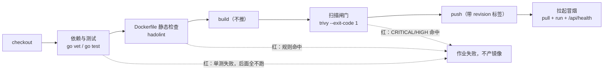

> **实战落点**：示例链第⑥段 —— 把「构建、测试、扫描、推送」写进一份能被执行的文件，并留下**一绿一红两次构建记录**（红由一个真实缺陷触发，不是把断言写松）。全部读数在 `示例/贯穿示例/段6-CI绿红两次构建/README.md`，workflow 文件是 `示例/贯穿示例/.github/workflows/ci.yml`。
> **示例版本**：链上新增 `.github/workflows/ci.yml`、`段6-CI绿红两次构建/`（`ci_local.py` + README）、`api-service/main_test.go`（7 个用例）；链目录第二次提交并打 annotated tag `v0.6.0`，镜像 `localhost:8443/kbdemo/api:0.6.0-g5104a20` 推到**本机 Harbor**，没有推任何远端。
> **前置依赖**：[/docs/03-镜像构建/交出去/BuildKit私有仓库标签策略与构建排错/](/docs/03-镜像构建/交出去/BuildKit私有仓库标签策略与构建排错/)、[/docs/03-镜像构建/养小养快/分层缓存多阶段构建与镜像瘦身/](/docs/03-镜像构建/养小养快/分层缓存多阶段构建与镜像瘦身/)、[/docs/02-核心操作/接上去/端口映射数据管理与权限时区/](/docs/02-核心操作/接上去/端口映射数据管理与权限时区/)
> **本篇产出物**：一条流水线各步骤「为什么在这个位置」的对照表；三套 CI 平台的等价模板（GitHub Actions 本机逐步验过，GitLab / Jenkins 标未实测）；hadolint 与 trivy 的规则/读数/闸门三张表（全部本机原文）；最小权限五条硬规矩，每条附**本机对照实验与违反后果**；secret 的四个泄漏面与两种正确写法；一份可贴进评审的 Dockerfile 安全基线清单。
> **难度·耗时**：★★★ · 70 分钟（含动手：跑一次绿、跑一次红、做一次扫描器误配对照）
> **拓展接口**：3.6 的依赖分层结论在这里变成「CI 缓存能不能命中」；3.11 的 `provenance: false` 在这里是「同一个提交重建两次摘要是否相同」的前提；6.3/6.4 用本篇推出去的标签做回滚指针；5.8（无 root 运行原理）把本篇第 9 节的实测往上抬一层；7.x 的故障复盘里「CI 绿但线上红」多数落在本篇第 5、8 节；**回指 10-存储专题**：[/docs/10-存储专题/故障手册/存储故障手册二遮蔽与失效/](/docs/10-存储专题/故障手册/存储故障手册二遮蔽与失效/)（10.9）。
> **自测三题**：
> 1. 同一条 `go test ./...` 在 CI 上第二次跑只花了 0.03 秒且没有输出编译过程，这正常吗？你要改哪个旗标才能确定测试真的又跑了一遍？
> 2. 流水线里 `trivy image my-app:latest` 返回「Clean」，能作为「这份镜像没高危漏洞」的证据吗？说出至少两条会让这个结论不成立的原因。
> 3. 你要求「容器不许以 root 运行」。除了 Dockerfile 里写 `USER 1000`，还必须防住哪两件事？（提示：一件关于端口，一件关于提权）

## 为什么要先让一份文件替你做构建

三个真实现场，都属于「命令没错，世界不同」：

```text
「我本机 `go test` 是过的，CI 上第一次跑就红。」
「CI 用的镜像是仓库里那份旧的，你本机改了 go.mod 还没提交。」

「我加了缓存，怎么还是 5 分钟？」
「你缓存的是 Go 模块，镜像层缓存根本没启用——BuildKit 的层缓存要 backend，不给就当没有。」

「扫描器报 0 个漏洞，可以放行了吧？」
「它连不上 docker.sock，自己去 Docker Hub 拉了一个同名公共镜像来扫。
 你本机那份带最新改层的镜像它一眼都没看。」
```

它们的共同点是：**只要构建动作发生在人的机器上，就永远存在「这份东西到底是哪来的」这个问题**。CI 的价值不是自动化，是**把来源钉住**——一次提交、一份 workflow、一个可反查的镜像标签。本篇按这个顺序讲：先讲流水线本身（6.1），再讲它替我们挡住的那半张风险清单（6.2）。



顺序里有三处刻意：测试在建镜像之前（便宜且定位快）、扫描在推之前（别让有洞的镜像进仓库）、冒烟用 `pull` 而不是本机镜像（证明仓库里那份真的能用）。段⑥ 的红路读数正好证明第三条边：**测试步一红，`buildx build` 根本没有出现在步骤表里**。

## 一条流水线要备齐的六件事（以及各自的红法）

| 环节 | 为什么必须有 | 缺了会怎样 | 本机证据 |
|---|---|---|---|
| 固定工具链版本 | 否则「我这儿好的」常驻 | 编译产物与测试结论随 runner 漂移 | workflow 用 `go-version-file: api-service/go.mod`，版本只有一处事实来源 |
| 构建前的静态检查 | 建一次镜像比改一行 lint 贵 | 坏 Dockerfile 反复进仓库 | hadolint 0 告警 / 坏样本 11 条（第 7 节） |
| 真跑测试 | 缓存会让「通过」变假 | 回归无声通过 | 不带 `-count=1` 两次都是 `(cached)`，带上才 `0.015s` 真跑 |
| 镜像层缓存 | 冷构建拖慢整条链 | 每次全量重来 | 链上第二次 build `0.55~0.63 秒`（命中） |
| 漏洞与密钥扫描 | 上线前唯一的自动体检 | 带洞镜像进生产 | trivy 对 `alpine:3.9` 报 14 条，对链上镜像报 0（同一份库，对照成立） |
| 可追溯标签 + 冒烟 | 出事要能回到那次提交 | 只能猜 | 镜像 `revision` = `5104a20c8f67…`，`git describe --tags` → `v0.6.0` |

> 💡 新人小结（体检报告要盖公章）：CI 就是一次带公章的体检。跳过「同一台机器、同一份代码、同一个时间」这三要素，报告再好看也不知道是谁的。标签里的 git sha 就是公章，`docker pull` 之后再冒烟，是「按报告把人叫回来复检一次」。

## 6.1 的 GitHub Actions 写法：逐段解释真实文件

链上的 `.github/workflows/ci.yml` 关键段落（完整版见示例目录）：

```yaml
on:
  push: { branches: [main] }
  pull_request:
env:
  REGISTRY: ghcr.io
  SEMVER: 0.6.0
jobs:
  build:
    runs-on: ubuntu-latest
    permissions: { contents: read, packages: write }
    steps:
      - uses: actions/checkout@v4
      - uses: actions/setup-go@v5
        with: { go-version-file: api-service/go.mod, cache: true }
      - run: go vet ./...
        working-directory: api-service
      - run: go test -count=1 ./...          # 关键：不带 -count=1 会复用上一轮 PASS
        working-directory: api-service
      - uses: hadolint/hadolint-action@v3.1.0
        with: { dockerfile: api-service/Dockerfile.v2, failure-threshold: warning }
      - uses: docker/setup-buildx-action@v3
      - uses: docker/login-action@v3
        with: { registry: ${{ env.REGISTRY }}, username: ${{ github.actor }},
                password: ${{ secrets.GITHUB_TOKEN }} }
      - uses: docker/build-push-action@v6      # 先 load，不 push
        with:
          context: api-service
          load: true
          push: false
          provenance: false                    # 3.11：关了才有稳定摘要
          tags: ${{ env.REGISTRY }}/…/api:${{ env.SEMVER }}
          cache-from: type=gha
          cache-to: type=gha,mode=max
          labels: org.opencontainers.image.revision=${{ github.sha }}
      - uses: aquasecurity/trivy-action@0.28.0
        with: { image-ref: '${{ env.REGISTRY }}/…/api:${{ env.SEMVER }}',
                severity: 'CRITICAL,HIGH', exit-code: '1' }
```

三处值得单独讲的取值：

| 写法 | 为什么 | 本机依据 |
|---|---|---|
| `provenance: false` | BuildKit 默认附 attestation，会让**同一份代码两次构建摘要不同**，缓存与回滚指针都跟着失真 | 3.11 实测：关掉之后摘要稳定 |
| `labels: revision=${{ github.sha }}` | 反查链条：镜像 → 提交 → tag。这是段⑤ 定的规范在 CI 里的落地 | 终态读数 `5104a20c8f67…` 与 HEAD 一致 `True` |
| `build` 与 `push` 拆成两步 | 中间插扫描。一步 `push: true` 等于「先发货后质检」 | 链上执行表：`build` PASS → `trivy` 判 → 才 `push` |

**缓存有两条，别混。** `setup-go` 的 `cache: true` 缓存的是**依赖下载**（Go module / npm 包）；`cache-from/to: type=gha` 缓存的是**镜像层**。前者让 `go build` 快，后者让 `docker build` 快。3.9 已实测过一条硬边界：**`--cache-from type=gha` 在没有 GHA 凭据的环境里静默无效**——它不报错，只是没有命中，于是你在本机反复测出的"缓存没用"其实是配置根本没生效。

## 另两家平台的等价模板（未实测）

本机没有 GitLab Runner 与 Jenkins controller，这两段**按官方文档形态给出，没有跑过**，落地前请自己验一遍。它们与 Actions 的差别恰好是排错时要看的三件事：

```yaml
# .gitlab-ci.yml —— 关键差异：镜像构建靠 dind 或 buildah；缓存放 cache:paths
stages: [test, lint, build, scan, push]
default:
  image: golang:1.27-alpine
test:
  stage: test
  script: [cd api-service, go vet ./..., go test -count=1 ./...]
build:
  stage: build
  image: docker:27
  services: [docker:27-dind]
  cache: { key: buildkit, paths: [.cache/buildkit] }
  script:
    - docker buildx build --cache-from=type=local,from=.cache/buildkit
        --cache-to=type=local,dest=.cache/buildkit,mode=max
        -t $CI_REGISTRY_IMAGE:$CI_COMMIT_SHORT_SHA --push api-service
```

```groovy
// Jenkinsfile —— 关键差异：agent 与 workspace 复用，凭据走 credentials()
pipeline {
  agent { label 'docker' }
  environment { HARBOR_CREDS = credentials('harbor-ci-robot') }   // 机器人账户，别写死
  stages {
    stage('Test')  { steps { sh 'cd api-service && go test -count=1 ./...' } }
    stage('Lint')  { steps { sh 'docker run -i --rm hadolint/hadolint:latest-alpine hadolint - < api-service/Dockerfile.v2' } }
    stage('Build') { steps { sh 'docker buildx build -t $REG/api:$GIT_COMMIT --load api-service' } }
    stage('Scan')  { steps { sh 'docker run -v /var/run/docker.sock:/var/run/docker.sock aquasec/trivy image --exit-code 1 --severity CRITICAL,HIGH $REG/api:$GIT_COMMIT' } }
  }
  post { always { sh 'docker buildx prune -f' } }
}
```

| 维度 | GitHub Actions | GitLab CI | Jenkins |
|---|---|---|---|
| 凭据从哪来 | `secrets.*` + `GITHUB_TOKEN`（作业级，自动过期） | CI/CD Variables（ masked / protected） | `credentials()` + 插件保管 |
| 层缓存 | `type=gha`（平台自带后端） | 自己挂 `cache:paths` + `type=local` | 自己挂 workspace + `type=local`/registry |
| 能不能起 docker | 默认可用（runner 自带） | 要 `services: docker:dind` 或改 buildah | 看 agent 标签与权限 |
| 谁在跑你的代码 | 公共 runner 上的任意 PR | 同上，注意 MR 会拿到变量 | 自建 agent 上，权限最敏感 |
| 平台专属机制 | `actions/*` 版本、artifact、缓存命名空间 | `needs`/`rules`、Dependency Proxy | 插件生态、agent 隔离 |

最后一行不是凑数：**「谁能拿到我的凭据」在公共 runner 上和在自建 Jenkins agent 上是两个风险等级**。fork 的 PR 默认拿不到 secrets，但一旦你把扫描/构建脚本改成"能读变量"的形态，就等于自己把它递过去了。

## 构建即测试：一条会把「通过」变假的缓存

本机跑 `go test ./...` 三次的原文：

```console
第 1 次（不带 -count=1）: rc=0  ok  kb/api  (cached)
第 2 次（不带 -count=1）: rc=0  ok  kb/api  (cached)
第 3 次（带 -count=1）  : rc=0  ok  kb/api  0.015s
```

`(cached)` 意味着**这一轮什么都没跑**，只是复用了上一次输入的结论。改测试代码会打破缓存，改被测代码也会；但**改环境变量、改外部服务状态不会**（Go 只看包内输入）。所以 CI 里请固定写 `-count=1`：宁可多花 15 毫秒。

同一条命令在 Windows 上还有一个平台差：

```console
go test -race -count=1 ./...  → rc=2
go: -race requires cgo; enable cgo by setting CGO_ENABLED=1
```

`-race` 需要 cgo，本机（Windows，`CGO_ENABLED=0`）直接拒。Linux runner 上能跑。**「本机跑不了」不等于「不该在 CI 跑」**——段⑥ 的执行器把它记成「平台对照，不计闸门」，而不是偷偷删掉那一行。

> 💡 新人小结（缓存像上一次的门禁打卡记录）：缓存回答的是「输入变了没有」，不是「今天有没有真的检查过」。`(cached)` 就是拿上次的打卡记录顶今天的名——名字对得上，人没来。

## 一绿一红：判据要能自己红

段⑥ 的两条记录（完整原文在链上 README）：

| | 命令 | 结果 |
|---|---|---|
| 绿 | `python ci_local.py` | 9 步全 PASS，末行 `CI_GREEN`，退出码 0；用时各 0.27~0.72 秒 |
| 红 | `python ci_local.py --红`（把 `envOr` 未设置时的回退改成直接返回空） | `go test` rc=1，两条用例各自报错，末行 `CI_RED`，退出码 1；`buildx build` 与 `push` 未执行 |

红的这一步的原文（一个缺陷被两条独立断言抓到）：

```text
main_test.go:31: 空串应回退默认值：got "" want "8080"
--- FAIL: TestHostPortJoinsHostAndPort (0.00s)
    main_test.go:42: 缺变量时要用 localhost：got ":6379" want "localhost:6379"
FAIL	kb/api	0.014s
```

跑完无条件还原：`git status` 对 `main.go` 无改动，重跑 `go test` 回到 `ok 0.015s`。**「红的这一条不是断言写松」的证据就在这一步**——同一份测试在正确代码上是绿的。

一处与真 runner 的差别要记：GitHub 一步失败就停掉后续 job；本机执行器红之后还跑完了 hadolint 才收口。别把两者当同一行为。

## 6.2 之一：hadolint 的位置与三种闸门语义

工具读数 `Haskell Dockerfile Linter 2.15.1`（`hadolint/hadolint:latest-alpine` 80.8 MB）。链上三份 Dockerfile（`Dockerfile.v1`、`Dockerfile.v2`、`web/Dockerfile`）**全部 0 告警**；一份故意写坏的样本给出 11 条：

| 规则 | 级别 | 触发写法 | 违反后果（不是"风格问题"） |
|---|---|---|---|
| `DL3007` | warning | `FROM ubuntu:latest` | 基础镜像随时间漂移，昨天的构建今天复现不了 |
| `DL4000` | **error** | `MAINTAINER` | 早已废弃，新镜像应用 OCI label |
| `DL3008` | warning | `apt-get install -y curl` 不锁版本 | 装到什么取决于当天仓库，等于把供应链交给别人 |
| `DL3009` / `DL3015` | info | 不删 `apt lists` / 不带 `--no-install-recommends` | 镜像白胖（3.8 量的层大小） |
| `DL3013` / `DL3042` | warning | `pip3 install requests`；带 pip 缓存 | 同上 + 依赖版本漂移 |
| `DL4006` | warning | `curl … \| sh` 没开 `pipefail` | **管道里前半段失败被吞掉**，装了一半还报成功 |
| `DL3064` | warning | `ENV API_KEY=sk-live-…` | 密钥进镜像配置，`inspect` 直接可见（第 10 节实测） |
| `DL3002` / `DL3066` | warning/info | 最后一步 `USER root` | 容器以 root 起，逃逸面从"要漏洞"降成"要一次误操作" |

闸门语义（本机三种都跑过，作用在坏样本上）：

```console
--failure-threshold error     rc=1  条数=11   # 只有 error 级才拦
--error DL3008                rc=1  条数=11   # 把指定规则提级成 error
--ignore DL3008 --ignore DL3025  rc=1  条数=10  # 放行=减条目，不是减风险
```

**`--ignore` 是账本上划掉一行**。团队里唯一可接受的用法是"这条规则与我们的基础镜像策略冲突，且有 owner 与到期日"，写在仓库里的 `.hadolint.yaml`，而不是散在每条流水线上。

## 6.2 之二：扫描器会骗你，而且骗法有三种

工具读数 `Version: 0.76.1`（`aquasec/trivy:latest` 264 MB）。先把"它确实会报"钉住，再谈 0：

| 目标 | 结果（同一份漏洞库） |
|---|---|
| `alpine:3.9`（3.9.6，老镜像） | **14 条**：HIGH 4 / MEDIUM 8 / LOW 2。样例 `CVE-2021-3450 HIGH libcrypto1.1 → 修复版 1.1.1k-r0` |
| `alpine:3.20`（3.20.10） | 0 条，元数据里同时报 `"OS":{"Family":"alpine","Name":"3.20.10","EOSL":true}` |
| 链上 `localhost:8443/kbdemo/api:0.6.0` | 0 条，`'0': Clean (no security findings detected)` |
| 同一目标扫两次（一次本机、一次带缓存卷） | 结论一致 ⇒ 上面那个 0 不是"库没到位" |

三条本机踩出来的坑：

**一、不挂 `docker.sock`，它扫的可能不是你这台机器上的那份镜像。** 原文：

```text
unable to inspect the image (localhost:8443/kbdemo/api:0.6.0):
failed to connect to the docker API at unix:///var/run/docker.sock; check if the path is correct
* containerd error: containerd socket not found: /run/containerd/containerd.sock
* podman error: unable to initialize Podman client
```

而对**公共仓库里存在的名字**（如 `alpine:3.20`），它会自己走上游解析并拉取，于是返回 `Clean`——**扫的是 Docker Hub 那份，不是你刚建的那份**。判据：要么挂 socket（本机 CI 用的就是这个），要么按 digest 扫，要么 `docker save` 成 tar 用 `--input`。

**二、漏洞库是一条独立的网络依赖，会时好时坏。** 本机连着两次 FATAL：

```text
failed to download vulnerability DB: failed to download artifact from mirror.gcr.io/aquasec/trivy-db:2
Get "https://mirror.gcr.io/v2/": dial tcp 74.125.23.82:443: connect: connection refused   （各卡 42 秒）
```

后来同一条命令又成功了。处理方式：把库挂在命名卷（`trivy-cache:/root/.cache/trivy`），先 `--download-db-only` 预热一次，之后 `--skip-db-update` 稳定可复现（本机验证：预热后离线扫 `alpine:3.9` 仍报 14 条）。生产上更进一步——指内网镜像源，别让流水线能不能红取决于一个外网 URL。

**三、阈值不是越严越好。** 本机三种配置的差别：

| 配置 | 目标 | rc |
|---|---|---|
| `--severity CRITICAL,HIGH --exit-code 1` | `alpine:3.20` | 0 |
| 同上 | `alpine:3.9` | **1** |
| `--severity CRITICAL --exit-code 1` | `alpine:3.9`（4 条都是 HIGH/MEDIUM/LOW） | 0 |

一条起步规则，够团队用一年：**新建项目 CRITICAL 立即拦、HIGH 拦但可 7 天豁免（须有修复版本）、MEDIUM 只记录、`FixedVersion` 为空的进白名单并打到期日**；基础镜像 `EOSL: true` 的，**先换基座再谈豁免**（第 9 节链上镜像用的正是 alpine 3.20 这条已 EOL 的线——这就是它被记在 `07` 未验证项旁边而不是被忽略的原因）。

> 💡 新人小结（安检门与探头）：扫描器是安检门，漏洞库是探头。门亮绿灯有三种原因：真没金属、探头没通电（库没下载）、扫的是隔壁那条通道（镜像不是这份）。所以"过了安检"必须同时报：**哪个门、什么探头、扫的是谁**。

## 6.2 之三：最小权限五条，每条都配了本机对照

写规范容易，难的是"这条在这台机器上到底挡不挡得住"。五条全部做了对照：

| 规矩 | 怎么写 | 本机实测 | 违反后果 |
|---|---|---|---|
| 不用 root 跑 | `USER 1000`（或 compose `user:`） | 链上镜像以 `uid=1000` 起服务正常 | 一次容器内 RCE 直接等于宿主机 root（配上挂载目录更糟） |
| 根文件系统只读 | `read_only: true` + 明确 `tmpfs` | `touch /x` → **`Read-only file system`**；加 `--tmpfs /tmp` 后 `/tmp` 可写、`/x` 仍拒 | 攻击者落地文件、写 cron、改配置全部失败面变小 |
| 能力按需加 | `cap_drop: [ALL]` + 逐条 `cap_add` | `ip link set lo down`：不带 NET_ADMIN → **`RTNETLINK answers: Operation not permitted`**；带 → `DOWN_OK/UP_OK` | 改路由、抓包、加载模块这类"逃逸跳板"被留成明路 |
| 不许提权 | `security_opt: [no-new-privileges:true]` | `/proc/self/status` 的 `NoNewPrivs` 由 `0` 变 `1` | 见下面第二条纠正：这条在本机**测不出功能差异**，但状态位仍值得钉 |
| 别指望绑低位端口 | 需要绑 80/443 时显式给策略 | 见下面第一条纠正 | 以为"非 root 就绑不了 80"，实际默认能绑 |

**两条被本机推翻的老说法（写规范时别再抄）：**

1. **「非 root 绑不了 1024 以下端口」——在这台机器上不成立。** 容器 netns 里 `net.ipv4.ip_unprivileged_port_start` = **0**（VM 根命名空间是 1024），所以 `-u 10001 --cap-drop ALL` 照样能监听 80。把它改回去才会被拒：

   ```console
   docker run --rm --sysctl net.ipv4.ip_unprivileged_port_start=1024 \
     -u 10001:10001 --cap-drop ALL alpine:3.20 sh -c 'timeout 3 nc -l -p 80'
   nc: bind: Permission denied
   ```

   结论要改成：**低位端口这件事由 sysctl 决定，不由 capability 决定**；真要卡住就显式设 `ip_unprivileged_port_start=1024`。
2. **「`cap_drop ALL` 会让 ping 挂」——也没挂。** `CapEff: 0000000000000000`（能力清空）下 `ping -c 1 127.0.0.1` 仍 `rc=0`，因为现代内核允许非特权 ICMP datagram socket。**同一批里 setuid 也没提权**：把 busybox 复制成 root 属主 `4755` 的 `/opt/suid/cat`，`Uid:` 在默认、`--privileged`、`seccomp=unconfined` 三种模式下都是 `1000 1000 1000 1000`。所以 `no-new-privileges` 在本机只能测到状态位差异，**"它挡住 setuid"这条功能对照做不出来**，原因未查（不编），已列入未验证项。

> 💡 新人小结（小区门禁的三种"以为安全"）：不换锁的门禁卡（镜像里 `USER` 写了但进程仍可提权）、能推开的消防门（低位端口那道 sysctl）、坏了不报警的探头（扫描器没库照样绿）。安全基线的每条规矩都要配一句「我怎么在 30 秒内验它是生效的」，否则它只是文档里的一行。

## 6.2 之四：secret 为什么不该走 env，以及构建期那条更狠

四个泄漏面的本机原文，全都指向同一个结论——env 是**到处都看得见**的：

```console
docker inspect --format '{{json .Config.Env}}' <c>
  ["DB_PASSWORD=sup3rsecret","PATH=/usr/local/..."]
docker exec <c> env | grep PASSWORD            → DB_PASSWORD=sup3rsecret
docker exec <c> sh -c 'xargs -0 -n1 < /proc/1/environ' → DB_PASSWORD=sup3rsecret
docker logs <c>（进程把口令写进 stdout 一次）    → startup line mentions sup3rsecret
```

换成文件挂载：`Config.Env` 里**没有**了，但 `Mounts` 里看得到宿主路径，且 Windows 侧文件的权限位变成 `-rwxrwxrwx`——**"用文件挂载"不等于"隐形"**，它只是把泄漏面从"人人能 inspect 到"缩到"能读宿主路径的人才能读"。

构建期更狠，`--build-arg` 会留在**镜像元数据**里：

```console
docker history --no-trunc kb13/arg:probe
  RUN |1 TOKEN=sk-live-abcdef /bin/sh -c echo "built with token=${TOKEN}" > /v.txt && cat /v.txt
  ARG TOKEN=sk-live-abcdef
docker run --rm kb13/arg:probe cat /v.txt   →   built with token=sk-live-abcdef
```

同一件事用 BuildKit secret 重写，`history` 里搜不到明文，成品镜像里也搜不到落盘文件：

```dockerfile
RUN --mount=type=secret,id=dbpass sh -c 'cat /run/secrets/dbpass | wc -c && test ! -e /leaked'
```

| 形态 | 会进 `inspect Env` | 会进 `history` | 会被日志收走 | 该用在哪 |
|---|---|---|---|---|
| `ENV` / `-e` | **是** | 是（若是 ARG/ENV 层） | 是（若被 echo） | 非敏感配置 |
| `--build-arg` | — | **是** | 是（step 输出） | 只放非密钥的构建参数 |
| `--mount=type=secret` | 否 | 否 | 否 | **构建期需要凭据**（登录私有仓库、拉私有依赖） |
| 运行时文件挂载 / `secrets` | 否（但 `Mounts` 可见） | — | 否 | 运行期口令、TLS 材料 |
| CI 平台的 secret 注入 | 看平台 | — | 会被日志模板吞 | 平台内传递，落盘前先换短期凭据 |

CI 侧的凭据形态还有两件事没做完，明确挂账：Harbor 的**机器人账户 + 短生命周期 token** 本机没建（`示例/Harbor私有仓库/07` 的未验证项），GHCR 的 `GITHUB_TOKEN` 作用域也没实测——这两条要真跑一次才能写进规范。

## 能直接贴进评审的 Dockerfile 安全基线清单

| # | 规矩 | 怎么验 | 谁替你抓 |
|---|---|---|---|
| 1 | 基础镜像钉到具体版本（禁 `latest`） | `FROM` 行有两个标签以上即不合格 | hadolint `DL3007`/`DL3006` |
| 2 | 有 `USER`，且不是 root 在最后 | 最后一条 `USER` 的 uid ≥ 10000 或具名非 root | hadolint `DL3002` |
| 3 | 只拷需要的文件 | `COPY` 不写 `.`；`.dockerignore` 至少排 `.git`、`*.md`、构建产物 | 3.12 的「上下文过大」那行 |
| 4 | 依赖锁版本 | `apt-get install pkg=版本`、`pip --require-hashes`、`go.sum` 进镜像 | hadolint `DL3008`/`DL3013` |
| 5 | 不在 Dockerfile 里放密钥 | `grep -nE 'ENV .*(KEY\|TOKEN\|PASS)'` 为空 | hadolint `DL3064` + trivy secret 扫描 |
| 6 | 管道要 `pipefail` | 有 `\|` 的 `RUN` 前设过 `SHELL ["/bin/bash","-o","pipefail","-c"]` | hadolint `DL4006` |
| 7 | 多阶段，工具链不进最终镜像 | 最终 `FROM` 阶段里没有编译器 | 3.7 + `docker history` 层大小 |
| 8 | 摘要可复现 | 同提交建两次，`digest` 相同（`provenance: false`） | 3.11 |
| 9 | 推之前扫过 | CI 步骤表里扫描在 push 之前 | 本篇第 2 节那张图 |
| 10 | 运行期 `read_only` + 明确可写点 | compose 里 `read_only: true` 且列了 `tmpfs` | 第 9 节对照实验 |

## 供应链与签名：本篇标「按需」的理由

cosign / notation 的签名与准入验证，**本机一套都没跑**（Harbor 侧 notary v1 已在 v2.8.0 前后移除，签名走 cosign 把签名当 accessory 存在同一仓库，见 `示例/Harbor私有仓库/03`）。所以本篇只给结论性建议，不给"我们已这么做"：

- 先做**可追溯**（本篇的 revision 标签 + SBOM），再做**可验证**（签名）。顺序反了会先建一套没人信的密钥体系。
- SBOM 现在就能白拿：`trivy image --format spdx-json`（链上 workflow 的 `upload-artifact` 步骤形态）。
- 准入控制器（K8s 侧）验签这条属于第⑦段之后的内容，与 8.2 一起写。

## 本篇不覆盖什么

按 W6 的规矩，本篇**故意不讲**的东西逐条点名去处——写「不覆盖」不是免责声明，是防止你在这一篇里找不存在的答案：

- Dockerfile 指令逐条语义与构建上下文 → 见 **3.1**（`COPY` 与 `.dockerignore` 的规矩在那一篇）
- 标签策略与「只挪标签」的回滚路 → 见 **3.11**（`imagetools` 那条路在那一篇）
- 回滚操作规程与一次真实演练 → 见 **6.4**（`回滚` 的三条路与演练记录在那一篇）
- 监控最小集与备份链 → 见 **6.5**（`node-exporter` 的挂载写法在那一篇）
- 运行时生态与 rootless 的机制 → 见 **5.7**（`runc` 与 shim 的分工在那一篇）
- 拉取失败的报错原文判读 → 见 **7.6**（`manifest unknown` 那类语料在那一篇）

## 未验证项（这一篇没做的，别当已知）

| 项 | 状态 | 原因 |
|---|---|---|
| GitHub Actions 真实 runner 行为（`type=gha` 命中、`GITHUB_TOKEN` 作用域、`upload-artifact`、job 级 fail-fast） | 未验证 | 约定不推远端；runner 也连不到本机私有仓库。本机执行器与 runner 的差别已逐项列出 |
| GitLab CI / Jenkins 模板能否跑通 | 未验证 | 本机没有对应服务端 |
| trivy 的 secret 扫描（`--scanners secret`）与 `--ignore-unfixed` | 未测 | 本轮只用了 vuln 扫描器 |
| Harbor 侧的 CVE 白名单、机器人账户、镜像保留策略与 GC | 未做 | 属 6.x 主题，本机 `WITH_TRIVY=False`，扫描器都没装 |
| cosign/notation 签名与准入 | 未做 | 见上一节 |
| `no-new-privileges` 的功能级对照（挡 setuid / 挡 file capability） | **本机做不出来** | setuid 在本机 Docker Desktop 上不提权（三种模式同读数），原因未查 |

## 要点总结

- CI 买的是**来源可钉**：一份 workflow + 一次提交 + 一个可反查的标签。步骤顺序里三处刻意不能省：测试在建镜像之前、扫描在推之前、冒烟用 `pull` 而不是本机镜像。
- 缓存有两条（依赖 vs 镜像层），而**"通过"也可能是缓存给的**：`go test` 不加 `-count=1` 会回 `(cached)`；`--cache-from type=gha` 在没有平台后端时静默无效。
- 判据要能红：段⑥ 的红路由一个真实缺陷触发，两条独立断言各自报错，还原后同一份测试回到 `ok`。这才证明闸门有效。
- 扫描器的三种骗法本机全见过：**没挂 socket 会去扫上游同名镜像**、**库拉不到时结论不可信**（本机两次 `connection refused` 后自己恢复）、**阈值设错要么天天吵要么形同虚设**。起步规则：CRITICAL 拦、HIGH 限期拦、无修复版本的进白名单并打到期日、基座 `EOSL` 先换基座。
- 最小权限五条里，有两条的"常识版本"被本机推翻：低位端口由 `ip_unprivileged_port_start` 决定（容器里默认 0，不是 1024），`cap_drop ALL` 不影响 `ping`；setuid 在本机根本不提权，所以 `no-new-privileges` 只能测状态位。**凡是安全规矩，配一条 30 秒能跑的验证**，否则它只是文档。
- secret 的规矩一句话：**别进 `ENV`，别进 `--build-arg`**——本机 `docker history --no-trunc` 能把 `TOKEN=sk-live-abcdef` 原样读出来，BuildKit 的 `--mount=type=secret` 则不会。文件挂载只是缩小泄漏面，`Mounts` 里仍看得到路径。
- 链上现状：workflow、单测、执行器与两次记录在 `示例/贯穿示例/`，镜像 `localhost:8443/kbdemo/api:0.6.0-g5104a20`，`revision` = `v0.6.0` 指向的提交。
