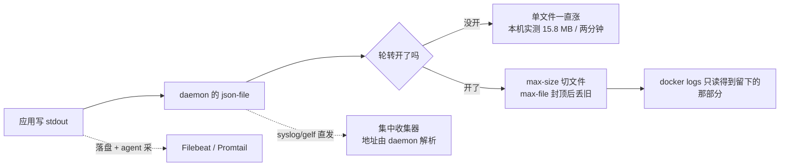
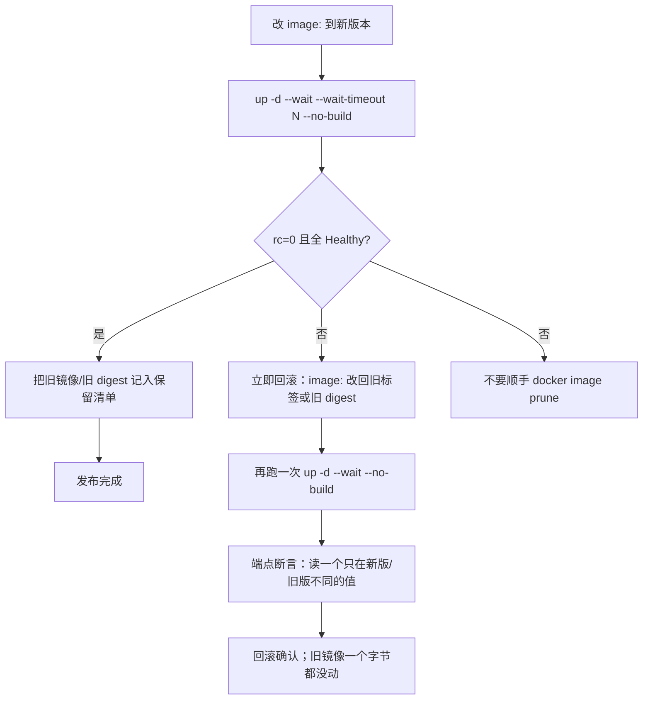

> **实战落点**：站⑦的运行基线。日志、限额、上线与回滚这四件事在单机 compose 上各有一条能跑通的路径，本篇把它们一次跑完并留下读数；6.4 要求的**产出物「一次回滚演练记录」**自成一节（标题就叫这个名字），全部数据来自本机一次性演练（容器与镜像已清场，文件形态内联在本篇里，可整段拷走复现）。
> **本机基线**：Docker Engine `29.8.0` / API 1.56、Docker Compose `v5.5.1`、默认日志驱动 `json-file`、cgroup v2、宿 VM 24 核 / `MemTotal 49292256 kB`；日志投递实验复用了已常驻的本机 Harbor（`harbor-log` 容器 rsyslog 监听 `0.0.0.0:10514`，宿主侧发布在 `127.0.0.1:1514`）。
> **前置依赖**：[/docs/05-原理深入/隔离与资源/容器本质Namespace与Cgroups/](/docs/05-原理深入/隔离与资源/容器本质Namespace与Cgroups/)（限额落在哪个文件、137 的两种成因都在这里）、[/docs/04-单机编排/日常/多环境热重载与五服务完整实战/](/docs/04-单机编排/日常/多环境热重载与五服务完整实战/)、[/docs/03-镜像构建/交出去/BuildKit私有仓库标签策略与构建排错/](/docs/03-镜像构建/交出去/BuildKit私有仓库标签策略与构建排错/)
> **本篇产出物**：一张「默认配置 vs 轮转后」的字节实测表；四种日志驱动的原文差异；一条被证伪的常识（日志地址由 **daemon** 解析，不是容器解析）；一份 compose 资源限制三种写法的落点对照（含冲突时的报错原文）；单机滚动/蓝绿/灰度的**边界读数**（不是概念图）；一次五步回滚演练的完整记录与两条能变红的判据；一份可贴进评审的上生产准入清单。
> **难度·耗时**：★★★ · 60 分钟（含动手：跑一次轮转对照、跑一次回滚演练）
> **拓展接口**：6.1/6.2 推出去的 `revision` 标签在这里变成回滚指针；6.5 的监控最小集要用「生产必设资源限制」一节的 `throttled_usec` 与 `memory.peak` 做告警指标；6.6 的备份容灾与「磁盘治理：先数清，再谈清理」共用「先数清再动手」的纪律；段⑦（生产形态 compose + 回滚）按「一次回滚演练记录」那节的骨架重写；**回指 10-存储专题**：[/docs/10-存储专题/数据保护/备份与恢复/](/docs/10-存储专题/数据保护/备份与恢复/)（10.6）。
> **自测三题**：
> 1. 一个跑了三个月的容器，`docker logs` 只回得来最近两天的输出，磁盘上也没有 `.gz`。这个现象正常吗？你要看哪两个文件名才能确认？
> 2. 你给 `--log-opt syslog-address=tcp://log:10514`，容器明明和日志服务在同一个自定义网络里，`docker run` 却直接失败。报错里最关键的词是哪个？
> 3. 上线新标签后 `docker compose up -d` 返回 0，这能作为「新版本可用」的证据吗？说出你必须补上的两个旗标和一条断言。

## 为什么要先问「这份日志会不会把磁盘写满」

三个现场，都属于「默认配置被当成生产配置」：

```text
「服务器磁盘怎么满了？查了一圈，是一个容器写了 15 MB 日志——它才跑了两分钟。」
「json-file 默认不轮转。你这两分钟是 15 MB，一个季度就是另一个数量级。」

「新标签推上去了，up -d 返回 0，怎么用户还是打到旧版本？」
「返回 0 只说明容器起了。健康检查没过、镜像根本没换、甚至旧容器还在跑，它都不关心。」

「我加了 --log-driver syslog，容器明明和日志服务同网络，docker run 直接 rc=125。」
「地址是 dockerd 解析的，不是容器解析的。容器能 getent hosts log，daemon 不能。」
```

它们的共同点是：**运行期的一切默认值都是为「先跑起来」设计的，不是为「跑三个月」设计的**。本篇按这个顺序讲：先把日志与限额的运行基线立住（6.3），再讲怎么把版本安全地换上去、以及换坏了怎么回来（6.4）。



## 默认配置的真相：json-file 不轮转

同一份负载（120000 行、每行约 70 字符的 echo 循环），两种配置，容器目录下 `ls -l` 的原文：

日志轮转配置只有两个旋钮：`max-size` 决定翻页大小，`max-file` 决定留几页。同一份负载、两种配置的落盘对照：

| 配置 | 落了几号文件 | 字节数 | 合计 |
|---|---|---|---|
| 不设（默认 `json-file`） | `<id>-json.log` | **15,835,402** | 15.8 MB，且没有上限 |
| `max-size=1m max-file=3` | `-json.log` / `.1` / `.2` | 834,596 / 1,000,096 / 1,000,061 | 2,834,753（2.8 MB） |
| `max-size=1m max-file=2` | `-json.log` / `.1` | 994,692 / 1,000,076 | 1,994,768（2.0 MB） |

同一个日志目录里躺着的东西也值得看一眼，因为排查磁盘时容易冤枉它们：

```text
-rw-r----- 1 root root 15835402 <id>-json.log        ← 日志本体
-rw------- 1 root root     3276 config.v2.json      ← 容器配置
-rw------- 1 root root     1481 hostconfig.json
-rw-r--r-- 1 root root       13 hostname
-rw-r--r-- 1 root root      148 hosts
drwx--x--- 2 root root     4096 checkpoints
```

💡 新人小结（轮转像什么）：`max-size` 是**笔记本写满一页就翻页**，`max-file=3` 是**只留最近三页**。所以写第三页时第一页已经被撕掉了——轮转是**丢弃机制，不是归档机制**。想让日志活得比 `max-file` 久，必须边写边往外送（见「接集中式日志：两种姿势」），而不是把 `max-file` 调到 200。

「撕掉第一页」在本机是直接可读出来的：`max-size=1m max-file=2` 那次，写了 120000 行，事后 `docker logs` 只能读回 **15847 行，第一行是「第 104155 行」**——前面十万行永久没了。这条决定了告警口径：**别把 `docker logs` 当历史查询接口**。

## 轮转参数只能新建时设，改不了运行中的容器

```console
docker update --log-opt max-size=1m 某容器
docker update --log-driver local 某容器
```

```text
rc=125  unknown flag: --log-opt
rc=125  unknown flag: --log-driver
docker update --help 里与 log 有关的行：（一行都没有）
```

对照两个容器的 `HostConfig.LogConfig`：

| 容器 | 设置时机 | LogConfig 原文 |
|---|---|---|
| 先起后改（失败） | 起时没给 | `{"Type":"json-file","Config":{}}` |
| 新建就带 | 起时带 `--log-opt` | `{"Type":"json-file","Config":{"max-file":"4","max-size":"1m"}}` |

所以「补轮转」只有两条真路：**重建容器**，或者改 daemon 全局默认后重建。全局默认要写 `/etc/docker/daemon.json` 的 `log-opts`——本机这台 Docker Desktop 的 daemon.json 在 `wsl -d docker-desktop` 的默认 namespace 里**根本不存在**（`cat` 报 No such file，`pidof dockerd` 为空，dockerd 不在这个挂载视图内），所以这条在本机只验到「`docker info` 报 `LoggingDriver=json-file`」，改默认值的效果标未验证。

## 四种驱动的差异，全部按原文记

| 驱动 | `LogPath` | `docker logs` 能不能读 | 本机原文/读数 |
|---|---|---|---|
| `json-file`（默认） | 有，`/var/lib/docker/containers/<id>/<id>-json.log` | 能 | 见上表 |
| `local` | **空字符串** `""` | 能 | `LogConfig={"Type":"local","Config":{}}`，日志读回 `hello-local-driver`；它进的是 daemon 自己的环形缓冲 |
| `none` | —— | **不能** | `rc=1`，`Error response from daemon: configured logging driver does not support reading` |
| `syslog` | —— | 不能（本机未单独复测 `docker logs`） | 见「接集中式日志：两种姿势」一节 |

`local` 那个空的 `LogPath` 是故意设计的：它把日志存在 daemon 侧、按大小截断，避免单个容器把磁盘写穿。代价是你在宿主上**没有文件可以直接 tail**。

## 接入 ELK / Loki 的两种姿势，以及一条被证伪的常识

姿势 A（driver 直发）在本机是可实测的，因为常驻的 Harbor 自带一个 rsyslog 容器。它的落盘模板（本机读到的 `rsyslog_docker.conf`）：

```text
template(name="DynaFile" type="string" string="/var/log/docker/%programname%.log")
if $programname != "rsyslogd" then { action(type="omfile" dynaFile="DynaFile") }
```

于是 `--log-opt tag=kb14probe` 会决定**文件名**（`%programname%`）。两条投递路径，一条成一条败：

```console
REM 成功：地址写 host.docker.internal:1514（Harbor 把 10514 发布到宿主 VM 的 127.0.0.1:1514）
docker run -d --log-driver syslog ^
  --log-opt syslog-address=tcp://host.docker.internal:1514 --log-opt tag=kb14probe alpine:3.20 echo hi

REM 失败：容器已经加进了 harbor_harbor 网络，地址写服务名 log:10514
docker run -d --network harbor_harbor --log-driver syslog ^
  --log-opt syslog-address=tcp://log:10514 --log-opt tag=kb14probe alpine:3.20 echo hi
```

```text
失败原文：rc=125  failed to create task for container: failed to initialize logging driver:
          dial tcp: lookup log on 192.168.65.7:53: no such host

非 0 对照：同一个网络里不带日志驱动地跑 getent hosts log -> 172.18.0.2  log   （rc=0）
```

成功那条在 Harbor 侧读回来的原文：

```text
/var/log/docker/kb14probe.log
Oct 27 16:47:54 172.18.0.1 kb14probe[127]: hello-via-syslog-1
```

💡 新人小结（为什么服务名不管用）：`--log-driver` 的连线是**引擎**去接的，不是你的容器去接的。容器里的 DNS（那个 `172.18.0.2 log`）只对容器自己有效；引擎站在另一个网络视图里，它查 `log` 这个名字查不到，就在 `docker run` 阶段直接失败——**日志配置的错，报在起容器的时候**。

这条推翻了很常见的写法「服务发现名字随处可用」。给日志驱动写地址时，只能写**引擎解析得到的地址**：IP、`host.docker.internal`、或引擎所在网络里的名字。

| 姿势 | 怎么做 | 优点 | 代价（本机证据） |
|---|---|---|---|
| A：driver 直发 | `--log-driver syslog/gelf/…` + 地址 | 应用零改动，一行配置接上 | 地址由 daemon 解析（上面那条报错）；网络抖动时日志可能直接丢；驱动不同时 `docker logs` 能不能读差别很大（`none` 明确不能） |
| B：落盘 + agent 采 | 应用仍写 stdout，另起 Filebeat/Promtail/Fluent Bit 采 `json-file` | 采集端可重试、可背压；`docker logs` 仍可用 | 磁盘要留够（`json-file` 不轮转就是 15.8 MB 那个数）；agent 要能读到 `/var/lib/docker/containers` |

**ELK / Loki 本身本机没跑**（没有对应服务端，也不为这一篇新起一套），所以本篇只给到 syslog 这条实测通路 + 两种姿势的取舍，Loki/GELF 的具体配置标未验证。

## 读 `docker logs` 的四个时间与条数旗标

同一个每秒钟输出一行的容器，本机：

| 命令 | rc | 读回 |
|---|---|---|
| `docker logs --tail 2` | 0 | 2 行（`tick-1`… 之后最新两条） |
| `docker logs --since 3s` | 0 | 2 行 |
| `docker logs --timestamps --tail 1` | 0 | `2026-10-27T17:17:32.905009790Z tick-2` |
| `docker logs --until 2s` | 0 | **0 行**（窗口在写入之前，返回空） |

`--until` 返回空但 `rc=0`——排障时这算「什么都没发生」还是「我看错了窗口」，只有靠时间戳确认。所以**日志查询三件套固定成 `--since` + `--timestamps` + `--tail`**，别裸用时间窗。

## 生产必设资源限制规范：三种写法都能落，但写法冲突会直接拒

这一节是 5.3 的「落到文件」变成「落到声明文件」。规范就四条：CPU、内存、进程数都设上限，IO 只在目标环境量得动时才承诺。四种写法，本机各起一个 project：

| compose 写法 | `up` 结果 | HostConfig | cgroup 实际读数 |
|---|---|---|---|
| 只写 `deploy.resources.limits`（`cpus: "0.5"` / `memory: 64M`） | `rc=0` | `NanoCpus=500000000 Memory=67108864` | `cpu.max=50000 100000`、`memory.max=67108864` |
| 只写顶层 `cpus: 0.5` / `mem_limit: 64m` | `rc=0` | 同上 | 同上 |
| **两种都写且值不同** | **`rc=1`** | 容器根本没创建 | 原文：`services.a: can't set distinct values on 'cpus' and 'deploy.resources.limits.cpus': invalid compose project` |
| `limits` + `reservations` | `rc=0` | `NanoCpus=1000000000 Memory=268435456 MemoryReservation=33554432` | `cpu.max=100000 100000`、`memory.max=268435456`（**reservations 不改变强制上限**） |

三个结论：

1. `deploy:` 这一段在单机 compose 上**不是摆设**，`limits` 会真的落到 cgroup；不接 Swarm 也能用。
2. 顶层写法和 `deploy.resources` **不能同时给不同值**——compose 直接拒。这是好事：宁可在 CI 里红，也不要运行时看运气。
3. `reservations` 只写进 `HostConfig.MemoryReservation`（对应 `memory.low`，5.3 里量到 `--memory-reservation 64m → memory.low=67108864`），它影响的是回收优先级，不是天花板。**别把 requests 当保障**：单机上没有抢占者时它什么都不改变。

限额该设多少，判据一律来自 cgroup 而不是感觉；下表第一列就是 CPU throttling 与内存余量的识别口径：

| 要防的事 | 看哪个读数 | 本机实测值举例 |
|---|---|---|
| CPU 是否被掐 | `cpu.stat` 的 `nr_throttled / nr_periods` | 335/336（≈100% 周期被掐）→ 配额确实不够 |
| 掐了多久 | `throttled_usec` | 16,737,390 µs ≈ 墙钟多出的 15.1 秒 |
| 内存该给多少 | `memory.peak`（不是 `current`） | 同一容器 `current=7.4 MiB`、`peak=116.5 MiB` |
| 有没有被杀过 | `memory.events` 的 `oom_kill`，**但容器重启过就失效** | 全 0 = 没杀过；段⑦ 复测：容器因 OOM 重启后再读，`oom_kill` 与 `memory.peak` 都归零，此时要读 `docker events` 里的 `oom` 动作 |
| 会不会 fork 炸 | `pids.max` / `docker stats` 的 PIDs | 限额 40 起 25 个 → `PIDs=26`；限额 32 硬起 200 → `rc=2` + `sh: can't fork: Resource temporarily unavailable` |
| 磁盘 IO | **能设，但别拿「写完了」当生效证据** | 限速要打在 `io.stat` 里真在记账的那块盘（本机 `8:48` = `sdd`），且计时必须等落盘：同一限额下 `dd` 不带 fsync 1 厘秒、带 `conv=fsync` 2402 厘秒（24 MiB ÷ 1 MB/s）。批 14 那句「本机登记 4 种设备、写 24 MiB 仍是 0.4~0.5 秒」是**量法错了**，已按 [/docs/07-运维手册/按故障域排错/Windows与WSL2性能排查应急runbook与复盘/](/docs/07-运维手册/按故障域排错/Windows与WSL2性能排查应急runbook与复盘/) 更正 |

`docker stats` 的 CPU 百分比分母是**核**，不是配额：本机一个死循环 + `--cpus 0.5` 读到 `50.39%`，两个死循环 + `--cpus 2` 读到 `200.11%`。看到 50% 就以为「还有一半余量」是最贵的一次误读。

段⑦ 拿生产形态的 compose 压了一次内存，两条读数要并到这张口径表旁边一起读：

- **只写 `memory: 96M` 时，swap 会被再给一份同额**。本机 `HostConfig.Memory=100663296` 而 `MemorySwap=201326592`，容器内 `memory.max` 与 `memory.swap.max` 各 96 MiB；同旗标的对照容器往 tmpfs 里灌，实际写到 **198,459,392 字节（约 189 MiB）** 才被撞停。所以「96M 上限」这句话在没配 `memswap_limit` 的 compose 上是**说不出口**的——这与上面 `--memory-swap 是总额` 那条是同一条规则的两面。
- **OOM 挑的是进程 RSS，而 tmpfs 页记在 cgroup 的账上**。`dmesg` 差集里链上那一只的点名顺序是 `Killed process 15552 (api) total-vm:1264056kB, anon-rss:0kB` 在前、`Killed process 15825 (dd) anon-rss:1152kB` 在后——**先死的是业务进程，不是那个把内存吃掉的写入者**。同一条命令在独立容器里重跑又只点名了 `dd`（`sleep` 活着、`.State.OOMKilled=true`、`重启=0`）。所以判据不能写成「先杀肇事者」，要写成「`docker events` 出现 `oom` + 宿主机 `MemAvailable` 没被吃穿」：本机有上限那只让 VM 的 available 只动了几 MB，无上限那只一次划走 519 MB。

## 磁盘治理与 prune 策略：先数清，再谈清理

本机的 `docker system df` 原文（跑演练之前）：

```text
TYPE            TOTAL     ACTIVE    SIZE      RECLAIMABLE
Images          27        11        5.111GB   3.011GB (58%)
Containers      16        16        7.606MB   0B (0%)
Local Volumes   10        9         1.641GB   1.641GB (99%)
Build Cache     119       1         1.932GB   4.171MB
```

四条读法，一条比一条重要：

- **Images 可回收 58%**：但 `ACTIVE=11` 说明有 16 条是没人用的*标签*，未必能删——正在被运行容器引用的不能删，报错原文见「镜像回滚操作规程」一节。
- **Volumes 可回收 99%，但它是唯一不可再生的一类**。卷里是数据库和 Harbor 的 `/data`，任何 `prune --volumes` 都是数据事故。本篇不跑任何 wide prune（共享环境），只把数报出来。
- **Build Cache 119 条 / 1.932 GB，但 RECLAIMABLE 只有 4.171 MB**——说明缓存几乎都在被引用。看到「构建缓存 1.9 GB」就想清，是无的放矢。
- **Containers 那列是 7.6 MB**，别忽略日志：容器可写层小，但同机的 `<id>-json.log` 不在这个统计里（本轮实测一个两分钟的容器写了 15.8 MB）。**`docker system df` 不含日志增长**，这条口径要知道。

> [!DANGER]
> 清理动作的次序永远是：先 `df` 数清 → 再按「可再生 / 不可再生」分类 → 只对可再生的、且在**你自己的项目名前缀**下的东西动手。全局 `docker system prune -a` 在共享开发机上等于删别人的构建现场，本篇不演示、不建议。

## 部署三式在单机 compose 上的朴素实现与各自边界

先把三种策略各自的边界用本机读数钉住，再谈选哪个：**灰度在单机上没有按比例旋钮**，蓝绿的代价是依赖翻倍，滚动的安全带只有 `--wait`。

💡 新人小结（三种发布的区别）：把上线想成换商场里的一家店。**滚动**=一家一家换招牌，顾客随时能进，但过渡期两家招牌并存；**蓝绿**=隔壁再开一家完整的店，剪彩那刻把门口的指示牌一改过来，旧店整间留着当退路；**灰度**=只放 5% 的顾客进新店，看有没有人投诉，再决定全量。单机 compose 能帮你换招牌、能帮你开两家店，但**它不会帮你分流顾客**——分流是指示牌（反代）的事。

### 滚动：compose 只有「整体对齐期望状态」，没有逐副本

把 `image:` 从 v1 换成 v2 后 `up -d --wait --no-build`，本机原文（2.9 秒，`rc=0`）：

```text
Container kbdrill-cache-1 Running        ← 没改的服务：原样继续跑
Container kbdrill-api-1 Recreate
Container kbdrill-api-1 Recreated        ← 改了的：删旧建新
Container kbdrill-api-1 Starting → Started
Container kbdrill-cache-1 Waiting → Healthy
Container kbdrill-api-1 Waiting → Healthy
```

配套的两条 id 读数，是「谁被重建」的唯一硬证据：`cache` 容器 id 前后**完全相同**（`a08462991c6dec1294f…`），`api` 容器 id 由 `9439514e08e45dfc8d0…` 变成 `76e2f16785fc157bf34…`。

单机 compose 的滚动边界就在这里：**一个服务只有一个容器**，所谓「滚动」退化成「换掉那一个」。中间必然有一段旧的下、新的还没 healthy 的窗口——所以 `--wait` 不是可选优化，是这条路径唯一的安全带。真要逐副本滚动，得 `--scale` + 可分流的入口（见本节内「灰度」那段）。

### 蓝绿：两个 project 各自一套，端口必须 `!override`

`ports` 在叠加文件里是**追加**语义。本机把只加一条端口发布的文件跑 `compose config`，解析结果里 `published` 同时出现 `"8137"` 和 `"8139"`——两个都发。想替换必须显式：

```yaml
# compose.green.yaml —— 不加 !override 就变成「再加一个端口」
services:
  api:
    image: kbdrill/api:v2
    ports: !override
      - 127.0.0.1:8138:80
```

忘了写的后果（本机原文）：

```text
rc=1  Error response from daemon: failed to set up container networking: driver failed
      programming external connectivity on endpoint kbdrill-green-api-1 (db56a2…):
      Bind for 127.0.0.1:8137 failed: port is already allocated
```

这条实验还顺手量到一个更阴的现象：失败之后 `docker compose ps` 只显示 `kbdrill-api-1 api running` 和 `kbdrill-cache-1 cache running`，**看不到那个卡在 `created` 的绿容器**；要用 `docker ps -a` 才看得见 `kbdrill-green-api-1|created|Created`。失败不会自动回滚，只会留下半具尸体——清理动作要写在演练脚本里（`down -v --remove-orphans`），不能指望编排自己收拾。

**「切流量」在单机上到底是什么动作？** 本机用一个小 nginx 前端量了一次：

| 步骤 | 命令/改动 | 读数 |
|---|---|---|
| 前端指向蓝 | `front.conf` 里 `proxy_pass http://172.19.0.3/version.txt` | 经 8140 访问 → `v1`，`HTTP=200` |
| 只改文件 + 重载 | `docker exec kbdrill-front-1 nginx -s reload` | `rc=0`，日志行 `signal process started` |
| 前端指向绿 | `proxy_pass http://172.20.0.3/version.txt` | 经 8140 访问 → **`v2`**，`HTTP=200` |
| 前端有没有重建 | `docker inspect --format {{.State.StartedAt}}` | `2026-10-27T17:25:21…` **未变** |

也就是说，蓝绿在单机上是**两件真实存在的部署 + 一次配置翻转**，代价是每个 project 各带一份依赖：本机 `kbdrill_default` 与 `kbdrill-green3_default` 两套网络、两份 redis（`kbdrill-cache-1` 4.17 MiB、`kbdrill-green3-cache-1` 4.49 MiB）。依赖能不能共享，取决于你愿不愿意让绿环境跨 project 挂同一份数据——那是另一个风险决定，不是编排开关。

### 灰度：compose 里没有按百分比分流的开关，实测一个都没有

```console
docker compose up --help
```

本机在这条命令的全部旗标里检索 `canary` / `percent` / `weight` / `traffic` —— **一个都没有**。与「多开几份」相关的只有这四条：

```text
--no-build          Don't build an image, even if it's policy
--scale scale       Scale SERVICE to NUM instances.
--wait              Wait for services to be
--wait-timeout int  Maximum duration in seconds to wait
```

`--scale` 与发布端口打架，本机原文（这类旗标必须写在 `up` 之后；写在前面会被当全局参数，报的是 `unknown flag`，跟功能本身无关）：

```text
docker compose -p kbdrill up -d --no-build --scale api=3
rc=1  … Bind for 127.0.0.1:8137 failed: port is already allocated
残留：kbdrill-api-2|created   kbdrill-api-3|created   kbdrill-api-1|running
```

把发布端口拿掉（`ports: !override []` + `expose: 80/tcp`）之后，同一命令 `rc=0`，三个副本都在跑，`getent hosts api` 在容器里回一个地址（`172.19.0.3`）。**这就是单机灰度的全部真相：DNS 轮询给你一个「大概均分」，没有任何按比例的旋钮。** 想按 5% 分，得让反代自己数（nginx `split_clients`、Traefik canary 权重），这已经超出 compose 的能力范围。

## 镜像回滚操作规程：三条路，前提各不同

先立一条前置认识——**回滚不能靠「重新构建旧版本」**。上一节量的滚动、蓝绿、灰度是「怎么把新版本放上去」，这一节讲的是三式共用的那条退路：**新版本放上去之后，旧版本还得不止一份地留着**。本机同一份 `Dockerfile`、同一个 `--build-arg VER=v1`，隔十几分钟重构三次，得到的摘要分别是：

```text
e01da1aae366…  →  29512500c8ec…  →  740b86b57331…
```

三个都不一样。要稳定摘要得走 [/docs/03-镜像构建/交出去/BuildKit私有仓库标签策略与构建排错/](/docs/03-镜像构建/交出去/BuildKit私有仓库标签策略与构建排错/) 里那套可复现构建。**所以回滚的对象必须是「留下来的那个镜像」，不是「再建一次」。**

💡 新人小结（回滚到底在回什么）：回滚像**把收银台的价格牌换回昨天那块**——你要手里还留着昨天那块牌（旧镜像/旧摘要），换回去只要三秒；如果昨天那块已经扔了，就只能照着记忆重刻一块，而重刻出来的那块和原来那块**不会是同一块**（上面三个摘要就是证据）。所以「保留旧版本」不是洁癖，是回滚这个动作的物理前提。

| 路线 | 怎么做 | 前提 | 本机读数 |
|---|---|---|---|
| ① 按标签回 | `image:` 改回 `kbdrill/api:v1` 后 `up -d --wait --no-build` | 旧标签**没被删** | `rc=0`，2.9 秒；端点回到 `v1`；`api` 容器用的镜像 id 与当初的 v1 **一致（True）**；`cache` id 全程不变 |
| ② 按 digest 回 | `image: 仓库/名@sha256:…` | 镜像**推过仓库**（要有 RepoDigests） | 推完才有：`RepoDigests=["kbdrill/api@sha256:295125…","localhost:5000/kbdrill/api@sha256:295125…"]`；把本地两条 tag 删干净后 `up -d --wait --no-build` → `rc=0`，3.9 秒，输出里明确有 `Image … Pulling / Pulled` |
| ③ 挪移动标签 | `docker buildx imagetools create -t …:stable …@sha256:<旧digest>` | 仓库支持（本机 `registry:2` 可以） | `rc=0`；随后 `tags/list` 回 `{"name":"kbdrill/api","tags":["stable","v2","v1"]}`；`:stable` 与 `:v1` 同一 manifest |

路线 ② 的两个细节必须记住：

- 本机 build 出来的镜像**也有**摘要（`kbdrill/api@sha256:…`），但那是本地内容摘要，**换一台机器就拉不到**；能跨机回滚的是推过仓库之后的那条。
- 旧镜像被运行中的容器占用时删不掉，报错原文：`rc=1 Error response from daemon: conflict: unable to delete kbdrill/api:v1 (must be forced) - container b3e78c7a329e is using …`。这条**是好事**——它替你挡住了「把唯一退路删了」。真要做离线保留，用 `save`/`load`：本机 `docker save -o v1.tar kbdrill/api:v1` 得到 **20,993,536 字节**，`load` 回来后镜像 id 与原来一致（True）。



## 一次回滚演练记录（6.4 的产出物）

演练体是三个文件，可以整段拷走复现。

```yaml
# compose.yaml —— 基线（v1）。cache 服务用来证明「没改的不会被重建」
services:
  api:
    image: kbdrill/api:v1
    build: { context: ., args: { VER: v1 } }
    ports: [127.0.0.1:8137:80]
    healthcheck:
      test: ["CMD-SHELL", "wget -q -O /dev/null http://127.0.0.1/version.txt"]
      interval: 2s
      timeout: 2s
      retries: 3
      start_period: 2s
    restart: "no"
  cache:
    image: redis:7-alpine
    command: ["redis-server", "--save", "", "--appendonly", "no"]
    healthcheck:
      test: ["CMD", "redis-cli", "ping"]
      interval: 2s
      timeout: 2s
      retries: 3
    restart: "no"
```

```dockerfile
# Dockerfile（v1/v2 只差一个 ARG）与 Dockerfile.bad（故意把文件写到 html 之外）
FROM nginx:1.27-alpine
ARG VER=none
RUN printf '%s\n' "$VER" > /usr/share/nginx/html/version.txt
```

```yaml
# compose.bad.yaml —— 红案用的「坏版本」：端点 404，健康检查必红
services:
  api:
    image: kbdrill/api:bad
    build: { context: ., dockerfile: Dockerfile.bad }
```

三个版本构建耗时 1.0 / 0.8 / 0.7 秒，镜像 id 互不相同（`9edf46aa…` / `a67cd979…` / `68d681e6…`）。

### 绿路五步读数

| # | 动作 | 命令 | 读数 |
|---|---|---|---|
| 1 | 起基线 | `up -d --wait --no-build` | `rc=0`，**2.6 秒**；两个容器都 `(healthy)`；`/version.txt` → `v1`（`HTTP=200`，1.5 ms） |
| 2 | 上 v2 | 叠 `compose.v2.yaml` 同一命令 | `rc=0`，2.9 秒；输出里 api 是 `Recreate/Recreated`、cache 是 `Running`；端点 → `v2`；**cache 容器 id 不变** |
| 3 | 按标签回滚 | 只留 `compose.yaml` | `rc=0`，2.9 秒；端点 → `v1`；api 用的镜像 id == 步骤 1 的 v1 镜像 id（True） |
| 4 | 按 digest 回滚 | `compose.reg.yaml` 里 `image: …@sha256:295125…` | 先把本地 tag `rmi` 干净 → `up -d --wait --no-build` `rc=0`，3.9 秒，`Image … Pulling/Pulled`（只能来自仓库）；端点 → `v1` |
| 5 | 恢复与清场 | `down -v --remove-orphans` + `rmi` | 演练容器/镜像/卷全部删除，Harbor 九个容器全程 `healthy` 未受影响 |

### 两条能变红的判据（缺一不可）

**红判据一：不带 `--wait` 的部署会假装成功。**

```console
docker compose -p kbdrill -f compose.yaml -f compose.bad.yaml up -d --no-build
```

```text
rc=0   Container kbdrill-api-1 Recreate → Started           ← 返回 0
1 秒后 ps：kbdrill-api-1|kbdrill/api:bad|running|Up 1 second (health: starting)
端点：      <html>…<title>404 Not Found</title>…nginx/1.27.5  |HTTP=404
健康检查：  {"Status":"starting","FailingStreak":0,"Log":[]}
```

`rc=0` + `health: starting` + `HTTP=404`，三件事同时成立。这就是为什么「`up -d` 返回 0」不能当判据。

**红判据二：加上 `--wait --wait-timeout` 之后，同一个坏版本真的失败。**

```text
docker compose … up -d --wait --wait-timeout 25 --no-build
rc=1   Container kbdrill-cache-1 Healthy
       container kbdrill-api-1 is unhealthy
```

恢复动作与耗时：改回 `compose.v2.yaml`，`up -d --wait --no-build` → `rc=0`，**恢复用时 2.9 秒**，端点 `v2`、两个容器 `(healthy)`。整个「上坏版本 → 被发现 → 回到好版本」的代价是 3 秒，而**发现**这一步的代价完全取决于你有没有 `--wait`。

> [!TIP]
> 演练的判据要成对写：一条绿的（回滚后镜像 id 与当初一致、只重建改过的服务），一条红的（坏版本必须让 `--wait` 返回非 0）。只跑绿的那条，等于没做演练——这条规矩和段⑥ CI 的一绿一红是同一件事。

## 上生产准入清单（可直接贴进评审）

| # | 项 | 判据 | 依据 |
|---|---|---|---|
| 1 | 日志有轮转且明确丢弃语义 | `--log-opt max-size`、`max-file` 在**新建容器时**就带上 | 默认单文件 15.8 MB 无上限；`docker update` 没有 log 旗标 |
| 2 | 不拿 `docker logs` 当历史库 | 关键日志有外部留存（syslog/agent） | `max-file=2` 时 12 万行只剩 1.58 万行可读 |
| 3 | 日志地址是引擎解析得到的 | `docker run` 阶段不报 `failed to initialize logging driver` | 服务名 `log` 直发失败、`host.docker.internal` 成功 |
| 4 | CPU/内存/进程数三项都设了 | `cpu.max`、`memory.max`、`pids.max` 有具体值 | 「生产必设资源限制」一节的写法落点表 |
| 5 | 内存限额按峰值定，不按当前定 | 采过 `memory.peak` | `current=7.4 MiB` 而 `peak=116.5 MiB` |
| 6 | 没把 IO 限额当「写完了就生效」的证据 | 有等落盘的实测证据（`io.stat` 的字节 + `conv=fsync` 的耗时） | 本机 `--device-write-bps /dev/sdd:1mb` + `conv=fsync` → 24 MiB 用 2402 厘秒；不带 fsync 只 1 厘秒（所以「跑得快」不是生效的证据） |
| 7 | 一号进程能接 SIGTERM | `docker stop` 秒级返回、退出码不是 137 | 不接时 6 秒采样全 running；`--init` 后 0.7 秒退、143。**「接不接」看程序的 `SigCgt` 位图**：busybox `sleep`/`ash` 没装 handler（TERM 位不在），Go 运行时全装了——所以 143 不等于在途请求被 drain 干净 |
| 8 | 停机宽限期显式写出 | compose `stop_grace_period` 或 `up` 流程里有超时 | **本机默认宽限实测 3 秒，出处已定位（2026-10-28 批 21）**：引擎 daemon.json 里写着 `"default-stop-timeout": 3`（对照读数：`-t 1`→1.28 秒、`-t 5`→5.26 秒、`-t 30`→30.26 秒、不给 `-t`→3.2~3.5 秒，固定开销约 0.25 秒；`Config.StopTimeout` 是 `<nil>`）。所以「与文档常见的 10 秒不一致」不是异常，**是这台引擎显式改过默认值**——部署清单里显式写 `stop_grace_period` 的理由因此更强：换一台机器默认值就不同。段⑦ 那条字段落点仍然成立：`stop_grace_period: 10s` 落在 **`Config.StopTimeout`**，`HostConfig` 里根本没有含 Stop 的键 |
| 9 | 部署命令带 `--wait` 且有超时 | 坏版本能让它返回非 0 | 「一次回滚演练记录」一节里两条能变红的判据 |
| 10 | 回滚不需要重新构建 | 旧标签/旧 digest 仍在，且 `--no-build` 能起 | 路线①②③读数；三次重构三个摘要 |
| 11 | 失败的部署有清理动作 | 演练脚本里带 `down -v --remove-orphans` | `created` 残留在 `compose ps` 里看不见 |
| 12 | 清理命令有范围约束 | 不用全局 `prune -a`；卷一律不动 | `system df`：卷 99% 可回收但全是不可再生数据 |

## 本篇不覆盖什么

按 W6 的规矩，本篇**故意不讲**的东西逐条点名去处——写「不覆盖」不是免责声明，是防止你在这一篇里找不存在的答案：

- 日志的两个流与 `logs -f` 怎么自己退出 → 见 [/docs/02-核心操作/跑起来/进容器调试与状态查看/](/docs/02-核心操作/跑起来/进容器调试与状态查看/)（`两个流` 那格有实测）
- 磁盘已经占满之后的清理决策 → 见 **7.5**（`system df` 与不可清理项在那一篇）
- 卷里数据的备份与恢复演练 → 见 **10.6**（`tar` 冷备与三级对账在那一篇）
- 监控指标、告警阈值与取不到的那几格 → 见 **6.5**（`throttled_usec` 与 `memory.peak` 在那一篇）
- compose 多文件与 profile 的合并规则 → 见 **4.7**（`profiles` 的实测边界在那一篇）
- Kubernetes 侧的就绪探针与流量摘除 → 见 **8.2**（`K8s 操作另开库` 那条边界声明在那一篇）

## 未验证项（这一篇没做的，别当已知）

| 项 | 状态 | 原因 |
|---|---|---|
| Loki / ELK / GELF 驱动的接入与背压表现 | 未验证 | 本机没有对应服务端；只实测了 syslog 通路 |
| daemon 全局默认 `log-opts`（引擎的 daemon.json） | **可读（2026-10-28 批 21 更正本库旧结论）** | 之前记的「读不到」是站错了命名空间：引擎是容器化部署，配置文件在**它自己的 mount namespace** 里，路径 `/run/config/docker/daemon.json`；读法是起一只 `--privileged --pid=host` 的一次性容器再 `cat /proc/1/root/run/config/docker/daemon.json`。本机全文 20 个键（`log-format: json`，**没有** `log-opts`，所以默认驱动是 `json-file`），全文与逐键解读见 [/docs/05-原理深入/网络与运行时/网络底层跨主机方案与运行时生态/](/docs/05-原理深入/网络与运行时/网络底层跨主机方案与运行时生态/) 的「顺手结清一条旧账」一节 |
| `docker stop` 默认宽限期为何表现为约 3 秒 | **已证实（批 21）** | 同一份 daemon.json 里写着 `"default-stop-timeout": 3`，与批 19 量到的 3.2~3.5 秒对上；注意别与同一文件里的 `"shutdown-timeout": 2` 读混（那是引擎自身退出的等待上限，不是单容器宽限） |
| Harbor 自身的 logrotate 参数生效情况 | 未采到 | `logrotate.conf` 里 size/rotate/maxage 三个关键字本机 grep 回空 |
| `docker compose up` 的 `--wait` 在真实多依赖链上的顺序 | 本篇只在两服务演练里验 | 五服务链上的等价结论在段②/4.5，不在此重复 |
| Swarm / K8s 的原生滚动更新参数 | 未做 | 不在本篇范围（站⑦之后） |
| 蓝绿共享同一份数据的可行性 | 未测 | 本轮只量了「两套各一份依赖」的成本 |

## 要点总结

- **stdout 最佳实践**：应用只往 stdout 写、别自己开日志文件——但「写 stdout」不等于「有人替你留档」。默认 `json-file` 不轮转：两分钟 15.8 MB 单文件；加了 `max-size=1m max-file=3` 同负载只有 2.8 MB。但轮转是**丢弃**不是归档——`max-file=2` 时 12 万行只剩 1.58 万行可读，第一行是「第 104155 行」。
- 轮转与驱动**不能运行中改**：`docker update` 的 help 里一行 log 相关都没有，两条命令都 `rc=125 unknown flag`。要么重建容器，要么改 daemon 全局默认（本机那份 daemon.json 可读，读法见上表最后一格；它里面没有 `log-opts`，所以默认驱动是 `json-file`，且**改它要动引擎配置并重启，本库没有做过**）。
- 四种驱动各有一处反直觉：`local` 的 `LogPath` 是空串但 `docker logs` 仍能用；`none` 直接让 `docker logs` 报 `configured logging driver does not support reading`；`syslog` 的地址由**引擎**解析——同网络里容器能解析的 `log` 服务名，在 `docker run` 阶段就报 `no such host`。
- 资源限制的三种 compose 写法都能落到 cgroup（`deploy.resources.limits` 在单机不是摆设），但两种写法给不同值会被直接拒：`can't set distinct values on 'cpus' and 'deploy.resources.limits.cpus'`。`reservations` 不改天花板。
- 限额数值要从 cgroup 来：CPU 看 `nr_throttled/nr_periods` 与 `throttled_usec`，内存看 `memory.peak` 不是 `current`（本机 116.5 vs 7.4 MiB），进程看 `pids.max/current`。**`docker stats` 的 CPU 百分比分母是核不是配额**（`--cpus 0.5` 单循环报 50.39%）。
- IO 限额在本机**是生效的，但要用等落盘的计时才看得见**（批 14 曾按「写 24 MiB 仍是 0.4~0.5 秒」记成「写了不咬」，批 19 用同一块盘的 `conv=fsync` 对照推翻：1 厘秒 vs 2402 厘秒）；`--blkio-weight` 干脆起不来（`io.weight: no such file or directory`）；`docker system df` 的 SIZE 里**不含容器日志**，磁盘治理要单独去数 `/var/lib/docker/containers` 下的文件。
- 单机三式的边界是实测出来的：滚动=「删一个建一个」，全靠 `--wait` 兜；蓝绿=两个 project + 一次反代翻转（`nginx -s reload` 后同一容器 `StartedAt` 不变，端点 v1→v2），代价是依赖翻倍；灰度=compose **没有任何分流旗标**，`--scale` 遇上发布端口直接 `port is already allocated`，去掉发布端口才拿到三副本 + DNS 均分。
- 回滚的三条路各有各的前提，且**都不能靠重建**：同一份 Dockerfile 重构三次得到三个摘要。标签回滚验的是「镜像 id 与当初一致」，digest 回滚验的是「本地删干净后仍能 `Pulling/Pulled`」，移动标签回滚验的是 `tags/list` 与 manifest 同一。
- 判据必须成对：不带 `--wait` 时坏版本 `rc=0` + `HTTP=404` + `health: starting` 三件事同时成立；带上 `--wait --wait-timeout 25` 才拿到 `rc=1 container kbdrill-api-1 is unhealthy`。回滚恢复实测 2.9 秒——**发现坏版本的时间，才是真正的停机时长**。
