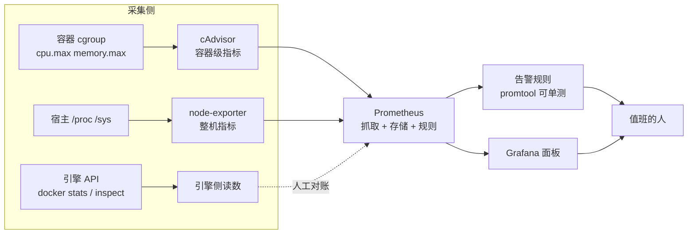
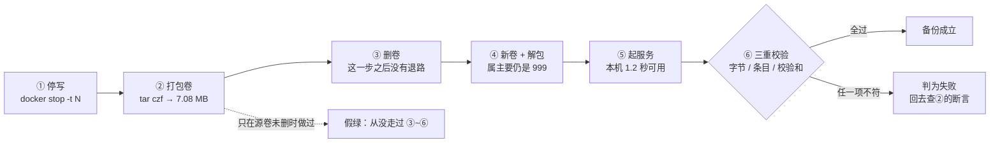

> **实战落点**：站⑦的运行基线到这里补齐了「看得见」和「回得来」两半。监控这一半吃的就是 6.3 那套限额与 5.3 那四个 cgroup 文件；备份这一半吃的是 6.4 的保留纪律与段⑤⑥的仓库链。本章 6.6 要求的**产出物「一条可复现的备份 → 删卷 → 恢复 → 数据校验命令链」就是「备份 → 删卷 → 恢复 → 数据校验」那一节**，全部读数来自本机一次真做（MySQL 8.4 + `registry:2`，跑完即清）。
> **本机基线**：Docker Engine `29.8.0` / API 1.56、Compose `v5.5.1`、cgroup v2、`StorageDriver=overlayfs` 但**镜像存储走 containerd**（这条决定了本章监控结论）、宿 VM 24 核 / `MemTotal 49292256 kB`。用到的镜像：`gcr.io/cadvisor/cadvisor:v0.49.1`（115 MB）、`prom/node-exporter:v1.8.2`（38.2 MB）、`prom/prometheus:v2.53.4`（380 MB）、`grafana/grafana:11.2.0`（635 MB）。
> **前置依赖**：[/docs/06-工程化与生产/运行基线/日志资源限制部署策略与回滚/](/docs/06-工程化与生产/运行基线/日志资源限制部署策略与回滚/)、[/docs/05-原理深入/隔离与资源/容器本质Namespace与Cgroups/](/docs/05-原理深入/隔离与资源/容器本质Namespace与Cgroups/)、[/docs/02-核心操作/接上去/端口映射数据管理与权限时区/](/docs/02-核心操作/接上去/端口映射数据管理与权限时区/)
> **本篇产出物**：一份「四件监控组件在这台机器上各自能拿到什么」的实测表；cAdvisor 拿不到容器级指标的**机制证据**（不是猜测）；node-exporter 挂载写法的三种结果与报错原文；容器指标 / 引擎指标 / 整机指标的对账表；一份关键指标清单（含本机取不到的那些）；告警阈值的三条纪律与**两条能各变红、变绿的判据**（`promtool` 单测 + 活数据 firing）；一条完整跑通的卷备份恢复校验命令链；**两个会让备份假绿的现场**（空卷、热打包）；镜像仓库备份的端到端复现；宿主机迁移与引擎升级里本机没能演的那些，逐条标出。
> **难度·耗时**：★★☆ · 60 分钟（含动手：跑一次备份恢复闭环、跑一次 `promtool test rules` 的红路）
> **拓展接口**：6.5 的 `throttled_usec` 与 `memory.peak` 是 7.x 排障页的入口指标；6.6 的卷备份闭环与 2.6 的数据卷语义、3.10 的仓库职责直接对接；段⑦（生产形态 compose）会把本篇的备份链固化成脚本；7.6 的「拉不到镜像」复盘会用到「仓库数据 = 一个卷」这条；**回指 10-存储专题**：[/docs/10-存储专题/落点与生命周期/存储形式在操作系统上的落点与验证/](/docs/10-存储专题/落点与生命周期/存储形式在操作系统上的落点与验证/)（10.3）、[/docs/10-存储专题/数据保护/备份与恢复/](/docs/10-存储专题/数据保护/备份与恢复/)（10.6）。
> **自测三题**：
> 1. 你按教程把 cAdvisor 起来了，`up` 是 1，指标也有 1695 条，但 Grafana 里按容器名下钻一个都选不到。本机给出的原因是什么？你要看哪一条读数才能确认？
> 2. 备份脚本 `tar czf backup.tar.gz -C /vol .` 返回 0、文件 87 字节。这次备份成功了吗？给出你判断用的两个数。
> 3. 「备份跑完了」和「数据能回来」之间差哪三步？本机的闭环里每一步的命令是什么？

## 为什么要先问「出事那天你看得见什么」

三个现场，都发生在出事那天而不是部署那天：

```text
「容器起来了、面板也有图，可 CPU 打满的是哪个容器？」
「cAdvisor 在你这台机器上只给了 9 条 cgroup 级序列，容器名一条都没有——
 它压根没把容器认出来，面板上那是整台机器的曲线。」

「告警一天响 40 次，第三天就没人看了。」
「你按『绝对值』定的阈值：CPU 使用率 > 80% 就报。
 一个 0.5 核配额的容器跑满就是 100%，它不该报；整机 24 核跑到 40% 也不该报。
 报的是『配额不够』和『机器要炸』，那是两个不同的比。」

「备份每天跑，上周真删了库，恢复出来是个空卷。」
「你的备份命令里卷名少打了一个字母。Docker 没报错——
 它给你新建了一个空卷，tar 打包了一个空目录，退出码 0，产物 87 字节。」
```

这三段的共同点：**监控与备份都是「平时看不出问题、用时才发现没用」的东西**。所以本篇每一节都配一条能当场跑的判据，能报红的不写进正文。



## 四件组件在这台机器上各自拿到了什么

先把结论摊开——**这不是「装好就能用」的四件套，本机上有一半是残的**：

| 组件 | 起得来吗 | 实际拿到什么 | 本机证据 |
|---|---|---|---|
| cAdvisor `v0.49.1` | `rc=0`，`/healthz` 回 `ok`，`up=1` | **只有 9 条 cgroup 级序列**（`/`、`/docker`、`/docker/buildkit`、`/docker/buildx`、`/kubepods`、`/non-systemd`、`/podruntime`、`/procd-paused`、`/restricted`），`count(container_last_seen{name!=""})` = **0**；`machine_cpu_cores=24`、`machine_memory_bytes=50475270144` 有值 | 日志尾部逐条刷：`Failed to process watch event {…Name:/docker/<64 位容器 id>…} - open /rootfs/var/lib/docker/image/overlayfs/layerdb/mounts/<id>/mount-id: no such file or directory` |
| node-exporter `v1.8.2` | 挂载写法决定成败（见下一节） | 正确挂载时 `count(node_cpu_seconds_total)=192`、24 个核、`node_filesystem_size_bytes` **56 条**、`node_memory_MemAvailable_bytes=48640405504`、`node_load1=0.12` | device 维度里同时出现 `/dev/sdb=2`、`/dev/sdd=6`、`/dev/sde=9` 与 **`C:\134=3`、`D:\134=3`、`E:\134=3`**；fstype 分布 `ext4=17`、`9p=11`、`tmpfs=27`、`rootfs=1` |
| Prometheus `v2.53.4` | 起得来，`/-/ready` 第 0 秒就 200 | 抓取正常：`job=cadvisor` 耗时 `0.0051 s`、`job=prometheus` `0.0029 s`；**`job=node` 起不来时耗时 `3.8494 s` 且 `health=down`**，规则立刻 `TargetDown` firing | `prometheus_tsdb_head_series=2380`；`/api/v1/labels` 返回 47 个 label 名；`/api/v1/cardinality/label_names` → **404**（要 `--enable-feature=cardinality-stats`，本轮 `enable-feature` 实测为空串） |
| Grafana `11.2.0` | `/api/health` 回 `{"database":"ok","version":"11.2.0"}` | 文件式 provisioning 的数据源生效：`uid=P90CD3974426EBB0A`、`id=1`；面板 4 张的仪表盘被注册为 `kb15-min`；走 Grafana 代理查 `up` 能拿到数据 | **未带凭据访问 `/api/datasources/name/…` 拿不到对象**（四个字段全 `None`），带 basic auth 才回 uid/id —— 数据源 API 不是匿名的 |

💡 新人小结（为什么会「装了却没数」）：监控栈像装在家里的水表。水表（cAdvisor）本身是好的，但它得接上你家的水管——它按 `layerdb/mounts/<容器 id>/mount-id` 去找容器可写层在磁盘上的位置，而这台引擎把镜像存在 **containerd** 里，那个路径**根本不存在**，于是它对每个容器都记一条「处理事件失败」，只交出机器总账。所以「组件在跑」和「数据进来了」是两件事。

机制证据不能只靠日志倒推，本机直接去挂载点里看了一眼：

```console
docker run --rm -v /var/lib/docker:/vd:ro alpine:3.20 sh -c ^
  "echo 顶层=$(ls /vd | tr "\n" " "); echo image目录=$(ls /vd/image); echo layerdb=$(ls -d /vd/image/overlayfs/layerdb 2>&1)"
```

```text
顶层: buildkit containers engine-id image network plugins policy rootfs runtimes stats tmp volumes
image 目录: identity-cache.db
overlayfs/layerdb 存在吗: ls: /vd/image/overlayfs/layerdb: No such file or directory
layerdb/mounts 条目数: 0
（同时 docker info 仍报 Driver=overlayfs、DockerRootDir=/var/lib/docker）
```

三条读数连起来就是本篇最重要的一条平台事实：**`docker info` 说自己是 overlayfs，但 `/var/lib/docker/image/` 里没有 overlayfs 的 layerdb**（只有一个 `identity-cache.db`），所以任何依赖 layerdb 做「容器 id → 磁盘路径」映射的采集器（cAdvisor 是典型）在这台机器上拿不到容器级指标。要容器级指标，只有三条路：读引擎自己的 `docker stats`/Engine API、把 cAdvisor 跑在**用 overlay2 存储的真 Linux 宿主**上、或者换用直接读 cgroup 的采集器（自己挂 `/sys/fs/cgroup`）。

## node-exporter 的挂载写法：三种里只有一种能用

这是本章最容易照抄踩坑的地方。同一个镜像、同一台机器，只改挂载：

| 写法 | 结果 | 读数 |
|---|---|---|
| `-v /:/host:ro`（**不带传播标志**） | 起得来，指标全 | `node_filesystem_size_bytes` **56 条**，含 `device="/dev/sdb" fstype="ext4"` 与 Windows 盘的 `9p` 挂载 |
| `-v /:/host:ro,rslave` | **起不来** | `rc=125`，原文 `docker: Error response from daemon: path / is mounted on / but it is not a shared or slave mount` |
| `-v /:/host:ro,rshared` | 起不来 | 同一类错误：`path / is mounted on / but it is not a shared mount` |
| 只挂 `-v /proc:/host/proc:ro -v /sys:/host/sys:ro` | 起得来，但**没有文件系统指标** | `node_filesystem_size_bytes` 行数 = **0** |

K8s 里那份官方 daemonset 清单写的是 `mountPropagation: HostToContainer`（等价于 `rslave`），照抄到 Docker Desktop 上就是第二种——**容器停在 `created`，Prometheus 侧表现为 `health=down`**。而且这一步还有个连带后果：compose 的 `up -d` 对这种服务**返回非 0**（本机 `rc=1`），但 `docker compose ps` 默认只显示 running 的那些，那个卡在 `created` 的容器要靠 `docker ps -a` 才看得见（这条与 6.4 蓝绿失败残留是同一形态）。

另外两条读数值得记：`mountpoint="/"` 的序列**不存在**（`n=0`）——根分区在 VM 里是 `rootfs` 而不是 node-exporter 期望的块设备；`node_disk_write_bytes_total` 也是 `n=0`。**「整机磁盘写压力」这条在这台机器上取不到**，别在容量规划里引用它。

> [!TIP]
> Docker Desktop 上的宿主文件系统监控看的是 VM，`device` 会同时出现 `/dev/sd*`（Linux 侧）与 `C:\`、`D:\`、`E:\`（Windows 侧经 `9p`）。写 PromQL 时必须用 `fstype!~"9p|tmpfs|overlay"` 这类过滤，否则「磁盘剩余空间」会拿 Windows 盘的容量来告警。

## 容器指标与宿主机指标的关系：一个负载对三张账（外加引擎自己的第三本账）

同一个容器（`--cpus 0.5 -m 64m`，一个死循环 + 握着 40 MB 字符串），同时刻的三个来源：

| 来源 | 读数 | 分母是什么 |
|---|---|---|
| `docker stats --no-stream` | `CPU=49.76%`、`MEM=38.55MiB / 64MiB`、`PIDs=1` | CPU 的分母是**核**；内存分母是容器限额 |
| cAdvisor（PromQL） | `rate(container_cpu_usage_seconds_total{name="…"}[2m])` → **n=0（没有序列）** | 本机拿不到，见上节 |
| node-exporter | `1 - avg(rate(node_cpu_seconds_total{mode="idle"}[1m]))` = **0.38**（另一轮 0.4598、0.9189，取决于同时在跑几个循环） | 分母是**整机 24 核** |

一张表说清关系：

| 你想回答的问题 | 该看的来源 | 别看的 |
|---|---|---|
| 这个容器有没有撞到它的配额 | cgroup 的 `cpu.stat`（`nr_throttled/nr_periods`）与 `memory.events`；有可用 cAdvisor 时看 `container_cpu_cfs_throttled_periods_total` | `docker stats` 的百分比（分母是核，不是配额） |
| 这台机器还剩多少 | node-exporter 的 `MemAvailable`、`node_load1`、过滤后的 `node_filesystem_avail_bytes` | 容器里的 `free -m`（5.3 已证它不隔离） |
| 这个服务被限死了还是没人用 | 引擎侧 `NanoCpus`/`Memory` + cgroup 实际值 | 面板上单条曲线 |
| 有没有 OOM 过 | `memory.events` 的 `oom_kill`、`container_oom_events_total`（有 cAdvisor 时） | 退出码 137 单独一条（137 有两种成因，见 5.3） |

## 关键指标清单：本机真取到的、和取不到的

**先给最小集**——七个查询覆盖 90% 的排障入口，全部本机跑过：

| 指标 | 用来回答 | 本机实值示例 |
|---|---|---|
| `up` | 采集本身活着吗（第一个该看的） | `n=3 cadvisor=1 \| prometheus=1 \| node=0`（node 挂了那轮） |
| `rate(container_cpu_usage_seconds_total[2m])` | 容器用了多少核 | 本机 **取不到**（cAdvisor 无容器序列） |
| `rate(container_cpu_cfs_throttled_periods_total[1m]) / rate(container_cpu_cfs_periods_total[1m])` | 配额够不够 | 本机取不到；等价判据走 cgroup 的 `cpu.stat`（5.3 实测 335/336） |
| `container_memory_working_set_bytes` / 除以 `container_spec_memory_limit_bytes` | 内存贴限额没有 | 本机取不到；引擎侧 `docker stats` 38.55MiB/64MiB 可用 |
| `1 - avg(rate(node_cpu_seconds_total{mode="idle"}[5m]))` | 整机 CPU 饱和 | 0.38 / 0.46 / 0.92（三轮不同负载） |
| `node_memory_MemAvailable_bytes` | 整机内存余量 | 48,546,344,960 / 48,640,405,504 |
| `node_filesystem_avail_bytes / node_filesystem_size_bytes`（过滤 `9p`、`tmpfs`） | 磁盘要满了 | 56 条序列，含 ext4 与 9p 两类 |
| `prometheus_tsdb_head_series` | 基数爆没爆 | 2380 |
| `prometheus_scrape_duration_seconds`（按 job） | 谁在拖慢抓取 | cadvisor 0.0051 s、prometheus 0.0029 s、**失败的 node 3.8494 s** |

**这台机器上取不到的那几条也要写下来**，否则会被当成「你的服务没数」：`container_threads`、`container_processes`（cAdvisor 本机 **n=0**）、`container_restart_count`（同上）、`node_disk_write_bytes_total`（n=0）、`node_filesystem_avail_bytes{mountpoint="/"}`（n=0）。

基数与成本的读数留给选型：`cadvisor` 这个 job 单独贡献 **1695 条时序**（三个 job 合计 head series 2380），而 `--housekeeping_interval=3s` 只是我在演示里为快点看到数据设的值——**默认 10s 起步，调小就是成倍加基数**。想按 job 看谁吃基数，用 `count by (job)({__name__=~".+"})`（本机 `cadvisor=1695 | prometheus=677 | node=7`）。

## 告警阈值怎么定才不吵：两条判据各变一次红、一次绿

💡 新人小结（阈值像什么）：烟雾报警器不该在「你点了根烟」时响，也不该「厨房全是烟」时还不响。区别在于：**报的是比率与趋势，不是绝对值；并且要等一段时间（`for`）再报**。绝对值 + 立刻报 = 天天吵；比率 + `for` = 只报真事。

规则文件用 6 条（`up==0`、CPU 限流比、内存贴近限额比、15 分钟重启 >3、磁盘可用 <10%、整机饱和 >85%），每条都带 `for`。三件事都能被机器自己验，不用人肉读日志：

**一、语法与语义静态检查**

```console
docker run --rm -v ./rules.yml:/w/rules.yml:ro --entrypoint promtool prom/prometheus:v2.53.4 check rules /w/rules.yml
```

```text
rc=0  Checking /w/rules.yml
  SUCCESS: 6 rules found
```

**二、告警逻辑的单元测试：既跑通过，也跑失败**

`tests.yml` 里四组用例，其中一组专门测「0.85 的内存占比**不许**报」：

```text
promtool test rules tests.yml        -> rc=0  Unit Testing: /w/tests.yml  SUCCESS
promtool test rules tests-bad.yml    -> rc=1  FAILED:
    alertname: ContainerMemoryNearLimit, time: 15m,
        exp:[ 0: Labels:{alertname="ContainerMemoryNearLimit", name="api", severity="ticket"} …]
        got:[]
```

那条红是我**故意**把「不该报」的期望改成「该报」造出来的——它证明这条判据会红，所以上面的绿有意义。这也给了本篇一条纪律：**0.85 < 0.9 必须不报**，阈值不卡边界，噪声就来自这类「差一点也算超」。

**三、活数据上的双向验证**

| 场景 | 规则 | 结果 |
|---|---|---|
| node-exporter 因挂载写错起不来 | `TargetDown`（`up == 0` for 1m） | 第一次采样就 `state=firing`，`活跃告警数=1`（这是它该报的时候报了） |
| 整机 CPU 饱和度阈值降到 0.3（实测 0.38） | `NodeCpuSaturatedLive` | 第一次采样 `firing`，`value=3.25e-01`、`activeAt=2026-10-27T23:55:23Z` |
| 同数据下阈值设成 1.2（物理不可能） | `VetoImpossible` | 全程 `ok/inactive`，**从未 firing** |
| 容器侧两条（本机无容器序列） | `ContainerCpuThrottling`、`ContainerMemoryNearLimit` | `ok/inactive`，原因不是「没问题」，是**没有数据**——这一格必须写在表里，否则「无告警」会被误读成「一切正常」 |

定阈值的四条纪律，都来自上面某一行：

1. **报比率不报绝对值**：`throttled_periods / periods`、`working_set / limit`，而不是「CPU 使用率 80%」。
2. **每条都带 `for`**：本机 `for` 分布 1m/3m/5m/10m；`for: 0s` 只适合做演示，会让单点毛刺变告警。
3. **区分「没数」与「没事」**：`up==0` 必须单独成一条，且优先级最高；采集器缺指标（本机 cAdvisor）会让业务规则永远 inactive。
4. **能红的才配上线**：`promtool test rules` 的红绿各跑一次，比读十遍 YAML 有用。

## 数据卷备份与恢复：备份 → 删卷 → 恢复 → 数据校验，一条真跑通的链

这是 6.6 要的产出物。被测对象是一个真的 MySQL 8.4 卷，数据只有三行，但校验按「真数据」的标准做。

💡 新人小结（备份和恢复为什么是两件事）：给房子拍照片很容易，难的是**照片能不能把房子盖回来**。备份脚本干的通常是拍照：把目录复制一份；恢复演练才是照图施工：另起一块空地（新卷）、按照片盖一遍、再逐间核对（校验和）。只做前两步的「备份系统」，第一次真出事时才被发现是照相机。



```console
REM ① 造数据（略：建库建表插 3 行）
REM ② 停写 —— 不是 Ctrl-C，是让数据库自己收尾
docker stop -t 20 kb16b-db
REM ③ 打包卷：源卷挂到 /from，宿主目录挂到 /to，tar 打包整个目录
docker run --rm -v kb16b-dbdata:/from -v D:\backups:/to alpine:3.20 ^
  sh -c 'tar czf /to/cold.tar.gz -C /from .; echo "rc=$?"; echo "条目=$(tar tzf /to/cold.tar.gz | wc -l)"'
REM ④ 删卷（危险动作，先确认容器已经 rm）
docker rm kb16b-db && docker volume rm kb16b-dbdata
REM ⑤ 新建同名卷并解包回去
docker volume create kb16b-dbdata
docker run --rm -v kb16b-dbdata:/to -v D:\backups:/from:ro alpine:3.20 ^
  sh -c 'tar xzf /from/cold.tar.gz -C /to; echo "解包rc=$?"'
REM ⑥ 用恢复出来的卷起服务并校验
docker run -d --name kb16b-db2 -e MYSQL_ROOT_PASSWORD=… -v kb16b-dbdata:/var/lib/mysql mysql:8.4
docker exec kb16b-db2 mysql -uroot -p… -e "CHECKSUM TABLE kb16b.t_note"
```

本机每一步的实际读数：

| 步 | 读数 |
|---|---|
| 空库起来到 `mysqladmin ping` 可用 | **8.7 秒** |
| 备份前 `CHECKSUM TABLE` | `kb16b.t_note  3040004466`；运行中卷内文件数 184 |
| 冷打包 | `tar_rc=0`、**181 条目、7,080,595 字节** |
| 解到新卷 | `解包rc=0`、解出文件数 173、属主仍是 `999:999`（tar 保住了 uid/gid，MySQL 才肯起） |
| 从恢复卷起库 | 可用耗时 **1.2 秒**（数据都在，不需要重新初始化） |
| 校验 | 行数 3、内容 `1 alpha / 2 bravo / 3 charlie`、`CHECKSUM TABLE` = `3040004466` → **与备份前逐字符相同** |

三个数缺一不可：**字节数**（有没有内容）、**条目数**（内容全不全）、**校验和**（内容对不对）。只报「备份成功 rc=0」的脚本，就是在赌。

逻辑备份也顺手对了一次账，因为它能跨版本恢复：

```text
mysqldump --single-transaction：容器内 3360 字节、51 行
  sha256 = a7c158620f6760c64f246b535ea2b5f26ec3409a7ea36b4c1179dbef5a9ce1de
落到宿主（docker exec cat 重定向）：3360 字节，sha256 同上
用 docker cp 拷出：3360 字节，sha256 同上
```

顺带一条被证伪的担心：**在这条链上 `docker exec` 取出的文本没有发生换行翻译**（三次字节数与哈希完全一致）。`docker cp` 仍是更稳的选择（不需要 shell 引号、支持目录与特殊文件名），但「exec 一定改字节」这句话本机不成立。

## 备份的验证方式：两个会让备份假绿的现场（本机的红样本）

**红样本一：卷名少打一个字母，Docker 帮你新建一个空卷。**

```console
docker run --rm -v kb16-dbdata-typo:/from -v D:\backups:/to alpine:3.20 ^
  sh -c 'tar czf /to/typo.tar.gz -C /from . && echo 打包完成; echo "条目数=$(tar tzf /to/typo.tar.gz | wc -l)"'
```

```text
rc=0  打包完成 | 条目数=1
产物字节 = 87        ← 一个真实数据库的卷是 7 MB 量级，这里是 87 字节
docker volume ls 里确实多出一个 kb16-dbdata-typo   ← Docker 静默创建了它
```

这是备份脚本最经典的一种失效：**没有任何一步报错**。防线只有两条，都在脚本里：`docker volume inspect <名字>` 先断言卷存在，以及**产物字节数与条目数的下限断言**（例如「< 1 MB 就判定失败」）。

**红样本二：库还在写就打包——不报错，但抓到的是过去的切片。**

同一个「目录正在被改」的场景，两种 tar 各跑一次（写入器每 0.4 秒改一次 `counter.txt`）：

| 打包方 | 退出码 | 有没有报「文件已变」 | 事后解包看到的 counter |
|---|---|---|---|
| busybox tar 1.36.1（`alpine:3.20`） | **rc=0** | 一句都没有 | **11** |
| GNU tar 1.35（Debian 系镜像） | **rc=0** | 首次打包没有报 | **17** |
| 卷此刻的真实值 | —— | —— | **30** |

两个归档都「成功」，都少了 13~19 秒的改动。GNU tar 的 `--warning=no-file-changed` 那一次反而 `rc=2` 且没产出文件（本机读数，原因本轮没查，见未验证项）——**这提醒另一件事：不同 tar 实现对「读到一半文件变了」的处理完全不同**，别假设它会提醒你。

数据库侧则要按引擎分情况：本机 InnoDB 的热备份恢复后**这次没丢数据**（124 行全在、`CHECK TABLE` 回 `status OK`），启动日志里有 `Starting XA crash recovery… XA crash recovery finished.`——**是数据库的 redo 兜住了 tar 的残缺**，不是 tar 安全。所以规程只能是：

1. 能停就停（`docker stop -t <够长的收尾时间>`，见 6.3 那条「一号进程不接 TERM 会白等」）；
2. 不能停就用应用层的一致性快照（`mysqldump --single-transaction`、`FLUSH TABLES WITH READ LOCK`、数据库自己的备份接口）；
3. 既不能停也没有快照能力时，**接受这是「尽力而为」的备份，并在恢复演练里验证它**，而不是在文档里写「每天 tar 一次」。

**顺手一条相关禁令**：备份工具想「先停容器再打包」，删卷时会被引擎挡住，而且 `-f` 也挡不住：

```text
docker volume rm kb16b-restore
  rc=1  Error response from daemon: remove kb16b-restore: volume is in use - [bdf7e0a87eec…]
docker volume rm -f kb16b-restore
  rc=1  同上（容器 kb16b-db2 仍是 running）
```

## 定时、全量与镜像仓库的备份责任边界：这条线画在哪

💡 新人小结（责任边界怎么画）：把「丢了能不能变回来」当成唯一标准，东西只分三种——**能重新下载的**（公共基础镜像）、**能重新造的**（你自己的构建产物，前提是可复现构建与源码在库）、**变不回来的**（数据库卷、仓库里已推的内容、引擎的信任配置与 CA）。备份预算只该花在第三类上；把预算花在第一类上，就是那种「每天备 5 GB 镜像、三年没备过一次数据库」的团队。

**「定时」的执行体在本机是可测的**：容器里 busybox `crond` 跑 `* * * * *`，130 秒内落了一次又一次：

```text
docker exec kb16b-cron sh -c 'echo 跑过次数=$(wc -l < /tmp/ran.txt); cat /tmp/ran.txt'
  跑过次数=3 | 1793145960 1793146020 1793146080     ← 严格 60 秒一次
```

注意 `crond -f -l 8 -b` 里那个 `-b`（转后台）会让容器主进程退出——**「加了 -b 反而不起作用」是这类 sidecar 最常见的死法**（与 6.3 的 PID 1 信号问题同源）。三种定时方式的取舍：

| 方式 | 适合 | 代价 / 注意 |
|---|---|---|
| 宿主机计划任务（Windows 任务计划 / cron） | 单机 compose、需要 `docker` CLI | 宿主机没了就一起没了；凭据与路径都在宿主上 |
| sidecar 容器 + `crond -f` | 备份跟着编排文件走、跨主机一致 | cron 粒度只有分钟；日志得从容器里取 |
| 编排层的一次性任务（K8s CronJob / CI 定时流水线） | 有编排或有 CI 时用 | 需要能访问引擎或仓库；备份产物要有去处 |

**镜像仓库的备份责任边界，本机端到端演了一遍**（用一次性 `registry:2`，Harbor 未参与）。本篇前半讲「看得见」，后半讲「回得来」，合起来才是备份与容灾这一章要交付的东西：

| 步 | 动作 | 读数 |
|---|---|---|
| 1 | push 探针镜像 | `rc=0`，`…sha256:c64c687cbea9…` |
| 2 | 备份它的存储卷 | `rc=0`、**3,624,912 字节 / 38 条目** |
| 3 | `docker rm -f` + `docker volume rm` | 都 `rc=0`；再 `pull` → `failed to resolve reference … Head "https://localho…"`（证明是真没了） |
| 4 | 新建同名卷并从 tar 解包 | `解包rc=0`、解出条目 38 |
| 5 | 重新起 registry | `catalog` 回到 `{"repositories":["kb16b/probe"]}`、`tags/list` 回到 `["1"]` |
| 6 | 从恢复后的仓库 `pull` 并运行 | `rc=0`，容器里 `echo id=$(cat /etc/alpine-release)` → **3.20.10** |

结论可以直接写进规程：**镜像仓库的数据就是它那个卷；备份仓库 = 备份那个卷**（Harbor 侧对应 `/data` 那一整块，见 [/docs/05-原理深入/隔离与资源/容器本质Namespace与Cgroups/](/docs/05-原理深入/隔离与资源/容器本质Namespace与Cgroups/) 之后会补的 Harbor 运维页与 `示例/Harbor私有仓库/05`）。而**镜像本身**是可再生的（能从 Docker Hub 重拉），**仓库里的内容**不可再生——这条边界弄错，就会出现「删了没推上去的本地镜像，找回无门」。

四类东西的责任归属：

| 东西 | 可再生吗 | 谁负责 | 本机依据 |
|---|---|---|---|
| 镜像（公共基础层） | 可再生，但要能连上源 | 不用备份；锁版本标签 | 3.11 的可复现构建；断网时 `docker pull` 失败 |
| 镜像（你自己构建、还没推） | **不可再生**（重构出来的 id 会变，见 6.4） | 推仓库，或 `docker save` | 6.4 三次重构三个摘要；本篇 `save/load` 哈希一致 |
| 数据卷 | 不可再生 | 你的备份链（本篇那条） | 冷备份闭环 + 假绿样本 |
| 仓库里的镜像内容 | 不可再生 | 仓库卷备份 / GC 策略 | registry 卷端到端恢复 |
| 编排与 `.env` | 半可再生（配置在，密钥不该进仓库） | 版本库 + 密钥分离 | 链上 `.gitignore` 实测挡住 `.env` 与构建产物 |
| 引擎配置与信任 | 重装即丢 | 迁移前必须单独抄走 | 本机 `daemon.json` **可读**（2026-10-28 批 21 更正本库旧结论）：引擎是容器化部署，文件在它自己 mount namespace 的 `/run/config/docker/daemon.json`，借 `--privileged --pid=host` 的容器 `cat /proc/1/root/run/config/docker/daemon.json` 就能拿到全文 20 个键——**这一份就是要抄的东西**，落点在 [/docs/05-原理深入/网络与运行时/网络底层跨主机方案与运行时生态/](/docs/05-原理深入/网络与运行时/网络底层跨主机方案与运行时生态/) |

## compose 与 `.env` 的版本化：链上实测过的三条

1. **秘密不进仓库，样板进仓库**：链上 `.gitignore` 生效后，`git status --porcelain --ignored` 的「被忽略」侧正是 `.env` 与 `api-service/api`（构建产物），提交里没有它们；`.env.example` 则入库。
2. **缺变量要在部署时炸，不要在运行时炸**：`labels: {org.opencontainers.image.revision: ${GIT_SHA:?没导出就报错}}` 这种写法下，不导出时 `docker compose config` 直接报 `required variable GIT_SHA is missing a value: 没导出就报错`（`rc=1`）；导出后那一行渲染成完整 sha。**这类「带 `:?` 的必填变量」是版本化配置里最值钱的三行**。
3. **多文件叠加要有名有姓**：`compose.yaml` + `compose.override.yaml`（自动合并）与 `-f` 点名（关闭自动合并）的差别在 4.4 已实测；备份/迁移场景里，**只提交主干文件而指望 override 自动生成，恢复出来的是另一套配置**。

## 宿主机迁移与引擎升级的操作规程：本机没演的部分，和必须核对的字段

Docker Desktop 的升级与卸载会动到 VM 的数据盘，这属于「共享环境上不做破坏性演示」的范围，**本篇因此不给升级步骤的实测**（见未验证项）。能给的是一份迁移前核对单——左列都是本机刚读过的真实字段：

| 字段 / 物件 | 迁移前后要核对的值 | 本机现值 |
|---|---|---|
| `docker info` 的 `Driver` | 决定 cAdvisor 这类采集器有没有容器级指标 | `overlayfs`（但 layerdb 不存在，见前述） |
| `DockerRootDir` | 卷与日志的落点，备份脚本里的路径要跟着改 | `/var/lib/docker` |
| `CgroupVersion` / `CgroupDriver` | 决定限额文件叫什么、`--cpu-shares` 怎么映射 | `2` / `cgroupfs` |
| `LoggingDriver` | 新机器上默认日志驱动与轮转 | `json-file`（无轮转） |
| `InsecureRegistryCIDRs` | 私有仓库能不能直连推 | 含 `127.0.0.0/8`、`::1/128` |
| `/etc/docker/certs.d` | 私有仓库的 CA 信任，**重装即丢** | 在 VM 里，Windows 侧建不出带冒号的目录名 |
| 卷 | 用本篇链逐卷搬；匿名卷要先认属主 | 10 个卷里 9 个是 Harbor 的 |
| 容器 | **不迁容器，迁声明**（compose + 镜像标签 + 数据） | 引擎里 9 个 running 都来自 Harbor 的 compose |

最后那条是最容易做错的：有人把 `docker commit` 当成迁移手段。commit 出来的镜像丢掉了 `CMD`/`ENTRYPOINT` 之外的运行期约定与构建缓存，也断掉了 6.1 的 `revision` 反查链——迁移要搬的是**声明 + 数据**，不是运行中的容器。

## 本篇不覆盖什么

按 W6 的规矩，本篇**故意不讲**的东西逐条点名去处——写「不覆盖」不是免责声明，是防止你在这一篇里找不存在的答案：

- 日志驱动的差异与轮转参数怎么设 → 见 **6.3**（`json-file` 不轮转的默认真相在那一篇）
- 回滚操作规程与一次演练记录 → 见 **6.4**（`回滚` 三条路的前提各不同，那一篇有读数）
- 卷的物理落点取证（`du` 与 `SIZE=N/A`）→ 见 **10.3**（`du` 与设备号那两节在那一篇）
- 存储类故障的现场分流 → 见 **10.8**（`分流表` 与四类容量/权限故障在那一篇）
- cgroup 指标的机制与为什么会被重启清零 → 见 **5.3**（`memory.peak` 的口径在那一篇）
- 误 `down -v` 之后的救援链 → 见 **7.9**（`down -v` 的救援 runbook 在那一篇）

## 未验证项（这一篇没做的，别当已知）

| 项 | 状态 | 原因 |
|---|---|---|
| cAdvisor 在真 Linux 宿主 + overlay2 上能否给出容器级指标 | 未验证 | 本机是 Docker Desktop + containerd 存储；已证的是「这台不行」及其原因 |
| GNU tar 加 `--warning=no-file-changed` 那次 `rc=2` 且不产出文件的具体成因 | 未查 | 本轮只计了报错行数，没把报错文本打出来 |
| 告警的通知通道（Alertmanager / 邮件 / IM）与静默、分组 | 未做 | 属 6.5 的下一步，需要再起一套服务；本轮只做到规则触发层面 |
| Docker Desktop 引擎升级与 VM 数据盘迁移 | 未验证 | 共享环境上不做破坏性演示；只给核对单 |
| `--enable-feature=cardinality-stats` 开启后的基数视图 | 未测 | 本轮 `enable-feature` 为空串，端点回 404 |
| 面板 UI 的实际渲染效果（Grafana 目测） | 未做 | 只核到 API：健康、数据源 uid、dashboard 注册数、代理查询能取到数据 |
| MyISAM / 无 redo 引擎的热 tar 后果 | 未测 | 本轮数据库侧只用了 InnoDB，那次「没丢」不能推广 |
| 远端备份目的地（对象存储 / 另一台机） | 未做 | 约定不推任何远端；产物只落本机目录，跑完即删 |

## 要点总结

- 本机的监控栈有一半是残的，而且残得有原因：`docker info` 报 `overlayfs`，但 `/var/lib/docker/image/` 里只有 `identity-cache.db`，没有 `overlayfs/layerdb`，于是 cAdvisor 对每个容器刷 `… layerdb/mounts/<id>/mount-id: no such file or directory`，只交出 9 条 cgroup 序列与 `machine_*`，容器名一条也没有。**「组件在跑 + `up=1` + 1695 条时序」与「有容器级数据」是三件事。**
- node-exporter 的挂载写法在 Docker Desktop 上有硬性差别：`-v /:/host:ro` 能拿到 56 条文件系统指标，加 `rslave`/`rshared` 直接 `rc=125`（`path / is mounted on / but it is not a shared or slave mount`），只挂 `/proc`+`/sys` 则文件系统指标为 0；`device` 里混着 `/dev/sd*` 与经 `9p` 进来的 `C:\`、`D:\`，所以磁盘查询必须按 `fstype` 过滤；`mountpoint="/"` 与 `node_disk_write_bytes_total` 本机取不到。
- 三口径要分开用：`docker stats` 的 CPU 分母是核（49.76%）、整机饱和是 24 核比率（0.38~0.92）、配额够不够只能看 cgroup 的 `nr_throttled/nr_periods`。**面板没数 ≠ 服务健康**，采集器缺指标时所有容器规则都会安静地 `inactive`。
- 阈值要「比率 + `for` + 分层」，而且要能红：`promtool check rules` 回 `SUCCESS: 6 rules found`，`test rules` 回 `SUCCESS`，**故意写错时回 `rc=1 FAILED` 并打出 exp/got 差异**；活数据上 `TargetDown` 与 `NodeCpuSaturatedLive`（value 0.325）各自 firing，物理不可能的 `VetoImpossible` 全程 inactive。
- 备份闭环的本机数字：停写 → tar 出 7,080,595 字节 / 181 条目 → 删卷 → 解到新卷（属主 999 保住）→ 起库 1.2 秒 → `CHECKSUM TABLE` 与备份前逐字符相同（3040004466）。**校验三件套是字节数、条目数、校验和**，`rc=0` 不在里面。
- 两类假绿本机能演：卷名打错时 Docker 静默建空卷、tar 产物 87 字节且 `rc=0`；热 tar 下 busybox 与 GNU tar 都 `rc=0` 零告警，但解出来的 `counter` 是 11 / 17，卷上此刻是 30——InnoDB 这次靠 `XA crash recovery` 没丢数据，那是数据库兜底，不是 tar 安全。**没验证过的备份等于没有备份**这条，落到实处就是「恢复演练要有断言」。
- 责任边界一句话：镜像可再生、**你自己构建还没推的镜像与仓库里的内容不可再生**（仓库数据就是它那个卷——3,624,912 字节的 tar 恢复后 `catalog`、`tags`、`pull` 与运行全通）、卷不可再生、引擎配置与 CA 信任重装即丢。定时执行体里 sidecar `crond -f` 实测 60 秒一次跑满 3 次，而带 `-b` 会让容器直接退出。
