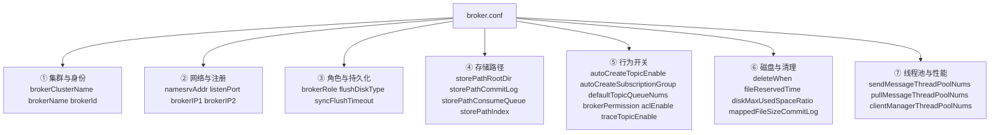
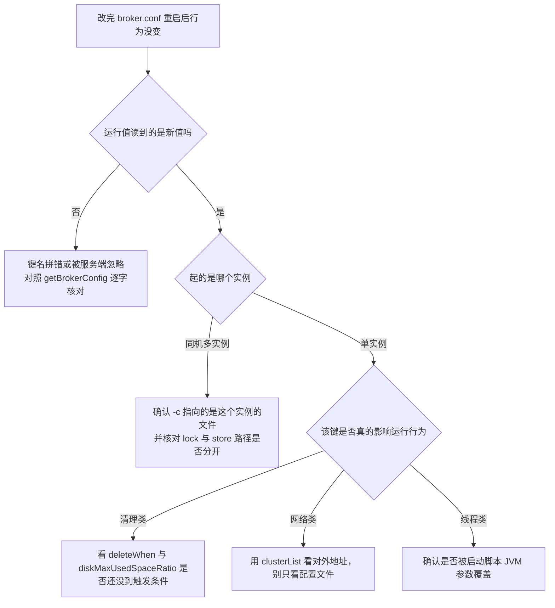

## 为什么「配置文件写了」不等于「服务端生效了」？（痛点引入）

Broker 的配置文件是纯键值文本，读不读得懂、有没有拼错，进程都不会拦你。四类高频事故：

- 键名多写或漏写一个字母：`mapedFileSizeCommitLog`（少一个 p）被服务端当成不认识的键忽略，CommitLog 单文件仍按默认 1 GiB 走，运维以为改了、磁盘规划按改后的值做，结果提前撑爆；
- 默认值记错：`diskMaxUsedSpaceRatio` 记成 90%，实际本机 4.9.8 上是 75%。按 90% 设告警阈值，等于磁盘写到 75% 时 Broker 已经开始拒绝写入而监控还在绿；
- 单位与量纲混用：`fileReservedTime` 是小时，`flushIntervalCommitLog` 是毫秒，两者都写成「时间」，改错量级不会报错，只会让清理逻辑提前或永远不触发；
- 改了文件没重启、或改的不是这个实例的文件：同机多实例时每个 Broker 各有一份 properties，最容易「改 a 生效到 b」。

本文把 `broker.conf` 按七组逐项讲清，并且**每个键都给三个数**：官方参数表的默认值、本机 4.9.8 运行中进程的实测值、生产环境是否建议显式写出。两者的差异本身就是最有用的信息。

> ### 💡 新人小结：把 broker.conf 想成「仓库的开业登记表」
>
> - 前三组（集群与身份、网络与注册、角色与刷盘）回答「我是谁、在哪、货怎么算存好了」——这三组错了，要么注册不上，要么可靠性等级和你想的不一样；
> - 中间两组（存储路径、行为开关）回答「货放在哪个货架、空货架能不能自己搭」——生产环境要收紧的是这两组；
> - 最后两组（磁盘清理、线程池）回答「什么时候扔旧货、几个人搬货」——这两组决定磁盘水位和吞吐上限，出事时最难看的是磁盘组。
>
> 一个键属于哪一组，决定了它出问题时的表现形式：身份组出问题表现为「查无此人」，存储组表现为「找不到数据」，磁盘组表现为「拒绝写入」。

**本文读法**

```text
七组参数分组图 → 逐组：键 / 官方口径 / 本机实测 / 生产建议
→ 模板笔误更正表 → 发行包四套示例配置对照 → 改了没生效的排查流程 → 要点总结
```

## 参数分组总览



本机 4.9.8 的实测值全部来自运行中进程，不是读文件猜的：

```text
$ sh bin/mqadmin getBrokerConfig -n 127.0.0.1:9876 -b 127.0.0.1:10911 | grep -E "brokerRole|brokerId|listenPort|haListenPort|flushDiskType|storePathRootDir|autoCreate|defaultTopicQueueNums|deleteWhen|fileReservedTime|diskMaxUsedSpaceRatio|mappedFileSize|sendMessageThreadPoolNums|pullMessageThreadPoolNums|maxMessageSize|brokerPermission|namesrvAddr"
brokerClusterName   = DefaultCluster
brokerName          = X
brokerId            = 0
namesrvAddr         = localhost:9876
listenPort          = 10911
haListenPort        = 10912
brokerRole          = ASYNC_MASTER
flushDiskType       = ASYNC_FLUSH
storePathRootDir    = C:Userswebtustore
autoCreateTopicEnable        = true
autoCreateSubscriptionGroup  = true
defaultTopicQueueNums        = 8
brokerPermission             = 6
deleteWhen                   = 04
fileReservedTime             = 72
diskMaxUsedSpaceRatio        = 75
mappedFileSizeCommitLog      = 1073741824
mappedFileSizeConsumeQueue   = 6000000
sendMessageThreadPoolNums    = 4
pullMessageThreadPoolNums    = 64
maxMessageSize               = 4194304
```

## ① 集群与身份标识

| 键 | 含义 | 官方口径 | 本机实测 | 生产建议 |
|----|------|----------|----------|----------|
| `brokerClusterName` | 所属集群名，同集群内所有节点一致 | 上游参数表列出该项；发行包四套示例配置统一写 `DefaultCluster` | `DefaultCluster` | 显式写死，别依赖默认 |
| `brokerName` | Broker 组名，**同名互为主从** | 「同名者互为主从关系（如 Master 为 broker-a，其 Slave 也为 broker-a）」；官方补充「一个 Master 可对应多个 Slave，一个 Slave 只能对应一个 Master」（出处：`docs/00-introduction/02whatis.md`、`docs/04-deployment/01deploy.md`） | `X`（本机未显式指定时的实际结果） | **必须显式写**：这是主从配对的唯一键 |
| `brokerId` | 0 表示 Master，大于 0 表示 Slave | 参数表：「brokerID 0表示主节点 大于0表示从节点」，默认值 0（出处：`docs/06-parameterConfiguration/02server.md`）；最佳实践表同样写「0 表示 master，其他的正整数表示 slave」（出处：`docs/05-bestPractice/01bestpractice.md`） | `0` | Master 恒 0；Slave 同组内唯一且 > 0 |

`brokerName` 与 `brokerId` 的组合还有一层隐蔽作用：它是路由数据的分组键。NameServer 返回的路由里 `brokerAddrs` 是一个**以 brokerId 为键**的映射，本机实测只有一台主节点，所以只有一项：

```json
{"brokerAddrs":{0:"192.168.3.103:10911"},"brokerName":"X","cluster":"DefaultCluster"}
```

配了 Slave 之后，同一 `brokerName` 下会多出 `1` 这一项（键即 brokerId），客户端据此判断能从哪些地址读。也就是说，**brokerName 写错、brokerId 撞号，直接表现为「Slave 在 clusterList 里不出现」或「两组 Broker 被当成一组」**——这是排障时最容易忽略的一条因果链。

> ### 💡 新人小结：三行身份写的其实是「同不同组、谁主谁从」
>
> `brokerClusterName` 决定「在不在同一个业务集群」，`brokerName` 决定「是不是同一条数据的主备」，`brokerId` 决定「这条主备里谁是可写的那个」。判断口诀：**同名不同号是主备，同号不同名不可能，不同名不同号是两组独立数据**。

## ② 网络与注册

| 键 | 含义 | 官方口径 | 本机实测 | 生产建议 |
|----|------|----------|----------|----------|
| `namesrvAddr` | 注册的 NameServer 地址列表 | 取值优先级：`-D` 系统参数 `rocketmq.namesrv.addr` 或环境变量 `NAMESRV_ADDR`（出处：`docs/06-parameterConfiguration/01local.md`）；多地址用分号分隔（出处：`docs/04-deployment/01deploy.md`） | `localhost:9876` | 写全所有 NameServer，分号分隔、不留空格 |
| `listenPort` | 接受客户端连接的监听端口 | 最佳实践表列 10911（出处：`docs/05-bestPractice/01bestpractice.md`） | `10911` | 同机多实例时必须逐实例改开 |
| `haListenPort` | 主从复制端口 | **该键未出现在 4.x 参数表中**，本文只报实测值 | `10912` | 一般不动；跨节点要保证主备之间该端口互通 |
| `brokerIP1` | Broker 对外服务地址 | 参数表描述「Broker服务地址」（出处：`docs/06-parameterConfiguration/02server.md`） | 未显式配置，实际对外地址是 `192.168.3.103` | 多网卡 / 容器 / 云主机**必须显式写** |
| `brokerIP2` | Broker 的 HA 地址 | 参数表描述「BrokerHAIP地址，供slave同步消息的地址」（出处：`docs/06-parameterConfiguration/02server.md`）；最佳实践表补充「存在主从 broker 时，主节点配置了 brokerIP2，从节点会连接该地址进行同步」（出处：`docs/05-bestPractice/01bestpractice.md`） | 未显式配置（单机无备） | Master 必须显式写；Slave 不需要配 |

`brokerIP1` 是整套网络配置里唯一能「静默骗过所有人」的键：Broker 起得好好的、`boot success` 也在、NameServer 也注册上了，只是注册出去的是一个客户端到不了的地址。本机实测正好演示了这一点——命令里填的是 `127.0.0.1:9876`，`clusterList` 回来的地址是 `192.168.3.103:10911`：

```text
$ sh bin/mqadmin clusterList -n 127.0.0.1:9876
DefaultCluster    X    0    192.168.3.103:10911    V4_9_8    ...
```

判断动作只有一条：**看 `clusterList` 或 `topicRoute` 里的地址，在自己这边通不通。** 不通就是 `brokerIP1` 的问题，不是 NameServer 的问题。

`haListenPort` 值得单独提一句：本机单机部署（没有 Slave）时它依然在监听，所以「备节点还没配」和「HA 端口没开」是两回事，防火墙策略里漏放行这条端口，将来加 Slave 时的现象就是主从一直配不上而单机一切正常。

## ③ 角色与持久化策略（高可用的两个开关）

这两个键正交，但一起决定「发送返回成功的含义」。

| 键 | 取值 | 语义（官方口径） | 默认 | 本机实测 |
|----|------|------------------|------|----------|
| `brokerRole` | `ASYNC_MASTER` / `SYNC_MASTER` / `SLAVE` | 异步复制主：Master 写入成功即返回，随后异步同步给 Slave；同步复制主：Master 与 Slave 均写入成功才返回；SLAVE：从节点（出处：`docs/06-parameterConfiguration/02server.md`，默认值栏写 `ASYNC_MASTER`） | `ASYNC_MASTER` | `ASYNC_MASTER` |
| `flushDiskType` | `ASYNC_FLUSH` / `SYNC_FLUSH` | 同步刷盘在收到确认给生产者之前落盘；异步刷盘按组刷盘换取更好性能（出处：`docs/05-bestPractice/01bestpractice.md`，默认 `ASYNC_FLUSH`） | `ASYNC_FLUSH` | `ASYNC_FLUSH` |
| `syncFlushTimeout` | 毫秒 | 同步刷盘 / 同步复制的等待上限，官方最佳实践称「默认为 5s」（出处：`docs/05-bestPractice/01bestpractice.md`） | — | `5000`（与「5 秒」口径一致） |

组合出来的四种可靠性档位，以及客户端能观察到的返回状态，官方在发送状态一节写得很明确（出处：`docs/05-bestPractice/01bestpractice.md`）：

| 组合 | 消息落盘 | 消息到 Slave | 客户端可能看到的异常状态 | 典型取舍 |
|------|----------|--------------|---------------------------|----------|
| `ASYNC_MASTER` + `ASYNC_FLUSH` | 否（进 PageCache 即返回） | 否 | 无（最宽松） | 吞吐优先，默认档 |
| `ASYNC_MASTER` + `SYNC_FLUSH` | 是 | 否 | 刷盘超时（未在 5 秒内完成） | 单机掉电不丢，性能下降 |
| `SYNC_MASTER` + `ASYNC_FLUSH` | 否 | 是 | 同步到 Slave 超时；或「Slave 不可用」（配了 SYNC_MASTER 却没备） | 官方推荐的常规生产组合 |
| `SYNC_MASTER` + `SYNC_FLUSH` | 是 | 是 | 上述两种都可能出现 | 零丢失要求，性能代价最大 |

第三行最反直觉的一条：**`SYNC_MASTER` 但没配 Slave，会直接看到「Slave 不可用」状态**。官方原话是「如果 Broker 服务器的角色是同步 Master……但没有配置 slave Broker 服务器，则将返回该状态」。所以「先改成 SYNC_MASTER、备节点明天再补」这个操作顺序，会让发送侧立刻开始报错。

## ④ 存储路径

模板里这一组最容易配错，因为它同时受「默认值依赖 `storePathRootDir`」和「Windows 路径转义」两件事影响。

| 键 | 模板里的写法 | 含义 | 本机实测 |
|----|--------------|------|----------|
| `storePathRootDir` | `/data/rocketmq/store/broker-a` | 存储根目录，模板建议改到独立大容量数据盘 | `C:Userswebtustore`（回显吞掉了反斜杠，实际值为用户目录下 `store`） |
| `storePathCommitLog` | 注释形式给出 `${storePathRootDir}/commitlog` | 所有主题的物理消息文件 | 默认随根目录，本机 `~/store/commitlog` 存在 |
| `storePathConsumeQueue` | 注释 `${storePathRootDir}/consumequeue` | 消费队列索引 | 本机 `~/store/consumequeue` 存在，下按主题分目录 |
| `storePathIndex` | 注释 `${storePathRootDir}/index` | 消息哈希索引文件 | 本机 `~/store/index` 存在，文件名是创建时刻 `20261017234241732` |
| `storeCheckpoint` | 注释 `${storePathRootDir}/checkpoint` | 异常恢复用的检查点 | 本机 `~/store/checkpoint` 存在 |

本机目录实测（这一条比任何解释都直观）：

```text
$ ls ~/store
abort  checkpoint  commitlog  config  consumequeue  index  lock

$ ls ~/store/commitlog
00000000000000000000
00000000001073741824
```

第二个文件名 `00000000001073741824` 就是 1 GiB，正好等于 `mappedFileSizeCommitLog = 1073741824`：**CommitLog 的文件名是它的起始偏移量，文件切分点由这个键决定**。这也解释了为什么该键不宜乱调大——单个文件越大，异常恢复时要扫描/校验的量越大，模板注释「过大会拖慢异常恢复速度」是有依据的。

> ### 💡 新人小结：改存储路径时的三条安全动作
>
> 1. 同一台机器多实例：`storePathRootDir` 必须逐实例不同，否则两个 JVM 抢同一个 `lock` 文件；
> 2. Windows 写路径要转义成 `D:\\rocketmq\\store`，并且知道配置回显可能把 `\n` 当转义吃掉（本机 NameServer 的 `configStorePath` 就显示成了跨行残字），所以**改完要用 `getBrokerConfig` 核对运行时值**，而不是只看文件；
> 3. 路径搬迁不是「改个键重启」就完事，老目录里的 CommitLog 与 ConsumeQueue 要么先迁数据、要么接受历史消息不可读。

## ⑤ 关键行为开关

| 键 | 模板值 | 含义 | 本机实测 | 生产建议 |
|----|--------|------|----------|----------|
| `autoCreateTopicEnable` | `true` | 是否允许发送时自动创建 Topic | `true` | **生产建议 false**，由运维统一管理。上游部署文档也提到「可以在发送消息时自动创建 Topic」是便捷路径而非治理路径（出处：`docs/00-introduction/02whatis.md`） |
| `autoCreateSubscriptionGroup` | `true` | 是否自动创建订阅组 | `true` | 生产建议 false，避免消费组名拼错静默新建 |
| `defaultTopicQueueNums` | `8` | 自动建 Topic 时的默认队列数 | `8` | 与 Broker 数、消费并发数一起规划；本机示例主题 `TP_ORDER_SEQ` 用的是 4 |
| `brokerPermission` | 模板未列 | 6 可读写、4 只读、2 只写、0 不可用 | `6` | 做禁写演练、灰度下线时用 `updateBrokerConfig` 动态改 |
| `aclEnable` | 注释未开 | 是否启用 ACL（配合 `plain_acl.yml`） | `false` | 需要鉴权时开，改动前先确认 `conf/plain_acl.yml` 已就位（发行包里有该文件） |
| `traceTopicEnable` | 注释未开 | 是否启用消息轨迹 | `false` | 开轨迹前先按轨迹文档确认内部轨迹主题的归属（出处：`docs/05-bestPractice/03messagetra.md`） |

自动建 Topic 的连带后果比「命名乱」更实际：自动创建出来的主题队列数取的是 `defaultTopicQueueNums`，且会落在一台 Broker 上，之后新队列的分配与路由继承都跟着默认模板走。本机在初始化实验主题时就是显式指定队列数注册的，这样顺序消费那组才能稳定复现到指定队列：

```bash
# 本机验证过的显式建主题方式（绕开 autoCreateTopicEnable）
sh bin/mqadmin updateTopic -n 127.0.0.1:9876 -b 127.0.0.1:10911 \
  -t TP_ORDER_SEQ -r 4 -w 4 -p 6
```

`updateBrokerConfig` 这个子命令在 4.9.8 的 tools 包里确实存在（静态核对：`UpdateBrokerConfigCommand`、`UpdateNamesrvConfigCommand`、`UpdateTopicPermSubCommand`、`WipeWritePermSubCommand` 均在类清单内），所以「禁写演练」不必重启进程。

## ⑥ 文件与磁盘清理（事故率最高的一组）

| 键 | 模板值 / 说法 | 官方口径 | 本机实测 | 差异说明 |
|----|----------------|----------|----------|----------|
| `deleteWhen` | `04`，「默认凌晨4点」 | 参数表：「磁盘文件空间充足情况下，默认每天什么时候执行删除过期文件，默认04表示凌晨4点」，默认 `04`（出处：`docs/06-parameterConfiguration/02server.md`） | `04` | 一致 |
| `fileReservedTime` | 模板写 `48`，注释称「默认 48 小时」 | 参数表描述写「文件保留时间，默认72小时」，而同一行的默认值栏印的是 `120`（出处：`docs/06-parameterConfiguration/02server.md`）——**上游自身两口径冲突** | `72` | 本机运行值 72 与参数表的**描述**一致，与默认值栏 120 不一致；模板注释的 48 是发行包示例配置里的显式值，不是默认值 |
| `diskMaxUsedSpaceRatio` | 模板写 `90`，注释称「默认 90% 左右」 | 4.x 参数表未直接给出该项默认值 | `75` | **模板说法与实测不符**：4.9.8 本机是 75%。以实测为准，告警阈值要按 75 设 |
| `mappedFileSizeCommitLog` | 模板写成 `mapedFileSizeCommitLog` | 最佳实践表：「commit log 的映射文件大小 1024*1024*1024(1G)」（出处：`docs/05-bestPractice/01bestpractice.md`） | `1073741824` | **模板键名拼错**，正确键名有 `pp`。实测运行键是 `mappedFileSizeCommitLog`，且回显里搜不到任何 `maped` 开头的键 |
| `mappedFileSizeConsumeQueue` | 模板写 `300000`，注释称「默认 30 万条」 | 4.x 参数表未列该项默认值 | `6000000` | **模板默认值说法与实测不符**：4.9.8 是 600 万条一个文件。按单条 20 字节量级算的容量规划要用实测值重算 |

磁盘这一组的危险在于它的失败模式是「突然拒绝写入」而不是「慢慢变慢」。官方对多主无备模式的前提描述也提到磁盘可靠性：RAID10 下即使机器宕机，消息也不会丢（异步刷盘丢少量、同步刷盘一条不丢）（出处：`docs/04-deployment/01deploy.md`）。模板给出的 `diskMaxUsedSpaceRatio=85` 建议（比默认更低以留缓冲）方向正确，但要知道它相对实测默认（75）反而是**放宽**了——这一点务必按自己的磁盘容量重算，不要照抄。

## ⑦ 线程池与性能

模板里这两项注释值为 128，本机实测与机器规格相关：

| 键 | 模板注释值 | 本机实测 | 说明 |
|----|------------|----------|------|
| `sendMessageThreadPoolNums` | 128 | `4` | 本机 CPU 逻辑核 24；实测值远小于模板注释，说明该键在未显式配置时由运行时按机器情况决定，不能拿注释当默认值 |
| `pullMessageThreadPoolNums` | 128 | `64` | 同上；发送与拉取线程数不对称是实测事实，别假设两者相等 |
| `clientManageThreadPoolNums` | 模板未列 | 参数表描述「服务端处理客户端管理（心跳 注册 取消注册线程数量）」默认 32（出处：`docs/06-parameterConfiguration/02server.md`） | 客户端连接数很大时先看这个 |

配套的系统层建议官方另有专篇（`vm.max_map_count` 因为 MMAP 加载 CommitLog 与 ConsumeQueue 要放大、文件描述符建议 655350）（出处：`docs/05-bestPractice/05JVMOS.md` 与 5.0 对应篇 `versioned_docs/version-5.0/06-bestPractice/07JVMOS.md`）。

## 模板笔误更正汇总

| 模板原文 | 更正 | 判据 |
|----------|------|------|
| `mapedFileSizeCommitLog=1073741824` | 正确键名是 `mappedFileSizeCommitLog` | 本机 `getBrokerConfig` 有 `mappedFileSizeCommitLog`、无任何 `maped*` 键 |
| 「ConsumeQueue 单文件条目数，默认 30 万条」`mapedFileSizeConsumeQueue=300000` | 4.9.8 实测 `mappedFileSizeConsumeQueue = 6000000`；键名同样要带 `pp` | 实测回显 |
| 「fileReservedTime 默认 48 小时」 | 48 是发行包示例配置里的显式值；本机运行默认 72；上游参数表描述 72、默认值栏 120，两处口径不自洽，本站不做裁决、并列记录 | 实测 + `docs/06-parameterConfiguration/02server.md` |
| 「磁盘最大使用空间比率默认 90% 左右」 | 本机 4.9.8 实测 75 | 实测回显 |
| 「Broker 默认 JVM 参数面向大内存机器」 | 方向正确，且必须按节点实际规格调整（后文 HA 篇同样强调） | `bin/runbroker.sh`、`bin/runserver.sh` 存在，属启动脚本层配置 |

## 发行包四套示例配置对照

4.9.8 发行包的 `conf/` 下自带四组示例，读它们等于读一份「最小可用配置矩阵」（本机逐个打印过去注释行后的结果）：

| 文件 | brokerName | brokerId | brokerRole | 其他相同项 |
|------|------------|----------|------------|------------|
| `conf/broker.conf` | broker-a | 0 | ASYNC_MASTER | `deleteWhen=04`、`fileReservedTime=48`、`flushDiskType=ASYNC_FLUSH` |
| `conf/2m-noslave/broker-a.properties` | broker-a | 0 | ASYNC_MASTER | 同上 |
| `conf/2m-2s-async/broker-a.properties` | broker-a | 0 | ASYNC_MASTER | 同上 |
| `conf/2m-2s-async/broker-a-s.properties` | broker-a | **1** | **SLAVE** | 同上，仅身份与角色两项不同 |
| `conf/2m-2s-sync/broker-a.properties` | broker-a | 0 | **SYNC_MASTER** | 同上 |

这套对照给出的结论很实在：**从单机升级到主从，改动面只有 `brokerName`/`brokerId`/`brokerRole` 三项**，存储路径、清理策略、刷盘方式全部可以照抄；而示例配置里**不含 `namesrvAddr`、`brokerIP1`、存储路径**，靠命令行 `-n` 与默认值补齐——这正是本文第 ② ④ 组要显式写进生产配置的原因。

## 改了没生效：排查流程



四步对应的命令：

```bash
# 一、读运行时生效值（判据只认这条）
sh bin/mqadmin getBrokerConfig -n 127.0.0.1:9876 -b 127.0.0.1:10911 > runtime.txt

# 二、确认是哪个进程持有哪个配置文件（同机多实例时最关键）
jps -lv | grep BrokerStartup

# 三、看对外地址是否与路由一致
sh bin/mqadmin clusterList -n 127.0.0.1:9876
sh bin/mqadmin topicRoute  -n 127.0.0.1:9876 -t <TopicName>

# 四、动态改一类可热更的键（禁写演练走这条，不用重启）
sh bin/mqadmin updateBrokerConfig -n 127.0.0.1:9876 -b 127.0.0.1:10911 -k brokerPermission -v 4
```

第四条里的 `-k` / `-v` 用法属于 `updateBrokerConfig` 的通用形态，`brokerPermission` 改成 4 即只读、可用来做禁写演练；执行前先确认这是你想要的动作，改完记得改回 6。

> ### 💡 新人小结：一个习惯省掉一半配置类故障
>
> 每次改完配置，把「`getBrokerConfig` 抓一次运行值、和改动前后各存一份」当成固定动作。配置文件会骗人（拼错、改错文件、没重启），运行中进程的参数不会。本机所有关于默认值的结论——75% 磁盘水位、600 万条队列文件、4 与 64 两组线程池、10912 的 HA 端口——全部来自这一条命令，而不是来自任何一份模板或博客。

---

## 要点总结

1. **七组分工明确**：身份组决定「进不进得了集群视图」，网络组决定「客户端能不能连上」，角色与刷盘组决定「发送返回成功意味着什么」，存储路径组决定「数据在哪个盘」，行为开关组决定「集群是否可治理」，磁盘清理组是事故率最高的一组，线程池组决定吞吐上限。
2. **键名与默认值都要以运行值为准**：模板里 `mapedFileSizeCommitLog` 拼错会被静默忽略；`diskMaxUsedSpaceRatio` 实测 75、`mappedFileSizeConsumeQueue` 实测 600 万，都与模板注释不同；`fileReservedTime` 上游文档自身两口径（描述 72 / 默认值栏 120），本文并列不裁决。
3. **`brokerIP1` 与 `brokerIP2` 是生产环境的强制项**：前者决定客户端能不能连到 Broker（本机实测地址是 `192.168.3.103` 而非 127.0.0.1），后者决定 Slave 能不能连上主节点做同步；Slave 不需要配 `brokerIP2`。
4. **`SYNC_MASTER` 无备会直接报「Slave 不可用」**：角色开关和集群拓扑必须同步变更，先改角色后补备节点会立刻影响发送侧。
5. **主从升级的改动面只有三行**：`brokerName` 相同、`brokerId` 0 与非 0、`brokerRole` 为 MASTER/SLAVE；其余存储与清理配置可完全复用（发行包四套示例即证据）。
6. **动态改配置用 `updateBrokerConfig`**：禁写演练这类动作（`brokerPermission` 6→4）不需要重启；但线程池、路径、刷盘方式这类不属于可热更范围，改动仍需重启实例。

**下一步读什么**：NameServer 侧的参数见《NameServer 配置文件逐项详解》；把本文件的键用到集群里见《生产环境高可用部署方案》；键的完整清单与取值区间见《客户端与服务端参数配置》；端口与组件关系见《RocketMQ 4.9.8 组件架构与部署形态详解》。

---

## 本文事实的出处与验证方式

| 类别 | 来源 |
|------|------|
| 用户提供模板文档 | `RocketMQ-broker的配置文件.md`（本文完整承载其全部键、注释与启动命令，并逐项标注与实测的出入） |
| 官方文档（`apache/rocketmq-site` 分支 `new-official-website`） | `docs/06-parameterConfiguration/02server.md`、`docs/06-parameterConfiguration/01local.md`、`docs/05-bestPractice/01bestpractice.md`、`docs/05-bestPractice/02dledger.md`、`docs/05-bestPractice/03messagetra.md`、`docs/04-deployment/01deploy.md`、`docs/00-introduction/02whatis.md` |
| 本机 4.9.8 运行时实测 | `mqadmin getBrokerConfig` 的 178 项生效参数、`clusterList` 与 `topicRoute` 回显、`~/store` 目录布局与 CommitLog 文件名、`mqadmin` 命令类静态清点 |
| 发行包实物 | `conf/broker.conf`、`conf/2m-noslave/`、`conf/2m-2s-async/`、`conf/2m-2s-sync/`、`conf/plain_acl.yml`、`bin/runbroker.sh` |
