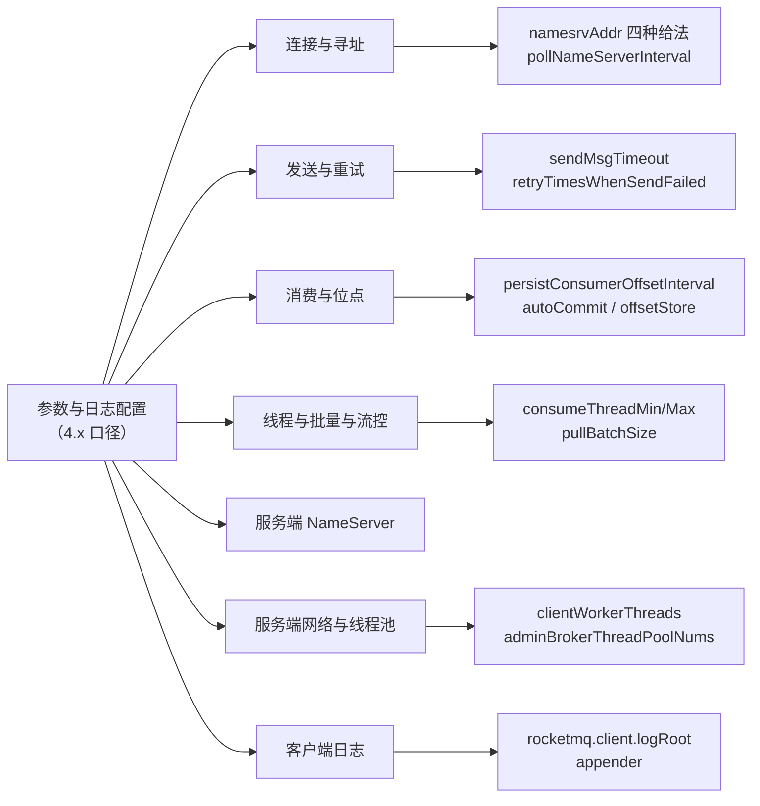
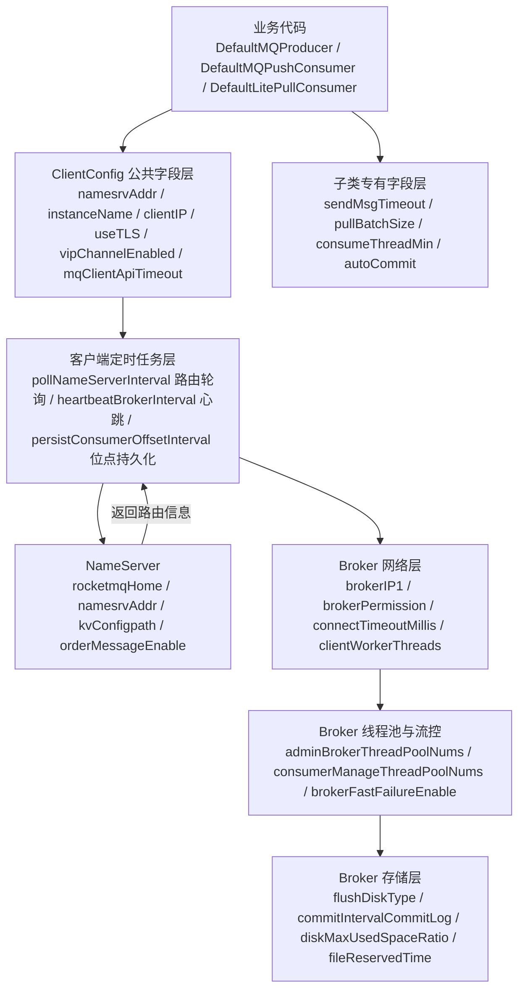

> [!IMPORTANT] 口径声明：本篇是 4.x 参数表，不是 5.0 参数结论
> 本文三张主表全部来自 4.x 文档体系：`docs/06-parameterConfiguration/01local.md`（客户端配置，77 个参数行）、`docs/06-parameterConfiguration/02server.md`（服务端配置，82 个参数行）、`docs/05-bestPractice/06log.md`（日志配置，6 个可配参数 + ClientLogger 常量）。
> **本表为 4.x 客户端/服务端参数；5.0 的参数差异上游未单列，未列出的项不代表 5.0 支持或不支持。**
> 上游 5.0 文档体系里没有与这三份文件一一对应的「参数总表」，只有一份《参数约束和建议》（17 行，见本复刻站〈使用限制与参数约束〉）。因此本文凡涉及 5.0，只在「4.x 与 5.0 口径交叉对照」一节里逐行标注出处版本，绝不把 4.x 的默认值当成 5.0 的结论，也不把 5.0 的结论回填到 4.x 的参数行上。
> 单个参数行如果上游默认值一栏是空的，本文一律写「上游未给出默认值」，绝不按同类参数的命名惯例或上下游猜测补数。

## 为什么需要一份参数手册？（痛点引入）

接入 RocketMQ 的团队，第一次出性能或可用性事故时，几乎都会先怀疑「代码写错了」，而不是「某个默认值本来就是这个数」。真实的踩坑现场通常是这样的：

1. **同一个参数名，客户端和服务端默认值不一样。** 生产端 `defaultTopicQueueNums` 默认 4，Broker 侧 `defaultTopicQueueNums` 默认 8——两处都在源表里，写方案的人只看过其中一处，于是对「一个主题在一个 Broker 上到底有几个队列」各执一词。
2. **一个参数在两个消费者类里默认值差 10 倍。** `pullThresholdForQueue` 在 DefaultMQPushConsumer 里是 100，在 DefaultLitePullConsumer 里是 1000；`pullBatchSize` 在 Push 里是 32，在 LitePull 里是 10。把「消费者」当成一类对象来记参数，压测结果就对不上。
3. **配置改了但没生效，因为寻址方式有优先级。** 上游明确四种寻址方式「优先级由高到低，高优先级会覆盖低优先级」：代码里 set 的地址会盖掉 `-D` 参数，`-D` 参数会盖掉环境变量，环境变量会盖掉 HTTP 静态服务器寻址。运维只改了环境变量，应用代码里还硬着一行 `setNamesrvAddr`，于是「改了没用」。
4. **日志一行都没打出来。** 客户端日志默认落在 `/{user.home}/logs/rocketmqlogs/`，上游第一句提醒就是「请确保应用进程有对该路径写的权限，否则日志不会打印」；容器里以别的用户跑 Java 进程，`user.home` 换了地方，人就以为「RocketMQ 不打日志」。
5. **快速失败开关造成的「系统错误」被当成 Broker 故障。** 服务端 `brokerFastFailureEnable` 默认 true，源表描述写得很直白：为 true 时「会立即清除发送消息线程池，消息拉取线程池中排队任务，直接返回系统错误」——不了解这一行，就会把排队超限的正常保护动作当成 Broker 挂了。

| 维度 | 没有参数手册（只看代码示例） | 有了逐行参数手册 |
|------|------------------------------|------------------|
| 默认值 | 靠记忆或猜，「一般消息队列都是 3 秒超时」 | 每行默认值有出处；空栏写「上游未给出默认值」 |
| 同名参数 | 以为客户端与服务端同值 | 明确指出 `defaultTopicQueueNums` 4 与 8 两处不同 |
| 配置不生效 | 反复重启验证 | 先查四种寻址方式的优先级，再查代码是否覆盖 |
| 流控与堆积 | 只知「堆积了」 | 能定位到 `pullThresholdForQueue`／`pullThresholdForTopic`／`consumeConcurrentlyMaxSpan` 哪一档触发 |
| 日志排查 | 「没日志就是没日志」 | 按 logRoot／logLevel／logFileMaxIndex／写权限四项逐个体检 |
| 版本口径 | 把 4.x 默认值写进 5.x 方案 | 交叉对照表逐行标注出自哪个版本 |

> ### 💡 新人小结：参数手册到底是干什么用的？
>
> 把它想成新家那台洗衣机的**说明书参数页**：
>
> - 默认值 = 出厂档位（标准洗、40 度、800 转）。你不知道出厂档位，就会以为「衣服洗不干净是机器坏了」。
> - 参数含义 = 每个旋钮对应什么。`pullBatchSize` 是「一次舀多少水」，`consumeThreadMin` 是「几个人同时晾衣服」，两者都能加，但加错的那个才省钱。
> - 优先级 = 说明书上那句「本机设置会覆盖预约设置」。改在环境变量里的地址被代码里的一行盖掉，跟洗衣机面板盖掉预约是同一件事。
> - 「上游未给出默认值」= 说明书这一栏印糊了。正确做法是「这栏看不清，先别通电」，而不是「别的洗衣机都是 30 分钟，那这台大概也是」。
>
> **一句话总结：参数手册的价值不是教你怎么调，而是让你知道「不调的时候系统本来是怎么运行的」。**

**学习路线图**

```text
场景速查 → 参数生效路径 → 连接与寻址 → 四组客户端参数 → 服务端两组参数 → 日志配置 → 交叉对照 → 高频误配
找参数    在哪层生效    四种给法     逐行全表       逐行全表      默认+自定义  4.x/5.0   排查清单
```

下图先把「参数分组」交代清楚：本文按「你要做什么」把 165 个源参数行切成七个场景组，每一组都落到具体的类或配置文件上。



图后解读：左边的七个分组是本文的检索入口，右边的六个例子说明每个分组里最常被改的那一行落在哪。第七组「客户端日志」不在 `ClientConfig` 里，而是走 JVM 系统参数（`rocketmq.client.*`），这也是很多新人「代码里设了日志级别却没用」的根因——它压根不是客户端对象上的 setter。

---

## 场景 → 参数速查表：先定位，再翻全表

用法：先在下表找到你的动作，再去对应小节看那张逐行全表。「位置」列写的是这个参数属于哪个类或哪张服务端表，照抄源文件的分组名。

| 我要做什么 | 先动的参数 | 位置 | 默认值（源口径） | 全表所在小节 |
|------------|------------|------|------------------|--------------|
| 让客户端连上 NameServer | `namesrvAddr` | ClientConfig | 从 `-D` 系统参数 `rocketmq.namesrv.addr` 或环境变量 `NAMESRV_ADDR` | ClientConfig 配置 |
| 用 HTTP 静态服务器寻址 | URL 硬编码，靠 `/etc/hosts` 改指向 | 客户端寻址方式 | 客户端默认每隔 2 分钟访问一次该 HTTP 服务器 | 连接与寻址 |
| 区分同进程内多个客户端 | `instanceName` | ClientConfig | 从 `-D` 系统参数 `rocketmq.client.name` 获取，否则就是 DEFAULT | ClientConfig 配置 |
| 改路由刷新频率 | `pollNameServerInterval` | ClientConfig | 30000，单位毫秒 | ClientConfig 配置 |
| 改心跳频率 | `heartbeatBrokerInterval` | ClientConfig | 30000，单位毫秒 | ClientConfig 配置 |
| 改客户端 API 超时 | `mqClientApiTimeout` | ClientConfig | 3000，单位毫秒 | ClientConfig 配置 |
| 开启传输加密 | `useTLS` | ClientConfig | 从 `-D` 系统参数 `tls.enable` 获取，否则就是 false | ClientConfig 配置 |
| 关掉 VIP 通道 | `vipChannelEnabled` | ClientConfig | 从 `-D com.rocketmq.sendMessageWithVIPChannel` 参数的值，若无则是 true | ClientConfig 配置 |
| 发送超时不够用 | `sendMsgTimeout` | DefaultMQProducer | 3000，单位毫秒 | DefaultMQProducer 配置 |
| 发送失败重试次数 | `retryTimesWhenSendFailed` / `retryTimesWhenSendAsyncFailed` | DefaultMQProducer | 2 / 2 | DefaultMQProducer 配置 |
| 存储状态非 SEND_OK 也要重发 | `retryAnotherBrokerWhenNotStoreOK` | DefaultMQProducer | false | DefaultMQProducer 配置 |
| 大消息压缩阈值 | `compressMsgBodyOverHowmuc` | DefaultMQProducer | 1024 * 4，4K | DefaultMQProducer 配置 |
| 客户端允许的最大消息体 | `maxMessageSize` | DefaultMQProducer | 1024 * 1024 * 4，4M | DefaultMQProducer 配置 |
| 自动创建主题时的队列数 | `defaultTopicQueueNums` | DefaultMQProducer | 4 | DefaultMQProducer 配置 |
| 首次启动从哪里开始消费 | `consumeFromWhere` | DefaultMQPushConsumer / DefaultLitePullConsumer | ConsumeFromWhere.CONSUME_FROM_LAST_OFFSET | 两组消费者全表 |
| 回溯消费的时间点 | `consumeTimestamp` | DefaultMQPushConsumer / DefaultLitePullConsumer | 半小时前 / 默认回溯消耗时间为半小时前 | 两组消费者全表 |
| 消费失败最多重试几次进死信 | `maxReconsumeTimes` | DefaultMQPushConsumer | -1 | DefaultMQPushConsumer 配置 |
| 单条消息最长多久算消费超时 | `consumeTimeout` | DefaultMQPushConsumer | 15，单位分钟 | DefaultMQPushConsumer 配置 |
| 关机时给在途消息多久收尾 | `awaitTerminationMillisWhenShutdown` | DefaultMQPushConsumer | 0 | DefaultMQPushConsumer 配置 |
| 串行消费的再次消费间隔 | `suspendCurrentQueueTimeMillis` | DefaultMQPushConsumer | 1000 | DefaultMQPushConsumer 配置 |
| 位点多久落一次盘（客户端） | `persistConsumerOffsetInterval` | ClientConfig | 默认值 5000，单位毫秒 | ClientConfig 配置 |
| 位点自动提交开关 | `autoCommit` | DefaultLitePullConsumer | true | DefaultLitePullConsumer 配置 |
| 自动提交位点的间隔上下限 | `autoCommitIntervalMillis` / `MIN_AUTOCOMMIT_INTERVAL_MILLIS` | DefaultLitePullConsumer | 5000 / 1000，单位毫秒 | DefaultLitePullConsumer 配置 |
| 消费并发线程池上下限 | `consumeThreadMin` / `consumeThreadMax` | DefaultMQPushConsumer | 20 / 64 | DefaultMQPushConsumer 配置 |
| 动态扩线程的堆积阈值 | `adjustThreadPoolNumsThreshold` | DefaultMQPushConsumer | 100000 | DefaultMQPushConsumer 配置 |
| 拉取线程数 | `pullThreadNums` | DefaultLitePullConsumer | 20 | DefaultLitePullConsumer 配置 |
| 一次拉多少条 | `pullBatchSize` | DefaultMQPushConsumer 32 / DefaultLitePullConsumer 10 | 见左列 | 两组消费者全表 |
| 一次批量消费几条 | `consumeMessageBatchMaxSize` | DefaultMQPushConsumer | 1 | DefaultMQPushConsumer 配置 |
| 队列级流控阈值 | `pullThresholdForQueue` | DefaultMQPushConsumer 100 / DefaultLitePullConsumer 1000 | 见左列 | 两组消费者全表 |
| 主题级流控阈值 | `pullThresholdForTopic` / `pullThresholdSizeForTopic` | DefaultMQPushConsumer | -1 / -1 | DefaultMQPushConsumer 配置 |
| 全局流控阈值 | `pullThresholdForAll` / `pullThresholdSizeForQueue` | DefaultLitePullConsumer | 10000 / 100MiB | DefaultLitePullConsumer 配置 |
| 并发消费的 offset 跨度上限 | `consumeConcurrentlyMaxSpan` / `consumeMaxSpan` | Push 2000 / LitePull 2000 | 见左列 | 两组消费者全表 |
| 长轮询挂起与等待 | `brokerSuspendMaxTimeMillis` / `consumerTimeoutMillisWhenSuspend` | DefaultLitePullConsumer | 20000 / 30000，单位毫秒 | DefaultLitePullConsumer 配置 |
| poll 阻塞多久返回 | `pollTimeoutMillis` | DefaultLitePullConsumer | 5000，以毫秒为单位 | DefaultLitePullConsumer 配置 |
| NameServer 装到哪个目录 | `rocketmqHome` | NameServer 配置 | 上游默认值栏为空（描述栏写「默认用户主目录」） | NameServer 配置 |
| NameServer 支持顺序消息 | `orderMessageEnable` | NameServer 配置 | 上游默认值栏为空（描述栏写「默认为 false」） | NameServer 配置 |
| Broker 快速失败 | `brokerFastFailureEnable` | 网络配置属性 | true | 网络配置属性 |
| Broker 角色与刷盘方式 | `brokerRole` / `flushDiskType` | 网络配置属性 | ASYNC_MASTER / ASYNC_FLUSH | 网络配置属性 |
| Broker 读写权限 | `brokerPermission` | 网络配置属性 | 6 | 网络配置属性 |
| 消费组自动创建 | `autoCreateSubscriptionGroup` | 网络配置属性 | true | 网络配置属性 |
| 主题自动创建 | `autoCreateTopicEnable` | 网络配置属性 | 上游未给出默认值 | 网络配置属性 |
| 磁盘水位触发清理 | `diskMaxUsedSpaceRatio` / `fileReservedTime` / `deleteWhen` | 网络配置属性 | 75 / 120（描述栏写默认 72 小时，两处不一致）/ 04 | 网络配置属性 |
| 服务端各线程池规模 | `adminBrokerThreadPoolNums` / `clientManageThreadPoolNums` / `consumerManageThreadPoolNums` / `endTransactionThreadPoolNums` | 网络配置属性 | 16 / 32 / 32 / 24 | 网络配置属性 |
| SQL92 属性过滤 | `enablePropertyFilter` | 网络配置属性 | false | 网络配置属性 |
| 客户端日志放哪 | `rocketmq.client.logRoot` | 日志配置 | 默认 `/{user.home}/logs/rocketmqlogs/` | 日志配置 |
| 日志级别 | `rocketmq.client.logLevel` | 日志配置 | INFO（不匹配默认 INFO） | 日志配置 |
| 历史日志保留几个 | `rocketmq.client.logFileMaxIndex` | 日志配置 | 10 个（超出 1~100 或格式错误则取 10） | 日志配置 |
| 把日志发到 RocketMQ 主题 | `log4j.appender.mq` 等 appender 配置 | 日志配置（log4j/log4j2/logback） | 无默认，需自行配置 NameServerAddress 等 | 日志配置 |

> [!NOTE] 「上游未给出默认值」这一栏出现得很多，这是刻意的
> 服务端表里 `autoCreateTopicEnable`、`brokerIP1`、`brokerTopicEnable`、`clientWorkerThreads`、`cleanResourceInterval` 等行的默认值一栏在源文件里就是空的；`commercialBaseCount`、`commercialBigCount`、`commercialEnable`、`commercialTimerCount`、`channelNotActiveInterval` 五行的**描述栏也是空的**。这些行本文一律照抄保留，不做补值、不做删除，也不按参数名猜测语义。

---

## 客户端参数生效路径：从业务代码到 Broker

一个常见误解是「参数设进对象就立刻作用于网络」。实际上 4.x 客户端参数分三层生效：对象字段层（`ClientConfig` 与子类的 get/set）、定时任务层（路由轮询、心跳、位点持久化都有各自的间隔参数）、服务端对等层（客户端的每个动作在 Broker 侧都有对应的线程池与流控参数）。下图是这条生效路径。



图后解读，三句话：

1. **`ClientConfig` 是四组客户端参数的公共底座。** 源文件写明「DefaultMQProducer、TransactionMQProducer、DefaultMQPushConsumer、DefaultMQPullConsumer 都继承于 ClientConfig 类，ClientConfig 为客户端的公共配置类」，所以本文把 ClientConfig 表放在最前面，其余三组表只写各自专有的行。
2. **配置形式只有 get/set 两种落点。** 原文：「客户端的配置都是 get、set 形式，每个参数都可以用 spring 来配置，也可以在代码中配置」，并给出 `producer.setNamesrvAddr("192.168.0.1:9876")` 这个例子；「其他参数同理」。
3. **客户端参数最终要和服务端参数对上号。** 例如客户端 `heartbeatBrokerInterval`（默认 30000 毫秒）对应服务端「定期发送注册心跳到 broker 的间隔」这一描述，而服务端 `clientManageThreadPoolNums`（默认 32）的官方描述正是「服务端处理客户端管理（心跳 注册 取消注册线程数量）」——排查心跳类问题时两侧都要看。

> ### 💡 新人小结：参数为什么要分「客户端三层 / 服务端三层」？
>
> 想象你在连锁餐厅点外卖：
>
> - 字段层 = 你在 App 里勾选的「不要辣、加份米饭」（`sendMsgTimeout`、`pullBatchSize` 这类，写在对象上）。
> - 定时任务层 = 外卖平台每隔多久刷新一次商家列表、骑手多久上报一次位置（`pollNameServerInterval`、`heartbeatBrokerInterval` 这类，都是「间隔」参数，不改变单次结果，只改变刷新频率）。
> - 服务端对等层 = 后厨接单窗口开几个（`adminBrokerThreadPoolNums`）、出餐顺序规则（`flushDiskType`）、食材留多久扔掉（`fileReservedTime`）。
>
> **你勾选「不要辣」永远不能让后厨多开一个窗口；反过来，后厨窗口排长队时，你反复点下单（客户端重试）只会让队更长——这正是 `brokerFastFailureEnable` 存在的意义。**

---

## 一、连接与寻址：`namesrvAddr` 的四种给法

RocketMQ 令客户端找到 Name Server，然后通过 Name Server 再找到 Broker。源文件列出四种配置方式，**优先级由高到低，高优先级会覆盖低优先级**。

| 优先级 | 方式 | 写法（照抄上游） | 覆盖关系 |
|--------|------|------------------|----------|
| 最高（1） | 代码中指定，多个地址用分号分割 | `producer.setNamesrvAddr("192.168.0.1:9876;192.168.0.2:9876")` | 覆盖 2、3、4 |
| 2 | Java 启动参数 | `-Drocketmq.namesrv.addr=192.168.0.1:9876;192.168.0.2:9876` | 覆盖 3、4，被 1 覆盖 |
| 3 | 环境变量 | `export NAMESRV_ADDR=192.168.0.1:9876;192.168.0.2:9876` | 覆盖 4，被 1、2 覆盖 |
| 最低（4） | HTTP 静态服务器寻址（默认） | 客户端定时访问 `http://jmenv.tbsite.net:8080/rocketmq/nsaddr` | 前三者都未设置时才起作用 |

```java
// ========== ✅ 推荐写法：优先级最高的两种给法之一，明确写在代码里 ==========
// 多个 NameServer 地址之间用分号分割（上游原文：多个namesrv地址之间用分号分割）
DefaultMQProducer producer = new DefaultMQProducer("ExampleProducerGroup");
producer.setNamesrvAddr("192.168.0.1:9876;192.168.0.2:9876");
System.out.println(producer.getNamesrvAddr());
// 输出: 192.168.0.1:9876;192.168.0.2:9876
// 说明：客户端的配置都是 get、set 形式，setter 写入的值即 ClientConfig.namesrvAddr 字段

// ========== ❌ 不推荐写法（仅展示）：三处给地址，且互相矛盾 ==========
// 代码里 set 了 A 组地址，启动脚本 -Drocketmq.namesrv.addr 配了 B 组，容器环境变量又给了 C 组。
// 上游明确「优先级由高到低，高优先级会覆盖低优先级」，最终只有代码里的 A 组生效，
// 结果是运维修改了 B/C 却「改了没用」。
```

参数解释：`setNamesrvAddr` 写入的是 `ClientConfig.namesrvAddr` 字段（类型 String，描述「NameServer 的地址列表」）；`-Drocketmq.namesrv.addr` 与环境变量 `NAMESRV_ADDR` 正是 ClientConfig 表里 `namesrvAddr` 默认值一栏提到的两个来源；HTTP 静态服务器方式则是「客户端默认每隔 2 分钟访问一次这个 HTTP 服务器，并更新本地的 Name Server 地址」。

HTTP 静态服务器寻址的返回内容就是一行地址列表：

```text
192.168.0.1:9876;192.168.0.2:9876
```

该 URL 已在代码中硬编码，可通过修改 `/etc/hosts` 改变要访问的服务器，上游给的例子是：

```text
10.232.22.67    jmenv.taobao.net
```

> [!NOTE] 照抄上游，并指出源文件内部的两处小不一致
> 上游正文里静态 HTTP 服务器的地址写作 `http://jmenv.tbsite.net:8080/rocketmq/nsaddr`，而紧随其后的 `/etc/hosts` 示例用的主机名是 `jmenv.taobao.net`。两处域名不同，本文原样保留、不做统一改写，也不推断哪个才是正确指向。
> 另一处：`namesrvAddr` 在 ClientConfig 表里的默认值一栏写的是「从 -D 系统参数 rocketmq.namesrv.addr 或环境变量。NAMESRV_ADDR」，而寻址方式一节把 HTTP 静态服务器寻址标注为「（默认）」，并说「推荐使用 HTTP 静态服务器寻址方式」。两处口径本文都保留，实际效果按优先级判：只要代码/`-D`/环境变量任一处给了地址，就不会走 HTTP 寻址。

上游对 HTTP 静态服务器寻址的推荐理由原文：**「推荐使用 HTTP 静态服务器寻址方式，好处是客户端部署简单，且 Name Server 集群可以热升级。」**

```bash
# ========== 生产环境推荐：地址集中在一处，NameServer 集群可热升级 ==========
# 1) 不改应用代码，用环境变量指向 NameServer 集群
export NAMESRV_ADDR=192.168.0.1:9876;192.168.0.2:9876
# 输出: 后续启动的 Java 进程可读到 NAMESRV_ADDR（上游把环境变量列为第 3 优先级）

# 2) 用 /etc/hosts 把硬编码的静态寻址主机名指向自己的配置服务器
echo "10.232.22.67    jmenv.taobao.net" >> /etc/hosts
# 输出: /etc/hosts 追加一行（照抄上游示例的主机名 jmenv.taobao.net）

# ========== ❌ 不推荐：把地址硬编码进每个应用 ==========
# 每个应用的 Java 代码里都写死 setNamesrvAddr("单台机器IP:9876")，
# NameServer 需要替换或扩容时，必须改代码、重新构建、逐个发布。
```

参数解释：`NAMESRV_ADDR` 与 `rocketmq.namesrv.addr` 是两个不同层的入口名（环境变量用大写下划线，`-D` 参数用点分小写），上游原文如此，本文不改成统一风格。

---

## 二、ClientConfig 配置全表（客户端公共参数，16 行）

上游把 DefaultMQProducer、TransactionMQProducer、DefaultMQPushConsumer、DefaultMQPullConsumer 归为「都继承于 ClientConfig 类」的客户端（原文见上一节；`DefaultLitePullConsumer` 未被写进那一句，但它的表行里同样出现 `unitMode`、`namesrvAddr` 这类公共参数名）。本节表格逐行照抄源文件，**顺序、名称、类型、默认值均与上游一致**；「有效值」列只在源文件该格有内容时才写，空的一律写「上游未给出」。

| 名称 | 描述（上游原文） | 参数类型 | 默认值（上游原文） | 有效值 | 本文场景 |
|------|------------------|----------|--------------------|--------|----------|
| `namesrvAddr` | NameServer 的地址列表 | String | 从 `-D` 系统参数 `rocketmq.namesrv.addr` 或环境变量 `NAMESRV_ADDR` | 上游未给出 | 连接与寻址 |
| `instanceName` | 客户端实例名称 | String | 从 `-D` 系统参数 `rocketmq.client.name` 获取，否则就是 DEFAULT | 上游未给出 | 连接与寻址 |
| `clientIP` | 客户端 IP | String | `RemotingUtil.getLocalAddress()` | 上游未给出 | 连接与寻址 |
| `namespace` | 客户端命名空间 | String | 上游未给出默认值 | 上游未给出 | 连接与寻址 |
| `accessChannel` | 设置访问通道 | AccessChannel | LOCAL | 上游未给出 | 连接与寻址 |
| `clientCallbackExecutorThreads` | 客户端通信层接收到网络请求的时候，处理器的核数 | int | `Runtime.getRuntime().availableProcessors()` | 上游未给出 | 线程与批量 |
| `pollNameServerInterval` | 轮询从 NameServer 获取路由信息的时间间隔 | int | 30000，单位毫秒 | 上游未给出 | 连接与寻址 |
| `heartbeatBrokerInterval` | 定期发送注册心跳到 broker 的间隔 | int | 30000，单位毫秒 | 上游未给出 | 连接与寻址 |
| `persistConsumerOffsetInterval` | 作用于 Consumer，持久化消费进度的间隔 | int | 默认值 5000，单位毫秒 | 上游未给出 | 消费与位点 |
| `pullTimeDelayMillsWhenException` | 拉取消息出现异常的延迟时间设置 | long | 1000，单位毫秒 | 上游未给出 | 消费与位点 |
| `unitName` | 单位名称 | String | 上游未给出默认值 | 上游未给出 | 连接与寻址 |
| `unitMode` | 单位模式 | boolean | false | 上游未给出 | 连接与寻址 |
| `vipChannelEnabled` | 是否启用 vip netty 通道以发送消息 | boolean | 从 `-D com.rocketmq.sendMessageWithVIPChannel` 参数的值，若无则是 true | 上游未给出 | 发送与重试 |
| `useTLS` | 是否使用安全传输 | boolean | 从 `-D` 系统参数 `tls.enable` 获取，否则就是 false | 上游未给出 | 连接与寻址 |
| `mqClientApiTimeout` | mq 客户端 api 超时设置 | int | 3000，单位毫秒 | 上游未给出 | 发送与重试 |
| `language` | 客户端实现语言 | LanguageCode | `LanguageCode.JAVA`（上游写作 `LanguageCode.*JAVA*`） | 上游未给出 | 连接与寻址 |
| （表头列） | 重要性 | —— | —— | —— | 上游「重要性」列全表为空，本文不为其填等级 |

补充三点，都直接来自源文件本身：

- **`vipChannelEnabled` 的默认值是「有条件的 true」**：先读 `-D com.rocketmq.sendMessageWithVIPChannel`，该参数没给时才为 true。想改变默认行为，改的是 JVM 参数而不是 setter。
- **三个「间隔」参数的单位都是毫秒**，上游在默认值一栏显式标注了「单位毫秒」：`pollNameServerInterval`、`heartbeatBrokerInterval`、`persistConsumerOffsetInterval`、`pullTimeDelayMillsWhenException`、`mqClientApiTimeout` 五行都带单位说明。
- **`clientCallbackExecutorThreads` 在 ClientConfig 与服务端网络配置表里各出现一次**，两处描述不同（客户端侧写「客户端通信层接收到网络请求的时候，处理器的核数」；服务端侧写「客户端执行回调线程数」），服务端那一行的默认值栏是空的。两行本文都保留，不做「同值」推断。

```java
// ========== ✅ 推荐写法：公共参数集中在 ClientConfig 层面配置，别散在业务代码里 ==========
DefaultMQProducer producer = new DefaultMQProducer("OrderProducerGroup");
producer.setNamesrvAddr("192.168.0.1:9876;192.168.0.2:9876"); // ClientConfig.namesrvAddr
producer.setInstanceName("order-service-01");                  // ClientConfig.instanceName：同进程多实例时用于区分
producer.setVipChannelEnabled(false);                          // ClientConfig.vipChannelEnabled：显式关闭 VIP 通道
producer.setUseTLS(true);                                      // ClientConfig.useTLS：安全传输（上游默认取 tls.enable）
producer.setMqClientApiTimeout(3000);                          // ClientConfig.mqClientApiTimeout：默认即 3000 毫秒
System.out.println(producer.getVipChannelEnabled() + " / " + producer.getUseTLS());
// 输出: false / true

// ========== ❌ 不推荐写法（仅展示）==========
// 同一个 JVM 里起了 3 个消费者，全都不设 instanceName。
// 上游 ClientConfig 表写明 instanceName 默认「从 -D rocketmq.client.name 获取，否则就是 DEFAULT」，
// 于三个实例在默认值层面同名，客户端实例名称无法区分。
```

参数解释：示例里的四个 setter 全部来自 ClientConfig 表行，未使用任何上游没有的 setter；`setVipChannelEnabled(false)` 与 `-D com.rocketmq.sendMessageWithVIPChannel` 是同一件事的两个入口，代码 setter 的优先级由「客户端寻址方式」那节的整体原则体现（代码高于启动参数），而 `-D` 参数只在未显式设置时决定默认值。

上游该表除「名称／描述／参数类型／默认值／有效值」五列外还有一列**「重要性」，全表 16 行的该格都是空的**。本文不替上游给任何参数标重要性等级，也不从「哪些参数常被改」反推重要性。

---

## 三、DefaultMQProducer 配置全表（10 行）

发送侧的参数集中在这一组。下表逐行照抄，顺序与上游一致；「有效值」列上游全为空，故统一写「上游未给出」。

| 名称 | 描述（上游原文） | 参数类型 | 默认值（上游原文） | 本文场景 |
|------|------------------|----------|--------------------|----------|
| `producerGroup` | 生产组的名称，一类 Producer 的标识 | String | DEFAULT_PRODUCER | 发送与重试 |
| `createTopicKey` | 发送消息的时候，如果没有找到 topic，若想自动创建该 topic，需要一个 key topic，这个值即是 key topic 的值 | String | `TopicValidator.AUTO_CREATE_TOPIC_KEY_TOPIC` | 发送与重试 |
| `defaultTopicQueueNums` | 自动创建 topic 的话，默认 queue 数量是多少 | int | 4 | 发送与重试 |
| `sendMsgTimeout` | 默认的发送超时时间 | int | 3000，单位毫秒 | 发送与重试 |
| `compressMsgBodyOverHowmuc` | 消息 body 需要压缩的阈值 | int | 1024 * 4，4K | 发送与重试 |
| `retryTimesWhenSendFailed` | 同步发送失败的话，rocketmq 内部重试多少次 | int | 2 | 发送与重试 |
| `retryTimesWhenSendAsyncFailed` | 异步发送失败的话，rocketmq 内部重试多少次 | int | 2 | 发送与重试 |
| `retryAnotherBrokerWhenNotStoreOK` | 发送的结果如果不是 SEND_OK 状态，是否当作失败处理而尝试重发 | boolean | false | 发送与重试 |
| `maxMessageSize` | 客户端验证，允许发送的最大消息体大小 | int | 1024 * 1024 * 4，4M | 发送与重试 |
| `traceDispatcher` | 异步传输数据接口 | TraceDispatcher | null | 发送与重试 |

三个必须点明的细节：

- **`compressMsgBodyOverHowmuc` 的拼写照抄上游。** 上游源文件里这一行参数名就是 `compressMsgBodyOverHowmuc`（不是 Howmuch），本文不改写；实际调用 setter 时请以你所用 SDK 版本的真实方法名为准，本文不推断其拼写是否等价。
- **`maxMessageSize` 与压缩阈值是两件事**：前者是客户端验证「允许发送的最大消息体大小」4M，后者是「消息 body 需要压缩的阈值」4K，两者都写在源表的默认值格里，一个都不许互相替换。
- **`retryTimesWhenSendFailed`（同步）与 `retryTimesWhenSendAsyncFailed`（异步）都是 2**，且描述明确是「rocketmq 内部重试多少次」。

```java
// ========== ✅ 推荐写法：把发送超时与内部重试次数当成一对来设定 ==========
DefaultMQProducer producer = new DefaultMQProducer("PayNotifyProducerGroup");
producer.setNamesrvAddr("192.168.0.1:9876;192.168.0.2:9876");
producer.setSendMsgTimeout(3000);              // DefaultMQProducer.sendMsgTimeout：上游默认值即 3000 毫秒
producer.setRetryTimesWhenSendFailed(2);       // 同步发送失败时内部重试 2 次（上游默认值即 2）
producer.setRetryTimesWhenSendAsyncFailed(2);  // 异步发送失败时内部重试 2 次（上游默认值即 2）
producer.setRetryAnotherBrokerWhenNotStoreOK(false); // 非 SEND_OK 不当失败重发（上游默认值即 false）
producer.setCompressMsgBodyOverHowmuc(1024 * 4);     // 超过 4K 的 body 压缩（上游默认值即 1024 * 4）
producer.setMaxMessageSize(1024 * 1024 * 4);         // 客户端校验最大消息体 4M（上游默认值即 1024*1024*4）
System.out.println(producer.getSendMsgTimeout() + " / " + producer.getRetryTimesWhenSendFailed());
// 输出: 3000 / 2

// ========== ❌ 不推荐写法（仅展示）==========
// 把 sendMsgTimeout 调成 60000、retryTimesWhenSendFailed 调成 20，
// 只为表达「这条消息一定要发出去」。
// 上游对发送侧的口径是：重试是客户端内部行为、同步调用会等待响应；
// 5.0《参数约束和建议》更对「消息发送重试次数」明确写了「建议取值不要过大，避免阻塞业务线程」，
// 并要求「达到最大重试次数后还未发送成功，业务侧做好兜底处理」。
```

参数解释：`setSendMsgTimeout` 对应「默认的发送超时时间」，`setRetryTimesWhenSendFailed` 对应「同步发送失败的话，rocketmq 内部重试多少次」；两者叠加决定一次同步发送调用最长阻塞多久，所以必须成对评估，不能只调一个。`setRetryAnotherBrokerWhenNotStoreOK(true)` 的含义按上游描述是「发送的结果如果不是 SEND_OK 状态，就当作失败处理而尝试重发」，默认 false，即 `FLUSH_DISK_TIMEOUT`／`FLUSH_SLAVE_TIMEOUT`／`SLAVE_NOT_AVAILABLE` 这三类结果默认不触发重发。

> ### 💡 新人小结：发送超时和发送重试是什么关系？
>
> 想象你给朋友打电话约饭：
>
> - `sendMsgTimeout` = 你愿意等这通电话**接通**多久（上游默认 3000 毫秒）。
> - `retryTimesWhenSendFailed` = 没接通时你**重拨几次**（上游默认 2 次）。
> - `retryAnotherBrokerWhenNotStoreOK` = 接通了但对方只说了声「收到」而没说「一定到」，你要不要当没谈成再打一遍（上游默认 false，即不重打）。
> - `maxMessageSize` = 你能在这通电话里念完的稿子上限（4M），超过就被客户端自己拦下。
>
> **总耗时预算是「超时 × 尝试次数」这一量级的事，而不是超时本身——只把超时调到 60 秒，等于让业务线程在电话机前站一分钟。**

---

## 四、DefaultMQPushConsumer 配置全表（26 行）

Push 消费者的参数最多，且流控、线程池、位点三类混在一张表里。下表逐行照抄，**上游表格里两处串行错位都原样标注**，不做「修正」。

| 名称 | 描述（上游原文） | 参数类型 | 默认值（上游原文） | 有效值／备注（上游原文） | 本文场景 |
|------|------------------|----------|--------------------|--------------------------|----------|
| `consumerGroup` | 消费组的名称，用于标识一类消费者 | String | 上游未给出默认值 | 上游未给出 | 消费与位点 |
| `messageModel` | 消费模式 | MessageModel | MessageModel.CLUSTERING | CLUSTERING(集群消費模式) / ROADCASTING (广播消费模式)（上游该格原文如此，含疑似拼写；且上游默认值格尾部混入了下一行的 `allocateMessageQueueStrategy` 字样） | 消费与位点 |
| `consumeFromWhere` | 启动消费点策略 | ConsumeFromWhere | ConsumeFromWhere.CONSUME_FROM_LAST_OFFSET | 上游未给出 | 消费与位点 |
| `consumeTimestamp` | CONSUME_FROM_LAST_OFFSET 的时候使用，从哪个时间点开始消费 | String | 半小时前 | 上游未给出 | 消费与位点 |
| `allocateMessageQueueStrategy` | 负载均衡策略算法 | AllocateMessageQueueStrategy | AllocateMessageQueueAveragely（取模平均分配） | 上游未给出 | 线程与批量 |
| `subscription` | 订阅关系 | Map&lt;String, String&gt; | {} | 上游未给出 | 消费与位点 |
| `messageListener` | 消息处理监听器（回调） | MessageListener | null | 上游未给出 | 消费与位点 |
| `offsetStore` | 消息消费进度存储器 | OffsetStore | null | 不建议设置，offsetStore 有两个策略：LocalFileOffsetStore 和 RemoteBrokerOffsetStore. 若沒有显示设置的情況下，广播模式將使用 LocalFileOffsetStore，集群模式將使用 RemoteBrokerOffsetStore，不建议修改. | 消费与位点 |
| `consumeThreadMin` | 消费线程池的 core size | int | 20 | 上游未给出 | 线程与批量 |
| `consumeThreadMax` | 消费线程池的 max size | int | 64 | 上游未给出 | 线程与批量 |
| `adjustThreadPoolNumsThreshold` | 动态扩线程核数的消费堆积阈值 | long | 100000 | 上游未给出 | 线程与批量 |
| `consumeConcurrentlyMaxSpan` | 并发消费下，单条 consume queue 队列允许的最大 offset 跨度，达到则触发流控 | int | 2000（上游该格原文为 `2000**pullInterval**`，混入了下一行参数名） | 上游未给出 | 线程与批量 |
| `pullThresholdForQueue` | consume queue 流控的阈值 | int | 100 | 上游未给出 | 线程与批量 |
| `pullInterval` | 拉取的间隔 | long | 0，单位毫秒 | 上游未给出 | 线程与批量 |
| `pullThresholdForTopic` | 主题级别的流控制阈值 | int | -1 | 上游未给出 | 线程与批量 |
| `pullThresholdSizeForTopic` | 限制主题级别的缓存消息大小 | int | -1 | 上游未给出 | 线程与批量 |
| `pullBatchSize` | 一次最大拉取的批量大小 | int | 32 | 上游未给出 | 线程与批量 |
| `consumeMessageBatchMaxSize` | 批量消费的最大消息条数 | int | 1 | 上游未给出 | 线程与批量 |
| `postSubscriptionWhenPull` | 每次拉取的时候是否更新订阅关系 | boolean | false | 上游未给出 | 消费与位点 |
| `unitMode` | 订阅组的单位 | boolean | false | 上游未给出 | 连接与寻址 |
| `maxReconsumeTimes` | 一个消息如果消费失败的话，最多重新消费多少次才投递到死信队列 | int | -1 | 由于 PullConsumer 没有管理消费的线程池和管理器，需要用户自己处理各种消费结果和拉取结果，故需要投递到重试队列或死信队列的时候需要显示调用 sendMessageBack. 回传消息的时候会带上 maxReconsumeTimes 的值，broker 发现此消息已经消费超过此值，则投递到死信队列，否则投递到重试队列。此逻辑和 DefaultPushConsumer 是一致的，只是 PushConsumer 无需用户显示调用. | 消费与位点 |
| `suspendCurrentQueueTimeMillis` | 串行消费使用，如果返回 ROLLBACK 或者 SUSPEND_CURRENT_QUEUE_A_MOMENT，再次消费的时间间隔 | long | 1000 | 上游未给出 | 消费与位点 |
| `consumeTimeout` | 消费的最长超时时间 | long | 15，单位分钟 | 上游未给出 | 消费与位点 |
| `awaitTerminationMillisWhenShutdown` | 关闭使用者时等待消息的最长时间，0 表示无等待。 | long | 0 | 上游未给出 | 消费与位点 |
| `traceDispatcher` | 异步传输数据接口 | TraceDispatcher | null | 上游未给出 | 消费与位点 |
| `registerTopics` | 消費者需要監聽的 topic | Collection | 默認值：空集合（上游该行表格结构本身不完整，只有这四格内容） | 上游未给出 | 消费与位点 |

四组值得单独讲的行（全部依据上表里的上游原文，不引入外部经验）：

1. **线程池是三行一套**：`consumeThreadMin`（core size，20）、`consumeThreadMax`（max size，64）、`adjustThreadPoolNumsThreshold`（动态扩线程核数的消费堆积阈值，100000）。第三行的存在说明「扩线程」这件事在上游设计里是有堆积阈值门槛的，不是只由 min/max 两个数决定。
2. **流控是四行一组、三个层级**：队列级 `pullThresholdForQueue`（100）、主题级 `pullThresholdForTopic`（-1）与 `pullThresholdSizeForTopic`（-1）、跨度 `consumeConcurrentlyMaxSpan`（2000，达到则触发流控——这句是上游描述原文）。主题级两行默认 -1，含义按上游描述分别是「主题级别的流控制阈值」与「限制主题级别的缓存消息大小」。
3. **`offsetStore` 不建议设置**：上游把「不建议修改」写进了有效值格，并说明未显式设置时广播模式用 LocalFileOffsetStore、集群模式用 RemoteBrokerOffsetStore。
4. **`maxReconsumeTimes` 默认 -1**，而它的行为描述是「broker 发现此消息已经消费超过此值，则投递到死信队列，否则投递到重试队列」，且 PushConsumer 无需用户显式调用 `sendMessageBack`（PullConsumer 才需要）。

```java
// ========== ✅ 推荐写法：线程、批量、流控三组参数按层级配平 ==========
DefaultMQPushConsumer consumer = new DefaultMQPushConsumer("OrderMsgConsumerGroup"); // consumerGroup
consumer.setNamesrvAddr("192.168.0.1:9876;192.168.0.2:9876");
consumer.setConsumeFromWhere(ConsumeFromWhere.CONSUME_FROM_LAST_OFFSET); // 上游默认值即此
consumer.setConsumeThreadMin(20);   // 消费线程池 core size，上游默认 20
consumer.setConsumeThreadMax(64);   // 消费线程池 max size，上游默认 64
consumer.setPullBatchSize(32);      // 一次最大拉取的批量大小，上游默认 32
consumer.setConsumeMessageBatchMaxSize(1); // 批量消费的最大消息条数，上游默认 1
consumer.setPullThresholdForQueue(100);    // consume queue 流控阈值，上游默认 100
consumer.setConsumeTimeout(15);     // 消费最长超时时间，上游默认 15，单位分钟
consumer.setAwaitTerminationMillisWhenShutdown(0); // 关闭时等待消息的最长时间，0 表示无等待
System.out.println(consumer.getConsumeThreadMin() + "/" + consumer.getConsumeThreadMax());
// 输出: 20/64

// ========== ❌ 不推荐写法（仅展示）==========
// 只把 consumeThreadMax 拉到 500，却留着默认 pullThresholdForQueue=100 与 pullBatchSize=32。
// 上游把「一次最大拉取的批量大小」和「consume queue 流控的阈值」都写进同一张表，
// 说明这三者（批量、流控、线程）是一组：线程涨、批量不变，只是让更多线程等同一小桶消息。
```

参数解释：`setConsumeFromWhere` 与 `setConsumeTimestamp` 是一对——`consumeTimestamp` 的描述明写「CONSUME_FROM_LAST_OFFSET 的时候使用，从哪个时间点开始消费」，默认「半小时前」；`setSuspendCurrentQueueTimeMillis(1000)` 只在串行消费下起作用（上游描述：「串行消费使用，如果返回 ROLLBACK 或者 SUSPEND_CURRENT_QUEUE_A_MOMENT，再次消费的时间间隔」）；`postSubscriptionWhenPull` 默认 false，即不每次拉取都更新订阅关系。

> ### 💡 新人小结：Push 消费者的「批量 / 流控 / 线程」为什么必须一起看？
>
> 想象超市收银台：
>
> - `pullBatchSize`（默认 32）= 传送带一次推过来几件商品。
> - `consumeMessageBatchMaxSize`（默认 1）= 收银员一次扫码处理几件。
> - `consumeThreadMin/Max`（20/64）= 开几个收银台。
> - `pullThresholdForQueue`（100）= 这条传送带上最多堆几件，堆满了就先停（上游描述原文：「consume queue 流控的阈值」）。
> - `consumeConcurrentlyMaxSpan`（2000）= 传送带上最前和最后两件的距离上限，「达到则触发流控」。
>
> **只加收银台（线程）而不看传送带堆了多少（流控），账面上吞吐上去了，实际是把堆积从队列搬进了 JVM 内存。**

---

## 五、DefaultLitePullConsumer 配置全表（25 行）

LitePull 是 4.x 里由业务自己 `poll` 的消费者，参数命名与 Push 高度相似但**默认值常常不同**，这是最容易配错的一组。

| 名称 | 描述（上游原文） | 参数类型 | 默认值（上游原文） | 本文场景 |
|------|------------------|----------|--------------------|----------|
| `consumerGroup` | 消费组的名称，用于标识一类消费者 | String | 上游未给出默认值 | 消费与位点 |
| `brokerSuspendMaxTimeMillis` | broker 在长轮询下，连接最长挂起的时间 | long | 20000，单位毫秒 | 消费与位点 |
| `consumerTimeoutMillisWhenSuspend` | broker 在长轮询下，客户端等待 broker 响应的最长等待超时时间 | long | 30000，单位毫秒 | 消费与位点 |
| `consumerPullTimeoutMillis` | pull 的 socket 超时时间 | long | 10000，单位毫秒 | 消费与位点 |
| `messageModel` | 消费模式 | MessageModel | MessageModel.CLUSTERING | 消费与位点 |
| `messageQueueListener` | 负载均衡 consume queue 分配变化的通知监听器 | MessageQueueListener | 上游未给出默认值 | 消费与位点 |
| `offsetStore` | 消息消费进度存储器 | OffsetStore | 上游未给出默认值 | 消费与位点 |
| `allocateMessageQueueStrategy` | 负载均衡策略算法 | AllocateMessageQueueStrategy | AllocateMessageQueueAveragely（取模平均分配） | 线程与批量 |
| `unitMode` | 订阅组的单位设置 | boolean | false | 连接与寻址 |
| `autoCommit` | 自动提交偏移的标志设置 | boolean | true | 消费与位点 |
| `pullThreadNums` | 拉取线程数设置 | int | 20 | 线程与批量 |
| `MIN_AUTOCOMMIT_INTERVAL_MILLIS` | 最小提交偏移间隔时间 | long | 1000，单位为毫秒 | 消费与位点 |
| `autoCommitIntervalMillis` | 最大提交偏移间隔时间 | long | 5000，单位为毫秒 | 消费与位点 |
| `pullBatchSize` | 每次拉出的信息的最大数量 | long | 10 | 线程与批量 |
| `pullThresholdForAll` | 消耗请求的流量控制阈值 | int | 10000 | 线程与批量 |
| `consumeMaxSpan` | 消耗最大跨度偏移量 | int | 2000 | 线程与批量 |
| `pullThresholdForQueue` | 队列级别的流量控制阈值 | int | 1000 | 线程与批量 |
| `pullThresholdSizeForQueue` | 队列级别上限制缓存的消息大小 | int | 100MiB | 线程与批量 |
| `pollTimeoutMillis` | 轮询超时设置 | long | 5000，以毫秒为单位 | 消费与位点 |
| `topicMetadataCheckIntervalMillis` | 检查主题元数据变化的间隔时间 | long | 30000，单位为毫秒 | 连接与寻址 |
| `consumeFromWhere` | 消费方式设置 | ConsumeFromWhere | ConsumeFromWhere.CONSUME_FROM_LAST_OFFSET | 消费与位点 |
| `consumeTimestamp` | 回溯消费时间 | String | 默认回溯消耗时间为半小时前 | 消费与位点 |
| `traceDispatcher` | 异步传输数据的接口 | TraceDispatcher | null | 消费与位点 |
| `enableMsgTrace` | 信息跟踪的标志 | boolean | false | 消费与位点 |
| `customizedTraceTopic` | 消息跟踪主题的名称 | String | 上游未给出默认值 | 消费与位点 |

LitePull 与 Push 的同名参数对照（只看默认值差异，两列数值都取自上面两张表）：

| 参数 | DefaultMQPushConsumer 默认值 | DefaultLitePullConsumer 默认值 | 差异说明 |
|------|------------------------------|--------------------------------|----------|
| `pullBatchSize` | 32（int，「一次最大拉取的批量大小」） | 10（long，「每次拉出的信息的最大数量」） | 相差 3.2 倍，且类型不同（int 与 long 按上游表原样保留） |
| `pullThresholdForQueue` | 100（「consume queue 流控的阈值」） | 1000（「队列级别的流量控制阈值」） | 相差 10 倍 |
| 主题/全局级流控 | `pullThresholdForTopic` -1、`pullThresholdSizeForTopic` -1 | `pullThresholdForAll` 10000、`pullThresholdSizeForQueue` 100MiB | 两表用词不同（主题级 vs 队列级/全局），本文不宣称二者等价 |
| 跨度上限 | `consumeConcurrentlyMaxSpan` 2000 | `consumeMaxSpan` 2000 | 数值同为 2000，参数名不同 |
| 线程参数 | `consumeThreadMin` 20 / `consumeThreadMax` 64 | `pullThreadNums` 20 | LitePull 表里没有 consumeThreadMin/Max 行；Push 表里没有 pullThreadNums 行 |
| 位点提交 | 无 autoCommit 行；`persistConsumerOffsetInterval` 来自 ClientConfig（5000 毫秒） | `autoCommit` true + `autoCommitIntervalMillis` 5000 + `MIN_AUTOCOMMIT_INTERVAL_MILLIS` 1000 | 两表的提交节奏来自不同参数名，改动时别改错对象 |
| 长轮询超时 | 无对应行 | `brokerSuspendMaxTimeMillis` 20000 / `consumerTimeoutMillisWhenSuspend` 30000 / `consumerPullTimeoutMillis` 10000 | LitePull 独有这三行 |
| 消费失败重试 | `maxReconsumeTimes` -1（投递死信/重试队列由 Push 内部处理） | 无 `maxReconsumeTimes` 行 | Push 表对 PullConsumer 说明需显式 `sendMessageBack`；LitePull 表未给该参数行 |
| 轨迹开关 | `traceDispatcher` null | `traceDispatcher` null + `enableMsgTrace` false + `customizedTraceTopic` 未给默认值 | LitePull 多出后两行 |

```java
// ========== ✅ 推荐写法：LitePull 的提交节奏显式写在明面上 ==========
DefaultLitePullConsumer litePullConsumer = new DefaultLitePullConsumer("LiteConsumerGroup");
litePullConsumer.setNamesrvAddr("192.168.0.1:9876;192.168.0.2:9876");
litePullConsumer.setAutoCommit(false);                    // 上游默认 true；改为手动，避免 poll 期间自动跳位点
litePullConsumer.setAutoCommitIntervalMillis(5000);       // 最大提交偏移间隔时间，上游默认 5000 毫秒
litePullConsumer.setPullBatchSize(10);                    // 每次拉出的信息的最大数量，上游默认 10
litePullConsumer.setPollTimeoutMillis(5000);              // 轮询超时设置，上游默认 5000 毫秒
litePullConsumer.setPullThresholdForQueue(1000);          // 队列级流控阈值，上游默认 1000
litePullConsumer.setConsumeMaxSpan(2000);                 // 消耗最大跨度偏移量，上游默认 2000
System.out.println(litePullConsumer.getPullBatchSize() + " / " + litePullConsumer.getPollTimeoutMillis());
// 输出: 10 / 5000

// ========== ❌ 不推荐写法（仅展示）==========
// 沿用 autoCommit 默认 true，却在 poll 返回后按「处理完一条就提交一次」的逻辑手工推进位点。
// 上游把 MIN_AUTOCOMMIT_INTERVAL_MILLIS（1000 毫秒）写成最小提交偏移间隔时间，
// 说明自动提交本身有节流，两套提交逻辑并存时，落盘的位点由谁决定说不清。
```

参数解释：`MIN_AUTOCOMMIT_INTERVAL_MILLIS` 是这张表里唯一全大写（常量风格）的参数行，上游描述为「最小提交偏移间隔时间」，默认 1000 毫秒；`autoCommitIntervalMillis` 描述为「最大提交偏移间隔时间」，默认 5000 毫秒——两行一起构成自动提交间隔的下界与上界，本文不推断在什么条件下取到哪一端。`enableMsgTrace` 默认 false，`customizedTraceTopic` 上游未给出默认值。

---

## 六、服务端 NameServer 配置全表（6 行）

NameServer 侧的参数只有六行，且**默认值一栏全部为空**——上游把「默认为 false」这类信息写在了描述栏里，本文区分标注。

| 名称 | 描述（上游原文） | 参数类型 | 默认值一栏 | 本文场景 |
|------|------------------|----------|------------|----------|
| `rocketmqHome` | RocketMQ 主目录，默认用户主目录 | String | 上游未给出默认值（描述栏含「默认用户主目录」） | 服务端 NameServer |
| `namesrvAddr` | NameServer 地址 | String | 上游未给出默认值 | 服务端 NameServer |
| `kvConfigpath` | kv 配置文件路径，包含顺序消息主题的配置信息 | String | 上游未给出默认值 | 服务端 NameServer |
| `configStorePath` | NameServer 配置文件路径，建议使用 -c 指定 NameServer 配置文件路径 | String | 上游未给出默认值 | 服务端 NameServer |
| `clusterTest` | 是否支持集群测试，默认为 false | boolean | 上游未给出默认值（描述栏含「默认为 false」） | 服务端 NameServer |
| `orderMessageEnable` | 是否支持顺序消息，默认为 false | boolean | 上游未给出默认值（描述栏含「默认为 false」） | 服务端 NameServer |

上游该表在六行之后还有一整行空行（六个格都空），本文不为其编造参数，也不删表。

三点使用提示（均可从上表直接得出）：

- **`namesrvAddr` 在客户端表和服务端表里同名出现**：客户端侧描述「NameServer 的地址列表」、默认值来自 `-D`/环境变量；服务端侧描述只有「NameServer 地址」且默认值栏为空。两处是不同进程里的同一个参数名，读表时别把默认值挪着用。
- **`kvConfigpath` 的拼写照抄上游**（小写 p 的 `Configpath`），上游原文如此。
- **顺序消息能力在 NameServer 侧有开关**：`orderMessageEnable` 描述「是否支持顺序消息，默认为 false」。

```properties
# ========== NameServer 配置文件（示例仅使用上游给出的参数名） ==========
# rocketmqHome：上游描述「RocketMQ 主目录，默认用户主目录」；默认值栏为空，这里显式给出部署目录
rocketmqHome=/opt/rocketmq-4.9.x
# kvConfigpath：上游描述「kv 配置文件路径，包含顺序消息主题的配置信息」
kvConfigpath=/opt/rocketmq-4.9.x/namesrv/kvConfig.json
# configStorePath：上游描述建议「使用 -c 指定 NameServer 配置文件路径」
configStorePath=/opt/rocketmq-4.9.x/namesrv/namesrv.properties
# clusterTest / orderMessageEnable：上游描述栏都写「默认为 false」，这里显式打开顺序消息支持
orderMessageEnable=true
# 输出: 以上参数名均来自上游 NameServer 配置表；上游未给出各行的默认值一栏内容

# ========== ❌ 不推荐写法 ==========
# 在 NameServer 配置文件里写 autoCreateTopicEnable=true
# autoCreateTopicEnable 属于「网络配置属性」（Broker 侧）那一行，不属于 NameServer 表；
# 把 Broker 参数写进 NameServer 配置，是「同名不同层」最容易犯的错。
```

参数解释：`-c` 是上游在 `configStorePath` 描述里给出的指定方式（「建议使用-c指定NameServer配置文件路径」）；其余四行没有给出命令行形式，本文不编。

---

## 七、服务端网络配置属性全表（76 行，按功能分十组）

这张表是上游篇幅最大的一份（76 行），但它是**一列平铺的**，检索困难。本文按功能把它拆成十组子表，**每一行都保留、每行的描述与默认值逐字照抄**，分组只做导航、不改内容。凡默认值栏为空的行，一律写「上游未给出默认值」。

先记下这张表的四个客观特征（都可在源文件里逐格核对）：

| 特征 | 具体表现 | 本文的处理 |
|------|----------|------------|
| 默认值栏大面积为空 | `autoCreateTopicEnable`、`brokerIP1`、`brokerIP2`、`brokerTopicEnable`、`clusterTopicEnable`、`channelNotActiveInterval`、`checkCRCOnRecover`、`cleanFileForciblyEnable`、`cleanResourceInterval`、`clientAsyncSemaphoreValue` 等 30 余行为空 | 写「上游未给出默认值」，不按同类参数推定 |
| 描述栏也为空 | `commercialBaseCount`、`commercialBigCount`、`commercialEnable`、`commercialTimerCount`、`channelNotActiveInterval` 五行描述栏为空 | 整行照抄，标注「上游未给出描述」，不猜语义 |
| 默认值藏在描述栏 | `commitCommitLogLeastPages`（描述含「默认4页」但默认值栏空）、`fileReservedTime`（描述含「默认72小时」而默认值栏是 120）、`flushDelayOffsetInterval`（描述含「默认10s」且默认值栏 10000） | 两栏都写出，冲突处明确标注不裁决 |
| 上游原文存在拼写与串行 | `brokerName` 描述含「morning服务器hostname」；`consumerFallbehindThreshold` 描述里的开关名写作 `disableConsumeifConsumeIfConsumerReadSlowly`（与真实参数行 `disableConsumeIfConsumerReadSlowly` 大小写不同）；`flushConsumerOffsetHistoryInterval` 描述为「fushConsumeQueueLeastPages直接刷盘」；`flushConsumeQueueThoroughInterval` 描述以「将忽略」结尾 | 照抄并逐处标注，不改写、不补全 |

### 组 1：Broker 身份与角色（7 行）

| 名称 | 描述（上游原文） | 类型 | 默认值（上游原文） |
|------|------------------|------|--------------------|
| `brokerClusterName` | Broker 集群名称 | String | TestCluster |
| `brokerId` | brokerID 0 表示主节点 大于 0 表示从节点 | int | 0 |
| `brokerIP1` | Broker 服务地址 | String | 上游未给出默认值 |
| `brokerIP2` | BrokerHAIP 地址，供 slave 同步消息的地址 | String | 上游未给出默认值 |
| `brokerName` | Broker 服务器名称 morning 服务器 hostname（上游原文如此） | String | broker-a |
| `brokerPermission` | Broker 权限 默认为 6 表示可读可写 | int | 6 |
| `brokerRole` | broker 角色，分为 ASYNC_MASTER SYNC_MASTER, SLAVE | enum | ASYNC_MASTER |

`brokerPermission` 的 6 与「可读可写」这条对应关系是上游描述里直接给的；`brokerId` 的 0/大于 0 分别对应主/从，也是描述原文。

### 组 2：自动创建与命名占用（5 行）

| 名称 | 描述（上游原文） | 类型 | 默认值（上游原文） |
|------|------------------|------|--------------------|
| `autoCreateSubscriptionGroup` | 是否自动创建消费组 | boolean | true |
| `autoCreateTopicEnable` | 是否自动创建主题 | boolean | 上游未给出默认值 |
| `brokerTopicEnable` | broker 名称是否可以用做主体使用 | boolean | 上游未给出默认值 |
| `clusterTopicEnable` | 集群名称是否可用在主题使用 | boolean | 上游未给出默认值 |
| `defaultTopicQueueNums` | 主体在一个 broker 上创建队列数量 | int | 8 |

这组是「同名不同值」的重灾区：`defaultTopicQueueNums` 在 DefaultMQProducer 表里默认 4（描述「自动创建 topic 的话，默认 queue 数量是多少」），在服务端这张表里默认 8（描述「主体在一个 broker 上创建队列数量」）；`autoCreateSubscriptionGroup` 有明确默认值 true，而紧邻的 `autoCreateTopicEnable` 默认值栏是空的——**不许按前者推定后者**。

### 组 3：快速失败与堆积保护（5 行）

| 名称 | 描述（上游原文） | 类型 | 默认值（上游原文） |
|------|------------------|------|--------------------|
| `accessMessageInMemorymaxRatio` | 访问消息在内存中的比率 | int | 40(%) |
| `brokerFastFailureEnable` | 是否支持 broker 快速失败 如果为 true 表示会立即清除发送消息线程池，消息拉取线程池中排队任务，直接返回系统错误 | boolean | true |
| `consumerFallbehindThreshold` | 消息消费堆积阈值默认 16GB 在 disableConsumeifConsumeIfConsumerReadSlowly 为 true 时生效（开关名大小写照抄上游） | long | 17179869184 |
| `disableConsumeIfConsumerReadSlowly` | 如果消费组消息消费堆积是否禁用该消费组继续消费消息 | boolean | false |
| `fastFailIfNoBufferInStorePool` | 从 transientStorepool 中获取 ByteBuffer 是否支持快速失败 | boolean | false |

`consumerFallbehindThreshold` 默认 17179869184 字节，等于描述里的「默认 16GB」，两处数值自洽；同时描述点明它**只在 `disableConsumeIfConsumerReadSlowly` 为 true 时生效**，而后者默认 false——所以这两行必须一起读，单看堆积阈值会误判它在工作。

### 组 4：网络、socket 与客户端连接参数（12 行）

| 名称 | 描述（上游原文） | 类型 | 默认值（上游原文） |
|------|------------------|------|--------------------|
| `channelNotActiveInterval` | 上游未给出描述 | long | 上游未给出默认值 |
| `clientAsyncSemaphoreValue` | 客户端对 invokeAsyncImpl 方法的调用频率 | int | 上游未给出默认值 |
| `clientCallbackExecutorThreads` | 客户端执行回调线程数 | int | 上游未给出默认值 |
| `clientChannelMaxIdleTimeSeconds` | 客户端每个 channel 最大等待时间 | int | 上游未给出默认值 |
| `clientCloseSocketIfTimeout` | 客户端关闭 socket 是否需要等待 | boolean | false |
| `clientOnewaySemaphoreValue` | 客户端对 invokeOnewayImpl 方法的调用控制 | int | 上游未给出默认值 |
| `clientPooledByteBufAllocatorEnable` | 客户端池化内存是否开启 | boolean | 上游未给出默认值 |
| `clientSocketRcvBufSize` | 客户端 socket 接收缓冲区大小 | long | 上游未给出默认值 |
| `clientSocketSndBufSize` | 客户端 socket 发送缓冲区大小 | long | 上游未给出默认值 |
| `clientWorkerThreads` | worker 线程数 | int | 上游未给出默认值 |
| `connectTimeoutMillis` | 链接超时时间 | long | 3000 |
| `fetchNamesrvAddrByAddressServer` | 是否支持从服务器获取 nameServer | boolean | false |

这一组的参数名都带 `client` 前缀，但它们出现在**服务端（Broker）配置表**里，描述口径也是「客户端 ×××」——按上游表格归属，它们是 Broker 侧可配项。本文不推断「Broker 侧配这些值作用在哪一端」，只如实记录归属与描述。`clientCallbackExecutorThreads` 与客户端 ClientConfig 表同名但描述与默认值都不同（ClientConfig 侧默认 `Runtime.getRuntime().availableProcessors()`，此处默认值栏为空），是本篇第三处「同名跨表」。

> [!NOTE] 关于 Netty 与 epoll：上游三份源文件里没有对应的参数行
> 源文件里出现 Netty 字样的只有一处——ClientConfig 表 `vipChannelEnabled` 的描述「是否启用 vip netty 通道以发送消息」。`clientWorkerThreads`、`clientPooledByteBufAllocatorEnable` 等行的描述只写「worker 线程数」「客户端池化内存是否开启」，**没有说明它们与 Netty EventLoop 或池化 ByteBuf 分配器的对应关系**，本文不做这层推断。
> 三份源文件里**完全没有 epoll 相关的参数行或说明**，因此本文对 epoll 在 RocketMQ 中的默认行为、开启条件一律不作断言；术语表里保留该词只是为了让读者知道「本文没讲到它」。

### 组 5：服务端线程池与队列容量（7 行）

| 名称 | 描述（上游原文） | 类型 | 默认值（上游原文） |
|------|------------------|------|--------------------|
| `adminBrokerThreadPoolNums` | 服务端处理控制台管理命令线程池线程数量 | int | 16 |
| `clientManagerThreadPoolQueueCapacity` | 客户端管理线程池任务队列初始大小 | int | 1000000 |
| `clientManageThreadPoolNums` | 服务端处理客户端管理（心跳 注册 取消注册线程数量） | int | 32 |
| `consumerManagerThreadPoolQueueCapacity` | 消费管理线程池任务队列大小 | int | 1000000 |
| `consumerManageThreadPoolNums` | 服务端处理消费管理 获取消费者列表 更新消费者进度查询消费进度等 | int | 32 |
| `endTransactionPoolQueueCapacity` | 处理提交和回滚消息线程池线程队列大小 | int | 上游未给出默认值 |
| `endTransactionThreadPoolNums` | 处理提交和回滚消息线程池 | int | 24 |

规律（仅就本组数值而言）：两个 `*ThreadPoolNums` 都是 32、两个 `*ThreadPoolQueueCapacity` 都是 1000000，事务侧线程数 24、控制台侧 16。`endTransactionPoolQueueCapacity` 的默认值栏为空，**不要按 `consumerManagerThreadPoolQueueCapacity` 的 1000000 推定它**。

### 组 6：CommitLog 与 ConsumeQueue 的提交和刷盘（12 行）

| 名称 | 描述（上游原文） | 类型 | 默认值（上游原文） |
|------|------------------|------|--------------------|
| `checkCRCOnRecover` | 文件恢复时是否校验 CRC | boolean | 上游未给出默认值 |
| `commitCommitLogLeastPages` | 一次提交至少需要脏页的数量，默认 4 页，针对 commitlog 文件 | int | 上游未给出默认值（描述栏含「默认 4 页」） |
| `commitCommitLogThoroughInterval` | Commitlog 两次提交的最大间隔，如果超过该间隔，将忽略 commitCommitLogLeastPages 直接提交 | int | 200 |
| `commitIntervalCommitLog` | commitlog 提交频率 | int | 200 |
| `flushCommitLogLeastPages` | 一次刷盘至少需要脏页的数量，针对 commitlog 文件 | int | 4 |
| `flushCommitLogTimed` | 表示 await 方法等待 FlushIntervalCommitlog，如果为 true 表示使用 Thread.sleep 方法等待 | boolean | false |
| `flushConsumeQueueLeastPages` | 一次刷盘至少需要脏页的数量，默认 2 页，针对 Consume 文件 | int | 2 |
| `flushConsumeQueueThoroughInterval` | Consume 两次刷盘的最大间隔，如果超过该间隔，将忽略（上游描述到此处结束，句子不完整） | int | 60000 |
| `flushDiskType` | 刷盘方式，默认为 ASYNC_FLUSH(异步刷盘)，可选值 SYNC_FLUSH(同步刷盘) | enum | ASYNC_FLUSH |
| `flushIntervalCommitLog` | commitlog 刷盘频率 | int | 500 |
| `flushIntervalConsumeQueue` | consumuQueue 文件刷盘频率（拼写照抄上游） | int | 1000 |
| `flushLeastPagesWhenWarmMapedFile` | 用字节 0 填充整个文件的，每多少页刷盘一次。默认 4096 页，异步刷盘模式生效 | int | 4096 |

这组要读三对关系，全部依据描述原文：`commitIntervalCommitLog`（提交频率 200）与 `flushIntervalCommitLog`（刷盘频率 500）是两个不同的动作；`*LeastPages` 是「至少多少脏页才做一次」；`*ThoroughInterval` 是「超过这个间隔就忽略 LeastPages 直接做」（这句只写在 `commitCommitLogThoroughInterval` 的描述里，`flushConsumeQueueThoroughInterval` 的对应句子在上游被截断）。`flushLeastPagesWhenWarmMapedFile` 的「异步刷盘模式生效」与 `flushDiskType` 默认 ASYNC_FLUSH 是两条独立的原文，本文不把它们拼成因果结论。

### 组 7：消费位点与延迟进度的持久化（3 行）

| 名称 | 描述（上游原文） | 类型 | 默认值（上游原文） |
|------|------------------|------|--------------------|
| `flushConsumerOffsetHistoryInterval` | fushConsumeQueueLeastPages 直接刷盘（上游原文如此，语义不完整） | int | 60000 |
| `flushConsumerOffsetInterval` | 持久化消息消费进度 consumerOffse.json 文件的频率 ms（文件名拼写照抄上游） | int | 5000 |
| `flushDelayOffsetInterval` | 延迟队列拉取进度刷盘间隔。默认 10s | long | 10000 |

`flushConsumerOffsetInterval` 5000 毫秒与客户端 `persistConsumerOffsetInterval` 5000 毫秒是**两端各自的一个「位点落盘频率」参数**（一个在客户端 ClientConfig，一个在服务端网络配置），数值相同不是巧合可以省掉的理由，而是两处都要检查的依据。

### 组 8：过期文件清理与磁盘水位（9 行）

| 名称 | 描述（上游原文） | 类型 | 默认值（上游原文） |
|------|------------------|------|--------------------|
| `cleanFileForciblyEnable` | 是否支持强行删除过期文件 | boolean | 上游未给出默认值 |
| `cleanResourceInterval` | 清除过期文件线程调度频率 | int | 上游未给出默认值 |
| `deleteCommitLogFilesInterval` | 删除 commitlog 文件的时间间隔，删除一个文件后等一下再删除一个文件 | int | 100 |
| `deleteConsumeQueueFilesInterval` | 删除 consumequeue 文件时间间隔 | int | 100 |
| `deleteWhen` | 磁盘文件空间充足情况下，默认每天什么时候执行删除过期文件，默认 04 表示凌晨 4 点 | string | 04 |
| `destroyMapedFileIntervalForcibly` | 销毁 MappedFile 被拒绝的最大存活时间，默认 120s。清除过期文件线程在初次销毁 mappedfile 时，如果该文件被其他线程引用，引用次数大于 0. 则设置 MappedFile 的可用状态为 false，并设置第一次删除时间，下一次清理任务到达时，如果系统时间大于初次删除时间加上本参数，则将 ref 次数一次减 1000，直到引用次数小于 0，则释放物理资源 | int | 120000 |
| `diskFallRecorded` | 是否统计磁盘的使用情况，默认为 true | boolean | true |
| `diskMaxUsedSpaceRatio` | commitlog 目录所在分区的最大使用比例，如果 commitlog 目录所在的分区使用比例大于该值，则触发过期文件删除 | int | 75 |
| `fileReservedTime` | 文件保留时间，默认 72 小时，表示非当前写文件最后一次更新时间加上 filereservedtime 小于当前时间，该文件将被清理 | String | 120（描述栏写「默认 72 小时」，与默认值栏 120 不一致，本文照抄两处、不做裁决） |

`fileReservedTime` 是上游自身口径冲突的典型一行：**描述说默认 72 小时，默认值栏写 120，类型还标成 String**。本文的处理是三个都照抄，并明确告诉读者「这一格不能直接抄进方案」，需要以自己所用版本的实际配置项为准。

### 组 9：消息过滤与 ConsumeQueue 扩展（8 行）

| 名称 | 描述（上游原文） | 类型 | 默认值（上游原文） |
|------|------------------|------|--------------------|
| `bitMapLengthConsumeQueueExt` | ConsumeQueue 扩展过滤 bitmap 大小 | int | 112 |
| `enableCalcFilterBitMap` | 是否开启比特位映射 | boolean | false |
| `enableConsumeQueueExt` | 是否启用 ConsumeQueue 扩展属性 | boolean | false |
| `enablePropertyFilter` | 是否支持根据属性过滤 如果使用基于标准的 sql92 模式过滤消息则改参数必须设置为 true（「改参数」为上游原文） | boolean | false |
| `expectConsumerNumUseFilter` | 布隆过滤器参数 | int | 32 |
| `filterDataCleanTimeSpan` | 清除过滤数据的时间间隔 | long | 86400000 |
| `filterServerNums` | broker 服务器过滤服务器数量 | int | 0 |
| `filterSupportRetry` | 消息过滤是否支持重试 | boolean | false |

只有 `enablePropertyFilter` 这一行带有硬性条件句（用 SQL92 模式过滤消息则必须为 true，默认 false），所以「消费端准备使用 SQL92 表达式过滤」时，第一个要核对的服务端参数就是它——这个「必须为 true」的要求是上游写在描述栏里的，不是本文推定的。

### 组 10：压缩、查询、调试、复制与商业统计（8 行）

| 名称 | 描述（上游原文） | 类型 | 默认值（上游原文） |
|------|------------------|------|--------------------|
| `commercialBaseCount` | 上游未给出描述 | 上游未给出类型 | 上游未给出默认值 |
| `commercialBigCount` | 上游未给出描述 | 上游未给出类型 | 上游未给出默认值 |
| `commercialEnable` | 上游未给出描述 | 上游未给出类型 | 上游未给出默认值 |
| `commercialTimerCount` | 上游未给出描述 | 上游未给出类型 | 上游未给出默认值 |
| `compressedRegister` | 是否开启消息压缩 | boolean | 上游未给出默认值 |
| `debugLockEnable` | 是否支持 PutMessage Lock 锁打印信息 | boolean | false |
| `defaultQueryMaxNum` | 查询消息默认返回条数，默认为 32 | int | 32 |
| `duplicationEnable` | 是否允许重复复制，默认为 false | boolean | false |

四个 `commercial*` 行在源文件里是**名称之外全部为空的占位行**，本文按「表格必须逐行保留」的纪律原样列出，不删除也不解释。

```properties
# ========== ✅ 推荐：Broker 配置文件只写「上游给出过默认值或明确条件」的行 ==========
# brokerRole / flushDiskType：上游枚举默认值分别是 ASYNC_MASTER 与 ASYNC_FLUSH，这里显式写出以便评审看见
brokerClusterName = DefaultCluster
brokerName = broker-a
brokerId = 0
brokerPermission = 6
deleteWhen = 04
fileReservedTime = 48
diskMaxUsedSpaceRatio = 85
brokerRole = SYNC_MASTER
flushDiskType = SYNC_FLUSH
namesrvAddr = 192.168.0.1:9876;192.168.0.2:9876
autoCreateSubscriptionGroup = true
brokerFastFailureEnable = true
enablePropertyFilter = true
# 输出: 每一行的参数名都可在本文组 1/2/3/8/9 的子表中逐字找到；
#       fileReservedTime 上游写「默认72小时」（描述栏）与 120（默认值栏）两处，此处按业务需要显式赋值 48，不依赖默认值

# ========== ❌ 不推荐 ==========
# 1) 凭同类参数惯例给没默认值的行填数：
#    autoCreateTopicEnable = true   ← 上游该行默认值栏为空，是否开启必须由你自己确认，不能按 autoCreateSubscriptionGroup=true 推定
#    cleanResourceInterval = 10000  ← 上游该行默认值栏为空
#    endTransactionPoolQueueCapacity = 1000000  ← 上游该行为空，1000000 属于相邻两行的值
# 2) 把服务端的 defaultTopicQueueNums 写成 4（那是 DefaultMQProducer 表的默认值）
```

参数解释：示例里显式写了 `fileReservedTime = 48` 而不是留空，正是为了绕开上游那一格的自相矛盾；`enablePropertyFilter = true` 对应上游唯一的硬性条件句（SQL92 过滤必须为 true）；`brokerFastFailureEnable = true` 与上游默认值同值，写出来的目的是让「排队任务会被立即清除并直接返回系统错误」这个行为在评审里可见。

> ### 💡 新人小结：Broker 侧参数为什么分「身份 / 网络 / 线程 / 存储 / 清理」五段？
>
> 把 Broker 想成一座仓库：
>
> - 身份段（`brokerClusterName`、`brokerName`、`brokerId`、`brokerPermission`、`brokerRole`）= 仓库门牌、库号与「是否允许发货」的牌子。
> - 网络段（`connectTimeoutMillis`、各 socket 缓冲区）= 卸货月台有多长、车等多久必须走。
> - 线程段（`adminBrokerThreadPoolNums`、`clientManageThreadPoolNums`、`consumerManageThreadPoolNums`、`endTransactionThreadPoolNums`）= 各业务窗口各开几个办理员，队尾容量多大。
> - 存储段（`flushDiskType`、`commitIntervalCommitLog`、`flushIntervalCommitLog`、各 `LeastPages`）= 记账是当场落笔还是攒一批再抄到总账。
> - 清理段（`deleteWhen`、`diskMaxUsedSpaceRatio`、`fileReservedTime`、`destroyMapedFileIntervalForcibly`）= 什么时间的旧货可以扔、仓库装到几成就提前开始扔。
>
> **同一段里的参数会互相牵制，跨段之间几乎不会——这就是把 76 行切成十组检索的实际价值。**

---

## 八、客户端日志配置：默认落在哪、怎么改、打不出来怎么查

上游对日志一句话定位：**客户端日志用于记录客户端运行过程中的异常，帮助快速定位和修复问题**，并且明确 **RocketMQ 的 TCP Java SDK 基于 SLF4J 接口编程**。

### 8.1 先分清两种「日志」

这两个词在上游源文件里指的是完全不同的东西，混用是「日志配置不生效」的第一大原因：

| 对比维度 | ① 客户端运行日志（本文主体） | ② 投递到 RocketMQ 主题的业务日志（appender） |
|----------|------------------------------|----------------------------------------------|
| 落到哪里 | 本地磁盘文件（默认 `/{user.home}/logs/rocketmqlogs/`） | 你指定的 Topic（`yourLogTopic`） |
| 谁产生 | RocketMQ 客户端自己写的运行/异常日志 | 业务应用的 logger 事件被搬到消息主题 |
| 怎么配 | JVM 系统参数 `rocketmq.client.*` | log4j properties/xml、log4j2 或 logback 里的 appender 定义 |
| 需要 NameServer 地址吗 | 上游未提及（本节只讲写本地文件的路径与级别） | 需要，配置项 `NameServerAddress` / `nameServerAddress` |
| 上游给的入口 | 「客户端日志配置」「默认配置」「自定义配置」三节 | 「方式一: 依赖 log4j 作为日志实现」里的 appender 片段 |

### 8.2 要不要自己加日志实现依赖

- **JavaSDK 1.7.8.Final 及以上**：上游原文——「RocketMQ 的 Java SDK 1.7.8.Final 已内置了日志实现，无需在客户端应用中添加日志实现依赖 即可打印 RocketMQ 客户端日志」，默认配置与修改方式见 8.4、8.5。
- **JavaSDK 1.7.8.Final 以下**：上游原文——「RocketMQ 的 Java SDK 1.7.8.Final 以下的旧版本不支持 log4j2，只支持 log4j、logback。你需要在 pom.xml 配置文件 或者 lib 中添加对应的日志实现依赖来打印 RocketMQ 客户端日志。」

### 8.3 方式一：依赖 log4j（含 log4j2）作为日志实现

依赖坐标照抄上游：

```xml
<!-- 上游「方式一」给出的依赖片段，原样保留 groupId/artifactId/version -->
<dependency>
  <groupId>org.slf4j</groupId>
  <artifactId>jcl-over-slf4j</artifactId>
  <version>1.7.7</version>
</dependency>
<dependency>
  <groupId>org.slf4j</groupId>
  <artifactId>slf4j-log4j12</artifactId>
  <version>1.7.7</version>
</dependency>
<dependency>
  <groupId>log4j</groupId>
  <artifactId>log4j</artifactId>
  <version>1.2.17</version>
</dependency>
```

使用 log4j **属性配置文件**时（appender 名 `mq`，全部键名照抄上游）：

```properties
log4j.appender.mq=org.apache.rocketmq.logappender.log4j.RocketmqLog4jAppender
log4j.appender.mq.Tag=yourTag
log4j.appender.mq.Topic=yourLogTopic
log4j.appender.mq.ProducerGroup=yourLogGroup
log4j.appender.mq.NameServerAddress=yourRocketmqNameserverAddress
log4j.appender.mq.layout=org.apache.log4j.PatternLayout
log4j.appender.mq.layout.ConversionPattern=%d{yyyy-MM-dd HH:mm:ss} %-4r [%t] (%F:%L) %-5p - %m%n
```

使用 log4j **xml 配置文件**时，上游要求「将其配置为这样并添加一个异步附加程序」（appender 名 `mqAppender1` 与 `mqAsyncAppender1` 照抄）：

```xml
<appender name="mqAppender1" class="org.apache.rocketmq.logappender.log4j.RocketmqLog4jAppender">
    <param name="Tag" value="yourTag" />
    <param name="Topic" value="yourLogTopic" />
    <param name="ProducerGroup" value="yourLogGroup" />
    <param name="NameServerAddress" value="yourRocketmqNameserverAddress"/>
    <layout class="org.apache.log4j.PatternLayout">
        <param name="ConversionPattern" value="%d{yyyy-MM-dd HH:mm:ss}-%p %t %c - %m%n" />
    </layout>
</appender>

<appender name="mqAsyncAppender1" class="org.apache.log4j.AsyncAppender">
    <param name="BufferSize" value="1024" />
    <param name="Blocking" value="false" />
    <appender-ref ref="mqAppender1"/>
</appender>
```

使用 **log4j2** 时，上游原文是「配置为 this。如果你想要 noneblock，只需为 ref 配置一个 asyncAppender」，片段照抄（元素名 `RocketMQ`，属性名小驼峰）：

```xml
<RocketMQ name="rocketmqAppender" producerGroup="yourLogGroup" nameServerAddress="yourRocketmqNameserverAddress"
     topic="yourLogTopic" tag="yourTag">
    <PatternLayout pattern="%d [%p] hahahah %c %m%n"/>
</RocketMQ>
```

参数解释（只解释上游片段里出现过的键）：`Tag`/`tag`、`Topic`/`topic`、`ProducerGroup`/`producerGroup`、`NameServerAddress`/`nameServerAddress` 四个键决定这批日志消息发到哪个主题的哪个标签、用哪个生产者组、经哪个 NameServer；`PatternLayout` 与 `ConversionPattern` 是 log4j/log4j2 自己的排版器（log4j2 片段里的 pattern 含字符串 `hahahah`，属上游原文，本文不改）；`AsyncAppender` 的 `BufferSize` 为 1024、`Blocking` 为 false，对应上游「想要 noneblock」的诉求。

### 8.4 方式二：依赖 logback 作为日志实现

上游在「方式二」下给出的依赖片段如下（**上游源文件里这段完全相同的依赖出现了两次，本文只保留一份，不做删改判断**）：

```xml
<dependency>
  <groupId>ch.qos.logback</groupId>
  <artifactId>logback-core</artifactId>
  <version>1.1.2</version>
</dependency>
<dependency>
  <groupId>ch.qos.logback</groupId>
  <artifactId>logback-classic</artifactId>
  <version>1.1.2</version>
</dependency>
```

上游对两种方式的关系给了一条硬性提示，原文照录：

> 应用中同时依赖 log4j 和 logback 的日志实现会造成日志冲突导致客户端日志打印混乱。确保应用只依赖其中一个日志实现，是正确打印 RocketMQ 客户端日志的前提条件，建议通过 `mvn clean dependency:tree | grep log` 命令排查。

```bash
# ========== ✅ 推荐：先把「到底有几个日志实现」查清楚 ==========
mvn clean dependency:tree | grep log
# 输出: 期望只看到一套日志实现（logback-classic/logback-core 或 log4j+slf4j-log4j12 之一）；
#       若两套同时出现，即为上游所说「同时依赖 log4j 和 logback 会造成日志冲突导致客户端日志打印混乱」

# ========== ❌ 不推荐 ==========
# pom.xml 里既留 logback-classic 又留 slf4j-log4j12，然后开始调 rocketmq.client.logLevel —— 冲突未解，调级别无效
```

### 8.5 客户端运行日志的六个可配参数

上游「客户端日志配置」一节先给了一句总纲：**「RocketMQ 客户端支持自定义日志保存路径、日志级别以及保存历史日志文件的最大个数。考虑到日志传输以及阅读的便利性，暂不允许自定义单个日志文件大小，仍保持默认的 64 MB。」** 下表逐行照抄其参数表（第 3 列是实际配置参数名，第 4 列是上游给的自定义取值说明）。

| 参数（上游第 1 列） | 说明（上游原文） | 配置参数 | 自定义取值（上游原文） |
|---------------------|------------------|----------|------------------------|
| 日志保存路径 | 请确保应用进程有对该路径写的权限，否则日志不会打印。 | `rocketmq.client.logRoot` | 可自定义为您需要将日志文件保存到本地的路径。请确保您的应用进程有该路径的写权限，否则日志无法打印。 |
| 保存历史日志文件的最大个数 | 支持 1 到 100 之前的数值；若输入的值超出该范围或格式错误，则系统默认保存 10 个。 | `rocketmq.client.logFileMaxIndex` | 取值范围：1~100。若设置的值超出该范围或格式错误，则以系统默认值（10 个）为准。 |
| 日志级别 | 支持 ERROR、WARN、INFO、DEBUG 中任何一种，不匹配默认 INFO。 | `rocketmq.client.logLevel` | 取值如下：**ERROR**、**WARN**、**INFO**、**DEBUG** |
| 单个文件日志大小 | 支持以 bytes 为单位指定 | `rocketmq.client.logFileMaxSize` | 取值在 0~1GB，默认 1GB，建议 64 MB |
| logback 是否使用父级 logger 打印 | children-logger 是否使用 rootLogger 配置的 appender 进行输出 | `rocketmq.client.log.additive` | true/false |
| 使用项目的 slf4j 实现记录日志 | 如果需要实现记录日志 则为 true | `rocketmq.client.logUseSlf4j` | true/false |

> [!IMPORTANT] 上游对「单个日志文件大小」给了三个互相打架的口径，本文不裁决
> 1. 参数表上文总纲：「暂不允许自定义单个日志文件大小，仍保持默认的 **64 MB**」；
> 2. 参数表「单个文件日志大小」行：「取值在 0~1GB，**默认 1GB**，建议 64 MB」；
> 3. 「默认配置」一节：「单个日志文件大小: **1GB**」。
> 三处都出自同一份源文件（`docs/05-bestPractice/06log.md`）。本文把三处原样列出，不替你选一个数；落方案时请显式设置 `rocketmq.client.logFileMaxSize`，让磁盘占用由你写的数字决定，而不是依赖默认值。

### 8.6 默认配置（不改任何东西时长什么样）

上游「默认配置」一节原文：RocketMQ 客户端启动后，会按照如下的默认配置生成日志文件——

```text
日志保存路径: /{user.home}/logs/rocketmqlogs/    其中 {user.home} 是指启动当前 Java 进程的用户的根目录
保存历史日志文件的最大个数: 10 个
日志级别: INFO
单个日志文件大小: 1GB
```

四个默认值里，前三个与参数表说明完全对应（`logFileMaxIndex` 超出范围取默认 10 个、`logLevel` 不匹配默认 INFO）；第四个即上面那条与 64 MB 打架的口径。

### 8.7 自定义配置：改的是 JVM 系统参数，不是对象 setter

上游原文：**「如果需要进行自定义配置 参考 ClientLogger 的静态变量定义，参数意义对齐上文客户端配置。」** 下面这段是上游给出的 `ClientLogger` 静态常量定义（照抄，含注释掉的那一行）：

```java
    public static final String CLIENT_LOG_USESLF4J = "rocketmq.client.logUseSlf4j";
    public static final String CLIENT_LOG_ROOT = "rocketmq.client.logRoot";
    public static final String CLIENT_LOG_MAXINDEX = "rocketmq.client.logFileMaxIndex";
    public static final String CLIENT_LOG_FILESIZE = "rocketmq.client.logFileMaxSize";
    public static final String CLIENT_LOG_LEVEL = "rocketmq.client.logLevel";
    public static final String CLIENT_LOG_ADDITIVE = "rocketmq.client.log.additive";
    public static final String CLIENT_LOG_FILENAME = "rocketmq.client.logFileName";
    public static final String CLIENT_LOG_ASYNC_QUEUESIZE = "rocketmq.client.logAsyncQueueSize";
    public static final String ROCKETMQ_CLIENT_APPENDER_NAME = "RocketmqClientAppender";

    private static final InternalLogger CLIENT_LOGGER;

    private static final boolean CLIENT_USE_SLF4J;

    //private static Appender rocketmqClientAppender = null;

    static {
        CLIENT_USE_SLF4J = Boolean.parseBoolean(System.getProperty(CLIENT_LOG_USESLF4J, "false"));
        if (!CLIENT_USE_SLF4J) {
            InternalLoggerFactory.setCurrentLoggerType(InnerLoggerFactory.LOGGER_INNER);
            CLIENT_LOGGER = createLogger(LoggerName.CLIENT_LOGGER_NAME);
            createLogger(LoggerName.COMMON_LOGGER_NAME);
            createLogger(RemotingHelper.ROCKETMQ_REMOTING);
        } else {
            CLIENT_LOGGER = InternalLoggerFactory.getLogger(LoggerName.CLIENT_LOGGER_NAME);
        }
    }
```

这段代码里能读出三条事实（都来自代码本身，不来自推测）：

1. **`rocketmq.client.logUseSlf4j` 的缺省值是 `"false"`**：`System.getProperty(CLIENT_LOG_USESLF4J, "false")` 的第二个实参就是缺省值。
2. **为 false 时走内置 logger**：`InternalLoggerFactory.setCurrentLoggerType(InnerLoggerFactory.LOGGER_INNER)`，并为 `LoggerName.CLIENT_LOGGER_NAME`、`LoggerName.COMMON_LOGGER_NAME`、`RemotingHelper.ROCKETMQ_REMOTING` 三个名字各创建一个 logger；为 true 时才直接执行 `InternalLoggerFactory.getLogger(LoggerName.CLIENT_LOGGER_NAME)`，即用项目的 SLF4J 实现。
3. **还有两个参数只在这段常量定义里出现、没进上面的参数表**：`rocketmq.client.logFileName` 与 `rocketmq.client.logAsyncQueueSize`；appender 的名字常量是 `RocketmqClientAppender`。这三个键本文列入参数落位核对，但不给默认值——上游没给。

上游「示例」一节给的落地写法（在启动脚本或 IDE 的 VM options 中添加系统参数）：

```text
# Linux 示例（照抄上游）
-Drocketmq.client.logRoot=/home/admin/logs -Drocketmq.client.logLevel=WARN -Drocketmq.client.logFileMaxIndex=20  -Drocketmq.client.logFileMaxSize=67108864

# windows 示例（照抄上游）
-Drocketmq.client.logRoot=D:\logs -Drocketmq.client.logLevel=WARN -Drocketmq.client.logFileMaxIndex=20 -Drocketmq.client.logFileMaxSize=67108864
```

```bash
# ========== ✅ 推荐写法：路径可写 + 级别够用 + 数量与大小显式给出 ==========
java -Drocketmq.client.logRoot=/home/admin/logs \
     -Drocketmq.client.logLevel=WARN \
     -Drocketmq.client.logFileMaxIndex=20 \
     -Drocketmq.client.logFileMaxSize=67108864 \
     -jar your-app.jar
# 输出: 客户端运行日志写入 /home/admin/logs（上游示例值），级别 WARN，最多 20 个历史文件，
#       单文件 67108864 bytes（= 64 MB，与上游「建议 64 MB」一致）

# ========== ❌ 不推荐写法（仅展示）==========
# java -Drocketmq.client.logRoot=/var/log/rocketmq -Drocketmq.client.logLevel=TRACE -Drocketmq.client.logFileMaxIndex=500 -jar your-app.jar
#   坑 1：上游只支持 ERROR、WARN、INFO、DEBUG 四种，「不匹配默认 INFO」，TRACE 会被降级为默认值；
#   坑 2：logRoot 指向了应用进程没有写权限的目录，上游明确「否则日志不会打印」；
#   坑 3：-Drocketmq.client.logFileMaxIndex=500 超出 1~100 范围，实际生效的是系统默认 10 个。
```

参数解释：`67108864` 就是 64 × 1024 × 1024 字节，上游示例与「建议 64 MB」这条说明相互印证；`logFileMaxIndex=20` 落在 1~100 内，合法；`logLevel=WARN` 是四个合法取值之一。

```python
# ========== 日志参数体检：把上游写过的取值范围变成能跑的判据 ==========
LEGAL_LEVELS = {"ERROR", "WARN", "INFO", "DEBUG"}   # 上游：支持 ERROR、WARN、INFO、DEBUG 中任何一种
ONE_GB = 1024 ** 3                                  # 上游：单个文件日志大小 取值在 0~1GB

def audit(log_root, level, max_index, max_size, use_slf4j=None):
    out = []
    out.append(f"logRoot={log_root} 需应用进程有写权限，否则日志不会打印（上游原文要求）")
    out.append(f"logLevel={level} -> " + ("OK" if level in LEGAL_LEVELS else f"不匹配，按上游回落为默认 INFO（当前值 {level}）"))
    ok_index = isinstance(max_index, int) and 1 <= max_index <= 100
    out.append(f"logFileMaxIndex={max_index} -> " + (f"OK，保留 {max_index} 个" if ok_index else "超出 1~100 或格式错误，以上游系统默认值 10 个为准"))
    ok_size = isinstance(max_size, int) and 0 < max_size <= ONE_GB
    out.append(f"logFileMaxSize={max_size} -> " + ("OK（bytes 为单位）" if ok_size else "不在 0~1GB 之内，需修正"))
    out.append(f"logUseSlf4j={use_slf4j if use_slf4j is not None else '未设置'} -> 按 ClientLogger 代码，缺省为 false，走内置 LOGGER_INNER")
    return out

for line in audit("/home/admin/logs", "WARN", 20, 67108864):
    print(line)
for line in audit("/var/log/rocketmq", "TRACE", 500, 2 * ONE_GB):
    print("越界样例 ->", line)
# 输出: logRoot=/home/admin/logs 需应用进程有写权限，否则日志不会打印（上游原文要求）
# 输出: logLevel=WARN -> OK
# 输出: logFileMaxIndex=20 -> OK，保留 20 个
# 输出: logFileMaxSize=67108864 -> OK（bytes 为单位）
# 输出: logUseSlf4j=未设置 -> 按 ClientLogger 代码，缺省为 false，走内置 LOGGER_INNER
# 越界样例 -> logLevel=TRACE -> 不匹配，按上游回落为默认 INFO（当前值 TRACE）
# 越界样例 -> logFileMaxIndex=500 -> 超出 1~100 或格式错误，以上游系统默认值 10 个为准
# 越界样例 -> logFileMaxSize=2147483648 -> 不在 0~1GB 之内，需修正
```

参数解释：脚本里每一条判定都能指回 8.5 参数表的某一行；`logLevel` 与 `logFileMaxIndex` 的回落行为是上游原文写明的（「不匹配默认 INFO」「以系统默认值（10 个）为准」），`logFileMaxSize` 的 0~1GB 也是原文范围，脚本只把这三条文字判据变成可执行判据，没有新增任何规则。

> ### 💡 新人小结：appender、rootLogger、additive 这些词到底在说什么？
>
> 把日志系统想成公司的**收发室**：
>
> - logger = 各个部门写出来的那叠信（`RocketMQ` 客户端自己写的信、你业务代码写的信）。
> - appender = 收发室的**投递方式**：放进本楼层文件柜（写本地文件）、还是交给快递发出去（发到 RocketMQ 主题，就是 `RocketmqLog4jAppender` 干的事）。
> - rootLogger = 总收发室，没登记的部门默认由它处理。
> - `rocketmq.client.log.additive`（上游描述：children-logger 是否使用 rootLogger 配置的 appender 进行输出）= 「部门自己的信除了进本部门柜子，还要不要抄送总收发室」。
> - `RocketmqClientAppender`（`ROCKETMQ_CLIENT_APPENDER_NAME` 常量的值）= RocketMQ 客户端给自己那份文件柜起的专名。
>
> **一个 logger 可以挂多个 appender，所以「日志同时进本地文件又被发到主题」是两件独立的事，配错了会互相看不见。**

### 8.8 排查清单：日志打不出来怎么查

按顺序查，每步都对应上面某个上游事实。

| 序号 | 现象/检查项 | 怎么查 | 判据出处 |
|------|-------------|--------|----------|
| 1 | 完全找不到日志目录 | 确认 `-Drocketmq.client.logRoot` 是否设置；未设置时看 `/{user.home}/logs/rocketmqlogs/`，其中 `{user.home}` 是**启动该 Java 进程的用户**的根目录 | 上游「默认配置」节 |
| 2 | 目录存在但文件为空或不存在 | 检查应用进程对该路径是否有写权限 | 上游参数表两处以同一句话强调「否则日志不会打印」 |
| 3 | 只有 WARN/ERROR 没有 INFO | 看 `rocketmq.client.logLevel`；不匹配四种取值时回落 INFO，设成 WARN 就看不到 INFO | 上游「日志级别」行 |
| 4 | 想调单个文件大小但没效果 | 上游总纲写「暂不允许自定义单个日志文件大小」，同一张表又写「支持以 bytes 为单位指定」——先按「显式设置 `-Drocketmq.client.logFileMaxSize`」处理，并核对 8.5 的三处口径冲突 | 上游 8.5 表与总纲 |
| 5 | 历史日志只留了 10 个 | 检查 `rocketmq.client.logFileMaxIndex` 是否落在 1~100；超出或格式错误一律回到 10 | 上游「保存历史日志文件的最大个数」行 |
| 6 | 日志内容混乱、格式跳变 | 跑 `mvn clean dependency:tree \| grep log`，确认没有同时依赖 log4j 与 logback | 上游 :::tip 提示原文 |
| 7 | SDK 版本较旧却配了 log4j2 | 1.7.8.Final 以下「不支持 log4j2，只支持 log4j、logback」 | 上游「打印客户端日志」节 |
| 8 | 1.7.8.Final 以上仍报「没有日志实现」 | 该版本已内置日志实现，无需再加依赖；先排查是否与项目内的其它实现冲突 | 上游「打印客户端日志」节 |
| 9 | 想让 RocketMQ 内部日志走项目 SLF4J | 设 `rocketmq.client.logUseSlf4j=true`；`ClientLogger` 代码显示缺省为 `"false"` 即走内置 LOGGER_INNER | 上游参数表 + ClientLogger 片段 |
| 10 | appender 发到主题却没有日志 | 核对 `NameServerAddress`/`nameServerAddress`、`Topic`/`topic`、`Tag`/`tag`、`ProducerGroup`/`producerGroup` 四个键是否都替换了 `yourXxx` 占位值 | 上游 log4j/log4j2 appender 片段 |
| 11 | 想要「不阻塞业务」的发送 | log4j xml 用 `AsyncAppender` 包一层（`BufferSize` 1024、`Blocking` false）；log4j2 按上游说法「为 ref 配置一个 asyncAppender」 | 上游 xml 片段与说明 |
| 12 | 日志参数改了但进程没读到 | 这些是 JVM 启动参数（`-D`），必须在启动脚本或 IDE 的 VM options 里加，改代码无效 | 上游「示例」节 |

---

## 九、4.x 与 5.0 口径交叉对照（逐行标注出处版本）

本节只做「两个版本各自写了什么」的并列，**不做换算、不做替代结论**。左列出自 4.x 三份源文件，右列出自 5.0《参数约束和建议》（本复刻站〈使用限制与参数约束〉一文已逐行落地，两处数值保持一致）。

| 主题 | 4.x 口径（出处：01local.md / 02server.md） | 5.0 口径（出处：version-5.0/01-introduction/03limits.md） | 读法 |
|------|--------------------------------------------|-----------------------------------------------------------|------|
| 发送超时 | `sendMsgTimeout`，默认 3000，单位毫秒（DefaultMQProducer 表） | 「请求超时时间」默认 3000 毫秒，建议不超过 30000 毫秒 | 数值同为 3000 毫秒；参数名不同，且 5.0 额外给出建议上限 |
| 客户端 API 超时 | `mqClientApiTimeout`，默认 3000，单位毫秒（ClientConfig 表） | 无同名行 | 不要断言两者等价；5.0 文档未单列此参数 |
| 连接超时 | `connectTimeoutMillis`，默认 3000（服务端网络配置表） | 无对应行 | 出现在 Broker 侧表里，与客户端超时不是一回事 |
| 发送重试 | `retryTimesWhenSendFailed` 同步默认 2、`retryTimesWhenSendAsyncFailed` 异步默认 2（描述均为「rocketmq 内部重试多少次」） | 「消息发送重试次数」默认 3 次，取值范围无限制，建议不要过大以免阻塞业务线程 | 一个是「重试次数」、一个是「发送次数」的表述差异；4.x 侧 FAQ 另有「同步（SYNC）方式共发送 3 次，异步（ASYNC）和单向（ONEWAY）发送 1 次」的说法（出处：`docs/FAQ.md`，4.x 与 5.0 两份 FAQ 该行一致）。本文只并列，不宣布哪个口径覆盖哪个版本 |
| 消费重试 | `maxReconsumeTimes` 默认 -1，描述为「最多重新消费多少次才投递到死信队列」 | 「消息消费重试次数」默认 16 次 | 4.x 表给 -1、5.0 限制表给 16；两者都属各自版本的原文，不得互相替换 |
| 单次拉取批量 | Push `pullBatchSize` 默认 32（int）；LitePull `pullBatchSize` 默认 10（long） | 「获取消息最大批次」默认 32 条，并提示一次获取过大易造成大批量重复 | 数值 32 与 5.0 一致；但 4.x 还有 LitePull=10 这一行，5.0 无同名行 |
| 消费并发 | `consumeThreadMin` 20 / `consumeThreadMax` 64 / `adjustThreadPoolNumsThreshold` 100000 / LitePull `pullThreadNums` 20 | 「PushConsumer 消费并发度」默认 20 个线程 | 5.0 只给一个数；不要把它当成「4.x 的 max 变成 20」或「min 就是并发度」的结论 |
| 客户端本地缓存/流控 | `pullThresholdForQueue`（100 / 1000）、`pullThresholdForTopic`（-1）、`pullThresholdSizeForTopic`（-1）、`pullThresholdForAll`（10000）、`pullThresholdSizeForQueue`（100MiB） | 「PushConsumer 本地缓存」最大 1024 条 / 64 M，支持自定义、无限制 | 两套参数名与量纲都不同（100MiB vs 64M），**本文不做等价或换算** |
| 位点提交频率 | 客户端 `persistConsumerOffsetInterval` 5000 毫秒；服务端 `flushConsumerOffsetInterval` 5000 毫秒；LitePull `autoCommit` true + `autoCommitIntervalMillis` 5000 + `MIN_AUTOCOMMIT_INTERVAL_MILLIS` 1000 | 无对应行 | 5.0 限制表未列位点提交频率；不要推定 5.0 沿用 5000 |
| 消费超时 | `consumeTimeout` 默认 15，单位分钟 | 「SimpleConsumer 最大不可见时间」必填无默认值，建议最小 10 秒、最大 12 小时 | 语义不同（消费超时 vs 不可见时间），只做并列提示：5.0 侧请查不可见时间 |
| 消息体积 | `maxMessageSize` 客户端校验 1024*1024*4（4M）；`compressMsgBodyOverHowmuc` 压缩阈值 1024*4（4K） | 「消息大小」默认不超过 4 MB，不涉及消息压缩、仅计算 body | 4.x 的 4M 明确写「客户端验证，允许发送的最大消息体大小」；5.0 额外说明「仅计算 body、不涉及压缩」 |
| VIP 通道 | `vipChannelEnabled` 默认取 `-D com.rocketmq.sendMessageWithVIPChannel`，无则 true | 无对应行 | 5.0《参数约束和建议》里没有这一行，据此既不能断言 5.0 有此开关，也不能断言它已移除 |
| 服务端队列数 | `defaultTopicQueueNums` 服务端默认 8；生产端同名默认 4 | 无对应行 | 两处 4.x 数值都保留，5.0 未单列 |
| 自动创建 | `autoCreateSubscriptionGroup` true；`autoCreateTopicEnable` 上游未给出默认值 | 无对应行 | 5.0 未列；服务端侧请查 Broker 配置 |
| 快速失败 | `brokerFastFailureEnable` true，描述给出「立即清除…排队任务，直接返回系统错误」 | 无对应行 | 属 4.x 服务端行为描述 |

> [!NOTE] 为什么这一节坚持「并列」而不是「统一」
> 上游 5.0 文档体系没有 4.x 那样的客户端/服务端参数总表，只有《参数约束和建议》这份 17 行的约束表；两份材料的**参数名体系、量纲与粒度都不是一套**。把 `maxReconsumeTimes=-1` 与「消费重试默认 16 次」合并成任意一个数，都会产生一个「查不到出处的事实」，这正是本复刻站最要防的错误。

---

## 十、高频误配 Top 清单

下面每一条只用**源文件里明确写了含义与默认值的参数**，「误配表现」都从该行文字本身推出，不虚构现场症状。

| 排名 | 参数 | 误配表现（依据源文描述） | 正确口径（源文件原文要点） |
|------|------|--------------------------|----------------------------|
| 1 | `defaultTopicQueueNums` | 以为它是「一个参数一个默认值」，把生产端的 4 当成 Broker 端也是 4 | 生产端 DefaultMQProducer 表默认 4（自动创建 topic 时 queue 数量）；服务端网络配置表默认 8（主体在一个 broker 上创建队列数量）——两张表两处值 |
| 2 | `pullBatchSize` | 从 Push 迁到 LitePull 后沿用 32，或反过来把 LitePull 的 10 当成全局默认 | Push 表默认 32（「一次最大拉取的批量大小」，int）；LitePull 表默认 10（「每次拉出的信息的最大数量」，long） |
| 3 | `pullThresholdForQueue` | 用 100 去设 LitePull，或用 1000 去设 Push，导致流控阈值与预期差 10 倍 | Push 表默认 100（consume queue 流控阈值）；LitePull 表默认 1000（队列级别流量控制阈值） |
| 4 | `autoCommit` | 以为 LitePull 默认手动提交，处理完不 commit 也没关系 | LitePull 表 `autoCommit` 默认 **true**（自动提交偏移的标志设置），并有 `autoCommitIntervalMillis` 5000、`MIN_AUTOCOMMIT_INTERVAL_MILLIS` 1000 两行控制提交间隔 |
| 5 | `namesrvAddr` | 只在环境变量里改地址，代码里还留着 `setNamesrvAddr`，误判「配置没生效」 | 四种寻址方式优先级由高到低、高覆盖低：代码 > `-Drocketmq.namesrv.addr` > 环境变量 `NAMESRV_ADDR` > HTTP 静态服务器 |
| 6 | `vipChannelEnabled` | 以为默认关闭 VIP 通道、需要显式打开 | 默认取 `-D com.rocketmq.sendMessageWithVIPChannel`，**该参数没给时即为 true**（默认启用） |
| 7 | `brokerFastFailureEnable` | 看到「直接返回系统错误」就断定 Broker 故障，不看这个开关 | 默认 true，含义就是「会立即清除发送消息线程池，消息拉取线程池中排队任务，直接返回系统错误」 |
| 8 | `enablePropertyFilter` | 服务端保持默认 false，消费端却按 SQL92 模式过滤消息 | 上游描述是硬条件：「如果使用基于标准的 sql92 模式过滤消息则该参数必须设置为 true」（描述栏原文写作「改参数」），默认 false |
| 9 | `consumerFallbehindThreshold` | 设了堆积阈值就以为能禁掉慢消费组继续消费 | 阈值本身 17179869184（16GB），但上游写「在 `disableConsumeIfConsumerReadSlowly` 为 true 时生效」，而后者默认 false |
| 10 | `maxReconsumeTimes` | 在 Pull/LitePull 场景等 Broker 自动把超限消息投死信，却从不回传 | 默认 -1；上游说明：PullConsumer 需要投递重试/死信队列时**必须显式调用 `sendMessageBack`**（回传会带上该值），PushConsumer 无需显式调用 |
| 11 | `autoCreateTopicEnable` | 按 `autoCreateSubscriptionGroup=true` 推断它也是 true | 该行默认值一栏上游为空，写「上游未给出默认值」；只有 `autoCreateSubscriptionGroup` 有明确默认 true |
| 12 | `fileReservedTime` | 直接把「默认 72 小时」或「120」任一数字当结论写进方案 | 同一行描述写默认 72 小时、默认值栏写 120、类型标 String；三处冲突，必须显式设置并核对所用版本 |
| 13 | `rocketmq.client.logRoot` | 改了 `-Drocketmq.client.logRoot` 却没给目录写权限，判定「RocketMQ 不打日志」 | 上游两处强调「请确保应用进程有对该路径写的权限，否则日志不会打印」；默认路径是 `/{user.home}/logs/rocketmqlogs/` |
| 14 | `rocketmq.client.logFileMaxIndex` | 设成 500 期望留 500 个历史文件 | 只支持 1~100，超出范围或格式错误一律回落到系统默认 **10 个** |
| 15 | `rocketmq.client.logLevel` | 设成 TRACE/VERBOSE 期望更详细日志 | 只支持 ERROR、WARN、INFO、DEBUG，「不匹配默认 INFO」 |
| 16 | `offsetStore` | 为了「自己管位点」显式注入 offsetStore | 上游有效值格写明不建议设置：未显式设置时广播模式用 LocalFileOffsetStore、集群模式用 RemoteBrokerOffsetStore，「不建议修改」 |
| 17 | `consumeThreadMin` / `consumeThreadMax` | 只调这两个数，以为线程数完全由它们决定 | 同表还有 `adjustThreadPoolNumsThreshold`（默认 100000，「动态扩线程核数的消费堆积阈值」）——扩线程有堆积阈值门槛，两数之外还有第三个变量 |
| 18 | `messageModel` | 把广播模式当成能记住位点的消费模式 | 上游默认 `MessageModel.CLUSTERING`；广播模式对应 LocalFileOffsetStore（见 `offsetStore` 行） |

---

## 十一、参数落位核对：源文件 165 行 / 正文全覆盖

本文与三份源文件的逐表对应关系，可直接用于复核「有没有漏行」。

| 源文件 | 上游小节 | 上游参数行数 | 本文所在小节 | 本文行数 | 是否逐行保留 |
|--------|----------|--------------|--------------|----------|--------------|
| 01local.md | ClientConfig 配置 | 16 | 二、ClientConfig 配置全表 | 16 | 是 |
| 01local.md | DefaultMQProducer 配置 | 10 | 三、DefaultMQProducer 配置全表 | 10 | 是 |
| 01local.md | DefaultMQPushConsumer 配置 | 26 | 四、DefaultMQPushConsumer 配置全表 | 26 | 是（含上游串行的 3 行：`messageModel`、`consumeConcurrentlyMaxSpan`、`registerTopics`） |
| 01local.md | DefaultLitePullConsumer 配置 | 25 | 五、DefaultLitePullConsumer 配置全表 | 25 | 是 |
| 02server.md | NameServer 配置 | 6 | 六、服务端 NameServer 配置全表 | 6 | 是（上游表末的空行不编造参数） |
| 02server.md | 网络配置属性 | 76 | 七、服务端网络配置属性全表（十组） | 76 | 是（含 5 行描述栏为空的行） |
| 06log.md | 客户端日志配置表 | 6 | 8.5 客户端运行日志的六个可配参数 | 6 | 是 |
| 06log.md | ClientLogger 静态常量 | 9 个常量键（其中 `rocketmq.client.logFileName`、`rocketmq.client.logAsyncQueueSize`、`RocketmqClientAppender` 三个只在此出现） | 8.7 自定义配置 | 全部照抄 | 是（代码块原样，未删行） |
| 合计 | —— | **165 个参数行 + ClientLogger 常量** | —— | **165** | 漏项 0 |

---

## 术语表

| 术语 | 全称 | 通俗含义（用自己的话） | 在本文中的角色 |
|------|------|------------------------|----------------|
| ClientConfig | 客户端公共配置类 | 所有 MQ 客户端对象的「底座」，放地址、实例名、TLS、各类间隔参数 | 本文第二节整张表；四个客户端类都继承它 |
| DefaultMQProducer | 默认消息生产者 | 发送消息的客户端对象 | 第三节十行参数的归属类 |
| DefaultMQPushConsumer | 默认推式消费者 | 注册监听器、由 SDK 托管拉取与回调的消费者 | 第四节 26 行参数的归属类 |
| DefaultLitePullConsumer | 轻量拉式消费者 | 业务自己 `poll`、自己管位点的消费者 | 第五节 25 行参数的归属类；与 Push 同名参数默认值不同 |
| NamesrvAddr / `namesrvAddr` | Name Server 地址列表 | 「先去问路牌在哪」的那串 IP:端口，多个用分号分隔 | 连接与寻址主参数，四种给法有优先级 |
| NameServer | 名字服务器 | 存路由信息、告诉客户端 Broker 在哪的轻量服务 | 第六节六行参数的归属进程 |
| Broker | 消息服务器 | 真正存消息、收发心跳与位点的那个进程 | 第七节 76 行参数的归属进程 |
| VIP 通道 | 上游原文写作「vip netty 通道」 | 发送消息时可能走的一条专门的 Netty 通道；上游只给了「是否启用」这一句，没有展开 vip 具体指什么 | `vipChannelEnabled` 一行的对象，默认启用 |
| `sendMessageWithVIPChannel` | `-D com.rocketmq.sendMessageWithVIPChannel` | 决定 VIP 通道默认是否启用的 JVM 启动参数名 | 解释 `vipChannelEnabled` 默认值来源的关键 |
| useTLS | use TLS，传输层加密开关 | 是否用加密通道通信 | ClientConfig 行，默认取 `-D tls.enable` |
| AccessChannel | 访问通道枚举 | 上游只给出默认 LOCAL 与「设置访问通道」一句 | ClientConfig 行之一，语义以上游原文为限 |
| namespace / unitName / unitMode | 命名空间 / 单位名称 / 单位模式 | 三个用于隔离与单元化的标识型参数 | ClientConfig 与两张消费者表都出现 `unitMode`，默认 false |
| `pollNameServerInterval` | 轮询 NameServer 路由的间隔 | 多久刷新一次「路牌」内容 | 默认 30000 毫秒；解释路由更新滞后用 |
| `heartbeatBrokerInterval` | 心跳间隔 | 客户端多久向 Broker 报一次「我还活着」 | 默认 30000 毫秒；对应服务端 `clientManageThreadPoolNums` 描述 |
| `persistConsumerOffsetInterval` | 持久化消费进度的间隔 | 消费位点多久在客户端落一次 | 默认 5000 毫秒；与服务端同名概念对照 |
| pullBatchSize | 单次拉取批量 | 一次向 Broker 要多少条消息 | Push 32 / LitePull 10，速查表与误配清单第 2 项 |
| `consumeMessageBatchMaxSize` | 批量消费条数 | 一次交给监听器处理几条 | 默认 1 |
| consumeThreadMin / consumeThreadMax | 消费线程池 core/max size | 常驻几个消费线程、最多能扩到几个 | 默认 20 / 64 |
| `adjustThreadPoolNumsThreshold` | 动态扩线程的堆积阈值 | 堆积到这个量级才允许扩线程 | 默认 100000，第三节的第三个变量 |
| `pullThreadNums` | 拉取线程数 | LitePull 侧负责拉取的线程数 | 默认 20 |
| autoCommit | 自动提交位点开关 | 是否让 SDK 自己把消费位点交上去 | LitePull 默认 true；误配清单第 4 项 |
| `MIN_AUTOCOMMIT_INTERVAL_MILLIS` / `autoCommitIntervalMillis` | 自动提交间隔的下界/上界 | 自动提交最快多久一次、最慢多久一次 | 1000 / 5000 毫秒 |
| offsetStore | 位点存储策略对象 | 决定位点存本地文件还是存 Broker | LocalFileOffsetStore / RemoteBrokerOffsetStore，上游注「不建议修改」 |
| ConsumeFromWhere | 启动消费点策略 | 第一次启动从哪儿开始读 | 默认 CONSUME_FROM_LAST_OFFSET，配合 `consumeTimestamp` |
| MessageModel | 消费模式 | 集群消费（CLUSTERING）或广播消费（上游拼写 ROADCASTING） | 两张消费者表都有该行，默认 CLUSTERING |
| `maxReconsumeTimes` | 最大重复消费次数 | 消费失败重试到几次后进死信队列 | 默认 -1；与 `sendMessageBack` 配套 |
| 死信队列 | Dead Letter Queue | 重试耗尽后消息的去处 | 在 `maxReconsumeTimes` 描述中出现 |
| 重试队列 | Retry Queue | 消费失败后消息临时重投的队列 | 在 `maxReconsumeTimes` 描述中出现 |
| `sendMessageBack` | 消费结果回传 | 把「这条消息我消费失败/超过重试上限」告诉 Broker 的动作 | PullConsumer 需显式调用，PushConsumer 不需要 |
| 长轮询 | Long Polling | 没消息时连接先挂一会儿再返回 | LitePull 三行超时参数（`brokerSuspendMaxTimeMillis` 等）的前提 |
| `consumeConcurrentlyMaxSpan` / `consumeMaxSpan` | 并发消费 offset 跨度上限 | 队列里未处理消息跨度到多少就触发流控 | 两表各 2000，参数名不同 |
| `pullThresholdForQueue` 等流控参数 | 拉取流控阈值 | 本地囤多少条就暂停拉取 | 队列级/主题级/全局级三档，默认值见第四节与第七节 |
| `brokerFastFailureEnable` | Broker 快速失败开关 | 队列积压时立即清排队任务并直接返回系统错误 | 默认 true；误配清单第 7 项 |
| Netty 线程池 | Netty 的 EventLoop / worker 线程组 | 上游唯一提到 Netty 的参数描述是 `vipChannelEnabled`；`clientWorkerThreads` 只写「worker 线程数」 | 本文只说明「源表未把它们与 Netty 对应起来」，不做推断 |
| epoll | Linux 的高性能 I/O 多路复用机制 | 让一个线程同时盯很多连接的内核能力 | **上游三份参数源里没有任何 epoll 参数行或说明**，本文列入此表仅为声明「本篇不覆盖它」 |
| `flushDiskType` | 刷盘方式 | 异步刷盘 ASYNC_FLUSH 或同步刷盘 SYNC_FLUSH | 默认 ASYNC_FLUSH |
| CommitLog | 提交日志文件 | 消息先顺序写进去的那个文件 | 组 6、组 8 多行参数的作用对象 |
| ConsumeQueue | 消费队列文件 | 给消费者按队列读的索引文件 | 组 6、组 9 多行参数的作用对象 |
| MappedFile | 内存映射文件 | 以内存映射方式打开的数据文件 | `destroyMapedFileIntervalForcibly`、`flushLeastPagesWhenWarmMapedFile` 的操作对象 |
| `diskMaxUsedSpaceRatio` / `deleteWhen` / `fileReservedTime` | 磁盘水位/清理时点/保留时长 | 装到几成开始清、几点清、留多久 | 组 8，注意 `fileReservedTime` 的上游自相矛盾 |
| brokerRole | Broker 角色 | ASYNC_MASTER / SYNC_MASTER / SLAVE 三选一 | 默认 ASYNC_MASTER |
| brokerPermission | Broker 权限 | 6 表示可读可写 | 组 1 |
| SQL92 过滤 | 基于标准 SQL92 的属性过滤 | 用表达式按消息属性筛消息 | 对应 `enablePropertyFilter` 必须为 true |
| 布隆过滤器 | Bloom Filter | 一种省内存的快速判存结构 | `expectConsumerNumUseFilter` 描述「布隆过滤器参数」 |
| appender | 日志追加器 | 决定日志「去哪儿」的插件：写文件、发主题等 | 8.3 的 `RocketmqLog4jAppender`、`RocketmqClientAppender` 都是 appender |
| AsyncAppender | 异步追加器 | 先把日志塞进缓冲、由后台线程投递，避免业务线程等待 | 上游 log4j xml 示例：BufferSize 1024、Blocking false |
| PatternLayout / ConversionPattern | 日志排版器 / 转换格式 | 一行日志长什么样的模板 | 8.3 两段配置里都出现，字符串照抄上游 |
| rootLogger / children-logger / additive | 根记录器 / 子记录器 / 追加 | 子 logger 是否也走父级 appender | `rocketmq.client.log.additive` 一行的主语 |
| SLF4J | Simple Logging Facade for Java | 日志的门面接口，真正实现在别处 | 上游：TCP Java SDK 基于 SLF4J 编程；`logUseSlf4j` 开关的含义 |
| log4j / log4j2 / logback | 三种日志实现 | 门后面的两套（多套）实际写日志的库 | 8.3、8.4 两节；旧 SDK 不支持 log4j2 |
| InternalLogger / InnerLoggerFactory | 内部日志器与其工厂 | RocketMQ 自带的日志封装与实现选择器 | 8.7 `ClientLogger` 片段中出现 |
| `{user.home}` | JVM 用户主目录 | 启动该 Java 进程的用户的根目录 | 默认日志路径 `/{user.home}/logs/rocketmqlogs/` 的变量位 |
| MiB / MB | 二进制/十进制兆字节 | 上游两种写法并存：`pullThresholdSizeForQueue` 写 100MiB，日志大小写 64 MB / 1GB | 照抄上游，不做换算 |
| JVM 系统参数（`-D`） | 启动时定义的系统属性 | 写在命令行里的键值对，进程内用 `System.getProperty` 读 | 寻址、VIP 通道、TLS、全部 `rocketmq.client.*` 都走这里 |

---

## 要点总结

1. **本篇是 4.x 参数口径，且只到 4.x 口径为止**：165 个参数行分别来自客户端配置（77 行）、服务端配置（82 行）、日志配置（6 行 + ClientLogger 常量）；5.0 侧只有《参数约束和建议》那 17 行，两套管线的参数名与量纲不同，任何跨版本结论都必须像第九节那样逐行标注出处，未列出的项不代表 5.0 支持或不支持。
2. **同名参数在客户端与服务端、在两个消费者类里常常不同值**：`defaultTopicQueueNums` 4 与 8、`pullBatchSize` 32 与 10、`pullThresholdForQueue` 100 与 1000、`clientCallbackExecutorThreads` 两处描述不同且服务端侧无默认值——读表时必须带着「哪张表」这个前缀。
3. **配置生效顺序 > 配置内容**：四种寻址方式「优先级由高到低，高优先级会覆盖低优先级」，代码 set 最高、HTTP 静态服务器最低（默认）；日志参数是 JVM 启动参数（`rocketmq.client.*`），不在任何客户端对象的 setter 里。
4. **默认值缺失要如实写「上游未给出默认值」**：服务端网络配置 76 行里约三十行默认值栏为空、5 行连描述都为空；`autoCreateTopicEnable`、`cleanResourceInterval`、`clientWorkerThreads`、`endTransactionPoolQueueCapacity` 都不许按相邻行补数，`fileReservedTime` 更是描述与默认值自相矛盾的一行。
5. **参数是分层的，问题也是**：客户端字段层（超时、批量、线程）→ 定时任务层（路由、心跳、位点）→ Broker 网络与线程池层（`*ThreadPoolNums`、`*QueueCapacity`）→ 存储层（提交/刷盘/清理）；一次排障要能说出「这个数作用在哪一层」，第十节的 18 条误配全部源于把层与层混为一谈。
6. **日志是唯一的「配置了也看不见」灾区**：先确认写权限与默认路径 `/{user.home}/logs/rocketmqlogs/`，再查级别（四种合法取值）、历史个数（1~100，否则回落 10）、以及是否同时依赖 log4j 与 logback（`mvn clean dependency:tree | grep log`）；1.7.8.Final 及以上已内置实现，以下不支持 log4j2。

---

> ### 💡 新人小结：参数与日志配置学完了，记住这 6 点
>
> 1. **先问「哪张表」再问「默认值」**：同一个参数名可能属于生产端、Push、LitePull、NameServer 或 Broker 五张表之一，默认值互相不能挪用——`defaultTopicQueueNums` 就是 4 和 8 两个答案，都对，但都在不同的表里。
> 2. **空栏就是空栏**：上游没写默认值，这份文档就写「上游未给出默认值」；把「别的参数都是 3000」当依据填进方案，是把猜测写成了事实。
> 3. **优先级比数值更重要**：地址被代码里一行 `setNamesrvAddr` 定死了，环境变量和 `-D` 改三遍也不会生效。
> 4. **客户端和服务端各有一套位点/心跳参数**：`persistConsumerOffsetInterval`（客户端 5000）与 `flushConsumerOffsetInterval`（服务端 5000）不是同一个开关，数值巧合不等于只改一边就够。
> 5. **日志排查从「能不能写盘」开始**：路径写权限 → 级别合法值 → 历史个数范围 → 依赖冲突，四步走完再谈内容。
> 6. **版本口径要挂在句子上，而不是挂在心里**：本文所有 5.0 数字都带着「出自 5.0《参数约束和建议》」的标签；不带标签的数字，全部来自那三份 4.x 源文件。
