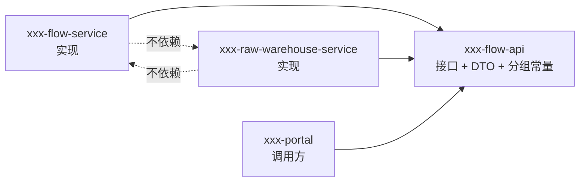
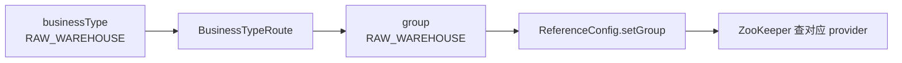

## 为什么接口不能写在提供者模块里？

一种常见做法是把接口和实现都放在 `provider` 模块里，消费者通过 Maven 依赖提供者来拿接口。本地能跑，但会带来一个不可逆的依赖方向：

```text
consumer -> provider-api -> provider 的 Spring/Dubbo 实现依赖
```

消费者本来只需要一个接口定义，却被迫带上提供者的全部运行依赖。更糟的是，当提供者升级 Spring Boot 或 Dubbo 版本时，消费者会被一起拖动；两个团队想独立发布，几乎不可能。

本实战把契约单独放在 `*-api` 模块，依赖方向变成：

```text
provider -> api
consumer -> api
api -> 无业务实现依赖
```

这条方向让“接口不变，提供者和消费者独立升级”成为可能。代价是你要多维护一个模块，但这是值得的。

> ### 💡 新人小结：契约像菜单，不是厨房
>
> - 顾客看菜单点菜，不需要进厨房看厨师怎么炒。
> - 菜单换了菜名，厨房要跟着改；厨房换锅，菜单不用动。
> - 如果把厨房和菜单钉在一起，换一口锅顾客也得重新买一本菜单。
>
> **接口是跨进程的公共语言，不能绑在某一方的实现里。**



---

## 契约模块里到底放什么

`xxx-flow-api` 只放五类内容，每一类都有明确用途：

| 内容 | 文件示例 | 作用 |
|------|----------|------|
| 服务接口 | `FlowEngineService.java`、`FlowEventService.java` | 定义跨进程可调用的方法 |
| DTO | `FlowInstanceDTO.java`、`FlowEvent.java` | 定义跨进程传输的数据 |
| 枚举 | `FlowStatus.java` | 定义稳定状态值 |
| 分组常量 | `FlowEventGroups.java` | 提供编译期常量，供 `@DubboService(group=...)` 使用 |
| 路由表 | `BusinessTypeRoute.java` | 把业务类型翻译成 group |

不放的内容同样重要：不放入 Spring 的 `@Service`、不放入 Dubbo 的 `@DubboService` 实现、不放入数据库实体、不放入 Controller。契约模块越“纯”，被依赖时带进来的东西越少。

### 目录地图

```text
xxx-flow-api/
  pom.xml
  src/main/java/com/xxx/xx/flow/api/
    FlowEngineService.java      流程引擎入口
    FlowEventService.java       业务回调统一契约
    FlowInstanceDTO.java        流程视图
    FlowEvent.java              回调事件载荷
    FlowStatus.java             流程状态枚举
    FlowEventGroups.java        分组常量
    BusinessTypeRoute.java      业务类型到分组的路由表
```

---

## 两个接口：一个入口，一个回调

### FlowEngineService：流程入口

`FlowEngineService` 由流程服务提供，门户静态引用：

```java
public interface FlowEngineService {

    FlowInstanceDTO start(String businessType, String businessId, String starter);

    FlowInstanceDTO approve(String flowInstanceId, String approver);

    FlowInstanceDTO reject(String flowInstanceId, String approver);

    FlowInstanceDTO get(String flowInstanceId);
}
```

这四个方法构成一个最小流程引擎：

| 方法 | 语义 | 是否触发回调 |
|------|------|----------------|
| `start` | 创建流程实例，状态 `RUNNING` | 是，回调业务方 `start` |
| `approve` | 审批通过，状态 `FINISHED` | 是，回调 `finish` |
| `reject` | 驳回，状态 `REJECTED` | 是，回调 `reject` |
| `get` | 查询流程实例 | 否 |

接口上没有 `group`，因为流程服务只有一个实现。不要把“只有一个实现”的接口也硬加 group，那会让调用方多写一个无意义的匹配条件。

### FlowEventService：业务回调

`FlowEventService` 由业务仓实现，流程服务调用：

```java
public interface FlowEventService {

    void start(FlowEvent event);

    void finish(FlowEvent event);

    void reject(FlowEvent event);
}
```

这个接口会被多个仓库实现，所以必须用 group 区分。三个方法都返回 `void`，因为回调只负责让业务方记账，不参与流程状态决策；回调失败由流程侧记录，不反向修改流程状态。

| 设计选择 | 原因 | 代价 |
|----------|------|------|
| 回调方法返回 `void` | 业务通知不应反向决定流程状态 | 失败需要 `dispatchResult` 或补偿机制 |
| 三个独立方法 | 阶段语义清楚，避免一个方法里塞 `phase` 参数 | 接口方法多一个 |
| 统一事件对象 | DTO 可以复用，字段稳定 | 需要保证字段兼容 |
| 分组多实现 | 同一接口按业务方隔离 | 调用方需要维护路由表 |

> ### 💡 新人小结：入口和回调是两扇门
>
> - 入口（FlowEngineService）只有一个，像公司前台。
> - 回调（FlowEventService）每个业务方一个实现，像各部门的内线。
> - 前台按业务类型查内线表，再拨对应分机。
>
> **一个接口是否加 group，取决于它有没有多个实现，而不是取决于它重不重要。**

---

## DTO：跨进程传输的边界

DTO 看起来只是几个字段，但它决定了序列化、版本兼容和错误排查的难易程度。

### FlowInstanceDTO

```java
@Getter
@Setter
@ToString
public class FlowInstanceDTO implements Serializable {

    private static final long serialVersionUID = 1L;

    private String flowInstanceId;
    private String businessType;
    private String businessId;
    private FlowStatus status;
    private String starter;
    private String approver;
    private String dispatchResult;
    private long createdAt;
    private long updatedAt;
}
```

几个设计点：

- 实现 `Serializable` 并显式写 `serialVersionUID`，让序列化边界稳定。
- `status` 用枚举，不用魔法字符串；枚举值变更要有兼容策略。
- 时间字段用 `long` 毫秒值，避免时区和序列化格式差异。
- `dispatchResult` 用字符串保留失败原因，方便直接展示在 HTTP 响应里。

### FlowEvent

```java
public class FlowEvent implements Serializable {

    private static final long serialVersionUID = 1L;

    private String flowInstanceId;
    private String businessType;
    private String businessId;
    private FlowStatus flowStatus;
    private String operator;
    private long occurredAt;
}
```

`operator` 在发起阶段是 `starter`，在审批/驳回阶段是 `approver`。这不是命名随意，而是“谁触发了这个事件”的统一语义；业务方不需要知道流程内部角色，只记录事件即可。

### DTO 设计检查表

| 检查项 | 要求 |
|--------|------|
| 可序列化 | 实现 `Serializable`，显式 `serialVersionUID` |
| 无实现依赖 | 不引用 Spring、Dubbo、数据库实体 |
| 字段可空性 | 明确哪些字段允许 null，消费者要能处理 |
| 时间格式 | 使用毫秒时间戳或明确时区 |
| 枚举兼容 | 新增枚举值要考虑旧消费者反序列化 |
| 变更策略 | 新增字段优先，避免删除/改名字段 |

> ### 💡 新人小结：DTO 像快递面单
>
> - 面单上只写收寄双方都认识的字段，不写仓库内部编号。
> - 面单格式变了，所有网点都要能看懂。
> - 加一个“备注”字段通常安全，把“收件人”改名就可能丢件。
>
> **跨进程传的是数据契约，不是你的数据库表。**

---

## 分组：多个实现怎么共存

`FlowEventService` 有两个实现：原料仓和成品仓。它们实现同一个接口，注册到同一个 ZooKeeper，Dubbo 靠 `group` 区分：

```java
@DubboService(group = FlowEventGroups.RAW_WAREHOUSE_GROUP)
public class RawWarehouseFlowEventService implements FlowEventService {
    // ...
}

@DubboService(group = FlowEventGroups.PRODUCT_WAREHOUSE_GROUP)
public class ProductWarehouseFlowEventService implements FlowEventService {
    // ...
}
```

分组常量必须是编译期常量，因为 `@DubboService` 的 `group` 属性需要常量表达式：

```java
public final class FlowEventGroups {

    public static final String RAW_WAREHOUSE_GROUP = "RAW_WAREHOUSE";
    public static final String PRODUCT_WAREHOUSE_GROUP = "PRODUCT_WAREHOUSE";
    public static final String BUSINESS_ORDER_GROUP = "BUSINESS_ORDER";

    private FlowEventGroups() {
    }
}
```

为什么不用普通字符串散落在各处？因为拼写错误不会在编译期被发现。`RAW_WAREHOUS` 和 `RAW_WAREHOUSE` 只差一个字母，消费者会得到 `No provider available`，而不是编译错误。

| 分组写法 | 编译期检查 | 可读性 | 建议 |
|----------|------------|--------|------|
| 各模块手写字符串 | 无 | 差 | 不推荐 |
| 接口模块常量 | 有 | 好 | 本实战采用 |
| 配置中心动态值 | 无 | 取决于治理 | 需要额外校验 |

---

## 路由表：业务类型到分组的唯一映射

分组只解决“同一接口的多个实现”，还需要一张表把 `businessType` 翻译成 group：

```java
public enum BusinessTypeRoute {

    RAW_WAREHOUSE(FlowEventGroups.RAW_WAREHOUSE_GROUP, "原料仓"),
    PRODUCT_WAREHOUSE(FlowEventGroups.PRODUCT_WAREHOUSE_GROUP, "成品仓"),
    BUSINESS_ORDER(FlowEventGroups.BUSINESS_ORDER_GROUP, "业务订单（示例无实现）");

    private final String dubboGroup;
    private final String remark;

    BusinessTypeRoute(String dubboGroup, String remark) {
        this.dubboGroup = dubboGroup;
        this.remark = remark;
    }

    public static BusinessTypeRoute of(String businessType) {
        if (businessType == null || businessType.trim().isEmpty()) {
            throw new IllegalArgumentException("businessType 不能为空");
        }
        try {
            return valueOf(businessType);
        } catch (IllegalArgumentException e) {
            throw new IllegalArgumentException("未知的 businessType=" + businessType, e);
        }
    }

    public String getDubboGroup() {
        return dubboGroup;
    }
}
```

这张表是“新增业务方”的唯一改动点：业务侧新增实现和 group，流程侧在枚举里加一行。流程服务的 POM 不需要新增任何仓库依赖。



### 为什么用枚举而不是 Map

枚举在编译期限制了可选值，`valueOf` 会拒绝未知值；Map 可以运行时塞入任意 key，容易产生“配置里有、代码不认识”的隐性错误。代价是新增业务方要改代码并重新发布流程服务。如果你的业务方变化非常频繁，可以把路由表外置到配置中心，但要额外做校验和灰度；本实战选择更简单、更可控的枚举。

---

## 契约的兼容性边界

接口和 DTO 一旦发布，就成为多进程之间的协议。修改时要考虑旧版本消费者：

| 变更 | 兼容性 | 建议 |
|------|--------|------|
| 新增接口方法 | 通常不兼容旧实现 | 新方法给默认实现，或升级所有提供者 |
| 删除接口方法 | 不兼容 | 先确认没有调用方，再删 |
| DTO 新增字段 | 通常兼容 | 旧消费者忽略未知字段 |
| DTO 删除/改名字段 | 不兼容 | 新增字段替代，保留旧字段一段时间 |
| 枚举新增值 | 视序列化方式 | 旧消费者可能反序列化失败，需评估 |
| 修改方法参数类型 | 不兼容 | 新增重载，避免原地改 |

本实战为了简化，没有引入版本号；生产环境如果接口会长期演进，建议显式使用 `version` 或建立独立的 API 版本模块。不要把“现在只有两个调用方”当成永远不变。

---

## 契约完成后的验证

契约模块写完，先单独构建：

```bash
mvn -s maven/settings-aliyun.xml -q -DskipTests \
  -pl xxx-flow/xxx-flow-api -am install
```

验收点：

| 检查 | 通过标准 |
|------|----------|
| API jar 生成 | `target/xxx-flow-api-1.0.0-SNAPSHOT.jar` 存在 |
| 没有实现依赖 | `mvn dependency:tree` 不含 Spring Web、Dubbo starter |
| 接口常量可用 | 提供者能编译通过 `@DubboService(group = FlowEventGroups.RAW_WAREHOUSE_GROUP)` |
| DTO 可序列化 | 所有跨进程 DTO 实现 `Serializable` |
| 路由表可校验 | 非法 `businessType` 抛出带可选值的异常 |

契约没有构建通过之前，不要写提供者和消费者。否则你会同时调试“接口找不到”“分组不匹配”“序列化失败”三类问题，定位成本会成倍上升。

---

## 要点总结

- 契约单独成模块，保证提供者和消费者都只依赖接口，不依赖对方实现。
- `FlowEngineService` 是单一实现入口，不加 group；`FlowEventService` 是多实现回调，必须用 group 区分。
- DTO 要实现 `Serializable`、显式 `serialVersionUID`，字段变更要考虑旧消费者兼容。
- 分组常量放在契约模块，避免字符串拼写错误；路由表用枚举把 `businessType` 映射到 group。
- 新增业务方的改动收敛为“业务侧实现 + 路由表一行”，流程服务不新增仓库依赖。
- 契约先单独构建验证，再进入提供者和消费者编码。

下一步进入 [ZooKeeper 与 Spring Boot 配置](/docs/07-dubbo-springboot-lab/契约与底座/zookeeper-config/)，为这些契约准备一个能连接、能注册、能验证的运行底座。
