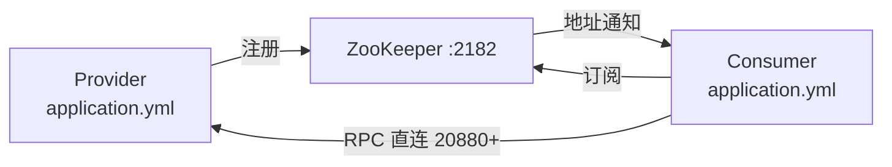
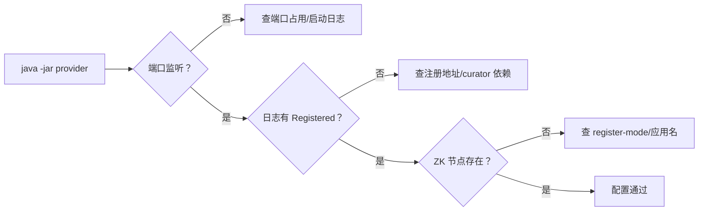

## 为什么配置比代码更容易让集成失败？

代码写错通常会在编译或启动时暴露；配置写错往往不会。应用能启动、端口也监听，但消费者就是找不到提供者，或者两者连的不是同一个 ZooKeeper。最常见的几类问题都和配置有关：

- 提供者连 `127.0.0.1:2181`，消费者连 `localhost:2182`。
- 两个进程都叫同一个 `dubbo.application.name`，应用级发现互相覆盖。
- 提供者端口被别的进程占用，Dubbo 启动失败但日志被其他输出淹没。
- 同机启动三个 provider，QOS 默认端口 22222 互相抢占。
- `register-mode` 设成 `instance`，但消费者或排查脚本还在看 `/dubbo`。
- ZooKeeper 的 AdminServer 占了 8080，和本机其他 Web 服务冲突。

这一篇先把运行底座固定下来：用独立 ZooKeeper、明确端口、明确注册模式，再写两份最小配置。

> ### 💡 新人小结：配置像地址和门牌号
>
> - 代码是“要寄什么”，配置是“寄到哪、从哪个门进”。
> - 地址写错，包裹再正确也到不了。
> - 门牌号重复，快递员不知道该敲哪扇门。
>
> **集成阶段先对齐地址与端口，再谈调用逻辑。**



---

## 准备一个独立的 ZooKeeper 实例

不要在学习和实验时直接复用本机已有的 2181 实例。原因很实际：你可能会删节点、改配置、重启服务，而 2181 上可能有别的项目数据。用独立端口和独立 `dataDir`，实验结束可以整体删除。

本实战使用：

| 项 | 值 |
|----|----|
| ZooKeeper 版本 | 3.8.7 |
| 客户端端口 | 2182 |
| dataDir | 站点根 `.tmp/zk-lab/data`（实验目录） |
| AdminServer | 关闭 |
| 4lw 白名单 | `srvr` |
| 用途 | 本地实战注册中心，不接生产数据 |

### zoo.cfg

```properties
tickTime=2000
dataDir=C:/Users/webtu/Desktop/Zookeeper文档站/.tmp/zk-lab/data
clientPort=2182
admin.enableServer=false
4lw.commands.whitelist=srvr
```

逐项说明：

| 配置 | 作用 | 本实战取值 |
|------|------|------------|
| `tickTime` | ZooKeeper 基本时间单位（毫秒） | 2000 |
| `dataDir` | 快照与事务日志目录 | 独立临时目录 |
| `clientPort` | 客户端连接端口 | 2182，避开已有 2181 |
| `admin.enableServer` | 是否启动 8080 HTTP 管理端 | false，避免端口冲突 |
| `4lw.commands.whitelist` | 四字命令白名单 | 只留 `srvr`，够看状态 |

`dataDir` 不要指向已有实例的目录，也不要和源码目录混在一起。实验结束后删除整个临时目录，避免残留会话和快照影响下一次实验。

### 启动与验证

本机用 Java 直接启动（路径按自己的发行包调整）：

```bash
ZKBIN="D:/ZK/apache-zookeeper-3.8.7-bin/apache-zookeeper-3.8.7-bin"
JAVA8="D:/JDK/Alibaba_Dragonwell_Standard_8.30.29_x64_windows/dragonwell-8.29.28/bin/java"

"$JAVA8" -cp "$ZKBIN/lib/*;$ZKBIN/conf" \
  org.apache.zookeeper.server.quorum.QuorumPeerMain \
  .tmp/zk-lab/zoo.cfg
```

启动成功后，日志里会出现绑定端口的记录：

```text
binding to port 0.0.0.0/0.0.0.0:2182
Snapshotting: 0x0 to .../.tmp/zk-lab/data/version-2/snapshot.0
```

用两个独立命令验证：

```bash
# 1. 端口监听
netstat -ano | findstr ":2182"

# 2. 客户端能否读写
printf 'ls /\nquit\n' | zkCli.cmd -server 127.0.0.1:2182
```

预期能看到 `/zookeeper` 根节点；如果连接失败，先不要改 Spring 配置，先确认 ZooKeeper 进程和端口。

> ### 💡 新人小结：先确认“登记处开门”，再填表格
>
> - ZooKeeper 没启动，应用配置写得再对也注册不上。
> - 2182 是实验门牌，不要和已有 2181 混用。
> - 独立 `dataDir` 让实验可以随时清空，不伤已有数据。
>
> **配置排查的第一层永远是“目标进程在不在、端口通不通”。**

---

## 提供者配置：连接注册中心并暴露端口

以 `xxx-flow-service` 为例，最小配置如下：

```yaml
spring:
  application:
    name: xxx-flow-service

dubbo:
  application:
    name: xxx-flow-service
    qos-enable: false
  registry:
    address: zookeeper://127.0.0.1:2182
  protocol:
    name: dubbo
    port: 20880
  provider:
    timeout: 5000
```

仓库服务同理，只改应用名和端口：

```yaml
spring:
  application:
    name: xxx-raw-warehouse-service

dubbo:
  application:
    name: xxx-raw-warehouse-service
    qos-enable: false
  registry:
    address: zookeeper://127.0.0.1:2182
  protocol:
    name: dubbo
    port: 20881
```

| 配置 | 必须性 | 说明 |
|------|--------|------|
| `spring.application.name` | 建议 | Spring 应用名，和 Dubbo 应用名保持一致便于排查 |
| `dubbo.application.name` | 必须 | 应用级发现的服务名；同应用多实例必须一致 |
| `dubbo.registry.address` | 必须 | 注册中心地址，协议必须是 `zookeeper://` |
| `dubbo.protocol.name` | 必须 | RPC 协议，默认 `dubbo` |
| `dubbo.protocol.port` | 必须 | 同机多实例必须不同 |
| `dubbo.provider.timeout` | 建议 | 提供者侧超时参考，消费者可覆盖 |
| `qos-enable` | 建议 | 同机多进程时关闭，避免 22222 冲突 |

### 为什么关闭 QOS

Dubbo QOS 默认监听 22222。三个 provider 在同一台机器启动时，第一个占用 22222，后两个可能启动失败或报警。示例统一设 `qos-enable: false`，把运维入口交给日志、ZooKeeper 和 HTTP 管理端，而不是依赖 QOS。

如果确实需要 QOS，给每个进程分配不同端口：

```yaml
dubbo:
  application:
    qos-enable: true
    qos-port: 22223
```

### 为什么不在配置里写 `register-mode`

Dubbo 3.2.20 对普通 ZooKeeper 注册中心的默认 `register-mode` 是 `all`，会同时写接口级与应用级两套数据。本实战先接受默认值，这样在 ZooKeeper 里既能看 `/dubbo`，也能看 `/services`，便于对照。

如果只想写一套，可以显式配置：

```yaml
dubbo:
  registry:
    address: zookeeper://127.0.0.1:2182
    register-mode: instance
```

| 模式 | 写入内容 | 适合 |
|------|----------|------|
| `all` | 接口级 + 应用级 | 学习、迁移期、需要两套视图 |
| `instance` | 只写应用级 `/services` | 新项目，减少接口级 URL |
| `interface` | 只写接口级 `/dubbo` | 旧系统兼容、按接口治理 |

模式差异的节点证据在 [Dubbo 在 ZooKeeper 中读写什么](/docs/06-dubbo-integration/注册与发现/data-in-zookeeper/) 里有完整实测。

---

## 消费者配置：只要地址与 HTTP 端口

`xxx-portal` 的配置更短：

```yaml
server:
  port: 18080

spring:
  application:
    name: xxx-portal

dubbo:
  application:
    name: xxx-portal
    qos-enable: false
  registry:
    address: zookeeper://127.0.0.1:2182
```

消费者不需要 `dubbo.protocol.port`，因为它不暴露 Dubbo 服务；它只发起引用和 HTTP 请求。`server.port=18080` 是 Spring Boot 的 Web 端口，和 Dubbo 的 20880 是两回事。

| 端口 | 属于 | 用途 |
|------|------|------|
| 2182 | ZooKeeper | 注册、订阅、元数据 |
| 20880 | flow-service | Dubbo RPC |
| 20881 | raw-warehouse | Dubbo RPC |
| 20882 | product-warehouse | Dubbo RPC |
| 18080 | portal | HTTP API |
| 22222 | Dubbo QOS（已关闭） | 运维命令，示例不用 |

---

## 启动参数覆盖：同一份 jar 跑不同环境

配置写在 `application.yml` 里，但实验时经常需要临时改注册地址。可以用启动参数覆盖：

```bash
java -Ddubbo.registry.address=zookeeper://127.0.0.1:2182 \
  -jar xxx-flow-service-1.0.0-SNAPSHOT.jar
```

优先级从高到低大致是：命令行系统属性、环境变量、`application.yml`、默认值。实验时用命令行覆盖，既能复用同一份 jar，又能把流量隔离到临时 ZK。

| 场景 | 推荐做法 |
|------|----------|
| 本地单实例 | 直接改 YAML |
| 同机多实例 | 命令行覆盖端口和注册地址 |
| 容器环境 | 环境变量注入 |
| 生产 | 配置中心/部署平台统一管理，不把地址写死在镜像里 |

> ### 💡 新人小结：配置分层像换外套
>
> - YAML 是默认外套，命令行参数是临时围巾。
> - 同一份程序可以换不同外套去不同环境。
> - 不要把生产地址缝死在衣服里，否则每次换环境都要改代码。
>
> **能在启动时覆盖的配置，不要硬编码进业务类。**

---

## 配置完成后怎么验证

不要等到写消费者才验证配置。提供者启动后，先看三件事：



| 验证项 | 命令/位置 | 通过标准 |
|--------|-----------|----------|
| Dubbo 端口 | `netstat -ano \| findstr :20880` | LISTENING |
| 注册日志 | 启动日志 | 出现 `Registered dubbo service` |
| 接口级节点 | `ls /dubbo/.../providers` | 有 URL 节点 |
| 应用级实例 | `ls /services/xxx-flow-service` | 有 `host:port` 子节点 |
| 元数据 | `ls /dubbo/metadata/...` | 有 provider 子路径 |

如果端口监听但日志没有 `Registered`，优先查注册中心地址和 Curator 依赖，而不是查业务代码。如果日志有 `Registered` 但节点看不到，查应用名、`register-mode` 和你查看的根路径是否一致。

---

## 常见配置错误

| 现象 | 原因 | 处理 |
|------|------|------|
| 启动报端口占用 | 20880/20881/20882 重复 | 每个进程分配不同端口 |
| 三个 provider 只有一个能起 | QOS 22222 冲突 | 关闭 QOS 或分配不同端口 |
| `Connection refused` 到 2182 | ZK 没启动或端口错 | 先 `netstat`，再查 `zoo.cfg` |
| 注册到了错误的 ZK | 启动参数覆盖了 YAML | 打印实际配置，检查命令行 |
| 消费者找不到提供者 | 应用名/分组/注册模式不一致 | 对齐 `application.name`、group、`register-mode` |
| 8080 被占 | ZooKeeper AdminServer 默认开启 | 关闭 AdminServer 或改端口 |
| 启动日志有多个 SLF4J binding | Curator 依赖带 `slf4j-reload4j` | 根 POM 排除 |
| 改完 YAML 没生效 | 用了旧 jar 或旧启动参数 | 重新打包，检查启动命令 |

---

## 要点总结

- 实验使用独立 ZooKeeper（2182、独立 `dataDir`、关闭 AdminServer），不要复用已有 2181 数据。
- 提供者配置的核心是应用名、注册地址、Dubbo 协议端口和 QOS；同机多实例必须区分端口。
- 消费者只需要注册地址和 HTTP 端口，不需要暴露 Dubbo 协议端口。
- Dubbo 3.2.20 普通注册中心默认 `register-mode=all`，会同时写 `/dubbo` 与 `/services`；需要单写时显式配置。
- 命令行系统属性可以覆盖 YAML，适合实验与多环境部署，但生产配置应由部署平台统一管理。
- 配置验证顺序是“端口 → 注册日志 → ZooKeeper 节点”，不要跳过前两步直接查业务代码。

下一步进入 [提供者：从接口到可调用服务](/docs/07-dubbo-springboot-lab/服务实现/provider-implementation/)，把配置变成真正注册到 ZooKeeper 的服务实例。
