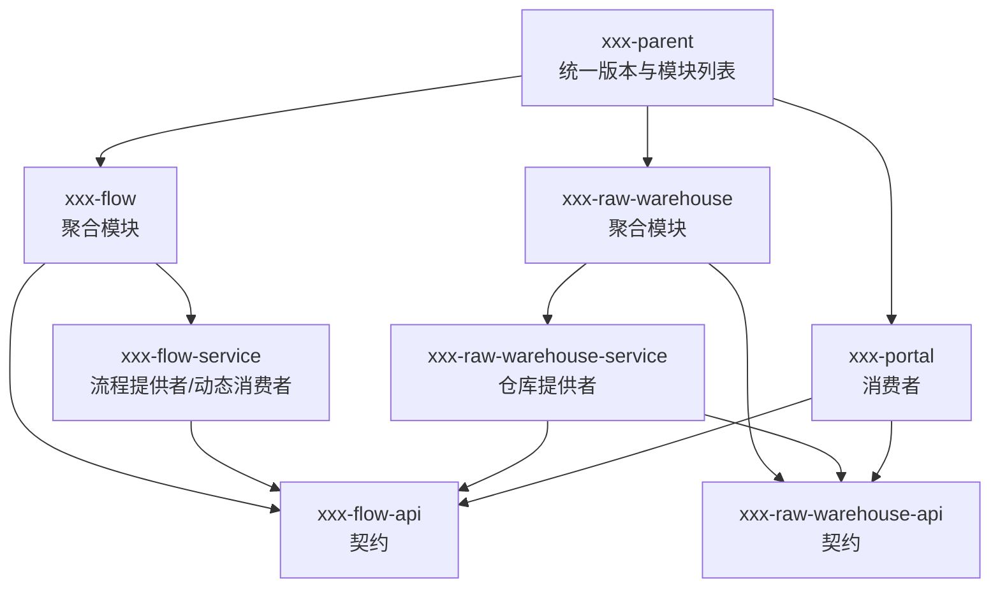
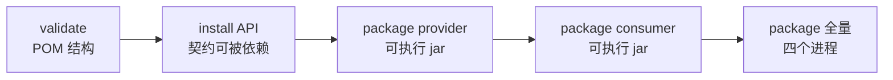

## 为什么不能把所有代码塞进一个 Maven 模块？

最小 Demo 可以只有一个 `pom.xml`：接口、实现、Controller 全在 `src/main/java` 下。它在本地能跑，但一旦要拆出两个进程，就会遇到三个具体问题：

- 消费者为了拿到接口类，不得不依赖提供者的实现 jar。
- 提供者为了拿到统一契约，可能反过来依赖消费者的 Web 模块。
- 版本号散落在每个模块里，Dubbo、Curator、Spring Boot 一旦不匹配，错误会在运行期才出现。

多模块不是为了“看起来专业”，而是为了把**契约、实现、装配**分开，让依赖方向可检查、版本可集中管理。

> ### 💡 新人小结：多模块像一套标准件
>
> - API 模块是标准接口，谁都能拿，不绑定某台机器。
> - service 模块是具体零件，只能按标准接口生产。
> - 父 POM 是总规格书，统一螺丝尺寸（版本），避免每个零件各用一套。
>
> **模块拆分的价值，不是文件变多，而是依赖方向变清楚。**



这张图的箭头是“依赖”还是“聚合”，需要分清：

| 关系 | 含义 | 例子 |
|------|------|------|
| 聚合 | 父模块负责构建子模块 | `xxx-flow` 的 `<modules>` 包含 api 与 service |
| 依赖 | 编译期需要对方的类 | `xxx-flow-service` 依赖 `xxx-flow-api` |
| 不依赖 | 有意不引入，保持解耦 | `xxx-flow-service` 不依赖任何仓库 api |

---

## 最终 POM 地图

工程共有 11 个 POM。数量看着多，但类型只有四种：

```text
dubbo-flow-springboot/
  pom.xml                         根 POM，版本与依赖管理
  xxx-flow/
    pom.xml                       聚合 POM
    xxx-flow-api/pom.xml          契约 jar
    xxx-flow-service/pom.xml      流程服务 fat jar
  xxx-raw-warehouse/
    pom.xml                       聚合 POM
    xxx-raw-warehouse-api/pom.xml
    xxx-raw-warehouse-service/pom.xml
  xxx-product-warehouse/
    pom.xml                       聚合 POM
    xxx-product-warehouse-api/pom.xml
    xxx-product-warehouse-service/pom.xml
  xxx-portal/
    pom.xml                       门户 fat jar
```

| POM 类型 | 数量 | 负责什么 | 不该负责什么 |
|----------|------|----------|--------------|
| 根 POM | 1 | 版本、依赖管理、模块聚合 | 具体业务依赖 |
| 聚合 POM | 3 | 把 api/service 串起来 | 具体依赖版本 |
| API POM | 3 | 契约 jar | Spring、Dubbo 实现、数据库 |
| 可执行 POM | 4 | 启动类、插件、运行依赖 | 契约定义 |

`xxx-portal` 没有独立聚合层，直接作为根 POM 的模块；这是因为它只有一个可执行模块，不需要再拆 api/service。

---

## 根 POM：先固定版本与模块

根 POM 的第一职责是锁定技术栈。实战使用的关键段落如下（节选，完整文件在工程根目录）：

```xml
<parent>
    <groupId>org.springframework.boot</groupId>
    <artifactId>spring-boot-starter-parent</artifactId>
    <version>2.7.18</version>
    <relativePath/>
</parent>

<groupId>com.xxx.xx</groupId>
<artifactId>xxx-parent</artifactId>
<version>1.0.0-SNAPSHOT</version>
<packaging>pom</packaging>

<modules>
    <module>xxx-flow</module>
    <module>xxx-raw-warehouse</module>
    <module>xxx-product-warehouse</module>
    <module>xxx-portal</module>
</modules>

<properties>
    <java.version>1.8</java.version>
    <dubbo.version>3.2.20</dubbo.version>
</properties>
```

三个点需要注意：

1. `java.version=1.8` 让 Spring Boot 父 POM 的编译插件按 Java 8 字节码处理；用 JDK 21 构建也可以，只要源码语法不越界，但运行端仍按 Java 8 目标验证。
2. `dubbo.version` 只在根 POM 维护一次，子模块不重复写版本。
3. `modules` 的顺序不是强制的，Maven 会按依赖关系计算构建顺序；但把契约模块放在聚合模块内，阅读时更直观。

### 依赖管理段

根 POM 用 `dependencyManagement` 统一三类别依赖：

```xml
<dependencyManagement>
    <dependencies>
        <dependency>
            <groupId>org.apache.dubbo</groupId>
            <artifactId>dubbo-spring-boot-starter</artifactId>
            <version>${dubbo.version}</version>
        </dependency>
        <dependency>
            <groupId>org.apache.dubbo</groupId>
            <artifactId>dubbo-dependencies-zookeeper-curator5</artifactId>
            <version>${dubbo.version}</version>
            <type>pom</type>
            <exclusions>
                <exclusion>
                    <groupId>org.slf4j</groupId>
                    <artifactId>slf4j-reload4j</artifactId>
                </exclusion>
            </exclusions>
        </dependency>
        <dependency>
            <groupId>com.xxx.xx</groupId>
            <artifactId>xxx-flow-api</artifactId>
            <version>${project.version}</version>
        </dependency>
        <dependency>
            <groupId>com.xxx.xx</groupId>
            <artifactId>xxx-raw-warehouse-api</artifactId>
            <version>${project.version}</version>
        </dependency>
        <dependency>
            <groupId>com.xxx.xx</groupId>
            <artifactId>xxx-product-warehouse-api</artifactId>
            <version>${project.version}</version>
        </dependency>
    </dependencies>
</dependencyManagement>
```

为什么内部 API 也要放进 `dependencyManagement`？因为子模块引用内部 jar 时只写 `groupId + artifactId`，版本自动取 `${project.version}`，不会出现 flow-api 1.0.0、provider 依赖 0.9.0 这种错位。

`slf4j-reload4j` 的排除同样重要。Spring Boot 自带 Logback，如果 Curator/ZooKeeper 依赖树再带一个 SLF4J binding，启动会出现多个绑定警告，日志实现也可能不确定。这个排除写在根 POM 里，所有子模块统一生效。

> ### 💡 新人小结：dependencyManagement 像统一采购清单
>
> - 子模块只报“要什么”，不报“多少钱”（版本）。
> - 价格（版本）由总清单统一维护，换版本只改一处。
> - 排除冲突依赖也放在总清单，避免每个模块各排一遍。
>
> **版本写在子模块里，迟早会出现两个模块用两个版本。**

---

## API 模块：只放契约，不引入实现

`xxx-flow-api` 的 POM 刻意保持极简：

```xml
<parent>
    <groupId>com.xxx.xx</groupId>
    <artifactId>xxx-flow</artifactId>
    <version>1.0.0-SNAPSHOT</version>
    <relativePath>../pom.xml</relativePath>
</parent>

<artifactId>xxx-flow-api</artifactId>
<packaging>jar</packaging>

<dependencies>
    <dependency>
        <groupId>org.projectlombok</groupId>
        <artifactId>lombok</artifactId>
        <optional>true</optional>
    </dependency>
</dependencies>
```

这里只有 Lombok，而且标记为 `optional`。原因是 `FlowInstanceDTO` 等类用了 Lombok 注解生成 getter/setter，编译期需要它；生成后的 class 已经包含方法，下游模块运行时不需要 Lombok。

API 模块不应该出现：

- `spring-boot-starter-*`：契约不应该依赖 Spring 容器。
- `dubbo-spring-boot-starter`：接口定义不需要 Dubbo 运行时。
- 任何 `*-service` 模块：否则契约和实现形成循环。
- 数据库、缓存、HTTP 客户端：这些属于实现细节。

一个检查方法：

```bash
mvn -q -pl xxx-flow/xxx-flow-api dependency:tree
```

如果依赖树里出现 Spring Web、数据库驱动或某个 service 模块，说明契约边界已经被破坏。

---

## 提供者模块：契约 + 运行时

以 `xxx-raw-warehouse-service` 为例，它的 POM 需要三类依赖：

```xml
<dependencies>
    <dependency>
        <groupId>com.xxx.xx</groupId>
        <artifactId>xxx-raw-warehouse-api</artifactId>
    </dependency>
    <dependency>
        <groupId>com.xxx.xx</groupId>
        <artifactId>xxx-flow-api</artifactId>
    </dependency>
    <dependency>
        <groupId>org.springframework.boot</groupId>
        <artifactId>spring-boot-starter</artifactId>
    </dependency>
    <dependency>
        <groupId>org.apache.dubbo</groupId>
        <artifactId>dubbo-spring-boot-starter</artifactId>
    </dependency>
    <dependency>
        <groupId>org.apache.dubbo</groupId>
        <artifactId>dubbo-dependencies-zookeeper-curator5</artifactId>
        <type>pom</type>
    </dependency>
    <dependency>
        <groupId>org.projectlombok</groupId>
        <artifactId>lombok</artifactId>
        <optional>true</optional>
    </dependency>
</dependencies>
```

它同时依赖 `xxx-raw-warehouse-api` 和 `xxx-flow-api`，因为仓库既要实现自己的查询接口，也要实现流程侧定义的回调接口。这是“实现依赖契约”的正常方向。

可执行模块还需要 Spring Boot 插件：

```xml
<build>
    <plugins>
        <plugin>
            <groupId>org.springframework.boot</groupId>
            <artifactId>spring-boot-maven-plugin</artifactId>
            <configuration>
                <mainClass>com.xxx.xx.rawwarehouse.RawWarehouseApplication</mainClass>
            </configuration>
        </plugin>
    </plugins>
</build>
```

没有 `<mainClass>` 时，`java -jar` 可能找不到入口；显式写出来比依赖自动探测更稳。

---

## 消费者模块：Web + 契约

`xxx-portal` 的依赖与提供者类似，但多了 Web，少了服务实现：

```xml
<dependencies>
    <dependency>
        <groupId>com.xxx.xx</groupId>
        <artifactId>xxx-flow-api</artifactId>
    </dependency>
    <dependency>
        <groupId>com.xxx.xx</groupId>
        <artifactId>xxx-raw-warehouse-api</artifactId>
    </dependency>
    <dependency>
        <groupId>com.xxx.xx</groupId>
        <artifactId>xxx-product-warehouse-api</artifactId>
    </dependency>
    <dependency>
        <groupId>org.springframework.boot</groupId>
        <artifactId>spring-boot-starter-web</artifactId>
    </dependency>
    <dependency>
        <groupId>org.springframework.boot</groupId>
        <artifactId>spring-boot-starter-validation</artifactId>
    </dependency>
    <dependency>
        <groupId>org.apache.dubbo</groupId>
        <artifactId>dubbo-spring-boot-starter</artifactId>
    </dependency>
    <dependency>
        <groupId>org.apache.dubbo</groupId>
        <artifactId>dubbo-dependencies-zookeeper-curator5</artifactId>
        <type>pom</type>
    </dependency>
</dependencies>
```

消费者只依赖 API，不依赖 `*-service`。所以 portal 可以编译、可以启动，但它完全不知道仓库服务是怎么实现的。这正是我们想要的边界。

---

## 第一次构建：按依赖顺序验证

不要等所有代码写完才构建。每加一个模块就构建一次，能更快定位 POM 问题。



推荐命令：

```bash
# 1. 只校验 POM 与模块关系
mvn -s maven/settings-aliyun.xml -q -DskipTests validate

# 2. 先安装 API，后续模块才能解析内部依赖
mvn -s maven/settings-aliyun.xml -q -DskipTests -pl xxx-flow/xxx-flow-api -am install

# 3. 全量打包
mvn -s maven/settings-aliyun.xml -q -DskipTests package
```

本机执行全量打包的退出码为 0，产物包括：

| jar | 类型 | 用途 |
|-----|------|------|
| `xxx-flow-api-1.0.0-SNAPSHOT.jar` | 普通 jar | 流程契约 |
| `xxx-raw-warehouse-api-...jar` | 普通 jar | 原料仓契约 |
| `xxx-product-warehouse-api-...jar` | 普通 jar | 成品仓契约 |
| `xxx-flow-service-...jar` | fat jar | 流程服务 |
| `xxx-raw-warehouse-service-...jar` | fat jar | 原料仓服务 |
| `xxx-product-warehouse-service-...jar` | fat jar | 成品仓服务 |
| `xxx-portal-...jar` | fat jar | 门户消费者 |

fat jar 和普通 jar 的差别不在“能不能运行”，而在“有没有把依赖一起打进去”。`java -jar` 启动时需要的 Spring Boot、Dubbo、ZooKeeper 客户端都在 fat jar 内；API jar 只提供编译期类。

> ### 💡 新人小结：构建顺序像做菜
>
> - 先备好标准配料（API），再组装菜品（service），最后摆盘（portal）。
> - 配料没装进仓库（install），后面的模块就找不到它。
> - 一次全做容易乱，按步骤做才知道哪一步出错。
>
> **构建失败先看模块顺序，再看依赖版本，最后才看代码。**

---

## 常见 POM 错误

| 现象 | 常见原因 | 验证 | 处理 |
|------|----------|------|------|
| `Could not find artifact com.xxx.xx:xxx-flow-api` | API 没有 install，或版本不一致 | `mvn -pl ... install`、看根 POM 版本 | 先安装 API，统一版本 |
| 子模块编译通过，运行报 `NoClassDefFoundError` | 依赖 scope 写成 `provided` 或漏包 | `mvn dependency:tree`、看 fat jar | 改 scope，确保运行依赖进入 fat jar |
| `No such extension RegistryFactory` | 缺 Curator/ZooKeeper 注册中心实现 | 依赖树中是否有 curator5 POM | 补 `dubbo-dependencies-zookeeper-curator5` |
| 启动时多个 SLF4J binding | 未排除 `slf4j-reload4j` | 启动日志警告 | 在根 POM 统一排除 |
| Java 8 编译失败 | 用了 Java 9+ 语法或依赖要求高版本 | `javac` 报错、`mvn -v` | 降语法或换兼容依赖 |
| `no main manifest attribute` | 没配 Spring Boot 插件 | `java -jar` 报错 | 加插件并指定 `mainClass` |
| 子模块 POM 找不到父 POM | `relativePath` 写错 | Maven 报 `Non-resolvable parent POM` | 修正相对路径或先安装父 POM |

这些错误里，只有最后一项是“Maven 本身的问题”，其余大多是依赖边界或打包配置的问题。遇到构建失败时，先看报错模块和目标 artifact，不要直接删本地仓库。

---

## 骨架完成后的检查清单

| 检查项 | 通过标准 |
|--------|----------|
| 根 POM 模块 | 4 个顶层模块都能被 Maven 识别 |
| API 依赖 | 不含 Spring Web、Dubbo starter、service 模块 |
| 版本一致性 | 所有内部 API 使用 `${project.version}` |
| 可执行 jar | 4 个服务都有 `mainClass` 与 Spring Boot 插件 |
| 注册中心依赖 | 每个要连 ZK 的进程都有 curator5 POM |
| 日志冲突 | 启动日志没有多个 SLF4J binding |
| Java 目标 | 编译输出为 Java 8 字节码 |
| 构建结果 | `mvn package` 退出码 0，7 个 jar 存在 |

骨架通过后，下一步不是写实现，而是先定契约。因为接口和 DTO 决定了提供者、消费者和序列化的边界，先写实现会让契约被实现细节牵着走。

---

## 要点总结

- 多模块的核心是依赖方向：实现依赖契约，契约不依赖实现，流程服务不依赖仓库模块。
- 根 POM 负责版本与 `dependencyManagement`，子模块只声明需要什么，不重复写版本。
- API 模块应保持极简，只放接口、DTO、常量和路由表，不引入 Spring/Dubbo 运行时。
- 提供者和消费者都依赖 API，但消费者绝不依赖 `*-service` 实现。
- 构建要按“validate → API install → provider/consumer package”的顺序验证，出现错误时先看模块顺序和依赖树。
- 11 个 POM 不是复杂度，而是四种职责的重复：根、聚合、契约、可执行。

接下来进入 [契约先行：API 模块、DTO 与分组设计](/docs/07-dubbo-springboot-lab/契约与底座/api-contract/)，把骨架里最重要的那层内容补上。
