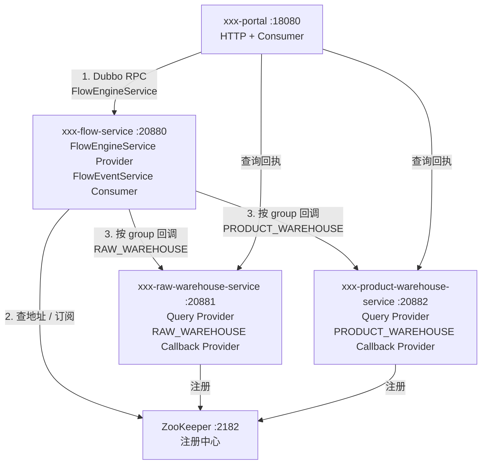
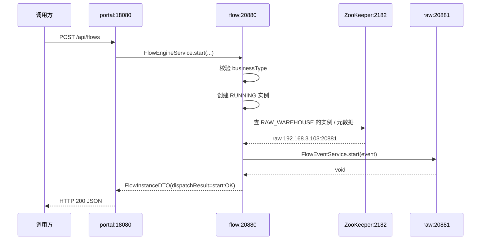
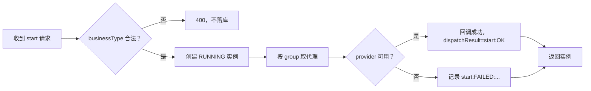
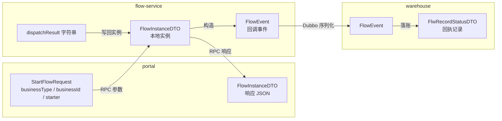

## 为什么“从零搭工程”比复制一段 Demo 更难？

搜索 Dubbo 集成，最容易找到的是几段代码：一个 `@DubboService`、一个 `@DubboReference`、一份 `application.yml`。把它们粘进项目，启动可能成功，但真正从空目录开始搭一套能维护的工程时，问题会变成另一类：

- 接口契约应该放在哪个模块？放在提供者里，消费者就要依赖提供者实现。
- 父 POM 管什么，子模块管什么？版本号写在哪一层才不会互相覆盖？
- 先写提供者还是先写消费者？消费者启动时提供者还没起来怎么办？
- 一个接口有多个业务实现，用什么区分？分组怎么和路由表对应？
- 动态引用的代码放在哪一层？为什么不能每次调用都 new 一个 `ReferenceConfig`？
- 出问题时，应该查代码、查配置、查端口，还是查 ZooKeeper 节点？

这些问题不是“会不会写注解”，而是“工程边界有没有提前想清楚”。本目录的目标不是再解释一遍 Dubbo 原理，而是按照**从空目录到四个进程跑通**的顺序，记录一套 Spring Boot 2.7.18 + Java 8 + Dubbo 3.2.20 的实战工程。

> ### 💡 新人小结：搭工程像盖楼，不是先买家具
>
> - 先定楼层和承重墙（模块边界），再决定房间怎么装修（代码实现）。
> - 契约是承重墙，提供者和消费者都靠它对齐。
> - 配置是水电，代码写得再漂亮，地址和端口接错也跑不起来。
>
> **先画结构，再写代码；先跑闭环，再谈治理。**


---

## 场景与目标：先把要解决的问题说清楚

实战需要一个足够真实、又能在单机跑通的场景。本目录使用“流程中心回调业务仓”作为主线：

1. 门户（portal）发起一条流程。
2. 流程服务（flow-service）创建流程实例，状态为 `RUNNING`。
3. 流程服务根据 `businessType` 找到对应业务仓的分组，回调业务仓。
4. 业务仓记录回调事件；流程继续审批或驳回。
5. 门户查询流程和业务仓的回执，确认调用真的到达了正确的实现。

这个场景同时覆盖了三个关键能力：

| 能力 | 在本场景中的体现 | 对应技术点 |
|------|------------------|------------|
| 基础 RPC | portal 调用 flow-service | 静态 `@DubboReference` |
| 分组多实现 | 原料仓、成品仓实现同一个回调接口 | `group` + 路由表 |
| 运行期动态引用 | flow-service 编译期不认识具体仓库 | `ReferenceConfig` + `SimpleReferenceCache` |

### 目标与非目标

| 类型 | 内容 |
|------|------|
| 目标 | 从空目录建立可构建的多模块工程 |
| 目标 | 接口契约与实现分离，消费者不依赖提供者实现 |
| 目标 | 两个业务仓按 group 隔离，新增业务方不需要改流程服务 |
| 目标 | 用独立 ZooKeeper 跑通注册、发现、调用、失败与恢复 |
| 非目标 | 不在本实战里做生产级安全加固、压测和容量规划 |
| 非目标 | 不覆盖 Nacos、etcd、K8s 等其他注册中心 |
| 非目标 | 不把示例的业务账本做成数据库持久化 |

把非目标写出来很重要。实战文档最容易失控的地方，就是一边搭 RPC，一边顺手引入数据库、缓存、网关、消息队列，最后读者不知道哪一步才是 Dubbo 的关键路径。

> ### 💡 新人小结：先跑通一条窄路，再修高速公路
>
> - 本实战只做“发起流程 → 回调仓库 → 查询回执”这一条路。
> - 认证、限流、数据库、监控先放在路边，不挡主路。
> - 主路跑通后，再加东西才知道每一步为什么加。
>
> **最小闭环不是功能少，而是依赖少、变量少。**

---

## 模块边界：谁依赖谁

工程最终有四个顶层业务模块，共 11 个 POM。名字看起来多，但依赖方向只有一条主线：

```text
xxx-parent/
  xxx-flow/
    xxx-flow-api/
    xxx-flow-service/
  xxx-raw-warehouse/
    xxx-raw-warehouse-api/
    xxx-raw-warehouse-service/
  xxx-product-warehouse/
    xxx-product-warehouse-api/
    xxx-product-warehouse-service/
  xxx-portal/
```

注意：上面这段是路径清单，不是命令行输出；真正的 Maven 结构以各级 `pom.xml` 的 `<modules>` 为准。

| 模块 | 角色 | 依赖 | 不该依赖什么 |
|------|------|------|----------------|
| `xxx-flow-api` | 流程契约 | 只依赖 Lombok（编译期） | Spring、Dubbo 实现、仓库模块 |
| `xxx-flow-service` | 流程提供者 + 动态消费者 | 自己的 API、Dubbo starter、ZooKeeper 实现 | 任何仓库的 API |
| `xxx-raw-warehouse-api` | 原料仓契约 | 只依赖 Lombok | 流程服务、其他仓库 |
| `xxx-raw-warehouse-service` | 原料仓提供者 | 自己的 API、流程 API、Dubbo starter | 流程服务的实现 |
| `xxx-portal` | 门户消费者 | 流程 API、仓库查询 API、Dubbo starter、Web | 任何 `*-service` 模块 |

最重要的两条依赖规则：

1. **实现可以依赖契约，契约不能依赖实现。**
2. **流程服务不依赖仓库模块，所以它只能通过统一契约 + group 认识业务方。**

第二条是整套解耦的支点。如果 `xxx-flow-service` 的 POM 里出现 `xxx-raw-warehouse-api`，那“新增业务方零改动”就不成立，因为每加一个仓库都要改流程服务的依赖并重新打包。

> ### 💡 新人小结：模块像插座和电器
>
> - API 是插座标准，提供者和消费者都按这个标准做插头。
> - 流程服务只认插座，不认具体是哪台电器。
> - 一旦流程服务依赖了某个电器，换一个电器就得改墙。
>
> **依赖方向错了，后面所有“解耦”都会变成口号。**

---

## 一张组件架构图

把模块放回运行时，会看到四个进程和一个注册中心：



这张图里有两个“消费者”：

- portal 是静态消费者，编译期就知道 `FlowEngineService`。
- flow-service 对仓库来说也是消费者，但它在编译期不认识仓库，只在运行期按 group 动态构造引用。

同一个进程可以同时是提供者和消费者。判断角色看的是“这次交互谁提供能力”，而不是看进程名。

---

## 一张工作流程图

从 portal 发起一条流程开始，完整工作流如下：



注意第 4 步到第 6 步：流程服务先落库，再回调业务方。这个顺序是有意设计的——业务方缺席时流程状态仍然是 `RUNNING`，失败只记录在 `dispatchResult` 里，不会把流程回滚成“未开始”。这是业务语义，不是框架自动行为。



失败不回滚是有代价的：业务方可能没有收到通知，需要补偿或人工处理。但把“业务通知失败”和“流程状态”绑在一起，会让流程的可用性取决于所有下游的可用性，通常更糟。实战代码选择记录失败、保持流程可继续，这是一个可以讨论的取舍，而不是唯一正确答案。

---

## 一张数据流转图

把数据从 HTTP 请求带到 RPC 响应，能看到三类数据：



| 数据 | 产生方 | 消费方 | 生命周期 |
|------|--------|--------|----------|
| `StartFlowRequest` | portal | flow-service | 单次 HTTP 请求 |
| `FlowInstanceDTO` | flow-service | portal / 查询接口 | 进程内存储，示例重启即丢 |
| `FlowEvent` | flow-service | warehouse | 单次 RPC 调用 |
| `FlwRecordStatusDTO` | warehouse | portal 查询接口 | 仓库进程内存储 |
| `dispatchResult` | flow-service | portal | 跟随流程实例 |

这张图也说明了为什么 DTO 要放在 API 模块：它需要在两个进程之间序列化传输，不能是某个实现类的内部对象。`FlowEvent` 和 `FlowInstanceDTO` 都是契约的一部分。

---

## 最终代码结构地图

下面是本实战的最终代码结构（只列关键文件，不列 `target/` 和 IDE 文件）：

```text
dubbo-flow-springboot/
  pom.xml
  xxx-flow/
    pom.xml
    xxx-flow-api/
      pom.xml
      src/main/java/com/xxx/xx/flow/api/FlowEngineService.java
      src/main/java/com/xxx/xx/flow/api/FlowEventService.java
      src/main/java/com/xxx/xx/flow/api/FlowEvent.java
      src/main/java/com/xxx/xx/flow/api/FlowInstanceDTO.java
      src/main/java/com/xxx/xx/flow/api/FlowEventGroups.java
      src/main/java/com/xxx/xx/flow/api/BusinessTypeRoute.java
    xxx-flow-service/
      pom.xml
      src/main/java/com/xxx/xx/flow/FlowServiceApplication.java
      src/main/java/com/xxx/xx/flow/provider/FlowEngineServiceImpl.java
      src/main/java/com/xxx/xx/flow/reference/DynamicDubboReferenceFactory.java
      src/main/java/com/xxx/xx/flow/dispatch/FlowEventDispatcher.java
      src/main/java/com/xxx/xx/flow/store/FlowInstanceStore.java
      src/main/resources/application.yml
  xxx-raw-warehouse/
    xxx-raw-warehouse-api/
    xxx-raw-warehouse-service/
      src/main/java/com/xxx/xx/rawwarehouse/provider/RawWarehouseQueryServiceImpl.java
      src/main/java/com/xxx/xx/rawwarehouse/flowevent/RawWarehouseFlowEventService.java
  xxx-product-warehouse/
    xxx-product-warehouse-api/
    xxx-product-warehouse-service/
  xxx-portal/
    src/main/java/com/xxx/xx/portal/PortalApplication.java
    src/main/java/com/xxx/xx/portal/web/FlowController.java
    src/main/java/com/xxx/xx/portal/web/WarehouseStatusController.java
    src/main/resources/application.yml
```

代码地图可以按“契约、实现、装配、入口”四层读：

| 层 | 目录/文件 | 先看什么 |
|----|-----------|----------|
| 契约 | `xxx-flow-api`、各仓库 `*-api` | 接口、DTO、group 常量、路由表 |
| 实现 | `*-service` 下的 `provider`、`flowevent` | `@DubboService` 与业务逻辑 |
| 装配 | 启动类、`application.yml` | `@EnableDubbo`、注册地址、协议端口 |
| 入口 | `xxx-portal/web` | `@DubboReference` 与 HTTP 契约 |

> ### 💡 新人小结：代码地图像商场的楼层索引
>
> - 先找“服务台”（API），知道有哪些能力。
> - 再找“店铺”（service），知道能力由谁实现。
> - 最后看“入口”（portal），知道顾客从哪里进来。
>
> **读工程先读依赖和目录，不要从第一个 Java 文件往下翻。**

---

## 版本矩阵与构建顺序

版本不是随便选的。Spring Boot 2.7.18 是 Java 8 时代最后一个 2.7 系列版本之一，Dubbo 3.2.20 与它配合稳定；ZooKeeper 客户端由 Dubbo 的 Curator 5 依赖统一管理。

| 组件 | 版本 | 选择理由 |
|------|------|----------|
| JDK | 1.8 | 工程目标字节码；本机用 Dragonwell 8 运行 |
| Spring Boot | 2.7.18 | 与 Java 8 兼容，生态成熟 |
| Dubbo | 3.2.20 | 支持接口级/应用级发现与动态引用 |
| Curator | 由 `dubbo-dependencies-zookeeper-curator5` 提供 | 避免手写版本导致兼容问题 |
| ZooKeeper 服务端 | 3.8.7 | 本机发行包；实验实例独立端口 2182 |
| Maven | 3.10.0 | 构建工具；依赖走阿里云镜像 |

构建顺序不是“先写所有代码再构建”，而是每一步都能验证：


| 阶段 | 产物 | 验证方式 |
|------|------|----------|
| 父 POM | 统一版本与模块列表 | `mvn -q -DskipTests validate` |
| API 模块 | 可被依赖的 jar | `mvn -q -DskipTests install` |
| 提供者 | 可启动的 fat jar | `java -jar` 后看端口与注册日志 |
| 消费者 | 可启动的 Web 进程 | HTTP 端口监听 |
| 全量 | 四个进程 | curl + zkCli 双向确认 |

真实构建使用命令：

```bash
mvn -s maven/settings-aliyun.xml -DskipTests package
```

本机执行后退出码为 0，产出 7 个 jar（4 个可执行 fat jar + 3 个 API jar）。离线构建曾因本地 Maven 缓存缺少部分 Spring BOM 失败，所以指南不把“完全离线构建成功”当作前提；依赖补齐后再打包更稳妥。

---

## 本文的使用方式与验收点

这个目录不是按“概念章节”组织的，而是按动手顺序组织的。建议按下面的顺序读：

| 顺序 | 文档 | 读完能做什么 |
|------|------|--------------|
| 1 | 本文 | 知道最终工程长什么样，为什么这样分模块 |
| 2 | Maven 多模块骨架 | 从空目录建出能构建的骨架 |
| 3 | 契约先行 | 写出接口、DTO、分组和路由表 |
| 4 | ZooKeeper 与配置 | 起独立 ZK，写出可连接的配置 |
| 5 | 提供者 | 让服务在端口上可调用，并出现在注册中心 |
| 6 | 消费者 | 用静态和动态两种方式调用服务 |
| 7 | 构建、启动、验收与排障 | 跑通成功、失败、恢复三条路径 |

每一步都留一个可观察的验收点：

| 阶段 | 必须看到 |
|------|----------|
| 骨架 | `mvn package` 成功，模块按依赖顺序构建 |
| 契约 | API jar 能被 provider/consumer 同时依赖，且不含 Spring 实现 |
| ZK | 2182 端口监听，`srvr` 能看到 standalone |
| 提供者 | 20881/20882 监听，日志有 `Registered` |
| 消费者 | 18080 监听，curl 返回 200 |
| 注册 | `/services` 和 `/dubbo` 下能看到对应节点 |
| 失败 | 停掉提供者后，响应里出现可解释的 `dispatchResult` |
| 恢复 | 重启提供者后，下一次调用恢复 `OK` |

如果某一步没有验收点，就不要继续往下写。实战文档最怕“代码都贴完了，但读者不知道哪一步错了”。

---

## 要点总结

- 从零搭工程的第一件事不是写注解，而是定模块边界、依赖方向和最终代码地图。
- 本实战以“流程中心回调业务仓”为主线，覆盖基础 RPC、分组多实现和运行期动态引用。
- 依赖规则只有两条：实现依赖契约，契约不依赖实现；流程服务不依赖任何仓库模块。
- 四个进程加一个 ZooKeeper 构成运行时拓扑，注册中心只在控制面，业务请求走 Dubbo 直连。
- 版本矩阵固定为 Java 8、Spring Boot 2.7.18、Dubbo 3.2.20，ZooKeeper 客户端由 Curator 5 依赖对齐。
- 每一步都要有可观察的验收点；先跑通最小闭环，再扩展业务方和治理能力。

下一步进入 [Maven 多模块骨架](/docs/07-dubbo-springboot-lab/工程蓝图/maven-skeleton/)，把这张代码地图变成真正能构建的工程。原理层面的补充可以回看 [Dubbo 架构与调用链](/docs/06-dubbo-integration/架构与选型/dubbo-architecture/) 与 [服务注册与发现全流程](/docs/06-dubbo-integration/注册与发现/registration-discovery-flow/)。
