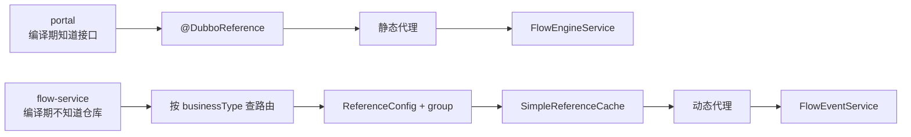
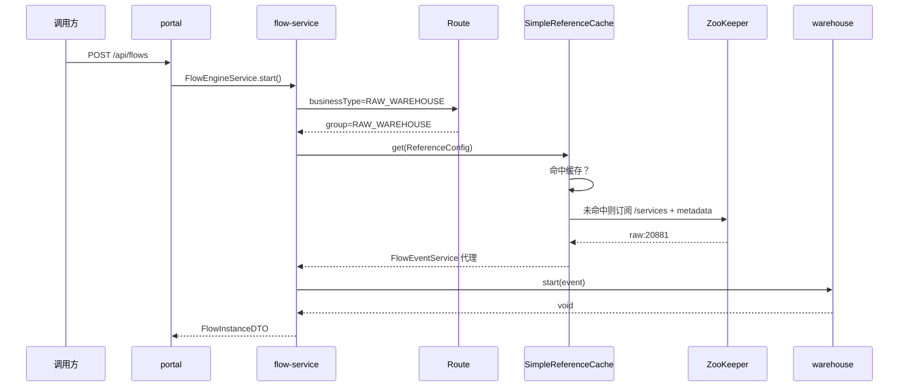
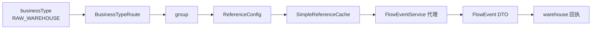

## 为什么消费者不能只会写 `@DubboReference`？

`@DubboReference` 很好用：字段上写一个注解，Spring 启动时注入代理，业务代码像调用本地方法一样。但它有一个前提——**编译期必须知道要引用哪个接口**。

本实战里有两个消费者，需求完全不同：

- portal 知道自己要调 `FlowEngineService`，静态引用足够。
- flow-service 要按 `businessType` 回调不同业务仓，而它编译期不认识任何仓库模块，静态注解写不出来。

如果只会静态引用，第二种场景就会逼迫 flow-service 依赖所有仓库 API，回到“新增业务方就要改流程服务”的老路。所以消费者这一篇要同时讲两种引用方式，并说明什么时候该用哪一种。

> ### 💡 新人小结：静态引用像自带钥匙，动态引用像到前台换钥匙
>
> - 静态引用在启动时就确定开哪扇门，代理直接挂在字段上。
> - 动态引用先看业务类型，再按分组去注册中心找对应实现。
> - 钥匙可以复用；每次进门前都重新配一把钥匙，迟早会丢。
>
> **“运行期才决定调谁”是动态引用的价值，也是它更容易写错的地方。**



---

## 静态引用：portal 调用流程引擎

portal 的 Controller 直接注入流程接口：

```java
@RestController
@RequestMapping("/api/flows")
public class FlowController {

    @DubboReference(check = false)
    private FlowEngineService flowEngineService;

    @PostMapping
    public FlowInstanceDTO start(@Valid @RequestBody StartFlowRequest request) {
        return flowEngineService.start(
                request.getBusinessType(),
                request.getBusinessId(),
                request.getStarter());
    }
}
```

这里只做三件事：声明引用、接收 HTTP 参数、调用代理。`@DubboReference` 在启动时创建代理，真正建立连接通常发生在第一次调用时。

### `check = false` 解决什么问题

`check` 控制“引用创建时是否校验提供者存在”。

| 取值 | 行为 | 适用 |
|------|------|------|
| `true`（默认） | 启动时找不到提供者就失败 | 强依赖、必须保证上游先起 |
| `false` | 启动不校验，调用时才报错 | 提供者可能晚启动、希望消费者先可用 |

portal 设置了 `check=false`。原因是启动顺序不应该成为硬约束：portal 可以先启动，等 flow-service 起来后再调用。代价是第一次调用可能失败，错误会以 `RpcException` 或 HTTP 500 的形式出现。

`check` 不是“调用时跳过检查”，它只影响代理创建阶段。调用时如果没有可用地址，仍然会报 `No provider available`。

### 静态引用的依赖边界

portal 的 POM 只依赖 `xxx-flow-api`，不依赖 `xxx-flow-service`：

```xml
<dependency>
    <groupId>com.xxx.xx</groupId>
    <artifactId>xxx-flow-api</artifactId>
</dependency>
```

这是静态引用能保持解耦的关键。`@DubboReference` 需要的是接口类，不是实现类；把实现 jar 带进来只会增加依赖和版本冲突。

---

## 动态引用：flow-service 按 group 找业务方

flow-service 不知道有几个业务仓，也不知道它们的类名。它只有一张 `businessType → group` 的路由表和一个统一接口 `FlowEventService`。

### 工厂代码

```java
@Slf4j
@Component
public class DynamicDubboReferenceFactory {

    private static final int TIMEOUT_MS = 3000;
    private static final int RETRIES = 0;

    private final ReferenceCache referenceCache = SimpleReferenceCache.getCache();

    public FlowEventService getFlowEventService(String businessType) {
        return getReference(FlowEventService.class, BusinessTypeRoute.of(businessType).getDubboGroup());
    }

    public <T> T getReference(Class<T> interfaceClass, String group) {
        ReferenceConfig<T> reference = new ReferenceConfig<>();
        reference.setInterface(interfaceClass);
        reference.setGroup(group);
        reference.setCheck(false);
        reference.setTimeout(TIMEOUT_MS);
        reference.setRetries(RETRIES);

        T proxy = referenceCache.get(reference);
        if (log.isDebugEnabled()) {
            log.debug("dynamic reference ready, group={}, interface={}, proxyIdentity={}",
                    group, interfaceClass.getName(), Integer.toHexString(System.identityHashCode(proxy)));
        }
        return proxy;
    }
}
```

这段代码有四个关键点：

| 代码 | 作用 | 不这么做会怎样 |
|------|------|----------------|
| `SimpleReferenceCache.getCache()` | 复用重量级 `ReferenceConfig` 与代理 | 每次调用新建，连接与内存泄漏 |
| `setInterface` | 指定统一回调接口 | 无法生成代理 |
| `setGroup` | 指定业务方分组 | 多实现无法区分，可能调错仓 |
| `setCheck(false)` | 取代理时不校验提供者 | 业务方缺席会导致流程服务启动失败 |

### 为什么不用 `new ReferenceConfig()` 直接调用

`ReferenceConfig` 是重量级对象，内部会创建注册中心连接、订阅、代理和网络客户端。每次调用都 new 一个，短时间可能看不出问题，长时间会积累连接和订阅，最终拖垮进程。

`SimpleReferenceCache` 是 Dubbo 3.x 提供的缓存实现。它的缓存 key 由 `group + interface + version` 组成；相同 key 的第二次调用会复用第一次的代理。示例日志里的 `proxyIdentity` 就是用来验证这一点的：

```text
dynamic reference ready, group=RAW_WAREHOUSE, interface=...FlowEventService, proxyIdentity=3b4362e
dynamic reference ready, group=RAW_WAREHOUSE, interface=...FlowEventService, proxyIdentity=3b4362e
```

两次调用拿到同一个 identity，说明缓存命中，没有重复创建代理。

> ### 💡 新人小结：代理像公司班车
>
> - 同一路线（group + interface + version）坐同一班车，不用每次造一辆。
> - 每次调用都 new，等于每趟都买一辆新车，停车场很快满。
> - 缓存 key 变了才是新路线，需要新班车。
>
> **动态引用要缓存，不是因为“性能优化”，而是因为代理本身有连接和订阅生命周期。**

### 为什么不能设置 registry

示例代码没有 `reference.setRegistry(...)`。裸 `new ReferenceConfig` 会懒绑定到默认 `ApplicationModel`，从 `@EnableDubbo` 装配好的 `ConfigManager` 取注册中心配置。也就是说，动态引用仍然使用 `application.yml` 里的注册地址，不需要在每个工厂里重复写一遍。

如果手动给它设置一个独立的 Registry，反而可能出现“静态引用连 2182，动态引用连 2181”这种极难排查的分裂。除非有明确的多注册中心需求，否则让动态引用继承应用级配置。

---

## `check`、`timeout`、`retries` 的取舍

动态回调的配置不是照抄静态引用，而是根据业务语义决定：

| 配置 | 本实战取值 | 原因 |
|------|------------|------|
| `check` | false | 业务方可以晚于流程服务启动 |
| `timeout` | 3000ms | 回调是同步等待，必须给上游一个明确上限 |
| `retries` | 0 | 回调有副作用，重试可能重复记账 |

### 为什么 `retries=0`

`start/finish/reject` 都是业务回调，业务方可能会往自己的表里追加一条记录。如果网络超时但提供者实际已经处理成功，重试会造成重复记录。对于非幂等操作，默认重试是危险的。

如果业务方实现了幂等（例如用 `flowInstanceId + phase` 做唯一键），可以把 `retries` 调到 1 或 2，但要先确认幂等逻辑真的生效，而不是“觉得应该没问题”。

### 为什么 `timeout` 不能照搬 provider 的 5000ms

flow-service 的 `provider.timeout=5000` 是对 portal 调用流程服务的约束；动态回调的 `timeout=3000` 是 flow-service 等业务仓的上限。两者是不同链路，不能因为 provider 配了 5000 就把所有消费者都设成 5000。

| 链路 | 超时归属 | 示例值 |
|------|----------|--------|
| portal → flow-service | flow 的 provider 配置 | 5000ms |
| flow-service → warehouse | 动态 `ReferenceConfig` | 3000ms |
| portal → warehouse 查询 | portal 的引用默认值 | 按需配置 |

---

## 一次动态调用经过了什么



数据流则是：



注意，ZooKeeper 只在“没命中缓存、需要订阅地址”时出现。代理拿到之后，后续调用走本地 Directory 和网络直连，不会每次都访问 ZooKeeper。

---

## 消费者在 ZooKeeper 里留下的痕迹

portal 是纯消费者，不会出现在 `/services` 的实例列表里，但在接口级 `/dubbo/.../consumers` 下会留下消费者 URL：

```text
/dubbo/com.xxx.xx.flow.api.FlowEngineService/consumers/consumer%3A%2F%2F...
```

解码后可以看到：

```text
consumer://192.168.3.103/com.xxx.xx.flow.api.FlowEngineService
?application=xxx-portal
&category=consumers
&check=false
&side=consumer
```

| 节点 | 是否出现 | 含义 |
|------|----------|------|
| `/services/xxx-portal` | 否 | 应用级只登记提供者实例 |
| `/dubbo/.../consumers` | 是 | 接口级记录消费者订阅 |
| `/dubbo/.../providers` | 否 | portal 不提供该接口 |

flow-service 作为动态消费者，也会在回调接口的 `consumers` 下留下节点，URL 里带 `group=RAW_WAREHOUSE`。当它第一次调用某个 group 时，消费者节点才可能出现；没有调用过的 group 不一定有消费者记录。

> ### 💡 新人小结：消费者节点是“订阅记录”，不是“健康证明”
>
> - 它说明某个应用订阅过这个接口，不说明它现在能正常工作。
> - 纯消费者不会出现在应用级实例列表里。
> - 查不到消费者节点，不代表调用没发生；可能还没触发首次订阅。
>
> **消费者数据用于理解依赖关系，不要拿它当探活指标。**

---

## 常见错误

| 现象 | 原因 | 处理 |
|------|------|------|
| 启动报找不到 `FlowEngineService` | 没有依赖 API 模块 | 在 POM 加 `xxx-flow-api` |
| 每次调用创建新连接 | 每次 new `ReferenceConfig` | 用 `SimpleReferenceCache` |
| 回调落到错误的仓 | group 写错或两个实现同组 | 对齐 `FlowEventGroups` |
| 流程服务启动失败在业务方缺席时 | `check` 使用默认 true | 设 `setCheck(false)` |
| 重复记账 | `retries` 大于 0 且业务非幂等 | 设 `retries=0`，或实现幂等 |
| 超时时间互相打架 | 把 provider 的 timeout 当成消费者 timeout | 按链路分别配置 |
| 动态引用连错 ZK | 手动设置了独立 Registry | 继承应用级配置，打印实际地址核对 |
| 消费者节点看不到 | 还没触发首次订阅/看错根路径 | 先发起一次调用，再查 `/dubbo/.../consumers` |

---

## 消费者验收清单

| 检查项 | 通过标准 |
|--------|----------|
| 静态引用 | portal 启动成功，调用返回 200 |
| 动态引用 | flow-service 首次回调成功，日志出现 `proxyIdentity` |
| 缓存 | 同一 group 多次调用 identity 相同 |
| 分组 | 原料仓与成品仓分别收到自己的回调 |
| 失败路径 | 停掉一个仓后，`dispatchResult` 记录失败而不是抛到 HTTP |
| 超时 | 回调耗时超过 3000ms 时能在结果里看到超时 |
| 注册数据 | 消费者节点在接口级出现，应用级不出现 portal |
| 依赖边界 | portal/flow-service 不依赖 `*-service` 实现 |

---

## 要点总结

- 静态 `@DubboReference` 适合编译期已知接口的调用方，`check=false` 可解决启动顺序问题。
- 动态 `ReferenceConfig` 适合运行期才知道目标实现的场景，核心是 `interface + group`。
- `ReferenceConfig` 必须通过 `SimpleReferenceCache` 复用，缓存 key 是 `group + interface + version`。
- `check` 只影响取代理阶段；`timeout` 和 `retries` 要按链路和幂等性分别设置。
- 动态引用应继承应用级注册配置，不要随手设置独立 Registry，避免连接分裂。
- 消费者在接口级留下 `consumers` 记录，纯消费者不会出现在应用级实例列表。

下一步进入 [构建、启动、验收与排障](/docs/07-dubbo-springboot-lab/运行与交付/build-run-troubleshoot/)，把提供者和消费者真正跑起来，验证成功、失败与恢复三条路径。
