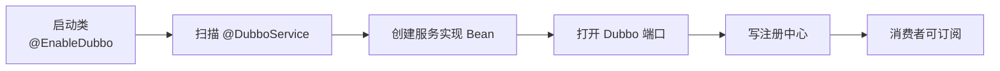
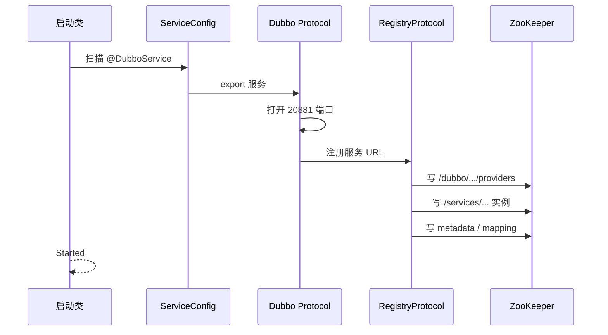

## 为什么加了 `@DubboService` 还不等于服务可用？

一个类加上 `@DubboService`，看起来就已经“暴露”了。但在真正可调用之前，至少还要同时满足五个条件：

- 启动类开启了 Dubbo 扫描，能发现这个实现。
- 该实现所在的模块有 Dubbo starter 与 ZooKeeper 注册中心实现。
- `application.yml` 里有正确的应用名、注册地址和协议端口。
- 本地 Dubbo 端口成功监听。
- 注册中心写入成功，消费者能订阅到地址。

任何一条不满足，结果都可能表现为“启动成功但调用不到”。所以提供者这一篇不只写 `@DubboService`，还要把“暴露 → 监听 → 注册 → 可发现”这条链逐段验证。

> ### 💡 新人小结：提供者像开店
>
> - 装修好（类写好）不等于开业。
> - 还要开门（端口监听）、到工商登记（注册中心写入）、挂招牌（可被发现）。
> - 顾客找不到店，可能是门没开，也可能是登记地址写错。
>
> **`@DubboService` 只是“准备开店”，不是“已经营业”。**



---

## 提供者模块的代码地图

以原料仓为例，模块分成 API 与 service 两部分：

```text
xxx-raw-warehouse/
  xxx-raw-warehouse-api/
    src/main/java/com/xxx/xx/rawwarehouse/api/
      RawWarehouseQueryService.java
      RawWarehouseOrderDTO.java
  xxx-raw-warehouse-service/
    src/main/java/com/xxx/xx/rawwarehouse/
      RawWarehouseApplication.java
      provider/RawWarehouseQueryServiceImpl.java
      flowevent/RawWarehouseFlowEventService.java
      store/FlwRecordStatusStore.java
    src/main/resources/application.yml
```

| 文件 | 角色 | 关键点 |
|------|------|--------|
| `RawWarehouseQueryService` | 仓库自己的查询契约 | portal 静态引用 |
| `RawWarehouseQueryServiceImpl` | 查询实现 | `@DubboService` 无 group |
| `FlowEventService` | 流程侧定义的回调契约 | 来自 `xxx-flow-api` |
| `RawWarehouseFlowEventService` | 回调实现 | `@DubboService(group=RAW_WAREHOUSE)` |
| `RawWarehouseApplication` | 启动类 | `@SpringBootApplication` + `@EnableDubbo` |
| `application.yml` | 运行配置 | 应用名、注册地址、端口 |

一个进程可以同时提供多个接口，也可以同时是消费者。原料仓在这里提供了两个接口：自己的查询接口，以及流程回调接口。

---

## 启动类：扫描范围决定能不能发现实现

```java
@SpringBootApplication
@EnableDubbo
public class RawWarehouseApplication {

    public static void main(String[] args) {
        SpringApplication.run(RawWarehouseApplication.class, args);
    }
}
```

`@EnableDubbo` 不带参数时，默认扫描启动类所在包及其子包。这里的启动类在 `com.xxx.xx.rawwarehouse`，而两个实现分别在：

```text
com.xxx.xx.rawwarehouse.provider
com.xxx.xx.rawwarehouse.flowevent
```

它们都在启动类的子包下，所以能被扫描到。如果把启动类移到 `com.xxx.xx`，而实现留在 `com.xxx.xx.rawwarehouse`，它仍然在子包内；但如果把实现移到另一个根包，就必须显式配置：

```yaml
dubbo:
  scan:
    base-packages: com.xxx.xx.rawwarehouse
```

| 启动类位置 | 实现位置 | 是否能扫描到 |
|------------|----------|----------------|
| `com.xxx.xx.rawwarehouse` | `com.xxx.xx.rawwarehouse.provider` | 是 |
| `com.xxx.xx` | `com.xxx.xx.rawwarehouse.provider` | 是 |
| `com.xxx.xx.rawwarehouse` | `com.xxx.xx.other` | 否，需要显式 `scan` |
| `com.xxx.xx.rawwarehouse` | 同包但未加 `@DubboService` | 否 |

扫描不到时，应用可能仍然启动成功，因为没有服务被暴露；日志里看不到 `Registered`，端口也可能没有监听。这时不要先怀疑 ZooKeeper，先确认实现类是否被 Dubbo 扫描到。

---

## 查询提供者：无分组的单实现

`RawWarehouseQueryServiceImpl` 是仓库对 portal 提供的查询接口：

```java
@DubboService
@RequiredArgsConstructor
public class RawWarehouseQueryServiceImpl implements RawWarehouseQueryService {

    private final FlwRecordStatusStore store;

    @Override
    public FlwRecordStatusDTO flowStatus(String businessId) {
        return store.find(businessId);
    }

    @Override
    public List<FlwRecordStatusDTO> listFlowStatuses() {
        return store.list();
    }

    @Override
    public RawWarehouseOrderDTO order(String businessId) {
        RawWarehouseOrderDTO order = new RawWarehouseOrderDTO();
        order.setBusinessId(businessId);
        order.setSku("RAW-SKU-" + businessId);
        order.setWarehouseCode("WH-RAW-01");
        order.setQuantity(100);
        return order;
    }
}
```

这个接口没有 group，因为它是“仓库查询”这一个实现。消费者 portal 用 `@DubboReference` 直接引用，不需要指定分组。

| 选择 | 结果 |
|------|------|
| 不写 group | 默认分组，消费者不写 group 即可匹配 |
| 写 group | 消费者必须写同样的 group，否则找不到 |
| 同一接口两个实现且都不写 group | 注册冲突或调用歧义 |

“只有一个实现”时不要画蛇添足加 group；group 是给多实现用的，不是给所有接口都加一层。

---

## 回调提供者：用 group 声明身份

`RawWarehouseFlowEventService` 实现的是流程侧定义的 `FlowEventService`：

```java
@DubboService(group = FlowEventGroups.RAW_WAREHOUSE_GROUP)
@RequiredArgsConstructor
public class RawWarehouseFlowEventService implements FlowEventService {

    private final FlwRecordStatusStore store;

    @Override
    public void start(FlowEvent event) {
        record("start", event);
    }

    @Override
    public void finish(FlowEvent event) {
        record("finish", event);
    }

    @Override
    public void reject(FlowEvent event) {
        record("reject", event);
    }

    private void record(String phase, FlowEvent event) {
        // 把 phase 和事件写入本仓库的回执存储
    }
}
```

它和成品仓的实现共享同一个接口，但 group 不同：

```java
@DubboService(group = FlowEventGroups.PRODUCT_WAREHOUSE_GROUP)
public class ProductWarehouseFlowEventService implements FlowEventService {
    // ...
}
```

| 字段 | 原料仓 | 成品仓 | 是否相同 |
|------|--------|--------|----------|
| 接口 | `FlowEventService` | `FlowEventService` | 相同 |
| group | `RAW_WAREHOUSE` | `PRODUCT_WAREHOUSE` | 不同 |
| 应用名 | `xxx-raw-warehouse-service` | `xxx-product-warehouse-service` | 不同 |
| 端口 | 20881 | 20882 | 不同 |
| 方法签名 | start/finish/reject | start/finish/reject | 相同 |

分组是“同一接口的命名空间”，应用名是“实例所属应用”。两者不是一回事：同一个应用可以有多个 group，同一个 group 也可能有多个应用实例（扩容时）。

> ### 💡 新人小结：接口是插座，group 是房间号
>
> - 插座标准相同（同一个接口），但不同房间（group）不能混用。
> - 顾客说“找原料仓”，流程侧查路由表得到房间号 `RAW_WAREHOUSE`。
> - 只报“我要找插座”不够，还要报房间号。
>
> **多实现场景下，接口名决定“调什么”，group 决定“调谁”。**

---

## 一次服务暴露在日志里留下什么

启动原料仓后，日志会依次出现几类记录。下面是本项目真实启动日志的节选（URL 做了截断）：

```text
[DUBBO] Start registering instance address to registry.
[DUBBO] Registered dubbo service com.xxx.xx.rawwarehouse.api.RawWarehouseQueryService
  ... to registry service-discovery-registry://127.0.0.1:2182/...
[DUBBO] Registered dubbo service RAW_WAREHOUSE/com.xxx.xx.flow.api.FlowEventService
  ... to registry zookeeper://127.0.0.1:2182/...
[DUBBO] metadata revision changed: null -> 74f4ec4ed1eaa74e7d6cf3d7fbd4389c,
  app: xxx-raw-warehouse-service, services: 2
Started RawWarehouseApplication in 3.185 seconds
```

| 日志 | 含义 | 说明了什么 |
|------|------|------------|
| `Start registering instance address` | 开始应用级注册 | 实例地址将被写入 `/services` |
| `to registry service-discovery-registry` | 写入应用级发现 | 应用级节点存在 |
| `to registry zookeeper` | 写入接口级注册 | 接口级节点存在 |
| `metadata revision changed` | 接口元数据已生成 | consumer 可据此构建 Invoker |
| `Started ...` | Spring Boot 启动完成 | 业务进程可接收请求 |

默认 `register-mode=all` 下，同一个服务会写两套注册数据。日志里两条 `Registered` 分别对应两套，不是重复启动了两个服务。

### 服务暴露的顺序



顺序里最重要的一点是：**先打开端口，再写地址**。如果顺序反了，消费者可能拿到一个还没准备好接收请求的地址。

---

## 去 ZooKeeper 里核对提供者

启动后，用 `zkCli` 检查接口级与应用级两棵树：

```bash
# 接口级：原料仓查询接口
printf 'ls /dubbo/com.xxx.xx.rawwarehouse.api.RawWarehouseQueryService/providers\nquit\n' \
  | zkCli.cmd -server 127.0.0.1:2182

# 回调接口：应能看到两个 group 的 provider
printf 'ls /dubbo/com.xxx.xx.flow.api.FlowEventService/providers\nquit\n' \
  | zkCli.cmd -server 127.0.0.1:2182

# 应用级：实例列表
printf 'ls /services/xxx-raw-warehouse-service\nquit\n' \
  | zkCli.cmd -server 127.0.0.1:2182
```

预期结果：

| 路径 | 预期内容 |
|------|----------|
| `RawWarehouseQueryService/providers` | 一个 URL 编码的提供者节点 |
| `FlowEventService/providers` | 原料仓和成品仓两个 URL 节点 |
| `/services/xxx-raw-warehouse-service` | `192.168.3.103:20881` |
| `/dubbo/metadata/.../provider/xxx-raw-warehouse-service` | 接口元数据 JSON |

如果接口级为空但应用级有实例，检查 `register-mode` 是否被设为 `instance`；如果两者都为空，检查注册地址、应用名和 `Registered` 日志；如果节点存在但消费者调不通，检查分组与端口。

> ### 💡 新人小结：注册日志和节点要一起看
>
> - 日志说“注册了”，节点却看不到，可能是看错了根路径或注册模式。
> - 节点有，端口没监听，说明只完成了登记，没开门。
> - 节点和端口都有，再查消费者是否用了正确的 group。
>
> **“日志、端口、节点”三件套对齐，服务才算真正可发现。**

---

## 提供者常见错误

| 现象 | 可能原因 | 验证 | 处理 |
|------|----------|------|------|
| 启动成功但没有 `Registered` | 实现未被扫描 | 看启动类包与 `@DubboService` | 调整包或配 `dubbo.scan.base-packages` |
| 端口未监听 | `protocol.port` 缺失/被占用 | `netstat` | 配置端口，排查占用 |
| 注册到错误的 ZK | 命令行覆盖了 YAML | 看启动参数与日志 URL | 对齐注册地址 |
| 消费者 `No provider` | group 不匹配 | 看 provider 节点 URL 中的 `group=` | 对齐分组常量 |
| 消费者 `No provider` | 应用名/接口不一致 | 看 URL 的 `interface`、`application` | 对齐契约 |
| 启动报 `No such extension RegistryFactory` | 缺 Curator5 依赖 | 依赖树 | 加 `dubbo-dependencies-zookeeper-curator5` |
| QOS 端口冲突 | 同机多进程默认 22222 | 启动日志 | `qos-enable: false` |
| 回调落到了错误的仓 | 两个实现用了同一个 group | 查两个 provider 的 group | 用独立 group 常量 |

注意最后一项：如果两个仓库都把 group 写成 `RAW_WAREHOUSE`，它们会注册成同一分组的两个实例，消费者做负载均衡，回调可能随机落到任一仓。业务上的“按仓隔离”就失效了，而且不会报错。

---

## 提供者的验收清单

| 检查项 | 通过标准 |
|--------|----------|
| 扫描 | 日志能看到对应服务的 `Registered` |
| 端口 | 20881/20882 监听 |
| 接口级 | `/dubbo/{interface}/providers` 有 URL |
| 应用级 | `/services/{app}` 有实例 |
| 分组 | 回调接口的两个 provider URL 中 group 不同 |
| 元数据 | `/dubbo/metadata/{interface}` 有 provider 记录 |
| 失败路径 | 停掉一个仓库后，对应 group 的地址消失 |

只有这些检查通过，才进入消费者编码。否则消费者侧的任何 `No provider` 都可能是提供者没暴露好，而不是引用写错。

---

## 要点总结

- `@DubboService` 只是暴露的第一步，还需要扫描、依赖、配置、端口监听和注册写入全部成功。
- 单一实现不需要 group；多实现必须用 group 区分，否则会注册冲突或回调串台。
- 默认 `register-mode=all` 会同时写接口级 `/dubbo` 和应用级 `/services`，日志里会出现两类 `Registered`。
- 服务暴露顺序是“打开端口 → 写地址 → 写元数据/mapping”，端口和节点都要核对。
- 回调提供者的 group 必须与流程侧路由表一致，两个仓库不能用同一个 group。
- 验收按“扫描日志 → 端口 → 节点 → 分组 → 元数据”的顺序进行，不要跳过前置项。

下一步进入 [消费者：静态引用与动态引用](/docs/07-dubbo-springboot-lab/服务实现/consumer-static-dynamic/)，从调用方视角把地址变成可调用的代理。
