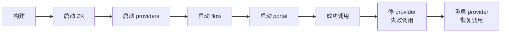
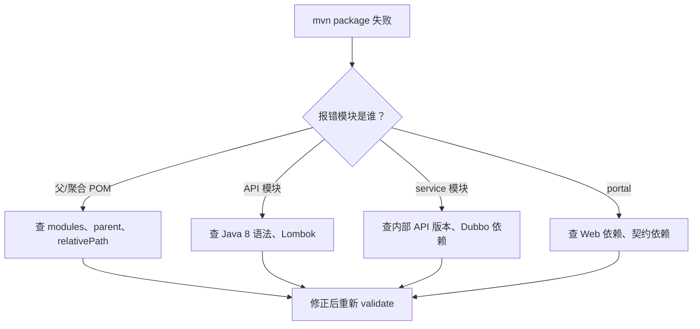
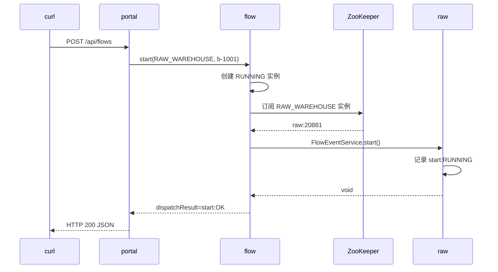
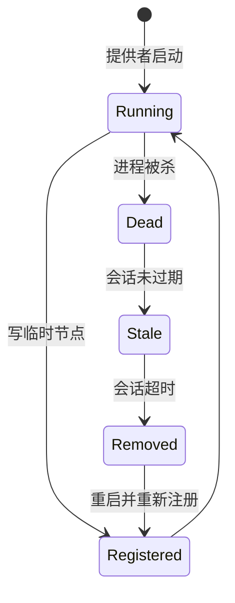
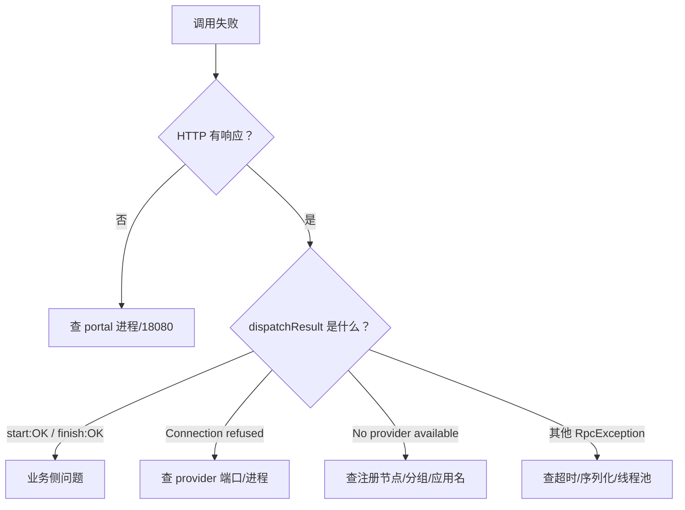

## 为什么“能编译”离“能调用”还有很远？

把工程 `mvn package` 成功，只证明 Java 代码和依赖能通过编译；它不证明：

- ZooKeeper 已经启动，端口和配置对得上。
- 四个进程的启动顺序没有让消费者启动失败。
- Dubbo 端口没有冲突，服务真的注册到了注册中心。
- 回调的 group 能落到正确的仓库。
- 提供者挂掉时，调用会以可解释的方式失败，而不是把整个流程卡死。

本篇按“构建 → 启动 → 成功调用 → 失败调用 → 恢复”的顺序，把每条路径都跑一遍。所有响应和节点都来自本机实际运行，不是示例伪代码。

> ### 💡 新人小结：联调像开一家店
>
> - 装修完成（编译成功）只是第一步。
> - 还要开门（端口）、登记（注册中心）、试营业（调用）。
> - 顾客投诉（失败）时要能分清是门没开、地址错了，还是后厨没接单。
>
> **联调的验收不是“进程没退出”，而是“成功、失败、恢复三条路径都能解释”。**



---

## 构建：先确认产物类型

在工程根目录执行：

```bash
mvn -s maven/settings-aliyun.xml -DskipTests package
```

本机执行退出码为 0。产物分两类：

| 产物 | 类型 | 用途 |
|------|------|------|
| `xxx-flow-api-1.0.0-SNAPSHOT.jar` | 普通 jar | 流程契约 |
| `xxx-raw-warehouse-api-...jar` | 普通 jar | 原料仓契约 |
| `xxx-product-warehouse-api-...jar` | 普通 jar | 成品仓契约 |
| `xxx-flow-service-...jar` | fat jar | 流程服务 |
| `xxx-raw-warehouse-service-...jar` | fat jar | 原料仓服务 |
| `xxx-product-warehouse-service-...jar` | fat jar | 成品仓服务 |
| `xxx-portal-...jar` | fat jar | 门户消费者 |

本机观察到的大小大致是：API jar 在 3.6 KB 到 9.6 KB 之间，可执行 fat jar 在 38 MB 到 46 MB 之间。大小差异来自依赖打包，不代表代码质量。

### 构建失败先看哪里



不要在全量构建失败时直接删 `~/.m2/repository`。先看报错模块和缺失的 artifact，大多数问题是内部 API 没 install、版本不一致或依赖 scope 写错。

---

## 启动：顺序与端口

本实战使用独立 ZooKeeper 2182，四个 Java 进程分别监听 20880、20881、20882 和 18080。

| 顺序 | 进程 | 端口 | 说明 |
|------|------|------|------|
| 1 | ZooKeeper | 2182 | 注册中心 |
| 2 | raw-warehouse | 20881 | 原料仓提供者 |
| 3 | product-warehouse | 20882 | 成品仓提供者 |
| 4 | flow-service | 20880 | 流程提供者 + 动态消费者 |
| 5 | portal | 18080 | HTTP 消费者 |

推荐先起提供者，再起消费者；但代码里用了 `check=false`，即使顺序反过来，消费者也能启动，只是首次调用可能失败。启动顺序影响的是“第一次调用是否成功”，不是“进程是否存活”。

### 启动命令

```bash
# 1. 启动临时 ZooKeeper（2182，独立 dataDir）
#    具体命令见 zookeeper-config.md

# 2. 两个仓库提供者
java -Ddubbo.registry.address=zookeeper://127.0.0.1:2182 \
  -jar xxx-raw-warehouse/xxx-raw-warehouse-service/target/xxx-raw-warehouse-service-1.0.0-SNAPSHOT.jar

java -Ddubbo.registry.address=zookeeper://127.0.0.1:2182 \
  -jar xxx-product-warehouse/xxx-product-warehouse-service/target/xxx-product-warehouse-service-1.0.0-SNAPSHOT.jar

# 3. 流程服务
java -Ddubbo.registry.address=zookeeper://127.0.0.1:2182 \
  -jar xxx-flow/xxx-flow-service/target/xxx-flow-service-1.0.0-SNAPSHOT.jar

# 4. 门户
java -Ddubbo.registry.address=zookeeper://127.0.0.1:2182 \
  -jar xxx-portal/target/xxx-portal-1.0.0-SNAPSHOT.jar
```

启动后检查端口：

```bash
netstat -ano | findstr ":2182 :20880 :20881 :20882 :18080"
```

预期 5 个端口都处于 `LISTENING`。如果某个端口缺失，先看对应进程的日志尾部，不要继续调用。

### 启动成功的日志特征

每个提供者应出现：

```text
[DUBBO] Registered dubbo service ... to registry service-discovery-registry://127.0.0.1:2182/...
[DUBBO] Registered dubbo service ... to registry zookeeper://127.0.0.1:2182/...
Started ...Application in ... seconds
```

流程服务和 portal 还会出现 Spring Boot 的 `Started`。portal 是 Web 进程，额外有 Tomcat 监听 18080 的日志。

---

## 成功路径：一次完整调用

```bash
curl -s -X POST http://127.0.0.1:18080/api/flows \
  -H "Content-Type: application/json" \
  -d '{"starter":"alice","businessId":"b-1001","businessType":"RAW_WAREHOUSE"}'
```

真实响应：

```json
{"flowInstanceId":"FI000001","businessType":"RAW_WAREHOUSE","businessId":"b-1001","status":"RUNNING","starter":"alice","approver":null,"dispatchResult":"start:OK","createdAt":1792940649674,"updatedAt":1792940649960}
```

这条响应说明：

| 字段 | 含义 |
|------|------|
| `flowInstanceId` | 流程服务创建的实例号 |
| `status=RUNNING` | 流程已创建，等待审批 |
| `dispatchResult=start:OK` | 业务仓回调成功 |
| `createdAt/updatedAt` | 流程创建与最近更新时间 |

再查业务仓回执：

```bash
curl -s http://127.0.0.1:18080/api/warehouse-status/raw
```

真实响应：

```json
[{"businessType":"RAW_WAREHOUSE","businessId":"b-1001","flowInstanceId":"FI000001","flowStatus":"RUNNING","receivedPhases":["start:RUNNING"],"updatedAt":1792940649957}]
```

`receivedPhases` 里出现 `start:RUNNING`，证明回调不仅发出了，而且落到了原料仓，而不是成品仓。

### 成功路径的链路图



---

## 失败路径一：提供者进程已死，节点还在

停掉原料仓进程后，立即发起同类型调用。真实响应仍然是 HTTP 200，但 `dispatchResult` 变成：

```json
{"flowInstanceId":"FI000002","businessType":"RAW_WAREHOUSE","businessId":"b-1002","status":"RUNNING","starter":"bob","approver":null,"dispatchResult":"start:FAILED:ConnectException: Connection refused: no further information","createdAt":1792940671364,"updatedAt":1792940673394}
```

为什么是 `Connection refused`，而不是 `No provider available`？

因为消费者手里还有旧地址，ZooKeeper 的临时节点要等会话超时才会删除。在这个窗口里，消费者会尝试连接已经死亡的端口，于是得到连接拒绝。

| 阶段 | 注册中心 | 消费者 | 结果 |
|------|----------|--------|------|
| 刚停进程 | 节点仍在 | 仍拿到旧地址 | `Connection refused` |
| 会话超时前 | 节点仍在 | 仍可能重试旧地址 | 连接失败 |
| 会话超时后 | 节点删除 | 地址列表变空 | `No provider available` |

这不是框架 bug，而是“最终清理”的必然延迟。需要更快发现故障，应该在应用层做健康检查和连接失败剔除，而不是把会话超时无限调小。

### 失败路径二：节点已清理

等会话超时、节点删除后再调用，`dispatchResult` 会变成：

```text
start:FAILED:RpcException: No provider available from registry ...
for service RAW_WAREHOUSE/com.xxx.xx.flow.api.FlowEventService ...
```

这两种错误要分开看：

| 错误 | 含义 | 排查方向 |
|------|------|----------|
| `Connection refused` | 有地址，但目标端口没监听 | 提供者进程/端口/网络 |
| `No provider available` | 没有可用地址 | 注册数据/分组/应用名 |

如果只看到“调用失败”就去重启 ZooKeeper，很容易把真正的问题掩盖掉。

---

## 恢复路径：重启提供者

重新启动原料仓后，它重新注册，下一次调用恢复：

```json
{"flowInstanceId":"FI000004","businessType":"RAW_WAREHOUSE","businessId":"b-1004","status":"RUNNING","starter":"dave","approver":null,"dispatchResult":"start:OK","createdAt":1792940755508,"updatedAt":1792940755563}
```

恢复不是“恢复旧连接”，而是：

1. 新进程注册新的临时节点。
2. 消费者收到实例变更通知。
3. Directory 重建 Invoker。
4. 下一次调用选中新实例。



本机一次运行的时间线大致是：

| 时间 | 事件 | 结果 |
|------|------|------|
| 停止后立即调用 | 节点仍在 | `Connection refused` |
| 停止后约 20 秒 | 节点与实例仍在 | 旧地址仍可见 |
| 停止后约 1 分钟 | 节点消失 | `No provider available` |
| 重启后 | 节点重新出现 | 下一次调用 `start:OK` |

> ### 💡 新人小结：成功、失败、恢复像三次体检
>
> - 成功调用检查“路能不能走通”。
> - 失败调用检查“路断了会报什么、会不会误伤流程”。
> - 恢复调用检查“修好之后系统能不能自己回到正轨”。
>
> **只测成功路径，等于只做了半次验收。**

---

## 去 ZooKeeper 核对整条链

调用成功不代表节点一定符合预期。用 `zkCli` 做一次完整核对：

```bash
# 接口级：流程服务
printf 'ls /dubbo/com.xxx.xx.flow.api.FlowEngineService/providers\nquit\n' \
  | zkCli.cmd -server 127.0.0.1:2182

# 接口级：回调的两个 group
printf 'ls /dubbo/com.xxx.xx.flow.api.FlowEventService/providers\nquit\n' \
  | zkCli.cmd -server 127.0.0.1:2182

# 应用级：三个提供者应用
printf 'ls /services\nquit\n' \
  | zkCli.cmd -server 127.0.0.1:2182

# 消费者：portal 的订阅
printf 'ls /dubbo/com.xxx.xx.flow.api.FlowEngineService/consumers\nquit\n' \
  | zkCli.cmd -server 127.0.0.1:2182
```

| 检查 | 预期 |
|------|------|
| `/dubbo/.../FlowEngineService/providers` | 1 个 flow-service URL |
| `/dubbo/.../FlowEventService/providers` | 2 个 URL，group 分别为 RAW/PRODUCT |
| `/services` | flow、raw、product 三个应用名 |
| `/dubbo/.../FlowEngineService/consumers` | portal 的 consumer URL |
| `/dubbo/.../FlowEventService/consumers` | flow-service 的动态 consumer URL（首次调用后） |

一个完整节点树（启动四个进程后）大致如下：

```text
/
/dubbo
/services
/zookeeper

/dubbo/com.xxx.xx.flow.api.FlowEngineService
/dubbo/com.xxx.xx.flow.api.FlowEventService
/dubbo/com.xxx.xx.rawwarehouse.api.RawWarehouseQueryService
/dubbo/com.xxx.xx.productwarehouse.api.ProductWarehouseQueryService
/dubbo/metadata
/dubbo/mapping
/dubbo/config

/services/xxx-flow-service
/services/xxx-raw-warehouse-service
/services/xxx-product-warehouse-service
```

---

## 排障顺序：先定位阶段，再看日志



### 故障定位表

| 现象 | 优先查 | 常见根因 | 处理 |
|------|--------|----------|------|
| portal 启动失败 | 18080、Web 依赖 | 端口占用、缺 Web starter | 换端口、补依赖 |
| flow 启动失败 | 20880、Dubbo 依赖 | 端口占用、缺 curator5 | 换端口、补依赖 |
| provider 启动失败 | 20881/20882、QOS 22222 | 端口冲突 | 分配端口、关 QOS |
| `No provider available` | ZK 节点、group、应用名 | 注册地址不一致、分组写错 | 对齐配置与常量 |
| `Connection refused` | provider 端口 | 进程已死、节点未过期 | 查进程，等待/触发地址刷新 |
| 回调落到错误的仓 | 两个 provider 的 group | 两个实现用了同一个 group | 改成独立 group |
| 调用超时 | 回调耗时、timeout | 业务处理慢、超时设置过小 | 优化业务或调整超时 |
| 重复回调 | retries 与幂等性 | 非幂等操作被重试 | 设 retries=0 或实现幂等 |
| 启动日志多个 SLF4J binding | 依赖树 | 未排除 reload4j | 根 POM 排除 |
| 节点存在但调用失败 | provider 端口/网络 | 只注册未监听、网络不通 | `netstat` + telnet/curl 验证 |

> ### 💡 新人小结：错误信息是路标，不是噪音
>
> - `No provider` 指向注册与分组，`Connection refused` 指向端口与进程。
> - `start:OK` 说明 RPC 成功，不代表业务逻辑一定正确。
> - 先把错误分成阶段，再决定查哪一层。
>
> **排障的效率，取决于你能不能把“失败”翻译成“哪一段没通”。**

---

## 扩展：再增加一个业务方

假设要新增一个“业务订单”仓库，步骤应该收敛为：

1. 新建 `xxx-business-order-api` 与 `xxx-business-order-service` 模块。
2. 在 service 里实现 `FlowEventService`，group 使用契约模块里的 `BUSINESS_ORDER`。
3. 在 `BusinessTypeRoute` 中确认 `BUSINESS_ORDER` 已有映射（示例已预留）。
4. 给新服务分配独立的 Dubbo 端口和应用名。
5. 启动新服务，确认 `/dubbo/.../FlowEventService/providers` 多一个 group、`/services` 多一个应用。
6. 用 portal 发起 `businessType=BUSINESS_ORDER` 的流程，验证回调落在新仓库。
7. 停掉新仓库，确认失败只记录在 `dispatchResult`，流程状态仍为 `RUNNING`。

| 改动位置 | 是否必须 | 说明 |
|----------|----------|------|
| 新业务模块 | 是 | 实现接口与 group |
| `BusinessTypeRoute` | 是（若新增类型） | 流程侧唯一路由改动 |
| flow-service POM | 否 | 不应新增仓库依赖 |
| flow-service 代码 | 否 | 动态引用不需要认识具体实现 |
| portal | 否 | 除非要新增查询接口 |

如果新增一个业务方需要改 flow-service 的 POM 或业务代码，说明契约边界被破坏了，应该先停下来检查依赖方向。

---

## 上线前检查清单

| 检查项 | 通过标准 |
|--------|----------|
| 版本 | Java 8、Spring Boot 2.7.18、Dubbo 3.2.20 对齐 |
| 注册中心 | 生产 ZK 为奇数节点、跨故障域、磁盘与快照有监控 |
| 注册模式 | 明确 `interface/instance/all`，与治理工具和消费者匹配 |
| 端口 | Dubbo/QOS/HTTP/AdminServer 无冲突 |
| 超时 | 每条链路单独设置，消费者超时大于正常处理时间 |
| 重试 | 非幂等回调 `retries=0`，幂等操作才考虑重试 |
| 安全 | ZK ACL/TLS、Dubbo 认证、管理端访问控制 |
| 监控 | 注册数、实例数、调用量、失败率、延迟、会话数 |
| 容量 | 服务数、实例数、节点数、Watcher 数、磁盘增长 |
| 容灾 | 提供者下线、ZK 抖动、网络分区都有演练记录 |
| 数据 | 业务回执可持久化，进程重启不丢关键状态 |
| 文档 | 注册模式、分组、端口、故障处理有交接记录 |

本实战只覆盖“能跑通”的最小闭环，不包含 ACL/TLS、压测、生产级持久化和多注册中心。把这些项直接当成已具备，是上线阶段最常见的误判。

---

## 要点总结

- 编译成功只是起点，完整验收要覆盖成功、提供者缺席、节点清理、恢复四条路径。
- 启动顺序影响首次调用，不决定进程存活；`check=false` 让消费者可以先启动。
- `Connection refused` 与 `No provider available` 分别指向“有旧地址但端口不通”和“没有地址”，排查方向不同。
- 回调失败只记录在 `dispatchResult`，流程状态不回滚；这是业务取舍，需要补偿或人工处理。
- 新增业务方的改动应收敛为“新模块 + group + 路由表一行”，flow-service 不应新增仓库依赖。
- 上线前要补齐安全、监控、容量、持久化和容灾，不能把本地最小闭环当成生产方案。

至此，从空目录到可运行工程的七篇实战文档已经闭环。想补原理可以回到 [Dubbo 架构与调用链](/docs/06-dubbo-integration/架构与选型/dubbo-architecture/)，想核对节点数据和三种注册模式可以看 [Dubbo 在 ZooKeeper 中读写什么](/docs/06-dubbo-integration/注册与发现/data-in-zookeeper/)。
