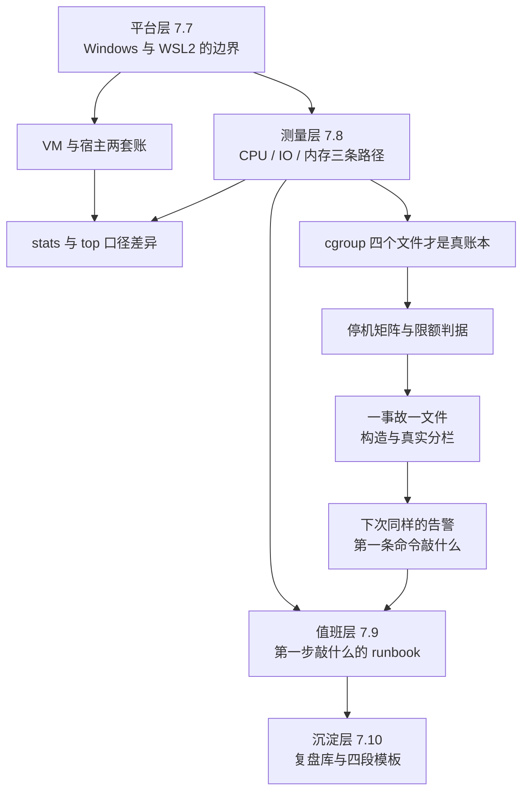
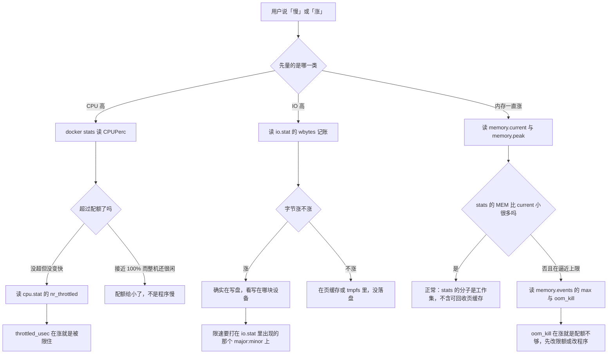

> **实战落点**：07 板块的第三篇，也是最后一篇「排错」。前两篇按**故障域**组织（起不来、网络、磁盘、拉取），这一篇干四件不同的事：把 **Windows 与 WSL2 这层平台特有的坑**说清（7.7）；把**性能排查写成三条能照着走的测量路径**（7.8）；把前面所有章压成一张**值班能直接执行的 runbook**（7.9）；最后规定**查完怎么留下东西**（7.10 复盘库）。四章合一篇的理由是它们共用同一批证据——同一台机器、同一轮取数，拆开写就只能靠复述。所有读数来自本机七轮脚本（容器、卷、网络一律 `kb25-` 前缀，跑完按名清干净）：**没有停过 Docker Desktop、没有改过 daemon 配置、没有跑过任何 `prune`**，Harbor 九个容器全程在跑。
> **本机基线**：Docker Engine `29.8.0` / API 1.56、Compose `v5.5.1`、`desktop-linux` 上下文走 `npipe:////./pipe/dockerDesktopLinuxEngine`；`wsl -l -v` 只有 `docker-desktop` 一个发行版（Running，版本 2）；宿主 Windows 逻辑处理器 **24** 个、`docker info` 的 `NCPU` 也是 24、引擎可见内存 47.01 GiB；`docker_data.vhdx = 12,862,881,792` 字节、`ext4.vhdx = 100,663,296` 字节；`vmmem` 的进程名是 **`vmmemWSL`**。跑前基线：容器 9 个（全是 Harbor）、卷 10 个、网络四条。
> **前置依赖**：[/docs/00-导读/把环境搭好/环境准备/](/docs/00-导读/把环境搭好/环境准备/)、[/docs/02-核心操作/接上去/端口映射数据管理与权限时区/](/docs/02-核心操作/接上去/端口映射数据管理与权限时区/)、[/docs/05-原理深入/隔离与资源/容器本质Namespace与Cgroups/](/docs/05-原理深入/隔离与资源/容器本质Namespace与Cgroups/)、[/docs/06-工程化与生产/运行基线/日志资源限制部署策略与回滚/](/docs/06-工程化与生产/运行基线/日志资源限制部署策略与回滚/)、[/docs/06-工程化与生产/运行基线/监控最小集与备份容灾/](/docs/06-工程化与生产/运行基线/监控最小集与备份容灾/)、[/docs/07-运维手册/按故障域排错/容器起不来与网络不通/](/docs/07-运维手册/按故障域排错/容器起不来与网络不通/)、[/docs/07-运维手册/按故障域排错/磁盘占满与镜像拉取失败/](/docs/07-运维手册/按故障域排错/磁盘占满与镜像拉取失败/)
> **本篇产出物**：7.7 六个原语的**逐条本机读数与边界**（哪些能写进规程、哪些只能标未验证）；`vmmem` 与 `vhdx` 两个「不回收」的机制分离（一个是不主动还、一个是文件系统层根本不缩）；`localhost` 不通那一族的**根因**（`-p` 的两种写法决定 Windows 侧监听在哪些地址上，实测到 `[::1]` 直接连不上）；跨盘符 bind mount 的**四存放处计时表**（自证计时器之后才敢给的厘秒数）；7.8 三条测量路径各一张「先量什么 → 看到什么说明是什么 → 下一步」决策表，外加 `docker stats` 与宿主机口径的四组对照（**stats 的 CPU 分母是 1 核，不是配额**）、CPU throttling 的确认字段、Java `-XX:MaxRAMPercentage` 与容器 limits 的三档实测；**一条对既有结论的更正**（IO 限速在本机是生效的，批 14 那句「登记不咬」是限额打错了设备）；7.9 八条 runbook（每条一栏「处置动作 / 会丢失什么 / 事后要补什么」）与**七行停机方式矩阵**（墙钟、events 原文、退出码三列都取到）；7.10 复盘库落位规则与四段模板，配套的三份构造事故复盘已经进了段⑧ 的 `复盘库/`。
> **难度·耗时**：★★★ · 95 分钟（含动手：跑一次停机矩阵、走一次误 `down -v` 救援、量一次 bind 与卷的小文件差距）
> **拓展接口**：7.8 的「cgroup 读什么」直接站在 5.3 那篇的四个限额文件上；停机矩阵把 7.3 那句「137 有三种来源」收成一条可判别的规则；`--device-write-bps` 的更正因为 6.3 那张「资源限制速查」表曾写着「本机别设」；`-XX:MaxRAMPercentage` 那格与 6.3 的 `memory.max` 是同一件事的两端（限额给不给、JVM 看不看）；误 `down -v` 的救援链是 6.6 备份章的一次复用；runbook 与复盘库是段⑧ 三次构造故障的落地点（`示例/贯穿示例/段8-故障演练/复盘库/`）；**回指 10-存储专题**：[/docs/10-存储专题/落点与生命周期/存储形式在操作系统上的落点与验证/](/docs/10-存储专题/落点与生命周期/存储形式在操作系统上的落点与验证/)（10.3）。
> **自测三题**：
> 1. 容器里 `docker stop` 之后墙钟 3.3 秒、退出码 137，而另一只 0.9 秒、143。差别在哪个 `/proc` 字段上？你要用哪一条命令在停之前就看到它？
> 2. 同一台机器，`-p 8080:80` 从 Windows 用 `localhost` 打得开，`-p 127.0.0.1:8080:80` 就打不开。为什么？给出你本机读到的监听地址列表。
> 3. `--device-write-bps /dev/sdd:5m` 和 `--device-write-bps /dev/sdb:5m`，哪个能限制住容器往可写层写数据？依据是哪两个字段？

## 为什么「Windows 上的 Docker」「性能慢」「出事了」「查完留下什么」是同一件事的四个时刻

平台层、测量层、值班层、沉淀层看着是四门学问，其实它们在同一条链上：**平台决定你能读到什么，读到的东西决定测量路径，测量路径收成值班动作，值班动作留下复盘**。这一篇就按这条链排。三个现场，都在「读的口径不对，动作就做错」这件事上：

```text
「vmmem 又 8 个 G 了，是不是容器在泄漏？」
「不是。它把 Windows 的内存借走，容器删掉也不一定还回来。
 你拿工作集去看配额，一定看不出区别——那两条线本来就不是一回事。」

「localhost:8080 时通时不通，我怀疑 Docker 抽风。」
「不是抽风。你那条 -p 只绑了 IPv4 回环，而 localhost 在你机器上会先解析成 ::1。
 换一个地址去敲，稳定得像个新人。」

「退出码 137，是不是又被 OOM 了？」
「先看 docker events 里有没有第二条 kill sig=9。有，就是宽限期到点被强杀；
 只有一条 oom，才是内存。137 长得一样，成因差两层。」
```

四章的依赖关系就一张图：



💡 新人小结（这一篇的读法）：7.7 是**地图**，告诉你哪些数在 Windows 侧读、哪些必须在 VM 里读；7.8 是**量法**，三条路径各配一张决策表；7.9 是**动作**，出事时不看别的，只看那张三栏表；7.10 是**存档**，规定你查完必须留下什么格式。四章共用一条纪律：**每个结论后面必须挂着一条能敲的命令和它在本机的原文**，挂不上的全部进「本篇未验证项」。

## 7.7 六个原语在本机的读数：先给结论表

清单给 7.7 的原语是六条。逐条给本机读数，以及**能不能写进规程**：

| 原语 | 本机读数（全部实测） | 能写进规程的结论 | 不能写的 |
|---|---|---|---|
| vmmem 内存暴涨 | 灌 1 GiB tmpfs 前 `vmmemWSL=3421 MB`，灌完 `4212 MB`（+791），删容器后 `4054 MB`（相对灌前 **+633**） | 「涨了不一定是泄漏」；判据是**删掉负载之后回不回**，回多少算多少 | 不能写「vmmem 高就是容器 bug」 |
| vhdx 不回收 | 卷里写 256 MB 再删：VM 的 `/d` 从 `9926504` → `10188648` → 回到 `9926504`，而 `docker_data.vhdx` 四个时刻都是 `12862881792` 字节 | 「VM 里退掉了不等于 Windows 里缩回去了」 | 不能写「`docker system prune` 能把 vhdx 缩回去」——本轮没跑，且两者不在一层 |
| localhost 不通 | `-p 18451:80` → Windows 监听 `:::18451`、`::1:18451`、`127.0.0.1:18451`，三种地址都 `HTTP=200`；`-p 127.0.0.1:18452:80` → 只有 `127.0.0.1:18452`，`curl [::1]:18452` → **`rc=7 Could not connect to server`** | 「时通时不通」先查**监听地址**，再查容器：一条 `Get-NetTCPConnection -State Listen` 就够 | 不能写「Docker Desktop 的 localhost 转发不可靠」——它按你给的范围转发，是本机的用法差 |
| 跨盘符 bind mount 性能陷阱 | 2000 个小文件：C 盘 bind `297` 厘秒、D 盘 bind `255`、named volume `6`、tmpfs `3`（详见下一节） | 「慢的不是跨盘，是跨操作系统边界」；代码与 `node_modules` 放卷里，不放 Windows 目录 | 不能写「把工程挪到 D 盘会更快」——两盘的数在同一量级 |
| WSL2 与 Docker Desktop 的启停依赖 | `wsl -l -v` 只有 `docker-desktop`（Running/2），context 是命名管道 `dockerDesktopLinuxEngine`；VM 里 `ps -ef` **能**看见 `/usr/bin/containerd`、`/usr/local/bin/dockerd --config-file /run/config/docker/daemon.json` 与每只容器一个的 `containerd-shim-runc-v2 -namespace moby -id <64位>`（2026-10-28 批 21 更正本库当时那句「遍历 `/proc` 找不到 dockerd」——当时用的是 `wsl -d docker-desktop --` 的默认用户与 BusyBox 路径，没加 `-u root`，也没把 `--` 后面的参数按列表传） | 「引擎跑在 WSL2 里，`docker` CLI 在 Windows 侧，中间是命名管道」——这一句足够解释大量现象；再往下要看**两层 pid namespace**：`--pid=host` 的容器里 pid 1 是 `/initd`、`pidof dockerd` 给 127，而 VM 根 pidns 里同一个进程是 167 | **本轮刻意没测启停依赖**：`wsl --shutdown` 会连 Docker Desktop 的 VM 一起停，而这一批的授权范围是不停它 |
| 系统休眠后容器网络失效 | 没做休眠实验（要睡整机，代价不止这一篇） | 只能给一句排查顺序：先 `docker context ls` 看引擎还在不在，再看 `-p` 的监听地址有没有回来 | 不能写「休眠一定会让端口转发失效」——本机未复现，进未验证项 |

顺带量到的四条本机事实，不在这六条里但值班时一定撞上：

| 现象 | 原文 | 读法 |
|---|---|---|
| `wsl` 的输出是 UTF-16 | 不带环境变量时 `wsl -l -v` 经 PowerShell 通道回的是「每个字符后面跟一个空格」的混码 | 给子进程塞 `WSL_UTF8=1`，同一命令立刻回可读 UTF-8；这是**编码问题不是数据问题** |
| `alpine:3.20` 里没有 `curl` | `sh: curl: not found`（`rc=127`） | 容器内测连通一律用 BusyBox `wget -q -T 5 -O-`；`rc=127` 是「没这个命令」，不是「连不上」 |
| BusyBox `date` 不认 `%N` | `date +%s%N` 回 `1793190386`（10 位，纳秒段整个没了） | 计时改用 `/proc/uptime`（厘秒精度、容器里可读），**并且先自证它量得出 `sleep 0.3`** |
| Windows 版 `curl -o /dev/null` | `HTTP=200` 但 `rc=23`（写文件失败） | 判「连不连得上」要的是 `%{http_code}`，`-o NUL` 才拿得到 `rc=0`；把 23 当成网络故障是读错层 |

## vmmem 涨上去只回一半，vhdx 删了不退：两个「不回收」不在同一层

这两件事经常被合并成一句「WSL2 吃内存不吃盘」，其实是两套账。

**内存这套账**：容器负载把内存推进 VM，`vmmemWSL` 的工作集跟着涨；负载删掉之后，VM 内部**回收了**（`memory.peak` 是那一轮的最高水位 `1083617280`），但 Windows 侧的工作集只回来一小截。本机这一轮的形状：

```console
灌 1 GiB tmpfs 前     vmmemWSL = 3421 MB
灌完（+2 秒采样）      vmmemWSL = 4212 MB      比灌前 +791 MB
docker rm -f（+3 秒）  vmmemWSL = 4054 MB      相对灌前 +633 MB  ← 只还回 158 MB
```

**盘这套账**更干脆：VM 里的 ext4 退了，NTFS 上的 VHDX 根本不缩。

| 时刻 | VM 里 `/d` 的 1K 块已用 | `docker_data.vhdx` 字节 |
|---|---|---|
| 写之前 | 9,926,504 | 12,862,881,792 |
| 写 256 MB 进卷 | 10,188,648 | 12,862,881,792 |
| 卷里删掉那个文件 | 9,926,504 | 12,862,881,792 |
| 本批收尾 | — | 12,862,881,792 |

所以「盘没缩」不是 Docker 没删数据（第二列证明它删了），而是**虚拟磁盘文件的收缩不在删除这条路径上**。真正能让 VHDX 变小的两条路都在 WSL/Windows 侧（Docker Desktop 的磁盘回收入口、`wsl --manage <发行版> --set-sparse true`），**本批没演练**，理由写进未验证项：动它们要么停 Docker Desktop、要么改变这台 VM 的磁盘形态，超出这一批的授权范围。

能写进规程的只有三条，每条都对着上面的读数：

| 想解决 | 能做的动作 | 做完怎么判 |
|---|---|---|
| 「内存看着一直涨」 | 别按 `vmmem` 报警，按**容器侧**报警：`docker stats` 的 `MEM` 与容器内 `memory.current` / `memory.peak` | 水位来自 cgroup 而不是工作集；`memory.peak` 会被重启清零，这条在 6.3 已登记 |
| 「Windows 盘符快满了」 | 先分清是**卷/镜像真占着**（去 VM 里数 `df`）还是**VHDX 的历史高水位** | VM 的已用远小于 VHDX 文件大小时，问题在回收不在清理 |
| 「想立刻腾出内存」 | 停掉压内存的容器只是必要不充分；真正还回去要动 WSL 侧 | 本机能证的只有一句：删容器后 3 秒采样只还回 158 MB |

💡 新人小结（租来的房）：VM 像一间按人数计费的租屋——人走了（容器删了），屋里的东西收拾干净了（VM 的 `df` 退回去），但**房租面积没缩**（VHDX 不变），而**押金也不立刻退**（工作集只回一小截）。所以「清盘」和「回收」是两个动作，一个在屋里面做，一个在房东那里做；把它们搞混的人会在屋里搬家具，而账单一个字没变。

## localhost 那一族：两种发布写法决定 Windows 侧监听在哪些地址上

7.4 讲的是容器之间不通；这一节全是**从 Windows 敲进来**和**从容器敲出去**的边界。全部读数是同一次发布的：

| 写法 | Windows 侧监听（`Get-NetTCPConnection -State Listen`） | `docker port` | 从 Windows 访问 |
|---|---|---|---|
| `-p 18451:80` | `:::18451`、`::1:18451`、`127.0.0.1:18451` | `80/tcp -> 0.0.0.0:18451` 与 `80/tcp -> [::]:18451` | `localhost` / `127.0.0.1` / `[::1]` 三条全 `HTTP=200`；局域网 `192.168.3.103:18451` 也 `200` |
| `-p 127.0.0.1:18452:80` | **只有** `127.0.0.1:18452` | `80/tcp -> 127.0.0.1:18452` | `localhost` 与 `127.0.0.1` `200`，**`[::1]:18452` → `rc=7 Could not connect to server`（等了 2035 ms）** |
| 没人监听的端口 | — | — | `curl -m 5 http://localhost:59999/` → `HTTP=000 time=2.234417`；换 `127.0.0.1` → `time=2.013878`（**两秒是重试与解析，不是「慢」**） |

这一组把「localhost 时通时不通」收成了可判的一条：**`localhost` 在你机器上可能先解析成 IPv6，而 `-p 127.0.0.1:…` 只绑 IPv4**。要两种都能用就写 `-p 8080:80`（会同时绑 v4 与 v6），要只给本机用就两种回环各写一条发布，别只写 `127.0.0.1` 又抱怨 IPv6 打不开。

从容器往外敲的三条也一并量了：

```console
容器内 getent hosts host.docker.internal -> 192.168.65.254    host.docker.internal
容器内 wget http://host.docker.internal:18443/  -> <!DOCTYPE html>   rc=0     ← 通
容器内 wget http://192.168.65.2:18443/          -> Host is unreachable          ← 这个 IP 不是宿主
容器内 wget http://host.docker.internal:18999/  -> Connection refused           ← 没发布的端口，拒绝而非超时
wsl -d docker-desktop -- getent hosts host.docker.internal -> 空，rc=2          ← VM 根命名空间里不解析
```

`host.docker.internal` 只在**容器内**解析得到（这是 5.5 那条边界在本机的第三次复现），VM 自己的根命名空间里查不到它；而猜 VM 网关 IP（`192.168.65.2`）会得到 `Host is unreachable`。**结论：容器要回敲宿主，只认 `host.docker.internal`；`Connection refused` 与 `Host is unreachable` 是两个不同的错，前者说明找对了机器、那个端口没开，后者说明机器都不对。**

## 跨盘符 bind mount 性能陷阱：真正慢的不是「跨盘」，是「Windows 那一侧」

这一节的数只在计时器自证通过之后才算。上一轮就是因为 BusyBox `date` 不认 `%N`，四种存放处全打成「毫秒=0」——那是假读数，作废重测。自证与抖动：

```console
cut -d" " -f1 /proc/uptime          -> 90772.30            （去掉小数点当整数用，精度 0.01 秒）
sleep 0.3 应得 30 厘秒               -> 厘秒=30             ✓
sleep 1.0 应得 100 厘秒              -> 厘秒=100            ✓
同一个 sleep 0.5 连跑三次            -> 50 / 50 / 51        ← 抖动 1 厘秒，够用
```

四种存放处，三种负载，单位**厘秒**（1 厘秒 = 10 毫秒）：

| 存放处 | 挂上去显示的文件系统 | 128 MB 顺序写 | 2000 个小文件建 | 2000 个小文件删 |
|---|---|---|---|---|
| Windows bind（C 盘 `%TEMP%\kb25bindC`） | `C:\  476.5G  197.5G  279.0G  41% /m` | 55 | **297** | **321** |
| Windows bind（D 盘 `D:\kb25bind`） | `D:\  931.5G  670.9G  260.6G  72% /m` | 55 | 255 | 294 |
| named volume | `/dev/sdd  1006.9G  9.5G  946.2G  1% /m` | 7 | **6** | 103 |
| 容器可写层 | 不是挂载点（`df: /m: can't find mount point`） | 该格作废（见下） | 9 | 103 |
| tmpfs | `tmpfs  23.5G  0  23.5G  0% /m` | 7 | **3** | 94 |

三条结论，各对着哪一列：

| 结论 | 依据 | 边界 |
|---|---|---|
| **小文件上是 40–50 倍差距**，不是「略微慢一点」 | 建 2000 个文件：Windows bind 255–297 vs 卷 6 | 单次操作差距更大，因为每次都要跨 VM 边界做一次元数据往返 |
| **盘符不是变量** | C 盘 297 / D 盘 255，同一量级；128 MB 顺序写两盘都是 55 | 本机两盘的挂载通道是同一条，换字母不换通道 |
| **顺序写大文件差距只有 7–8 倍** | 55 vs 7 | 大文件被缓冲摊平了，所以「只在读多文件时才明显」是准确说法 |

那一格作废要如实写：容器可写层那行没挂任何东西，`/m` 只是个不存在的目录，`dd of=/m/f` 当场失败，所以 1 厘秒不是「可写层快」，是**没写进去**。补测改成往 `/root` 写（同一个容器的可写层）：

```console
写 128 MB 到 /root（可写层）  -> 6 厘秒
du -sh /root                  -> 256.0M          （两个 128 MB 文件都还在）
docker ps -s                  -> kb25-layer SIZE=268MB (virtual 277MB)
容器里 mount -t tmpfs         -> mount: permission denied (are you root?)
inspect .GraphDriver          -> map has no entry for key "GraphDriver"
```

可写层与卷同量级（6 vs 7），因为它们最终都落在 VM 的 ext4 上；顺带两条本机边界：容器**没有 `CAP_SYS_ADMIN`**，自己挂不了 tmpfs（要用 `--tmpfs` 在创建时给）；`inspect` 里**没有 `GraphDriver` 这一层**（containerd 存储），所以想问「可写层在哪个目录」不能靠 inspect，只能读容器里的 `/proc/1/mountinfo`（那行的 `upperdir` 全在 `/var/lib/desktop-containerd/…` 之下，与 7.5 那条同源）。

💡 新人小结（跨那条边的代价在「次数」上）：一次大写入 = 少数几次很粗的搬运，跨边界的固定开销摊不出多少；两千个小文件 = 两千次元数据往返，每次都要跨一次操作系统边界。**所以「把源码目录 bind 进容器」在跑一次构建时感觉不出来，在 `npm install` 这种「几万个几 KB 文件」的场景里能差出几十倍。** 判据也照这个来：想验证性能差别，别写大文件，数小文件。

## 时间漂移与 NFS 卷：一个读错方向会白查半天，一个只在挂上去那一刻才报错

**容器时间漂移**。本机同一分钟内两侧读数：

| 来源 | 原文 | 说明 |
|---|---|---|
| 容器内 `date "+%F %T %Z"` | `2026-10-28 12:27:13 UTC` | 时刻正确，只是 UTC |
| Windows `Get-Date` | `2026-10-28 20:27:14 +08:00` | 同一时刻，差 1 秒（采样先后） |
| 容器内 `echo $TZ` | 空 | 镜像里没设 |
| 容器内 `ls -l /etc/localtime` | `No such file or directory` | **精简镜像根本没有时区数据** |
| `docker run -e TZ=Asia/Shanghai alpine date` | `2026-10-28 12:27:14 UTC` | **给了变量也没用**，因为没有 `/usr/share/zoneinfo` 去查 |

这条是本节最容易被写反的地方：**`-e TZ=…` 不是开关，是「查询键」**。装了 `tzdata` 的镜像上它生效，`alpine` 默认那档不装，于是你给了变量、时间照样 UTC，接着就会拿「日志时间差 8 小时」去查网络、查代理。两条能落地的修法：镜像里 `apk add --no-cache tzdata`（最干净），或 `--volume=/usr/share/zoneinfo:/usr/share/zoneinfo:ro` 从宿主借（Windows 侧没有这个目录，这条只在 Linux 宿主成立）。**更稳的规程是反过来的：容器一律跑 UTC，展示层再做时区换算**——跨源对账时，两套本地时间永远对不齐，UTC 能。

**NFS 数据卷**。这条原语在本机给的是一个「延迟暴露」的现场：

```console
docker volume create --driver local --opt type=nfs --opt o=addr=127.0.0.1,rw \
       --opt device=:/tmp/nfsexport kb25-nfs            -> rc=0        （创建成功）
docker run --rm -v kb25-nfs:/n alpine sh -c 'mount | grep /n'
       -> rc=125  failed to mount local volume: mount :/tmp/nfsexport:/var/lib/docker/volumes/kb25-nfs/_data,
                   data: addr=127.0.0.1: operation not supported
```

**创建成功不代表能用，第一次挂上去才报错**——这不是 NFS 的 bug，是 local 驱动的实现：卷创建只写配置，挂载推迟到容器启动。所以规程里凡出现远端存储卷，必须带一步「用一个一次性容器挂一次并写一读」的预检，不能停在 `volume create` 的 `rc=0` 上。真实 NFS 服务器本机没搭，所以「配好 NFS 之后能不能读写」标未验证；能证的只是这条**报错时机的形状**。

## 7.8 三条标准测量路径：把「慢」改写成方法论，先分清它发生在哪一层

7.8 的要求是**把它改写为方法论**：CPU 高、IO 高、内存持续上涨**三条标准测量路径**，每条路径一张「先量什么 → 看到什么说明是什么 → 下一步」决策表；再把 `docker stats` 与宿主机 top 的口径差异量清楚，给出 CPU throttling 的确认方法，并覆盖**大量小文件** volume、NFS 数据卷、Java **容器内存感知**（`-XX:MaxRAMPercentage` 与容器 limits 的关系）这四类场景。三张决策表在各自小节末尾，这张总图先讲三条路径怎么分流：



三条路径共同的底座是同一句话：**Windows 侧看不到容器级的账，容器的账在 cgroup 文件里**。`docker stats` 是给 cgroup 做了一遍带口径的翻译，翻得好但**不等于原始数字**——下面四组对照就是量这个差的。四类场景里前三类的读数在前面：**大量小文件**要回 7.7 那张四存放处计时表（named volume 与 Windows bind 差 40–50 倍就出在这里）、NFS 数据卷回「时间漂移与 NFS 卷」那一节、跨操作系统挂载同表；第四类（Java **容器内存感知**）在本节最后一张表。

## CPU 高：stats 的分母是 1 核，throttling 的账在 cpu.stat

同一时刻三种视图各读一次（每组都是新容器、烧 4–10 秒之后再取）：

| 配置 | `docker stats` 的 CPUPerc | `cpu.max` | `cpu.stat` 的 throttling | 容器内 `nproc` | Windows 整机 CPU% |
|---|---|---|---|---|---|
| 无限制、4 个死循环 | **397.48%** | `max 100000` | `nr_periods 0 nr_throttled 0` | 24 | 22.21 |
| `--cpus 0.5`、1 个死循环 | **49.89%** | `50000 100000` | `nr_periods 144 nr_throttled 143 throttled_usec 7209752` | 24 | 12.16 |
| `--cpus 0.5`、2 个死循环（过载） | **49.65%** | `50000 100000` | `nr_periods 147 nr_throttled 146 throttled_usec 22334337` | 24 | 6.21 |
| `--cpus 2`、2 个死循环 | **198.13%** | `200000 100000` | `nr_periods 143 nr_throttled 21 throttled_usec 75966` | 24 | 18.85 |
| `--cpuset-cpus 0`、1 个死循环 | **99.97%** | `max 100000` | `nr_periods 0 nr_throttled 0` | **1** | 10.94 |

这张表能读出四条口径，每条都只靠一列：

| 读法 | 依据 | 常见误判 |
|---|---|---|
| **stats 的 CPU% 分母是 1 核**，不是配额、不是整机 | `--cpus 0.5` 时读到 `49.89%`（不是 100%）；`--cpus 2` 读到 `198.13%`；4 个循环读到 `397.48%` | 「400% 是不是坏了」——不坏，四个核各近 100% |
| **`nr_periods` 为 0 不等于没在用 CPU** | 无限制那行 usage 在涨而 periods 是 0：**没有配额就没有「周期」这个概念** | 「cpu.stat 全 0 → 程序没吃 CPU」是错的，要去看 `cpu.stat` 的 `usage_usec` 或 stats |
| **throttling 的确认方法是两个数一起看** | `nr_throttled/nr_periods` 是「多少次周期被限」，`throttled_usec` 是「一共被限住多久」：过载那组 `146/147` 次 + `22.3 秒`（墙钟才 6 秒，两条线程一起算） | 只看 `nr_throttled > 0` 就报警：`--cpus 2` 那组也有 21 次，但只被限 76 毫秒 |
| **`--cpus` 不改 `nproc`，`--cpuset-cpus` 才改** | 前四行 `nproc` 恒 24，cpuset 那行是 1 | 程序按「CPU 个数」开线程池时，`--cpus` 会让它开 24 条去抢 0.5 核，于是过载那行的 throttled_usec 爆到 22 秒 |

还有一条命令层的事实要挡在前面：`docker stats` **没有 `--filter`**（它是位置参数），而 `--format` 里的 **`{{.Pids}}` 在本机这个版本不存在**——

```console
docker stats --no-stream --filter name=kb25-cpu   -> 报用法错误（它把 --filter 当容器名）
docker stats --no-stream --format '{{.Pids}}' kb25-f
       -> rc=1  can't evaluate field Pids in type *container.statsContext
docker stats --no-stream kb25-f                   -> 默认整行有 PIDS 列，值是 1
```

同族的字段坑在 inspect 侧也复现了一次：`.State.StopSignal`、`.GraphDriver` 都报 `map has no entry for key`，而 events 的字段是 `.Actor.Attributes`（不是 `.Attributes`）。**这些不是文档分歧，是本轮亲手撞的墙**，抄旧命令前先在本机单跑一次。

**决策表（CPU 高）**

| 先量什么 | 看到什么说明什么 | 下一步 |
|---|---|---|
| `docker stats --no-stream <容器>` 的 CPUPerc | 远小于 100% 但程序确实慢 → 不是 CPU 不够 | 转去 IO 或内存路径，别加 `--cpus` |
| `cat /sys/fs/cgroup/cpu.max` | `50000 100000` = 0.5 核 | 和程序自己开的线程数对一遍（`PIDS`、`nproc`） |
| `grep -E "nr_throttled\|throttled_usec" /sys/fs/cgroup/cpu.stat` 两次取差 | `throttled_usec` 在涨 → 被配额卡住 | 提额或降并发；不改程序就先把 cpuset 与 quota 对齐 |
| `nr_periods` | 恒 0 → 这只容器**没有配额** | 那 stats 的百分比是相对 1 核的，整机忙不忙去看 Windows 侧 |
| Windows 整机 CPU% 与容器 stats 同时读 | 整机闲而容器满 → 容器被自己配额限住；整机满而容器闲 → 邻居在吃 | 用 `docker stats --no-stream` 列全量看是谁（本机 11 行） |

💡 新人小结（三把尺子）：`--cpus` 是**配额**（写进 `cpu.max`）、`--cpuset-cpus` 是**座位**（改 `nproc`）、`docker stats` 是**别人替你做的一遍翻译**（分母固定 1 核）。三把尺子各量一件事，混用就会出现「给了 2 核却只跑 1 核」和「cpu.stat 全 0 但程序烧穿了整机」这两类看起来互相矛盾的现场。

## IO 高：io.stat 记的是真账，限速要写在真正承写的那块盘上（本批更正一条）

先给记账证据——容器写 128 MB 到可写层，`io.stat` 里 8:48 那行的 `wbytes` 正好等于 `134217728`，`wios=33`；另一行 8:64 只有 `wios=1`、`wbytes=0`：

```console
cat /proc/partitions 里的盘      8 0 sda / 8 16 sdb / 8 32 sdc / 8 48 sdd(1 TiB) / 8 64 sde
容器里 ls /dev                  core fd full mqueue null ptmx pts random shm stderr stdin stdout tty urandom zero
                                       ↑ 一个块设备节点都没有（但这不妨碍 daemon 在 VM 侧解析限额）
```

然后是这条**更正**。5.3 与 6.3 两篇此前写着「IO 限额在本机登记了但不咬」，依据是批 14 把限额分别登记在 `8:0 / 8:16 / 8:32 / 8:48` 四块设备上、写 24 MiB 都是 0.4–0.5 秒。本批按正确语法重做，得到的形状完全不同：

| 命令 | 起容器 | `io.max` 内容 | 写 64 MB 到可写层 |
|---|---|---|---|
| 不带限速 | rc=0 | 空 | **4 厘秒** |
| `--device-write-bps /dev/sdd:5m` | rc=0 | `8:48 rbps=max wbps=5242880 riops=max wiops=max` | **1285 厘秒**（12.85 秒） |
| `--device-write-bps /dev/sdd:50m` | rc=0 | `wbps=52428800` | **132 厘秒** |
| `--device-write-bps /dev/sdb:5m` | rc=0 | 登记在 8:16 | 与不限速同（数据不在这块盘上） |
| `--device-write-bps /dev/sdd 5m`（两个参数） | **rc=125** | — | `bad format: /dev/sdd` |
| `--device-write-bps 8:48:5m`（主:次:速率） | **rc=125** | — | `bad format for device path: 8:48:5m` |

`64 MB ÷ 5 MB/s = 12.8 秒`，实测 `12.85 秒`；`÷50 MB/s = 1.28 秒`，实测 `1.32 秒`。**限速是咬的**，但有**三层条件**，缺一条就会读成「不生效」。第三层才是批 14 那次的主因——它其实把限额打在了正确的 `8:48` 上：

```console
同一块盘（8:48 = sdd）、同一个限额（1mb），只差 conv=fsync：
  写 24 MiB 不带 fsync      -> 厘秒=1        ← 写完就返回，量到的是页缓存
  写 24 MiB 带 conv=fsync   -> 厘秒=2402     ← 24 MiB ÷ 1 MB/s = 24 秒，对上了
不带限额的对照（同一只脚本、同一台机器）：
  不带 fsync 2 厘秒 / 带 fsync 2 厘秒 / count=8 后再 sync 也是 2 厘秒
```

| 层 | 条件 | 不满足时的原文或形状 |
|---|---|---|
| 1 语法 | 值是 `设备路径:速率` **一个参数** | `--device-write-bps /dev/sdd 1mb` → `rc=125 bad format: /dev/sdd`；`8:48:1mb` → `bad format for device path` |
| 2 选址 | 设备要写 `io.stat` 里真在记账的那一块（本机 `8:48` = `sdd`，即 `docker_data.vhdx` 背后那块 1 TiB） | 打在 `8:16`（`sdb`，99 MiB 的那块）上等于没打，写可写层照样 2 厘秒 |
| 3 落盘 | 计时必须等数据派发到底层设备（`conv=fsync` 或写完 `sync`） | 只写页缓存就返回的 `dd` **量不到限流**，于是「登记了但不咬」——批 14 就是停在这一层 |

旧结论的成因因此可以完整定位：**「四种登记都别想让写变慢」这句判据里，三个是无关设备的空限，第四个虽然选对了盘，却用了一个不等落盘的计时方法**。顺带两条本机边界：容器 `/dev` 里一个块设备节点都没有（`ls /dev | grep -E "^(sd|vd|nvme)"` → `rc=1`），但限额是 daemon 在 VM 侧解析的，所以节点不在不影响登记；`--blkio-weight` 仍然起不来（`io.weight: no such file or directory`，本机 IO 调度器不提供 BFQ 权重通道）。**5.3 的「IO 与 pids」一节与 6.3 那张资源表已按本节改写**。

顺带一条能直接用的：容器**不能自己挂文件系统**（`mount -t tmpfs` → `permission denied`），所以「把某个目录挪到内存盘」只能在创建时给 `--tmpfs`，运行中做不到。

**决策表（IO 高）**

| 先量什么 | 看到什么说明什么 | 下一步 |
|---|---|---|
| `cat /sys/fs/cgroup/io.stat` | 有 `wbytes` 在涨 → 真在写盘 | 记下 `major:minor`，限速/排查都认它 |
| 同一文件里的 `rios/wios` 对比字节数 | 字节不大但 `wios` 很高 → 小文件风暴 | 回到 7.5 那篇的「日志与可写层」来源清单 |
| `df` 里那一行的设备 | 落在 `overlay` 而 `io.stat` 有 8:48 → 写的是可写层 | 可写层不该当数据盘用，挪进卷（见 2.6） |
| `dd ... conv=fsync` 的耗时（先自证计时器） | 明显变慢而整机不忙 → 有人在同盘上抢 | 用 io 限额隔离，语法 `设备:速率` |
| 想承诺「磁盘不会再被打满」 | 只有打在正确设备上才有保障 | 把 `io.max` 那一行读出来当验收证据 |

## 内存持续上涨：stats 的分子不是 memory.current，Java 容器内存感知跟着 limits 走

同一只容器、同一段 `dd` 写 200 MB 到可写层，三种限额下的三个口径：

| 配置 | `dd` 结果 | `docker stats` 的 MEM | `memory.current` | `memory.events` |
|---|---|---|---|---|
| 无 limits | 成功（0.083 秒，2.4 GB/s） | `8.426MiB / 47.01GiB`（0.02%） | 223,293,440 | 全 0，`max 0` |
| `-m 256m` | 成功（0.054 秒） | `8.023MiB / 256MiB`（3.13%） | 223,174,656 | `max 0 oom_kill 0` |
| `-m 128m`（写超了） | **照样成功**（0.054 秒） | `5.578MiB / 128MiB`（4.36%） | 134,193,152 = 顶到 `memory.max` | **`max 83`**，`oom_kill 0` |

三条读法：

| 读法 | 依据 | 会犯的错 |
|---|---|---|
| **stats 的分子是工作集**（`current` 减去可回收的页缓存） | 第三行 `current=134193152` 而 stats 只报 `5.578MiB` | 拿 stats 的百分比当「还剩多少能写」，会在真 OOM 前一秒还以为很空 |
| **`memory.events` 的 `max` 才是撞限次数的账** | 第三行 `max 83`、`oom_kill 0`：一直贴着 `memory.max` 在回收页缓存，没杀进程 | 只看 `oom_kill` 会漏掉「一直在限内挣扎」这种慢病 |
| **写进文件不等于吃进内存** | 三行 `dd` 全成功：写的是页缓存，可回收；`-m 128m` 也没被杀 | 「给 128 MiB 就限住写入」是错的，要限住写要用 `--tmpfs size=` 或直接限盘 |

**Java 那一格**（`eclipse-temurin:21-jre-alpine`，同一条 `-XX:+PrintFlagsFinal -version`，只看 `MaxHeapSize`）：

| 命令行与限额 | `MaxHeapSize` | `MaxRAMPercentage` | 换算 |
|---|---|---|---|
| `-m 256m`，什么 JVM 旗标都不给 | `132120576` | `25.0 {product} {default}` | 256 MiB 的 **49.2%**，不是 25% |
| `-m 256m -XX:MaxRAMPercentage=75.0` | `201326592` | `75.0 {command line}` | 256 MiB 的 **75.0%**（精确） |
| 不给 limits | `12624855040` | `25.0 {default}` | 引擎可见 47.01 GiB 的 **25%** |

三行讲完这条原语：**不给 limits 时 JVM 看的是整台 VM 的内存**（第三行 11.75 GiB 堆，一旦真吃下去就是和其它容器抢 VM，`--memory` 没设就没护栏）；**给了 limits，默认档并不按 25% 走**——第一行那个 49.2% 说明小内存档用的是另一套 ergonomics，而**旗标表里打印的 `25.0 {default}` 只是默认值，不是这次实际用的比例**（第一行与第三行的差别恰好在这一列：同一 `{default}` 标记，比例却不同）。所以写规程时别依赖默认，要么显式给 `-XX:MaxRAMPercentage`，要么直接 `-Xmx`；并且**先给容器 `--memory`，否则百分比的基数是 VM 而不是容器**。

**决策表（内存一直涨）**

| 先量什么 | 看到什么说明什么 | 下一步 |
|---|---|---|
| `docker stats` 的 MEM 分母 | 分母是 47.01 GiB → **这只容器没有 `--memory`** | 先补限额，再谈「涨」 |
| 容器内 `cat /sys/fs/cgroup/memory.current` 与 `memory.peak` | `current` 大而 stats 小 → 大头是页缓存 | 一般不用管；真要限住写就换 `--tmpfs size=` |
| `cat /sys/fs/cgroup/memory.events` | `max` 在涨而 `oom_kill=0` → 一直贴着上限回收 | 该程序的有效工作集接近配额，提额或减载 |
| `docker events --filter event=oom` 与 `.State.OOMKilled` | 有 `oom` 事件 → 是 memcg 杀的 | 回 7.3 的 137 三条来源分流 |
| JVM 参数 `-XX:+PrintFlagsFinal` 里 `MaxHeapSize` | 与 `memory.max` 不成比例 → 限额没给或百分比没给 | 按上面三行的口径补齐：先 limits，再 `MaxRAMPercentage` |

## 7.9 应急响应 runbook：八条，每条只答「第一步敲什么」

与排错手册的分工要说死：**排错手册按故障域组织（去哪查），runbook 按「第一步敲什么」组织（现在就敲）**，所以它**供值班直接执行**——下面这八条**每条一页以内**，每格都得是可以直接敲的东西，不讲原理（原理在前两篇）。八条覆盖：`dockerd` 无响应或挂掉、宿主机重启后容器没起、磁盘 100% 紧急处置、镜像仓库不可达、误删 volume、误 `down -v`、容器时间漂移、**立即停掉某容器的所有方式及后果**（最后这条单独展开成下一节的矩阵，因为它最容易做错）。

| 场景 | 处置动作（第一条命令） | 会丢失什么 | 事后要补什么 |
|---|---|---|---|
| dockerd 无响应（`docker ps` 挂着不返回） | `docker version` 分开看 Server 段：Client 有 Server 空 = 引擎侧不动了；再看 `Get-Process Docker*` 与 `wsl -l -v` 里 `docker-desktop` 还在不在 Running | 引擎侧没返回的请求；正在构建的任务 | 值班记录里写明「有没有重启 Docker Desktop」，重启后逐只确认 `restart` 策略真的把该起的起了 |
| 引擎挂掉之后 | 同上先判归属，再按宿主的常规方式恢复引擎；恢复后第一条命令是 `docker ps -a --filter status=exited` | 同容器运行态的会话 | 补：为什么这只没被 `--restart` 带回来（策略、`ExitCode`、是否 `paused`） |
| 宿主机重启后容器没起来 | `docker ps -a --format '{{.Names}} {{.State.Status}} {{.HostConfig.RestartPolicy.Name}}'` | 无（只是没起） | 补：`always`/`unless-stopped` 的选择理由；`unless-stopped` 会被上一次人工 `stop` 记住 |
| 磁盘 100% 紧急处置 | **先数后删**：`docker system df` + `docker ps -s` + `df -h` 三条一起取；VM 侧再取 `df -h /` | 一旦跑宽口 `prune -a` 会连用得到的镜像一起丢 | 补：回收了多少、来自哪一类（见 7.5 的五来源表），以及 VHDX 是否仍不缩 |
| 镜像仓库不可达 | 分三层各试一次：`curl -v https://<registry>/v2/`（传输层）、`docker manifest inspect`（CLI）、`docker pull`（daemon） | 无 | 补：三层里哪一层错了（证书链有三套，见 7.6 与本批 `host.docker.internal` 那条） |
| 误删 volume | `docker volume ls` 先确认它真的没了；再 `docker volume ls -f dangling=true` 看有没有别的同名残留 | 卷内数据（若无备份就没了） | 补：备份在哪、能不能解回（走下面那条的完整链） |
| 误 `docker compose down -v` | **别急着重 `up`**。先 `docker volume ls`，再按下一节的救援链走 | 卷内数据 + 网络（网络可重建，数据不可） | 补：`-v` 是谁加的（CI 脚本里手滑是常态），把 `down -v` 从流水线里摘出去或加二次确认 |
| 容器时间漂移 | `docker exec <c> date "+%F %T %Z"` 与宿主 `Get-Date` 各读一次，先看 `TZ=` 与 `/etc/localtime` 在不在 | 无 | 补：镜像有没有 `tzdata`（本批实测 `alpine` 没有，给了 `-e TZ=` 也不动） |

三条「空转类」边角也顺手量了原文，值班时最容易误判成故障：

| 敲了什么 | rc | 原文 | 正确读法 |
|---|---|---|---|
| `docker stop 不存在的名字` | **1** | `Error response from daemon: No such container: kb25-不存在` | 失败是真失败，脚本别吞 |
| `docker stop 一只已退出的` | **0** | 只打印容器名（墙钟 0.05 秒） | 幂等：rc=0 不代表它刚才在跑 |
| `docker kill 一只已退出的` | **1** | `container <id> is not running` | kill 不幂等，和 stop 语义不同 |
| `docker start` / `restart` 一只 `exit 7` 的 | 0 / 0 | 重跑又立刻退出（墙钟 0.19 / 0.18 秒） | 退出码仍是 7，没被 start 改写 |
| `docker run --rm alpine true` | 0 | 无输出 | 无输出不等于没跑，判 rc |
| `docker start -i 不存在的` | 1 | 同 `No such container` | 与 stop 同族 |

## 立即停掉某容器的所有方式及后果：一张用 events 钉死的矩阵

7.3 讲过「137 有三种来源」，这一节把「你主动停它」的那一支穷尽。每格都是**新容器 + 并发 `docker events` + 事后 inspect**，退出码取自 `die` 事件里的 `exitCode`（容器删了之后 inspect 就没对象了，这一条是必须的写法）：

| 一号进程与动作 | events 原文（信号与顺序） | 墙钟 | 退出码 | 收尾代码跑没跑 |
|---|---|---|---|---|
| `sleep` 当 PID1（`SigCgt=0000000000000000`）+ `stop` | `kill sig=15` → `kill sig=9`（隔 3 秒）→ `die` | 3.24 s | **137** | 无（也没得跑） |
| `sh -c 'while :; do sleep 1; done'`（`SigCgt=0000000000010002`，只有 INT+CHLD）+ `stop` | `kill sig=15` → `kill sig=9` | 3.52 s | **137** | 没跑 |
| 同上 + `stop -t 1` | `sig=15` @t，`sig=9` @t+1 | 1.28 s | **137** | 没跑 |
| 同上 + `stop -t 5` | `sig=15` @t，`sig=9` @t+5 | 5.26 s | **137** | 没跑 |
| 同上 + `stop -t 30` | 同形状 | 30.26 s | 137 | 没跑 |
| 同上但 **`--init`**（PID1=`docker-init`） | `kill sig=15` → `stop` → `die`（**没有第二条 sig=9**） | **0.19 s** | **143** | 子进程被转发信号打死 |
| `sh` 装了 `trap … TERM; exit 143`（`SigCgt=0000000000014002`，TERM 位 `0x4000` 出现了） | `sig=15` → `die` | 0.87 s | **143** | 跑了（日志有「收到SIGTERM」） |
| `--stop-signal SIGINT` + `trap … INT; exit 9` | `kill sig=2` → `die` | 0.85 s | **9** | 跑了自定义码 |
| `docker kill`（默认 SIGKILL） | `start` → `kill sig=9` → `die exitCode=137` → `destroy` | 0.26 s | **137** | 没有机会 |
| `docker rm -f` | 同上，只有一条 `sig=9` | 0.30 s | **137** | 没有机会 |
| `pause` 之后再 `stop` | `sig=15` → **`unpause`** → `sig=9` → `die exitCode=137` | 3.27 s | **137** | 没有机会（`.State.Paused=false`） |
| `docker kill -s SIGTERM` 打在无视 TERM 的进程上 | 只有一条 `kill sig=15`，**没有 die** | 0.05 s | 容器还在跑（+4 秒、+6 秒都 `running`） | 什么都没发生 |

三条只有实测才写得出的结论：

| 结论 | 依据 | 值班动作 |
|---|---|---|
| **`stop` 的宽限期在本机默认是 3 秒，不是文档常见的 10 秒** | `Config.StopTimeout = <nil>`（没设），而 `-t 1/5/30` 精确等于墙钟减约 0.25 秒，不给 `-t` 时 3.24–3.52 秒 | 收尾要跑超过 3 秒的程序，**必须显式给 `-t` 或 `stop_grace_period`**，否则你会看到「它没来得及收尾就被 KILL」——实测收尾要 2 秒而 `-t 1` 时日志只打印了「我在收尾」一半 |
| **137 与 143 的分界不在内存，在「有没有第二条 `sig=9`」** | 上表前两行与 `--init`/trap 两行的 events 对照 | 判 `docker events`，别猜：有 KILL 就是宽限到点；只有 `oom` 才是内存 |
| **`pause` 不是安全暂停** | `pause` 后 `stop` 会先 `unpause` 再走完 KILL | 想「冻结但不丢状态」用 `SIGSTOP`（对进程组），不要用 `pause` 之后再 `stop` |

`kill -s SIGTERM` 那一行值得单独记：**它返回 rc=0，却不保证容器停了**——`kill` 只负责发信号，不看结果。这一条与 5.3 的「一号进程的 TERM 豁免是程序属性」是同一机制的两面：容器 PID1 是 PID namespace 的 init，**默认动作是「终止」的信号对它不生效**，只有装了处理器的程序才能退出。位图就是判据：`SigCgt` 里 TERM 那一位（`0x4000`）在不在。

## 误 down -v 的救援：备份 → 同名重建 → 解回 → 三级校验和

这一条要**端到端跑通**才算成立，所以本批真跑了一遍（`kb25proj` 是一个一次性 compose 项目，卷名固定为 `kb25-dbdata`，备份落在 Windows 侧目录）。

```console
docker compose -f docker-compose.yml up -d        -> rc=0  0.43 秒   容器 kb25proj-app-1
docker exec kb25proj-app-1 sh -c 'echo 批19演练数据-请别删 > /d/important.txt; sha256sum /d/important.txt'
       -> 94ff4021815b94827e1223cd0c27212a8f2794483ece6b7ffe1ae28607bbdf83  /d/important.txt
docker run --rm -v kb25-dbdata:/d:ro -v <备份目录>:/b alpine tar czf /b/dbdata.tar.gz -C /d .
       -> rc=0  0.43 秒   存档条目：./  ./important.txt（28 字节）
docker compose -f docker-compose.yml down -v      -> rc=0  3.6 秒
       Volume kb25-dbdata Removing | Volume kb25-dbdata Removed | Network kb25proj_default Removed
docker volume ls -> （空）                          ← 到这里数据只剩那份 tar
```

救援三步与**三级校验和**：

| 步 | 命令 | 本机读数 |
|---|---|---|
| 1 同名重建空卷 | `docker volume create kb25-dbdata` | rc=0 |
| 2 解回卷里（**`-C /d`**） | `docker run --rm -v kb25-dbdata:/d -v <备份目录>:/b alpine sh -c 'tar xzf /b/dbdata.tar.gz -C /d; sha256sum /d/important.txt'` | rc=0，0.42 秒，sha 与写入时**同一条** |
| 3 服务起回来后再读一次 | `docker compose up -d` → `docker exec <容器> sha256sum /d/important.txt` | 第三次同一条 sha：`94ff4021815b…` |

**为什么必须解到 `-C /d` 而不是 `-C /`**：存档是用 `-C /d .` 打的，条目名是相对路径 `./important.txt`。解到 `/` 会落在**容器的根目录**，而容器根是可写层——一次性容器 `--rm` 一撤，文件跟着没了，卷里还是空的。这个错走法本批在全新卷上演示了一次：

```console
tar xzf /b/dbdata.tar.gz -C /; ls -l /important.txt; ls -l /d
  解包rc=0
  -rw-r--r-- 1 root root 28 … /important.txt        ← 「解成功了」
  total 0                                            ← 卷里什么都没有
```

`rc=0`、零告警、卷里空的——这就是 6.6 那句「备份最大的敌人是退出码 0」的救援侧对称版本。所以判据必须是**第三次读到的 sha256 与最初那条逐字符相同**，而不是解包命令的 rc。

另外两条纪律（都有读数支持）：**`down -v` 之前先 `docker volume ls` 截图**，因为 `Removing/Removed` 那两行只在成功时才印，事后无法回溯；**同名重挂拿到的是空卷**（7.5 已量：条目数 0），所以「把容器重新 `up` 一下看看数据在不在」不是救援，是第二次破坏。

## 7.10 复盘库与复盘模板：本篇规范 `复盘库/` 目录的落位规则，构造与真实为什么必须分栏存放

7.10 是规范章，不是文章章——**本篇规范 `复盘库/` 目录的落位规则**：一事故一文件、模板固定四段（现象 → 根因 → 解决 → 预防）、**按时间倒序**、**「构造事故」与「真实事故」分栏存放**，并且站⑧的三份演练复盘作为第一批种子并明确标注，避免把演练当经验沉淀。落位规则逐条：

| 规则 | 具体要求 | 怎么自动判 |
|---|---|---|
| 一事故一文件 | 文件名 `YYYY-MM-DD-<短横线标题>.md`，放在 `示例/贯穿示例/段8-故障演练/复盘库/` | 文件名正则；一篇多事故即不合格 |
| 模板固定四段 | `现象 → 根因 → 解决 → 预防`，顺序不许换、小节名不许自创 | 逐文件查四个 H2 是否齐全且同序 |
| 按时间倒序 | 文件名以 `YYYY-MM-DD` 起头，新的一份排在前面；索引列出时必须与真实文件一致 | **不去比 `os.listdir` 的顺序**（那是文件系统给的，比了会造出随机假红），而是比「索引 ↔ 目录」双向对账：README 引用的文件必须存在、目录里的每份都必须被引用 |
| **构造与真实分栏** | 演练来的进 `复盘库/构造事故/`，真发生的进 `复盘库/真实事故/`；**每条首行必须写「构造事故」或「真实事故」** | grep 首行标记；标错即不合格 |
| 必须可复现 | 每条给出「构造命令」原样可敲，以及它落在哪台机器哪个版本 | 每条带一个可跑的脚本或命令块 |
| 必须回答第一条命令 | 「下次同样的告警，第一条命令敲什么」是必填栏，空即不合格 | 查该栏非空 |

四段模板（可直接拷）：

```markdown
# <一句话事故标题>            <!-- 首行标记：构造事故 / 真实事故 -->

- 时间：<绝对日期与时刻>    级别：P?    处置人：<名字>
- 现象一句话：<用户或告警看到的那一句>

## 现象
可观测到的东西：命令、原文、读数。不写推测。

## 根因
一句话因果，外加支撑它的第二个读数（不同来源更好，例如 events + cgroup）。

## 解决
当时敲的每条命令原样列出（含失败的那条），并给出「生效后如何确认」。

## 预防
配置项、规程、闸门；写不出可执行判据的写成「未闭环」，不要写成已完成。

## 下次同样的告警，第一条命令敲什么
<一条命令> 以及要在这条命令的输出里看哪两个字段
```

为什么要把「构造」和「真实」分栏：**演练的证据强度永远低于事故**——构造故障是「我知道会坏，然后看它怎么坏」，你对它有后视镜；事故是「没人知道会坏」。混在一栏，一年后会有人拿一份演练复盘当「我们测过这个」的证明，而那份演练根本没覆盖当时的真实负载形状。本批入库的三份都在 `构造事故/` 下，首行标了「构造事故」，且各自写明**构造命令与真实故障的距离**（比如「`/var/lib/docker` 撑满」这一份是用 64 MiB tmpfs 等价构造的，**没有真撑满宿主盘**）。

段⑧ 的三份构造复盘与执行体脚本都在 `示例/贯穿示例/段8-故障演练/`：`drill.py` 一条命令跑完三次构造并落一份带时间戳的日志，三份复盘从那份日志里取原文。链上判据（清单 §四 段⑧）三条的落地情况：「每份复盘能回答第一条命令」——三份的最后一栏都非空；「构造命令可复现」——同一脚本可在别的机器上跑；「137 靠构造 OOM 复现」——构造① 就是它（`-m 64m` + `tail /dev/zero`，`rc=137`、`.State.OOMKilled=true`、events 里有 `oom`）。

💡 新人小结（复盘不是日记）：日记记录「发生了什么」，复盘的产物是**下一条命令**。判一份复盘合不合格只有一个动作：盖住它的「下次第一条命令」那一栏，看你还记不记得该敲什么。写得出来就合格，写不出来那份复盘只是流水账。

## 本篇不覆盖什么

按 W6 的规矩，本篇**故意不讲**的东西逐条点名去处——写「不覆盖」不是免责声明，是防止你在这一篇里找不存在的答案：

- 桥与 NAT 在 `wsl` 视图里为什么读不到（机制侧）→ 见 **5.5**（`veth` 与桥的对应表在那一篇）
- 资源限制的机制与三个口径三个数 → 见 **5.3**（`memory.max` 与 `throttled_usec` 在那一篇）
- 误 `down -v` 之后的备份链实操 → 见 **6.6**（`备份` 那条真跑通的链在那一篇）
- 报错原文到去处的索引 → 见 **7.2**（`症状索引` 那张表在那一篇）
- 存储侧容量与权限四类故障 → 见 **10.8**（`ENOSPC` 与 inode 耗尽在那一篇）
- 卷在 VM 里的真实目录 → 见 **10.3**（`Mountpoint` 要站对命名空间那格在那一篇）

## 本篇未验证项

| 项 | 状态 | 原因（以及要验证得动什么） |
|---|---|---|
| WSL2 与 Docker Desktop 的启停依赖 | **未演练** | 唯一能证它的动作是 `wsl --shutdown` / 停 Docker Desktop，会打断本机 Harbor 与其它会话；本批只读现状（`wsl -l -v`、context、管道名） |
| 系统休眠后容器网络失效 | 未复现 | 要真睡这台机器；醒来后先看 `wsl -l -v` 与 `Get-NetTCPConnection` 是否恢复 |
| VHDX 缩容的两条路 | 未演练 | 要停 Docker Desktop 或用 `wsl --manage --set-sparse`；本批只证「删数据不会自动缩」 |
| **默认宽限为什么是 3 秒** | **已定位（2026-10-28 批 21）** | 当时三条读法都落空：`Config.StopTimeout` 是 `<nil>`；VM 里遍历 `/proc` 找不到 dockerd 命令行；`%APPDATA%\Docker\settings.json` 不存在，`settings-store.json` 里 10 个键没有 timeout/grace 类。**原因是配置文件不在你站的那个命名空间里**：引擎是容器化部署，daemon.json 在它的 mount namespace 的 `/run/config/docker/daemon.json`，借 `--privileged --pid=host` 的容器读 `/proc/1/root/...` 就能看到 **`"default-stop-timeout": 3`**，与 3.2–3.5 秒的读数对上。全文见 5.7 那节所在的 [/docs/05-原理深入/网络与运行时/网络底层跨主机方案与运行时生态/](/docs/05-原理深入/网络与运行时/网络底层跨主机方案与运行时生态/) |
| 真 NFS 服务器上的数据卷读写 | 未测 | 本机只有 `addr=127.0.0.1` 这个不存在的导出；本节只证「创建成功、挂载才失败」的时机 |
| `.wslconfig` 的内存上限与自动回收 | 未测 | 属系统配置，改动会影响这台机器上所有 WSL 发行版；本批没动 |
| `/var/lib/docker` 真撑满 | 刻意不演练 | 会危及同机 Harbor；构造③ 用 64 MiB tmpfs 拿到同一句 `No space left on device`，但**影响半径不同**（真撑满会让所有写失败，包括日志与卷），复盘里已写明这个差距 |
| `--device-write-bps` 在其它 I/O 调度器下的行为 | 未测 | 本机只证 BFQ/throttle 这条路径上的两处读数；换宿主 Linux 需重测 |
| 大文件顺序写在 `--tmpfs` 与可写层上的差距 | 读数不完备 | 可写层那一格因 `/m` 不是挂载点而作废（已补测 `/root`），但补测只给了一次采样，不做「谁快多少」的断言 |
| IPv6 端口的完整可达性 | 部分验证 | 已证 `-p 127.0.0.1:…` 时 `[::1]` 连不上（`rc=7`），没证 `-p [::1]:…` 这种显式 v6 写法 |

## 要点总结

- **平台层的账分两套读**：Windows 侧看 `vmmemWSL` 工作集与 `docker_data.vhdx` 文件字节，容器侧看 cgroup 文件与 `df`。两套账不同步是设计，不是 bug：本批实测删容器后工作集只还回 158 MB，删卷内文件后 VM 的 `df` 退回而 VHDX 一个字节没缩。
- **`localhost` 时通时不通的根在监听地址**：`-p 8080:80` 会同时绑 v4 与 v6（本机读到 `:::18451`、`::1:18451`、`127.0.0.1:18451`），`-p 127.0.0.1:8080:80` 只绑 v4，于是 `curl [::1]:8080` 必然 `rc=7`。
- **容器敲宿主只认 `host.docker.internal`**（本机解析到 `192.168.65.254`），VM 根命名空间里它不解析；`Connection refused` 是端口没开，`Host is unreachable` 是地址就不对。
- **bind mount 的代价在操作次数上**：2000 个小文件在 Windows bind 上是 255–297 厘秒、named volume 6 厘秒、tmpfs 3 厘秒，C 盘与 D 盘同量级——慢的是跨操作系统边界，不是跨盘符。
- **计时之前先自证计时器**：BusyBox `date` 不认 `%N`，那一批「毫秒=0」全是假读数；换 `/proc/uptime` 后先量 `sleep 0.3` 得到 30 厘秒才敢继续。
- **`docker stats` 的 CPU 分母是 1 核**：`--cpus 0.5` 读到 49.89%、`--cpus 2` 读到 198.13%、四个循环读到 397.48%；throttling 只认 `cpu.stat` 的 `nr_throttled/nr_periods` 与 `throttled_usec`，而没配配额时 `nr_periods` 恒为 0。
- **`--cpus` 不改 `nproc`，`--cpuset-cpus` 才改**（前者恒 24，后者读到 1）。按 CPU 数开线程池的程序只认后者。
- **IO 限速在本机是生效的**，三层条件缺一不可：语法 `设备路径:速率` 一个参数、设备选 `io.stat` 里真在记账的那块（本机 `8:48` = `sdd`）、**计时要等落盘**（限 1 MB/s 时同一块盘同一限额，`dd` 不带 fsync 是 1 厘秒、带 `conv=fsync` 是 2402 厘秒；64 MB 限 5 MB/s 从 4 厘秒变 1285 厘秒，与 64÷5 吻合）。**5.3 与 6.3 此前那句「登记不咬」已按本批更正**——那次是量了页缓存。
- **stats 的内存分子是工作集**，不是 `memory.current`：`-m 128m` 写 200 MB 时 stats 报 5.578 MiB 而 `memory.current` 顶满 128 MiB、`memory.events` 的 `max=83`；写文件不等于吃内存，`oom_kill` 不涨不代表没撞限。
- **Java 的比例基数取决于有没有给 `--memory`**：不给 limits 时 JVM 按整台 VM 取 25%（11.75 GiB 堆）；给了 256 MiB 默认档实际是 49.2%，而旗标表里仍打印 `25.0 {default}`——**别信默认，显式给 `-XX:MaxRAMPercentage` 或直接 `-Xmx`**。
- **默认宽限在这台机器上是 3 秒**：`-t 1/5/30` 精确跟随、不给 `-t` 时 3.2–3.5 秒，所以收尾超过 3 秒的程序必须显式给宽限；出处已在批 21 定位（引擎 daemon.json 的 `"default-stop-timeout": 3`，读法见该篇 5.7 节），本条不再是未验证项。
- **137 与 143 的分界是「有没有第二条 `kill sig=9`」**：`--init` 0.19 秒 143、装 trap 0.87 秒 143、`--stop-signal SIGINT` 配合 INT 处理器给自定义码 9、`rm -f`/`kill`/`pause 后 stop` 全是 137；`kill -s SIGTERM` 对无视 TERM 的进程 **rc=0 但容器还在跑**。
- **误 `down -v` 能救回来的前提是备份，判据是三级校验和**（写入、解回、服务里再读，三条 sha 逐字符相同），不是解包命令的 rc；解错目录（`-C /` 而不是 `-C /d`）会得到「`rc=0` 且卷里空着」这种最危险的形状。
- **复盘的产物是下一条命令**：四段模板（现象→根因→解决→预防）＋必填的「第一条命令」栏；构造事故与真实事故必须分栏，因为两者的证据强度不同。
- 本篇刻意没做的事：没停 Docker Desktop、没改 daemon 配置、没跑任何 `prune`、没推任何远端、Harbor 九个容器全程在跑；`kb25-` 前缀的容器、卷、网络与临时目录跑完全部按名删净（收尾复验 `docker ps -aq` 回到 9）。
