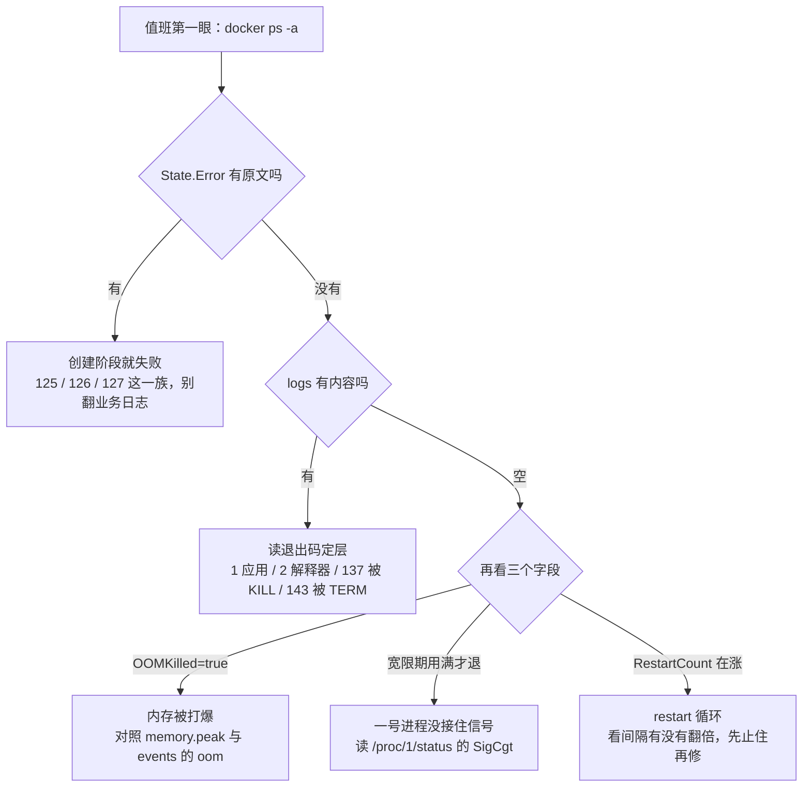
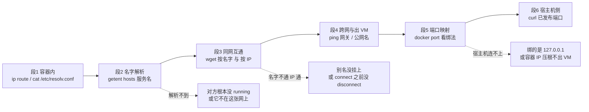

> **实战落点**：第七篇从这一篇开始换成「出事那天」的口吻。前面六篇讲的是怎么写配置、怎么把服务起起来；这一篇讲的是**起来了又倒下、通了又不通**的时候该按什么顺序敲命令。两个故障域放在一起，是因为它们共用同一个前提：**先确认现象在哪一层，再谈修法**。本篇是 W6.1 第 7 项「退出码语义（0/1/2/125/126/127/137/143）」的**穷尽处**——2.2 只引入，到这里每一项都给成因、本机原文与值班第一条命令。
> **本机基线**：Docker Engine `29.8.0` / API 1.56、Compose `v5.5.1`、Desktop on Windows（VM 里 cgroup v2）、默认 bridge 的 DNS 是 `192.168.65.7`、自定义网络的 DNS 是 `127.0.0.11`。用到的镜像：`alpine:3.20`（BusyBox v1.36.1）、`nginx:1.27-alpine`。全部读数来自本机四轮脚本（容器前缀 `kb21-` / `kb22-` / `kb23-`，跑完按名清干净），没有跑任何 `prune`，也没有改 daemon 配置。
> **前置依赖**：[/docs/02-核心操作/跑起来/镜像管理与容器生命周期/](/docs/02-核心操作/跑起来/镜像管理与容器生命周期/)、[/docs/02-核心操作/接上去/端口映射数据管理与权限时区/](/docs/02-核心操作/接上去/端口映射数据管理与权限时区/)、[/docs/05-原理深入/隔离与资源/容器本质Namespace与Cgroups/](/docs/05-原理深入/隔离与资源/容器本质Namespace与Cgroups/)、[/docs/04-单机编排/启停/常用命令启动顺序与健康检查/](/docs/04-单机编排/启停/常用命令启动顺序与健康检查/)、[/docs/06-工程化与生产/运行基线/日志资源限制部署策略与回滚/](/docs/06-工程化与生产/运行基线/日志资源限制部署策略与回滚/)
> **本篇产出物**：一张覆盖十个退出码的**exit code 速查表**（每格都给本机原文与「第一条命令」）；137 的三条来源与判别读数；`128+N` 打在 PID1 与 PID2 上的六格对照；一张「起来立即退出」排查流程图与四条读法各自的能读到/读不到；restart 循环的三个识别字段与**真实 backoff 间隔序列**；compose 四种命令的 rc 语义表；**分段排查**（容器内 → 宿主机 → 外网 → 端口映射 → DNS）每段一条命令、通的样子与不通的原文；内置 DNS 解析对象表（容器名、服务名、别名、短 id、跨网络）与 `--dns` 的真实语义；端口三种绑法、撞车原文与 host 网络下 `-p` 被丢弃的警告；**tcpdump 在容器场景的用法**——要的是 `NET_RAW` 而不是 `NET_ADMIN`，以及抓包必须在通信两端之一的对照读数。
> **难度·耗时**：★★★ · 75 分钟（含动手：跑一遍退出码矩阵、跑一遍两容器 DNS 与抓包对照）
> **拓展接口**：本篇的 137/143 判别直接用 5.3 的 `SigCgt` 位图与段⑦ 的停机矩阵；`--network` 与别名是 4.4/4.6 那些 compose 写法的运行时真相；「容器 IP 出不出得了 VM」这条边界留给 7.7（Windows 与 WSL2）；本篇的每一行原文都是 7.2 症状索引的检索入口；段⑧ 要构造的三次故障里，「137 靠构造 OOM 复现」在本篇已经跑通（见 137 三条路那一节）。
> **自测三题**：
> 1. 一只容器 `docker ps -a` 里 `exit 126`。这个码是谁给的？你要在哪一条命令的原文里确认它不是 127？
> 2. `docker logs` 一个字都没有，容器却已经退出了。本机给出的下一步读哪个字段？为什么这一步不能靠 `logs`？
> 3. 同一个自定义网络里，`getent hosts api` 拿不到地址，但 `getent hosts kb23-web` 能拿到。最可能的原因是什么？给出你的验证命令。

## 为什么要先分清「谁给的退出码」和「哪一段断了」

三个真实值班现场，都栽在「从最容易的那条命令开始查」：

```text
「容器退出码 126，我以为是应用崩了，翻了半小时业务日志。」
126 不是应用给的——它连应用都没开始跑。原文里那句
`exec: "/etc/hostname": permission denied` 才是答案：入口指向了一个不能执行的东西。
应用自己失败给的通常是 1（或它自己约定的码），跟 126 不是一回事。

「logs 是空的，所以这个镜像没问题，是运行时的问题。」
空的 logs 只能说明「没有进程往里写过东西」。
真正的那句话在 inspect 的 State.Error 里：
`path / is mounted on / but it is not a shared or slave mount`——创建阶段就失败了。

「服务名解析不通，我以为是 DNS 挂了。」
两只容器在同一张自定义网络上，但那只「服务」在启动瞬间就退出了。
解析失败是结果，不是原因。先确认对方 running，再谈 DNS。
```

三条的共同点是**退出码与现象的归属层不同**：`125/126/127` 归 docker 与运行时，`1`/`2` 归应用与解释器，`137/139/143` 归信号。所以下面每一格都先回答「这个码是谁给的」，再给第一条命令。



## exit code 速查表：十个码各自的成因与第一条命令

每一格的「本机原文」都是这一轮真跑出来的，不是抄文档：

| 码 | 谁给的 | 本机原文（关键片段） | 说明什么 | 值班第一条命令 |
|---|---|---|---|---|
| `0` | 应用正常收尾 | `docker run --rm alpine:3.20 sh -c 'exit 0'` → rc=0，无输出 | 成功；批处理任务看这个 | `docker logs` 确认它真做了事 |
| `1` | 应用内部失败 | 输出 `我失败了`，rc=1 | 最常见，语言默认失败码 | `docker logs --tail 50` |
| `2` | shell/解释器 | `sh: syntax error: unexpected end of file (expecting "then")` | 入口命令本身写错了 | 把 `command` 拆开单独跑 |
| `125` | **docker 自己** | `Usage: docker run [OPTIONS] IMAGE ...`（未知旗标）<br>`pull access denied for kb21-not-exist-repo, repository does not exist or may require 'docker login'`（镜像拉不到） | 参数错、镜像不存在、认证缺失——容器根本没建成 | 看 `docker run` 的 stderr，不要看 logs |
| `126` | docker 建成但**执行不了** | `exec: "/etc/hostname": permission denied`<br>`exec: "/etc": is a directory: permission denied`<br>容器内层：`sh: /x: Permission denied` | 文件在，但不能执行：权限位、是目录 | `docker run --rm --entrypoint sh IMG -c 'ls -l 那个文件'` |
| `127` | docker 找不到入口 | `exec: "definitely-not-a-cmd": executable file not found in $PATH`<br>容器内层（shebang 指向不存在）：`sh: /s: not found` | 路径错、命令没装、被 `--entrypoint` 吞了参数 | `docker run --rm --entrypoint sh IMG -c 'which 那个命令'` |
| `134` | 信号 6（SIGABRT） | `--init` 下 `kill -ABRT $$` → rc=134 | abort、断言失败、glibc 检测到堆破坏 | `docker logs` 找 `free(): invalid pointer` 之类 |
| `137` | 信号 9（SIGKILL） | 三条路都给 137，见下一节 | 被强杀：**OOM 或宽限期用满**，两者修法完全不同 | `docker inspect --format '{{.State.OOMKilled}}'` |
| `139` | 信号 11（SIGSEGV） | `--init` 下 `kill -SEGV $$` → rc=139 | 段错误，原生依赖与 musl/glibc 混用最常见 | `docker logs` + 换 debug 镜像看 core |
| `143` | 信号 15（SIGTERM） | `--init` 下 `kill -TERM $$` → rc=143；链上 Go 服务 `docker stop` 也是 143 | 被 TERM 打死。**不等于优雅关闭完成** | 看有没有 drain 在途请求，别只看码 |

💡 新人小结（把退出码想成分诊台）：`125` 是**挂号处的问题**——表格填错、找不到这个科室（镜像/参数），病人压根没进诊室；`126` 是进了门但**走不动**（文件在但不能执行）；`127` 是**叫错名字**（没这个人）；`1` 和 `2` 是病人自己的病（应用与解释器）；`137`/`143` 是**被抬走**和**听了广播自己走**的区别——前者不留遗言，后者本来有机会收尾。分诊台上最贵的错误是把「挂号处的问题」送去抢救病人。

### 126 与 127 只差三个词，修法完全不同

```console
docker run --rm --entrypoint /etc/hostname alpine:3.20
  → rc=126  exec: "/etc/hostname": permission denied

docker run --rm --entrypoint /etc alpine:3.20
  → rc=126  exec: "/etc": is a directory: permission denied

docker run --rm --entrypoint definitely-not-a-cmd alpine:3.20
  → rc=127  exec: "definitely-not-a-cmd": executable file not found in $PATH

docker run --rm --entrypoint sh alpine:3.20 -c \
  'printf "#!/nope\nexit 3\n" > /s && chmod +x /s && /s; echo 内层rc=$?'
  → sh: /s: not found | 内层rc=127
```

第四条值得单独记：**脚本文件本身有执行位也照样 127**，因为内核找不到它的第一行 `#!` 指向的解释器。这类问题在容器里比在宿主机上更常见——镜像是 `alpine`（musl）而你塞了一个按 glibc 编译、动态链接到 `/lib64/ld-linux-x86-64.so.2` 的二进制。

> 💡 新人小结（`--rm` 是调试期的天敌）：加上 `--rm`，容器一退出就连同它的文件系统与元数据一起消失。本机读数：`docker run --rm … exit 7` 拿到 rc=7，随后 `docker inspect` 回 **`error: no such object: kb21-e-rm`**。排查时**别用 `--rm`**，先 `docker run -d`，读完 inspect/logs/events 再删。

## 137 有三条路，值一样、判别不一样

| 这条路怎么来的 | 本机命令 | 读数 |
|---|---|---|
| 直接补 KILL | `docker kill kb21-kill137` | `status=exited exit=137 oom=false 重启次数=0` |
| 内存被打爆（构造 OOM） | `docker run -m 64m alpine:3.20 sh -c 'tail /dev/zero > /dev/null'` | run rc=137，`oom=true`，**logs 是空的** |
| 宽限期用满后被补 KILL | 一号进程是 `sh -c 'while :; do sleep 10; done'`，`docker stop -t 2` | 墙钟 2.2 秒，`exit=137 oom=false` |

第二条有一个**必须写进纪律的坑**：OOM 打死进程时容器日志常常什么都没有——你翻 `docker logs` 找不到任何异常，但 `OOMKilled=true`。段⑦ 还量到更狠的一种：容器因 OOM 重启之后，`.State.OOMKilled` 会跟着新实例归零、`memory.peak` 与 `memory.events` 的 `oom_kill` 也清零，此时能用的判据是 `docker events` 里的 `oom` 动作（同一条压测本机看到两次）与 `dmesg` 的差集。

### 128+N 那一族：同一个信号打在 PID1 与 PID2 上是两回事

| 信号 | 打在 PID1（无 `--init`） | 打在 PID2（`--init`，一号是 docker-init） |
|---|---|---|
| `ABRT`(6) | `rc=0`，输出 `还活着 pid=1` | `rc=134` |
| `SEGV`(11) | `rc=0`，输出 `还活着 pid=1` | `rc=139` |
| `TERM`(15) | `rc=0`，输出 `还活着 pid=1` | `rc=143` |

这不是内核给容器一号进程开了「所有信号都免死」的口子。规则是**内核只豁免「没装 handler 且默认处置是终止/忽略」的信号**，所以装没装 handler 是**程序属性**：`alpine` 的 `sleep` 与 `ash` 一个都不装（`/proc/1/status` 里 `SigCgt` 为 `0000000000000000` / `0000000000010002`，TERM 位 `0x4000` 都不在里面）→ 上面那三条「还活着」；链上那个 Go 二进制没写 `signal.Notify`，可 Go 运行时装了一大片（`SigCgt=fffffffd7fc1feff`）→ `docker stop` 0.4 秒返回、退出码 143。完整六格矩阵与位图读数写在链上资产 `示例/贯穿示例/段7-生产形态与回滚/README.md`（六格停机矩阵、`SigCgt` 位图、dmesg 差集），另一处展开在 [/docs/05-原理深入/隔离与资源/容器本质Namespace与Cgroups/](/docs/05-原理深入/隔离与资源/容器本质Namespace与Cgroups/)。

## 起来立即退出：四条读法各自能读到什么

一只 `exit 3` 的容器，四条命令的分工：

| 读法 | 命令 | 本机读数 | 什么时候读不到 |
|---|---|---|---|
| ① 状态与错误 | `docker inspect --format '{{.State.Status}} {{.State.ExitCode}} {{.State.Error}} {{.State.OOMKilled}}'` | `exited 3 oom=false`，`Error` 为空 | 用 `--rm` 之后整个对象没了 |
| ② 业务输出 | `docker logs` | `我先说一句就退` | 进程在写第一行日志前就被创建失败/被 KILL |
| ③ 引擎事件流 | `docker events --since <t0> --until <t1> --filter container=<名> --format '{{.Action}}'` | `create → start → die` | 忘了 `--until` 会一直挂着不返回 |
| ④ 创建期报错 | `docker run` 自己的 stderr | `path / is mounted on / but it is not a shared or slave mount`（rc=125），此时 **logs 为空** | 只能在前台 `run` 或 `logs` 前看到 |

`--since/--until` 那一条是实操坑：`docker events` 不带 `--until` 会**永远不返回**，本批第一版脚本就在这上面超时过一次。

**「logs 空」不等于「没出错」**，最典型的就是 mount 写法错：

```console
docker run --name kb21-e-mount -v /:/host:rslave alpine:3.20 sleep 30
  → run rc=125
  → Error response from daemon: path / is mounted on / but it is not a shared or slave mount
docker logs kb21-e-mount
  → (空)
```

## restart 循环的识别：靠三个字段，别指望它自己停

| 策略 | 本机读数 | 什么时候变成故障 |
|---|---|---|
| `no`（默认） | 退出就是退出，`重启次数=0` | —— |
| `on-failure:2` | 必然 `exit 1` 的容器：`status=exited exit=1 重启次数=2`，之后**停住** | 停住 ≠ 修好；只是不再试了 |
| `unless-stopped` | 同一个容器：`status=restarting 重启次数=8` 还在涨，`docker ps` 里 STATUS 是 `Restarting (1) Less than a second ago` | 无限循环，日志与事件流被同一个错刷满 |
| `always` | 与 `unless-stopped` 同样是循环，`docker stop` 也能停住（02 篇实测：计数停在 7） | 两者的真分界在**守护进程重启之后**——`always` 会被拉起来，`unless-stopped` 记住你是手动停的，不再拉起 |

循环的真实节奏不是「瞬间重试」，是**翻倍退避**（相邻两次 `die` 的间隔，来自 `docker events` 的纳秒时间戳）：

```console
die 事件 8 条、start 事件 8 条
相邻间隔（秒）: [0.26, 0.35, 0.59, 0.92, 1.78, 3.36, 6.55]
现在的计数与状态: 重启次数=8 status=restarting
```

所以「它还在动」不能当作「在恢复」的证据：间隔越拉越长、计数一直涨、业务永远没起来。三个识别字段固定是 `RestartCount`（在涨）、`.State.Restarting`（true）、STATUS 里的 `Restarting (N)`，配上 `docker events` 的 `die → start` 序列。

💡 新人小结（restart 循环像自动复位的饮水机）：机器一报错就自己重启，而且每次重启之间歇的时间越来越长——这是引擎在保护你，不是它在恢复。你要是只看到「面板又亮了」就以为好了，它会一直亮到把你今天的日志量刷爆。**先止住（`docker update --restart=no`）再修因**，是本机唯一给得出一条命令的写法。

## compose 的 rc：CI 里最容易误用的一位

| 命令（同一个 project：`boom` 退 3、`sleeper` 睡 300） | 本机 rc | 读数 |
|---|---|---|
| `docker compose up`（前台，不加旗标） | **不返回**（40 秒超时掐掉） | 只要还有服务在跑，`up` 就继续等；输出里已经有 `boom-1 exited with code 3` |
| `docker compose up --abort-on-container-exit` | `3` | 有服务退出就停全部；被它停掉的 `sleeper-1 exited with code 137` |
| `docker compose up --abort-on-container-exit --exit-code-from boom` | `3` | 要拿哪个服务的码就点名谁；本例两点名与不点名都给了 3 |
| `docker compose up -d --wait --wait-timeout 12` | `1` | `container kb21rc-boom-1 exited (3)`，而**没有健康检查的 sleeper 被报成 Healthy** |

最后那行是本篇最要紧的一条 CI 判据：`--wait` 把「running」当「健康」，所以**每个要在 CI 里当门的服务都必须自带 `healthcheck`**，否则一个立刻退出的旁路服务不会让门变红（这条与 4.6 的健康检查、段⑥ 的 CI 门是同一件事）。

## 分段排查：容器内 → 宿主机 → 外网 → 端口映射 → DNS

顺序的意义在于**每段只回答一个问题**，而且每段的命令都在容器里跑得动：



| 段 | 一条命令（本机实测） | 通的样子 | 不通时本机的原文 |
|---|---|---|---|
| 段1 容器内 | `ip route; cat /etc/resolv.conf` | `default via 172.19.0.1 dev eth0`；`nameserver 127.0.0.11` + `options ndots:0` | 默认 bridge 上 `nameserver 192.168.65.7`（**没有 127.0.0.11，容器名必然解析不到**） |
| 段2 名字解析 | `getent hosts kb23-web` | `172.19.0.2  kb23-web  kb23-web` | 空输出 + `内层rc=2`（对方断开或不存在） |
| 段3 同网互通 | `wget -q -T 5 -O- http://kb23-web/` | `<!DOCTYPE html>`（nginx 欢迎页） | `wget: bad address 'kb23-web'` |
| 段4 跨网 | 另一张网上的容器 `wget http://172.19.0.2/` | —— | **`wget: download timed out`**（是超时不是拒绝）。**机制已在 5.5 量到**：filter 表 `DOCKER` 链里每张桥一条 `! -i br-X -o br-X -j DROP`，批 21 用计数器把它坐实（ping 5 个包，那条 DROP 计数 +5，入口桥抓得到包、出口桥一个都没有）；要放行只有多宿主或改 `DOCKER-USER` 两条路 |
| 段4b 出容器 | `ping -c 1 -W 2 kb23-web`（同网对方）、`ping -c 1 -W 2 192.168.65.1`（VM 的默认网关） | 前者 `0% packet loss, rtt 0.060 ms`，后者 `0.457 ms` | 解析先行失败时报 `ping: bad address '…'`，那是段2 的事不是段4 的事 |
| 段4c 无网络样张 | `docker run --network none` 里 `ifconfig -a` 与 `wget http://1.1.1.1` | 只有 `lo`（`inet addr:127.0.0.1`） | `wget: can't connect to remote host (1.1.1.1): Network unreachable`——这条原文本身就说明「不是 DNS 问题」 |
| 段4d 出外网 | `wget -q -T 8 -S -O /dev/null https://registry-1.docker.io/v2/` | `HTTP/1.1 401 Unauthorized`——**401 就是通**，容器没被网络挡住 | 卡在 DNS 时先 `getent hosts registry-1.docker.io`（本机给 `199.16.156.38`） |
| 段5 端口 | `docker port <容器>` | `80/tcp -> 0.0.0.0:18199`（v4/v6 各一行） | 空 = 这容器根本没发布任何端口 |
| 段6 宿主机 | `curl -s -w '\|HTTP=%{http_code}' http://127.0.0.1:18199/` | 拿到页面正文 + `HTTP=200` | `HTTP=000`（连不上）——先看段5 是不是绑了 `127.0.0.1` |

💡 新人小结（分段排查像查一条水管）：你不需要知道整栋楼的水路，只需要**从最远的一节往回**逐节开阀：先确认这只容器有自己的水管（段1）、再确认它能叫到对面的名字（段2/3）、再确认出得了这层楼（段4）、最后确认大楼门口那个阀门开了（段5/6）。每一节只问一件事，问完就得到「通」或「不通的原话」。

## 内置 DNS 解析什么、不解析什么

这是 7.4 里最容易被写成「重启大法」的一节。**自定义网络与内置 DNS 失效**看着是两回事，其实是同一件事的两面：内置解析器（`127.0.0.11`）只挂在自定义网络上，所以「换了个网络」就会同时改掉解析行为与互通规则。本机把每一类对象都问了一遍：

| 查询对象 | 在自定义网络（`kb23-net`） | 在默认 bridge | 说明 |
|---|---|---|---|
| 对方容器名 `kb23-web` | `172.19.0.2`，`内层rc=0` | **解析不到**（`内层rc=2`） | 内置 DNS（`127.0.0.11`）只在自定义网络上生效 |
| 网络别名 `api` / `svc` | disconnect 后带别名重连 → `172.19.0.2  api  api` | 不适用 | `docker network connect --alias` 必须**先断开** |
| compose 服务名 `a` | `172.20.0.2` | 不适用 | compose 给每个服务在网络上挂服务名别名 |
| compose 容器名 `kb23c-a-1` | `172.20.0.2` | 不适用 | 容器名同样可解析 |
| compose 里 `networks.<网>.aliases` 的 `web-a` / `a-alias` | 两者都 `172.20.0.2` | 不适用 | 四个名字指向同一个地址，任选其一都能连 |
| 容器短 id | 空（`内层rc=2`） | 空 | **id 不参与 DNS**，别拿 id 写服务发现 |
| 公网名 `example.org` | `2606:4700:10::…` | 正常 | 内嵌 DNS 把它转给上游 |

别名这一条本机踩得很实：直接对**已经连在该网络上**的容器再 `connect --alias` 是失败的——

```console
docker network connect --alias api kb23-net kb23-web
  → rc=1  Error response from daemon: endpoint with name kb23-web already exists in network kb23-net
（此时）getent hosts api → 空，内层rc=2      ← 看起来像「别名解析坏了」，其实是别名根本没挂上

docker network disconnect kb23-net kb23-web
docker network connect --alias api --alias svc kb23-net kb23-web
  → rc=0
getent hosts api → 172.19.0.2  api  api
inspect → Aliases=[api svc]
```

**`--dns` 的真实语义**（这条纠正了「`--dns` 会顶掉内置 DNS」的想当然）：

```console
docker run -d --dns 8.8.8.8 --dns 1.1.1.1 --network kb23-net alpine:3.20 sleep 1200
  HostConfig.Dns = ["8.8.8.8","1.1.1.1"]
  resolv.conf:  nameserver 127.0.0.11
                # ExtServers: [8.8.8.8 1.1.1.1]
                # Overrides: [nameservers]
  getent hosts kb23-web → 172.19.0.2   ← 服务名照样解析
  getent hosts example.org → 有答案    ← 公网名走新上游

docker run -d --dns 10.255.255.1 --network kb23-net alpine:3.20 sleep 900   ← 一个没人应答的上游
  getent hosts example.org → 空，内层rc=2
  wget http://172.19.0.2/ → 拿到 nginx 页面          ← 同网 IP 直连完全不受影响
```

也就是说 `--dns` 换的是**内嵌解析器的上游**，`nameserver` 那一行仍然是 `127.0.0.11`；而最后两条一起构成「分段排查」的理论依据：**DNS 坏了不影响 IP 连通**，所以「按名字不通、按 IP 通」永远先怀疑解析层，不要怀疑网络。

💡 新人小结（内置 DNS 是公司总机）：`127.0.0.11` 这台总机只登记**内部分机号**（同网络上的容器名、服务名、别名），你 `--dns` 换的是「总机打外线用哪家运营商」，总机本身没被撤；`--network bridge`（默认网络）等于把你放到一间**没有总机的房间**，只能拨全号（IP）；至于「另一个部门（另一张网络）的分机号」，总机既不登记、也不转接——按 IP 拨过去也一样没人接（本机表现是超时）。

## 端口映射：三种绑法、一次撞车、host 网络的警告

| 写法 | `docker port` 读数 | 从 Windows 访问 | 结论 |
|---|---|---|---|
| `-p 18199:80` | `80/tcp -> 0.0.0.0:18199`<br>`80/tcp -> [::]:18199` | `curl 127.0.0.1:18199` → 拿到页面 | 所有接口都听，最省事也最容易过度暴露 |
| `-p 127.0.0.1:18198:80` | `80/tcp -> 127.0.0.1:18198` | 回环 `curl` → 拿到页面；<br>从本机局域网地址 `192.168.3.103:18198` → **HTTP=000** | 只给本机用，健康检查与「同事能不能访问」会给出不同答案 |
| `-p 80`（不给宿主端口） | `80/tcp -> 0.0.0.0:54827` | 要现读 `docker port` 才知道 | 随机宿主端口，脚本里绝不能硬编码 |

撞车时的原文是**一整条长句**，值班时值得认出来：

```console
docker run --rm -p 18299:80 nginx:1.27-alpine      （18299 已被占）
  → Error response from daemon: failed to set up container networking:
    driver failed programming external connectivity on endpoint dreamy_austin (3daef9a640f8…):
    Bind for 0.0.0.0:18299 failed: port is already allocated
```

`--network host` 是另一类误解集中地：

```console
docker run -d --network host -p 18298:80 nginx:1.27-alpine
  → WARNING: Published ports are discarded when using host network mode
  → 容器照样起来（rc=0）——旗标被丢弃，不是报错
```

这只 host 容器里 `ip route` 看到的是 **VM 的表**（`default via 192.168.65.1 dev eth0`，另有 `172.17.0.0/16 dev docker0 … src 172.17.0.1`），它访问刚发布的 `127.0.0.1:18199` 是**通的**（在 VM 里）。反过来，宿主机（Windows）访问**容器 IP** `172.19.0.2` 是 `HTTP=000`——容器地址不出这台 VM。这条边界是 Docker Desktop 与 Linux 宿主机上最不一样的地方，也是「容器里 curl 自己通、同事 curl 不通」的常见答案。

## tcpdump 在容器场景的用法

三个读数摞起来才是这一节的结论。

**一、这台引擎的默认 capability 里已经有 `NET_RAW`，抓包不需要 `NET_ADMIN`：**

```console
普通 alpine 容器的 CapEff = 00000000a80425fb → NET_RAW=True  NET_ADMIN=False
--cap-drop ALL           的 CapEff = 0000000000000000 → 两者都 False
  这只里跑 tcpdump → tcpdump: eth0: You don't have permission to perform this capture on that device
                    (socket: Operation not permitted)
--cap-drop ALL --cap-add NET_RAW  的 CapEff = 0000000000002000 → NET_RAW=True、NET_ADMIN 仍 False
  这只里跑 tcpdump → 正常抓到（2 packets received by filter, 0 dropped）
```

**二、抓包必须在通信的两端之一**，第三方容器抓不到同一网段的单播流量：

```console
在第三方容器（kb23-third，同网、装了 tcpdump）里 tcpdump -i eth0 -nn -c 3 tcp port 80
  → 20 秒 0 个包：listening on eth0, link-type EN10MB …（banner 之后没有任何行）

在服务端容器（kb23-web）里抓同一个过滤器
  → 05:08:49.986950 IP 172.19.0.3.36296 > 172.19.0.2.80: Flags [S], seq 2901830069, win 64240, …
  → 2 packets captured / 12 packets received by filter / 0 packets dropped by kernel
```

这不是 tcpdump 坏了，是**网桥学到 MAC 之后不再向第三方端口泛洪**。所以「我在另一个容器里抓一下看看」这个动作在本机得到的答案是 0 个包；要么进**发起方**要么进**接收方**，实在需要在中间抓，就得改拓扑（把两腿走同一条链路）或到 VM 侧动手。

**三、`apk add tcpdump` 能装上**（`apk_rc=0`、`/usr/bin/tcpdump`），但它是**装在容器可写层**里的：容器删了就没了，排查用一次性容器（`docker run --rm`）比在生产容器里装包更合适；而本机 `alpine:3.20` 的 BusyBox **没有 `httpd` 这个 applet**（`which httpd` → `rc=1`），所以别指望用 `httpd` 顶一个测试服务——本批改用 `nginx:1.27-alpine` 才拿到稳定的服务端。

💡 新人小结（抓包位置像在总机接线）：同一个楼层的两台分机通话，你在第三台分机上摘机是什么都听不到的——交换机会把这条线单独接给需要它的人。容器网络一样：**要录音就在打电话的那一端或接电话的那一端**。

## 值班第一步敲什么：把本篇压成一张顺序表

| 现象 | 第一条命令 | 期望读数 | 由此决定的下一步 |
|---|---|---|---|
| 容器 exited | `docker inspect --format '{{.State.ExitCode}} {{.State.Error}} {{.State.OOMKilled}}'` | 三个字段一起看 | `Error` 有原文 → 125/126/127 一族；`OOMKilled=true` → 内存；都干净 → 读退出码 |
| 退出码 126/127 | `docker run --rm --entrypoint sh IMG -c 'which 目标'` | 找到/没找到 | 修入口、修权限位、修镜像里的依赖 |
| 退出码 137 | `docker events --since T --until NOW --filter container=名` | `oom` 动作有没有 | 有 → 按 5.3 调 limit；没有 → 一号进程没接住信号，看 `SigCgt` |
| STATUS 是 `Restarting (N)` | `docker inspect --format '{{.RestartCount}} {{.State.Restarting}}'` | 计数在涨 | 先 `docker update --restart=no` 止住，再看 logs |
| 日志是空的 | `docker logs` + `inspect .State.Error` | 一个空一个有 | 创建期问题，跟应用无关 |
| 服务名解析不到 | 先 `docker ps` 确认对方 running，再 `getent hosts 名字` | 对方活着仍解析不到 | 查是否同网、别名是否挂上（`inspect .NetworkSettings.Networks.*.Aliases`） |
| 宿主机 curl 不通 | `docker port 容器` | 有映射且绑对地址 | 绑了 `127.0.0.1` 就用回环测；容器 IP 从宿主机不可达属正常 |
| 同网却不通、想抓包 | 在**通信的一端**里 `tcpdump -i eth0 -nn tcp port <端口>` | 看到 `[S]` 就说明包到了 | 看不到再回段1/2 逐段验 |

## 本篇不覆盖什么

按 W6 的规矩，本篇**故意不讲**的东西逐条点名去处——写「不覆盖」不是免责声明，是防止你在这一篇里找不存在的答案：

- 退出码背后的 cgroup 与信号机制 → 见 **5.3**（`memory.max` 与 PID 1 的信号规则在那一篇）
- 桥、veth 与转发规则的读法 → 见 **5.5**（`veth` 配对判据与那条 DROP 在那一篇）
- 日志两个流与 `logs -f` 的退出姿势 → 见 [/docs/02-核心操作/跑起来/进容器调试与状态查看/](/docs/02-核心操作/跑起来/进容器调试与状态查看/)（`两个流` 那格有实测）
- 「一条报错 → 一个去处」的索引 → 见 **7.2**（`症状索引` 那张表在本篇的姊妹节）
- 磁盘占满导致的起不来 → 见 **7.5**（`system df` 与五大来源在那一篇）
- Windows/WSL2 侧的可见性与 localhost 那一族 → 见 **7.7**（`vmmem` 与两种发布写法在那一篇）

## 本篇未验证项

| 项 | 状态 | 原因 |
|---|---|---|
| VM 侧（`docker-desktop` 发行版）的接口与 NAT 规则读法 | **已定位，2026-10-28 批 21 更正** | 本批当时得到的 `download timed out` 与「应该可达」的矛盾**不是通道问题，是站错了命名空间**：`wsl -d docker-desktop` 落在的是 VM 的根 netns（只有 `lo` 与一张 `eth0 172.17.40.166/20`），桥、`docker0`、NAT 规则都在**引擎自己的 netns**里。读法与全部规则见 [/docs/05-原理深入/网络与运行时/网络底层跨主机方案与运行时生态/](/docs/05-原理深入/网络与运行时/网络底层跨主机方案与运行时生态/) 的「转发规则的读法」一节；`ip -br` 是 BusyBox 版这一条仍然成立 |
| 中间位置抓包（同网第三方）能不能靠混杂模式打通 | 未测 | 本机只量到「第三方 0 个包」这一现象，没有去改网桥 promisc 设置 |
| `139` 的真段错误样张 | 用 `kill -SEGV` 构造，未用真实崩溃程序 | 手边没有会自然 segfault 的镜像；机制层读数（128+11）已经给到 |
| `134`（SIGABRT）在 glibc 堆破坏下的完整表现 | 未测 | 需要按 glibc 编译的镜像并造堆破坏，属 5.3/7.8 的量 |
| IPv6 端口的实际可达性 | 未验证 | `docker port` 确实渲染出 `[::]:18199`，但本机 Windows 侧没做 v6 连通测试 |
| `docker events` 在高并发下的丢失 | 未测 | 量的是单容器序列，没有做丢事件压力测试 |
| `iptables` / `nft` 规则级排错 | **通道已建立（批 21），规则级判读见 5.5** | 只读通道是起一只 `--network host --cap-add NET_ADMIN` 的一次性容器（`apk add iptables nftables`），里面 `docker0`/`br-*`/veth 与五张 netfilter 表全可见；`iptables v1.8.10 (nf_tables)` 意味着 iptables 与 nft 是同一后端的两个视图 |
| Swarm / K8s 下的服务名解析与端口语义 | 不在本篇 | 本站范围是单机 Compose；5.5 的逐跳机制已交付（跨机部分在 5.6，编排对照在 8.x） |

## 要点总结

- 退出码先问**谁给的**：`125/126/127` 归 docker 与运行时（容器根本没跑起来，别翻业务日志），`1`/`2` 归应用与解释器，`134/137/139/143` 是 `128+信号号`。
- `126` 与 `127` 的原文只差三个词（`permission denied` / `executable file not found in $PATH`），但一个修权限与文件类型、一个修路径与镜像依赖；`#!` 解释器缺失会伪装成 `127`。
- `137` 有三条来源，值相同：`docker kill`（`OOMKilled=false`）、构造 OOM（`OOMKilled=true` 且**日志常常是空的**）、宽限期用满（本机 2.2 秒）。容器重启过之后 OOM 的账会归零，改用 `docker events` 的 `oom` 动作或 `dmesg` 差集。
- `128+N` 打在 PID1 与 PID2 上是两回事，但豁免只覆盖「没装 handler」的信号——`SigCgt` 位图是判据，`143` 不等于在途请求被 drain 干净。
- restart 循环的三个字段是 `RestartCount`、`.State.Restarting`、STATUS 里的 `Restarting (N)`；间隔实测翻倍（`0.26 → 0.35 → 0.59 → 0.92 → 1.78 → 3.36 → 6.55` 秒），「还在动」不是「在恢复」。先 `--restart=no` 止住再修因。
- 前台 `docker compose up` 不会因为有服务退出而返回；要码就 `--exit-code-from`；`up -d --wait` 把没有健康检查的服务当健康——**CI 门要红，服务必须自带 `healthcheck`**。
- 分段排查的顺序固定为容器内 → 名字解析 → 同网互通 → 跨网与出 VM → 端口 → 宿主机侧；每段只回答一个问题，且「按名字不通、按 IP 通」永远先怀疑解析层。
- 内置 DNS `127.0.0.11` 只在**自定义网络**上生效（默认 bridge 的 `resolv.conf` 写的是 `192.168.65.7`）；容器名、compose 服务名与网络别名都可解析，**容器短 id 不行**；`docker network connect --alias` 要先 disconnect，否则报 `endpoint with name … already exists in network …`。
- `--dns` 换的是内嵌解析器的**上游**（`# ExtServers: [...]`），`nameserver` 仍是 `127.0.0.11`；上游死了公网名解析失败，但同网 IP 直连照常通。
- 端口三种绑法的可见范围不同（`0.0.0.0` / 只 `127.0.0.1` / 随机宿主端口）；`--network host` 下 `-p` 被**静默丢弃**（只有一句 WARNING）；容器 IP 从宿主机不可达是这台机器的常态。
- 抓包要的是 `NET_RAW` 而不是 `NET_ADMIN`，而这台引擎默认就给 `NET_RAW`（`CapEff=00000000a80425fb`）；`--cap-drop ALL` 之后才报 `Operation not permitted`。**抓包必须在通信两端之一**，第三方容器同网也抓不到。
