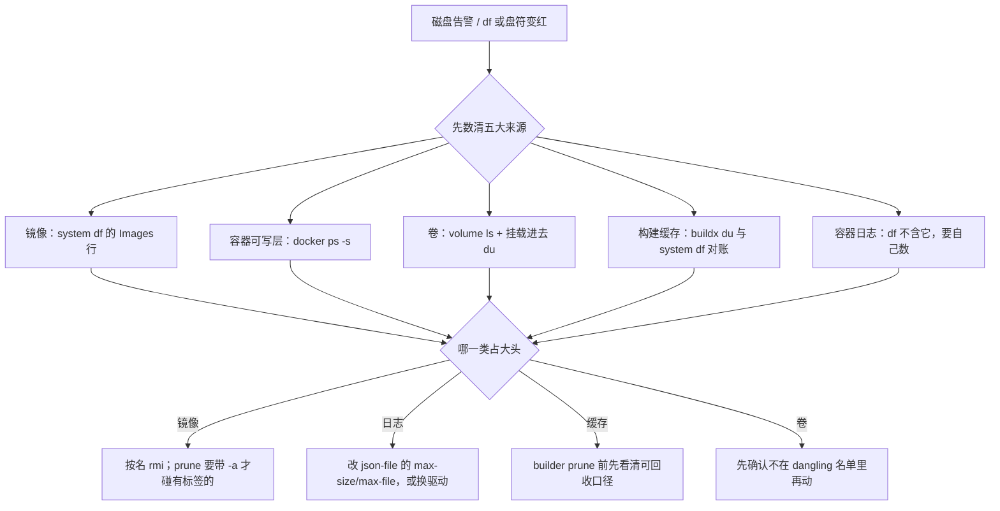
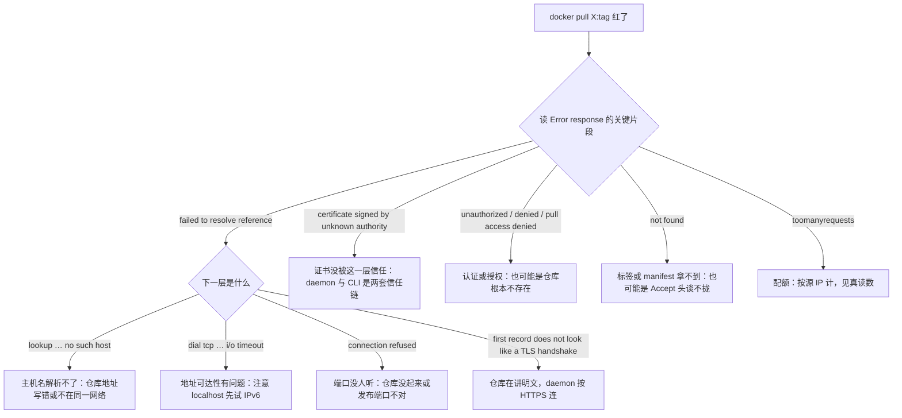

> **实战落点**：接着 7.3/7.4 那两个故障域往下走。这一篇管的是**撑满**与**拿不到**——`/var/lib/docker` 把盘吃掉时怎么数清、敢删什么、删错了怎么回来；以及 `docker pull` 失败时那五类原文（超时、限流 `toomanyrequests`、认证失败、X509、`manifest unknown`）分别说明什么、本机能不能重放。所有读数来自本机三轮脚本（容器与卷一律 `kb24-` 前缀，跑完按名清干净）：**没有跑过 `docker system prune`、`docker volume prune`、`docker builder prune`、`docker image prune -a`**，因为这台机器上 Harbor 九个容器在跑、`trivy-cache` 是刻意留的 1.5 G 漏洞库。
> **本机基线**：Docker Engine `29.8.0` / API 1.56、Compose `v5.5.1`、Windows 上的 Desktop VM；`InsecureRegistryCIDRs = ["::1/128","127.0.0.0/8"]`、`RegistryConfig.Mirrors = []`、`IndexConfigs` 里出厂就带一个 `hubproxy.docker.internal:5555`（`Secure:false`）。跑前基线：镜像 **29 个 ID / 31 条标签**、卷 **10 个**、容器 **9 个**、`system df` 报 Images 5.111 GB / 可回收 2.951 GB (57%)、Build Cache 128 条 / 1.932 GB / 可回收 4.262 MB。
> **前置依赖**：[/docs/05-原理深入/隔离与资源/联合文件系统与镜像分层/](/docs/05-原理深入/隔离与资源/联合文件系统与镜像分层/)、[/docs/02-核心操作/接上去/端口映射数据管理与权限时区/](/docs/02-核心操作/接上去/端口映射数据管理与权限时区/)、[/docs/03-镜像构建/交出去/BuildKit私有仓库标签策略与构建排错/](/docs/03-镜像构建/交出去/BuildKit私有仓库标签策略与构建排错/)、[/docs/06-工程化与生产/运行基线/日志资源限制部署策略与回滚/](/docs/06-工程化与生产/运行基线/日志资源限制部署策略与回滚/)
> **本篇产出物**：`/var/lib/docker` 膨胀的**五大来源**与每个来源的定位命令（含「`system df` 的 SIZE 里不含容器日志」这条口径）；`system df` 与 `system df -v` 的列读法（为什么 SIZE **不能相加**）；本机镜像数据真实落点的证据（没有 `overlay2/layerdb`，`/var/lib/docker/image` 只剩一个 262 KB 的 `identity-cache.db`，数据在 containerd 快照里）；清理决策的三条边界（`prune --filter label=` 不带 `-a` 时回收 **0B**、覆盖 tag 不积累悬空镜像、`volume ls -f dangling=true` 就是 `volume prune` 的靶子清单）与**不可清理项**清单；一条完整跑通的「误删 volume → rescue」命令链（备份 → 删卷 → 同名重挂是空卷 → 恢复 → 校验和一致）；拉取失败五类语料的**本机原文**，含 daemon 与 CLI 对同一张自签证书的两种态度、以及换一种拼法就多一个本地镜像引用。
> **难度·耗时**：★★★ · 80 分钟（含动手：数一次本机磁盘五来源、重放一次拉取失败五类）
> **拓展接口**：本篇的「先数清再动手」是 6.6 磁盘治理那条纪律的落地版；`memory.peak`/`oom_kill` 那套「cgroup 读数会被重启清零」的教训在 5.3 与段⑦；`manifest unknown` 与 `not found` 的对应关系是 3.11 标签策略的反向验证；7.9 的 runbook 会把本篇的两张判读树压成「第一步敲什么」；段⑧ 要构造的 `/var/lib/docker` 撑满演练直接用本篇第 1 节的来源清单当检查表；**回指 10-存储专题**：[/docs/10-存储专题/落点与生命周期/存储形式在操作系统上的落点与验证/](/docs/10-存储专题/落点与生命周期/存储形式在操作系统上的落点与验证/)（10.3）、[/docs/10-存储专题/数据保护/内容损坏与修复/](/docs/10-存储专题/数据保护/内容损坏与修复/)（10.7）、[/docs/10-存储专题/故障手册/存储故障手册一容量与权限/](/docs/10-存储专题/故障手册/存储故障手册一容量与权限/)（10.8）。
> **自测三题**：
> 1. `docker system df` 报 Build Cache 可回收 4.262 MB，`docker buildx du` 报 Reclaimable 1.932 GB。谁在撒谎？你要用哪条命令判「`builder prune` 大概能吐回多少」？
> 2. `docker pull 127.0.0.1:8443/kbdemo/api:0.6.0` 与 `docker manifest inspect localhost:8443/kbdemo/api:0.6.0` 一条成功一条报 x509。为什么？
> 3. 你 `docker volume rm` 一个还在被容器使用的卷，和删掉一个已经没人在用的卷，本机分别给什么？

## 为什么会撑满和为什么拿不到，是同一类问题

三个现场，都在「命令给了成功，问题还留着」这一类上：

```text
「盘满了，我跑了 docker system prune -f，回收了 40 MB。」
「因为 1.9 GB 的大头在构建缓存里，而 system df 说它只可回收 4.262 MB；
 剩下的 2.9 GB 是镜像，prune 不带 -a 根本不碰有标签的镜像。」

「pull 报 not found，我以为标签被删了。」
「标签在。我拿 curl 直接问 /v2/<repo>/manifests/<tag> 才看清是
 `Accept header does not support OCI manifests`——404 不一定是没有，也可能是媒介类型谈不拢。」

「误删了一个卷，我先把容器重起回来想救。」
「Docker 一声不响地建了**一个同名空卷**。数据不在里面，
 你唯一能靠的是备份——以及删卷之前那条 in-use 保护报错。」
```

它们的共同点是：**报错的层和真相的层不是同一层**。本篇每一节都先给「怎么问到那一层的原话」，再给修法。



## 五大来源与各自的定位命令（`/var/lib/docker` 膨胀五大来源与定位命令，本机全量读数）

| 来源 | 定位命令 | 本机读数 | 该找谁 |
|---|---|---|---|
| 镜像 | `docker system df` 的 Images 行 | `29 个 ID / ACTIVE 9 / 5.111 GB / 可回收 2.951 GB (57%)` | 3.11 的标签策略与 3.10 的仓库职责 |
| 容器可写层 | `docker ps -s` | `harbor-jobservice=1.84MB (virtual 237MB)`、`nginx=61.4kB (virtual 207MB)` | 写盘的位置对不对（6.6 的卷纪律） |
| 卷 | `docker volume ls -q` 再挂进去 `du` | 10 个卷 / `1.641 GB`；`trivy-cache` 单独 `1.5G` | 6.6 的备份链 |
| 构建缓存 | `docker buildx du`（末尾摘要） | `Shared 1.928GB / Private 4.266MB / Reclaimable 1.932GB / Total 1.932GB` | BuildKit 缓存策略（3.9） |
| 容器日志 | 挂载 `/var/lib/docker/containers` 数 | `du -sh` → `5.0M`；**`system df` 的 SIZE 里不含它** | 6.3 的轮转配置 |

两个读数必须放在一起看，否则会被引导错方向：

| 口径 | 命令给出的数 | 差在哪 |
|---|---|---|
| `system df` 的 Build Cache | `128 条 / 1.932 GB`，但 RECLAIMABLE 只有 **4.262 MB** | 它按「当前没有 builder 引用」判可回收，所以几乎不动 |
| `buildx du` 的摘要 | `Reclaimable: 1.932GB` | 它按「条目本身是否 mutable/被引用」判，几乎是全量 |

这就是本机跑了 `builder prune -f` 只吐回几十 MB 的原因（那条不彻底在 T0Level 第 25 条里从批 11 记到现在）：**判「这次 prune 值不值得跑」要用 `system df` 那一列，不是 `buildx du` 那一行。**

💡 新人小结（`system df` 是体检报告，不是账单）：它给的是「这些部位各有多重」，不是「你 cut 掉能轻多少」。RECLAIMABLE 那一列才是「现在就能减掉的重量」，而构建缓存那一格它只肯认 4.262 MB——因为剩下的被某个 builder 记着名。**看 SIZE 决定要不要管，看 RECLAIMABLE 决定跑哪条命令。**

## `system df -v` 的列读法：SIZE 不能相加

`-v` 给镜像列出 `SIZE / SHARED SIZE / UNIQUE SIZE / CONTAINERS` 四列，本机这三条同源镜像是这样：

```console
REPOSITORY                          TAG              IMAGE ID     SIZE     SHARED SIZE  UNIQUE SIZE  CONTAINERS
localhost:8443/kbdemo/api           0.6.0            39493a2349ec 25.6MB   25.63MB      2.221kB      0
localhost:8443/kbdemo/api           0.6.0-gd475d4a   11e2464774c2 25.6MB   25.63MB      2.221kB      0
localhost:8443/kbdemo/api           0.7.0            4c51899aa980 25.6MB   25.63MB      4.497kB      0
```

三条各 25.6 MB，**加起来不是 76.8 MB**：`SHARED SIZE` 就是那 25.63 MB 的公共层，各自独有的只有 2–4 kB。所以「删掉一个标签能回收多少」要看 `UNIQUE SIZE`，不是 `SIZE`——这一格就是 7.5 最常见的误判源。同理 `python:3.12-alpine` 报 `74.7MB / SHARED 12.94MB / UNIQUE 61.81MB`：删它才真掉 62 MB。

## 镜像数据到底落在哪儿：`overlay2 目录与镜像层的对应关系` 在本机要换一套读法

清单 7.5 那条原语在经典 overlayfs 引擎上是「`/var/lib/docker/image/overlay2/layerdb/mounts/<容器id>/mount-id` → `/var/lib/docker/overlay2/<mount-id>/diff`」。这台引擎上第一段就走不通：

```console
docker run --rm -v /var/lib/docker:/d:ro alpine:3.20 sh -c 'ls /d; ls -l /d/image; ls /d/image/overlay2/layerdb'
  /d 顶层： buildkit containers engine-id image network plugins policy rootfs runtimes stats swarm tmp volumes
  /d/image 里只有一个文件： identity-cache.db（262144 字节）
  ls /d/image/overlay2/layerdb → No such file or directory
```

数据在 containerd 的快照目录里，**层号就是快照号**：

```console
docker run --rm -v /var/lib/desktop-containerd:/cd:ro alpine:3.20 sh -c 'du -sh /cd; ls .../overlayfs/snapshots | wc -l'
  6.5G      快照目录数 270

容器里看自己的根挂载（awk '$2=="/"{print $4}' /proc/mounts）：
  rw,relatime,lowerdir=/var/lib/desktop-containerd/daemon/io.containerd.snapshotter.v1.overlayfs/snapshots/3379/fs
                    :/…/snapshots/174/fs
```

`3379` 是这个容器可写层上面那一层、`174` 是最底下的基础层——**要对应关系就读 lowerdir 里的快照号序列**，不要去 `layerdb` 找。这条不是学术细节：批 14 那次 cAdvisor 在本机拿不到容器级指标，根因就是它按 `layerdb/mounts/<id>/mount-id` 去读，得到 `open /rootfs/var/lib/docker/image/overlayfs/layerdb/mounts/…: no such file or directory`（原文见 [/docs/05-原理深入/隔离与资源/联合文件系统与镜像分层/](/docs/05-原理深入/隔离与资源/联合文件系统与镜像分层/) 与 6.5 那篇）。凡是按 overlay2 假设写工具/面板的，都会在同一处撞墙。

> 💡 新人小结（快照号是「楼层号」，不是「房间号」）：overlay2 那套里，`layerdb` 像物业台账，写明「某住户的行李放在哪个仓」；这台引擎把台账搬走了，只剩一个 `identity-cache.db`（相当于一张门禁缓存），行李位置只能问住户本人——也就是容器里 `/proc/mounts` 那行 `lowerdir`。台账没丢，只是换了地方；不知道的人以为物业把东西弄没了。

## 清理决策与**不可清理项**（每条都有本机读数）

| 想清的东西 | 命令 | 本机实测结果 | 结论 |
|---|---|---|---|
| 我造的样张镜像（带 label） | `docker image prune -f --filter label=kb24=junk` | `rc=0 Total reclaimed space: 0B` | **不带 `-a` 时 prune 只碰悬空镜像**，label 过滤不改变这一点 |
| 同 tag 重 build 留下的旧镜像 | `docker images -f dangling=true -q` 数 | 覆盖前 1 条、覆盖后仍 1 条 | containerd 存储上**不积累悬空镜像**，别指望「重 build 会留一堆垃圾」这套直觉 |
| 有标签但没人用的镜像 | `docker rmi kb24/img1:v1 …` | 按名删后 tag 从 34 → 31、ID 回到 29 | 定向删除是唯一可交代的路径 |
| 正在被容器用的卷 | `docker volume rm kb24-vol` | `rc=1 remove kb24-vol: volume is in use - [e91d9061eeb7…（64 位容器 id）]` | in-use 保护是**真保护**，别绕过它 |
| 没人用的卷清单 | `docker volume ls -f dangling=true` | 只有 `trivy-cache`（1.5 G） | 这条名单就是 `docker volume prune` 的靶子——所以本机**不能跑** `volume prune` |

**不可清理项**（这台机器上明确留着的东西，每一条都给理由）：

| 项 | 为什么不能清 | 误清代价 |
|---|---|---|
| `trivy-cache` 卷 | 漏洞库本体，6.1/6.2 的扫描闸门要用 | 下次扫描要重下（历史读数：15:33 两次 connection refused、15:41 才成） |
| Harbor 的 9 个匿名卷 | 挂在跑着的容器上（`docker inspect` 里能看到 `bb55640c…→/run`、`c1f1e88c…→/etc/logrotate.d`），`dangling=true` 不列它们，但 `down -v` 会 | Harbor 的数据库/日志/证书配置全没，链上仓库重装修 |
| `/var/lib/desktop-containerd` | 镜像与快照的真实存放处 | 所有镜像重拉 |
| Build Cache 里的 `Reclaimable 0B` 部分 | 被 builder 引用；`builder prune -f` 也带不走（本机只吐回几十 MB） | 反复跑只会拖时间，不会回收空间 |
| `kb-p2_*` 链上卷 | 贯穿示例的数据（段①的哨兵行、段⑦的数据存续判据） | 链的判据要重跑一遍才能复现 |

⚠️ 一条实操纪律，来自本批之前那一轮：`docker compose down` **不带 `-v`** 时卷保留；而 `docker compose up` 即使**失败**（本批为拿 `--no-build` 的原文跑了一次，它在 web 那步才红），db/cache 已经先起来、named volume 已经建回来了。**跑任何 `up` 之后都复查 `docker volume ls`**，别假设「这条命令红了所以没留东西」。

## 误删 volume 的 rescue：跑一遍完整的回来路径

顺序是「先证有备份能回来，再谈删」。本机这一轮：

```console
docker volume create kb24-vol
docker run -d --name kb24-app -v kb24-vol:/data alpine:3.20 sleep 900
docker exec kb24-app sh -c 'mkdir -p /data/sub; printf "批18哨兵行\n第二行\n" > /data/note.txt;
                            echo 三行 > /data/sub/other.txt; sha256sum /data/note.txt | cut -c1-16'
  434efb71e9127640

docker run --rm --volumes-from kb24-app -v <本机目录>:/bk alpine:3.20 \
  sh -c 'tar czf /bk/kb24-vol.tar.gz -C /data . && ls -l /bk/kb24-vol.tar.gz'
  210            ← tar 只有 210 字节：数据本来就小，别把「字节数小」当「备份失败」，要对着卷内容数

docker volume rm kb24-vol
  rc=1  volume is in use - [e91d9061eeb7…]          ← 第一次删不动，是保护不是故障
docker rm -f kb24-app
docker volume rm kb24-vol
  rc=0  kb24-vol                                     ← 删掉了，下面才是真 rescue

docker run -d --name kb24-app2 -v kb24-vol:/data alpine:3.20 sleep 600
docker exec kb24-app2 sh -c 'ls -A /data | wc -l'
  条目数=0                                            ← Docker 静默新建了一个同名空卷（没有任何警告）
docker run --rm --volumes-from kb24-app2 -v <本机目录>:/bk alpine:3.20 \
  sh -c 'tar xzf /bk/kb24-vol.tar.gz -C /data && sha256sum /data/note.txt | cut -c1-16; ls /data/sub'
  434efb71e9127640 | other.txt                        ← 校验和与删前一致，目录结构也回来了
```

三句话可执行结论：**同名卷会被静默重建为空**（这就是批 15 那条 87 字节备份的根，也是「恢复成功」假绿的第一现场）；**校验和是唯一能证明回来的读数**（`ls` 有文件不等于内容对）；**卷恢复不需要 `docker volume create`**，直接挂同名卷让它建、再解 tar 进去就行。

💡 新人小结（卷是保险柜，容器是柜子的门）：柜门（容器）拆了还能再装一扇，柜子本身（卷）没被拖走东西就在；可你一旦把柜子推去销毁，重装的「同名柜子」是**空柜**——名字一样、门牌一样、里面什么都没有。所以保险箱演练的正确顺序永远是：先证明「备份能填回一个空柜」，再谈删除。

## `docker pull` 失败的五类原文与各自的判读

判读树先给全，逐类在下面配原文：



| 类别 | 本机原文（关键片段） | 说明什么 | 第一条复测命令 |
|---|---|---|---|
| 解析不到 | `Head "https://kb24-does-not-exist.invalid:5000/v2/x/manifests/1": EOF` | 域名不存在时 daemon 给的是 EOF，**不是** `no such host` | `curl -sv https://该地址/v2/` 看握手停在哪 |
| 连不上（v6 优先） | `Head "https://localhost:5446/…": dial tcp [::1]:5446: i/o timeout` | `localhost` 先解析到 `[::1]`，端口只发了 v4 → **等超时**而不是被拒 | 换 `127.0.0.1:5446` 再试一次 |
| 连不上（v4 直给） | `Head "https://127.0.0.1:5446/…": connect: connection refused` | 同一件事，v4 拼法立刻给「没人听」 | `docker ps` + `docker port` 看发布没发布 |
| 明文仓库 | `Head "https://localhost:5445/…": tls: first record does not look like a TLS handshake` | 回环段虽然不校验证书，但**仍按 HTTPS 讲**，明文服务接不上 | 给仓库配 TLS，或走 `certs.d` 那套（见下节） |
| 认证失败 | `Error response from daemon: Get "https://registry-1.docker.io/v2/": unauthorized: incorrect username or password` | 真上游给的明确拒绝 | `docker login` 单独验凭据 |
| 仓库不存在 / 需登录 | `pull access denied for definitely-not-here-kb24, repository does not exist or may require 'docker login'` | **一条消息两种成因**，不能只看字面 | 先在浏览器/API 里确认仓库是否存在 |
| 配额 | 真读数：`ratelimit-limit: 100;w=3600`、`x-ratelimit-remaining: 99;w=3600`、`docker-ratelimit-source: 103.151.172.71` | 匿名按**出口 IP** 计 100 次/小时 | 拿到 token 后读响应头即可 |
| 限流响应体 | `HTTP 429 {'Retry-After': '30'} {"errors":[{"code":"TOOMANYREQUESTS", …}]}` | 假仓库造的原文，字段与真上游同构 | `curl -i` 直接问 `/v2/<repo>/manifests/<tag>` |
| manifest 拿不到 | `localhost:8443/kbdemo/api:0.7.1: not found`（Harbor 真缺标签）<br>`docker.io/library/alpine:notathing-kb24: not found` | 服务器回 `MANIFEST_UNKNOWN` 时，**docker 只打印 `not found`** | `curl -H 'Accept: application/vnd.oci.image.index.v1+json'` 自己问一次 |
| 404 的另一种成因 | `{"errors":[{"code":"MANIFEST_UNKNOWN","message":"OCI manifest found, but Accept header does not support OCI manifests"}]}` | 东西在，媒介类型谈不拢——404 ≠ 不存在 | 同上，把 Accept 头补全 |
| X509（CLI 层） | `tls: failed to verify certificate: x509: certificate signed by unknown authority` | 走 CLI（`docker manifest`、`buildx imagetools`）时**不认** daemon 那份信任 | `curl -k` 对比一次就明白是谁在验 |

💡 新人小结（`pull` 和 `manifest inspect` 是两个人去敲门）：同一家仓库，daemon 拿着物业开的门禁卡（`InsecureRegistryCIDRs` 里的回环段、`certs.d` 里那条目录），CLI 自己两手空空去敲门，于是被证书挡在门外。**判断「谁的证书问题」的最快办法是换个人去敲**：daemon 成、CLI 败 → 是 CLI 的证书链；两个都败 → 才轮到证书本身或网络。

## 三种拼法三个结果：本机实证的证书与「多出来的镜像」

```console
docker pull localhost:8443/kbdemo/api:0.6.0     → 成（Harbor 自签证书，回环段不校验）
docker pull 127.0.0.1:8443/kbdemo/api:0.6.0     → 也成，但留下一条新引用：
   Status: Downloaded newer image for 127.0.0.1:8443/kbdemo/api:0.6.0
   docker images 里于是多了 127.0.0.1:8443/kbdemo/api:0.6.0（与本机的 tag 数 31 → 32）
docker manifest inspect localhost:8443/kbdemo/api:0.6.0
   → tls: failed to verify certificate: x509: certificate signed by unknown authority
docker buildx imagetools inspect localhost:8443/kbdemo/api:0.6.0
   → ERROR: unexpected status from HEAD request to http://localhost:8443/…: 400 Bad Request
```

四条连起来是本篇最实用的一格：**镜像引用里的主机名拼法是要进库名的**，`localhost:8443/...` 与 `127.0.0.1:8443/...` 是两个标签、同一个 ID；清账时 `docker rmi 127.0.0.1:8443/kbdemo/api:0.6.0` 只 untag 一条（本批收尾就这么复原到 31 条标签）。而 CLI 那两条不通不是仓库坏了：`docker manifest` 校验证书（daemon 不校验）、`buildx imagetools` 直接把 `localhost:8443` 当 http 使。信任配置在 daemon 那一层，本机从容器里挂 `/etc/docker` 是看不到 `certs.d` 的（`ls: /e/certs.d: No such file or directory`）——批 12.5 那次配 HTTPS 是**进发行版根目录**改的，过程记在 `示例/Harbor私有仓库/06-配置HTTPS.md`。

## 国内网络环境应对三条路：本机给得出什么、给不出什么

| 路 | 本机读数 / 边界 | 状态 |
|---|---|---|
| 镜像加速（`registry-mirrors`） | `RegistryConfig.Mirrors = []`（出厂未配）；`IndexConfigs` 里出厂带一个 `hubproxy.docker.internal:5555`、`Secure:false`，但 `Mirrors` 为空说明它没被当成 docker.io 的镜像源用 | 改它要动 daemon 配置，本批按授权范围**没动**；只给读法 |
| 代理透传 | 客户端注入坏代理 `HTTPS_PROXY=http://127.0.0.1:1` 后 `docker pull alpine:3.20` **仍 rc=0**（daemon 不继承 shell 环境）；同一变量传进容器里让 `curl` 去问 registry-1，就是失败 | 结论：`pull` 走 daemon，代理要配到 daemon 或 builder；构建期取包要另配 `--build-arg`（3.9 已量） |
| 私有仓库代理缓存（Harbor proxy-cache） | 本批**不创建**代理项目（不动 Harbor 状态），所以没有端到端读数 | 复现步骤写在未验证项里，交给下一批或 Harbor 专题补 |

## 值班第一步敲什么：这两章压成一张表

| 现象 | 第一条命令 | 期望读数 | 下一步 |
|---|---|---|---|
| 盘要满 | `docker system df` | 四行的 SIZE + RECLAIMABLE | 哪一类既大又可回收，走对应来源那节 |
| 想确认某个镜像占多少 | `docker system df -v` 看 UNIQUE SIZE | 同源镜像 UNIQUE 只有 kB 级 | 按名 `rmi`，别用 `-a` |
| 判断 prune 能回收多少 | 只信 `system df` 的 RECLAIMABLE 列 | 构建缓存那条只有 MB 级 | 别对 `builder prune` 抱 GB 期望 |
| 卷敢不敢删 | `docker volume ls -f dangling=true` | 名单就是 `volume prune` 的靶子 | 名单里的都要逐个问「是不是刻意留的」 |
| 删不动卷 | 看 `volume is in use - [<容器 id>]` | 给出引用它的容器 | 先决定容器要不要，再删卷 |
| 误删了卷 | `docker volume inspect` 看 `CreatedAt` | 同名卷是不是刚建的新空卷 | 走备份恢复链，用校验和对账 |
| pull 报 not found | `curl -i -H 'Accept: application/vnd.oci.image.index.v1+json' https://<reg>/v2/<repo>/manifests/<tag>` | 服务器原话（可能是 Accept 不匹配） | 对得上就修客户端，对不上才是真没标签 |
| pull 报证书 | `docker manifest inspect` 与 `docker pull` 各跑一次 | 一个成一个败 → 信任只在某一层 | 补该层的信任，别改 daemon 配置碰运气 |
| pull 卡住很久 | 换 `127.0.0.1:` 拼法重试 | 立刻 `connection refused` | 说明卡在 IPv6 或路由，不是仓库慢 |
| 配额吃紧 | 取 token 后读 `ratelimit-*` 头 | 剩余额度与窗口 | 登录提高配额，或走自己的 Harbor |

## 本篇不覆盖什么

按 W6 的规矩，本篇**故意不讲**的东西逐条点名去处——写「不覆盖」不是免责声明，是防止你在这一篇里找不存在的答案：

- 为什么删文件不省空间的机制 → 见 **5.4**（`GraphDriver` 与 copy-up 在那一篇）
- 存储侧四类故障的细分与命令卡片 → 见 **10.8**（`ENOSPC` 那一格在那一篇做成手册）
- 卷数据的备份与恢复 → 见 **10.6**（`tar` 冷备与三级对账在那一篇）
- 网络不通与 DNS 的分段排查 → 见 **7.4**（`分段排查` 那张表在那一篇）
- 值班第一步敲什么的顺序表 → 见 **7.9**（`runbook` 八条在那一篇压成一句话）
- 构建缓存的账与 `builder prune` 的影响面 → 见 **3.9**（`buildx` 两个驱动的差别在那一篇）

## 本篇未验证项

| 项 | 状态 | 原因 |
|---|---|---|
| daemon 侧真 x509 原文 | 未复现 | 回环段（`::1/128`、`127.0.0.0/8`）出厂跳过证书校验，本机能给的自签 TLS 仓库只有回环地址；要复现得让仓库用一个非回环主机名，而这需要改 hosts——属系统配置，本批不动。已给到的同族原文是 Python 默认链的 `certificate verify failed: self-signed certificate` 与 CLI 的 `x509: certificate signed by unknown authority` |
| 真上游 429 的 docker 侧文本 | 未复现（刻意） | 匿名配额本机读到的是 `100;w=3600`、剩余 99；去打满会影响后续批次的拉取。响应体形态用假仓库留证，daemon 打印形态标未复现 |
| Harbor 代理缓存项目端到端 | 未测 | 不在 Harbor 上新建项目/改配置。复现步骤：Harbor 建 `proxy-cache` 项目（上游 `https://registry-1.docker.io`）→ `docker pull <harbor>/<proxy-project>/library/alpine:3.20` → 二次拉取看是否不再出网 → 删项目复原 |
| `registry-mirrors` 与 `hubproxy.docker.internal:5555` 的实际效果 | 未验证 | 配它要改 daemon 配置；本批只读到出厂值 |
| `overlay2` 引擎上的 layerdb 对应关系 | 本机不适用 | 这台引擎是 containerd 存储，`layerdb` 不存在；正文给的是替代读法，不是那条原语的复现 |
| `builder prune -f` 能吐回多少 | 只引用历史读数 | 本批不跑宽口清理；T0Level 第 25 条从批 11 记到现在（本机曾实测只回几十 MB） |
| 大卷的实际 du 全量 | 部分 | 只挂了 `trivy-cache`（1.5 G）与样张卷数；Harbor 的卷没逐个 du（它们在被使用，挂载读取没必要） |

## 要点总结

- `/var/lib/docker` 的膨胀要**先数清再动手**，五大来源各有一条定位命令：`system df`（镜像）、`docker ps -s`（可写层）、`volume ls` + 挂载 `du`（卷）、`buildx du` 与 `system df` 对账（构建缓存）、`/var/lib/docker/containers` 的 `du`（日志，**`system df` 的 SIZE 不含它**）。
- `system df -v` 的 `UNIQUE SIZE` 才回答「删这个标签能回收多少」；三条同源镜像各报 25.6 MB，独有部分只有 2–4 kB——**SIZE 不能相加**。
- 构建缓存的两句口径互相矛盾：`system df` 说可回收 4.262 MB、`buildx du` 说 1.932 GB；判「prune 值不值得跑」用前者。
- 这台引擎没有 `overlay2/layerdb`（`/var/lib/docker/image` 只剩 262 KB 的 `identity-cache.db`），镜像数据在 `/var/lib/desktop-containerd`（6.5 G、270 个快照）；对应关系改读容器 `/proc/mounts` 的 `lowerdir` 快照号序列，按 overlay2 假设写的工具会在 `layerdb/mounts/…` 上报 `no such file or directory`。
- 清理三条边界：`prune --filter label=` 不带 `-a` 时回收 **0B**；覆盖同名 tag 在 containerd 上**不积累悬空镜像**（1 → 1）；`volume ls -f dangling=true` 就是 `volume prune` 的靶子名单，本机唯一一条是刻意留的 `trivy-cache`——所以这台机器不能跑 `volume prune`。
- 不可清理项要点名记：`trivy-cache`（1.5 G 漏洞库）、Harbor 的 9 个匿名卷、`/var/lib/desktop-containerd`、被 builder 引用的缓存、链上 `kb-p2_*` 卷。
- 卷只有 in-use 保护是可靠的（`volume is in use - [<容器 id>]`）；删掉后同名重挂会被**静默新建为空**，能救回来的只有备份，且必须用校验和对账（`434efb71e9127640` 前后一致）。
- `docker compose up` 失败也会留下 named volume，`down` 不带 `-v` 保留它们——**每次跑过 `up` 都复查卷表**。
- 拉取失败五类的判读以「原话片段」为准：`failed to resolve reference` 下面分解析/超时/拒绝/明文四支；`not found` 可能是 Accept 头不匹配；`pull access denied … may require 'docker login'` 一句同时覆盖「不存在」与「要登录」。
- 配额是按出口 IP 计的：本机匿名读数 `ratelimit-limit: 100;w=3600`、`x-ratelimit-remaining: 99`，登录即可抬高；打满前后的差别只在响应头里，不在 `docker` 的命令输出里。
- daemon 与 CLI 是两套信任链：同一个 Harbor 自签证书，`docker pull` 成、`docker manifest inspect` 报 `x509: certificate signed by unknown authority`、`buildx imagetools` 报 `http://… 400 Bad Request`（它按 http 打 TLS 口）。
- 主机名拼法会进库名：`localhost:8443/...` 与 `127.0.0.1:8443/...` 是两个标签、同一个镜像 ID；本批收尾用 `docker rmi` 把多出来的那条 untag 回去（34 → 31 条标签、ID 回到 29）。
