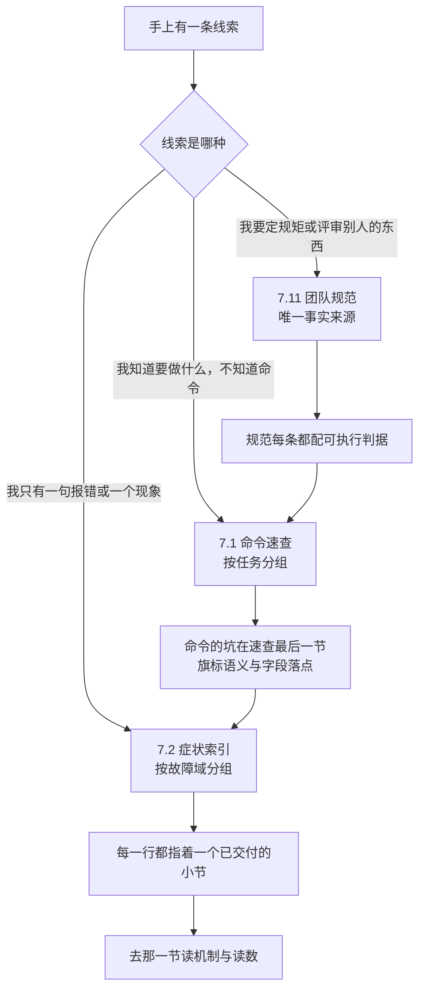
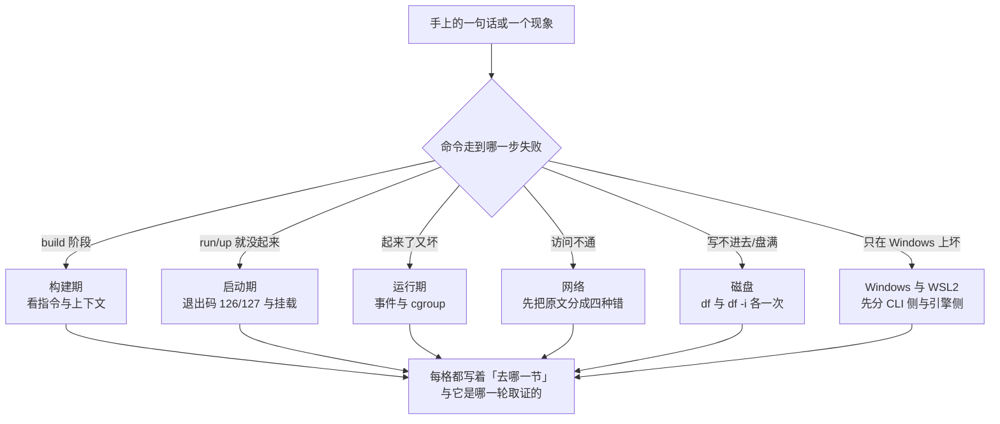

> **实战落点**：07 板块的收官篇，也是全库最后一片落地正文。前两篇排错手册教你**去哪查**（按故障域），这一篇三件事：给你一张**抄了就能用的命令速查**（7.1）、一张**一条报错 → 一个去处**的症状索引（7.2），以及把散落各章的规矩收成一处的**团队规范——全库唯一事实来源**（7.11，其它章节只链接不复述）。这一批必须最后写：速查表里的每一条命令、索引里的每一句原文、规范里的每一条判据，都只有在全库正文成型之后才敢说「本机验过」。
> **本机基线**：Docker Engine `29.8.0` / API `1.56`（MinAPI 1.40）、Go `go1.26.8`、Client `29.8.0 windows/amd64`、Compose **v5.5.1**、BuildKit/buildx **v0.37.0**；`docker info` 报 `Driver=overlayfs` + `DriverStatus=[[driver-type io.containerd.snapshotter.v1]]`（containerd 镜像存储）、`NCPU=24`、`MemTotal=50475270144`、`Cgroup=2`。本篇取数跑了**五轮**（L / L2 / M / N / O），一次性对象一律 `kb26` 前缀，跑完按名清净。
> **前置依赖**：[/docs/00-导读/怎么用这个库/使用指南与主线八站地图/](/docs/00-导读/怎么用这个库/使用指南与主线八站地图/)、[/docs/00-导读/把环境搭好/环境准备/](/docs/00-导读/把环境搭好/环境准备/)、[/docs/03-镜像构建/交出去/BuildKit私有仓库标签策略与构建排错/](/docs/03-镜像构建/交出去/BuildKit私有仓库标签策略与构建排错/)、[/docs/04-单机编排/定义/Compose语法基线与文件全字段参考/](/docs/04-单机编排/定义/Compose语法基线与文件全字段参考/)、[/docs/06-工程化与生产/运行基线/日志资源限制部署策略与回滚/](/docs/06-工程化与生产/运行基线/日志资源限制部署策略与回滚/)、[/docs/07-运维手册/按故障域排错/容器起不来与网络不通/](/docs/07-运维手册/按故障域排错/容器起不来与网络不通/)、[/docs/07-运维手册/按故障域排错/磁盘占满与镜像拉取失败/](/docs/07-运维手册/按故障域排错/磁盘占满与镜像拉取失败/)、[/docs/07-运维手册/按故障域排错/Windows与WSL2性能排查应急runbook与复盘/](/docs/07-运维手册/按故障域排错/Windows与WSL2性能排查应急runbook与复盘/)
> **本篇产出物**：一张**按任务分组**的命令速查（每条标了本机验证状态：真跑过 / 只在 `kb26-` 一次性对象上跑过 / 只核了语法 / 未执行），并附「这台引擎到底有哪些命令」的四组清单与一条**存在性判据**（`--help` 的 `rc=0` 不能作为证据，`trust` 与 `scp` 就是反例）；一张**六域症状索引**——构建期 / 启动期 / 运行期 / 网络 / 磁盘 / Windows 与 WSL2，每格是「报错原文关键字 → 判读 → 去哪一节」，且**每条原文都能指回本库的某一次取证**；7.11 的四套规范（镜像命名与标签、Dockerfile、`compose.yaml`、生产部署与评审 checklist）+ 它们的**可执行判据**（非法标签三种各一句原文、链上镜像 OCI label 的实际内容、`hadolint` 对同一份文件在两种阈值下的 rc 差）。
> **难度·耗时**：★☆☆～★★☆ · 70 分钟（速查与索引是「用」的章节，读它不如抄一次；动手部分建议只做三件事：跑一次存在性判据、跑一次 `# syntax` 那格、跑一次 hadolint 对照）
> **拓展接口**：4.2 那句「团队语法基线一句话结论」已按清单开放项 5 搬进本篇第 9 节，4.2 处只留链接；症状索引与 3.12 的构建排错表**双向对接**（构建期那一行直接指过去）；退出码与 137 的三条来源在 7.3，本篇只放检索入口；资源限制的语义在 5.3 与 6.3，Windows/WSL2 的边界在 7.7；评审 checklist 与段⑦ 那份「上生产准入清单」是同一条纪律的两种粒度。
> **自测三题**：
> 1. `docker trust --help` 返回 0。这台机器上有 `docker trust` 吗？你要用哪**两个**口径判，而不是那一个 rc？
> 2. `docker events --since 60` 想表达「最近 60 秒」。本机实际发生了什么？正确的写法是什么？
> 3. 一只从没设过 `--memory` 的容器，`docker update --memory 96m` 会成功吗？为什么建的时候给过 `-m 256m` 的容器却能成？

## 为什么这三章要合成一篇，而且必须最后写

三章体裁完全不同——速查表是**抄的**、症状索引是**查的**、团队规范是**守的**——但它们共用一个前提：**写下来的每一条都必须被人验过**。早写一批，就会出现「照着抄的结果在本机跑不通」这种对文档最致命的伤害。三个现场：

```text
「网上抄的 `docker trust inspect`，跑出来报 unknown command。」
「你的 `--help` 里它确实返回 0——因为未知命令会回落到总帮助。
 判存在要看的是『无参数直接调用』和『输出是不是跟 docker --help 一字不差』。」

「`--since 60` 不就是最近 60 秒吗？它怎么一直挂着不动。」
「它被当成 1970 年的第 60 秒。窗口从那时开，于是要把历史上所有事件重放一遍，
 然后继续等。你要的是 epoch 或者 RFC3339。」

「`docker update --memory 96m` 报『Memory limit should be smaller than already set memoryswap limit』。
 我上一只容器同样的命令是成功的。」
「那只建的时候给过 -m。这只从没设过 limits，memoryswap 就是 0——
 它在拿新的 memory 和『已经设过的 swap』比。」
```

三章的关系是一张检索路径图：



💡 新人小结（三张地图的用法）：把这三章想成手机里的三种查询——**速查表是键盘**（你已经知道要输入什么，只是记不住拼法）；**症状索引是搜索框**（你只知道「刚才是这个症状」）；**团队规范是公司章程**（你要判断的是「这么写行不行」）。所以它们不该按章顺序读，也不该被复述：任何一处把规范抄成第二份，规范就开始漂移，而漂移的规范比没有规范更糟——没人知道该信哪一份。

## 7.1 命令速查：先认清这台引擎到底有哪些命令

本节按清单要求给四样东西：**docker CLI 按分组的 cheat sheet**、**Compose 速查**、**Dockerfile 指令速查**、**常用一行流**（再往下的**脚本化版本见第八章**——那一层要的是可复制的脚本骨架，本篇只给单条命令与它的本机读数）。置顶这件事在站点里是可核对的：本篇 `weight: 1`、所在板块 `检索与规矩` 的 `_index.md` 也是 `weight: 1`，所以侧栏（sidebar）里它排在排错板块之前、在本板块里也是第一篇——**这就是清单那句「sidebar 置顶」的落地形态**。

`docker --help` 在本机是 100 行，分四组。分组本身就是一张能力地图：

| 组 | 条数 | 本机内容 | 用法判断 |
|---|---|---|---|
| Common Commands | 13 | `run exec ps build bake pull push images login logout search version info` | 日常主力；`build`/`bake` 已被 BuildKit 接管（见 3.9） |
| Management Commands | 23 | `builder buildx* compose* container context desktop extension image init manifest mcp* network plugin scout* system volume` … | 带 `*` 的是**插件**（可装卸）；`container/image/system/network/volume` 只是同一批能力的另一种入口 |
| Swarm Commands | 1 | `swarm` | 命令在，**集群没起**：任何 swarm 族调用都会撞 `This node is not a swarm manager` |
| 其余 core 命令 | 28 | `attach commit cp create diff events export history import inspect kill load logs pause port rename restart rm rmi save start stats stop tag top unpause update wait` | 容器生命周期本体；速查表里的大部分行都出自这一组 |

**一条判据要先立住**：`docker <cmd> --help` 的 `rc=0` **不能**证明命令存在。

| 探测 | `--help` rc | 输出是否等于 `docker --help` | 无参调用 | 结论 |
|---|---|---|---|---|
| `docker trust` | 0 | **是**（都是 100 行） | `rc=1 docker: unknown command: docker trust` | **不存在** |
| `docker scp` | 0 | **是**（100 行） | `rc=1 unknown command: docker scp` | **不存在** |
| `docker swarm` | 0 | 否（9 行） | `rc=0` 列出子命令 | 存在（但需要 `swarm init`） |
| `docker stack` | 0 | 否（13 行） | `rc=0` 列出子命令 | 存在（同上） |
| `docker config`（swarm 那个） | 0 | 否 | `rc=0` 列出子命令 | 存在；`docker config ls` 才撞 `This node is not a swarm manager`（`rc=1`） |
| `docker run` | 0 | 否（178 行） | `rc=1 'docker run' requires at least 1 argument` | 存在 |
| `docker ps` | 0 | 否（28 行） | `rc=0` | 存在 |

所以判存在性的正确口径是两条一起看：**无参调用给的原文**，以及 **`--help` 输出是否与总帮助逐字节相同（回落）**。本库早期那版草稿只看了 rc，把 `trust`/`scp` 误判成「有」——这条判据在 N 轮里先红后绿了一次。

## 容器与镜像：按任务分的一行流（每条标验证状态）

| 任务 | 命令 | 本机读数 / 坑 | 验证状态 |
|---|---|---|---|
| 看谁在跑、各占多少盘 | `docker ps -a -s --format '{{.Names}} {{.Size}}'` | `harbor-jobservice 1.84MB (virtual 237MB)`——`SIZE` 是**可写层**，`virtual` 才含只读层 | A 真跑 |
| 只看退出的容器 | `docker ps -a --filter status=exited -q` | 本机输出 0 行（清场后的正常状态） | A 真跑 |
| 一个容器改了哪些文件 | `docker diff <容器>` | 打出 `C /var/lib/logrotate`、`A /var/spool/…`——可写层内容一览 | A 真跑 |
| 看容器里的进程 | `docker top <容器>` | 表头 + 进程行；被 `pause` 的容器仍列进程 | A 真跑 |
| 拿发布端口 | `docker port <容器>` | `10514/tcp -> 127.0.0.1:1514`（Harbor 那行） | A 真跑 |
| 实时资源 | `docker stats --no-stream --format '{{.Name}} {{.CPUPerc}} {{.MemUsage}}'` | 分母是 1 核与「配额或整机」，两种口径见 7.8；**没有 `--filter`**，容器名是位置参数 | A 真跑 |
| 一条命令的历史 | `docker events --since <epoch-120> --until <epoch>` | 拿到 `exec_die`、`exec_create: …` 等真实事件；写法陷阱见下面「旗标坑」一节 | A 真跑 |
| 镜像清单带体积 | `docker images --format '{{.Repository}}:{{.Tag}} {{.Size}}'` | `localhost:8443/kbdemo/api:0.6.0 25.6MB`——SIZE **不能相加**（7.5 那条） | A 真跑 |
| 一个镜像的层 | `docker history --no-trunc <镜像>` | 层与 `CREATED BY` 全串 | A 真跑 |
| 镜像的摘要与来源 | `docker image inspect --format '{{json .RepoDigests}}' <镜像>` | 本机 `alpine` 的 `RepoDigests` 里同时挂着 `localhost:8443/kbdemo/probe@sha256:d9e853…`（同一 ID 两个来源） | A 真跑 |
| 把容器做成镜像 | `docker commit <容器> kb26/committed:v0` | 返回 `sha256:69e9ac45…`；**它会绕过你的 Dockerfile**，只用于取证不用于交付 | B 自建对象上跑 |
| 取文件出来 | `docker cp <容器>:/etc/hostname ./本地.txt` | rc=0；反方向同样可用 | B 自建对象上跑 |
| 离线搬镜像 | `docker save -o x.tar <镜像>` → `docker load -i x.tar` | 本机 3,639,296 字节产物；`load` 回读 `Loaded image: kb26/committed:v1` | B 自建对象上跑 |
| 取回退出码 | `docker wait <容器>` | 一只 `exit 5` 的容器：`wait` 打印 `5`（attached 跑的那次 rc 也是 5） | B 自建对象上跑 |
| 改运行中容器的限额 | `docker update --cpus 0.3 <容器>` | 立刻反映到 `cpu.max=30000 100000`，并写回 `HostConfig.NanoCpus`——**但不写回 compose 文件** | B 自建对象上跑 |

## Compose 速查：34 个子命令、两种调用，以及 `--dry-run` 的那句「看起来像真起了」

`docker compose --help` 的 `Commands:` 段解析出 **34 条**：

```text
attach build commit config cp create down events exec export images kill logs ls pause
port ps publish pull push restart rm run scale start stats stop top unpause up version volumes wait watch
```

| 要点 | 本机读数 | 用法 |
|---|---|---|
| `dry-run` **不是子命令** | `docker compose dry-run` → `rc=1 unknown docker command: "compose dry-run"` | 它是 `up`/`down` 的旗标 |
| 文件名不写 `-f` 只自动认三种 | `compose.yaml`/`compose.yml`/`docker-compose.yml`（+ 同目录 `compose.override.yaml` 自动合并）；非标准名必须 `-f`，一旦点名 `-f` 自动合并就失效 | 4.2 判据二那次的口径 |
| `ps` 在项目没起过时**输出表头、rc=0** | `NAME IMAGE COMMAND SERVICE CREATED STATUS PORTS`（一行数据都没有） | 脚本别用 `rc` 判「有没有起」，要数行 |
| `port` 要**数字端口** | `compose port app 60/udp` → `rc=1 strconv.ParseUint: parsing "60/udp": invalid syntax` | 先 `compose port app 8080` 再自己看协议 |
| `config --format` 只认 `yaml`/`json` | `--format '{{json .Services}}'` → `rc=1 unsupported format "{{json .Services}}"`；`--format bogus` 同样被拒 | 想要模板渲染就 `config` 出来再自己 `ConvertFrom-Json` |
| `--dry-run` 的输出与真跑一字不差 | `Container kb26nproj-app-1 Creating / Created / Starting / Started`——**但紧接着 `compose ps` 只有表头、`docker ps -a` 没有它、网络表里也没有 `kb26nproj_default`** | 判「干跑有没有落地」只能查 ps 与网络表，不能读它的输出 |
| `down -v` 会带走卷 | `Volume … Removing / Removed` + `Network … Removed` | 救援路径见 7.9 那条（先备份再谈 `down`） |

💡 新人小结（`--dry-run` 为什么骗人）：它打印的是**计划**，措辞与执行完全同款。所以凡是带 `--dry-run`/`--simulate`/`--print` 这类旗标，验收动作必须是「**去查副作用有没有发生**」——查 `ps`、查网络表、查卷表、查文件——而不是读它打了什么。本库 3.12 那条「`bake --print` 校验是假绿」是同一族。

## 构建速查：buildx 的子命令、17 条指令的落点、以及本机不能用的 `# syntax`

`docker buildx` 在本机 13 个子命令全部可用（`build bake du prune ls rm create inspect imagetools copy history version debug`）。两格速查级别的读数：

| 命令 | 本机结果 |
|---|---|
| `docker buildx du --summary` | **`rc=125 unknown flag: --summary`**——正确写法是 `--verbose`（帮助里写明它是 `--format=pretty` 的简写）；另有 `--timeout duration`（默认 20s） |
| `docker buildx ls` | `default` 与 `desktop-linux` 两个 builder；`PLATFORMS` 列是「此刻发现到的」快照，不能当能力上限（3.9 那条） |

**Dockerfile 指令面**用一份文件一次 build 覆盖 17 条，`rc=0`、`docker history -q` 给出 **17 层**，落点回读如下：

```console
FROM alpine:3.20 / ARG / LABEL / ENV / COPY / ADD / RUN / WORKDIR / USER / SHELL / RUN
EXPOSE 8080 / VOLUME /data / STOPSIGNAL SIGTERM / HEALTHCHECK --interval=30s --timeout=2s --retries=2 CMD true
ONBUILD ARG X=1 / ONBUILD RUN echo onbuild-ran / CMD ["echo","ok"]

docker image inspect --format '{{json .Config.Healthcheck}}'
  {"Test":["CMD-SHELL","true"],"Interval":30000000000,"Timeout":2000000000,"Retries":2}
docker image inspect --format '{{json .Config.OnBuild}}'
  ["ARG X=1","RUN echo onbuild-ran"]        ← 顶层 {{.OnBuild}} 没有这个键，正解在 .Config 下
以它为父镜像再 build  ->  rc=0，且 onbuild-ran 真的跑进子镜像的构建日志
```

四条速查级别的「本机这样才不踩」：

| 写法 | 本机原文 / 结果 | 怎么办 |
|---|---|---|
| 指令大小写混用（`FROm alpine:3.20`） | **build `rc=0`**，只出 lint 提示 `ConsistentInstructionCasing: Command 'FROm' should match the case of the command majority (uppercase)` | 大小写不影响解析，只影响人和 hadolint；别把「能 build」当「写对了」 |
| 未知指令（`FOO bar`） | `rc=1 ERROR: failed to build: failed to solve: **dockerfile parse error on line 2: unknown instruction: FOO (did you mean FROM?)**` | 引擎会猜你要写什么；索引里那句就是这个串 |
| `ADD` 一个 URL | `rc=1 failed to solve: failed to load cache key: Get "https://example.invalid/x.txt": EOF` | 本机网络域内取不到；URL 形式的 `ADD` 走的是 BuildKit 自己的取源，不继承 daemon 代理（3.9） |
| `# syntax=docker/dockerfile:1.7` 写在**第一行** | **`rc=1`**：`…service=registry.docker.io": dial tcp 157.240.9.36:443: connectex: A connection attempt failed…` | 它要先去 registry 取 frontend 镜像，而本机 BuildKit 出网不通 → **本库的示例文件一律不写 syntax 指令**；写在别处（非第一行）则被当普通注释、静默无效 |
| `COPY --link`、`RUN --mount=type=cache` | 两条都 `rc=0`（前提是文件真的在上下文里——上一轮 `--link` 报 `"/a.txt": not found` 就是上下文里没有该文件，不是旗标不支持） | 报 `failed to compute cache key` 先查上下文，别先怀疑 BuildKit |
| `USER nobody` 之后的 `/root` | 同一份文件里 `COPY a.txt /root/…` 后接 `USER nobody` 再 `RUN [ -f /root/a.txt ]` → **失败**；去掉 `USER` 就成功 | `--link` 之外这条也是「先造对象后查询」类假故障的常见来源：换用户后能不能进目录是另一件事 |

## 旗标与字段的坑：这些写法在本机给你什么原文

速查表最容易害人的是「命令没错，旗标语义不是你以为的」和「模板没错，字段不属于这类对象」。这一节全是本机原文：

| 你想做的 | 常见写法 | 本机实际给的 | 正确写法 |
|---|---|---|---|
| 看最近 60 秒的事件 | `docker events --since 60` | **一直挂着**：它被当作 epoch 秒 60（1970 年），于是要重放全部历史再等下去（20 秒超时被掐时 stdout 已有 281 行） | `--since <epoch>` + **必带** `--until <epoch>`；或 RFC3339 对 |
| 给一个结束时间 | `--since 60 --until 1` | `rc=1` + `request returned 400 Bad Request for API route and version …?since=60&until=1, check if the server supports the requested API version`（`until` 早于 `since` 就是这个 400） | 两个都是 epoch 且 `until > since` |
| 想只看窗口 | `--since <绝对过去> --until 2030-01-01T00:00:00` | **挂住 60 秒被掐**：结束时间在未来 = 继续等 | `--until` 给过去时刻 |
| 改运行中容器的内存 | `docker update --memory 96m <c>`（这只从未设过 limits） | `rc=1 … Memory limit should be smaller than already set memoryswap limit, update the memoryswap at the same time` | `--memory 96m --memory-swap 96m` 两个一起给（建时给过 `-m 256m` 的那只单给能成，差别就在「已有的 swap 是多少」） |
| 读镜像的运行状态 | `docker inspect --format '{{.State.Status}}' alpine:3.20` | `rc=1 map has no entry for key "State"` | `.State` 属于**容器**；镜像用 `image inspect` 读 `.RepoTags`/`.RepoDigests`/`.Config.*` |
| 按旧文档读镜像字段 | `docker image inspect --format '{{.Repository}}'` | `rc=1 map has no entry for key "Repository"` | 用 `.RepoTags` 或 `.RepoDigests` |
| 读存储驱动细节 | `docker inspect --format '{{.GraphDriver.Name}}'` | `rc=1 map has no entry for key "GraphDriver"`（containerd 存储没有这一层） | 问容器里的 `/proc/1/mountinfo`（7.5 那条） |
| 数容器数 | `docker stats --filter name=x` | 用法错误：`stats` **没有 `--filter`**，容器名是位置参数 | `docker stats --no-stream <name>`；全量列表用 `docker ps` |
| 拿 PIDs 列 | `docker stats --format '{{.Pids}}'` | `rc=1 can't evaluate field Pids in type *container.statsContext`（默认输出里**有** PIDS 列，`--format` 里没这个字段） | 想要 PIDs 就不带 `--format` |
| 读 stoppedat | `--format '{{.State.StopTime}}'` | `rc=1 map has no entry for key "StopTime"` | `.State.FinishedAt` |
| 抓事件属性 | `docker events --format '{{.Attributes}}'` | `rc=1 can't evaluate field Attributes in type *events.Message` | `.Actor.Attributes`（die 的退出码在 `exitCode` 里） |
| 容器内测 HTTP | `docker exec <c> curl …`（alpine） | `sh: curl: not found`（`rc=127`） | BusyBox `wget -q -T 5 -O-`；`rc=127` 是没命令，不是连不上 |
| 让 wsl 输出可读文本 | `powershell -c "wsl -l -v"` | 每个字符后面跟一个空格的混码 | 直接 `subprocess` 调 `wsl` 并塞 `WSL_UTF8=1` |
| 挂当前目录进容器 | `-v $PWD:/work`（字面量传进去） | `rc=125 … If you intended to pass a host directory, use absolute path` | 传**展开后的绝对路径**；Git Bash 里 `$PWD` 还可能被 MSYS 改写（本库第 14 条） |
| 日志读到空 | `docker logs harbor-log` | **`rc=0` 且 0 字节**，而 `LogConfig.Type=json-file`、容器在跑、`docker top` 有进程 | 空的来源是「应用往自己的文件里写」而不是 stdout（7.5 的日志来源那一节）；`rc=0` 与「有日志」是两件事 |

## 7.2 症状索引：一条报错 → 一个去处

本节是**一张大表**（按故障域拆成六张，**覆盖构建期、启动期、运行期、网络、磁盘、Windows/WSL2 六个域**）：**现象（含报错原文关键字）→ 去看哪一节**，并与 3.12 那张构建排错表**双向链接**。判据原文是「值班时一条报错 → 一个章节，不需要翻第二页」，所以用法只有一条：**拿你手上那句原文去匹配「关键字」列**，命不中就把现象描述塞进搜索框；每一行的「去处」都已经是交付过的小节，**不需要翻第二页**去别处找入口。括号里标的是这条原文在本机的取证轮次。

先进六域的分流，再进对应那张表：



### 构建期

| 报错关键字（原文片段） | 判读 | 去处 |
|---|---|---|
| `dockerfile parse error on line N: unknown instruction: X (did you mean FROM?)` | 指令拼错或写了不存在的指令 | 3.12 / 本篇构建速查（L 轮） |
| `ConsistentInstructionCasing` | 只是 lint 提示，build 照样 `rc=0` | 7.11 的 hadolint 那一格（L 轮） |
| `failed to compute cache key … "/x": not found` | 上下文里没有这个文件（`.dockerignore` 或路径写错） | 3.3 / 3.12（L 轮） |
| `failed to load cache key: Get "https://…": EOF` | `ADD <URL>` 走 BuildKit 自己的取源，本机不通 | 3.9 代理那一节（L 轮） |
| `failed to solve: process "/bin/sh -c …" did not complete successfully: exit code: N` | 是 RUN 自己失败，N 就是那条命令的退出码 | 3.12 / 7.3 的退出码表（L 轮） |
| `invalid reference format: repository name (…) must be lowercase` | 标签或仓库名不合法（大写） | 3.11 / 7.11 命名那一节（M 轮） |
| `unsupported format "…"` | `compose config --format` 只认 `yaml`/`json` | 4.2 / 本篇 Compose 速查（O 轮） |
| `unknown flag: --summary` / `unknown flag: --scale` | 旗标不属于这条命令 | 本篇旗标坑一节（L 轮、批 14） |

### 启动期

| 报错关键字（原文片段） | 判读 | 去处 |
|---|---|---|
| `exec: "X": executable file not found in $PATH`（`rc=127`） | 入口命令在镜像里不存在 | 7.3 退出码 127（批 17、L 轮） |
| `exec: "/etc": is a directory: permission denied`（`rc=126`） | 入口是个目录 | 7.3 退出码 126（批 17、L 轮） |
| `No such image: <name>` | 镜像没构建/没拉；`up --no-build` 时 compose 会安一个 `<项目>-<服务>:latest` 去拉 | 7.3 / 段⑤⑦ 那条更正（批 16） |
| `Bind for 0.0.0.1:PORT failed: port is already allocated` | 端口撞车（含别人的进程） | 7.4 端口那一节（批 14） |
| `mkdir() "/var/cache/nginx/client_temp" failed (30: Read-only file system)` | `read_only` 没配可写点；注意 `up` 的 rc 仍是 0 | 6.3 / 段⑦（批 16） |
| `path / is mounted on / but it is not a shared or slave mount` | `rslave`/`rshared` 挂法在本机被拒 | 6.5 挂载那一节（批 15） |
| `required variable X is missing a value` | `${X:?}` 生效，变量没给；`--env-file` 是替换不是叠加 | 4.2 / 段⑦（批 16） |
| `failed to read <file>: line 1: unexpected character ";" in variable name "…"` | env 文件里有非法变量名（分号开头） | 2.8 / 7.11（O 轮。**注意**：本库更早记录的是 `invalid env file … contains whitespaces`，同一类错误在版本间换了措辞） |
| `failed to create task for container: failed to create shim task` | 容器根本没起来，下一句才是要害（常见是 cgroup 文件不存在） | 7.3 / 5.3（批 14） |
| `io.weight: no such file or directory` | `--blkio-weight` 在本机起不来（调度器不提供权重通道） | 5.3 / 7.8（批 14） |
| `Memory limit should be smaller than already set memoryswap limit` | 只改 `--memory` 而没同时给 swap | 6.3 / 本篇旗标坑（L、N 轮） |

### 运行期

| 报错关键字（原文片段） | 判读 | 去处 |
|---|---|---|
| `Error response from daemon: container <id> is not running` | `exec`/`kill`/`logs -f` 打在已停的容器上 | 7.9 停机矩阵（批 14、批 20） |
| `error: no such object: <name>` | 对象已被删（`rm -f` 之后 inspect 就是这个） | 7.9（批 14、批 20） |
| `OCI runtime exec failed: … unable to start container process` | 容器活着但那条命令起不来 | 2.3 / 7.3（批 16） |
| `sh: can't fork: Resource temporarily unavailable` | 撞上 `--pids-limit`，脚本以 `rc=2` 中断 | 5.3 pids 那一节（批 14） |
| `Memory cgroup out of memory: Killed process <pid> (<name>)` | memcg 干的，`oom_kill` 会随容器重启归零 | 7.3 的 137 / 段⑦ dmesg 差集（批 16） |
| 退出码 `137` 而 `OOMKilled=false` | 不是内存：宽限到点被 KILL，events 里有第二条 `kill sig=9` | 7.9 停机矩阵（批 20） |

### 网络

| 报错关键字（原文片段） | 判读 | 去处 |
|---|---|---|
| `wget: bad address '<name>'` | 解析层失败（服务名不在同一网络、或默认 bridge 没有内置 DNS） | 7.4 DNS 那一节（批 17） |
| `wget: can't connect to remote host (IP): Network unreachable` | 路由不存在——典型是 `--internal` 网络 | 段⑧ 构造②（批 19） |
| `Connection refused` | 对端机器对、端口没开 | 7.4 / 7.7（批 19、批 20） |
| `wget: download timed out` | **跨网络按 IP 直连**：被 filter 表 `DOCKER` 链里每张桥一条的 `! -i br-X -o br-X -j DROP` 丢掉（批 21 用 `iptables-save -c` 前后差值坐实：ping 5 个包，那条 DROP +5，入口桥抓得到、出口桥零包）。放行只有多宿主或改 `DOCKER-USER` 两条路 | 7.4（批 17 现象）+ 5.5（批 21 机制，见 [/docs/05-原理深入/网络与运行时/网络底层跨主机方案与运行时生态/](/docs/05-原理深入/网络与运行时/网络底层跨主机方案与运行时生态/)) |
| `Host is unreachable` | 地址就不是它——猜网关 IP 的典型后果 | 7.7 三种走法（批 19） |
| `failed to initialize logging driver: dial tcp: lookup X on 192.168.65.7:53: no such host` | 日志驱动的地址由 **daemon** 解析，不走容器 DNS | 6.3（批 14） |
| `endpoint with name <c> already exists in network <n>` | 要先 `disconnect` 再 `connect --alias` | 7.4 别名那一节（批 17） |
| `You don't have permission to perform this capture on that device` | 抓包被拒——要的是 `NET_RAW`（默认已含） | 7.4 tcpdump 那一节（批 17） |
| `.IPAddress` 读出 `invalid IP` | 容器已停或已从该网络断开——这是**状态**不是故障 | 7.4（批 17） |
| 从宿主机访问容器 IP：`HTTP=000` | 容器地址不出这台 VM | 7.7（批 17、批 19） |

### 磁盘

| 报错关键字（原文片段） | 判读 | 去处 |
|---|---|---|
| `No space left on device`（`dd: error writing` / `sh: write error:` / `cp: write error:` / `gzip: write error:` + `tar: write error: Broken pipe`） | 空间满；再查 `df -i` 排除 inode 耗尽；容器不会因此被杀 | 7.5 与段⑧ 构造③（批 19） |
| `failed to mount local volume: mount …: operation not supported` | 远端类型卷（NFS）在 `volume create` 时不报错，**第一次挂才失败** | 7.7 的 NFS 那一格（批 19） |
| `volume is in use - [<容器 id>]` | 卷还被容器引用，`-f` 也拒 | 7.5 / 6.6（批 15） |
| `Total reclaimed space: 0B` | prune 没东西可清（不带 `-a` 不碰有标签的镜像；label 过滤不改变这点） | 7.5 清理边界（批 18） |

### Windows 与 WSL2

| 现象或原文 | 判读 | 去处 |
|---|---|---|
| `failed to connect to the docker API at npipe:////./pipe/<名字>; … The system cannot find the file specified.` | 引擎不在（命名管道没了），CLI 侧问题不在你的命令 | 7.9 第一条（O 轮现场复现） |
| `error during connect: Get "http://127.0.0.1:PORT/v1.56/…": … actively refused it` | `DOCKER_HOST` 指向没人听的端口 | 7.9 / 0.3（O 轮） |
| `curl -o /dev/null` 给 `rc=23` 而 `HTTP=200` | Windows 侧写文件失败，不是连不上 | 7.7 那一族（批 19） |
| `wsl` 输出是逐字符空格的混码 | 编码，不是数据坏了 | 7.7（批 19） |
| `project name must not be empty` | compose 文件不写 `name:`，而目录名不是合法项目名（本机用中文目录复现） | 4.2 / 7.11（O 轮复现） |

💡 新人小结（索引为什么写「原文片段」而不是「错误码」）：容器这一路的失败，**信息量几乎全在那句原文里**——同一个 `rc=1` 上面六行索引都能命中，而它们的原因天差地别。所以值班时第一件事是把**一整句**抄下来（含冒号后面那段），而不是记下「启动失败了」。这也是 7.9 每条 runbook 都要求「处置动作先取证再动手」的原因。

## 7.11 团队规范：全库唯一事实来源就在这一节

本节的身份是「**全库唯一事实来源**」——**其他章节只链接不复述**，为的就是**防止规范在多处漂移**。先接上开放项那笔账：**4.2 里那句话正式搬到这里**，4.2 处只留一个链接（那节从「结论」改成「为什么这么定」，两条实测证据留在原处）：

> **Compose 语法基线（唯一事实来源）**：统一用 `docker compose`（v2 实现）；文件名统一 `compose.yaml`，开发期覆盖写 `compose.override.yaml`；**不写顶层 `version:`**；顶层显式写 `name:`；口令一类的值一律走 `.env` 或注入，不进文件。

四条各配一条本机判据（都能当场验）：

| 规范条目 | 可执行判据 | 本机证据 |
|---|---|---|
| 用 `docker compose` 不用 `docker-compose` | `docker compose version` 有读数；仓库脚本里不出现带连字符的旧命令 | `Docker Compose version v5.5.1`（本篇 0 节） |
| 不写顶层 `version:` | `docker compose config` 不报废弃字段；旧写法只出现在历史对照里 | 4.2 那张「写错法哪些被 `config` 拦住」表 |
| 顶层显式写 `name:` | `docker compose -f <文件> config --quiet` 在不带 `name:` 的目录下 `rc=1`，补上即 `rc=0` | O 轮中文目录那次复现 |
| 口令不进文件 | `grep` 服务目录里的 `compose*.yaml` 命中 0 条明文口令；缺变量时 `config` 当场红 | 段⑦：漏传 `--env-file` 时报 `required variable DB_ROOT_PW is missing a value` |

**镜像命名与标签**：

| 条目 | 规范 | 本机判据 |
|---|---|---|
| 仓库名 | 全小写，`<注册中心>/<项目>/<服务>`，不含大写与空格 | `docker tag alpine:3.20 kb26/Bad:V1` → `rc=1 … repository name (kb26/Bad) must be lowercase` |
| 标签形态 | 语义版本 + 构建元信息用 `-g<sha>` 而不是 `+`（`+` 会被拒） | `kb26/meta:1.0+abc` → `rc=1 invalid reference format`；而 `kb26/ok:1.0.0-g0-fresh` → `rc=0` |
| 每个交付镜像带三个 OCI label | `org.opencontainers.image.{revision,source,version}` | 链上镜像实际内容：`revision=5104a20c8f67…（40 位提交号）`、`source=file:///…/贯穿示例`、`version=0.6.0` |
| `latest` 只做默认别名 | 部署引用一律钉具体标签 | 段⑤ 那条「删光本地再 pull」的判据要求标签可反查 |

**Dockerfile 规范**（每条都有 lint 或 build 可对）：

| 条目 | 判据 | 本机证据 |
|---|---|---|
| 基础镜像钉具体标签 | `hadolint` 报 `DL3006 Always tag the version of an image explicitly` | M 轮：对 `FROM alpine` + 裸 `RUN` 那份文件 → `rc=1` 并列出 DL3006 |
| 指令大小写统一大写 | lint 提示 `ConsistentInstructionCasing`（**不改变 rc**） | L 轮：`FROm` 那次 build `rc=0` |
| 不写 `# syntax=`（本库基线） | 写了就在 BuildKit 取 frontend 时失败 | L 轮 `rc=1 dial tcp …:443: connectex` |
| 依赖层与代码层分开、多阶段出产物 | 体积与「改一行后的重建命中数」两张表 | 3.5~3.8 那篇的前后对照表 |
| 入口能接住 `SIGTERM` 或显式 `--init` | 停机矩阵那一列「有没有第二条 `kill sig=9`」 | 7.9（批 20） |

**生产部署与评审 checklist**（比段⑦ 那份准入清单更粗，覆盖「谁来定、怎么验」）：

| # | 检查项 | 谁签字 | 判据（能当场跑的） |
|---|---|---|---|
| 1 | compose 文件顶层有 `name:`，且不写 `version:` | 提交人 | `config --quiet` `rc=0` |
| 2 | 每个服务钉具体标签，镜像带 OCI `revision` | 提交人 | `image inspect` 能取到 40 位提交号 |
| 3 | 资源三项（CPU / 内存 / pids）有显式值 | 负责人 | 容器内 `cpu.max`、`memory.max`、`pids.max` 不是 `max`/空 |
| 4 | 停机路径写明宽限 | 负责人 | `stop_grace_period` 存在；实测收尾耗时 < 宽限（本机默认只有 **3 秒**，见 7.9） |
| 5 | 日志有轮转或外置驱动 | 运维 | `inspect .HostConfig.LogConfig` 带 `max-size`，或写明驱动去向 |
| 6 | 没有把 `prune`/`down -v` 放进流水线 | 运维 | 仓库脚本 grep 命中 0；备份链在 6.6 |
| 7 | 规范只在 7.11 出现一次 | 评审 | 其它章出现同一句话时必须改成链接（本库那条具名引用检查脚本管的就是这类漂移） |

## 规范怎么不被抄走：漂移的成因与两条可执行的防线

**唯一事实来源**这条要求本身不产生命令行，它靠两条纪律撑着：

| 防线 | 做法 | 本库的实现 |
|---|---|---|
| 复述检测 | 「具名小节指代」必须命中真实标题；标题被改过就要报错 | 站点判据之外常驻的那支具名引用检查脚本（本批跑过：`小节指代共查 20 处 / REFS_OK`） |
| 规则可执行化 | 规范里每条「要求」后面跟一条能红的判据 | 段⑧ 的 `复盘库自检.py`（`--selftest` 一份好样本 + 八个坏样本 → `SELFTEST_PASS`）与本篇那张「命名/标签/label/lint」三列判据表 |

一条反面例子值得留着：本篇 4.2 那句话原本两处都写了完整版本。搬过来之后如果 4.2 仍留着全文，将来改规范就会只改一处——而**改文档的人只看得到自己手上那一份**。这类漂移不会因为「我们写了规范」而消失，只会因为「规范只有一份」而消失。

## 本篇不覆盖什么

按 W6 的规矩，本篇**故意不讲**的东西逐条点名去处——写「不覆盖」不是免责声明，是防止你在这一篇里找不存在的答案：

- 报错背后的机制解释 → 见 **5.1**（`namespace` 与 cgroup 怎么框住进程在那一篇）
- 完整排错顺序与判据 → 见 **7.3**（`分段排查` 在那一篇逐段展开）
- 术语的权威定义 → 见 **8.4**（`术语表` 的三条纪律与全量条目在那一篇）
- 版本兼容与「登记≠生效」的清单 → 见 **8.6**（`登记≠生效` 那一节是唯一事实源）
- 存储类故障的现场分流 → 见 **10.8**（`分流表` 与四类故障在那一篇）
- 高频问题的问答体 → 见 **9.1**（`FAQ` 按你心里的问题进，那张分工说明在那一篇）

## 本篇未验证项

| 项 | 状态 | 原因（以及要验证得动什么） |
|---|---|---|
| `swarm` / `stack` / `service` / `secret` / `config` 的真实行为 | 未测 | 本机是单节点、没 `swarm init`；只测到「命令存在 + 调用即 `This node is not a swarm manager`」。速查表把它们标在 Swarm 组而不是删掉，就是为了不误导 |
| `docker trust`、`docker scp` | 本机**不存在**（已证） | 判据：`--help` 回落到总帮助 + 无参调用 `unknown command`。它们属早期插件生态，别再抄进脚本 |
| 未闭合引号那类 Dockerfile 语法错的原文 | 未取得 | O 轮那次探针的命令我写错了（多给了一个位置参数，拿到的是 `'docker buildx build' requires 1 argument`），**不能**当作未闭合引号的证据；索引里因此只收 `unknown instruction` 那一格 |
| `env` 文件在更早引擎版本里的措辞 | 只记录了「措辞会变」这一事实 | 本库早期日志里是 `invalid env file … contains whitespaces`，本机 29.8 给的是 `unexpected character ";" in variable name`。没有旧版本可比对，不写成「版本 A 就是这句话」 |
| `--format '{{.Pids}}'` 在别的引擎版本是否可用 | 未测 | 本机 29.8 报 `can't evaluate field`，默认输出却有 PIDS 列；只登记本机现象 |
| `# syntax=` 在能出网的环境 | 未测 | 本机 BuildKit 取不到 frontend 镜像；结论只到「本库示例一律不写」 |
| Windows 上 `-p [::1]:…` 显式 IPv6 发布 | 未测 | 7.7 只证到「只绑 v4 时 `[::1]` 连不上」 |
| 引擎不可达时 `docker` 与 `docker compose` 的全部命令差异 | 部分 | O 轮用 `DOCKER_HOST` 指向不存在的管道/端口各测了 `ps` 与 `version`；`compose` 侧只测到「同样报错」，没有逐条铺 |

## 要点总结

- **判命令存在有两个口径**：无参调用的原文，加上「`--help` 输出是否与 `docker --help` 逐字节相同」。`--help` 的 `rc=0` 会骗人——`trust` 与 `scp` 都是回落成总帮助的反例。
- **本机能力分四组**：Common 13 条 / Management 23 条（带 `*` 的是可装卸插件）/ Swarm 1 条（命令在、集群没起，调用即 `This node is not a swarm manager`）/ core 28 条。
- **`docker compose` 在本机 34 个子命令**，但 `dry-run` 是旗标不是子命令；`ps` 在项目没起过时给表头且 `rc=0`，脚本要数行不能看 rc；`port` 只接数字端口；`config --format` 只认 `yaml`/`json`。
- **`--dry-run` 的输出与真跑一字不差**（`Created/Starting/Started` 全都打），验收必须去查 `ps` 与网络表——本机实测：干跑之后网络表里没有 `kb26nproj_default`，真 `up -d` 之后才有。
- **`events` 的时间参数是 epoch 或 RFC3339，不是「多少秒前」**：`--since 60` 被当成 1970 年，于是重放全部历史并继续挂着；`--until` 早于 `--since` 给 400，`--until` 在未来一样挂死。
- **`docker update` 单给 `--memory` 在「这只容器从没设过 limits」时被拒**（`Memory limit should be smaller than already set memoryswap limit`），必须连 `--memory-swap` 一起给；建时给过 `-m` 的那只能单给——差别就在已有的 swap 上限。
- **模板字段要认对象**：`.State`/`.NetworkSettings` 属容器，镜像侧用 `.RepoTags`/`.RepoDigests`/`.Config.*`；`.Repository`、`.GraphDriver`、`.State.StopTime`、`{{.Pids}}`、events 的 `.Attributes` 在本机全部报错（正解分别是 `RepoTags`、问 `mountinfo`、`FinishedAt`、不带 `--format`、`.Actor.Attributes`）。
- **Dockerfile 指令大小写只影响 lint 不影响 build**（`FROm` 那次 `rc=0`）；未知指令给 `dockerfile parse error on line N: unknown instruction`；`COPY --link` 与 `RUN --mount=type=cache` 本机可用，报 `failed to compute cache key` 先查上下文；`# syntax=` 在第一行会让 BuildKit 去 registry 取 frontend——本机取不到，因此本库示例一律不写。
- **17 条指令一次 build 能出 17 层**，`HEALTHCHECK`/`ONBUILD` 的落点分别在 `.Config.Healthcheck`（`CMD-SHELL` + 纳秒级 Interval）与 `.Config.OnBuild`，顶层没有 `.OnBuild` 这个键；ONBUILD 只在「以它为父镜像再 build」时才真跑。
- **症状索引只收能指回取证的原文**：本批 M 轮 43 条计划里 37 条命中、O 轮补造 4 条，剩下 1 条判为「设置键不是报错」不进索引、1 条因我探针写错未取得并如实标注——**同一类错误在不同版本里措辞会变**（env 文件那例），所以索引每格都带版本与轮次。
- **规范只能有一份**：4.2 那句语法基线已搬入本节，4.2 处只留链接；每条规范后面都跟着一条能当场跑的判据（小写仓库名、`-g<sha>` 而非 `+`、三个 OCI label 的实际内容、hadolint 在 `warning` 与 `--failure-threshold error` 两种阈值下的 rc 差就是闸门语义的证据）。
- 本批同样**没停 Docker Desktop、没改 daemon 配置、没跑任何宽口 prune**；`kb26*` 的一次性容器/镜像/卷/网络与三个临时目录跑完全部按名清净，Harbor 九个容器全程在跑。
