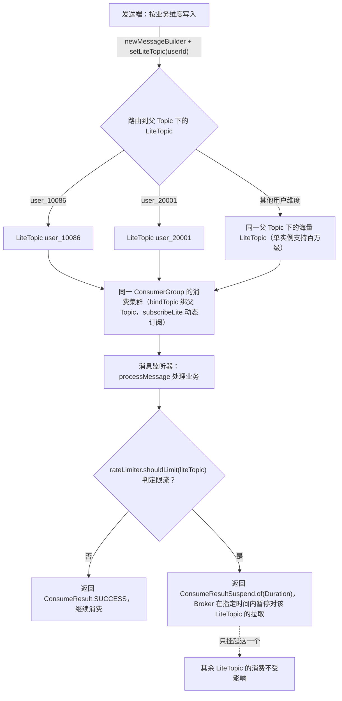
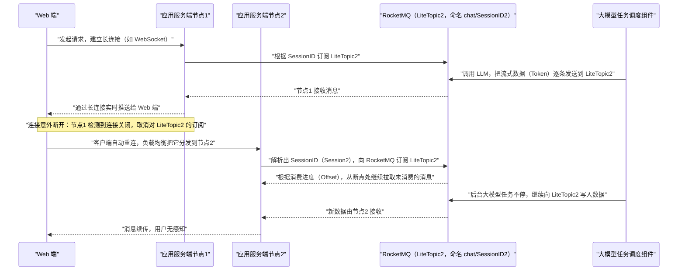

## 为什么需要 LiteTopic 实践？（痛点引入）

AI 应用把消息队列的老问题放大了十倍：任务动辄跑几十秒（GPU 推理）、一次对话要连续推几百个 Token、用户一掉线整条上下文就作废。三篇 5.0 上游实践文档（细粒度限流、分布式会话状态管理、多智能体异步通信）不约而同指向同一个诉求：**隔离与状态管理的粒度要从「主题」下沉到「单个用户 / 单次会话 / 单个任务」，而这个粒度上用普通 Topic 太贵、用 Kafka 分区太脆。**

| 维度 | 只有普通 Topic / 传统方案的痛苦 | 用上 LiteTopic 三套实践之后 |
|------|----------------------------------|------------------------------|
| 限流粒度 | 为一类用户单独建 Topic 和消费组，或只能对整体限流 | 每个用户/任务类型一个 LiteTopic，返回 Suspend 只挂起目标队列，毫秒级精准限流 |
| 资源开销 | Topic/Group 属重资源，创建后要完成连接初始化，影响收发平滑性 | LiteTopic 无需预先创建，写入时自动生成、空闲按 TTL 自动清理，单实例可支持百万级 |
| 会话容灾 | 会话状态绑在某个应用节点上，断线重连到别的节点就接不上 | 会话对应一个 LiteTopic，任意节点重新订阅同一 LiteTopic 即可按消费进度续传 |
| 多智能体通信 | 长耗时 AI 任务用同步调用，线程阻塞、扩展性差 | 请求走各子 Agent 的请求主题，响应写入响应主题下的 LiteTopic，全程异步解耦 |
| 结果正确性 | 流式响应乱序到达，前端渲染错乱 | 同一个 LiteTopic 下的消息是顺序的，保障流式响应结果的正确性（5.0 源原文） |

> ### 💡 新人小结：LiteTopic 到底是个什么东西？
>
> 把普通 Topic 想象成餐厅的「包间」：建一个要装修、要排号、要配一套服务员（Topic/Group 属重资源，创建后生产消费者要完成连接初始化）。LiteTopic 则是大厅里的一号牌桌卡：客人来了随手摆一张（写入自动生成）、客人走了收走（空闲按 TTL 自动清理）、桌与桌的菜互不串（物理隔离）、但都归同一个服务组管（同一 ConsumerGroup 共享线程池）。
>
> **LiteTopic 把「一个业务维度一个容器」的成本从装修包间降到摆一张桌卡，隔离粒度才能真正下沉到用户/会话/任务级。**
>
> LiteTopic 在领域模型中的正式定义与消息类型约束，归 `02-core-concepts/领域模型/主题队列与消息模型`；本文只讲三套实践与配置。

**学习路线图**（三套实战各自独立成节，均按「背景与挑战 → 解决方案 → 操作步骤/关键技术」推进）

```
实战一 细粒度限流 → 实战二 分布式会话 → 实战三 多智能体 → 共性总结
按用户挂起消费      按会话断点续传        按任务异步收发      一张表看三个方案
```

---

## 开始之前：三套实践共用的配置底座

以下配置项全部出自 5.0 限流实践一篇（上游原文照录），是三个场景共同依赖的「开机条件」：

| 配置项 | 写在哪里 | 取值与口径（上游原文） |
|--------|----------|------------------------|
| `message.type=LITE` | 创建父 Topic 的 API | 用于开启 LiteTopic 能力，消息类型选择「轻量类型（Lite）」 |
| `lite.topic.expiration` | 创建父 Topic 的 API | LiteTopic 空闲清理时间，**单位为分钟**；默认值 **`-1` 表示不启用空闲清理**，正数配置最大为 **`43200` 分钟（30 天）**；示例配置 1440 分钟（1 天） |
| `lite.bind.topic` | 创建消费组的 API | 将 LiteTopic 消费组绑定到父 Topic |
| `lite.sub.model` | 创建消费组的 API | LiteTopic 订阅模式：`Shared`（**默认**）允许同一 Group 下多个 Consumer 共同持有同一个 LiteTopic 的订阅并分摊消费；`Exclusive` 让同一个 LiteTopic 在同一时刻只归属一个 Consumer |

```yaml
# ========== ✅ 推荐：上游示例配置的父 Topic 与消费组（值照录源文档） ==========
# 父 Topic（承载所有 LiteTopic，一个父 Topic 下可承载百万级 LiteTopic）
topic: "rate-limit-parent-topic"     # 名称（上游示例值）
message.type: LITE                   # 开启 LiteTopic 能力
lite.topic.expiration: 1440          # 空闲过期时间，单位分钟（1 天）；-1 为不启用清理

# 消费组（所有消费机器共用该 Group）
group: "GID_rate_limit_consumer"     # 名称（上游示例值）
lite.bind.topic: "rate-limit-parent-topic"
lite.sub.model: Shared               # Shared（默认）或 Exclusive，按业务选择

# ========== ❌ 不推荐（上游点名的传统方案一，见实战一「背景与挑战」） ==========
# ❌ 为每个用户 ID 或任务类型创建独立的 Topic 和 ConsumerGroup，并为每个 ConsumerGroup
#    启动对应的消费者实例：Topic/Group 属重资源，创建后需完成连接初始化，影响收发平滑性
```

> [!NOTE] 版本适用：LiteTopic 是 5.0 系特性
> 本文三套实践的全部源文件均来自 5.0 文档目录（06-bestPractice 下的 02ratelimit / 03session / 04multiagent）。本复刻工程的 4.x 文档全集中检索不到 LiteTopic 相关章节，因此本文所有配置项、API 写法都是 5.0 语境结论，不得回填到 4.x 集群上尝试。

---

## 实战一：基于 LiteTopic 的任务细粒度隔离和限流

### 背景与挑战

在 AI 推理和业务处理场景（图片生成、视频渲染、大规模计算等）中，后端服务依赖 GPU 等高成本计算资源。平台方在算力有限的前提下要优先保障重要用户或关键任务类型的服务质量，同时应对上游列出的六项典型挑战：

1. **资源隔离**：重要客户或关键任务的请求需独占处理资源池，避免与其他流量混用。
2. **流量互不干扰**：同等优先级的客户之间相互隔离，防止单一客户的突发流量挤占资源、导致其他客户长期排队。
3. **动态订阅管理**：用户 ID 列表或任务类型列表实时变化，下游消费者需动态调整订阅关系，新增或移除订阅目标。
4. **细粒度限流**：某一类型或某一用户的请求量超过最大处理能力时，针对该维度单独暂停消费、退避处理，不影响其他维度。
5. **集群级流量治理**：集群整体处理能力到上限时，识别并暂停 Top 流量队列的消费，等扩缩容完成再逐步恢复。
6. **削峰填谷**：平滑波动较大的请求流量，保障后端服务的稳定性和可用性。

**传统方案的局限**（上游逐条点名）：

| 方案 | 做法 | 上游指出的问题 |
|------|------|----------------|
| 方案一：RocketMQ 普通 Topic 隔离 | 为每个用户 ID 或任务类型创建独立 Topic 和 ConsumerGroup，并为每个 ConsumerGroup 启动对应消费者实例 | Topic 和 ConsumerGroup 属**重资源**，创建后生产者和消费者需完成连接初始化等资源准备，**影响消息发送和消费的平滑性**；下游需主动感知上游用户/任务类型列表变化、动态增删订阅关系，**无法实现真正的生产者与消费者解耦** |
| 方案二：Kafka 隔离 | 用 Kafka Topic 承载，或以 Partition 映射不同用户/任务类型 | 与方案一面临相同的**重资源问题**；若以分区映射用户，**单个 Topic 分区数过多会导致 Broker 资源消耗和性能开销急剧上升，引入稳定性风险** |

### 解决方案

下图是上游给出的基于 LiteTopic 的细粒度隔离和限流架构：


架构分工照上游口径拆成两侧：

- **消息发送端**：根据业务维度（用户 ID、模型 ID、任务类型）将消息路由至对应的 LiteTopic。
- **消息消费端**：消费者绑定父 Topic，按业务维度订阅需要处理的 LiteTopic；LiteTopic 动态新增或移除时，同步调整 LiteTopic 订阅关系，消费集群可按容量水平扩展。

LiteTopic 在该方案中的四项核心优势（上游原文归纳）：

| 优势 | 上游口径 |
|------|----------|
| 轻量级与海量支持 | 单个实例内可支持**百万级 LiteTopic**，可为每个用户或任务类型创建专属轻量级队列，满足大规模细粒度隔离 |
| 资源解耦与高效复用 | 无需预先创建，消息写入时按需自动生成、**不影响发送耗时**；空闲后按内置 TTL 策略自动清理，全自动化生命周期管理 |
| 精准流控能力 | 消费端支持返回 Suspend 状态，精确挂起指定 LiteTopic 暂停消费，实现**毫秒级精细化限流**，仅影响目标 LiteTopic、不干扰其他队列正常消费 |
| 物理隔离与逻辑统一 | 每个用户或业务维度拥有独立 LiteTopic（数据层隔离）；所有消费实例归属同一 ConsumerGroup，共享线程池等资源（兼顾隔离性与资源利用率） |

### 操作步骤/关键技术

请求从进入到被限流放行的完整分流路径如下图：



图后解读：限流的执行点在**消费返回值**上——不是把请求挡在发送端，而是让消息安心落进各自的小队列，由消费端按用户维度决定「继续吃」还是「这个队列先停一会儿」。挂起的粒度精确到单个 LiteTopic，这就是「细粒度」三个字的落点。

**步骤一：创建父 Topic**（在 Apache RocketMQ 控制台或通过 API）。所有限流对象共享同一个父 Topic，无需为每个用户单独创建。示例配置见本篇开头的底座配置块：Topic 名称 `rate-limit-parent-topic`、消息类型轻量类型（Lite）、LiteTopic 空闲过期时间例如 1440 分钟（1 天）。

**步骤二：创建 Consumer Group**。所有消费机器共用一个 Group（示例 `GID_rate_limit_consumer`），绑定父 Topic `rate-limit-parent-topic`，LiteTopic 订阅模式默认 `Shared`，可按业务选 `Exclusive`。

**步骤三：发送消息到 LiteTopic**。LiteTopic 无需预先创建，首次发送时自动生成：

```java
// 父 Topic 名称
String topic = "rate-limit-parent-topic";

// 获取 Producer 实例
final Producer producer = ProducerSingleton.getInstance(topic);

// 构造消息体
byte[] body = "your message content".getBytes(StandardCharsets.UTF_8);

// 以用户标识作为 LiteTopic 名称，实现按用户隔离
String userId = "user_10086";

final Message message = provider.newMessageBuilder()
    // 设置父 Topic
    .setTopic(topic)
    // 设置 LiteTopic，按用户维度隔离
    .setLiteTopic(userId)
    .setBody(body)
    .build();

try {
    final SendReceipt sendReceipt = producer.send(message);
    log.info("Message sent successfully, messageId={}", sendReceipt.getMessageId());
    // 输出: Message sent successfully, messageId=<消息 ID>
} catch (LiteTopicQuotaExceededException e) {
    // LiteTopic 数量超过实例配额限制
    log.error("LiteTopic quota exceeded, please upgrade instance", e);
} catch (Throwable t) {
    log.error("Failed to send message", t);
}
```

关键说明（照上游口径）：

- `setLiteTopic()` 的参数为 LiteTopic 名称，建议使用用户 ID、任务类型 ID 等业务标识，便于后续限流策略匹配。
- 当 LiteTopic 首次被写入消息时，系统自动创建该队列，无需额外操作。
- 若 LiteTopic 数量超过实例配额，抛出 `LiteTopicQuotaExceededException`，此时需**升级实例规格**。
- 上游示例未给出 `provider` 与 `ProducerSingleton` 的初始化代码，本文不做推测性补齐。

**步骤四：消费消息并实施限流**。消费端使用 `LitePushConsumer` 绑定父 Topic，按业务维度订阅，并在监听器里做流控判断：

```java
String consumerGroup = "GID_rate_limit_consumer";
String topic = "rate-limit-parent-topic";

// 构建 LitePushConsumer 实例
LitePushConsumer litePushConsumer = provider.newLitePushConsumerBuilder()
    .setClientConfiguration(clientConfiguration)
    // 设置消费者组
    .setConsumerGroup(consumerGroup)
    // 绑定父 Topic
    .bindTopic(topic)
    // 设置消息监听器
    .setMessageListener(messageView -> {
        // 获取消息所属的 LiteTopic（即用户标识）
        String liteTopic = messageView.getLiteTopic()
            .orElseThrow(() -> new IllegalStateException("LiteTopic is missing"));

        // 执行业务逻辑（如调用下游服务）
        boolean success = processMessage(messageView);

        if (success) {
            // 业务处理成功，检查该用户是否需要限流
            if (rateLimiter.shouldLimit(liteTopic)) {
                // 返回 Suspend，暂停该 LiteTopic 的拉取
                // 参数为暂停时长，期间不会拉取该 LiteTopic 的新消息
                return ConsumeResultSuspend.of(Duration.ofMillis(500));
            }
            return ConsumeResult.SUCCESS;
        } else {
            // 业务处理失败，消息将被重试（重试策略细节见下文「相关文档」指向的板块）
            return ConsumeResult.FAILURE;
        }
    })
    .build();

// 按业务维度动态订阅需要处理的 LiteTopic
litePushConsumer.subscribeLite("user_10086");
```

关键说明（照上游口径）：

- `ConsumeResultSuspend.of(Duration)` 是 LiteTopic 提供的**核心限流机制**：返回该结果后，Broker 将在指定时间内暂停对该 LiteTopic 的消息拉取，但不影响其他 LiteTopic 的正常消费。
- 限流策略（`rateLimiter.shouldLimit()`）由业务侧自行实现，可基于滑动窗口、令牌桶等算法，按用户维度控制消费速率。

**步骤五：实现限流策略（上游参考示例，固定窗口简化版）**：

```java
import java.util.Map;
import java.util.concurrent.ConcurrentHashMap;
import java.util.concurrent.atomic.AtomicInteger;

public class LiteTopicRateLimiter {

    // 每个 LiteTopic 的速率限制配置：key = liteTopic, value = 每秒允许的最大消费数
    private final Map<String, Integer> rateLimitConfig;

    // 固定窗口计数器
    private final Map<String, AtomicInteger> windowCounters = new ConcurrentHashMap<>();

    /**
     * 判断指定 LiteTopic 是否需要限流
     * @param liteTopic LiteTopic 名称（用户标识）
     * @return true 表示需要限流
     */
    public boolean shouldLimit(String liteTopic) {
        Integer maxQps = rateLimitConfig.get(liteTopic);
        if (maxQps == null) {
            // 未配置限流策略，不限流
            return false;
        }

        AtomicInteger counter = windowCounters.computeIfAbsent(
            liteTopic, k -> new AtomicInteger(0));

        return counter.incrementAndGet() > maxQps;
    }

    /**
     * 定时重置窗口计数器（每秒执行一次）
     */
    @Scheduled(fixedRate = 1000)
    public void resetWindow() {
        windowCounters.values().forEach(c -> c.set(0));
    }
}
```

参数解释：`rateLimitConfig` 按 LiteTopic 维度存「每秒允许的最大消费数」；未配置的用户直接放行；`@Scheduled(fixedRate = 1000)` 每 1000 毫秒把全部窗口计数器清零，构成一个固定秒级窗口。

### 最佳实践

**LiteTopic 命名规范**（上游建议用业务语义明确的命名，便于运维排查和限流策略匹配）：

| 限流维度 | 命名格式 | 上游示例 |
|----------|----------|----------|
| 按用户 | `{userId}` | `user_10086` |
| 按用户 + 业务类型 | `{userId}_{bizType}` | `user_10086_premium` |
| 按任务类型 | `{taskType}_{taskId}` | `sms_task_001` |

**Suspend 时长三档选择**（时长直接影响限流效果和消息处理延迟）：

| 档位 | 时长 | 效果（上游口径） |
|------|------|------------------|
| 轻度限流 | 50~200 毫秒 | 降速但不阻塞 |
| 中度限流 | 200~1000 毫秒 | 明显降低消费速率 |
| 重度限流 | 1000~5000 毫秒 | 接近暂停消费 |

**与后端弹性扩容配合**（三步走，让消费流量增长曲线匹配算力扩容曲线）：

```
① 流量突发初期: 对超出阈值的用户返回较大的 Suspend 值（如 2000 毫秒），大幅降低消费速率
② 扩容进行中:   动态减小 Suspend 值（从 2000 毫秒逐步降至 100 毫秒），使流量平滑增长
③ 扩容完成后:   取消限流策略，恢复正常消费速率
```

上游对这套组合的收束：最小化因扩容时间窗口导致的服务不可用问题。

> ### 💡 新人小结：Suspend 为什么比「整体降速」高级？
>
> 把每个 LiteTopic 想象成十字路口的一条车道：
> - 普通限流是红灯一亮全路口停——所有用户一起变慢。
> - `ConsumeResultSuspend.of(Duration)` 是给**某一条车道**单独设置的限时黄灯：只有这条车道停 500 毫秒，其他车道照常走。
> - 停多久由返回值里的 Duration 说了算，所以才能按「轻度/中度/重度」三档精细控制。
>
> **限流的粒度能细到「单个用户队列 + 单个暂停时长」，才谈得上「不误伤」。**

---

## 实战二：基于 LiteTopic 的分布式会话状态管理

### 背景与挑战

构建现代 AI 应用时的一个棘手难题：如何在长连接（WebSocket 或 SSE）不稳定的网络环境中保证会话的连续性。传统会话管理方式在节点故障或网络重连时容易导致**上下文丢失和算力浪费**，上游归纳为三点：

1. **长耗时与多轮次**：大语言模型（LLM）的推理过程通常需要数秒甚至更久，且用户与 AI 的交互往往是多轮对话，上下文依赖极强。
2. **高算力成本**：每一次 AI 任务的执行都消耗昂贵的 GPU 资源；网络波动导致连接中断、任务作废，将造成巨大的资源浪费。
3. **长连接的不稳定性**：AI 应用通常用 SSE 或 WebSocket 等长连接技术实时推送流式结果，但网关或服务节点重启、连接超时、移动端网络切换等异常在生产环境中不可避免。

**传统架构的痛点**：会话状态绑定在特定的应用服务节点上。用户的长连接一旦断开并重连到另一个节点，新节点无法获取之前的会话状态，对话中断，体验极差。

### 解决方案

方案核心：用 LiteTopic 作为会话消息的传输通道，**把应用服务节点设计为无状态**，实现会话的高可用和连续性。上游架构图如下：


三个角色（照上游口径）：

| 角色 | 职责 |
|------|------|
| 应用服务端（无状态） | 可横向扩展为多个节点（节点1、节点2），不存储会话状态，只负责处理连接和消息转发 |
| RocketMQ LiteTopic | 会话的「管道」：每个会话（Session）对应一个唯一的 LiteTopic，命名规则建议 `chat/{sessionID}` |
| 大模型任务调度组件 | 负责与 LLM 交互，并将生成的流式数据发送到对应的 LiteTopic 中 |

### 操作步骤/关键技术（通信流程）

整个流程分「会话建立」与「断线重连」两段，下图按时序还原上游通信流程：



图后解读，四个关键动作各有出处：

1. **会话建立**：用户接入（Web 端与应用服务端节点1 建立长连接）→ 系统生成唯一 SessionID（例如 Session2）→ 节点1 按 SessionID 订阅 `chat/SessionID2` 对应的 LiteTopic2 → 任务调度组件把 LLM 返回的 Token 逐条写入 LiteTopic2 → 节点1 收到后经长连接实时推送。
2. **连接中断**：节点1 检测到连接关闭，**取消对 LiteTopic2 的订阅**；后台大模型任务**不会因此停止**（这正是「资源保护」的机制根源）。
3. **状态接管**：Web 端触发自动重连，因负载均衡落到节点2；节点2 解析出 SessionID，立即向 RocketMQ 发起订阅 LiteTopic2 的请求。
4. **消息续传**：RocketMQ 具有消息持久化和消费进度管理能力，节点2 订阅后按 LiteTopic 的消费进度（Offset）从断点处继续拉取后续未消费的消息；调度组件继续写入的数据此刻改由节点2 接收并推送。

### 方案优势

| 优势 | 上游口径 |
|------|----------|
| 会话连续性 | 无论重连到哪个节点，都能通过订阅同一个 LiteTopic 无缝获取后续消息，用户无感知 |
| 资源保护 | 会话状态保存在 RocketMQ 中，连接中断不会导致后台大模型任务停止，避免昂贵的算力浪费 |
| 弹性伸缩 | 应用服务端完全无状态，可按流量负载随意扩缩容，无需担心会话粘滞（Session Sticky）问题 |

> ### 💡 新人小结：为什么说「会话挪到了消息队列里」？
>
> 想象你在追一部连载小说（LLM 生成的回答）：
> - 传统做法是「只有 1 号店员手里有你的书签」——你换了门店（重连到节点2），书签没了，只能从头读。
> - LiteTopic 方案是把书签放进了连载亭（RocketMQ）：无论哪位店员接手（任意无状态节点），都到同一个亭子里、按同一个进度（Offset）往下取。
> - 作者（大模型任务调度组件）根本不知道也不关心换了店员，稿子照写不误——算力不浪费。
>
> **断点续传的载体不是「节点内存」而是「队列位点」，节点才能彻底无状态。**

---

## 实战三：基于 LiteTopic 的多智能体异步通信

### 背景与挑战

随着 AI 应用场景日益复杂，单 Agent 架构难以满足需求，Multi-Agent 系统成为发展趋势。然而 **AI 任务的长耗时特性**使传统同步调用方式面临**线程阻塞和扩展性问题**。上游这篇实践教程演示：用 RocketMQ 的消息队列与 LiteTopic 特性构建异步通信的 Multi-Agent 系统，把长耗时 AI 任务调用从同步阻塞模式转变为异步非阻塞模式。

### 解决方案

上游架构图如下：


三类角色（照上游口径）：

| 角色 | 职责 |
|------|------|
| Web 端 | 用户交互界面，向系统发起请求并接收最终结果 |
| Supervisor Agent（监管 Agent） | 系统核心调度者：接收 Web 端请求，把复杂任务拆解为多个子任务并分发给相应子 Agent；收集子 Agent 的处理结果，汇总后返回 Web 端 |
| 子 Agent（Worker Agent） | 负责执行具体的、专业化的子任务，每个子 Agent 专注自己擅长的领域 |

### 操作步骤/关键技术（通信流程）

整个通信流程分请求与响应两个阶段，**均通过 RocketMQ 进行异步解耦**：

```
请求阶段
① 接收拆解: Supervisor Agent 收到 Web 端请求，将任务拆解
② 分发子任务: 为每个子任务创建一个请求消息，发送到对应的请求主题（Request Topic），
   例如为「子Agent 1」建 Topic 1 (Request)，为「子Agent 2」建 Topic 2 (Request)
③ 立即处理: 子 Agent 各自订阅自己负责的请求主题，新消息到达即开始处理

响应阶段
④ 建响应通道: Supervisor 在处理请求的同时创建一个响应主题（Response Topic）并订阅它——
   这是一个特殊的轻量类型的 Topic
⑤ 写入结果: 子 Agent 把每个任务的响应结果发送到 Topic (Response) 的 LiteTopic 中；
   该 LiteTopic 用唯一的 TaskID 或 SessionID 命名，确保结果能被正确路由
⑥ 汇总回推: Supervisor 通过订阅响应主题实时接收各子 Agent 的结果，汇总后经 HTTP
   协议实时推送给 Web 端，实现流式响应
```

流程里 LiteTopic 承担的是**响应侧的「按任务分流」**：请求阶段的分发靠普通 Request Topic，结果回收的粒度（每个 TaskID/SessionID 一路）靠 Response Topic 下的 LiteTopic。

### 关键技术：RocketMQ LiteTopic 在本方案中的四项能力

上游在本篇单独列了 LiteTopic 的特性小节，四项能力逐条保留：

| 能力 | 上游口径 | 对 Multi-Agent 场景的意义 |
|------|----------|----------------------------|
| 动态创建与销毁 | 可为每一个任务动态创建专属 LiteTopic（例如以任务 ID 命名），TTL 到期后自动销毁，无需预先配置大量主题 | 极大提升系统灵活性和资源利用率 |
| 隔离性 | 每个会话或任务都有专属 LiteTopic；相比普通 Topic，创建和维护成本更低 | 适合大规模、高并发的短生命周期消息场景 |
| 精准订阅 | 在同一个 ConsumerGroup 下，每个 Consumer 可以订阅不同的 LiteTopic 集合 | Supervisor 可以只订阅自己关心的那批任务结果队列 |
| 顺序消息 | 同一个 LiteTopic 下的消息是顺序的 | 保障流式响应结果的正确性（Token 不乱序） |

> [!NOTE] 与「订阅关系一致」的关系：上游没有展开的一处张力
> 本板块前一篇（`08-best-practice/使用规范与调优/基本最佳实践订阅一致性与JVM调优`）讲的订阅关系一致，考核的是「同组实例订阅的 Topic、Tag 必须完全一致」；而 LiteTopic 实践里「精准订阅」明确允许同一 ConsumerGroup 下每个 Consumer 订阅**不同的 LiteTopic 集合**。两条规则各自的适用边界如何在服务端校验层面协调，上游未给出进一步说明，本文不做推定；落地前建议先用测试分组验证你的订阅调整方式。

> ### 💡 新人小结：Multi-Agent 为什么非要绕一圈消息队列？
>
> 想象装修房子：
> - 同步调用 = 工长（Supervisor）站在瓦工旁边干等，瓦工贴一块他验收一块，期间水电工、木工全在门口排队——线程就是这么被长耗时任务阻塞死的。
> - 异步方案 = 工长把每道工序写成工单丢进各自信箱（Request Topic），工人做完把过程汇报丢回「按工单号分格」的公告栏（Response Topic 下的 LiteTopic），工长按格子收报、贴完再汇总给业主（Web 端）。
> - 公告栏的格子随用随钉、过期就拆（动态创建、TTL 销毁），不占固定墙面。
>
> **把「等待」变成「订阅」，长耗时 AI 任务才不再拖垮整条调用链。**

---

## 三套实战共性总结

三篇实践其实是同一个模式的三次落地：**「父 Topic 不动，把隔离粒度下沉到 LiteTopic；订阅跟着业务对象动态增删；用消息层的持久化/顺序性/挂起语义换业务层的解耦」**。

**共同模式表**：

| 对比维度 | 实战一：细粒度限流 | 实战二：分布式会话 | 实战三：多智能体异步通信 |
|----------|--------------------|--------------------|--------------------------|
| 一个 LiteTopic 代表 | 一个用户 / 用户+业务类型 / 一类任务 | 一个会话（`chat/{sessionID}`） | 一个任务（TaskID 或 SessionID 命名） |
| 解决的核心矛盾 | 突发流量误伤其他用户 | 长连接断开导致上下文丢失、算力浪费 | 长耗时同步调用阻塞线程 |
| 关键机制 | `ConsumeResultSuspend.of(Duration)` 按队列挂起消费 | 消费进度（Offset）+ 任意节点重新订阅续传 | Request/Response 双主题异步化 + 同 LiteTopic 消息顺序 |
| 发送端做什么 | 按业务维度 `setLiteTopic()` 路由 | 任务调度组件把 Token 逐条写入会话 LiteTopic | 子 Agent 把结果写入任务 LiteTopic |
| 消费端做什么 | `bindTopic` 父 Topic + `subscribeLite` 动态订阅 + 限流判断 | 无状态节点按 SessionID 订阅、转发到长连接 | Supervisor 订阅响应主题收集结果并汇总 |
| 生命周期管理 | 空闲按 `lite.topic.expiration` TTL 自动清理 | 同上（会话结束后队列自动回收） | 上游原文：TTL 到期自动销毁 |
| 上游点名的适用规模 | 单实例百万级 LiteTopic；超配额抛 `LiteTopicQuotaExceededException` | 未给出规模数值 | 「适合大规模、高并发的短生命周期消息场景」 |

**适用边界表**（什么时候不该套用这套模式）：

| 场景特征 | 是否适合 | 依据 |
|----------|----------|------|
| 隔离粒度要求到「用户/会话/任务」级，且数量可能上万到百万 | 适合 | 单实例支持百万级 LiteTopic、按需自动生成（实战一） |
| 业务维度少且稳定（例如总共五六个消息子类型） | 不适合，用普通 Topic + Tag 即可 | 本板块前一篇的生产者规范：一个应用尽可能一个 Topic，子类型用 Tag 标识；LiteTopic 是重粒度隔离手段 |
| 每个业务对象都要独立的「可挂起、可续传、可保序」通道 | 适合 | Suspend 只影响目标 LiteTopic（实战一）；按 Offset 续传（实战二）；同 LiteTopic 消息顺序（实战三） |
| 还在运行 4.x 集群、无法引入 5.x SDK | 不适合 | 本文三篇源均为 5.0 文档；配置项与 API 都是 5.0 语境 |
| 期望用 LiteTopic 替代消费重试策略 | 不适合 | `ConsumeResult.FAILURE` 之后的重试语义属于消费机制，细节见 `05-consumption/均衡进度与重试/` 板块，LiteTopic 只改变「队列粒度」 |

**5.0 版本要求汇总**：三套实践统一依赖——父 Topic 的消息类型为 Lite（`message.type=LITE`）、消费组绑定 `lite.bind.topic` 与订阅模式 `lite.sub.model`、发送端 `setLiteTopic()`、消费端 `LitePushConsumer`（`bindTopic` / `subscribeLite` / `ConsumeResultSuspend`）。4.x 文档集中无以上任何配置与 API。

---

## 本篇术语表

| 术语 | 全称 | 含义（用自己的话） | 在本文中的角色 |
|------|------|--------------------|----------------|
| LiteTopic | 轻量级主题（Lite Topic） | 挂在父 Topic 下的轻量消息容器，按用户/会话/任务粒度隔离消息，写入自动生成、空闲自动清理 | 三套实践共同的隔离单元 |
| 父 Topic | 轻量类型（Lite）主题 | LiteTopic 的载体，`message.type=LITE` 开启，一个父 Topic 下可承载百万级 LiteTopic | 创建与管理的第一入口 |
| TTL | Time To Live，存活时间 | 空闲 LiteTopic 的自动清理时限（`lite.topic.expiration`，分钟） | 三套实践「用完即弃」的依据 |
| Suspend | 消费挂起结果（ConsumeResultSuspend） | 消费监听器返回的「暂停拉取该 LiteTopic 一段时间」的结果对象 | 实战一的限流执行机构 |
| ConsumerGroup | 消费者分组 | 承载多个消费者的逻辑分组，组内共享线程池等资源 | 「物理隔离与逻辑统一」的落点 |
| subscribeLite | LiteTopic 动态订阅接口 | LitePushConsumer 按 LiteTopic 名称增减订阅的方法 | 动态订阅管理的 API 落点 |
| bindTopic | 父 Topic 绑定接口 | LitePushConsumer 构建时绑定父 Topic 的方法 | 消费端接入方式 |
| QPS | Queries Per Second，每秒查询/请求数 | 限流配置里「每秒允许的最大消费数」（示例代码变量 maxQps） | 实战一限流器的计量单位 |
| 会话状态 | Session 状态 | 一次对话的上下文与进度，本文里体现为 LiteTopic 的消费进度（Offset） | 实战二保护的对象 |
| Agent | 智能体 | 能自主执行一类任务的软件实体（AI 语境） | 实战三的运行角色 |
| Supervisor Agent | 监管 Agent | 拆解任务、分发子任务、收集汇总结果的调度者 | 实战三的枢纽 |
| Worker Agent | 子 Agent | 执行具体专业化子任务的 Agent | 实战三的工作单元 |
| LLM | Large Language Model，大语言模型 | 推理耗时数秒以上、产出流式 Token 的模型 | 会话与多智能体的算力来源 |
| Token | 模型输出词元 | LLM 流式返回的逐条数据单元 | 会话续传里「断点续传的最小颗粒」 |
| SSE | Server-Sent Events，服务器发送事件 | 上游列为「实时推送流式结果」的长连接技术之一 | 实战二要保住的连接类型 |
| WebSocket | 上游未展开全称（长连接推送技术名称本身） | 上游与 SSE 并列列出的「实时推送流式结果」的长连接技术 | 同上 |
| GPU | Graphics Processing Unit，图形处理器 | 上游语境中 AI 推理依赖的高成本计算资源 | 限流与算力保护的原因 |
| SessionID / TaskID | 会话标识 / 任务标识 | 业务侧唯一编号，分别用作会话 LiteTopic 与任务 LiteTopic 的命名 | LiteTopic 命名来源 |
| Session Sticky | 会话粘滞 | 负载均衡把同一用户固定打到同一节点的做法 | 无状态方案要摆脱的拐杖 |
| Offset | 消费进度（位点） | 队列消费到哪一条的记账坐标 | 断点续传的依据 |
| 订阅关系一致性 | Subscription Consistency | 同一消费者分组内实例订阅的 Topic、Tag 必须完全一致 | 与 LiteTopic「精准订阅」存在适用边界张力，见实战三的 NOTE；完整规则见本板块前一篇 |

---

## 常见误区自检（✅ 与 ❌ 对照）

| 场景 | ❌ 容易做错的判断 | ✅ 按三篇实践应有的做法 |
|------|-------------------|--------------------------|
| 隔离粒度 | 为每个用户建一个 Topic + ConsumerGroup（方案一） | 一个父 Topic（Lite 类型）承载所有用户维度的 LiteTopic |
| 分区扛万级维度 | 用 Kafka 单 Topic 的 Partition 映射用户（方案二） | 上游警告：分区过多导致 Broker 资源消耗和性能开销急剧上升；改用 LiteTopic |
| 限流手段 | 一个用户超限就把整个消费组停掉 | 监听器对该消息返回 `ConsumeResultSuspend.of(Duration)`，只挂起目标 LiteTopic |
| Suspend 时长 | 无脑设超长挂起「反正安全」 | 按轻度 50~200ms / 中度 200~1000ms / 重度 1000~5000ms 分档，扩容场景从 2000ms 逐步降到 100ms |
| 空闲清理 | 让百万 LiteTopic 永久占着不释放 | 创建父 Topic 时配置 `lite.topic.expiration`（示例 1440 分钟；-1 为不启用，正数最大 43200 分钟即 30 天） |
| 会话管理 | 把会话状态存在某个应用节点内存里 | 应用节点无状态化；会话对应 `chat/{sessionID}`，重连的任意节点按 Offset 续传 |
| 多智能体调用 | Supervisor 同步等待每个子 Agent 返回 | 请求走各自 Request Topic，响应写入 Response Topic（轻量类型）下按 TaskID/SessionID 命名的 LiteTopic |
| 超配额处理 | 捕获 `LiteTopicQuotaExceededException` 后当普通失败重试 | 上游口径：LiteTopic 数量超过实例配额限制，需升级实例规格 |
| 命名 | LiteTopic 名随意取、无业务语义 | 按 `{userId}`、`{userId}_{bizType}`、`{taskType}_{taskId}` 的规范命名，便于运维排查和限流策略匹配 |

---

## 相关文档（交叉引用）

- LiteTopic 在领域模型中的定义、消息类型（Lite）与容器关系：见 `02-core-concepts/领域模型/主题队列与消息模型`，本文不重复。
- `ConsumeResult.FAILURE` 之后的重试次数、间隔与死信处理：见 `05-consumption/均衡进度与重试/` 板块（消费重试与死信队列），本文只用到返回值语义本身。
- 传统订阅关系一致性的定义、正反例与排查流程：见同板块前一篇《基本最佳实践、订阅一致性与 JVM/OS 调优》。

---

## 要点总结

1. **一个模式，三处落地**：父 Topic（`message.type=LITE`）不动、LiteTopic 按业务维度（用户/会话/任务）自动生成与 TTL 清理、消费端 `bindTopic` + `subscribeLite` 动态订阅——限流、会话、多智能体三篇实践全是这套底座上的不同玩法。
2. **限流的执行机构是返回值**：`ConsumeResultSuspend.of(Duration)` 让 Broker 在指定时间内只暂停目标 LiteTopic 的拉取，毫秒级、不误伤；时长按轻/中/重三档（50~200 / 200~1000 / 1000~5000 毫秒）选取，并与弹性扩容的降速曲线（2000ms 逐步降到 100ms）配合。
3. **会话的续传依据是队列位点**：会话映射为 `chat/{sessionID}` 的 LiteTopic 后，应用节点彻底无状态；断线重连由新节点按消费进度（Offset）续传，后台大模型任务不停、算力不浪费，也不再需要会话粘滞。
4. **多智能体靠双主题异步化**：请求阶段用各子 Agent 的 Request Topic 分发，响应阶段用 Response Topic（轻量类型）下按 TaskID/SessionID 命名的 LiteTopic 回收结果；同 LiteTopic 消息有序保证流式响应不乱。
5. **边界与配额要盯住**：单实例百万级 LiteTopic、超配额抛 `LiteTopicQuotaExceededException` 需升级实例规格；LiteTopic 配置与 API 全部是 5.0 语境，4.x 集群不适用。

---

> ### 💡 新人小结：LiteTopic 三套实践学完了，记住这 5 点
>
> 1. **先建父 Topic，再谈隔离**：`message.type=LITE` + `lite.topic.expiration`（分钟，默认 -1、正数最大 43200）是所有玩法的开机条件。
> 2. **LiteTopic 是「用完自动收走的桌卡」**：写入自动生成、空闲 TTL 清理，才敢按用户/会话/任务随意开队列。
> 3. **限流不用停机，一行返回值**：`ConsumeResultSuspend.of(Duration)` 只挂起这一个队列，时长分轻中重三档。
> 4. **会话不绑节点，进度绑队列**：`chat/{sessionID}` + Offset 续传，掉线重连到哪个节点都接得上，GPU 任务不白跑。
> 5. **异步是 Multi-Agent 的命**：长耗时调用一律「请求进 Request Topic、结果进响应 LiteTopic」，顺序性和动态创建是它的两项独门能力。
