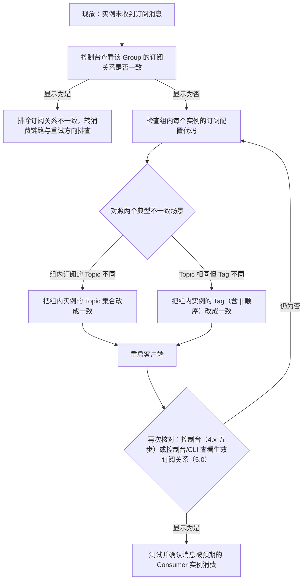

## 为什么需要使用规范与调优？（痛点引入）

RocketMQ 装上就能跑，跑起来和跑得稳之间隔着一堆事故。下面这些场景都来自上游最佳实践文档明确警告过的问题：

- 有人给每个消息子类型都建了一个 Topic，一个应用建了几百个，管控与运维成本失控——上游的答案是「一个应用尽可能用一个 Topic，消息子类型用 Tags 标识」。
- 有人上线新版本时只改了一个消费者实例订阅的 Tag，同一个消费者组里实例间订阅关系不一致，结果「消费消息紊乱，甚至消息丢失」。
- 有人发送失败不打印 SendResult、不做兜底，直到业务方来问「我的订单消息去哪了」。
- 有人在同一个组里无限制地加消费者实例，吞吐先升后降——并行度增加到一定程度反而会下降。
- 有人的 Broker 偶尔长时间停顿、内存分配出现长延迟，一查是没配 JVM 堆参数与 Linux 内核参数（`vm.swappiness`、文件描述符这些）。

| 维度 | 没有使用规范与调优基线 | 按本文规范执行之后 |
|------|------------------------|--------------------|
| 主题规划 | 每种消息子类型建一个 Topic，资源爆炸 | 一个应用尽量一个 Topic，子类型用 Tag 区分 |
| 消息可追溯 | 出问题时无法定位消息丢在哪一环 | Keys 设成业务唯一标识，服务端建哈希索引，可按 Topic+Key 查消息与消费者 |
| 发送可靠性 | 发送失败无感知、无兜底 | 打印 SendResult，理解四种发送状态，应用侧 DB 兜底重试 |
| 订阅管理 | 组内实例订阅悄悄不一致，消息紊乱 | 组内所有实例 Topic、Tag 完全一致，并可用控制台/CLI 核对 |
| 消费吞吐 | 加实例、加线程乱试，越调越慢 | 按 IO 密集特性设并行度、批量消费、减少 DB 交互 |
| 服务端稳定性 | 停顿、长延迟说不清来源 | JVM 堆/G1/GC 日志与内核参数按基线配置 |

> ### 💡 新人小结：这一整套「规范 + 调优」到底是什么？
>
> 把 RocketMQ 集群想象成一栋公寓楼：
> - 生产者/消费者规范 = 「住户公约」：垃圾怎么分类（Tag）、快递单怎么写编号（Key）、一家人共用一块水表时口径要一致（订阅关系一致）。
> - Broker 配置 = 「设备间台账」：水表型号、管道走向都有默认值，改之前要知道改的是什么。
> - JVM/OS 调优 = 「总闸与水电管网」：住户家里的事再规范，总闸电压不稳整栋楼都抖。
>
> **公约管人不越界，调优管机器不拖后腿——两边都做好了，系统才叫「生产可用」。**

**学习路线图**（本文按五段推进，前两篇源文档在 4.x 与 5.0 差异明显，全文按「4.x 原文 / 5.0 原文」双轨标注）

```
生产者侧规范 → 消费者侧规范 → Broker 侧基线 → 订阅关系一致性 → JVM/OS 调优
怎么发不乱    怎么丢不了     默认值与权衡    组内实例要对齐    堆与内核参数
```

---

## 先把术语对齐（本篇术语表）

| 术语 | 全称 | 含义（用自己的话） | 在本文中的角色 |
|------|------|--------------------|----------------|
| Tag | 消息标签（Tags） | 主题之下的细分类标记，生产者打了标签、消费者才能按标签在服务端过滤 | 生产者侧「一个 Topic 多用」的核心手段 |
| Keys | 消息索引键 | 消息在业务层的唯一标识（订单 Id 等），服务端据此建哈希索引供事后查询 | 定位「消息丢没丢、被谁消费」的钩子 |
| SendResult | 发送结果 | 同步发送返回的结果对象，含 SEND_OK 等四种状态 | 生产者日志与兜底判断的依据 |
| Producer / Consumer | 生产者 / 消费者 | 发消息的运行实体 / 收消息的运行实体 | 本文规范约束的两类客户端 |
| ConsumerGroup（Group ID） | 消费者分组 | 一组消费逻辑必须一致的消费者实例，共享消费进度与负载均衡 | 订阅关系一致性的考核单位 |
| 订阅关系 | Subscription | 一个消费者组订阅某主题的某组 Tag 的登记记录 | 「订阅关系一致」章节的定义对象 |
| Rebalance | 重平衡 | 组内实例进出时，系统重新分配「哪个实例消费哪些队列」的过程 | 解释「加实例有上限、超过订阅队列数的实例无效」的机制背景，细节见 `05-consumption/均衡进度与重试/` 板块 |
| ConsumeFromWhere | 消费位点起点策略 | 新建消费者组时决定从哪开始消费：LAST_OFFSET / FIRST_OFFSET / TIMESTAMP | 「其他消费建议」小节的一项 |
| Broker | 消息服务器 | 存储与投递消息的服务端节点，有 Master/Slave 角色 | Broker 侧配置基线的对象 |
| NameServer | 名字服务 | 客户端先找到它、再由它找到 Broker 的寻址枢纽 | 「客户端寻址方式」小节的主角 |
| CommitLog / ConsumeQueue | 提交日志 / 消费队列 | Broker 上的两类存储文件，RocketMQ 用 MMAP 方式加载它们 | 解释 `vm.max_map_count` 为什么要设大 |
| MMAP | Memory Map，内存映射文件 | 把磁盘文件直接映射进进程地址空间读写 | 内核参数调优的根因之一 |
| PageCache | 操作系统页缓存 | 内核用空闲内存缓存文件页，Broker 重度依赖它做性能优化 | 5.0 新增「别用小内存机器」的依据 |
| GC | Garbage Collection，垃圾回收 | JVM 自动回收不再使用的对象内存 | JVM 调优影响的核心过程 |
| G1 | Garbage-First 收集器 | JDK 1.8 自带的分区回收器，上游推荐的垃圾回收器 | JVM 参数表的主角 |
| CMS | Concurrent Mark Sweep 收集器 | 另一种老年代 Java 并发收集器；上游 JVM/OS 文档只推荐 G1，未给出 CMS 的任何参数与数值 | 仅在「上游未覆盖项」清单中出现 |
| 年轻代 | Young Generation | JVM 堆中新对象所在的区域 | 解释 MaxGCPauseMillis 设太小为什么会产生频繁 minor GC |
| minor GC | 年轻代回收 | 针对年轻代的一次小范围垃圾回收 | 「非常频繁的 minor GC」是上游警告的后果 |
| swap | 交换分区 | 内存不够时内核把不活跃内存页挪到磁盘 | `vm.swappiness` 调节的对象 |
| 脏页（dirty page） | 已修改未回写磁盘的内存页 | 内核写盘前暂存的数据页 | `vm.dirty_ratio` 相关，上游 JVM/OS 文档未给出该项数值（见下文清单） |
| fd | File Descriptor，文件描述符 | 进程每打开一个文件或一条网络连接占一个 | 上游建议设为 655350 |
| kswapd | 内核后台内存回收线程 | 在后台阈值触发时回收内存页 | `vm.extra_free_kbytes` 说明里出现的机制 |
| os.sh | 启动辅助脚本 | Broker 安装包 bin 目录下的脚本，列了许多内核参数 | 上游建议以它为底稿微调后用于生产 |
| LiteTopic | 轻量主题 | 5.0 的二级容器特性，按会话/任务粒度隔离消息 | 本文不展开，归同板块的《LiteTopic 限流会话与多智能体实践》；此处仅列名防止混读 |
| Agent / 会话状态 | AI 应用语境术语 | 多智能体系统中的执行角色 / 一次对话的上下文进度 | 同上，只在术语表登记，正文不涉及 |

---

## 生产者侧使用规范（发送消息的四条注意事项 + 两种兜底）

### 1. Tag：一个应用尽可能用一个 Topic

上游原文口径：**一个应用尽可能用一个 Topic，消息子类型用 Tags 标识**。Tags 由应用自由设置；只有生产者在发送消息时设置了 Tags，消费方订阅时才能利用 Tags 通过 Broker 做消息过滤。

```java
// ========== ✅ 推荐写法（4.x 历史客户端）：同类型消息进一个 Topic，用 Tag 分子类型 ==========
message.setTags("TagA"); // 上游示例：只有发送时设置了 tags，消费方才能按 tag 过滤

// ========== ✅ 5.0 写法：SDK 构建消息时设置 Tag ==========
// 5.x SDK 调用 messageBuilder.setTag("messageTag")；历史版本仍可调用 message.setTags("messageTag")
final Message message = provider.newMessageBuilder()
        .setTopic("TopicTest")          // 父主题：一个应用一个
        .setTag("messageTag")           // 子类型：用 Tag 区分
        .setBody(body)
        .build();

// ========== ❌ 不推荐写法（仅展示） ==========
// ❌ 给「订单创建」「订单支付」「订单取消」各建一个 Topic：上游明确「一个应用尽可能用一个 Topic」，
//    子类型应该用 Tag 标识，而不是拆主题
```

参数解释：`setTags`（4.x）与 `setTag`（5.x messageBuilder）都是给这一条消息打一个自由字符串标签；过滤规则的计算发生在服务端（消息过滤机制见 `05-consumption/消费模型/消息过滤Tag与SQL92`），客户端不需要自己筛。

> [!NOTE] 版本适用：Tag 设置入口在 4.x 与 5.0 不同
> 4.x 源只给了 `message.setTags("TagA")`；5.0 源明确「5.x SDK 可以调用 `messageBuilder.setTag("messageTag")`，历史版本可以调用 `message.setTags("messageTag")`」，两条路都保留。

### 2. Keys：把业务唯一标识填进去

上游原文口径：**每个消息在业务层面的唯一标识码要设置到 keys 字段**，方便将来定位消息丢失问题。服务器会为每个消息创建索引（哈希索引），应用可以通过 Topic、Key 查询这条消息内容，以及消息被谁消费。**由于是哈希索引，务必保证 Key 尽可能唯一**，避免潜在的哈希冲突。

```java
// ========== ✅ 推荐写法：业务唯一 Id 放进 Keys ==========
// 订单Id
String orderId = "20034568923546";
message.setKeys(orderId);
// 输出: 无直接输出；效果是服务端为该消息建立哈希索引，后续可按 Topic+Key 查到消息内容与消费者

// ========== ❌ 不推荐写法（仅展示） ==========
// ❌ 不设置 Keys，或所有消息塞同一个固定串：上游要求「保证 key 尽可能唯一，避免潜在哈希冲突」，
//    Key 缺失或重复时按 Topic+Key 定位消息会失效或互相干扰，丢消息时无法定位
```

参数解释：`setKeys` 的值取业务侧唯一标识。5.0 源比 4.x 多给了一句选型建议：**常见的设置策略使用订单 Id、用户 Id、请求 Id 等比较离散的唯一标识**。

### 3. 日志打印与四种发送状态：SEND_OK 不等于绝对可靠

上游 4.x 口径：**消息发送成功或者失败都要打印消息日志，务必要打印 SendResult 和 key 字段**；send 方法只要不抛异常，就代表发送成功。而「发送成功」有四种状态：

| SendResult 状态 | 含义 | 什么情况下返回（上游给的触发条件与默认值） | 丢消息风险 |
|-----------------|------|---------------------------------------------|------------|
| SEND_OK | 消息发送成功 | 正常返回。**注意：发送成功并不意味着可靠**，要确保不丢任何消息，还应启用同步 Master 或同步刷盘（SYNC_MASTER 或 SYNC_FLUSH） | 配置为异步 Master/异步刷盘时，宕机可能丢 |
| FLUSH_DISK_TIMEOUT | 发送成功但服务器刷盘超时 | Broker 配置 FlushDiskType=SYNC_FLUSH（默认为异步刷盘 ASYNC_FLUSH）时，未在同步刷盘时间（**默认 5s**）内完成刷盘 | 消息已进入服务器队列（内存），只有服务器宕机才会丢 |
| FLUSH_SLAVE_TIMEOUT | 发送成功但同步到 Slave 超时 | Broker 角色为 SYNC_MASTER（**默认是异步 ASYNC_MASTER**）时，从 Broker 未在同步时间（**默认 5 秒**）内完成与主服务器同步 | 消息已进入服务器队列，只有宕机才丢 |
| SLAVE_NOT_AVAILABLE | 发送成功但 Slave 不可用 | Broker 角色为 SYNC_MASTER 但没有配置 Slave Broker | 消息已进入 Master 队列，只有 Master 宕机才丢 |

> [!NOTE] 版本适用：5.0 源对这一节的写法是精简的
> 5.0 源只保留「消息发送成功或者失败要打印消息日志，用于业务排查问题；Send 消息方法只要不抛异常，就代表发送成功」，未再展开四种状态；上表的状态语义与默认值（刷盘/同步超时默认 5s、默认 ASYNC_MASTER / ASYNC_FLUSH）全部出自 4.x 源。不要据此认为 5.0 没有这些状态——上游只是没在这页重复。

> ### 💡 新人小结：四种发送状态到底在说什么？
>
> 把发消息想象成寄挂号信，「寄出」和「送到」是两回事：
> - SEND_OK = 邮局收下了信（进了 Broker 内存队列），但信可能还没锁进保险柜（刷盘）、还没给分局备案（同步到 Slave）。
> - FLUSH_DISK_TIMEOUT = 信收下了，但抄录入档案库超时了。
> - FLUSH_SLAVE_TIMEOUT = 主局记录好了，给分局备份超时。
> - SLAVE_NOT_AVAILABLE = 你要求必须两处备案，可分局根本没开门。
>
> **想要「只要寄出就绝不丢」，光看 SEND_OK 不够，要选 SYNC_MASTER + SYNC_FLUSH 这种「双保险」配置。**

### 4. 发送失败的处理：客户端内建重试 + 应用侧 DB 兜底

上游 4.x 口径：Producer 的 send 方法本身支持内部重试，重试逻辑如下：

- 至多重试 2 次（**同步发送为 2 次，异步发送为 0 次**）。
- 如果发送失败，则轮转到下一个 Broker。总耗时不超过 sendMsgTimeout 设置的值，**默认 10s**。
- 如果本身向 Broker 发送消息产生**超时异常，就不会再重试**。

> [!NOTE] 版本适用：5.0 源不再罗列重试参数
> 5.0 源把 5.x SDK 的重试逻辑整体指向了「发送重试策略」特性文档，本页未给数值；上面的「2 次 / 0 次 / sendMsgTimeout 默认 10s」是 **4.x 结论**，不得当作 5.x SDK 的行为描述。

如果业务对消息可靠性要求比较高，上游要求应用自己加重试兜底：**调用 send 同步方法发送失败时，将消息存储到 DB，由后台线程定时重试，确保消息一定到达 Broker**。

为什么这个兜底不集成进 MQ 客户端？上游给了三条理由，逐条保留：

1. MQ 客户端设计为**无状态模式**，方便任意水平扩展，对机器资源的消耗仅仅是 CPU、内存、网络。
2. 若客户端内部集成 KV 存储，数据只有**同步落盘**才较可靠，而同步落盘性能开销大，通常只能异步落盘；又因为应用关闭过程不受 MQ 运维控制，经常发生 `kill -9` 这类暴力关闭，数据未及时落盘而丢失。
3. Producer 所在机器可靠性较低（一般为虚拟机），**不适合存储重要数据**。

### 5. 低耗时场景可选 oneway（4.x 独有段落）

上游 4.x 口径：一次消息发送 = 客户端发请求 + 服务端处理 + 服务端应答，耗时是三步之和。某些场景要求耗时非常短、但可靠性要求不高（例如**日志收集类应用**），可以用 oneway 形式：**只发请求不等应答，实现层面仅是把数据写入客户端 socket 缓冲区的系统调用开销，耗时通常在微秒级**。

> [!NOTE] 版本适用：5.0 源删除了 oneway 小节；三种发送语义（同步/异步/单向）的完整对比与代码见 `02-core-concepts/领域模型/领域模型全景与通信方式`，本文不重复。

### 6. 客户端寻址方式：四种配置的优先级（4.x 独有段落）

上游 4.x 口径：客户端先找到 NameServer，再由 NameServer 找到 Broker。配置方式按**优先级由高到低**排列，高优先级覆盖低优先级：

```java
// ========== ✅ 方式一（优先级最高）：代码中指定，多个地址用分号分割 ==========
producer.setNamesrvAddr("192.168.0.1:9876;192.168.0.2:9876");
consumer.setNamesrvAddr("192.168.0.1:9876;192.168.0.2:9876");
```

```text
# ========== ✅ 方式二：Java 启动参数指定 NameServer 地址 ==========
-Drocketmq.namesrv.addr=192.168.0.1:9876;192.168.0.2:9876

# ========== ✅ 方式三：环境变量指定 ==========
export NAMESRV_ADDR=192.168.0.1:9876;192.168.0.2:9876

# ========== ✅ 方式四（默认）：HTTP 静态服务器寻址 ==========
# 客户端启动后定时访问静态 HTTP 服务器：
#   http://jmenv.tbsite.net:8080/rocketmq/nsaddr
# 该 URL 返回内容形如：
#   192.168.0.1:9876;192.168.0.2:9876
# 客户端默认每隔 2 分钟访问一次并更新本地 NameServer 地址。
# URL 在代码中硬编码，可通过修改 /etc/hosts 改变要访问的服务器，例如在 /etc/hosts 增加：
#   10.230.22.67    jmenv.taobao.net
```

参数解释：四种方式是覆盖关系而不是叠加关系；上游的推荐结论是**推荐使用 HTTP 静态服务器寻址方式，好处是客户端部署简单，且 NameServer 集群可以热升级**。

> [!NOTE] 版本适用：「客户端寻址方式」小节只存在于 4.x 源，5.0 源已删除；本节整体为 4.x 结论。

---

## 消费者侧使用规范（幂等、并行度、批量、堆积与日志）

### 1. 消费过程必须幂等

上游口径（4.x 与 5.0 文字基本一致）：**RocketMQ 无法避免消息重复（Exactly-Once）**，业务对消费重复敏感时，务必在业务层面去重，可借助关系数据库：

1. 确定消息唯一键：可以是 msgId，也可以是消息内容中的唯一标识字段（如订单 Id）。
2. 消费前判断唯一键是否已存在于关系数据库：不存在则插入并消费，否则跳过。
3. 实际过程要考虑原子性：不做「先查再插」，直接尝试插入，**如果报主键冲突则插入失败、直接跳过**。

两个上游点名的坑：
- msgId 一定是全局唯一标识符，但**相同消息可能有两个不同 msgId**（消费者主动重发、客户端重投机制导致的重复等），这种情况需要用**业务字段**判重，而不是只认 msgId。
- 判重表的主键冲突不是错误，是「已消费」的正常信号。

> ### 💡 新人小结：为什么说「消费幂等」是使用规范里最硬的一条？
>
> 想象快递员两次上门送同一个包裹：
> - 你家门台账本（判重表）上已登记了单号（唯一键），第二次来就直接说「领过了」——这就是插入报主键冲突、跳过。
> - 单号也可能变：同一件货第二次贴了新单号（不同 msgId 的同一条消息），所以核对的应该是箱子里的货物编号（业务字段），只认快递单号会被骗。
>
> **重复投递不是 RocketMQ 的 bug，是它公开承认的语义；去重的责任在业务侧。**

### 2. 提高消费并行度：有上限的加速手段

上游口径：绝大部分消息消费行为属于 **IO 密集型**（操作数据库或调用 RPC），消费速度取决于后端数据库或外系统的吞吐量。增加消费并行度可以提高总吞吐，**但并行度增加到一定程度反而会下降**，必须设置合理并行度。修改方法：

| 手段 | 4.x 说法 | 5.0 说法 |
|------|----------|----------|
| 增加组内实例数 | 同一 ConsumerGroup 下通过增加 Consumer 实例数量提高并行度；**超过订阅队列数的 Consumer 实例无效**；加机器或在已有机器启动多进程 | 同样允许加实例（加机器或已有机器起多进程），但未保留「超过订阅队列数无效」的提醒句 |
| 提高单实例线程数 | 修改参数 `consumeThreadMin`、`consumeThreadMax`；另有 setter 形式 `setConsumeThreadMin` / `setConsumeThreadMax`（消费者内部用 ThreadPoolExecutor 消费） | 5.x PushConsumer SDK 通过 `PushConsumerBuilder.setConsumptionThreadCount()` 设置线程数；SimpleConsumer 可由业务线程自由增加并发，底层线程安全；历史版本 SDK 的 PushConsumer 仍走 consumeThreadMin / consumeThreadMax |

```java
// ========== ✅ 推荐：按上游参数名调整并行度（数值需自行压测确定，上游未给推荐值） ==========
// 4.x 历史客户端：
//   consumer.setConsumeThreadMin(与 max 一对，控制内部 ThreadPoolExecutor 规模)
//   consumer.setConsumeThreadMax(同上)
// 5.x SDK PushConsumer：
//   provider.newPushConsumerBuilder().setConsumptionThreadCount(线程数).build()   // 线程数值需压测确定
// 5.x SimpleConsumer：不设线程数，由业务自己的线程并发调用接口（上游：底层线程安全）

// ========== ❌ 不推荐写法（仅展示） ==========
// ❌ 只靠「无脑加机器、加实例」提吞吐：4.x 提醒超过订阅队列数的实例无效；
//    上游同时警告并行度增加到一定程度吞吐反而下降
```

「超过订阅队列数实例无效」背后的机制是组内队列分配的重新平衡（Rebalance）：实例多于可分配的队列时，多出来的实例分不到队列。分配规则细节归 `05-consumption/均衡进度与重试/` 板块（负载均衡与消费进度管理），本文不展开。

### 3. 批量方式消费

上游口径（两版共用的量化例子）：某些业务流程支持批量消费可大幅提高吞吐——**订单扣款类应用，一次处理一个订单耗时 1s，一次处理 10 个订单可能也只耗时 2s**。

| 版本 | 做法 |
|------|------|
| 4.x | 设置 consumer 的参数 `consumeMessageBatchMaxSize`，**默认是 1**（一次只消费一条消息）；设置为 N 时每次消费的消息数小于等于 N |
| 5.0 | 建议使用 5.x SDK 的 **SimpleConsumer**，每次接口调用设置批次大小，一次性拉取消费多条消息 |

> [!NOTE] 版本适用：4.x 调 Push 消费端参数 `consumeMessageBatchMaxSize`；5.0 源改为推荐 SimpleConsumer 接口级批次。两种写法解决同一个问题，迁移时不要沿用旧参数思路。

### 4. 跳过非重要消息：先数堆积，再决定丢不丢

发生消息堆积、消费速度一直追不上发送速度时，若业务对数据要求不高，可以选择丢弃不重要的消息。上游 4.x 的例子：**当某个队列的消息数堆积到 100000 条以上，则尝试丢弃部分或全部消息**，快速追上发送速度。判定方法是「队列最大位点 - 本条消息位点」：

```java
// ========== ✅ 4.x 上游示例：按堆积深度丢弃非重要消息 ==========
public ConsumeConcurrentlyStatus consumeMessage(
        List<MessageExt> msgs,
        ConsumeConcurrentlyContext context) {
    long offset = msgs.get(0).getQueueOffset();                          // 本条消息在队列中的位置
    String maxOffset =
            msgs.get(0).getProperty(Message.PROPERTY_MAX_OFFSET);        // 队列当前最大位点
    long diff = Long.parseLong(maxOffset) - offset;                      // 两者之差即堆积深度
    if (diff > 100000) {
        // 堆积超过 10 万条时的特殊处理：直接返回成功，相当于跳过这批不重要的消息
        return ConsumeConcurrentlyStatus.CONSUME_SUCCESS;
    }
    // 正常消费过程
    return ConsumeConcurrentlyStatus.CONSUME_SUCCESS;
}
// 输出: 无日志输出时行为不可见；生产环境请按下一节要求打印耗时与消息日志
```

参数解释：`getQueueOffset()` 取当前消息位点，`Message.PROPERTY_MAX_OFFSET` 属性携带队列最大位点，差值即「我落后多少」。返回 `CONSUME_SUCCESS` 意味着这批消息被服务端视为已处理，不会再投回来——这就是「丢弃」的实现方式。

**5.0 源把这一节改写为「重置位点跳过非重要消息」**：建议使用重置位点功能，直接调整消费位点到指定时刻或指定位置，不再给消费端丢弃代码。

| 对比维度 | 4.x 做法（消费端判断后丢弃） | 5.0 做法（重置位点） |
|----------|------------------------------|----------------------|
| 生效位置 | 业务代码里逐条比较堆积深度 | 运维侧直接调整该组消费位点 |
| 粒度 | 消息条数阈值（示例 100000） | 指定时刻或指定位点 |
| 前置条件 | 消费者必须在线且代码已实现判断 | 需要能操作控制台/工具，且业务允许跳过这段消息 |
| 上游态度 | 5.0 之前的原文示例，本文照录 | 5.0 源替换后的新建议 |

### 5. 优化每条消息的消费过程：算一笔 DB 账

上游原文的量化例：某条消息的消费过程为「查 DB 数据 1 → 查 DB 数据 2 → 复杂业务计算 → 插 DB 数据 3 → 插 DB 数据 4」，共 **4 次 DB 交互**；按每次 5ms 计算共 20ms，业务计算耗时 5ms，总计 25ms。**把 4 次 DB 交互优化为 2 次，总耗时降到 15ms，总体性能提高 40%**。对时延敏感的应用，把 DB 部署在 SSD 硬盘，相比 SCSI 磁盘 RT 会小很多。

### 6. 消费打印日志

上游口径：消息量较少时，建议在消费入口方法打印消息、消费耗时等，方便后续排查；能打印每条消息消费耗时的话，排查「消费慢」类线上问题会更方便。

```java
// ========== ✅ 4.x 上游示例：消费入口打印消息 ==========
public ConsumeConcurrentlyStatus consumeMessage(
        List<MessageExt> msgs,
        ConsumeConcurrentlyContext context) {
    log.info("RECEIVE_MSG_BEGIN: " + msgs.toString());
    // 正常消费过程
    return ConsumeConcurrentlyStatus.CONSUME_SUCCESS;
}

// ========== ✅ 5.0 上游示例：MessageListener 打印 MessageView ==========
new MessageListener() {
    @Override
    public ConsumeResult consume(MessageView messageView) {
        LOGGER.info("Consume message={}", messageView);
        // 此处执行你的消费流程（Do your consume process）
        return ConsumeResult.SUCCESS;
    }
};
```

> [!NOTE] 版本适用：5.0 源比 4.x 多了一句反向警告
> 「如果线上环境 TPS 很高，不建议开启（逐条打印），避免日志太多影响性能」——这一句只在 5.0 源中出现，4.x 源没有。

### 7. 其他消费建议（4.x 独有的八项清单）

| 主题 | 上游要点 |
|------|----------|
| 消费者和订阅 | 不同消费者组可以独立消费同一批 Topic，且**每个消费者组都有自己的消费偏移量**；请确保同一组内每个消费者订阅信息保持一致（这正是下文「订阅关系一致」的伏笔） |
| 有序消息 | 消费者将锁定每个消息队列以确保逐个消费，会牺牲性能，但关心顺序时有用；**不建议抛异常**，返回 `ConsumeOrderlyStatus.SUSPEND_CURRENT_QUEUE_A_MOMENT` 作为替代 |
| 并发消费 | 消费者将并发处理消息，建议为获得良好性能使用它；同样**不建议抛异常**，返回 `ConsumeConcurrentlyStatus.RECONSUME_LATER` 替代 |
| 消费状态 Consume Status | 并发监听器可返回 RECONSUME_LATER 通知「现在不能消费这条、希望稍后重试」，且不影响继续消费其他消息；顺序监听器因为要保证顺序不能跳过消息，但可以返回 SUSPEND_CURRENT_QUEUE_A_MOMENT 让队列等待片刻 |
| Blocking | **不建议阻塞监听器**：它会阻塞线程池，并最终可能终止消费进程 |
| 线程数设置 | 消费者内部用 ThreadPoolExecutor 消费消息，可通过 `setConsumeThreadMin` / `setConsumeThreadMax` 改变 |
| 消费位点起点 | 新建消费者组时需决定是否消费 Broker 中已有的历史消息：`CONSUME_FROM_LAST_OFFSET` 忽略历史、只消费之后新产生的消息；`CONSUME_FROM_FIRST_OFFSET` 消费 Broker 中每一条现存消息；`CONSUME_FROM_TIMESTAMP` 消费指定时间戳之后产生的消息 |

失败之后到底重试几次、间隔多久、进不进死信，属于消费重试机制的细节，本文不重复；归 `05-consumption/均衡进度与重试/消费重试与死信队列`。

---

## Broker 侧配置基线（角色、刷盘与关键参数）

### 1. Broker 角色怎么选

Broker 角色分为 **ASYNC_MASTER（异步主机）、SYNC_MASTER（同步主机）、SLAVE（从机）**：

| 可靠性要求 | 上游建议的部署方式 |
|------------|--------------------|
| 对消息可靠性要求比较严格 | SYNC_MASTER 加 SLAVE |
| 对消息可靠性要求不高 | ASYNC_MASTER 加 SLAVE |
| 只是测试方便 | 仅 ASYNC_MASTER 或仅 SYNC_MASTER |

### 2. FlushDiskType 的取舍

SYNC_FLUSH（同步刷新）相比 ASYNC_FLUSH（异步处理）**会损失很多性能，但是也更可靠**，需要根据实际业务场景做好权衡。此句 4.x 与 5.0 一致。

### 3. Broker 配置参数表（上游表逐行保留）

| 参数名 | 默认值 | 说明 |
|--------|--------|------|
| listenPort | 10911 | 接受客户端连接的监听端口 |
| namesrvAddr | null | NameServer 地址 |
| brokerIP1 | 网卡的 InetAddress | 当前 Broker 监听的 IP |
| brokerIP2 | 跟 brokerIP1 一样 | 存在主从 Broker 时，若在主节点配置了 brokerIP2，从节点会连接主节点配置的 brokerIP2 进行同步 |
| brokerName | null | Broker 的名称 |
| brokerClusterName | DefaultCluster | 本 Broker 所属的 Cluster 名称 |
| brokerId | 0 | Broker id，0 表示 Master，其他正整数表示 Slave |
| storePathCommitLog | $HOME/store/commitlog/ | 存储 CommitLog 的路径 |
| storePathConsumerQueue | $HOME/store/consumequeue/ | 存储 ConsumeQueue 的路径 |
| mappedFileSizeCommitLog | 1024 * 1024 * 1024（1G） | CommitLog 的映射文件大小 |
| deleteWhen | 04 | 在每天的什么时间删除已超过文件保留时间的 CommitLog |
| fileReservedTime | 72 | 以小时计算的文件保留时间 |
| brokerRole | ASYNC_MASTER | SYNC_MASTER / ASYNC_MASTER / SLAVE |
| flushDiskType | ASYNC_FLUSH | SYNC_FLUSH / ASYNC_FLUSH。SYNC_FLUSH 模式下 Broker 保证在确认给生产者之前将消息刷盘；ASYNC_FLUSH 模式利用一组消息刷盘的模式，取得更好的性能 |

注：`mappedFileSizeCommitLog` 一行 4.x 与 5.0 源仅差转义写法，取值一致（1G）；其余各表内容两版相同。

### 4. Broker 日志管理

Broker 的默认日志路径在 `${user.home}/logs/rocketmqlogs/` 下，可以通过修改二进制包中 conf 文件夹下的 `xx.logback.xml` 文件来进行日志级别和路径的修改。上游特别提醒：**请保管好您的日志，以免敏感信息发生泄漏。**

---

## 订阅关系一致性：定义、正例、排查、反例

### 1. 什么是订阅关系、什么算一致

- 4.x 定义：**一个消费者组订阅一个 Topic 的某一个 Tag，这种记录被称为订阅关系**。
- 5.0 定义：订阅关系是 RocketMQ 领域模型中非常重要的环节，用于表达消费者消费消息的**控制元数据**（概念全文见 `02-core-concepts/领域模型/主题队列与消息模型`）。
- 一致的定义（两版文字一致）：**同一个消费者组下所有消费者实例所订阅的 Topic、Tag 必须完全一致**。如果订阅关系（4.x 写作「消费者组名-Topic-Tag」、5.0 写作「消费者分组名-Topic-Tag」）不一致，会**导致消费消息紊乱，甚至消息丢失**。

5.0 源额外强调了两句话，帮新人校准边界感：
- 订阅关系一致，核心是指**相同 ConsumerGroup 的每个 Consumer 之间一致**——因为在服务端视角看来，一个 Group 下的所有 Consumer 都应该是**相同的副本逻辑**。
- 订阅关系一致**不是**指一个 Consumer 不能订阅多个 Topic；每个 Consumer 仍可按需订阅多个 Topic，前提是相同消费者分组下的 Consumer 之间要一致。

### 2. 正确订阅关系示例（4.x 原文配 5 张图，先看什么算一致）

4.x 源给出三个正确场景。三个场景的共同点：**同一 Group ID 下的 C1、C2、C3 三个实例，订阅代码必须完全一致**。

**场景 1.1：订阅一个 Topic 且一个 Tag。** 三个实例都订阅 TopicA，且 Tag 都是 Tag1，符合一致原则：


```java
// ✅ 4.x/ONS 客户端正确写法（C1、C2、C3 使用完全相同的订阅代码）
Properties properties = new Properties();
properties.put(PropertyKeyConst.GROUP_ID, "GID_test_1");
Consumer consumer = ONSFactory.createConsumer(properties);
consumer.subscribe("TopicA", "Tag1", new MessageListener() {
    public Action consume(Message message, ConsumeContext context) {
        System.out.println(message.getMsgID());
        // 输出: 每收到一条消息打印其 msgId（32 位消息 ID 字符串）
        return Action.CommitMessage;
    }
});
```

**场景 1.2：订阅一个 Topic 且多个 Tag。** 三个实例都订阅 TopicB，Tag 都是 Tag2 和 Tag3（订阅 TopicB 中所有 Tag 为 Tag2 或 Tag3 的消息），**且顺序一致都是 Tag2||Tag3**，符合一致原则：


```java
// ✅ 多 Tag 用 || 连接，且组内顺序写法也要一致
Properties properties = new Properties();
properties.put(PropertyKeyConst.GROUP_ID, "GID_test_2");
Consumer consumer = ONSFactory.createConsumer(properties);
consumer.subscribe("TopicB", "Tag2||Tag3", new MessageListener() {
    public Action consume(Message message, ConsumeContext context) {
        System.out.println(message.getMsgID());
        return Action.CommitMessage;
    }
});
```

**场景 1.3：订阅多个 Topic 且多个 Tag。** 三个实例都订阅 TopicA 和 TopicB：TopicA 未指定 Tag（即订阅该 Topic 所有消息），TopicB 的 Tag 都是 Tag2||Tag3，符合一致原则：


```java
// ✅ 一个 Consumer 订多个 Topic：组内每个实例的订阅集合都要相同
Properties properties = new Properties();
properties.put(PropertyKeyConst.GROUP_ID, "GID_test_3");
Consumer consumer = ONSFactory.createConsumer(properties);
consumer.subscribe("TopicA", "*", new MessageListener() {   // "*" 表示不指定 Tag，订阅全部消息
    public Action consume(Message message, ConsumeContext context) {
        System.out.println(message.getMsgID());
        return Action.CommitMessage;
    }
});
consumer.subscribe("TopicB", "Tag2||Tag3", new MessageListener() {
    public Action consume(Message message, ConsumeContext context) {
        System.out.println(message.getMsgID());
        return Action.CommitMessage;
    }
});
```

**5.0 源把正确场景收敛为 1 个：订阅的 Topic 一样，且过滤表达式一致。** 三实例都订阅 TopicA、Tag 都是 TagA：


```java
// ✅ 5.x SDK 正确写法：三个实例的订阅代码完全一致
PushConsumer consumer1 = provider.newPushConsumerBuilder().setConsumerGroup("GroupA").build();
consumer1.subscribe("TopicA", new FilterExpression("TagA", FilterExpressionType.TAG));

PushConsumer consumer2 = provider.newPushConsumerBuilder().setConsumerGroup("GroupA").build();
consumer2.subscribe("TopicA", new FilterExpression("TagA", FilterExpressionType.TAG));

PushConsumer consumer3 = provider.newPushConsumerBuilder().setConsumerGroup("GroupA").build();
consumer3.subscribe("TopicA", new FilterExpression("TagA", FilterExpressionType.TAG));
// 注: 上游示例未给出 provider 实例的创建代码，本文不做推测性补齐
```

> [!NOTE] 版本适用：新旧写法同场景对照
> 同一个「组内三实例订阅 TopicA 的 TagA/Tag1」场景：4.x/ONS 写法是 `properties.put(PropertyKeyConst.GROUP_ID, "GID_test_1") + ONSFactory.createConsumer + consumer.subscribe("TopicA", "Tag1", listener)`；5.x 写法是 `provider.newPushConsumerBuilder().setConsumerGroup("GroupA").build() + consumer.subscribe("TopicA", new FilterExpression("TagA", FilterExpressionType.TAG))`。语义要求没变（组内完全一致），变的是组名设置入口和过滤条件的对象化表达。

### 3. 订阅关系不一致的排查

**问题现象**（两版一致）：
- 控制台中「订阅关系是否一致」显示为否。
- 消费者（Consumer）实例未收到订阅的消息。

排查决策流如下图（依据 4.x 五步与 5.0 三步合并绘制）：



图后解读，两版的操作步骤各有出处：

4.x 五步（原文照录）：
1. 检查 Consumer 实例中与订阅相关的配置代码，确保同一个 Group ID 的所有实例订阅相同的 Topic 及 Tag。
2. **重启客户端应用**。
3. 登录消息队列 RocketMQ 版控制台，在左侧导航栏单击实例列表，选择目标实例进入实例详情页面。
4. 在左侧导航栏单击 Group 管理，选择对应协议后，单击消费者状态，确认「订阅关系是否一致」显示为是。
5. 测试并确认消息能被预期的 Consumer 实例消费。

5.0 三步（原文口径）：
1. 检查订阅配置代码，确保同一个 ConsumerGroup 的所有实例订阅相同的 Topic 及 Tag。
2. 使用控制台或者 CLI 命令 **ConsumerConnection** 查看生效的订阅关系是否一致。
3. 测试并确认消息能被预期的实例消费。

> [!NOTE] 版本适用：排查工具箱不同
> 4.x 源的排查面向云控制台（实例列表 → Group 管理 → 消费者状态）；5.0 源面向 Apache RocketMQ 控制台或 CLI（ConsumerConnection 命令）。CLI 命令的完整用法归 `06-deployment/命令行工具/` 板块，本文只记「用它核对订阅关系」这一处用途。

### 4. 常见订阅关系不一致问题（两个反例场景）

**场景 3.1：同一 Group 下的实例订阅的 Topic 不同。** 4.x 源配图：C1、C2、C3 分别订阅 TopicA、TopicB、TopicC，不符合一致原则：


4.x 源给出三段错误代码（组名同为 GID_test_1，订阅主题各不相同）：

```java
// ❌ Consumer 实例 1-1：订阅 TopicA
Properties properties = new Properties();
properties.put(PropertyKeyConst.GROUP_ID, "GID_test_1");
Consumer consumer = ONSFactory.createConsumer(properties);
consumer.subscribe("TopicA", "*", new MessageListener() {
    public Action consume(Message message, ConsumeContext context) {
        System.out.println(message.getMsgID());
        return Action.CommitMessage;
    }
});
```

```java
// ❌ Consumer 实例 1-2：同一组名却订阅 TopicB
Properties properties = new Properties();
properties.put(PropertyKeyConst.GROUP_ID, "GID_test_1");
Consumer consumer = ONSFactory.createConsumer(properties);
consumer.subscribe("TopicB", "*", new MessageListener() {
    public Action consume(Message message, ConsumeContext context) {
        System.out.println(message.getMsgID());
        return Action.CommitMessage;
    }
});
```

```java
// ❌ Consumer 实例 1-3：同一组名却订阅 TopicC——三个实例合起来才是「不一致」的全貌
Properties properties = new Properties();
properties.put(PropertyKeyConst.GROUP_ID, "GID_test_1");
Consumer consumer = ONSFactory.createConsumer(properties);
consumer.subscribe("TopicC", "*", new MessageListener() {
    public Action consume(Message message, ConsumeContext context) {
        System.out.println(message.getMsgID());
        return Action.CommitMessage;
    }
});
```

5.0 源保留了同一个反例场景，配图并**明确标注「3.x、4.x SDK 适用」**——即 5.0 认为在旧 SDK 形态下这是典型错误：


**场景 3.2：Topic 相同、Tag 不一致。** 4.x 源配图：三实例都订阅 TopicA，但 C1 的 Tag 是 Tag1，C2、C3 是 Tag2：


```java
// ========== ✅/❌ 5.0 源给出的同场景错误示例（三实例订阅代码节选，组名同为 GroupA） ==========
// ❌ Consumer 实例 2-1：订阅 TopicA 的 Tag1
PushConsumer consumer1 = provider.newPushConsumerBuilder().setConsumerGroup("GroupA").build();
consumer1.subscribe("TopicA", new FilterExpression("Tag1", FilterExpressionType.TAG));

// ❌ Consumer 实例 2-2：订阅 TopicA 的 Tag2（与 2-1 不一致）
PushConsumer consumer2 = provider.newPushConsumerBuilder().setConsumerGroup("GroupA").build();
consumer2.subscribe("TopicA", new FilterExpression("Tag2", FilterExpressionType.TAG));

// ❌ Consumer 实例 2-3：订阅 TopicA 的 Tag2（与 2-1 不一致）
PushConsumer consumer3 = provider.newPushConsumerBuilder().setConsumerGroup("GroupA").build();
consumer3.subscribe("TopicA", new FilterExpression("Tag2", FilterExpressionType.TAG));
```

对照 4.x 源同场景的三段 ONS 写法（组名 GID_test_2，实例 2-1 订阅 Tag1、2-2 与 2-3 订阅 Tag2），错误本质完全相同：**同组内出现了两种过滤条件**。修复方式也一样：把三个实例的订阅代码改成逐字符一致。


> ### 💡 新人小结：订阅关系一致为什么这么「不近人情」？
>
> 把消费者组想象成一家三口共用一块水表：
> - 水表（Group）登记的是一个口径：取哪些水（Topic）、什么用途的水（Tag）。
> - 妈妈登记「只接自来水」，爸爸偷偷改成「接中水」，水表读数归谁、断水算谁的，全都乱套——这就是「消费紊乱，甚至消息丢失」。
> - 三个实例是同一份逻辑的副本（5.0 原话「服务端看来一个 Group 下的所有 Consumer 都应该是相同的副本逻辑」），副本之间必须可互换。
>
> **改订阅等于改户口本：要改就整组一起改，改完重启、回控制台核对。**

### 5. 4.x 与 5.0 订阅一致性文档的差异对照

| 对照维度 | 4.x 源（05-bestPractice/07subscribe.md） | 5.0 源（06-bestPractice/08subscribe.md） |
|----------|------------------------------------------|-------------------------------------------|
| 篇幅 | 216 行 / 8,623 字节，三段正确场景 + 五步控制台排查 + 两类反例全配代码 | 98 行 / 4,615 字节，正确场景收敛为 1 个，排查压缩为三步，反例代码只保留 Tag 不一致一组 |
| 术语 | 消费者组 / Group ID | 消费者分组 / ConsumerGroup，并把订阅关系挂到领域模型「控制元数据」的框架上 |
| 示例 SDK | ONS 客户端（PropertyKeyConst.GROUP_ID + ONSFactory） | 5.x SDK（newPushConsumerBuilder + FilterExpression + FilterExpressionType.TAG） |
| 「多 Topic 订阅」说明 | 以正确示例三呈现（组内每实例都订 TopicA+TopicB） | 以 info 框文字强调：一致是 Consumer 之间一致，不禁止单个 Consumer 订多个 Topic |
| 反例 3.1 的定位 | 直接列为常见错误 | 标注「3.x、4.x SDK 适用」，视为旧 SDK 形态问题 |
| 排查工具 | 云控制台（实例列表 → Group 管理 → 消费者状态），含「重启客户端应用」一步 | Apache RocketMQ 控制台或 CLI 的 ConsumerConnection 命令 |

---

## JVM 与 OS 调优（逐条参数、逐条后果）

上游 JVM/OS 文档（4.x 的 05JVMOS.md 与 5.0 的 07JVMOS.md）主体内容一致，差异点见标注。这一节的原则：**每条参数保留数值与用途，并写出「调错会怎样」**，不合并成「按需调整」。

### 1. JVM 基线选项：4.x 与 5.0 的两处差异

| 对照项 | 4.x 源 | 5.0 源 |
|--------|--------|--------|
| JDK 推荐 | 「推荐使用最新发布的 JDK 1.8 版本」 | 「推荐使用最新发布的 JDK 版本」（去掉了 1.8 的限定） |
| 生产环境基线 | `-server -Xms8g -Xmx8g` | `-server -Xms8g -Xmx8g -Xmn4g`（多了年轻代 4g 的显式配置） |
| 内存规格提醒 | 无 | 新增 info 框：生产环境集群 Broker 建议配置足够内存，避免小规格内存机器；Broker 重度依赖内存 PageCache 做性能优化，内存过小可能造成性能不稳定 |

```text
# ========== ✅ 推荐：5.0 上游生产环境 JVM 基线 ==========
-server -Xms8g -Xmx8g -Xmn4g
# 4.x 版本的对应基线没有 -Xmn4g，只有 -server -Xms8g -Xmx8g

# ========== ❌ 上游点名的错误 ==========
# ❌ Xms 与 Xmx 设成不同值：JVM 会调整堆大小，性能变差（上游要求设置相同的 Xms 和 Xmx 来防止调整堆）
# ❌ 最大堆超过 32G：JVM 默认 8 字节对齐时会影响指针压缩技术、浪费内存（上游明确「不要超过 32G」）
```

### 2. JVM 参数逐条表（数值全部照录上游）

| JVM 选项 | 上游给的数值/写法 | 用途（上游口径） | 调错/不设会怎样（上游口径，未写者标「上游未展开」） |
|----------|-------------------|------------------|-----------------------------------------------------|
| `-server -Xms8g -Xmx8g`（5.0 另加 `-Xmn4g`） | 8g / 8g（5.0 再设 Xmn4g） | 相同的 Xms 和 Xmx 防止 JVM 调整堆大小，获得更好性能 | Xms 不等于 Xmx 时 JVM 会调整堆，性能变差；超过 32G 影响指针压缩、浪费内存 |
| `-XX:+AlwaysPreTouch` | 开 | 「预触摸」Java 堆，确保 JVM 初始化期间每个页面都被分配 | 会拉长启动时间（上游以「不关心启动时间的人可以启用」为前提）；对运行期分配的影响上游未展开 |
| `-XX:-UseBiasedLocking` | 关偏置锁定 | **禁用偏置锁定可能会减少 JVM 暂停** | 保持开启时可能保留更长的暂停（上游用词为「可能会」，未给量化数据） |
| `-XX:+UseG1GC` | 开 | 垃圾回收：建议使用 JDK 1.8 自带的 G1 收集器 | 上游未给不设的后果，仅说明推荐立场 |
| `-XX:G1HeapRegionSize=16m` | 16m | G1 分区大小，随 G1 一并推荐 | 「这些 GC 选项看起来有点激进，但事实证明它在我们的生产环境中具有良好的性能」——数值照抄，无后果说明 |
| `-XX:G1ReservePercent=25` | 25 | G1 预留空间比例，随 G1 一并推荐 | 同上，上游未给单项后果 |
| `-XX:InitiatingHeapOccupancyPercent=30` | 30 | 堆占用达 30% 时启动并发标记周期的阈值，随 G1 一并推荐 | 同上，上游未给单项后果 |
| `-XX:MaxGCPauseMillis` | 上游只说「不要把值设置太小」，未给推荐值 | 控制 GC 停顿目标 | **设太小，JVM 会用一个小的年轻代来实现该目标，导致非常频繁的 minor GC** |
| `-XX:+UseGCLogFileRotation` `-XX:NumberOfGCLogFiles=5` `-XX:GCLogFileSize=30m` | 5 个文件 × 30m | rolling GC 日志文件，配合上一条使用 | 上游未给不滚动时的直接后果，仅作为建议给出 |
| `-Xloggc:/dev/shm/mq_gc_%p.log123` | 路径写到 /dev/shm | **如果写入 GC 文件会增加代理的延迟，可考虑将 GC 日志重定向到内存文件系统**（整行照录上游原文，`%p` 等占位写法不在上游说明范围内） | 内存文件系统内容非持久，机器重启日志即失（上游未提，使用本条时自行权衡） |

### 3. Linux 内核参数逐条表（脏页之外的每一条都来自上游原文）

上游口径：`bin` 文件夹中的 **os.sh 脚本列出了许多内核参数，可以进行微小更改后用于生产用途**；更多细节参考 `/proc/sys/vm/*` 的官方文档。以下每条保留原文数值与用途：

| 内核参数 | 上游建议值 | 用途 | 调错会怎样 |
|----------|------------|------|------------|
| `vm.extra_free_kbytes` | 上游未给数值（说明与具体内核版本相关） | 告诉 VM 在后台回收（kswapd）启动阈值与直接回收（通过分配进程）阈值之间保留额外可用内存；RocketMQ 用它**避免内存分配中的长延迟** | 未设置可能出现内存分配长延迟（上游给出的是正向来意，反向后果未展开） |
| `vm.min_free_kbytes` | 不得 **低于 1024 KB** | 维持系统空闲内存水位 | **低于 1024 KB 会把系统破坏，并且系统在高负载下容易出现死锁** |
| `vm.max_map_count` | 「设置较大的值」，上游未给具体数字 | 限制一个进程可能具有的最大内存映射区域数；RocketMQ 使用 **MMAP 加载 CommitLog 和 ConsumeQueue** | 值偏小时进程无法为全部存储文件建立内存映射（上游以「建议设较大值」表达该风险，未给具体故障码） |
| `vm.swappiness` | **建议设置为 10** | 定义内核交换内存页面的积极程度：较高值增加攻击性，较低值减少交换量 | 值偏高会加大 swap 积极性、引入交换延迟；上游用词即「避免交换延迟」 |
| File descriptor limits（文件描述符上限） | **建议设置为 655350** | RocketMQ 需要为文件（CommitLog、ConsumeQueue）和网络连接打开文件描述符 | 上限不足时文件与连接打开受限（上游以建议值表达该风险，未给具体报错） |
| Disk scheduler（磁盘调度器） | 建议使用 **I/O 截止时间调度器（deadline）** | 该调度器试图为请求提供有保证的延迟 | 使用其它调度器时，延迟保证性更差（上游未给量化差异） |

### 4. 常被问到、但上游 JVM/OS 清单未给出的三项

以下为诚实清单：这些名词常出现在 RocketMQ 运维讨论中，但**本篇两版 JVM/OS 源文档都没有给出它们的推荐值或调整结论**，本文因此不给数值，也不要从别处抄了当作官方建议：

| 常问项 | 状态 |
|--------|------|
| `vm.dirty_ratio` / `vm.dirty_background_ratio`（脏页回写水位） | 上游未给出该项参数与数值；上游给出的内存类参数只有 extra_free_kbytes、min_free_kbytes、max_map_count、swappiness |
| `net.core.somaxconn` 与 TCP backlog（网络监听队列） | 上游未给出该项参数与数值；上游的网络相关建议只有文件描述符 655350 |
| CMS 收集器及其参数 | 上游只推荐 G1；对 CMS 未给出任何参数、数值或对比结论 |

> ### 💡 新人小结：swap 和 PageCache，一个在拖你、一个在帮你
>
> 把 Broker 的内存想象成书桌：
> - PageCache 是桌面：CommitLog、ConsumeQueue 这些「文件」摊在桌面上读写最快——这就是 5.0 强调「Broker 重度依赖内存 PageCache 做性能优化、别用小内存机器」的原因。
> - swap 是把桌面东西塞进地上纸箱（磁盘交换分区）：`vm.swappiness=10` 就是告诉内核「尽量别动我的桌面」。
> - `vm.min_free_kbytes` 低于 1024 KB 相当于桌面连摊书的位置都不留——上游原话：系统会被破坏、高负载容易死锁。
>
> **调优不是把参数调到最大，而是按上游数值给内核划清「桌面、抽屉、纸箱」的边界。**

---

## 常见误区自检（✅ 与 ❌ 对照）

| 场景 | ❌ 容易做错的判断 | ✅ 按本文应有的做法 |
|------|-------------------|----------------------|
| 规划主题 | 每种消息子类型建一个 Topic | 一个应用尽可能一个 Topic，子类型用 Tag 标识 |
| 排查丢消息 | 没设 Keys 就查不到消息下落 | 每条消息把业务唯一 Id 写入 Keys（订单 Id、用户 Id、请求 Id 等离散标识），保证尽量唯一 |
| 判断发送结果 | 以为 SEND_OK 就绝对不丢 | SEND_OK 只代表发送成功；要确保不丢还应启用 SYNC_MASTER 或 SYNC_FLUSH，并打印 SendResult 日志 |
| 发送失败兜底 | 只依赖客户端内部重试 | 可靠性要求高时应用侧兜底：失败落 DB、后台线程定时重试（重试不内置的原因见生产者第 4 节） |
| 消费去重 | 认为 msgId 全局唯一所以天然不重复 | RocketMQ 无法避免消息重复；用唯一键入库判重（主键冲突即跳过），同消息不同 msgId 时改用业务字段判重 |
| 提升吞吐 | 无限加同组消费者实例 | 加实例注意 4.x 提醒「超过订阅队列数无效」；单实例并行度用线程参数调节，过高反而下降 |
| 处理堆积 | 消费追不上时无限堆积或盲目重启 | 数据要求不高时按 4.x 示例判堆积深度丢弃，或按 5.0 建议直接重置消费位点 |
| 改订阅 | 灰度时只改一个实例的 Topic/Tag | 同组所有实例订阅完全一致（含多 Tag 的 || 顺序），改完重启并用控制台/CLI 核对 |
| JVM 配置 | 把 4.x 基线（无 Xmn）与 5.0 基线（Xmn4g）混用 | 按自己运行的版本抄对应版本的基线；两版差异已在对照表中列出 |
| 内核参数 | 「按需调整」一笔带过 | min_free_kbytes 不低于 1024 KB、swappiness=10、fd=655350、deadline 调度器逐条落实 |

---

## 要点总结

1. **生产者侧的三条铁律**：一个应用一个 Topic（子类型用 Tag）；业务唯一 Id 写进 Keys；发送日志必须打印 SendResult 并理解四种状态——SEND_OK 不等于绝对可靠，SYNC_MASTER / SYNC_FLUSH 才是「不丢」的配置前提；发送失败应用侧落 DB 兜底，重试逻辑不要指望内置。
2. **消费者侧的容量与正确性**：重复消费无法避免，业务层判重（主键冲突即跳过，必要时弃 msgId 用业务字段）；并行度有上限，加实例注意队列数、加线程注意吞吐反降；4.x 靠 consumeMessageBatchMaxSize、5.0 靠 SimpleConsumer 批次；堆积严重时 4.x 按 100000 条阈值丢弃、5.0 直接重置位点。
3. **订阅关系一致是全组约束**：同一消费者分组内所有实例的 Topic、Tag 必须完全一致（含 || 顺序），否则消费紊乱甚至丢消息；排查路径是「控制台/CLI 看是否一致 → 对照两类典型不一致 → 改齐 → 重启 → 核对 → 测试」。
4. **JVM/OS 调优照抄上游数值**：Xms=Xmx、堆不超过 32G、G1 四件套（UseG1GC + RegionSize=16m + ReservePercent=25 + IHOP=30）、MaxGCPauseMillis 别设太小、GC 日志 5 个 30m 滚动可入 /dev/shm；内核侧 min_free_kbytes 不低于 1024 KB、max_map_count 设大、swappiness=10、fd=655350、deadline 磁盘调度器；5.0 额外强调 Broker 依赖 PageCache、避开小内存机器。
5. **4.x 与 5.0 的差异要分版本执行**：JDK 推荐口径、是否带 -Xmn4g、批量消费与丢弃消息的推荐手段、排查工具（控制台 vs 控制台/CLI）、Tag 设置入口（setTags vs messageBuilder.setTag）都不同；禁止把一个版本的数值当另一个版本的结论。

---

> ### 💡 新人小结：使用规范与调优学完了，记住这 5 点
>
> 1. **Tag 是省钱的，Keys 是救命的**：Tag 让你不必乱建 Topic，Keys 在丢消息事故里帮你找回现场。
> 2. **SEND_OK 只是「邮局收了」**：不丢消息要 SYNC_MASTER + SYNC_FLUSH 双保险，再加上应用侧 DB 兜底重试。
> 3. **重复消费是公开语义**：判重表插不进去就是「已消费」，别把它当报错。
> 4. **一个组就是一块水表**：组内实例的 Topic、Tag 必须逐字符一致，改订阅就整组改，改完控制台核对。
> 5. **调优照抄上游数值，不抄网上玄学**：脏页、somaxconn、CMS 这些上游没给数值的项，先自己压测，别当官方结论。
