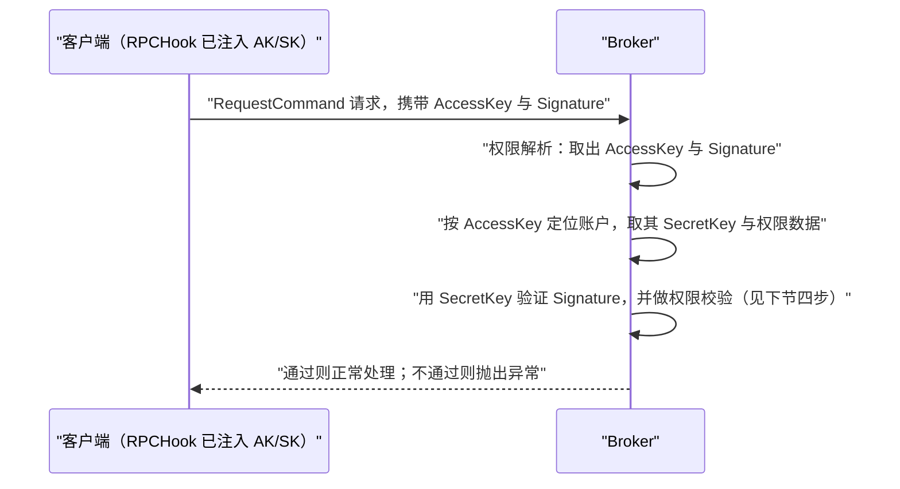
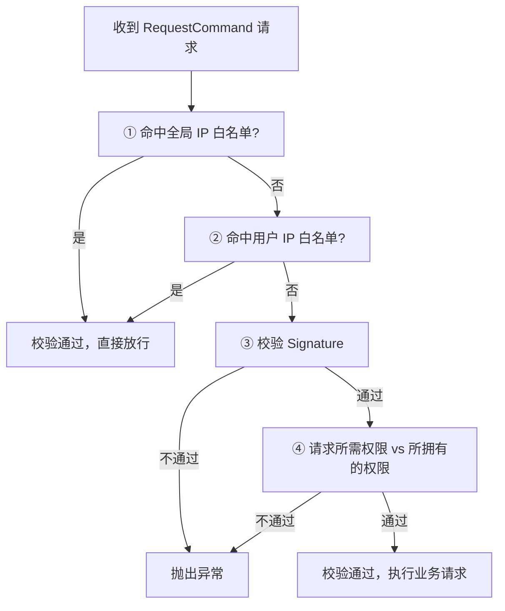

## 为什么需要安全模型？（痛点引入）

先想一个通用场景（这里只描述上游文档明确记载的风险形态，不引用任何具体事故）：一个 RocketMQ 集群按默认方式部署在若干台机器上，Broker 监听端口对内网其他网段、甚至对公网可达；运维没有启用 ACL，也没有做网络隔离。此时按上游「安全模型」一节的原文结论：**RocketMQ 不会在协议层强制校验客户端身份，任何能够访问 RocketMQ 端口的主体都可能发起消息收发或管理类操作**。

这意味着攻击面比多数人直觉中大得多：

- 任何能连上端口的人，都能向业务 Topic **发任意消息**（消息投毒、伪造业务事件）。
- 任何能连上端口的人，都能**订阅业务 Topic**，把消息体里的订单、手机号等敏感数据读走。
- 任何能连上端口的人，都可能尝试 **UPDATE_AND_CREATE_TOPIC 这类管理请求**（ACL 1.0 文档明确这类特殊请求应只由 admin 账户操作）。
- 若 Dashboard 或 Prometheus Exporter 的 HTTP 端口也被访问到，**集群元数据可被任意读取**（上游明确它们默认不启用强认证）。

| 维度 | 没有安全模型（未鉴权、端口可达） | 按上游安全模型收敛之后 |
|------|----------------------------------|--------------------------|
| 消息发送 | 能连上端口即可任意发送 | 无合法 AccessKey/SecretKey 签名的请求在 Broker 校验处抛异常 |
| 消息读取 | 能连上端口即可订阅任何 Topic | Topic/ConsumerGroup 权限逐项校验，未授权即失败 |
| 管理操作 | 建 Topic、改配置不设防 | 特殊请求仅 admin 账户可操作 |
| 元数据暴露 | Dashboard/Exporter 端口可随意读 | 监听地址绑内网/受信任 VPC，网关加白名单，公网运维叠 VPN/鉴权/WAF |
| 传输链路 | 明文可被监听 | 客户端与服务端可启用 TLS 加密通信 |
| 变更管理 | 权限散落在各处无人审计 | 权限集中在 plain_acl.yml，支持热加载与 mqadmin 命令管理 |

> ### 💡 新人小结：安全模型和 ACL 是一回事吗？
>
> 把 RocketMQ 集群想象成一个小区：
> - 安全模型 = 整套物业方案：围墙（网络隔离）、门禁（ACL）、密封信袋（TLS 传输加密）、快递柜台账（日志管理），缺一不可。
> - ACL = 门禁系统本身：刷卡（AccessKey）+ 校验防伪码（SecretKey 签名）+ 访客免登记通道（IP 白名单）。
> - 上游第一句话就说清了责任边界：项目自身提供 ACL、TLS 等特性，但**最终安全效果取决于运维对网络、主机、账户与数据的整体防护配置**。
>
> **门禁装得再好，大门敞着也没用——安全模型讲的是「每一层都要有人负责」。**

**学习路线图**（本文按七段推进，逐段读完即可落地 ACL 1.0）

```
安全模型 → ACL 1.0 是什么 → 权限定义与属性 → 集群开启 → 鉴权流程 → 热加载与限制 → mqadmin 命令
分层职责   yml+签名校验     4 种权限 9 字段   aclEnable   解析+四步校验  免重启改权限   五条管理命令
```

> [!NOTE] 本文口径边界
> 本文全部技术结论只来自上游文档文本（4.x 与 5.0 的「安全」页、4.x 与 5.0 的「权限控制（ACL 1.0）」页）。文中关于鉴权行为的描述都是「上游文档的记载」，**本复刻站没有对任何版本做过实际鉴权验证**。上游未给出的数据（例如某些开关的默认值）一律显式标注「上游未给出」，不做推测。

---

## 先把术语对齐：术语表

| 术语 | 全称 | 含义（用自己的话） | 在本文中的角色 |
|------|------|--------------------|----------------|
| ACL | Access Control List，访问控制列表 | 对请求做「认证 + 授权」控制的机制；ACL 1.0 是 4.4.0 引入的第一代实现 | 本文后半篇的主角 |
| ACL 1.0 | — | 基于 plain_acl.yml 配置文件 + AccessKey/SecretKey 签名的权限控制 | 4.x、5.0-5.2、5.3.0-5.3.2 适用；5.3.3 起被移除 |
| ACL 2.0 | — | 5.3.0 起引入、认证与授权分离、用户/资源/操作/决策模型的新实现 | 本文只在版本时间线与迁移提示处出现，细节见本站《访问控制 2.0》 |
| AccessKey（AK） | — | 类似用户名的身份标识，权限数据挂在它身上 | 客户端签名请求中携带，Broker 据此找账户 |
| SecretKey（SK） | — | 与 AK 配对的密钥，用于对请求做签名 | 客户端用它算 Signature，服务端用它验签 |
| Signature | 签名 | 客户端用 SecretKey 对请求计算出的字符串，服务端用 SecretKey 验证 | 鉴权流程第 3 步的校验对象 |
| RPCHook | — | 客户端的 RPC 钩子，ACL 1.0 通过它把 AK/SK 签名注入请求 | 客户端接入 ACL 的入口 |
| plain_acl.yml | — | ACL 1.0 权限属性的存储文件，默认实现是 yml 配置文件 | 权限定义、热加载都围绕它 |
| aclEnable | — | Broker 配置里的 ACL 开启开关 | 集群部署章节的核心参数 |
| admin 账户 | — | 账户属性之一（true/false），标记是否管理员账户 | UPDATE_AND_CREATE_TOPIC 等特殊请求仅 admin 可操作 |
| 全局 IP 白名单 | globalWhiteRemoteAddresses | 命中即视为校验通过的来源 IP 列表 | 鉴权四步的第 1 步 |
| 用户 IP 白名单 | whiteRemoteAddress | 单个账户级的来源 IP 白名单 | 鉴权四步的第 2 步 |
| DENY / PUB / SUB / ANY | — | ACL 1.0 的四种权限取值 | 权限定义表逐行列出 |
| 热加载 | — | 修改 plain_acl.yml 属性后无需重启 Broker 即可生效 | 权限运维的关键能力 |
| TLS | Transport Layer Security，传输层安全 | 客户端与服务端之间的加密通信 | 安全模型第 3 节「传输加密」 |
| Proxy | 代理组件 | 5.x 架构中承担接入与计算角色的组件 | 上游日志管理节要求妥善保管其日志；鉴权细节见《访问控制 2.0》 |
| Dledger | — | 多副本高可用部署架构，节点宕机时组内自动选主 | 使用限制第 2 条涉及 |
| Dashboard | RocketMQ Dashboard | 集群控制台 | 上游提示其默认不启用强认证，需收敛暴露面 |
| WAF | Web Application Firewall，Web 应用防火墙 | 挂在 HTTP 入口前的防护层 | 公网运维 Dashboard 的叠加手段之一 |
| ASF | Apache Software Foundation，Apache 软件基金会 | RocketMQ 所属社区，漏洞处理遵循其流程 | 「安全策略」章节的依据 |
| PoC | Proof of Concept | 漏洞的概念验证代码/步骤 | 上游建议漏洞报告附带（如有） |

---

## 上游安全模型：六个防护维度

Apache RocketMQ 项目自身提供了 ACL、TLS 等安全特性，但最终的安全效果仍取决于运维人员对**网络、主机、账户与数据**的整体防护配置。

上游两个版本的「重要提示（安全部署基线）」内容一致，照录如下：

> **重要提示（安全部署基线）**：RocketMQ 的认证/鉴权能力依赖 ACL 配置。若未启用/未配置 ACL，RocketMQ 将不会在协议层强制校验客户端身份，任何能够访问 RocketMQ 端口的主体都可能发起消息收发或管理类操作。
> **运维方必须**：要么启用并正确配置 ACL（认证 + 授权），要么将 RocketMQ 组件与端口严格限制在受信任网络内（如内网/VPC/专用网络），而不是将它们暴露到不受信任网络。

### 1. 认证与授权（ACL）

上游给出的 ACL 版本时间线（4.x 与 5.0 两版文字相同）：

| 事件 | 版本 | 上游原文要点 |
|------|------|--------------|
| ACL 1.0 支持起始 | RocketMQ 4.4.0 | 自 4.4.0 版本起支持 ACL 1.0 |
| ACL 2.0 引入 | 5.3.0 起 | 引入安全性更高的 ACL 2.0 |
| ACL 1.0 移除 | 5.3.3 | 移除了 ACL 1.0 |
| 官方建议 | — | 建议所有使用 Apache RocketMQ ACL 的用户迁移到 ACL 2.0 |

ACL 用于对 RocketMQ 请求进行**认证**与**授权**控制。生产环境建议（上游原文口径）：

- 除非 RocketMQ 被严格隔离在受信任网络内，部署的集群应启用 ACL（认证/鉴权），并为使用方配置最小权限账户。
- 避免在业务应用中使用管理员账号；对使用方的访问密钥进行分级、定期轮换并审计变更。

### 2. 控制台（Dashboard）与可观测组件暴露

RocketMQ Dashboard 及部分可观测组件（例如 RocketMQ Prometheus Exporter）**默认不启用强认证**，任何可访问 HTTP 端口的用户都可读取集群元数据。上游强烈建议：

| 措施 | 具体做法（上游原文要点） |
|------|--------------------------|
| 收敛监听 | Dashboard 监听地址绑定至内网或受信任 VPC |
| 入口管控 | 在网关 / Ingress / 反向代理上配置 ACL / IP 白名单 |
| 公网运维 | 务必叠加 VPN、HTTP Basic/OAuth 鉴权或 WAF |

上游同时注明：否则可能导致信息泄露风险，**该风险属于部署方责任而非 RocketMQ 漏洞**。

### 3. 传输加密与数据加密

- 客户端与服务端可通过 TLS 加密通信，若数据中包含敏感信息可以开启。
- 消息体由业务定义，RocketMQ 不会解密消息体或持久化解密后的内容（5.0 版措辞为「不会解析或持久化解密后的内容」，见下节差异表）。
- 若消息包含敏感信息，应在业务侧进行字段或整体加密，避免明文传输至 RocketMQ（5.0 版措辞为「避免明文落盘」）。

### 4. 序列化与反序列化风险

- RocketMQ 仅传输字节数组，不做对象反序列化。
- 消费端若需反序列化，应选用安全格式（如 JSON-Binding、Protobuf 等），并对不可信数据进行校验。

### 5. SDK 与版本管理

- 始终使用官方最新稳定版客户端，以获得最新漏洞修复与改进。

### 6. 日志管理

- 请妥善保管 RocketMQ 相关日志（包括 Broker、NameServer、Proxy、Client 等），避免敏感信息泄漏。

### 4.x 与 5.0 安全模型逐处差异对比表

两个版本的安全模型页结构一致（均为六个防护维度加安全策略），但文字存在以下差异，逐处对照（左为 4.x `12-security/01security.md`，右为 5.0 `14-security/01security.md`）：

| 位置 | 4.x 原文 | 5.0 原文 | 差异性质 |
|------|----------|----------|----------|
| 总责句 | ……取决于运维人员对网络、主机、账户与数据的整体防护**配置** | ……取决于运维人员对网络、主机、账户与数据的整体防护 | 措辞，无实质差异 |
| 部署基线括号 | （如内网/VPC/专用网络） | （内网/VPC/专用网络） | 措辞，无实质差异 |
| 生产建议第 1 条 | 部署的 RocketMQ 集群应启用 ACL（认证/鉴权），并为**使用方**配置最小权限账户 | 否则应启用 ACL（认证/鉴权），并为**应用**配置最小权限账户 | 措辞，口径相同 |
| 生产建议第 2 条 | 对**使用方的访问密钥**进行分级、定期轮换并审计变更 | 对访问密钥进行分级、定期轮换并审计变更 | 措辞，口径相同 |
| 传输加密第 2 条 | RocketMQ 不会**解密消息体**或持久化解密后的内容 | RocketMQ 不会**解析**或持久化解密后的内容 | 动词不同：5.0 的「解析」覆盖面更宽 |
| 传输加密第 3 条 | 避免**明文传输至 RocketMQ** | 避免**明文落盘** | 防护对象不同：4.x 强调入站链路，5.0 强调持久化 |
| FAQ 章节位置 | 「未开启 ACL」FAQ 位于「安全模型」内部，三级小节 | 同一 FAQ 位于「安全策略」之后，独立二级章节 | 位置不同，内容口径相同 |
| FAQ 措辞 | 是否启用取决于部署时的配置；运维方应根据自身威胁模型**评估并**启用 ACL | 是否启用取决于部署与配置；运维方应根据自身威胁模型启用 ACL | 措辞，口径相同 |
| 漏洞报告结尾提示 | 请勿在**已修复安全漏洞的版本发布前**通过公开 Issue、邮件列表或社交媒体等披露可被立即利用的漏洞细节 | 请勿在**修复发布前**通过公开 Issue、邮件列表或社交媒体披露可被立即利用的细节 | 措辞，口径相同 |

### FAQ：关于「未开启 ACL 时无需认证/可访问」的说明

上游原文口径：RocketMQ 的认证与鉴权能力由 ACL 提供，是否启用取决于部署配置。当 ACL 未启用或未配置时，**请求可能在不进行身份校验的情况下被处理**；这属于部署/配置选择，运维方应根据自身威胁模型评估并启用 ACL，配合网络隔离等手段保证集群安全。

> [!NOTE] 版本适用：这条 FAQ 在两版文档中的位置不同
> 这条常被新人当成「产品漏洞」来提问的 FAQ，4.x 与 5.0 安全文档**两版均有收录**（编写过程中曾按任务口径预期它是 5.0 独有，逐行比对后确认 4.x 也有，此处以源文件为准）：4.x 把它作为「安全模型」下的三级小节，5.0 把它升级为「安全策略」之后的独立二级章节，且 5.0 措辞更精炼。两版结论一致：未开启 ACL 时的「免鉴权」是**配置选择**，不是协议缺陷；需要鉴权就必须启用并正确配置 ACL。

### 安全策略：漏洞报告

Apache RocketMQ 是 ASF 旗下项目，遵循 ASF 的漏洞处理流程。发现新的安全漏洞时，应遵循 ASF 官方流程进行**私下披露与提交**：`https://apache.org/security/#reporting-a-vulnerability`。

为便于评估与修复，上游建议报告中包含：受影响的组件/版本、复现步骤、影响说明，以及 PoC（如有）。

> 请勿在已修复版本发布前，通过公开 Issue、邮件列表或社交媒体披露可被立即利用的漏洞细节。

---

## ACL 1.0 是什么：一页速览

> [!NOTE] 版本适用：ACL 1.0 的适用版本与移除
> 按 5.0 文档的「历史版本文档」提示：ACL 1.0 适用于 **RocketMQ 4.x、5.0-5.2 和 5.3.0-5.3.2**；**从 RocketMQ 5.3.3 开始 ACL 1.0 已被移除、不再支持**。5.3.0 及以上版本的用户，上游强烈建议使用 ACL 2.0（见本站《访问控制 2.0》）。

权限控制（ACL）主要为 RocketMQ 提供 **Topic 资源级别的用户访问控制**。整体工作方式（上游特性介绍原文要点）：

- 客户端：在 Client 端通过 **RPCHook** 注入 AccessKey 和 SecretKey 签名。
- 服务端配置：把权限控制属性（Topic 访问权限、IP 白名单、AccessKey/SecretKey 签名等）写在 **distribution/conf/plain_acl.yml** 配置文件中。
- 校验：Broker 端对 AccessKey 所拥有的权限进行校验，**校验不过，抛出异常**。
- 参考实现：上游指向 **org.apache.rocketmq.example.simple** 包下的 **AclClient** 示例代码。

> ### 💡 新人小结：ACL 1.0 的三件东西各管什么？
>
> 把 ACL 1.0 想象成一家老式公司的门禁：
> - AccessKey = 你挂在门口的工牌号（代指你是谁，可以公开在请求里）。
> - SecretKey = 工卡里的防伪芯片（**永不上线**，只在本地算签名）。
> - plain_acl.yml = 前台手里的那本登记册（每个工牌号能进哪些房间、从哪些访客机来的算通行）。
> - 校验不过就抛异常 = 登记册上没这一行，前台直接拦下你。
>
> **AK 是「我是谁」，SK 是「凭什么信我」，yml 是「谁能干什么」，三件套合起来才是 ACL。**

---

## 权限定义与属性值（完整保留上游表格）

### 权限定义

对 RocketMQ 的 Topic 资源访问权限控制定义分为以下四种（上游表格逐行保留）：

| 权限 | 含义 |
| --- | --- |
| DENY | 拒绝 |
| ANY | PUB 或者 SUB 权限 |
| PUB | 发送权限 |
| SUB | 订阅权限 |

补充读表：属性取值清单里还出现了 `PUB|SUB` 写法（同时具备发送与订阅），它出现在 defaultTopicPerm、defaultGroupPerm 以及 mqadmin 参数示例中，属于上游给出的合法取值组合。

### 权限定义的关键属性

上游关键属性表逐行保留（9 个字段一个不少）：

| 字段 | 取值 | 含义 |
| --- | --- | --- |
| globalWhiteRemoteAddresses | \*;192.168.\*.\*;192.168.0.1 | 全局IP白名单 |
| accessKey | 字符串 | Access Key |
| secretKey | 字符串 | Secret Key |
| whiteRemoteAddress | \*;192.168.\*.\*;192.168.0.1 | 用户IP白名单 |
| admin | true;false | 是否管理员账户 |
| defaultTopicPerm | DENY;PUB;SUB;PUB\|SUB | 默认的Topic权限 |
| defaultGroupPerm | DENY;PUB;SUB;PUB\|SUB | 默认的ConsumerGroup权限 |
| topicPerms | topic=权限 | 各个Topic的权限 |
| groupPerms | group=权限 | 各个ConsumerGroup的权限 |

具体文件参考 **distribution/conf/plain_acl.yml** 配置文件。

按上述字段整理的**结构示意**（注意：上游只给出字段名与合法取值，**没有给出该文件的完整样例文本**，下文缩进层级是为阅读方便整理的示意，落地时以发行包内 `distribution/conf/plain_acl.yml` 的实际格式为准）：

```yaml
# ========== 推荐写法：最小权限 + 显式逐项配置 ==========
globalWhiteRemoteAddresses:
  - 192.168.*.*          # 全局IP白名单：仅放行受信任网段（取值含义见上游属性表）
accounts:                # mqadmin 文档称此列表为 "accounts"，每个条目是一个账户
  - accessKey: <your-access-key>        # 占位符示例，禁止直接使用上游示例值
    secretKey: <your-secret-key>        # 占位符示例，禁止写入真实生产密钥
    whiteRemoteAddress: 192.168.0.1     # 用户IP白名单：该账户只允许来自此地址
    admin: false                        # 是否管理员账户（上游未给出默认值，显式写清）
    defaultTopicPerm: DENY              # 未显式配置的 Topic 一律拒绝
    defaultGroupPerm: DENY              # 未显式配置的 Group 一律拒绝
    topicPerms:
      - topicA=DENY                     # 对单个 Topic 显式授权，格式 topic=权限
      - topicD=SUB                       # 该账户只能订阅 topicD
    groupPerms:
      - groupD=DENY
      - groupB=SUB
```

```yaml
# ========== 不推荐写法（仅展示） ==========
# ❌ globalWhiteRemoteAddresses: - "*"   —— 全局白名单配 "*" 时，任何来源第 1 步就「认为校验通过」，
#      签名与权限校验全部被跳过，等于 ACL 名存实亡（依据：鉴权流程第 1 步命中即通过）
# ❌ admin: true 给业务应用账户 —— 上游明确「避免在业务应用中使用管理员账号」
# ❌ defaultTopicPerm: ANY 图省事放开 —— 与「为使用方配置最小权限账户」的生产建议相反
# ❌ 把真实 AK/SK 提交进代码仓库 —— secretKey 是签名密钥，泄漏即可被冒用
```

> [!NOTE] 上游未给出的项
> `admin`、`defaultTopicPerm`、`defaultGroupPerm` 等字段在**不配置时的缺省行为**，上游文档未给出默认值说明，只给出了各自的合法取值清单；本文示例一律显式写出取值，不依赖缺省行为。

---

## 支持权限控制的集群部署

在 `distribution/conf/plain_acl.yml` 中按上述说明定义好权限属性后，**打开 `aclEnable` 开关变量即可开启 RocketMQ 集群的 ACL 特性**。上游给出了 Broker 端开启 ACL 的完整 properties 配置内容，逐行照录（含上游原注释行）：

```properties
# ========== 上游原文照录：Broker 端开启 ACL 的 properties 配置 ==========
brokerClusterName=DefaultCluster
brokerName=broker-a
brokerId=0
deleteWhen=04
fileReservedTime=48
brokerRole=ASYNC_MASTER
flushDiskType=ASYNC_FLUSH
storePathRootDir=/data/rocketmq/rootdir-a-m
storePathCommitLog=/data/rocketmq/commitlog-a-m
autoCreateSubscriptionGroup=true
## if acl is open,the flag will be true
aclEnable=true
listenPort=10911
brokerIP1=XX.XX.XX.XX1
namesrvAddr=XX.XX.XX.XX:9876
```

参数解释（与本文相关的部分）：

| 参数 | 本文中的作用 | 依据 |
|------|--------------|------|
| `aclEnable=true` | ACL 总开关，上游注释「if acl is open,the flag will be true」 | 上游配置块原文 |
| `brokerClusterName` / `brokerName` / `brokerId` | 集群与节点身份，mqadmin 按集群名/地址定位执行节点时用到 | 上游配置块 + 第 7 节命令说明 |
| 其余行（deleteWhen、fileReservedTime、brokerRole、flushDiskType、storePath*、autoCreateSubscriptionGroup、listenPort、brokerIP1、namesrvAddr） | 常规 Broker 存储与网络配置，非 ACL 专有 | 上游配置块原文 |

```properties
# ========== 不推荐写法（仅展示） ==========
# ❌ 不写 aclEnable 就直接把 10911 暴露到不受信任网络 —— 违反上游「安全部署基线」二选一要求
# ❌ 只在 Master 开了 aclEnable，Slave 或 Dledger 组内其余节点不管 —— 见「使用限制」两条要求
```

> [!NOTE] 上游未给出默认值
> `aclEnable` 的默认值上游未给出，示例配置是显式写 `aclEnable=true` 开启；另外上游「热加载」一节只说明**修改 plain_acl.yml 属性**不需重启 Broker，**未说明 aclEnable 开关本身**改后是否需重启才生效，本文不做推断。

---

## 鉴权主要流程：权限解析与权限校验

ACL 主要流程分为两部分：**权限解析**和**权限校验**。

### 权限解析

Broker 端对客户端的 RequestCommand 请求进行解析，拿到需要鉴权的属性字段，主要包括：

1. **AccessKey**：类似于用户名，代指用户主体，权限数据与之对应。
2. **Signature**：客户端根据 SecretKey 签名得到的串，服务端再用 SecretKey 进行签名验证。

下图是「一次带签名的请求从客户端到 Broker」的解析时序（依据上游 4.1 节文字绘制）：



图后解读：SecretKey 本身**不随请求传输**，传输的是用它算出的 Signature；服务端拿存储的 SecretKey 复算验证，这就是「凭签名不凭密钥」的基本设计。

### 权限校验

Broker 端对权限的校验逻辑，上游给出四步（顺序执行，逐条照录后作图）：

1. 检查是否命中**全局 IP 白名单**；是则认为校验通过；否则走第 2 步。
2. 检查是否命中**用户 IP 白名单**；是则认为校验通过；否则走第 3 步。
3. **校验签名**，校验不通过则抛出异常；校验通过则走第 4 步。
4. 对**用户请求所需的权限**与**用户所拥有的权限**进行校验；不通过则抛出异常。

下图即这条判定链：



第 4 步中「用户所需权限」的判定，上游补充两条必须注意的规则：

| 规则 | 上游原文要点 |
|------|--------------|
| 特殊请求限制 | 特殊请求例如 UPDATE_AND_CREATE_TOPIC 等，只能由 admin 账户进行操作 |
| 显式优先、默认兜底 | 对于某个资源，如果有显性配置权限，则采用配置的权限；如果没有显性配置权限，则采用默认的权限 |

> ### 💡 新人小结：四步校验为什么白名单排在签名前面？
>
> 想象写字楼早高峰的门禁：
> - ① 全局白名单 = 大楼固定的快递代收点，刷脸都不用，直接进（最粗粒度、最快）。
> - ② 用户白名单 = 某个工牌绑定了「从这扇门来的就是本人」，也直接过。
> - ③ 签名校验 = 剩下所有人逐个验工卡防伪码，验不过当场拦下。
> - ④ 权限校验 = 卡是真的，但你的卡能不能刷开 3 楼会议室，逐房间核对。
>
> **白名单是性能与免登记通道，签名是身份真实性，权限是资源可达性——三层顺序不能倒，倒了白名单就变成绕过鉴权的洞。**

---

## 热加载修改后的权限控制定义

上游「热加载」一节原文口径：RocketMQ 权限控制存储的**默认实现基于 yml 配置文件**；用户可以**动态修改权限控制定义的属性，而不需重新启动 Broker 服务节点**。

实践含义（结合上游两节内容，不引入新事实）：

- 改权限（增删账户、调 topicPerms/groupPerms、调白名单）走 plain_acl.yml 或 mqadmin 命令，无需重启。
- 改 `aclEnable` 这类 Broker properties 是否免重启，上游未说明，变更窗口按常规 Broker 配置变更处理。

---

## 权限控制的使用限制

上游给出两条与高可用部署组合使用的限制：

| 部署形态 | 组合场景 | 上游要求的具体动作 |
|----------|----------|--------------------|
| Master/Slave 架构 | ACL + 主从高可用同时启用 | 在 Broker **Master 节点**的 distribution/conf/plain_acl.yml 中设置全局白名单信息：将 **Slave 节点的 IP 地址**加入 Master 节点 plain_acl.yml 的全局白名单 |
| 多副本 Dledger 架构 | ACL + Dledger 同时启用 | 节点宕机时 Dledger Group 组内会**自动选主**，因此需将 Group 组内**所有 Broker 节点**的 plain_acl.yml 白名单设置为**所有 Broker 节点的 IP 地址** |

这两条限制的共同原因：主从同步、选主后的写请求来自集群内部节点；这些内部来源若不进白名单，会被第 1/2 步白名单和第 3 步签名校验拒绝，同步链路就会失败。

上游特别注意事项（原文照录要点）：开启 ACL 鉴权认证后导致 **Master/Slave 和 Dledger 模式下 Broker 同步数据异常**的问题，社区在 **[4.5.1] 版本已修复**，PR 链接：`https://github.com/apache/rocketmq/pull/1149`。

---

## mqadmin 的 ACL 管理命令（五条，参数表完整保留）

以下命令的说明遵循同一规则（上游对每条命令均有此说明）：**如果指定的是集群名称，则会在集群中各个 Broker 节点执行该命令；否则会在单个 Broker 节点执行该命令**。

凭证占位符说明：上游示例中的 AccessKey 用了 `RocketMQ`、SecretKey 用了 `1234567809123`，这两个值是上游文档示例值；本文按凭证安全要求统一替换为 `<your-access-key>` / `<your-secret-key>`，命令其余结构（地址、Topic、Group 名称与参数形态）与上游一致。

### 1. 更新 ACL 配置文件中「account」的属性值

```shell
$ sh mqadmin updateAclConfig -n 192.168.1.2:9876 -b 192.168.12.134:10911 \
    -a <your-access-key> -s <your-secret-key> -t topicA=DENY,topicD=SUB -g groupD=DENY,groupB=SUB
# 输出: 上游未给出该命令的标准输出样例；执行效果可用下方第 4、5 条命令查询版本信息与配置内容来确认
```

说明：如果不存在则会在 ACL Config YAML 配置文件中创建；若存在，则会更新对应的「accounts」的属性值。

| 参数 | 取值 | 含义 |
| --- | --- | --- |
| n | eg:192.168.1.2:9876 | namesrv地址(必填) |
| c | eg:DefaultCluster | 指定集群名称(与broker地址二选一) |
| b | eg:192.168.12.134:10911 | 指定broker地址(与集群名称二选一) |
| a | eg:`<your-access-key>`（上游示例值 RocketMQ） | Access Key值(必填) |
| s | eg:`<your-secret-key>`（上游示例值 1234567809123） | Secret Key值(可选) |
| m | eg:true | 是否管理员账户(可选) |
| w | eg:192.168.0.* | whiteRemoteAddress,用户IP白名单(可选) |
| i | eg:DENY;PUB;SUB;PUB\|SUB | defaultTopicPerm,默认Topic权限(可选) |
| u | eg:DENY;PUB;SUB;PUB\|SUB | defaultGroupPerm,默认ConsumerGroup权限(可选) |
| t | eg:topicA=DENY,topicD=SUB | topicPerms,各个Topic的权限(可选) |
| g | eg:groupD=DENY,groupB=SUB | groupPerms,各个ConsumerGroup的权限(可选) |

### 2. 删除 ACL 配置文件里对应的「account」

```shell
$ sh mqadmin deleteAccessConfig -n 192.168.1.2:9876 -c DefaultCluster -a <your-access-key>
# 输出: 上游未给出标准输出样例；删除结果可用第 5 条 getAccessConfigSubCommand 查询确认
```

说明：参数 a 为 Access Key 的值，用以标识唯一账户 id，因此该命令的参数中指定账户 id 即可。

| 参数 | 取值 | 含义 |
| --- | --- | --- |
| n | eg:192.168.1.2:9876 | namesrv地址(必填) |
| c | eg:DefaultCluster | 指定集群名称(与broker地址二选一) |
| b | eg:192.168.12.134:10911 | 指定broker地址(与集群名称二选一) |
| a | eg:`<your-access-key>`（上游示例值 RocketMQ） | Access Key的值(必填) |

### 3. 更新 ACL 配置文件中的全局白名单

```shell
$ sh mqadmin updateGlobalWhiteAddr -n 192.168.1.2:9876 -b 192.168.12.134:10911 -g 10.10.154.1,10.10.154.2
# 输出: 上游未给出标准输出样例；该命令更新的是配置文件 globalWhiteRemoteAddresses 字段的属性值
```

说明：参数 g 为全局 IP 白名单的值，用以更新 ACL 配置文件中的「globalWhiteRemoteAddresses」字段的属性值。

| 参数 | 取值 | 含义 |
| --- | --- | --- |
| n | eg:192.168.1.2:9876 | namesrv地址(必填) |
| c | eg:DefaultCluster | 指定集群名称(与broker地址二选一) |
| b | eg:192.168.12.134:10911 | 指定broker地址(与集群名称二选一) |
| g | eg:10.10.154.1,10.10.154.2 | 全局IP白名单(必填) |

### 4. 查询集群/Broker 的 ACL 配置文件版本信息

```shell
$ sh mqadmin clusterAclConfigVersion -n 192.168.1.2:9876 -c DefaultCluster
# 输出: 上游未给出输出样例；本命令用途即「查询集群/Broker 的 ACL 配置文件版本信息」
```

| 参数 | 取值 | 含义 |
| --- | --- | --- |
| n | eg:192.168.1.2:9876 | namesrv地址(必填) |
| c | eg:DefaultCluster | 指定集群名称(与broker地址二选一) |
| b | eg:192.168.12.134:10911 | 指定broker地址(与集群名称二选一) |

### 5. 查询集群/Broker 的 ACL 配置文件全部内容

```shell
$ sh mqadmin getAccessConfigSubCommand -n 192.168.1.2:9876 -c DefaultCluster
# 输出: 上游未给出输出样例；本命令用途即「查询集群/Broker 的 ACL 配置文件全部内容」
```

| 参数 | 取值 | 含义 |
| --- | --- | --- |
| n | eg:192.168.1.2:9876 | namesrv地址(必填) |
| c | eg:DefaultCluster | 指定集群名称(与broker地址二选一) |
| b | eg:192.168.12.134:10911 | 指定broker地址(与集群名称二选一) |

---

## ACL 1.0 文档：4.x 与 5.0 的差异

两版「权限控制（ACL 1.0）」文档的正文（第 1 节到第 7 节，含全部表格与命令）逐节比对后**内容相同**，差异集中在 5.0 版新增的版本提示：

| 对比项 | 4.x `05-bestPractice/04access.md` | 5.0 `06-bestPractice/10access-1.0.md` |
|--------|-----------------------------------|----------------------------------------|
| 标题 | 权限控制 | 权限控制（ACL 1.0） |
| 历史版本提示 | 无 | 开头新增「历史版本文档」警告块：适用 4.x、5.0-5.2、5.3.0-5.3.2；5.3.3 起移除不再支持 |
| 迁移指引 | 无 | 警告块中明确 5.3.0+ 用户「强烈建议使用 ACL 2.0 文档」并给出链接 |
| 正文第 1-7 节 | 完整 | 与 4.x 相同，逐节一致 |

也就是说：ACL 1.0 的功能口径从 4.x 到 5.x 没有变化，5.0 文档做的事是把它标记为历史版本并引导迁移。

---

## 与访问控制 2.0 的关系（导览）

本文覆盖的是 ACL 1.0；5.3.0 起引入的 ACL 2.0 在模型与运维方式上有较大重构，本站已单独成篇《访问控制 2.0》。先用一张速查表建立预期（详细依据见该文）：

| 对比维度 | ACL 1.0（本文） | ACL 2.0（见《访问控制 2.0》） |
|----------|-----------------|-------------------------------|
| 身份载体 | AccessKey/SecretKey 签名对 | 用户名/密码的用户体系（Super/Normal） |
| 权限表达 | DENY/ANY/PUB/SUB 挂 Topic/Group | 主体 × 资源 × 操作 × 决策（Allow/Deny）× 环境（IP） |
| 存储介质 | plain_acl.yml（默认实现） | 认证/授权元数据提供者（Local 实现） |
| 开关 | aclEnable | authenticationEnabled 与 authorizationEnabled 独立配置 |
| 管理命令 | updateAclConfig / deleteAccessConfig / updateGlobalWhiteAddr 等 | createUser / createAcl / listUser / listAcl 等 |
| 官方定位 | 4.4.0 起支持；5.3.3 移除 | 5.3.0 起引入，官方建议迁移目标 |

---

## 常见误区自检（✅ 与 ❌ 对照）

| 场景 | ❌ 容易做错的判断 | ✅ 依据上游文档应有的判断 |
|------|-------------------|--------------------------|
| 内网就安全 | 集群只在 VPC 内可达，开不开 ACL 无所谓 | 上游给了二选一的基线：要么启用并正确配置 ACL，要么严格网络隔离；且 Dashboard/Exporter 默认不强认证，内网元数据照样可读 |
| 白名单便利性 | globalWhiteRemoteAddresses 配 `*` 省事 | 第 1 步命中即通过，`*` 让签名与权限校验全部失效，等价于关闭 ACL |
| 主从 + ACL | 只在 Master 配 plain_acl.yml 就上线 | 上游限制 (1)：必须把 Slave 的 IP 加入 Master 的全局白名单，否则同步数据异常（4.5.1 还专门修复过此问题） |
| Dledger + ACL | 只把当前主节点 IP 写进白名单 | 上游限制 (2)：宕机时组内自动选主，白名单必须覆盖组内**所有** Broker 节点 IP |
| 用命令查权限变更是否生效 | 认为 updateAclConfig 会打印成功文案 | 上游未给出这些命令的输出样例；确认应使用 clusterAclConfigVersion 与 getAccessConfigSubCommand |
| 示例凭证直接上线 | 照抄文档示例的 AK/SK 串 | 示例值（含 RocketMQ/1234567809123）只是文档占位，生产必须换成自己的凭证并纳入轮换与审计 |
| 未配置资源的行为 | 认为不写 topicPerms 时行为可自行推断 | 上游口径：无显性配置权限则采用默认权限；而默认字段未配置时的缺省行为上游未给出，必须显式配置 defaultTopicPerm/defaultGroupPerm |

---

## 要点总结

1. **安全模型是分层的责任清单**：ACL（认证+授权）、Dashboard/Exporter 暴露面收敛、TLS 传输加密、业务侧敏感数据加密、安全序列化格式、稳定版 SDK、日志保管，七类事项共同决定最终安全效果；「未开 ACL 即不鉴权」是配置选择而非缺陷，4.x 与 5.0 两版 FAQ 口径一致（仅章节位置不同）。
2. **ACL 1.0 的核心机制是「RPCHook 注入签名 + Broker 校验 + plain_acl.yml 存权限」**：权限四值（DENY/ANY/PUB/SUB）、账户九字段（含两级 IP 白名单、admin、默认与显式 Topic/Group 权限），校验按四步走：全局白名单、用户白名单、签名、权限。
3. **特殊请求与兜底权限是两条硬规则**：UPDATE_AND_CREATE_TOPIC 等特殊请求只能 admin 账户操作；资源权限显性配置优先、默认权限兜底，所以 defaultTopicPerm/defaultGroupPerm 必须显式收紧。
4. **高可用组合有明确限制**：主从架构要把 Slave IP 加入 Master 全局白名单；Dledger 要把全部节点 IP 互写白名单；4.5.1 修复过开 ACL 后同步数据异常的问题。
5. **运维通道**：权限热加载（改 yml 不重启）；mqadmin 五条命令覆盖增删账户、改全局白名单、查版本与查内容；上游未给出各命令输出样例与若干开关默认值，本文均显式标注，不做推断。

---

> ### 💡 新人小结：安全模型与 ACL 1.0 学完了，记住这 5 点
>
> 1. **先问「谁能连上端口」**：没开 ACL 的集群，端口可达者即可收发与管理；要么开 ACL，要么网络隔离，二者必居其一。
> 2. **AK 是工牌号，SK 是防伪芯片**：请求里只传 AK 与签名，SK 永远留在本地与配置文件；签名不过，一律抛异常。
> 3. **白名单是双刃剑**：全局/用户两级白名单先于签名生效，配 `*` 等于拆掉门禁，主从与 Dledger 场景必须按上游限制精确放行节点 IP。
> 4. **改权限不重启，改开关看配置**：plain_acl.yml 支持热加载；aclEnable 自身变更是否免重启上游未说明，按配置变更窗口处理。
> 5. **1.0 已是历史版本**：适用 4.x、5.0-5.2、5.3.0-5.3.2，5.3.3 起移除；新项目直接上 ACL 2.0（本站《访问控制 2.0》），存量按迁移路径走。
