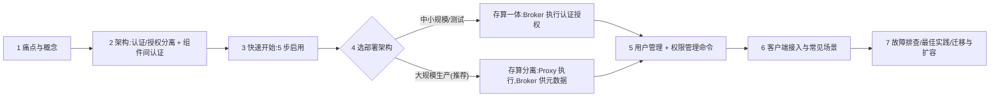
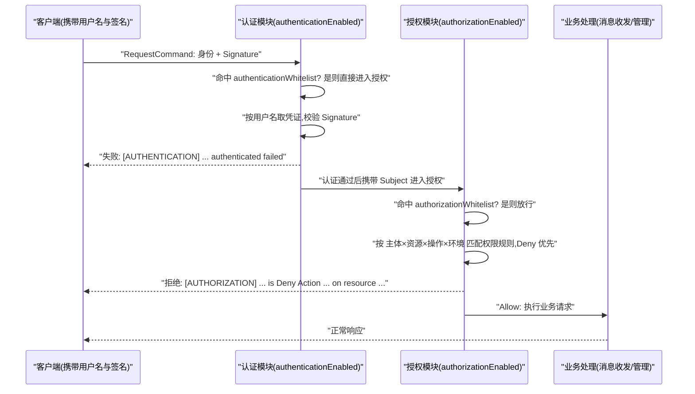
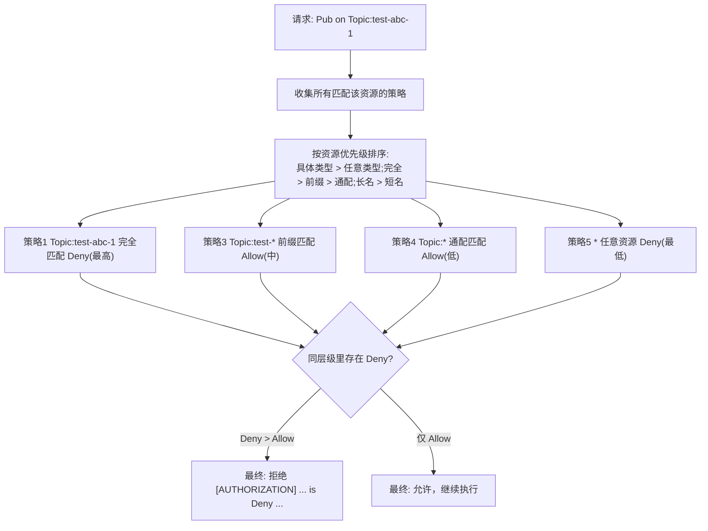

## 为什么需要访问控制 2.0？（痛点引入）

沿用本站安全篇的通用场景（只描述上游文档记载的风险形态，不引用具体事件）：一个未启用认证/授权的 RocketMQ 集群，任何能访问端口的主体都可以收发消息、读取元数据、尝试管理操作。ACL 1.0（见本站《安全模型与 ACL 1.0 权限控制》）解决了「有没有门禁」的问题，但在大规模生产集群里运营它，会撞上第二批痛点——这些痛点正是上游在 5.3.0 引入 ACL 2.0、并在 5.3.3 移除 ACL 1.0 的背景：

| 运营环节 | ACL 1.0 的痛点（依据其文档可核对的机制） | ACL 2.0 的改进（依据本文源文档） |
|----------|-------------------------------------------|----------------------------------|
| 身份管理 | 只有 AccessKey/SecretKey 签名对，没有「用户」体系，创建/查询/删除用户要靠改 yml 或专用命令 | 建立用户（User）体系：createUser/getUser/listUser/updateUser/deleteUser 全生命周期管理，分 Super/Normal 两类 |
| 认证与授权 | 一个 aclEnable 总开关，认证与授权绑死在一起 | authenticationEnabled 与 authorizationEnabled **可独立配置**（双重安全机制） |
| 权限表达 | 只有 PUB/SUB/DENY/ANY 四种取值，挂在 Topic/Group 上 | 主体 × 资源 × 操作 × 决策 × 环境五元组：资源覆盖 Cluster/Namespace/Topic/Group，操作细分为 Pub/Sub/Create/Update/Delete/Get/List/All |
| 批量授权 | topicPerms 逐条枚举 topic=权限 | 支持完全匹配、前缀匹配、通配符匹配三种资源匹配模式 |
| 拒绝语义 | DENY 只能作为某资源的权限值 | 独立 Decision：Deny 优先级高于 Allow，可「先放开一类、再点名禁止个别资源」 |
| 集群内部通信 | 主从/Dledger 靠把节点 IP 塞进全局白名单放行（见安全篇「使用限制」） | 提供 `innerClientAuthenticationCredentials` 组件间认证凭证：主从同步、Proxy 访问 Broker、Controller 选举走真实认证 |
| 性能与安全取舍 | 无策略可选 | 无状态/有状态两种认证授权策略，按吞吐与安全要求选择 |
| 新旧部署形态 | 校验只发生在 Broker | 存算一体（Broker 执行）与存算分离（Proxy 执行、Broker 供元数据）两种架构都有成套配置 |

> ### 💡 新人小结：认证和授权到底谁管什么？
>
> 把进入集群想象成住酒店：
> - 认证（Authentication）= 前台查身份证：确认「你是你说的这个人」。失败了根本进不了门。
> - 授权（Authorization）= 房卡权限：你能开 801 房、能刷健身房，但开不了别人房间和配电室。
> - ACL 1.0 是「查证件和发卡」捆在同一个柜台办；ACL 2.0 把两个柜台拆开，可以只开证件核对（只认证），也可以两个都开（认证 + 授权）。
>
> **认证回答 Who are you，授权回答 Are you allowed；2.0 的第一设计进步就是让这两件事可以独立开关、独立配置。**

**学习路线图**（本文含架构分支，用 Mermaid 表达）



> [!NOTE] 本文口径边界
> 本文全部技术结论只来自上游 5.0 文档《访问控制 2.0》（`06-bestPractice/06access.md`）单源，ACL 1.0 侧的对照口径来自本站《安全模型与 ACL 1.0 权限控制》所依据的上源。**本复刻站没有对任何 RocketMQ 版本做过实际的认证/授权验证**，文中所有错误码、日志样例、默认值均为上游文档记载原文。上游未给出或未说明的条目（文中逐处标注）不做推测。

---

## 先把术语对齐：术语表

| 术语 | 全称 | 含义（用自己的话） | 在本文中的角色 |
|------|------|--------------------|----------------|
| ACL | Access Control List，访问控制列表 | 对请求做认证与授权控制的机制总称 | 全文主题 |
| ACL 2.0 / 访问控制 2.0 | — | RocketMQ 访问控制的升级版本，提供完善的认证与授权机制，5.3.0 起适用 | 本文主角 |
| Authentication | 认证 | 确认请求者身份（用户名/密码参与的签名校验） | `authenticationEnabled` 控制 |
| Authorization | 授权 | 确认该身份能否对某资源执行某操作 | `authorizationEnabled` 控制 |
| User | 用户 | 访问 RocketMQ 资源的主体，分 Super 与 Normal 两类 | 用户管理章节的对象 |
| Super 用户 | 超级用户 | 拥有所有资源的所有权限，无需单独授权 | 系统初始化、紧急运维、mqadmin 凭证 |
| Normal 用户 | 普通用户 | 需要显式授权才能访问资源 | 业务应用、服务使用的账户 |
| Subject | 主体 | 权限规则里「这个权限给谁」的一端，格式 `User:用户名` | createAcl 的 `-s` 参数 |
| Resource | 资源 | 需要访问控制的对象：Cluster/Namespace/Topic/Group/Any | createAcl 的 `-r` 参数 |
| Action | 操作 | 对资源执行的动作：Pub/Sub/Create/Update/Delete/Get/List/All | createAcl 的 `-a` 参数 |
| Decision | 决策 | 授权结果：Allow（允许）或 Deny（拒绝，优先级更高） | createAcl 的 `-d` 参数 |
| Environment | 环境 | 访问环境信息，如来源 IP 地址 | createAcl 的 `-i` 白名单参数 |
| LITERAL / PREFIXED / ANY | 完全/前缀/通配符匹配 | 三种资源匹配模式 | 权限管理与批量授权的基础 |
| AK / SK | AccessKey / SecretKey | 1.0 时代的身份对；2.0 中作为组件间凭证与 mqadmin 凭证字段名保留 | `innerClientAuthenticationCredentials`、`tools.yml` |
| 白名单 | Whitelist | 免校验放行的来源 IP 列表；2.0 中含配置项白名单与规则内 `-i` 白名单 | 授权配置参数与权限规则 |
| 无状态策略 | Stateless Strategy | 每个请求都做完整认证授权检查的默认策略 | 策略选择章节 |
| 有状态策略 | Stateful Strategy | 首次认证授权后走缓存结果的推荐策略 | 策略选择与缓存调优章节 |
| Broker | — | 存储与元数据节点 | 认证授权参数的落点之一 |
| Proxy | — | 5.x 存算分离架构中的计算接入层，认证授权在其上执行 | 存算分离配置章节 |
| NameServer | — | 路由注册组件，mqadmin 命令的 `-n` 地址 | 全部管理命令的入口参数 |
| Controller | — | 参与选举协作的组件，其选举通信属于组件间认证场景 | `innerClientAuthenticationCredentials` 适用场景之一 |
| TLS | Transport Layer Security | 传输层加密，与 ACL 分属「链路加密」和「身份权限」两层防护 | 见本站《安全模型与 ACL 1.0 权限控制》安全模型篇 |
| mqadmin / mqadmin 工具 | — | 命令行管理工具；启用认证后必须先配好 `conf/tools.yml` 凭证 | 全部管理命令的载体 |
| CIDR | Classless Inter-Domain Routing | 无类别域间路由写法，如 `192.168.1.0/24` 表示一个 IP 段 | `-i` 参数支持的 IP 段格式 |
| RPCHook | — | ACL 1.0 客户端注入签名的钩子（2.0 客户端改用凭证 Provider） | 仅在新旧对比处出现 |

---

## 什么是访问控制 2.0：定位与核心概念

> [!NOTE] 版本适用：ACL 2.0 的适用版本
> 上游版本说明原文：访问控制 2.0（ACL 2.0）适用于 **RocketMQ 5.3.0 及以上版本**；使用 **4.x、5.0-5.2 或 5.3.0-5.3.2** 的版本请参考 ACL 1.0 文档（本站《安全模型与 ACL 1.0 权限控制》）；**从 RocketMQ 5.3.3 开始 ACL 1.0 已不再支持**，建议升级到 ACL 2.0。正在迁移的读者可直接跳本文「ACL 1.0 迁移到 ACL 2.0」一节。

访问控制 2.0 是 Apache RocketMQ 访问控制列表的升级版本，提供完善的身份认证（Authentication）和权限授权（Authorization）机制，用于保护 RocketMQ 集群的数据安全。核心特性（上游五条全录）：

- **双重安全机制**：支持认证和授权独立配置。
- **灵活的资源匹配**：支持完全匹配、前缀匹配和通配符匹配。
- **精细化权限控制**：覆盖集群、命名空间、Topic、Group 等多种资源类型。
- **多种策略选择**：提供无状态和有状态两种认证授权策略。
- **组件间安全通信**：支持 Broker、Proxy、NameServer 等组件间的访问控制。

核心概念表（上游五格全录）：

| 概念 | 说明 |
|------|------|
| **用户(User)** | 访问RocketMQ资源的主体，分为超级用户(Super)和普通用户(Normal) |
| **资源(Resource)** | 需要访问控制的对象，如Cluster、Namespace、Topic、Group |
| **操作(Action)** | 对资源执行的动作，如Pub、Sub、Create、Update、Delete、Get、List |
| **决策(Decision)** | 授权结果，Allow(允许)或Deny(拒绝) |
| **环境(Environment)** | 访问环境信息，如来源IP地址 |

> [!NOTE] 上游未提供的抽象：角色（Role）
> 本页源文档的身份维度只有「用户 + 权限规则」两层，**没有独立的「角色」对象**（无 createRole 之类命令，上游未提供角色功能）。要达到「一组应用共享同一套权限」的角色式效果，可参照上游最佳实践「为不同的应用或服务创建独立的用户」，用命名约定与逐个授权来组织；本文不虚构角色 API。

上游安全提示（原文照录要点）：**文档中的所有用户名、密码仅作为示例，切勿在生产环境直接使用**。生产部署时务必使用强密码、严格控制超级用户的使用范围、妥善保管认证凭证不要明文提交到代码仓库。

> [!NOTE] 上游口径不一致：强密码的长度
> 同一篇上游文档对「强密码」给了两个标准：开头安全提示要求「至少 16 位，包含大小写字母、数字和特殊字符」；「最佳实践」一节写的是「至少 8 位，包含字母和数字」。两处并存，本文不擅自合并；落地时建议按更严格的 16 位标准执行。

---

## 架构：认证与授权分离，外加一层组件间认证

### 对客户端：先认证、后授权的两道闸门

启用后，一条客户端请求在接入层（存算一体时是 Broker，存算分离时是 Proxy）要依次过两道闸，外加两道白名单短路：



图后解读，三件事最重要：

1. **两个开关互相独立**：`authenticationEnabled` 与 `authorizationEnabled` 默认值都是 `false`（上游参数表原文），可以只开认证不开授权（只查身份不发权限），这也是「双重安全机制：支持认证和授权独立配置」的字面依据。
2. **两道白名单是短路通道**：`authenticationWhitelist`、`authorizationWhitelist` 均为 IP 列表（逗号分隔），命中即跳过对应环节；与 1.0 的全局/用户白名单一样，配置过宽等于自我解除防护。
3. **失败表现不同**：认证失败抛签名校验类错误，授权失败是明确的 Deny 文案，两类日志前缀分别是 `[AUTHENTICATION]` 与 `[AUTHORIZATION]`（见故障排查节），排障时先分清死在哪道闸。

### 对集群内部：组件间认证

RocketMQ 的组件之间存在大量内部通信，上游为它们准备了专门的凭证项 `innerClientAuthenticationCredentials`（格式 `{"accessKey":"xxx","secretKey":"xxx"}`）。适用场景按上游原文列举：

| 内部通信场景 | 上游说明 |
|--------------|----------|
| Broker 主从同步 | Slave 连 Master 的内部客户端请求需携带凭证 |
| Proxy 访问 Broker | 存算分离架构下 Proxy 与 Broker 之间的通信 |
| Controller 选举等集群内部通信 | 选举协作流量同样属于内部客户端场景 |

上游给出的硬性约束（原文要点）：**如有组件间通信，所有组件必须配置完全相同的凭证**。

```properties
# ========== 推荐写法：所有存在内部通信的组件配置同一凭证（占位符示例） ==========
innerClientAuthenticationCredentials = {"accessKey":"<your-inner-access-key>","secretKey":"<your-inner-secret-key>"}
# 上游示例值为 accessKey=rocketmq / secretKey=12345678，本文按凭证安全要求替换为占位符；结构与键名与上游一致

# ========== 不推荐写法（仅展示） ==========
# ❌ Master 配了凭证、Slave 没配 —— 上游故障排查第 4 条场景：Slave Broker connect to Master failed
# ❌ 各节点凭证不一致 —— 上游要求「所有组件必须配置完全相同的凭证」
# ❌ 把该凭证与业务用户凭证混用同一个账户 —— 组件间凭证属基础设施凭据，应与业务应用账户分离管理
```

> ### 💡 新人小结：为什么内部组件也要「认证」？
>
> 想象连锁酒店的对讲机系统：
> - 前台、客房部、工程部各有呼号与口令（各组件的 accessKey），**全网必须用同一本口令册**（所有组件配置完全相同的凭证），否则客房部呼叫前台就是「连接失败」。
> - 对客人（客户端）来说只需要证明自己是住客；但对讲机之间（Broker 主从、Proxy 到 Broker、Controller 选举）走的是内部口令，不查客人证件。
> - ACL 1.0 时代内部频道靠「把同事手机号加白名单」来放行；2.0 改成了真正核验口令（组件间认证），这就是安全篇里「主从必须配全局白名单」那两条限制在 2.0 中的替代物。
>
> **innerClientAuthenticationCredentials 就是集群内部那本统一的口令册，少一个节点配或配得不一样，内部链路就断。**

---

## 快速开始：5 分钟启用带 ACL 的集群

上游前提条件：RocketMQ 版本 ≥ 5.3.0；已完成基本安装。版本检查：

```bash
# 查看RocketMQ版本
sh bin/mqbroker -v
# 输出: 上游未给出输出样例；此命令用途即查看 Broker 版本，需 ≥ 5.3.0
```

上游说明：本示例使用**存算一体架构（单 Broker 模式）**，适合快速体验和测试环境；生产环境部署参考「配置说明」章节。

### 第 1 步：配置 Broker

编辑 `conf/broker.conf`，添加以下配置（上游 properties 片段逐行落地，注释保留；示例用户名/密码已按凭证安全要求替换为占位符，上游原示例值为 username=rocketmq / password=12345678，结构未改动）：

```properties
# 启用认证
authenticationEnabled = true
authenticationMetadataProvider = org.apache.rocketmq.auth.authentication.provider.LocalAuthenticationMetadataProvider

# 启用授权
authorizationEnabled = true
authorizationMetadataProvider = org.apache.rocketmq.auth.authorization.provider.LocalAuthorizationMetadataProvider

# 初始化管理员用户（首次启动自动创建）
initAuthenticationUser = {"username":"<your-admin-user>","password":"<your-admin-password>"}

# 组件间认证凭证（用于Broker主从同步、集群内部通信等）
innerClientAuthenticationCredentials = {"accessKey":"<your-inner-access-key>","secretKey":"<your-inner-secret-key>"}
```

上游配置说明（原文要点）：只需配置必填项即可快速启动，其他配置项都有默认值；生产环境建议把 `authenticationStrategy` 和 `authorizationStrategy` 配置为有状态策略以提升性能。

### 第 2 步：启动集群

```bash
# 1. 启动NameServer
nohup sh bin/mqnamesrv &

# 2. 启动Broker（使用上述配置文件）
nohup sh bin/mqbroker -n localhost:9876 -c conf/broker.conf &
# 输出: 上游未给出输出样例；initAuthenticationUser 会在首次启动时自动创建管理员用户
```

### 第 3 步：配置 mqadmin 工具

启用 ACL 后，需要为 mqadmin 配置认证凭证才能执行管理命令。编辑 `conf/tools.yml`（凭证为占位符，对应第 1 步初始化的管理员用户）：

```yaml
# 使用初始化的管理员用户凭证
accessKey: <your-admin-user>
secretKey: <your-admin-password>
```

### 第 4 步：创建业务用户和授权

```bash
# 创建生产者用户
sh bin/mqadmin createUser -n 127.0.0.1:9876 -c DefaultCluster \
  -u producer_user \
  -p '<your-password>' \
  -t Normal

# 授予Topic发送权限
sh bin/mqadmin createAcl -n 127.0.0.1:9876 -c DefaultCluster \
  -s User:producer_user \
  -r Topic:TestTopic \
  -a Pub \
  -d Allow
# 输出: 上游未给出这两条命令的输出样例；可用 getUser / getAcl 查询确认（见后文命令节）
```

### 第 5 步：验证配置

使用 Java 客户端发送一条测试消息（上游验证片段）：

```java
// ========== 推荐写法：显式凭证 Provider 接入（与上游验证片段一致） ==========
SessionCredentials credentials = new SessionCredentials("producer_user", "<your-password>");
StaticSessionCredentialsProvider credentialsProvider = 
    new StaticSessionCredentialsProvider(credentials);

ClientConfiguration clientConfiguration = ClientConfiguration.newBuilder()
    .setEndpoints("127.0.0.1:10911")
    .setCredentialProvider(credentialsProvider)
    .build();
// ... 创建Producer并发送消息
```

上游结语：完成以上五步即成功启动带 ACL 的 RocketMQ 集群。

---

## 两种部署架构的成套配置

RocketMQ 支持两种部署架构，按场景选择。

### 存算一体架构

Broker 同时负责计算和存储，适合中小规模集群和测试环境。上游配置示例（properties 逐行落地，占位符替换同上）：

```properties
# broker.conf
authenticationEnabled = true
authenticationMetadataProvider = org.apache.rocketmq.auth.authentication.provider.LocalAuthenticationMetadataProvider
authenticationStrategy = org.apache.rocketmq.auth.authentication.strategy.StatefulAuthenticationStrategy

authorizationEnabled = true
authorizationMetadataProvider = org.apache.rocketmq.auth.authorization.provider.LocalAuthorizationMetadataProvider
authorizationStrategy = org.apache.rocketmq.auth.authorization.strategy.StatefulAuthorizationStrategy

initAuthenticationUser = {"username":"<your-admin-user>","password":"<your-admin-password>"}
innerClientAuthenticationCredentials = {"accessKey":"<your-inner-access-key>","secretKey":"<your-inner-secret-key>"}
```

### 存算分离架构（上游推荐）

Proxy 负责计算和认证授权，Broker 仅负责存储和元数据管理，适合大规模生产环境。

**Broker 配置**（`broker.conf`）——注意认证授权开关是 `false`，Broker 只做元数据提供者：

```properties
# Broker只作为元数据提供者，不处理客户端认证授权
authenticationEnabled = false
authorizationEnabled = false

# 配置元数据提供者
authenticationMetadataProvider = org.apache.rocketmq.auth.authentication.provider.LocalAuthenticationMetadataProvider
authorizationMetadataProvider = org.apache.rocketmq.auth.authorization.provider.LocalAuthorizationMetadataProvider

# 初始化管理员用户
initAuthenticationUser = {"username":"<your-admin-user>","password":"<your-admin-password>"}
```

**Proxy 配置**（`rmq-proxy.json`，上游 JSON 片段逐行落地）：

```json
{
  "authenticationEnabled": true,
  "authenticationProvider": "org.apache.rocketmq.auth.authentication.provider.DefaultAuthenticationProvider",
  "authenticationMetadataProvider": "org.apache.rocketmq.proxy.auth.ProxyAuthenticationMetadataProvider",
  "authenticationStrategy": "org.apache.rocketmq.auth.authentication.strategy.StatefulAuthenticationStrategy",
  
  "authorizationEnabled": true,
  "authorizationProvider": "org.apache.rocketmq.auth.authorization.provider.DefaultAuthorizationProvider",
  "authorizationMetadataProvider": "org.apache.rocketmq.proxy.auth.ProxyAuthorizationMetadataProvider",
  "authorizationStrategy": "org.apache.rocketmq.auth.authorization.strategy.StatefulAuthorizationStrategy"
}
```

**启动顺序**（Proxy 依赖 NameServer 与 Broker 先行）：

```bash
# 1. 启动NameServer
nohup sh bin/mqnamesrv &

# 2. 启动Broker（存储节点）
nohup sh bin/mqbroker -n localhost:9876 -c conf/broker.conf &

# 3. 启动Proxy（计算节点）
nohup sh bin/mqproxy -n localhost:9876 -pc conf/rmq-proxy.json &
```

| 对比维度 | 存算一体 | 存算分离（上游推荐） |
|----------|----------|----------------------|
| 认证授权在哪执行 | Broker | Proxy |
| Broker 的角色 | 计算 + 存储 + 认证授权 | 存储 + 元数据管理（两开关配 false） |
| 配置载体 | broker.conf 的 properties | broker.conf + rmq-proxy.json 两份配置 |
| 元数据提供者类名 | `...auth.authentication.provider.LocalAuthenticationMetadataProvider` | Proxy 侧换成 `...proxy.auth.ProxyAuthenticationMetadataProvider`（授权同理） |
| 适用场景（上游原文） | 中小规模集群和测试环境 | 大规模生产环境 |

---

## 配置参数全表

### 认证配置参数（上游 7 行全录）

| 参数名称 | 类型 | 默认值 | 说明 |
|---------|------|--------|------|
| `authenticationEnabled` | boolean | `false` | 是否启用认证 |
| `authenticationProvider` | String | `org.apache.rocketmq.auth.authentication.provider.DefaultAuthenticationProvider` | 认证提供者实现类（可不配置，使用默认值） |
| `authenticationMetadataProvider` | String | - | 认证元数据提供者实现类<br/>**必填项** |
| `authenticationStrategy` | String | `org.apache.rocketmq.auth.authentication.strategy.StatelessAuthenticationStrategy` | 认证策略（可不配置，使用默认值）<br/>生产环境建议配置有状态策略：<br/>`org.apache.rocketmq.auth.authentication.strategy.StatefulAuthenticationStrategy` |
| `initAuthenticationUser` | JSON | - | **推荐配置**：系统初始化用户（首次启动自动创建）<br/>格式：`{"username":"xxx","password":"xxx"}`<br/>不配置则需手动创建管理员用户 |
| `innerClientAuthenticationCredentials` | JSON | - | **视情况配置**：组件间认证凭证，用于Broker主从同步、Proxy访问Broker、Controller选举等集群内部通信场景。<br/>格式：`{"accessKey":"xxx","secretKey":"xxx"}`<br/>⚠️如有组件间通信，所有组件必须配置完全相同的凭证 |
| `authenticationWhitelist` | String | - | 认证白名单（IP列表，逗号分隔） |

### 授权配置参数（上游 5 行全录）

| 参数名称 | 类型 | 默认值 | 说明 |
|---------|------|--------|------|
| `authorizationEnabled` | boolean | `false` | 是否启用授权 |
| `authorizationProvider` | String | `org.apache.rocketmq.auth.authorization.provider.DefaultAuthorizationProvider` | 授权提供者实现类（可不配置，使用默认值） |
| `authorizationMetadataProvider` | String | - | 授权元数据提供者实现类<br/>**必填项** |
| `authorizationStrategy` | String | `org.apache.rocketmq.auth.authorization.strategy.StatelessAuthorizationStrategy` | 授权策略（可不配置，使用默认值）<br/>生产环境建议配置有状态策略：<br/>`org.apache.rocketmq.auth.authorization.strategy.StatefulAuthorizationStrategy` |
| `authorizationWhitelist` | String | - | 授权白名单（IP列表，逗号分隔） |

读表要点：默认值栏的 `-` 表示上游未给出默认值（无缺省、按需必填或按需配置）；两个 Enabled 开关默认 `false`，即**认证与授权都不是开箱即用，必须显式打开**——这与安全篇「未开启 ACL 时不鉴权」的基线完全对应。

### 缓存配置参数（上游 10 行全录）

| 参数名称 | 类型 | 默认值 | 说明 |
|---------|------|--------|------|
| `userCacheMaxNum` | int | `1000` | 用户缓存最大数量 |
| `userCacheExpiredSecond` | int | `600` | 用户缓存过期时间(秒) |
| `userCacheRefreshSecond` | int | `60` | 用户缓存刷新时间(秒) |
| `aclCacheMaxNum` | int | `1000` | ACL缓存最大数量 |
| `aclCacheExpiredSecond` | int | `600` | ACL缓存过期时间(秒) |
| `aclCacheRefreshSecond` | int | `60` | ACL缓存刷新时间(秒) |
| `statefulAuthenticationCacheMaxNum` | int | `10000` | 有状态认证缓存最大数量 |
| `statefulAuthenticationCacheExpiredSecond` | int | `60` | 有状态认证缓存过期时间(秒) |
| `statefulAuthorizationCacheMaxNum` | int | `10000` | 有状态授权缓存最大数量 |
| `statefulAuthorizationCacheExpiredSecond` | int | `60` | 有状态授权缓存过期时间(秒) |

---

## 认证授权策略：无状态与有状态

### 无状态策略（Stateless），系统默认

- 特点：每个请求都进行完整的认证和授权检查。
- 优势：安全性高，权限变更立即生效。
- 劣势：性能开销较大。
- 适用场景：安全要求极高的环境。
- 默认值：系统默认使用此策略。

```properties
# 以下为默认值，可不配置（上游配置示例原文）
authenticationStrategy = org.apache.rocketmq.auth.authentication.strategy.StatelessAuthenticationStrategy
authorizationStrategy = org.apache.rocketmq.auth.authorization.strategy.StatelessAuthorizationStrategy
```

### 有状态策略（Stateful），生产环境推荐

- 特点：首次请求进行认证授权，后续请求使用缓存结果。
- 优势：性能开销小，吞吐量高。
- 劣势：权限变更有延迟（缓存过期后生效）。
- 适用场景：高吞吐量场景，生产环境推荐（上游建议显式配置此策略）。

```properties
# 生产环境推荐配置（上游配置示例原文）
authenticationStrategy = org.apache.rocketmq.auth.authentication.strategy.StatefulAuthenticationStrategy
authorizationStrategy = org.apache.rocketmq.auth.authorization.strategy.StatefulAuthorizationStrategy
```

### 两种策略逐维度对比

| 对比维度 | 无状态 Stateless（默认） | 有状态 Stateful（生产推荐） |
|----------|--------------------------|------------------------------|
| 检查方式 | 每个请求完整检查 | 首次检查，后续用缓存结果 |
| 性能开销 | 较大 | 小、吞吐量高 |
| 权限变更生效 | 立即生效 | 有延迟（缓存过期后生效） |
| 适用场景 | 金融/支付等安全要求极高、权限频繁变更、低吞吐 | 电商/日志等高吞吐、权限变更不频繁、性能敏感 |
| 相关缓存参数 | 不涉及 | `statefulAuthenticationCache*`、`statefulAuthorizationCache*`（默认值见缓存表） |

上游「策略选择」给出的取舍场景清单：选无状态——金融、支付等安全要求极高；权限变更需立即生效；低吞吐量。选有状态——电商、日志等高吞吐；权限变更不频繁；对性能要求较高。

---

## 用户管理

### 用户类型（上游表全录）

| 用户类型 | 说明 | 权限范围 | 使用场景 |
|---------|------|---------|---------|
| **Super** | 超级用户 | 拥有所有资源的所有权限，无需单独授权 | 系统管理员、运维人员 |
| **Normal** | 普通用户 | 需要显式授权才能访问资源 | 业务应用、服务 |

### mqadmin 工具配置

使用 mqadmin 前需要配置管理员凭证，配置文件为 `conf/tools.yml`（凭证占位符，指超级用户）：

```yaml
# 使用超级用户的用户名和密码
accessKey: <your-super-user>
secretKey: <your-super-password>
```

验证配置：

```bash
# 测试mqadmin工具是否能正常连接
sh bin/mqadmin listUser -n 127.0.0.1:9876 -c DefaultCluster
# 输出: 上游未给出输出样例；此命令能列出现有用户即说明 mqadmin 凭证可用
```

### 用户管理命令（上游命令全录，密码改占位符）

创建用户：

```bash
# 创建普通用户
sh bin/mqadmin createUser -n 127.0.0.1:9876 -c DefaultCluster -u username -p '<your-password>' -t Normal

# 创建超级用户
sh bin/mqadmin createUser -n 127.0.0.1:9876 -c DefaultCluster -u rocketmq -p '<your-password>' -t Super
```

更新用户：

```bash
# 修改用户密码
sh bin/mqadmin updateUser -n 127.0.0.1:9876 -c DefaultCluster -u username -p '<new-password>'

# 修改用户类型
sh bin/mqadmin updateUser -n 127.0.0.1:9876 -c DefaultCluster -u username -t Super
```

查询用户：

```bash
# 查询用户详情
sh bin/mqadmin getUser -n 127.0.0.1:9876 -c DefaultCluster -u username

# 查询用户列表
sh bin/mqadmin listUser -n 127.0.0.1:9876 -c DefaultCluster

# 查询用户列表（带过滤）
sh bin/mqadmin listUser -n 127.0.0.1:9876 -c DefaultCluster -f producer
```

删除用户：

```bash
sh bin/mqadmin deleteUser -n 127.0.0.1:9876 -c DefaultCluster -u username
```

用户命令参数表（上游 8 行全录）：

| 参数 | 必填 | 说明 | 默认值 |
|------|------|------|--------|
| `-n` | 是 | NameServer地址 | - |
| `-c` | 否 | 集群名称（与`-b`二选一） | - |
| `-b` | 否 | Broker地址（与`-c`二选一） | - |
| `-u` | 是 | 用户名 | - |
| `-p` | 否 | 密码（创建/更新时使用） | - |
| `-t` | 否 | 用户类型：Super或Normal | Normal |
| `-f` | 否 | 过滤条件（查询时使用） | - |

---

## 权限管理：主体 × 资源 × 操作 × 决策 × 环境

### 资源类型（上游表全录）

| 资源类型 | 格式 | 示例 | 说明 |
|---------|------|------|------|
| **Any** | `*` | `*` | 所有资源 |
| **Cluster** | `Cluster:集群名` | `Cluster:DefaultCluster` | 集群级资源 |
| **Namespace** | `Namespace:命名空间` | `Namespace:test` | 命名空间 |
| **Topic** | `Topic:主题名` | `Topic:TestTopic` | 消息主题 |
| **Group** | `Group:消费组名` | `Group:TestGroup` | 消费者组 |

### 资源匹配模式（上游表全录）

| 匹配模式 | 说明 | 示例 | 匹配结果 |
|---------|------|------|---------|
| **完全匹配(LITERAL)** | 精确匹配资源名称 | `Topic:OrderTopic` | 仅匹配`Topic:OrderTopic` |
| **前缀匹配(PREFIXED)** | 匹配指定前缀的资源 | `Topic:Order*` | 匹配`Topic:OrderTopic`、`Topic:OrderDLQTopic`等 |
| **通配符匹配(ANY)** | 匹配该类型的所有资源 | `Topic:*` | 匹配所有Topic |

### 操作类型（上游表全录，8 个 Action 一个不少）

| 操作 | 说明 | 适用资源 |
|------|------|---------|
| **Pub** | 发布消息 | Topic |
| **Sub** | 订阅消息 | Topic, Group |
| **Create** | 创建资源 | Cluster, Namespace, Topic, Group |
| **Update** | 更新资源 | Cluster, Namespace, Topic, Group |
| **Delete** | 删除资源 | Cluster, Namespace, Topic, Group |
| **Get** | 查询资源详情 | Cluster, Namespace, Topic, Group |
| **List** | 查询资源列表 | Cluster, Namespace, Topic, Group |
| **All** | 所有操作 | 所有资源 |

### 决策类型（上游表全录）

| 决策 | 说明 |
|------|------|
| **Allow** | 允许执行操作 |
| **Deny** | 拒绝执行操作（优先级高于Allow） |

### 权限优先级规则

当多个权限策略匹配同一请求时，按上游规则确定最终结果：

| 资源优先级（高→低） | 决策优先级 |
|------------------|----------|
| 1. 具体资源类型 > 任意资源类型(`*`)<br/>2. 完全匹配 > 前缀匹配 > 通配符匹配<br/>3. 长资源名 > 短资源名 | **Deny > Allow**<br/>（拒绝优先级高于允许） |

上游给的 5 条策略示例（全录）：

| 策略 | 资源定义 | 操作 | 决策 | 优先级 |
|------|---------|------|------|--------|
| 1 | `Topic:test-abc-1` | Pub,Sub | Deny | 最高 |
| 2 | `Topic:test-abc` | Pub,Sub | Allow | 高 |
| 3 | `Topic:test-*` | Pub,Sub | Allow | 中 |
| 4 | `Topic:*` | Pub,Sub | Allow | 低 |
| 5 | `*` | All | Deny | 最低 |

对应的匹配结果（上游表全录）：

| 访问资源 | 匹配策略 | 最终决策 |
|---------|---------|---------|
| `Topic:test-abc-1` | 策略1（完全匹配） | ❌ Deny |
| `Topic:test-abc` | 策略2（完全匹配） | ✅ Allow |
| `Topic:test-123` | 策略3（前缀匹配） | ✅ Allow |
| `Topic:other` | 策略4（通配符匹配） | ✅ Allow |
| `Group:TestGroup` | 策略5（任意资源） | ❌ Deny |

判定过程画成决策流（依据上面两张表，以 `Topic:test-abc-1` 为例展示「先按资源收窄、再按决策定夺」）：



> ### 💡 新人小结：Deny 为什么能压过 Allow？
>
> 把它想成小区物业的告示栏：
> - 一条大红告示「本区地下库禁止无关人员进入」（范围大、语气硬）不会被旁边的小纸条「持会员卡可参观展示区」覆盖。
> - 规则越具体越优先：点名「3 栋 501 停水」比「本小区偶发停水」更接近事实本身。
> - 于是「先大范围 Allow、再点名 Deny 敏感资源」是合法组合拳（上游示例 12 与场景 5 就是这么配的）。
>
> **一句话：范围比粒度，粒度比语气，语气上「拒绝」永远赢「允许」。**

### 创建权限：十五个上游示例全分类保留

**基本用法**：

```bash
# 示例1：授予单个Topic的发布权限
sh bin/mqadmin createAcl -n 127.0.0.1:9876 -c DefaultCluster \
  -s User:producer_user -r Topic:TestTopic -a Pub -d Allow

# 示例2：授予单个Topic的订阅权限（需要同时指定Topic和Group）
sh bin/mqadmin createAcl -n 127.0.0.1:9876 -c DefaultCluster \
  -s User:consumer_user -r Topic:TestTopic,Group:TestGroup -a Sub -d Allow

# 示例3：授予多个操作权限
sh bin/mqadmin createAcl -n 127.0.0.1:9876 -c DefaultCluster \
  -s User:admin_user -r Topic:TestTopic -a Create,Update,Delete,Get,List -d Allow
```

读表示例 2 的关键点：**订阅授权要 Topic 与 Group 成对给出**（`-r Topic:TestTopic,Group:TestGroup`），这与 ACL 1.0 里 Topic 权限和 Group 权限分开配置的做法相呼应——消费一条消息在权限视角涉及「读哪个 Topic」和「以哪个 Group 的身份」两件事。

**资源匹配模式**：

```bash
# 示例4：完全匹配 - 精确匹配资源名称
sh bin/mqadmin createAcl -n 127.0.0.1:9876 -c DefaultCluster \
  -s User:order_service -r Topic:OrderTopic -a Pub,Sub -d Allow

# 示例5：前缀匹配 - 匹配所有order_开头的Topic
sh bin/mqadmin createAcl -n 127.0.0.1:9876 -c DefaultCluster \
  -s User:order_service -r Topic:order_* -a Pub -d Allow

# 示例6：通配符匹配 - 匹配所有Topic
sh bin/mqadmin createAcl -n 127.0.0.1:9876 -c DefaultCluster \
  -s User:monitor_user -r Topic:* -a Get,List -d Allow

# 示例7：匹配所有资源类型
sh bin/mqadmin createAcl -n 127.0.0.1:9876 -c DefaultCluster \
  -s User:super_admin -r * -a All -d Allow
```

**IP 白名单（Environment 维度）**：

```bash
# 示例8：限制单个IP访问
sh bin/mqadmin createAcl -n 127.0.0.1:9876 -c DefaultCluster \
  -s User:producer_user -r Topic:TestTopic -a Pub -i 192.168.1.100 -d Allow

# 示例9：限制IP段访问（CIDR格式）
sh bin/mqadmin createAcl -n 127.0.0.1:9876 -c DefaultCluster \
  -s User:internal_user -r Topic:InternalTopic -a Pub,Sub -i 192.168.1.0/24 -d Allow

# 示例10：不限制IP（不指定-i参数）
sh bin/mqadmin createAcl -n 127.0.0.1:9876 -c DefaultCluster \
  -s User:public_user -r Topic:PublicTopic -a Pub -d Allow
```

**拒绝策略（Deny 优先）**：

```bash
# 示例11：拒绝访问敏感Topic
sh bin/mqadmin createAcl -n 127.0.0.1:9876 -c DefaultCluster \
  -s User:normal_user -r Topic:SensitiveTopic -a Pub,Sub -d Deny

# 示例12：先授予大部分权限，再拒绝特定资源（Deny优先级更高）
# 第一步：授予所有Topic访问权限
sh bin/mqadmin createAcl -n 127.0.0.1:9876 -c DefaultCluster \
  -s User:normal_user -r Topic:* -a Pub,Sub -d Allow
# 第二步：拒绝敏感Topic（会覆盖上面的Allow）
sh bin/mqadmin createAcl -n 127.0.0.1:9876 -c DefaultCluster \
  -s User:normal_user -r Topic:SensitiveTopic -a Pub,Sub -d Deny
```

**集群管理权限**：

```bash
# 示例13：授予集群查询权限
sh bin/mqadmin createAcl -n 127.0.0.1:9876 -c DefaultCluster \
  -s User:monitor_user -r Cluster:DefaultCluster -a Get,List -d Allow

# 示例14：授予Topic管理权限
sh bin/mqadmin createAcl -n 127.0.0.1:9876 -c DefaultCluster \
  -s User:topic_admin -r Topic:* -a Create,Update,Delete,Get,List -d Allow

# 示例15：授予Group管理权限
sh bin/mqadmin createAcl -n 127.0.0.1:9876 -c DefaultCluster \
  -s User:group_admin -r Group:* -a Create,Update,Delete,Get,List -d Allow
```

### 更新、查询、删除权限

```bash
# 更新权限
sh bin/mqadmin updateAcl -n 127.0.0.1:9876 -c DefaultCluster \
  -s User:producer_user -r Topic:TestTopic -a Pub,Sub -d Allow

# 查询权限：查询用户的所有权限
sh bin/mqadmin getAcl -n 127.0.0.1:9876 -c DefaultCluster -s User:producer_user

# 查询所有权限列表
sh bin/mqadmin listAcl -n 127.0.0.1:9876 -c DefaultCluster

# 查询权限列表（带过滤条件）
sh bin/mqadmin listAcl -n 127.0.0.1:9876 -c DefaultCluster -s User:producer_user -r Topic:TestTopic

# 删除用户的所有权限
sh bin/mqadmin deleteAcl -n 127.0.0.1:9876 -c DefaultCluster -s User:producer_user

# 删除用户对特定资源的权限
sh bin/mqadmin deleteAcl -n 127.0.0.1:9876 -c DefaultCluster -s User:producer_user -r Topic:TestTopic
# 输出: 上游未给出各条命令的输出样例；确认效果依赖 getAcl / listAcl 的查询结果
```

权限命令参数表（上游 8 行全录）：

| 参数 | 必填 | 说明 | 示例 |
|------|------|------|------|
| `-n` | 是 | NameServer地址 | `127.0.0.1:9876` |
| `-c` | 否 | 集群名称（与`-b`二选一） | `DefaultCluster` |
| `-b` | 否 | Broker地址（与`-c`二选一） | `192.168.1.1:10911` |
| `-s` | 是 | 主体名称 | `User:producer_user` |
| `-r` | 否 | 资源定义（多个用逗号分隔） | `Topic:TestTopic`<br/>`Topic:*`<br/>`Topic:Order*,Group:Order*` |
| `-a` | 否 | 操作类型（多个用逗号分隔） | `Pub`<br/>`Pub,Sub`<br/>`Create,Update,Delete` |
| `-i` | 否 | IP白名单（支持IP或IP段） | `192.168.1.100`<br/>`192.168.1.0/24` |
| `-d` | 否 | 决策结果 | `Allow` 或 `Deny` |

---

## 客户端接入

### Maven 依赖（上游坐标照录）

```xml
<dependency>
    <groupId>org.apache.rocketmq</groupId>
    <artifactId>rocketmq-client-java</artifactId>
    <version>5.5.0</version>
</dependency>
```

### 消息生产者（上游完整示例，密钥改占位符）

```java
import org.apache.rocketmq.client.apis.ClientConfiguration;
import org.apache.rocketmq.client.apis.ClientServiceProvider;
import org.apache.rocketmq.client.apis.SessionCredentials;
import org.apache.rocketmq.client.apis.StaticSessionCredentialsProvider;
import org.apache.rocketmq.client.apis.producer.Producer;
import org.apache.rocketmq.client.apis.message.Message;

public class ProducerWithACL {
    public static void main(String[] args) throws Exception {
        // 1. 创建凭证提供者
        SessionCredentials credentials = new SessionCredentials(
            "producer_user",       // AccessKey (用户名)
            "<your-password>"      // SecretKey (密码)；上游示例值 producer123，本文替换为占位符
        );
        StaticSessionCredentialsProvider credentialsProvider = 
            new StaticSessionCredentialsProvider(credentials);
        
        // 2. 配置客户端
        ClientConfiguration clientConfiguration = ClientConfiguration.newBuilder()
            .setEndpoints("127.0.0.1:8081")  // Proxy地址或Broker地址
            .setCredentialProvider(credentialsProvider)
            .build();
        
        // 3. 创建生产者
        ClientServiceProvider provider = ClientServiceProvider.loadService();
        Producer producer = provider.newProducerBuilder()
            .setClientConfiguration(clientConfiguration)
            .setTopics("TestTopic")
            .build();
        
        // 4. 发送消息
        Message message = provider.newMessageBuilder()
            .setTopic("TestTopic")
            .setBody("Hello RocketMQ with ACL".getBytes())
            .build();
        
        producer.send(message);
        System.out.println("消息发送成功");
        // 输出: 消息发送成功（上游示例输出行；失败场景见故障排查节日志文案）
        
        // 5. 关闭生产者
        producer.close();
    }
}

// ========== 不推荐写法（仅展示） ==========
// ❌ 用户名/密码硬编码进仓库 —— 上游安全提示：妥善保管认证凭证，不要明文提交到代码仓库
// ❌ 把 producer_user 的密码原样抄进消费者 —— 违反上游最佳实践「生产者只授予Pub权限，消费者只授予Sub权限」的分离初衷
```

### 消息消费者（上游完整示例，密钥改占位符）

```java
import org.apache.rocketmq.client.apis.ClientConfiguration;
import org.apache.rocketmq.client.apis.ClientServiceProvider;
import org.apache.rocketmq.client.apis.SessionCredentials;
import org.apache.rocketmq.client.apis.StaticSessionCredentialsProvider;
import org.apache.rocketmq.client.apis.consumer.PushConsumer;
import org.apache.rocketmq.client.apis.consumer.FilterExpression;
import org.apache.rocketmq.client.apis.consumer.FilterExpressionType;
import org.apache.rocketmq.client.apis.consumer.ConsumeResult;

import java.util.Collections;

public class ConsumerWithACL {
    public static void main(String[] args) throws Exception {
        // 1. 创建凭证提供者
        SessionCredentials credentials = new SessionCredentials(
            "consumer_user",       // AccessKey (用户名)
            "<your-password>"      // SecretKey (密码)；上游示例值 consumer123，本文替换为占位符
        );
        StaticSessionCredentialsProvider credentialsProvider = 
            new StaticSessionCredentialsProvider(credentials);
        
        // 2. 配置客户端
        ClientConfiguration clientConfiguration = ClientConfiguration.newBuilder()
            .setEndpoints("127.0.0.1:8081")
            .setCredentialProvider(credentialsProvider)
            .build();
        
        // 3. 创建消费者
        ClientServiceProvider provider = ClientServiceProvider.loadService();
        FilterExpression filterExpression = new FilterExpression("*", FilterExpressionType.TAG);
        
        PushConsumer consumer = provider.newPushConsumerBuilder()
            .setClientConfiguration(clientConfiguration)
            .setConsumerGroup("TestGroup")
            .setSubscriptionExpressions(Collections.singletonMap("TestTopic", filterExpression))
            .setMessageListener(messageView -> {
                System.out.println("接收消息: " + new String(messageView.getBody().array()));
                return ConsumeResult.SUCCESS;
            })
            .build();
        
        System.out.println("消费者启动成功");
        // 输出: 消费者启动成功（上游示例输出行）
        
        // 保持运行
        Thread.sleep(Long.MAX_VALUE);
    }
}
```

参数解释（两例共通）：`SessionCredentials` 承载用户名与密码；`StaticSessionCredentialsProvider` 是其静态提供者，交给 `ClientConfiguration.setCredentialProvider` 后，客户端对服务端的每次通信都会带上由此产生的认证信息；`setEndpoints` 在示例中指向 Proxy 或 Broker 地址。该写法与 ACL 1.0 的 `RPCHook` 注入是两套接入方式，迁移客户端代码时要换的就是这一层。

### Spring Boot 集成（上游片段，密钥改占位符）

```yaml
# application.yml
rocketmq:
  name-server: 127.0.0.1:9876
  producer:
    group: producer-group
    access-key: producer_user
    secret-key: <your-password>       # 上游示例值 producer123，本文替换为占位符
  consumer:
    group: consumer-group
    access-key: consumer_user
    secret-key: <your-password>       # 上游示例值 consumer123，本文替换为占位符
    topics:
      - TestTopic
```

---

## 常见场景（上游五个场景全录）

### 场景 1：生产者和消费者分离

需求：生产者只能发送消息，消费者只能消费消息。

```bash
# 创建生产者用户
sh bin/mqadmin createUser -n 127.0.0.1:9876 -c DefaultCluster \
  -u producer_user -p '<your-password>' -t Normal

# 创建消费者用户
sh bin/mqadmin createUser -n 127.0.0.1:9876 -c DefaultCluster \
  -u consumer_user -p '<your-password>' -t Normal

# 授予生产者发送权限
sh bin/mqadmin createAcl -n 127.0.0.1:9876 -c DefaultCluster \
  -s User:producer_user -r Topic:TestTopic -a Pub -d Allow

# 授予消费者消费权限
sh bin/mqadmin createAcl -n 127.0.0.1:9876 -c DefaultCluster \
  -s User:consumer_user -r Topic:TestTopic,Group:TestGroup -a Sub -d Allow
```

### 场景 2：按业务模块划分权限

需求：不同业务模块使用不同的 Topic 前缀，各模块用户只能访问自己的 Topic（前缀匹配的典型用法）。

```bash
# 创建订单模块用户
sh bin/mqadmin createUser -n 127.0.0.1:9876 -c DefaultCluster \
  -u order_service -p '<your-password>' -t Normal

# 授予订单模块权限（可以访问所有order_开头的Topic）
sh bin/mqadmin createAcl -n 127.0.0.1:9876 -c DefaultCluster \
  -s User:order_service -r Topic:order_* -a Pub,Sub -d Allow

# 创建支付模块用户
sh bin/mqadmin createUser -n 127.0.0.1:9876 -c DefaultCluster \
  -u payment_service -p '<your-password>' -t Normal

# 授予支付模块权限（可以访问所有payment_开头的Topic）
sh bin/mqadmin createAcl -n 127.0.0.1:9876 -c DefaultCluster \
  -s User:payment_service -r Topic:payment_* -a Pub,Sub -d Allow
```

### 场景 3：IP 白名单限制

需求：只允许特定 IP 段的机器访问（`-i` 支持逗号分隔多段）。

```bash
# 创建用户
sh bin/mqadmin createUser -n 127.0.0.1:9876 -c DefaultCluster \
  -u internal_user -p '<your-password>' -t Normal

# 授予权限，但限制只能从内网IP访问
sh bin/mqadmin createAcl -n 127.0.0.1:9876 -c DefaultCluster \
  -s User:internal_user \
  -r Topic:InternalTopic \
  -a Pub,Sub \
  -i 192.168.1.0/24,10.0.0.0/8 \
  -d Allow
```

### 场景 4：管理员权限

需求：管理员需要管理 Topic 和 Group 的创建、更新、删除。

```bash
# 创建管理员用户
sh bin/mqadmin createUser -n 127.0.0.1:9876 -c DefaultCluster \
  -u admin_user -p '<your-password>' -t Normal

# 授予集群管理权限
sh bin/mqadmin createAcl -n 127.0.0.1:9876 -c DefaultCluster \
  -s User:admin_user \
  -r Cluster:DefaultCluster \
  -a Create,Update,Delete,Get,List \
  -d Allow

# 授予所有Topic的管理权限
sh bin/mqadmin createAcl -n 127.0.0.1:9876 -c DefaultCluster \
  -s User:admin_user \
  -r Topic:* \
  -a Create,Update,Delete,Get,List \
  -d Allow

# 授予所有Group的管理权限
sh bin/mqadmin createAcl -n 127.0.0.1:9876 -c DefaultCluster \
  -s User:admin_user \
  -r Group:* \
  -a Create,Update,Delete,Get,List \
  -d Allow
```

注意上游给管理员建的仍是 **Normal 类型用户 + 显式授予 Create/Update/Delete 等 Action**，而不是 Super——这正是安全篇「避免在业务应用中使用管理员账号」建议在 2.0 里的落地方式。

### 场景 5：拒绝访问敏感 Topic

需求：明确拒绝某些用户访问敏感 Topic（Deny 优先级高于 Allow）。

```bash
# 授予用户访问大部分Topic的权限
sh bin/mqadmin createAcl -n 127.0.0.1:9876 -c DefaultCluster \
  -s User:normal_user \
  -r Topic:* \
  -a Pub,Sub \
  -d Allow

# 拒绝访问敏感Topic（Deny优先级高于Allow）
sh bin/mqadmin createAcl -n 127.0.0.1:9876 -c DefaultCluster \
  -s User:normal_user \
  -r Topic:SensitiveTopic \
  -a Pub,Sub \
  -d Deny
```

---

## 故障排查（上游四类错误全录）

### 1. mqadmin 工具执行命令失败

错误信息（上游原文）：

```
CODE: 17  DESC: No user
或
CODE: 16  DESC: Authentication failed
```

可能原因：未配置 `conf/tools.yml` 文件；`tools.yml` 中的凭证配置错误；配置的用户不是超级用户。

解决方案（上游脚本，凭证为占位符）：

```bash
# 1. 检查 tools.yml 文件是否存在
ls conf/tools.yml

# 2. 配置管理员凭证
cat > conf/tools.yml << EOF
accessKey: <your-super-user>
secretKey: <your-super-password>
EOF

# 3. 验证配置
sh bin/mqadmin listUser -n 127.0.0.1:9876 -c DefaultCluster
```

### 2. 客户端认证失败

错误信息（上游原文）：

```
[AUTHENTICATION] User:xxx is authenticated failed with Signature = xxx
```

可能原因：用户名或密码错误；用户不存在；用户被禁用。排查步骤：

```bash
# 1. 检查用户是否存在
sh bin/mqadmin getUser -n 127.0.0.1:9876 -c DefaultCluster -u username

# 2. 检查客户端配置的用户名密码是否正确

# 3. 重置用户密码
sh bin/mqadmin updateUser -n 127.0.0.1:9876 -c DefaultCluster -u username -p '<new-password>'
```

### 3. 授权失败

错误信息（上游原文）：

```
[AUTHORIZATION] Subject = User:xxx is Deny Action = Pub from sourceIp = xxx on resource = Topic:xxx
```

可能原因：用户没有对应资源的权限；IP 不在白名单内；存在 Deny 规则。排查步骤：

```bash
# 1. 检查用户的权限配置
sh bin/mqadmin getAcl -n 127.0.0.1:9876 -c DefaultCluster -s User:username

# 2. 检查是否有Deny规则
sh bin/mqadmin listAcl -n 127.0.0.1:9876 -c DefaultCluster -s User:username

# 3. 授予相应权限
sh bin/mqadmin createAcl -n 127.0.0.1:9876 -c DefaultCluster \
  -s User:username -r Topic:TestTopic -a Pub -d Allow
```

### 4. 组件间通信失败

错误信息（上游原文）：

```
Slave Broker connect to Master failed
或
Proxy connect to Broker failed
```

可能原因：`innerClientAuthenticationCredentials` 配置错误；不同组件间的认证凭证不一致；Master/Slave 的凭证配置不匹配。解决方案（上游脚本）：

```bash
# 检查所有组件的配置是否一致
grep "innerClientAuthenticationCredentials" conf/*.conf conf/*.json

# 修改为统一的凭证（结构照上游，值为占位符）
innerClientAuthenticationCredentials = {"accessKey":"<your-inner-access-key>","secretKey":"<your-inner-secret-key>"}
```

### 查看审计日志

上游说明：认证和授权的所有操作都会记录在 Broker/Proxy 的日志中。

```bash
grep "AUTHENTICATION" logs/rocketmqlogs/broker.log
# 输出（上游给出的日志样例）:
# [AUTHENTICATION] User:producer_user is authenticated success with Signature = xxx
# [AUTHENTICATION] User:producer_user is authenticated failed with Signature = xxx

grep "AUTHORIZATION" logs/rocketmqlogs/broker.log
# 输出（上游给出的日志样例）:
# [AUTHORIZATION] Subject = User:producer_user is Allow Action = Pub from sourceIp = 192.168.1.100 on resource = Topic:TestTopic
# [AUTHORIZATION] Subject = User:producer_user is Deny Action = Sub from sourceIp = 192.168.1.100 on resource = Topic:TestTopic
```

---

## 最佳实践（上游四条全录）

### 1. 用户管理

| ✅ 推荐做法 | ❌ 避免做法 |
|-------------|-------------|
| 为不同的应用或服务创建独立的用户 | 多个应用共享同一个用户 |
| 使用强密码（该节原文：至少 8 位，包含字母和数字；文首安全提示要求更严：至少 16 位并含大小写、数字、特殊字符——按更严者执行） | 使用弱密码（如 123456 这类上游点名的示例串） |
| 超级用户仅用于系统初始化和紧急运维 | 在生产环境大量使用超级用户 |

### 2. 权限配置

| ✅ 推荐做法 | ❌ 避免做法 |
|-------------|-------------|
| 遵循最小权限原则，只授予必要的权限 | 给所有用户授予 `*` 资源的 All 权限 |
| 使用前缀匹配简化同类资源的权限管理 | 过度使用通配符匹配 |
| 对敏感资源使用 Deny 规则进行保护 | 忽略 IP 白名单配置 |
| 生产者只授予 Pub 权限，消费者只授予 Sub 权限 | — |

### 3. 策略选择

见上文「无状态与有状态」对比表：金融/支付与权限频繁变更场景选无状态；电商/日志等高吞吐场景选有状态。

### 4. 生产环境部署调优

存算一体调优（上游片段，占位符替换凭证值）：

```properties
# broker.conf
# 基本配置
authenticationEnabled = true
authenticationMetadataProvider = org.apache.rocketmq.auth.authentication.provider.LocalAuthenticationMetadataProvider
authorizationEnabled = true
authorizationMetadataProvider = org.apache.rocketmq.auth.authorization.provider.LocalAuthorizationMetadataProvider
initAuthenticationUser = {"username":"<your-admin-user>","password":"<your-admin-password>"}
innerClientAuthenticationCredentials = {"accessKey":"<your-inner-access-key>","secretKey":"<your-inner-secret-key>"}

# 生产环境性能调优：使用有状态策略（默认为无状态）
authenticationStrategy = org.apache.rocketmq.auth.authentication.strategy.StatefulAuthenticationStrategy
authorizationStrategy = org.apache.rocketmq.auth.authorization.strategy.StatefulAuthorizationStrategy

# 缓存配置（根据用户数量和QPS调整）
userCacheMaxNum = 5000
userCacheExpiredSecond = 3600
userCacheRefreshSecond = 300
aclCacheMaxNum = 5000
aclCacheExpiredSecond = 3600
aclCacheRefreshSecond = 300
statefulAuthenticationCacheMaxNum = 20000
statefulAuthenticationCacheExpiredSecond = 60
statefulAuthorizationCacheMaxNum = 20000
statefulAuthorizationCacheExpiredSecond = 60
```

存算分离调优（推荐）：Broker 侧保持「只作元数据提供者」（两开关 false + 元数据提供者 + initAuthenticationUser，与快速开始节一致）；Proxy 的 `rmq-proxy.json` 在存算分离配置基础上追加上面这组缓存参数（键名相同，写法为 JSON 字段，上游片段照录于前文，缓存值与 properties 版一致）。

上游调优建议表（4 行全录）：

| 参数 | 推荐值 | 说明 |
|------|--------|------|
| `userCacheMaxNum` | 用户数 × 1.5 | 避免频繁加载用户数据 |
| `aclCacheMaxNum` | 用户数 × 1.5 | 避免频繁加载权限数据 |
| `statefulAuthenticationCacheMaxNum` | 连接数 × 2 | 缓存每个连接的认证结果 |
| `statefulAuthorizationCacheMaxNum` | 连接数 × 资源数 × 2 | 缓存每个连接对每个资源的授权结果 |

---

## 与 ACL 1.0 的差异和迁移路径

### 同一场景的新旧对照最小案例

场景：**给一个业务账户授予 Topic:TestTopic 的发送（Pub）权限**。

旧方案最小案例（ACL 1.0，命令出自安全篇第 7.1 节，凭证为占位符）：

```shell
# ACL 1.0：一条 updateAclConfig 改 plain_acl.yml 中该 AK 账户的属性
# 前提：账户的 accessKey/secretKey 已存在（或在此条命令中用 -a/-s 创建），
#        账户此前已被 topicPerms 或 defaultTopicPerm 约束
$ sh mqadmin updateAclConfig -n 192.168.1.2:9876 -c DefaultCluster \
    -a <your-access-key> -t topicA=DENY,topicD=SUB
# 若这个账户此前没有 TestTopic 的显式配置，权限取 defaultTopicPerm（默认权限兜底规则）
```

新方案最小案例（ACL 2.0，同一场景两步）：

```bash
# 第一步：确保用户存在（身份体系）
sh bin/mqadmin createUser -n 127.0.0.1:9876 -c DefaultCluster -u producer_user -p '<your-password>' -t Normal

# 第二步：对「主体 × 资源 × 操作」显式建一条 Allow 规则
sh bin/mqadmin createAcl -n 127.0.0.1:9876 -c DefaultCluster \
  -s User:producer_user -r Topic:TestTopic -a Pub -d Allow
```

### 逐维度对比表（1.0 侧口径出自安全篇所依据的上源）

| 对比维度 | ACL 1.0 | ACL 2.0 |
|----------|---------|---------|
| 适用版本 | 4.4.0 起支持；适用 4.x、5.0-5.2、5.3.0-5.3.2；5.3.3 移除 | 5.3.0 起引入并持续支持（上游建议的迁移目标） |
| 身份模型 | AccessKey/SecretKey 签名对，无用户体系 | User 体系（Super/Normal），用户名/密码，全套 CRUD 命令 |
| 开关 | `aclEnable` 单一开关 | `authenticationEnabled` / `authorizationEnabled` 独立开关，默认均 false |
| 权限表达 | 权限值 DENY/ANY/PUB/SUB，挂 Topic/Group | Subject × Resource（Cluster/Namespace/Topic/Group/Any）× Action（8 种）× Decision（Allow/Deny）× Environment（IP） |
| 资源匹配 | topicPerms/groupPerms 逐条枚举 | 完全匹配/前缀匹配/通配符匹配，且有明确的优先级规则（Deny 优先） |
| 白名单 | globalWhiteRemoteAddresses（全局）与 whiteRemoteAddress（账户级），支持 `*`/网段通配写法 | `authenticationWhitelist`、`authorizationWhitelist`（IP 逗号分隔）+ 规则级 `-i`（支持 CIDR 段） |
| 特殊管理请求 | UPDATE_AND_CREATE_TOPIC 等仅 admin 账户可操作 | 通过 Create/Update/Delete 等 Action 对 Cluster/Topic/Group 资源显式授权 |
| 配置存储 | distribution/conf/plain_acl.yml（默认实现，yml） | 认证/授权元数据提供者（Local 实现；存算分离时 Proxy 用 Proxy 元数据提供者读 Broker 侧元数据） |
| 客户端接入 | RPCHook 注入 AK/SK 签名 | SessionCredentials + StaticSessionCredentialsProvider（setCredentialProvider） |
| 内部通信处理 | 主从/Dledger 靠把节点 IP 加全局白名单 | `innerClientAuthenticationCredentials` 统一凭证，所有组件必须完全相同 |
| 性能策略 | 无策略选项（上游未提供） | 无状态（默认）/有状态（生产推荐）两种策略 + 10 个缓存参数 |
| 管理命令 | updateAclConfig / deleteAccessConfig / updateGlobalWhiteAddr / clusterAclConfigVersion / getAccessConfigSubCommand | createUser/updateUser/getUser/listUser/deleteUser + createAcl/updateAcl/getAcl/listAcl/deleteAcl + copyUser/copyAcl |

### 迁移步骤（上游七步全录，命令逐条落地）

```bash
# 1. 备份ACL 1.0配置
cp conf/plain_acl.yml conf/plain_acl.yml.backup

# 2. 在Broker配置中启用迁移
echo "migrateAuthFromV1Enabled = true" >> conf/broker.conf

# 3. 启用ACL 2.0（凭证为占位符，上游示例值 username=rocketmq / password=12345678）
cat >> conf/broker.conf << EOF
authenticationEnabled = true
authenticationMetadataProvider = org.apache.rocketmq.auth.authentication.provider.LocalAuthenticationMetadataProvider
authorizationEnabled = true
authorizationMetadataProvider = org.apache.rocketmq.auth.authorization.provider.LocalAuthorizationMetadataProvider
initAuthenticationUser = {"username":"<your-admin-user>","password":"<your-admin-password>"}
innerClientAuthenticationCredentials = {"accessKey":"<your-inner-access-key>","secretKey":"<your-inner-secret-key>"}
EOF

# 4. 重启Broker（迁移会在启动时自动执行）
sh bin/mqbroker -n localhost:9876 -c conf/broker.conf

# 5. 验证迁移结果
sh bin/mqadmin listUser -n 127.0.0.1:9876 -c DefaultCluster
sh bin/mqadmin listAcl -n 127.0.0.1:9876 -c DefaultCluster

# 6. 迁移成功后，关闭迁移开关
# migrateAuthFromV1Enabled = false

# 7. 删除旧配置文件（可选）
rm conf/plain_acl.yml
```

上游注意事项（4 条全录）：

| 注意事项 | 含义与影响 |
|----------|-----------|
| ACL 1.0 的 IP 白名单不会迁移（行为不一致） | plain_acl.yml 里的 globalWhiteRemoteAddresses / whiteRemoteAddress 不会变成 2.0 的白名单，迁移后要按 2.0 的 `-i` / 两个 Whitelist 参数重新规划 |
| 已存在的用户和权限不会被覆盖 | 重复执行迁移是安全的，但也不会修正旧数据，冲突需人工核对 |
| 建议在测试环境先验证迁移效果 | 迁移在 Broker 启动时自动执行，验证手段就是第 5 步的 listUser / listAcl |
| 迁移成功后建议删除 plain_acl.yml 文件，避免混淆 | 配合第 6 步关闭 `migrateAuthFromV1Enabled` 一起执行 |

> [!NOTE] 上游未给出默认值
> `migrateAuthFromV1Enabled` 的默认值上游未给出，只给出了迁移期置 `true`、成功后置 `false` 的操作指令。

---

## 扩容与日常运维

### 扩容新 Broker：同步用户与权限数据

当集群扩容新 Broker 时，需要同步用户和权限数据。上游命令全录（`-f`、`-t` 的含义按命令示例与注释理解：源 Broker 地址与目标 Broker 地址；上游未给出这两条命令的参数说明表）：

```bash
# 从旧Broker拷贝所有用户到新Broker（注释「拷贝所有用户」为上游原文）
sh bin/mqadmin copyUser -n 127.0.0.1:9876 -f 192.168.0.1:10911 -t 192.168.0.2:10911

# 拷贝所有权限
sh bin/mqadmin copyAcl -n 127.0.0.1:9876 -f 192.168.0.1:10911 -t 192.168.0.2:10911

# 从旧Broker拷贝特定用户到新Broker
sh bin/mqadmin copyUser -n 127.0.0.1:9876 -f 192.168.0.1:10911 -t 192.168.0.2:10911 -u producer_user

# 拷贝该用户的权限
sh bin/mqadmin copyAcl -n 127.0.0.1:9876 -f 192.168.0.1:10911 -t 192.168.0.2:10911 -s User:producer_user
# 输出: 上游未给出输出样例；同步效果可在目标 Broker 上用 listUser / listAcl 核对
```

### 监控和告警

上游建议监控的指标（5 项全录）：认证失败次数、授权拒绝次数、缓存命中率、用户数量、ACL 规则数量。

上游日志监控脚本示例（阈值 100 为上游示例取值，按自身基线调整）：

```bash
#!/bin/bash
# 监控认证失败次数
auth_fail_count=$(grep "authenticated failed" logs/rocketmqlogs/broker.log | wc -l)
if [ $auth_fail_count -gt 100 ]; then
    echo "告警：认证失败次数过多: $auth_fail_count"
fi

# 监控授权拒绝次数
authz_deny_count=$(grep "is Deny" logs/rocketmqlogs/broker.log | wc -l)
if [ $authz_deny_count -gt 100 ]; then
    echo "告警：授权拒绝次数过多: $authz_deny_count"
fi
```

---

## 要点总结

1. **2.0 的本质是「把门禁拆成两道闸」**：`authenticationEnabled`（认证）与 `authorizationEnabled`（授权）默认都是 `false`、可独立开启；认证失败看 `[AUTHENTICATION]` 日志，授权失败看 `[AUTHORIZATION]` 的 Deny 文案，排障先分闸。
2. **权限是一条五元组规则**：主体（`User:xxx`）× 资源（Cluster/Namespace/Topic/Group/Any，支持完全/前缀/通配匹配）× 操作（Pub/Sub/Create/Update/Delete/Get/List/All）× 决策（Allow/Deny）× 环境（IP，支持 CIDR）；多条规则命中时「具体资源类型 > 任意类型，完全 > 前缀 > 通配，长名 > 短名，Deny 永远压 Allow」。
3. **集群内部流量第一次被当成正式对象对待**：`innerClientAuthenticationCredentials` 覆盖主从同步、Proxy 访问 Broker、Controller 选举，所有组件必须配置完全相同的凭证——这是 1.0「往全局白名单塞节点 IP」做法的替代物。
4. **性能与安全可显式取舍**：默认无状态策略每请求全检、权限即时生效；有状态策略缓存首次结果、吞吐更高但变更有延迟，生产推荐，并配 10 个缓存参数（默认值见参数表）与 4 条推荐值公式。
5. **迁移路径明确且有坑**：`migrateAuthFromV1Enabled = true` 后随 Broker 启动自动迁移，listUser/listAcl 验证，成功即关开关并删除 plain_acl.yml；但 **1.0 的 IP 白名单不会迁移**，必须在新体系下重新配置；上游对「强密码」两处标准不一致（16 位 / 8 位），按更严者执行。

---

> ### 💡 新人小结：访问控制 2.0 学完了，记住这 5 点
>
> 1. **先分闸再谈权限**：认证管「你是谁」、授权管「你能不能」，两个开关都在 broker.conf/rmq-proxy.json 里显式打开才生效，默认全关。
> 2. **一切授权都是五元组**：看到 createAcl 命令，按「主体、资源、操作、决策、环境」五个槽位读，读不出这五格就说明这条规则本身值得警惕（比如槽位全是 `*` 和 `All`）。
> 3. **Deny 是硬顶**：大范围 Allow + 点名 Deny 是官方推荐姿势；反过来「大范围 Allow 想盖住一条 Deny」永远做不到。
> 4. **内部凭证要全网一致**：主从、Proxy 到 Broker、Controller 选举共用同一份 `innerClientAuthenticationCredentials`，漏配或配歪的报错形态就是「connect failed」。
> 5. **从 1.0 搬家带走账户和权限，带不走白名单**：迁移完成后旧 IP 白名单作废，新体系的 `-i`/Whitelist 参数要重新设计；5.3.3 起 1.0 已移除，存量集群别再犹豫。
