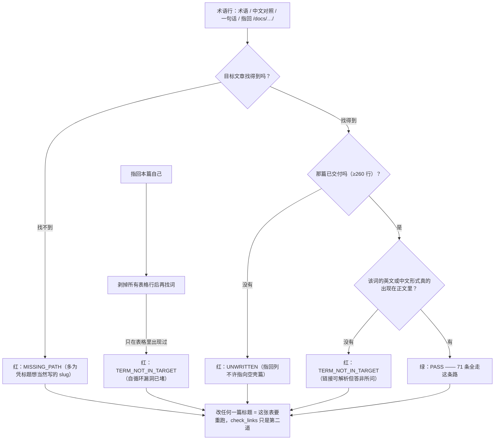

> **本章清单原语（逐字承接）**
> **清单项标题（清单原话）**：术语表 / 参考资料 / 版本与兼容矩阵 / 变更日志
>
> 章节号：8.4 / 8.5 / 8.6 / 8.7 ｜ 所属篇：08-生态与附录（第八篇 生态与附录）
> 主线站 · 难度 · 耗时：— · ★☆☆ 查阅（8.6 ★★☆）· 查阅；8.7 为「追加」型
> 前置依赖：8.6 依赖 0.3；其余无
> 变更标记：**8.6 相对 v1.2 新增**；**8.7 相对 v1.2 变更（重排/合并/迁移）**——它原来是清单的 8.6，v1.2 把「版本与兼容矩阵」插成新的 8.6 后顺延为 8.7；8.4、8.5 在 v1.2 无变更标记行。
>
> **内容要点与产出物**：全库术语按字母序 + 中文对照 + 一句话解释 + 指回详解章节；1.5 的 20 词是本表子集，两处同源生成。官方文档索引、书籍 / 课程、社区资源；每条注明「为什么值得读」与「适合在第几站之后读」。Docker Engine / Compose / BuildKit / WSL2 / 各基础镜像的版本组合与已知不兼容项。**以 as-of 日期 + 现查命令呈现，不钉死数字快照**（版本数字必漂）。▸ 产出：一张 as-of 表 + 每行对应的现查命令。原 8.6：日期 / 章节 / 变更 / 作者；每次改动同步更新 8.6 的 as-of 日期。

> **实战落点**：08 板块的第二篇，也是**全库唯一一篇「长期维护件」**——前面 32 篇教怎么做对，这一篇提供三样东西：查词（8.4）、查去处（8.5）、查版本与变更记录（8.6/8.7）。它落在段⑧之后、FAQ 之前，因为**术语要有出处、参考资料要有被读过的证据、版本要有可现查的通道**，这三件事只有在全库正文交付完之后才做得实。
> **本机基线（as-of 2026-10-29，全部现查得到）**：Engine `29.8.0` / API `1.56` / `MinAPIVersion 1.40` / GitCommit `3ce5872` / Go `go1.26.8` / BuildTime `Thu Sep 3 21:51:20 2026`；Desktop `4.91.0 (239619)`；Compose `v5.5.1`；buildx `v0.37.0 ac30b249`；BuildKit `v0.33.0`（`docker buildx inspect` 的 `BuildKit version` 行）；runc `v1.4.3-0-gbb14dabe`（OCI spec `1.0.0–1.3.0`）；containerd commit `db8809540e1a7a9da5d518876894933ff55692ab`；init `de40ad0`；内核 `6.18.54.1-microsoft-standard-WSL2`；WSL `3.0.3.0`、WSLg `1.0.79`、MSRDC `1.2.7391`；`NCPU=24`、`MemTotal=50475270144`、`DockerRoot=/var/lib/docker`、日志驱动 `json-file`；存储驱动 `overlayfs` + `driver-type: io.containerd.snapshotter.v1`。上游最新（同日 API 现查）：`moby/moby docker-v29.9.2`、`docker/compose v5.6.1`、`docker/buildx v0.38.1`、`moby/buildkit v0.34.1`、`containerd/containerd v2.4.2`、`opencontainers/runc v1.5.2`。
> **前置依赖**：[/docs/00-导读/怎么用这个库/使用指南与主线八站地图/](/docs/00-导读/怎么用这个库/使用指南与主线八站地图/)（八站与八段的说法在本表里被反复引用）、[/docs/00-导读/怎么用这个库/写作要求与文档模板/](/docs/00-导读/怎么用这个库/写作要求与文档模板/)（判据、头部契约、W1~W6 这些词的定义处）、[/docs/01-基础认知/为什么是容器/为什么需要容器/](/docs/01-基础认知/为什么是容器/为什么需要容器/)（**尚未撰写**，见「术语表的三条纪律」第 3 条）、[/docs/08-生态与附录/生态坐标/容器生态地图与Kubernetes衔接/](/docs/08-生态与附录/生态坐标/容器生态地图与Kubernetes衔接/)（8.1~8.3，本表大量术语的详解处）、[/docs/10-存储专题/基础/五种存储形式的原理与取舍/](/docs/10-存储专题/基础/五种存储形式的原理与取舍/)（存储五形式的中文对照与取舍，本表的存储词条以它为准）。
> **本篇产出物**：**71 条术语的四列表**（第二十一次交付＝批 26 补进 `container` 与 `repository`——1.5 要做「第一周 20 词」就必须有这两个词，而本表原本缺它们；这就是本表自己规定的连带义务的又一次触发）（英文/缩写 · 中文对照 · 一句话解释 · 指回详解章节。第十八次交付时是 66 条；第十九次交付把《第一次运行容器与图形化工具》带出的 `docker context`、`distroless`、`npipe / 命名管道` 三条补了进来——**这就是本表自己规定的连带义务：新交付一篇，指回列就要能指得进去**），并且**每条指回都被脚本验过**（本批配套对账脚本 `术语对账.py`，属仓库暂存件、不随站点发布：目标文章存在 → 已交付（≥260 行）→ 该词的英文或中文形式真的出现在那篇正文里；现值 `术语行 = 71 | PASS=71`），`--selftest` 用**五条**坏样本证明它会红（假路径、未写的空壳篇、目标篇里没有的词、凭标题想当然写的 slug，以及第五条本批新造的**自循环漏洞**：指回本篇时只在表格里出现的词不能算通过——它专门防"术语表自己给自己作证"）。**参考资料**（官方文档索引 **14 条**，每条带「为什么值得读」与「适合在第几站之后读」，并附**本机 2026-10-29 的可达性实测**：`200` 9 条 / `000` 4 条 / `301` 1 条，`000` 与 `404` 的区别读法单列一节）+ **书籍、课程与社区的取舍口径 4 条**（本库未逐本通读，故只给判据不给推荐）；**一套现查命令**（`docker version` / `docker info` / `docker compose version` / `docker buildx version` / `docker buildx inspect` / `wsl --version` / GitHub Releases API），配**一张 as-of 版本组合表**（13 行，含上游同日最新版对照）与**一张「已知不兼容与登记≠生效」清单**（18 行，其中 11 行给报错原文、7 行给读数）；**变更日志的条目格式与本库真实摘录**（**14 行**，从第十一次交付起到第二十二次；这 14 行由当轮表格计数现读、不是手数；本批还修掉一处结构缺陷：第二十次那行曾被一个空行切在表格之外（渲染时会脱表），现已并回连续表块；以及台账 §一 那 37 条修订说明怎么读）。
> **难度·耗时**：8.4 ★☆☆ · 查阅／8.5 ★☆☆ · 查阅／8.6 ★★☆ · 查阅／8.7 ★☆☆ · 追加（这一篇不是"读一遍"的，是"每次改库都要回来动一笔"的）
> **拓展接口**：8.4 的指回列就是 0.x~10.x 各篇的反向索引，改任何一篇标题时这张表要跟着动；8.5 的可达性表与 7.6（拉取失败）共用同一套 `curl` 判据；8.6 的「登记≠生效」与 5.7 的运行时注册、10.2 的 `--mount` 实测同族；8.7 与台账（`Docker知识库内容结构与组织清单.md` §一/§九/§十一、`doc/运行与构建（T0Level）.md` §八）是同一批事实的两个视图。
> **自测三题**：
> 1. 你要给「copy-up」这条术语换一篇指回章节。除了改链接，还要跑哪条命令才知道它没指错？为什么 `broken=0` 不足以说明指对？
> 2. 8.5 里 `docs.docker.com/` 现读 `000` 而 `docs.docker.com/compose/` 是 `200`。这能推出「主站挂了」吗？正确结论是什么？
> 3. 为什么 8.6 坚持「as-of 日期 + 现查命令」而不是把版本号写死？给出本批实测的两个例子说明版本号的漂速。

## 为什么要有一篇「不教任何新东西」的文档

前面每一篇都在往里加东西，这一篇只做两件事：**把词固定下来**、**把去处和版本固定成"可现查"而不是"抄一遍"**。它存在的理由很具体：

1. **同一个词在本库不同篇里被用过不同说法**（「绑定挂载 / bind mount / 宿主目录挂载」、「卷 / 命名卷 / 数据卷」），新人换篇就读不懂；术语表的职责不是"权威定义"，而是**声明本库内部用哪个词、它在哪儿被详细解释**。
2. **版本数字一定会漂**。这一篇交付当天上游就比本机新（Engine `29.8.0` 对 `docker-v29.9.2`、Compose `v5.5.1` 对 `v5.6.1`、buildx `v0.37.0` 对 `v0.38.1`），所以 8.6 的规矩是**每行都配一条现查命令**，数字只作为某一天的读数存在。
3. **变更要有账**。8.7 与台账是同一批事实的两个视图：台账记"为什么改"，这一篇记"改了哪一章"。

> 💡 新人小结：这一篇的正确用法是**反着查**——读到别的篇里有个词不顺，来这里找它的一句话解释和详解位置；准备升级 Docker 或换基础镜像时，来抄现查命令并把结果记回 8.6 的 as-of 表；有人问「这本库现在什么状态」，来 8.7 念最近三行。

## 术语表的三条纪律

1. **指回列只允许指向已交付的正文**。本表交付时（第十八次）全库 38 篇里 **34 篇已写**，剩下 **4 个空壳**；**第十九次交付（批 24）后现读 35 篇已写、3 个空壳**（01 基础认知剩 `为什么需要容器`、`核心概念与架构总览` 两篇，09 常见问题剩 `常见问题FAQ` 一篇）；**第二十次交付（批 25）后现读 36 篇已写、2 个空壳**；**第二十一次交付（批 26）后现读 38 篇已写、0 个空壳**——01 板块那两篇（1.1《为什么需要容器》、1.2+1.5《核心概念、Docker 架构与新人 20 词》）落地，全库 38 篇**首次全部达到 260 行判据线**，因此「不进指回列」这句从今天起不再排除任何一篇；但它不会失效：**只要将来有文章被改短到 260 行以下，`术语对账.py` 就会以 `UNWRITTEN` 拒绝它被指回**。这条也不是靠自觉：对账脚本会先按行数（<260 行判 UNWRITTEN）把空壳挡在外面，**所以篇数变了不需要改脚本，只需要改这句话**。
2. **一句话解释必须能被指回的那篇正文印证**。这条不是愿望，是有脚本兜着的：`术语对账.py`（本批配套取证件，仓库暂存、不发布到站点）逐条检查「该词（英文或中文对照）在目标篇正文里出现 ≥1 次」，并且先用**五条**坏样本证明它会红（假路径、未写篇、词不在目标篇、指回写成标题想当然，以及「指回本篇、词只在表格里」那条自循环）。
3. **1.5 的 20 词是本表子集，两处同源生成**：1.5（`为什么需要容器` 那一篇的术语小节）**尚未撰写**，所以本表是母集、当下唯一的词源。等写 01 板块时，从本表挑 20 条子集过去，并且**在那一节里标一句"完整词表见 8.4"**，反过来不复制本表。这条"同源生成"目前只有单侧成立——本批把它写成待办而不是假装已完成。

## 8.4 术语表（A–D）

| 术语 | 中文对照 | 一句话解释 | 指回详解 |
|---|---|---|---|
| anonymous volume | 匿名卷 | 不带名字挂卷时引擎自动分配的那个体，`docker rm` 不带走它 | [/docs/10-存储专题/故障手册/存储故障手册三损坏与丢失/](/docs/10-存储专题/故障手册/存储故障手册三损坏与丢失/) |
| API version | API 版本 | CLI 与 daemon 之间协商的接口号，`MinAPIVersion` 划出兼容下界 | [/docs/08-生态与附录/查阅件/术语表参考资料与版本兼容矩阵/](/docs/08-生态与附录/查阅件/术语表参考资料与版本兼容矩阵/) |
| bind mount | 绑定挂载 | 把宿主路径贴进容器，实时双向，不做预填充 | [/docs/10-存储专题/基础/五种存储形式的原理与取舍/](/docs/10-存储专题/基础/五种存储形式的原理与取舍/) |
| build cache | 构建缓存 | BuildKit 按步骤内容摘要复用上一步产物 | [/docs/03-镜像构建/养小养快/分层缓存多阶段构建与镜像瘦身/](/docs/03-镜像构建/养小养快/分层缓存多阶段构建与镜像瘦身/) |
| build context | 构建上下文 | `docker build` 时从当前目录打包发给 daemon 的全部内容 | [/docs/03-镜像构建/写出来/Dockerfile指令全解与构建上下文/](/docs/03-镜像构建/写出来/Dockerfile指令全解与构建上下文/) |
| buildx | 构建前端 CLI | `docker buildx` 那一层，管 builder 实例、驱动与输出类型 | [/docs/03-镜像构建/交出去/BuildKit私有仓库标签策略与构建排错/](/docs/03-镜像构建/交出去/BuildKit私有仓库标签策略与构建排错/) |
| BuildKit | 构建引擎 | 真正执行构建步骤的引擎，版本由 `docker buildx inspect` 读到 | [/docs/03-镜像构建/交出去/BuildKit私有仓库标签策略与构建排错/](/docs/03-镜像构建/交出去/BuildKit私有仓库标签策略与构建排错/) |
| cgroup v2 | 控制组 v2 | 限额与统计的第二代接口，`/sys/fs/cgroup` 的读法与 v1 完全不同 | [/docs/05-原理深入/隔离与资源/容器本质Namespace与Cgroups/](/docs/05-原理深入/隔离与资源/容器本质Namespace与Cgroups/) |
| CMD / ENTRYPOINT | 默认命令 / 入口 | 前者可被覆盖，后者定义容器怎么起，二者拼成最终进程 | [/docs/03-镜像构建/写出来/Dockerfile指令全解与构建上下文/](/docs/03-镜像构建/写出来/Dockerfile指令全解与构建上下文/) |
| container | 容器 | **镜像跑起来的那个实例**：一份进程 + 自己的 namespace 视图与 cgroup 配额，删掉它不影响镜像 | [/docs/01-基础认知/为什么是容器/核心概念与架构总览/](/docs/01-基础认知/为什么是容器/核心概念与架构总览/) |
| containerd | 容器运行时管理层 | daemon 与 runc 之间那一层，本机只暴露 commit 不暴露版本号 | [/docs/05-原理深入/网络与运行时/网络底层跨主机方案与运行时生态/](/docs/05-原理深入/网络与运行时/网络底层跨主机方案与运行时生态/) |
| copy-up | 上拷 | overlayfs 为了让下层文件可写而把它复制到可写层 | [/docs/10-存储专题/基础/存储是什么与为什么会出现/](/docs/10-存储专题/基础/存储是什么与为什么会出现/) |
| docker context | 上下文 | CLI 当前把请求发给哪一个 daemon；面板与命令行之所以能对上，是因为它们用的是同一条 | [/docs/01-基础认知/第一次动手/第一次运行容器与图形化工具/](/docs/01-基础认知/第一次动手/第一次运行容器与图形化工具/) |

## 8.4 术语表（E–P）

| 术语 | 中文对照 | 一句话解释 | 指回详解 |
|---|---|---|---|
| digest | 镜像摘要 | `sha256:` 内容地址，标签会变它不变 | [/docs/03-镜像构建/交出去/BuildKit私有仓库标签策略与构建排错/](/docs/03-镜像构建/交出去/BuildKit私有仓库标签策略与构建排错/) |
| Docker Desktop | 桌面版 | 把引擎跑在 WSL2/Hyper-V 虚拟机里的发行形态 | [/docs/00-导读/把环境搭好/环境准备/](/docs/00-导读/把环境搭好/环境准备/) |
| DOCKER-USER | 自定义防火墙链 | 引擎保留给你加规则的那条链，重启不覆盖它 | [/docs/05-原理深入/网络与运行时/网络底层跨主机方案与运行时生态/](/docs/05-原理深入/网络与运行时/网络底层跨主机方案与运行时生态/) |
| distroless | 无壳镜像 | 里面没有 `sh`/`ls` 可执行，`docker exec` 进不去是设计而不是坏了 | [/docs/01-基础认知/第一次动手/第一次运行容器与图形化工具/](/docs/01-基础认知/第一次动手/第一次运行容器与图形化工具/) |
| driver-type | 快照实现标识 | `io.containerd.snapshotter.v1`，决定可写层落在哪个目录 | [/docs/10-存储专题/落点与生命周期/存储形式在操作系统上的落点与验证/](/docs/10-存储专题/落点与生命周期/存储形式在操作系统上的落点与验证/) |
| env / ARG | 环境变量 / 构建参数 | 前者进运行时，后者只活在构建期，别混用 | [/docs/03-镜像构建/写出来/Dockerfile指令全解与构建上下文/](/docs/03-镜像构建/写出来/Dockerfile指令全解与构建上下文/) |
| healthcheck | 健康检查 | 引擎按命令返回值判定容器可用性的机制 | [/docs/04-单机编排/启停/常用命令启动顺序与健康检查/](/docs/04-单机编排/启停/常用命令启动顺序与健康检查/) |
| host.docker.internal | 宿主别名 | 容器内解析到宿主网关名的那条通道 | [/docs/05-原理深入/网络与运行时/网络底层跨主机方案与运行时生态/](/docs/05-原理深入/网络与运行时/网络底层跨主机方案与运行时生态/) |
| image | 镜像 | 只读层叠加出来的可分发物，内容寻址 | [/docs/02-核心操作/跑起来/镜像管理与容器生命周期/](/docs/02-核心操作/跑起来/镜像管理与容器生命周期/) |
| json-file | 日志驱动 | 默认驱动，容器日志写成 JSON 行文件，受 `max-size` 约束 | [/docs/06-工程化与生产/运行基线/日志资源限制部署策略与回滚/](/docs/06-工程化与生产/运行基线/日志资源限制部署策略与回滚/) |
| layer | 镜像层 | 一次 `RUN`/`COPY` 产生的差异内容，共享即省空间 | [/docs/05-原理深入/隔离与资源/联合文件系统与镜像分层/](/docs/05-原理深入/隔离与资源/联合文件系统与镜像分层/) |
| macvlan | 二层虚拟网卡 | 让容器直接挂在父网卡所在网段上 | [/docs/05-原理深入/网络与运行时/网络底层跨主机方案与运行时生态/](/docs/05-原理深入/网络与运行时/网络底层跨主机方案与运行时生态/) |
| multi-stage build | 多阶段构建 | 用工具链构建、只把产物拷进最终镜像 | [/docs/03-镜像构建/养小养快/分层缓存多阶段构建与镜像瘦身/](/docs/03-镜像构建/养小养快/分层缓存多阶段构建与镜像瘦身/) |
| named volume | 命名卷 | 由引擎管理、名字归你的独立数据对象 | [/docs/10-存储专题/基础/五种存储形式的原理与取舍/](/docs/10-存储专题/基础/五种存储形式的原理与取舍/) |
| namespace | 命名空间 | 隔离"看得见什么"的那套内核机制 | [/docs/05-原理深入/隔离与资源/容器本质Namespace与Cgroups/](/docs/05-原理深入/隔离与资源/容器本质Namespace与Cgroups/) |
| npipe / 命名管道 | Windows 侧的 daemon 入口 | `npipe:////./pipe/dockerDesktopLinuxEngine` 这类地址；面板、CLI、VM 都挂在它上面 | [/docs/01-基础认知/第一次动手/第一次运行容器与图形化工具/](/docs/01-基础认知/第一次动手/第一次运行容器与图形化工具/) |
| OCI | 开放容器倡议 | 镜像、分发与运行时规范的家族，本库按它判断可移植性 | [/docs/03-镜像构建/交出去/BuildKit私有仓库标签策略与构建排错/](/docs/03-镜像构建/交出去/BuildKit私有仓库标签策略与构建排错/) |
| overlayfs | 联合文件系统 | 把 lower/upper/work 三层挂成一棵视图的文件系统 | [/docs/05-原理深入/隔离与资源/联合文件系统与镜像分层/](/docs/05-原理深入/隔离与资源/联合文件系统与镜像分层/) |
| port mapping | 端口映射 | `-p` 把宿主端口 DNAT 到容器端口 | [/docs/02-核心操作/接上去/端口映射数据管理与权限时区/](/docs/02-核心操作/接上去/端口映射数据管理与权限时区/) |
| prefill | 卷预填充 | 空卷挂到镜像已有内容的目录时那一次复制 | [/docs/10-存储专题/配置与内容/配置应用内容覆盖与失效/](/docs/10-存储专题/配置与内容/配置应用内容覆盖与失效/) |
| profile | 服务档 | Compose 里按需启用一组服务的开关 | [/docs/04-单机编排/日常/多环境热重载与五服务完整实战/](/docs/04-单机编排/日常/多环境热重载与五服务完整实战/) |

## 8.4 术语表（Q–Z 与工具名）

| 术语 | 中文对照 | 一句话解释 | 指回详解 |
|---|---|---|---|
| registry | 镜像仓库 | 推拉与鉴权的那一端，私有化后是本库的交付闸门 | [/docs/03-镜像构建/交出去/BuildKit私有仓库标签策略与构建排错/](/docs/03-镜像构建/交出去/BuildKit私有仓库标签策略与构建排错/) |
| repository | 镜像仓 | registry 里按名字分开的命名空间（官方镜像那个名字就是它），仓下面才是标签；`library/nginx` 与 `nginx` 指的是同一个仓 | [/docs/01-基础认知/为什么是容器/核心概念与架构总览/](/docs/01-基础认知/为什么是容器/核心概念与架构总览/) |
| rootless | 无 root 运行 | 引擎自身不要求 root，代价与限制另见 5.8 | [/docs/08-生态与附录/生态坐标/容器生态地图与Kubernetes衔接/](/docs/08-生态与附录/生态坐标/容器生态地图与Kubernetes衔接/) |
| runc | OCI 运行时 | 真正 clone 出容器的进程，本机 `v1.4.3-0-gbb14dabe` | [/docs/05-原理深入/网络与运行时/网络底层跨主机方案与运行时生态/](/docs/05-原理深入/网络与运行时/网络底层跨主机方案与运行时生态/) |
| seccomp | 系统调用过滤 | 默认档挡掉一批调用，容器里 `unshare -U` 被拒就是它 | [/docs/05-原理深入/隔离与资源/容器本质Namespace与Cgroups/](/docs/05-原理深入/隔离与资源/容器本质Namespace与Cgroups/) |
| shim | 容器守护进程 | 每个容器一个 shim，负责持有生命周期与 I/O | [/docs/05-原理深入/网络与运行时/网络底层跨主机方案与运行时生态/](/docs/05-原理深入/网络与运行时/网络底层跨主机方案与运行时生态/) |
| snapshotter | 快照器 | containerd 侧决定层与可写层怎么落盘的那一层实现 | [/docs/10-存储专题/落点与生命周期/存储形式在操作系统上的落点与验证/](/docs/10-存储专题/落点与生命周期/存储形式在操作系统上的落点与验证/) |
| stop_grace_period | 停机宽限 | `SIGTERM` 到强杀之间的等待上限，不是固定等待时长 | [/docs/10-存储专题/落点与生命周期/容器启动停止与存储的关系/](/docs/10-存储专题/落点与生命周期/容器启动停止与存储的关系/) |
| tag | 标签 | 人的可读指针，可变；不可变引用是 digest | [/docs/03-镜像构建/交出去/BuildKit私有仓库标签策略与构建排错/](/docs/03-镜像构建/交出去/BuildKit私有仓库标签策略与构建排错/) |
| tmpfs | 内存文件系统 | 快且不留，算进容器内存配额 | [/docs/10-存储专题/基础/五种存储形式的原理与取舍/](/docs/10-存储专题/基础/五种存储形式的原理与取舍/) |
| trivy | 漏洞扫描器 | CI 里挡高危镜像进主干的那把尺 | [/docs/06-工程化与生产/交付链路/CI-CD中的Docker与安全基线/](/docs/06-工程化与生产/交付链路/CI-CD中的Docker与安全基线/) |
| userland-proxy | 用户态端口代理 | 本机出厂 `false`，所以 `-p` 走纯 DNAT | [/docs/05-原理深入/网络与运行时/网络底层跨主机方案与运行时生态/](/docs/05-原理深入/网络与运行时/网络底层跨主机方案与运行时生态/) |
| user namespace | 用户命名空间 | uid 映射那套；默认不开，`uid_map` 是全范围映射 | [/docs/05-原理深入/隔离与资源/容器本质Namespace与Cgroups/](/docs/05-原理深入/隔离与资源/容器本质Namespace与Cgroups/) |
| veth | 成对虚拟网卡 | 两端用 `iflink` 互指，容器侧几乎总是 index 2 | [/docs/05-原理深入/网络与运行时/网络底层跨主机方案与运行时生态/](/docs/05-原理深入/网络与运行时/网络底层跨主机方案与运行时生态/) |
| volume | 数据卷 | 统称；具名、匿名与 `--volumes-from` 三种用法 | [/docs/10-存储专题/基础/存储是什么与为什么会出现/](/docs/10-存储专题/基础/存储是什么与为什么会出现/) |
| writable layer | 可写层 | 这次运行的差异层，随 `docker rm` 一起消失 | [/docs/10-存储专题/落点与生命周期/容器启动停止与存储的关系/](/docs/10-存储专题/落点与生命周期/容器启动停止与存储的关系/) |
| WSL2 | Windows 子系统 2 | 本机 Linux 内核与引擎宿主，VM 里那套目录都在它身上 | [/docs/00-导读/把环境搭好/环境准备/](/docs/00-导读/把环境搭好/环境准备/) |
| whiteout | 删除占位 | 下层文件在可写层被"标死"的那种删除 | [/docs/10-存储专题/基础/存储是什么与为什么会出现/](/docs/10-存储专题/基础/存储是什么与为什么会出现/) |
| lowerdir / upperdir / workdir | 下层 / 上层 / 工作目录 | overlayfs 的三个角色，合起来才是一棵可写的树 | [/docs/05-原理深入/隔离与资源/联合文件系统与镜像分层/](/docs/05-原理深入/隔离与资源/联合文件系统与镜像分层/) |
| merged view | 挂载视图 | 容器里真正看到的那一棵树，遮蔽与合并都发生在这一层 | [/docs/10-存储专题/基础/存储是什么与为什么会出现/](/docs/10-存储专题/基础/存储是什么与为什么会出现/) |
| mount namespace | 挂载命名空间 | 决定一个进程看得见哪张挂载表，站错层就读不到东西 | [/docs/10-存储专题/落点与生命周期/存储形式在操作系统上的落点与验证/](/docs/10-存储专题/落点与生命周期/存储形式在操作系统上的落点与验证/) |
| DOCKER_OUTPUT | 沙箱内的 DNS 链 | 把容器发往 53 的包 DNAT 到随机高位口的那条链 | [/docs/05-原理深入/网络与运行时/网络底层跨主机方案与运行时生态/](/docs/05-原理深入/网络与运行时/网络底层跨主机方案与运行时生态/) |
| docker diff | 可写层差异清单 | 唯一能读可写层内容的命令，看不见卷与 bind | [/docs/10-存储专题/落点与生命周期/容器启动停止与存储的关系/](/docs/10-存储专题/落点与生命周期/容器启动停止与存储的关系/) |
| docker compose config | 渲染与校验 | 起容器之前把文件渲染成最终形态，`--quiet` 只做合法性检查 | [/docs/04-单机编排/定义/Compose语法基线与文件全字段参考/](/docs/04-单机编排/定义/Compose语法基线与文件全字段参考/) |
| --volumes-from | 卷继承 | 不写路径，直接继承另一只容器的全部挂载 | [/docs/10-存储专题/数据保护/备份与恢复/](/docs/10-存储专题/数据保护/备份与恢复/) |
| 9p | 文件共享协议 | Desktop 把宿主目录穿进容器时用的那条协议，语义与性能代价都来自它 | [/docs/10-存储专题/落点与生命周期/存储形式在操作系统上的落点与验证/](/docs/10-存储专题/落点与生命周期/存储形式在操作系统上的落点与验证/) |
| GraphDriver | 层与可写层的引擎视图 | 本机在 containerd snapshotter 下是 `null`，别按它写排错脚本 | [/docs/10-存储专题/落点与生命周期/存储形式在操作系统上的落点与验证/](/docs/10-存储专题/落点与生命周期/存储形式在操作系统上的落点与验证/) |

## 8.4 术语表（本库自造的流程词）

这些词不是 Docker 的术语，是**本库的**——它们的定义只在这几篇里成立，所以最容易查错地方。

| 术语 | 中文对照 | 一句话解释 | 指回详解 |
|---|---|---|---|
| 判据 | 验收判据 | 会自己红的检查，不接受"看起来正常" | [/docs/00-导读/怎么用这个库/写作要求与文档模板/](/docs/00-导读/怎么用这个库/写作要求与文档模板/) |
| 头部契约 | 七项元数据引用块 | 每篇开头必须写的实战落点/基线/依赖/产出物/难度/拓展/自测 | [/docs/00-导读/怎么用这个库/写作要求与文档模板/](/docs/00-导读/怎么用这个库/写作要求与文档模板/) |
| 主线 | 学习路径（八个站点） | 本库的阅读顺序单位，参考资料按「第几站之后读」标注 | [/docs/00-导读/怎么用这个库/使用指南与主线八站地图/](/docs/00-导读/怎么用这个库/使用指南与主线八站地图/) |
| 贯穿示例 / 段①~段⑧ | 八段演进链 | 同一个业务从裸容器长到可交付的八个阶段 | [/docs/00-导读/怎么用这个库/使用指南与主线八站地图/](/docs/00-导读/怎么用这个库/使用指南与主线八站地图/) |
| 故障域 | 排错分区 | 按"哪一层坏了"而非按命令分组 | [/docs/07-运维手册/检索与规矩/命令速查症状索引与团队规范/](/docs/07-运维手册/检索与规矩/命令速查症状索引与团队规范/) |
| 存在性判据 | 两条口径一起看（找到路径 + 跑出输出） | 判"某工具在不在"必须两口径一致，只看 `where` 会假阳 | [/docs/07-运维手册/检索与规矩/命令速查症状索引与团队规范/](/docs/07-运维手册/检索与规矩/命令速查症状索引与团队规范/) |
| 复盘库 | 故障案例库 | 一次故障一条，四段固定顺序 | [/docs/07-运维手册/按故障域排错/Windows与WSL2性能排查应急runbook与复盘/](/docs/07-运维手册/按故障域排错/Windows与WSL2性能排查应急runbook与复盘/) |
| 登记≠生效 | 记下≠生效 | 选项被记进配置或 Options 但行为没变的那一族坑 | [/docs/05-原理深入/网络与运行时/网络底层跨主机方案与运行时生态/](/docs/05-原理深入/网络与运行时/网络底层跨主机方案与运行时生态/) |
| 先复制再动手 | 现场保全纪律 | 破坏性操作前先把卷打包带走 | [/docs/10-存储专题/数据保护/内容损坏与修复/](/docs/10-存储专题/数据保护/内容损坏与修复/) |
| as-of 日期 | 截至日期 | 版本表每行的取值时点，配现查命令一起看 | [/docs/08-生态与附录/查阅件/术语表参考资料与版本兼容矩阵/](/docs/08-生态与附录/查阅件/术语表参考资料与版本兼容矩阵/) |

> 💡 新人小结：这张自造词表是**用来防"术语漂移"的**——同一个「判据」在 0.4 里是文体要求、在 7.11 里是团队门禁、在 10.10 里是脚本，词同指不同。查的时候认准「指回」那一列，别看词本身。

## 一条术语行怎么被验：三种红与一条自循环



`check_links.py` 只回答"链接有没有对应产物页"，它**永远看不出**"那一篇到底讲没讲这个词"。所以这一篇的术语行配的是上面这套三步对账，而且脚本自己带五条坏样本——**没有坏样本的判据不算判据**（这是全库从第 8 批起就立下的规矩）。

> 💡 新人小结：这一张图里最值钱的是第四条红。指回本篇、或者指回一篇"顺带提过一次"的文章，都能骗过链接检查；只有"词真的在正文里"这一条能把它抓住，而"词在**本篇的表格里**"又不能被算数——否则术语表就成了自证清白的小圈子。

## 8.5 参考资料：官方文档索引（含本机可达性实测）

规矩先说清：`000` 是**这台机器此刻到不了**（或被中间设备拦掉），不是"文档不存在"；`404` 才是**路径错了**，可以直接得出"该搬家"的结论。两者混用会把读者带去错的地方，所以这一列单独存证（`curl -s -o /dev/null -m 15 -w '%{http_code}'`，2026-10-29 现读）。

| 入口 | 本机现读 | 为什么值得读 | 适合在第几站之后读 |
|---|---|---|---|
| `https://docs.docker.com/compose/` | 200 | Compose 文件字段的第一手定义，本库 4.x 的每个字段都对照它 | 站②（会起多容器之后） |
| `https://docs.docker.com/desktop/` | 200 | Desktop 的设置面与已知限制，Windows/macOS 读者的主场 | 站①（装环境时） |
| `https://docs.docker.com/` | 000（本机不可达） | 主站首页；不可达不影响下面各分路径按需用现查命令替代 | 站① |
| `https://docs.docker.com/engine/reference/builder/` | 000（本机不可达） | Dockerfile 指令权威清单，本库 3.x 的语义都取自它 | 站③ |
| `https://docs.docker.com/engine/release-notes/` | 000（本机不可达） | Engine 变更史；本机不可达时改走 `moby/moby` 的 Releases | 站⑤ / 每次升 Engine |
| `https://github.com/moby/moby` | 200 | 引擎源码与 issue，报错原文的第一现场 | 站⑤ 之后 / 排错无解时 |
| `https://github.com/docker/compose` | 200 | Compose 的 release notes 与破坏性改动 | 站② / 升 Compose 前 |
| `https://github.com/moby/buildkit` | 200 | 构建引擎正主；`docker/buildkit` 已 `404`（组织搬家，别再用旧地址） | 站③ |
| `https://api.github.com/repos/<org>/<repo>/releases/latest` | 200 | 现查上游最新版本的机器通道，8.6 那张表的"活口" | 任意站 / 每次核版本 |
| `https://hub.docker.com/` | 000（本机不可达） | 官方镜像页（tag 列表与 Dockerfile 链接）；本机不通时改 `docker image inspect` 看本机已拉的那版 | 站①~③ |
| `https://containerd.io/` | 200 | 快照器与 shim 模型的概念页，解释 `driver-type` 那一行 | 站⑤ |
| `https://runc.io/` | 301（跳转后为项目页） | 运行时规范与能力面（本机 spec `1.0.0–1.3.0` 即来自它） | 站⑤ |
| `https://www.kernel.org/doc/html/latest/admin-guide/cgroup-v2.html` | 200 | cgroup v2 的接口第一手，5.3 限额那节的根 | 站⑤ |
| `https://learnxinyminutes.com/docs/docker/` | 200 | 一页速览，适合没读过本库的人先建立形状 | 站① 之前 |

> 💡 新人小结：**别把这份表当"链接收藏"**。它的用法是"我现在这一件事，第几站之后读它才有意义"——站①就读 Engine 源码等于白读。

## 8.5 参考资料：书籍、课程与社区资源的取舍口径

本库**没有逐本通读**任何外部书籍或课程，所以这里不列"推荐书单"，只列**判据与三类去处**（这是本库"团队规范类内容不编造"的同一族纪律）：

1. **书籍怎么挑**：看它是否覆盖 `docker save` 已是 OCI 布局、`containerd snapshotter` 默认可选、Compose v2+ 三件套（`docker compose` 子命令、`profiles`、`watch`）这三件近年变化。挑不出这三件的书，其命令面大概率停留在旧版。
2. **课程怎么挑**：看有没有让你**读原始报错**的练习（`Tablespace … is missing!`、`volume is in use - [<容器ID>]` 这类），只演示"跟着敲"的课程无法迁移到排错现场。
3. **社区去处**：`moby/moby` 与 `moby/buildkit` 的 issue 区是**唯一能给报错原文定版本**的地方；论坛与问答站只适合找关键词，不适合当结论。
4. **与本库的关系**：本库负责"这台机器上怎么做对并怎么验"；上述去处负责"为什么设计成这样"。**两者冲突时以现查命令与你的实验结果为准**，不以本库任何一张表为准（这也是 8.6 不钉死版本号的原因）。

## 现查命令清单（把 8.6 的每一行问出来）

```bash
# 引擎与 CLI、API 兼容上下界
docker version --format 'Client {{.Client.Version}} / Server {{.Server.Version}} / API {{.Server.APIVersion}} / MinAPI {{.Server.MinAPIVersion}}'
docker version --format '{{json .Server.Components}}'          # Engine/Containerd 等组件与 GitCommit
docker info --format 'Driver {{.Driver}} / {{json .DriverStatus}} / Root {{.DockerRootDir}} / Log {{.LoggingDriver}}'
docker info --format 'runc={{json .RuncCommit}} containerd={{json .ContainerdCommit}} init={{json .InitCommit}}'
docker info --format '{{json .Runtimes}}'                      # 注册了哪些运行时与各自 path
docker info --format 'kernel={{.KernelVersion}} OS={{.OperatingSystem}} NCPU={{.NCPU}} Mem={{.MemTotal}}'
# Compose / BuildKit / buildx
docker compose version --short && docker-compose version --short   # 桌面版这两个入口是同一个
docker buildx version && docker buildx inspect | grep -i buildkit   # BuildKit 版本只在 inspect 里
# Windows / WSL2 侧
wsl --version                                                   # 输出是 UTF-16，重定向到文件再读
# 上游最新版本（不打开网页也能问）
curl -s https://api.github.com/repos/moby/moby/releases/latest | grep -E '"tag_name"|"published_at"'
for r in docker/compose docker/buildx moby/buildkit containerd/containerd opencontainers/runc; do
  printf '%s ' "$r"; curl -s "https://api.github.com/repos/$r/releases/latest" | grep -m1 '"tag_name"'; done
# 基础镜像实际版本（本机已拉到的那一版才是你测过的那一版）
docker images --format '{{.Repository}}:{{.Tag}} {{.ID}}' | grep -E 'mysql|nginx|alpine|redis|golang|node|python'
docker image inspect mysql:8.4 --format '{{.Os}}/{{.Architecture}} {{json .Config.Env}}'
```

## 8.6 版本与兼容矩阵（as-of 2026-10-29）

**读法**：这一张表的"本机现值"是**某一天用上面某条命令问出来的**，不是标准；"现查命令"列才是可以反复问的东西。升级判断一律走"先现查、再对照不兼容清单、最后单机演练"。

| 组件 | 本机现值 | 上游最新（同日现查） | 现查命令 | 升级前要看的 |
|---|---|---|---|---|
| Docker Engine | `29.8.0`（`3ce5872`，Go `go1.26.8`） | `docker-v29.9.2`（2026-10-20） | `docker version --format '{{.Server.Version}}'` | API `1.56` 与 `MinAPIVersion 1.40` 是否覆盖你的 CI runner |
| Engine API | `1.56`（下界 `1.40`） | 随 Engine | 同上 `ApiVersion` 字段 | 第三方 SDK 是否声明支持该版本区间 |
| Docker Desktop | `4.91.0 (239619)` | 发布说明本机不可达（`000`），改查 GitHub | `docker version --format '{{.Server.Platform.Name}}'` | 它同时决定 VM、compose 与 kubectl 的捆绑版本 |
| Compose | `v5.5.1` | `v5.6.1`（2026-10-21） | `docker compose version --short` | `config --format` 允许值、`--profile`/`watch` 语义 |
| buildx | `v0.37.0`（`ac30b249`） | `v0.38.1`（2026-10-20） | `docker buildx version` | `--output type=oci` 是否仍缺 `manifest.json`（本库实测缺） |
| BuildKit | `v0.33.0` | `v0.34.1`（2026-10-20） | `docker buildx inspect \| grep -i BuildKit` | 缓存挂载与 `RUN --mount=type=cache` 行为变更 |
| runc | `v1.4.3-0-gbb14dabe` | `v1.5.2`（2026-09-25） | `docker info --format '{{json .RuncCommit}}'` | OCI spec 区间（本机 `1.0.0–1.3.0`）、seccomp 动作清单 |
| containerd | commit `db8809540e1a…`（**不暴露版本号**） | `v2.4.2`（2026-10-13） | `docker info --format '{{json .ContainerdCommit}}'` | 快照器与镜像格式兼容（本库撞过 schema v1 被拒） |
| 内核 / WSL | `6.18.54.1-microsoft-standard-WSL2`，WSL `3.0.3.0`，WSLg `1.0.79` | 随 Windows Update | `wsl --version` + `docker info --format '{{.KernelVersion}}'` | cgroup 版本、overlayfs 特性、9p/virtiofs 共享实现 |
| 存储驱动 | `overlayfs` + `io.containerd.snapshotter.v1` | — | `docker info --format '{{.Driver}} {{json .DriverStatus}}'` | 决定可写层路径与 `.GraphDriver` 是否有值（本机为 `null`） |
| 卷驱动 | 只有 `local`，外部插件 0 条 | — | `docker info --format '{{json .Plugins.Volume}}'; docker plugin ls` | 想用 NFS/云盘/快照必须先有插件 |
| 网络驱动 | `bridge host ipvlan macvlan null overlay` | — | `docker info --format '{{json .Plugins.Network}}'` | `overlay` 需要 swarm 控制面（本机没有） |
| 基础镜像（本库用过） | `mysql:8.4` `nginx:1.27-alpine` `alpine:3.20` `redis:7-alpine` `busybox:1.37` `registry:2` `golang:1.27-alpine` `node:22-alpine` `python:3.12-alpine` | 随 tag | `docker images --format '{{.Repository}}:{{.Tag}}'` | tag 是浮动指针，实验结论要落到 digest（`docker image inspect --format '{{.Id}}'`） |

## 8.6 已知不兼容与「登记≠生效」清单（本库实测）

每行都给本库真实撞到的原文——**没有原文的不列**。

| # | 组合 / 场景 | 实测原文或读数 | 结论 |
|---|---|---|---|
| 1 | `overlay` 网络驱动 + 无 swarm | 创建被拒（要 swarm 控制面） | 驱动出现在 `.Plugins.Network` ≠ 可用 |
| 2 | `--driver overlay2` 传给 `network create` | `plugin "overlay2" not found` | 快照器名不能当网络驱动名 |
| 3 | `--ingress` 配 bridge | `Ingress network can only be global scope network` | 端口网格依赖 swarm |
| 4 | 子网写法 `192.168.3.200/24` | `invalid subnet …: it should be 192.168.3.0/24` | 必须写网络号 |
| 5 | 运行时 `sysbox-runc` | 二进制在引擎根里，`--runtime sysbox-runc` 报 `unknown or invalid runtime name` | 二进制在 ≠ 运行时注册 |
| 6 | `--userns=private` | `invalid USER mode`；默认 `uid_map` 是 `0 0 4294967295` | 本机默认不开 user namespace |
| 7 | 普通容器里 `unshare -U` | 被 seccomp 拒 | 出厂档挡与"内核支不支持"是两回事 |
| 8 | `docker load` 读 `buildx --output type=oci` 的包 | 本库实测 `docker load` 认 OCI 包（`rc=0`），但那种包**没有 `manifest.json`** | 能装不等于符合 OCI 布局，别拿它当发布物 |
| 9 | 旧 schema v1 镜像 + 本机 containerd | 被拒收（换镜像源无用） | 格式兼容优先于网络可达 |
| 10 | `--compatibility` 求 K8s 输出 | 输出仍是 Compose 格式；`config --format kubernetes` 回 `unsupported format "kubernetes"` | 这条转换路在本机不存在 |
| 11 | `-o ipvlan.mode=l3` | 记进 Options，但设备实际仍是 `l2` | 记下 ≠ 生效 |
| 12 | 同一父口挂两张 ipvlan | `network di-… is already using parent interface eth0` | macvlan 可、ipvlan 不可 |
| 13 | macvlan 不指定父口 | 默认父口是随网创建的 `dm-<NetworkID前12位>`，`kind dummy` 且带 `NOARP` | 六方向全不通不是网络故障 |
| 14 | `docker volume ls` 的 `SIZE` | 本机全是 `N/A` | 别拿它估卷大小，用 `du` |
| 15 | busybox `dd` | `bs=1m` 报 `invalid number '1m'`；`conv=fdatasync` 报 `invalid argument 'fdatasync' to 'conv'` | 构造故障前先 `--help` |
| 16 | alpine 镜像里 | `findmnt: not found`、`mkfs.ext4: not found`、`mount -o loop` 报 `Invalid argument` | 取证命令要按发行版换 |
| 17 | MySQL 8.4 + `--default-authentication-plugin` | `[ERROR] [MY-000067] unknown variable …` → `Aborting` | 该参数在 8.4 已移除 |
| 18 | `docker inspect --format {{.Volumes}}` | `failed to execute template: … can't evaluate field Volumes in type *formatter.ContainerContext` | 用 `{{json .Mounts}}` |

> 💡 新人小结：**这张表是给你省重试次数的，不是给你怕升级的**。要判断自己会不会撞第 N 条，做法都一样：在一次性容器/一次性机器上把那一行命令敲一遍，看原文对不对得上。

## 三条版本决策（何时升、何时不升、升之前测什么）

1. **升之前先测"报错原文有没有变"**：上面那张清单 18 行里有 **11 行**给出可直接对账的报错原文（`unknown variable …` → `Aborting`、`plugin "overlay2" not found`、`unsupported format "kubernetes"` 这些），另外 7 行给的是读数（`.GraphDriver` 为 `null`、`volume ls` 的 `SIZE` 全是 `N/A`）。这 11 条原文是判据的锚点。升级后锚点变了，就是正文需要改，而不是"环境坏了"。同理，谈兼容时说的 **API 版本** 指的是 CLI 与 daemon 协商的那一号（本机 `1.56`，下界 `MinAPIVersion 1.40`），它随 Engine 一起变，不要与 Engine 自身的 `29.8.0` 混为一谈。
2. **不升的条件**：依赖的面里有本机版本才有的行为（例如 Compose v5.5.1 的子命令集合——`docker compose --help` 的 `Commands:` 段现数 **34 条**，加上 `Management Commands:` 段的 `bridge` 才是 35 条；`config --format` 只允许 yaml/json）。**动依赖面先动文档**，别反过来。
3. **升之后必做的三件**：跑一遍 8.6 的现查命令并更新 as-of；跑一遍 `verify_chain.py` 与双案例的 `verify_storage.py`（先 `--selftest` 再读 PASS）；把任何变红的原文记进 8.6 那张清单，标"自 X 版本起"。

## 8.7 变更日志：格式、口径与本库摘录

**条目格式**（清单原话是「日期 / 章节 / 变更 / 作者」，本库落地为五列，多出的「判据」列是硬要求——没有判据的变更等于没发生）：

| 日期 | 章节 | 变更 | 作者 | 判据 |
|---|---|---|---|---|
| 2026-10-28 | 第十一次交付（3.5~3.8 + 5.4） | 分层缓存与 overlayfs 两篇落地，附全库第一张实测对照表 | 本库维护者（Qoder 批次交付；真实署名待补） | `audit_structure` 该批 `problems` 少 7 |
| 2026-10-28 | 第十二次交付（3.9~3.12） | BuildKit / 私有仓库 / 标签策略 / 构建排错；段⑤ 闭合 | 同上 | 链上 git 追溯与推拉链读数 |
| 2026-10-28 | Harbor 插入批次（12.5） | `示例/Harbor私有仓库/` 七篇专题文档 + 本机真装 v2.14.6 保留在跑 | 同上 | Harbor 起停判据（T0Level §八） |
| 2026-10-28 | 第十三次交付（6.1+6.2） | CI/CD 与安全基线；段⑥ 闭合（workflow 一绿一红两次构建） | 同上 | `verify_chain.py` 段⑥ 判据 |
| 2026-10-28 | 第十四次交付之前各批（6.3~6.6） | 回滚演练、监控最小集与备份容灾 | 同上 | 6.4 可复现演练记录 |
| 2026-10-28 | 第十四次交付（7.1+7.2+7.11+0.2） | 07 板块收官：速查、症状索引、团队规范；4.2 一句搬至 7.11 | 同上 | `check_links` 105、`broken=0` |
| 2026-10-28 | 第十五次交付（5.5~5.8） | 机制层四章一次交完；结清跨网 DROP 计数器、`wsl` 读不到的真相、默认宽限 3 秒出处 | 同上 | 四章覆盖率 100%，daemon.json 全文可读 |
| 2026-10-29 | 第十六次交付（8.1~8.3） | 全库第一篇决策文档；`compose→K8s` 无转换路的十条硬读数 | 同上 | `links_checked=130`、三章覆盖率 100% |
| 2026-10-29 | **插单批次 S（10.1~10.10）** | 新板块 `10-存储专题` 十章十篇（2,906 行）+ 双案例与 `verify_storage.py`；**章数口径改为 86** | 同上 | 十章覆盖率 100%；`Pages 239`；mermaid 42 张真图；案例 `checks=12 FAIL=0` |
| 2026-10-29 | **批 23（本篇 8.4~8.7 四章一篇）** | 术语表 66 条（每条指回都被脚本对账）+ 官方文档索引 14 条带可达性实测 + as-of 版本矩阵 13 行 + 不兼容清单 18 行 + 变更日志五列格式与 10 行摘录；第八次章面/篇面错位（8.6、8.7 从批 24 前移） | 同上 | `audit_structure --mode rewrite` 全站 `problems` 35→**28**（= 剩余 4 篇空壳 × 7，本篇七项全过）；`--mode copy` 仍 `problems=0`；`check_links` `links_checked` 175→**246**、`broken=0`；`hugo` `Pages 239` **不变**；四章覆盖率 **100/100/100/100**；`术语对账.py` `术语行 = 66 \| PASS=66` 且 `--selftest` 抓到 5/5；mermaid 台子 `TOTAL=43 REAL_FAIL=0 SELFTEST=1/2` / `GREEN`；台账 §一 加第 **35** 行、§九 批次表 23/24 行改写、§十一 六行现值更新 |
| 2026-10-29 | **第十九次交付（批 24：1.3+1.4 一篇两章）** | 《第一次运行容器与图形化工具》整篇落地（`--report` 现读 **351 行 · 12 个 H2 · 6 个 💡 小结 · 1 张 mermaid · 6 个带语言代码块 · 39 对表格行**）；产出物 `示例/入门-hello与nginx/`（`入门跑一遍.py` + `README.md`）；**本表按自己定的连带义务补进 3 条术语，`术语行` 由 66 → 69**（本篇自身随之变成 330 行 · 82 对表格行），并把纪律第 1 条的"已写篇数"从 34 篇/4 壳改成 35 篇/3 壳；8.6 的 as-of 未动（本批没升版本） | 同上 | 产出物 `SELFTEST=PASS 抓到 5/5` → `checks=18 AUTO_PASS=17 MANUAL=1 FAIL=0`；`audit rewrite` 全站 **28→21**（= 3 篇空壳 × 7）；`check_links` **246→253 broken=0**；两章覆盖率 **11/11 与 10/10 = 100%**；表格列数本篇 11 表 0 不一致（**过程中自己踩到一处裸竖线**：表格里引 log 串 `key \| value` 会把行打断）；mermaid 台子 `TOTAL=44 REAL_FAIL=0 SELFTEST=1/2` / `GREEN` |
| 2026-10-29 | **第二十次交付（批 25：9.1~9.4 一篇四章，09 板块就此无欠账）** | 《常见问题 FAQ》整篇落地（**288 行**（`wc -l`）· 11 个 H2 · 1 张 mermaid · 32 对表格行），**26 问**四段作答（9.1 六问 / 9.2 七问 / 9.3 六问 / 9.4 七问）；**本表术语行维持 69 条**——FAQ 是汇编篇、没带新术语进来，所以连带义务这批改的是「指回列能否被 FAQ 指进来」而不是加条；纪律第 1 条的篇数由 35 篇/3 壳改成 **36 篇/2 壳**；8.6 的 as-of 未动（本批没升版本、没换组件）；**本表自身现读 332 切行 · 82 对表格行 · 17 个 H2 · 5 处小结**（`--report` 当轮值） | 同上 | 新判据 `faq对账.py`（本批配套对账脚本，属仓库暂存件、不随站点发布）：三态判定之外加**第四层「归属对账」**，现值 `FAQ 行 = 26 \| PASS=26`、`本篇现量行 = 11 \| 沿用行 = 15 \| 误标行 = 0`，`--selftest` **6/6 坏样本被抓到**（第六条成对：没量过却写「本篇现量」必须抓到、真量过的必须放过）；`audit rewrite` 全站 **21→14**（= 2 篇空壳 × 7）、`copy` 0（少报数与 rewrite 恒等）；`check_links` **256→298 broken=0**；四章覆盖率 **13/13、18/18、16/16、17/17 = 100%**；表格列数本篇 `TABLES=8 不一致=0`（**过程中又踩一次裸竖线**：把判据现值 `… \| PASS=26` 直接写进台账行会把它切成 7 格，本表与台账都改成转义写法）；mermaid 台子 `blocks=47`（**45 真图**）`TOTAL=45 REAL_FAIL=0 SELFTEST=1/2 SELFTEST_PASS` / `GREEN` |
| 2026-10-29 | **第二十一次交付（批 26：1.1 与 1.2+1.5 两篇，**全库 86/86 章、38/38 篇落地**）** | 《为什么需要容器》（265 行（`wc -l`）· 7 个表格块 · 1 张 `flowchart LR`）与《核心概念、Docker 架构与新人 20 词》（271 行 · 9 个表格块 · 1 张 `sequenceDiagram`）两篇同时落地，空壳从 2 归零；**本表按连带义务补进 2 条术语（`container`、`repository`），`术语行` 由 69 → 71**，两条都指回 1.2 那篇；1.2 末尾的 1.5 二十词表是本表的**受控子集**（新判据 `术语子集对账.py` 验词、验指回、验解释逐字一致）；纪律第 1 条的篇数由 36 篇/2 壳改成 **38 篇/0 壳**；8.6 的 as-of 未动（本批没升版本）；**本表自身现读 334 切行 · 17 个 H2 · 5 处小结 · 变更日志 13 行**（当轮脚本现读） | 同上 | `术语对账.py` 现读 `术语行 = 71 \| PASS=71`（`--selftest` 5/5，本批把它那条**写死的空壳坏样本**改成注入式——原样本指向的那篇刚被交付，自测当场从 5/5 掉到 4/5）；`faq对账.py` 同理修好后回到 `SELFTEST=PASS 抓到 6/6`；新判据 `术语子集对账.py` 现读 `8.4 全量 = 71 条 \| 1.5 词行 = 20 \| PASS=20`，`--selftest` 5/5 且坏样本成对；`audit_structure --mode rewrite` **14→0**（38 篇首次全部达标），`copy` 0；`hugo Pages 239 / Static 35` 第六次不变；`check_links` **298→334、broken=0**；1.1/1.2/1.5 覆盖率 13/13、13/13、10/10 = 100%，全站汇总 `rows=86 error_rows=0`（**首次归零**）；表格列数 01 板块 `27 表 0 不一致`、全站 `416/7`（7 处仍在旧篇）；mermaid 台子 `blocks=49`（**47 真图**）`TOTAL=47 REAL_FAIL=0 SELFTEST=1/2 SELFTEST_PASS` / `GREEN` |
| 2026-10-29 | **第二十二次交付（整备轮：不改章面，只收五条待定项）** | ① 13 篇旧篇各补一条「**回指 10-存储专题**」（新判据 `核存储回指.py`：`边数 = 23 \| PASS = 23`，`--selftest` 实测 **2/2**）；② 旧篇 **7 处裸竖线**改完，`check-表格列数.py` 全站从 `416/7` 到 **`416/0`**；③ 本清单 §一 那个交付批次块**拆成两张表**（18 行 × 4 格 + 20 行 × 3 格），新常驻判据 `核清单表形.py`（`SELFTEST=PASS 3/3`）；④ **35 篇补齐「本篇不覆盖什么」那一节**（209 条、63 个去处，新判据 `核不覆盖节.py` 两层口径：去处必须经 matrix 解析得到，锚点必须逐字出现在去处正文里），并纠掉 1.2 一处真错指回（`runc` 指给 5.1、5.2，实际在 5.7）；⑤ **渲染验收做到 DOM 级**：38 篇逐篇对账 H2 / 表格块 / 代码块 / mermaid 容器 / 不覆盖条数 **mismatches=0**，页内 748 条链接全 200，离线搜索索引 76 条且 `本篇不覆盖` 命中 **38**；**像素级仍未做**（内嵌浏览器 `viewport=0x0`，见本行末与未验证项） | 本库维护者（真实署名待补） | `核存储回指.py --check` + `核不覆盖节.py --check`（两者 `--selftest` 实测分别为 **2/2** 与 **7/7**）+ `核清单表形.py` 3/3 + `audit rewrite` 仍 0、`check_links` **334→357→360 broken=0**、`check-表格列数.py` **416/0**、`hugo Pages 239 / Static 35` 第七次不变 |

**口径三条**：① 台账才是母体——`Docker知识库内容结构与组织清单.md` §一（38 条修订说明：为什么改）、§九（批次与进度）、§十一（判据现值）；本表只按"哪一章动了什么"重排，**不复制"为什么"**；② 作者列在没有真实署名前一律写「本库维护者」，不编造人名（本库"团队规范类内容不编造团队规则"的同一条纪律）；③ 日期只填台账里可读到交付次数的条目，读不到的**留空并注明"见 §一 对应行"**，不靠记忆补日期。

**每次改动的连带义务**（8.7 ↔ 8.6 的耦合，清单原话是"每次改动同步更新 8.6 的 as-of 日期"）：

| 你改了什么 | 必须跟着动的地方 | 会红的判据 |
|---|---|---|
| 任何一篇的标题或文件名 | `matrix.json` 的 `file` + 8.4 指回列 + 首页/卡片链接 | `check_links` 立刻 `broken>0`；`matrix_check` 报 `NONEXISTENT` |
| 新增术语或改了中文对照 | 8.4 那一行 + 若属自造词则流程词表 | `术语对账.py`（词不在目标篇 → 红） |
| 升级 Engine/Compose/buildx | 8.6 的 as-of 与本表第 8 行的"现值" | 现查命令输出与表不符 |
| 撞到新的不兼容 | 8.6 清单加一行（带原文） | 无判据，靠人工；原文缺失就不许进表 |

## 常见误读

| 误读 | 本批反证 |
|---|---|
| 「参考资料给了就是读过」 | 8.5 只给入口 + 可达性 + "第几站之后读"，书籍/课程一类**明确写本库未逐本通读**，不给推荐 |
| 「`000` 说明站点挂了」 | 同一天 `docs.docker.com/compose/` 是 200、`/engine/` 是 000；这是本机网络通路问题。只有 `404` 才是路径不存在（`github.com/docker/buildkit` 就是这样，正主在 `moby/buildkit`） |
| 「版本号写进表就是标准」 | 同日上游 Engine/compose/buildx/buildkit/runc/containerd **六项全部新于本机**，本表因此只作 as-of 读数并配现查命令 |
| 「containerd 有版本号可写」 | 本机 `docker info` 只给 `ContainerdCommit`，`docker version` 的 Components 也只给 commit；版本号问不出来就标"不暴露" |
| 「术语表是权威定义」 | 它是**本库内部用词声明**，一句话解释必须能在指回的那篇里被找到，否则 `术语对账.py` 就红 |
| 「1.5 已与本表同源」 | 1.5 尚未撰写，本表是当下唯一词源；这条只能作为待办写，不能当已成交付 |
| 「变更日志的作者是某个具体人」 | 台账里没有可信署名信息，一律写「本库维护者（真实署名待补）」 |

## 本篇不覆盖什么

按 W6 的规矩，本篇**故意不讲**的东西逐条点名去处——写「不覆盖」不是免责声明，是防止你在这一篇里找不存在的答案：

- 任何一条命令的现场读数与报错原文 → 见 **7.1**（`docker compose` 的命令族速查在那一篇）
- 概念的首讲与完整展开 → 见 **1.2**（`digest` 与五种引用的命名拆解在那一篇）
- 可达性是怎么问出来的（取证过程）→ 见 **7.6**（`manifest unknown` 那一族的判读在那一篇）
- 构建器与标签的行为差异 → 见 **3.9**（`buildx` 两个驱动在那一篇）
- 生态工具在这台机器上装没装 → 见 **8.1**（`本机可得性` 那一列的 25 个工具现读在那一篇）
- 新人第一周该先学的 20 个词 → 见 **1.5**（`20 词` 那张表是本表 71 条的子集，同源由判据保证）

## 要点总结

1. **术语表的价值在指回，不在解释**：66 条（第十九次交付补到 69、**第二十一次交付补到 71**；第十九次那三条来自《第一次运行容器与图形化工具》）每条一个 `/docs/…/` 去处，且**指回列只指向已交付的那几篇**；对账脚本会验"该词真的在那篇里出现"，比链接可解析更强一层。
2. **参考资料按"第几站之后读"组织**，官方文档索引 14 条各带一份**可达性实测**（`200` 9 条 / `000` 4 条 / `301` 1 条），`000`/`301`/`404` 三种码含义分开。书籍与课程只给取舍判据（4 条），不给未读过的推荐。
3. **8.6 不钉死版本**：as-of 表 + 每行现查命令 + 18 行「已实测的不兼容与登记≠生效」。**报错原文是这张表的通货**，没有原文的条目不进表。
4. **升级的动作顺序固定**：现查 → 对不兼容清单 → 单机演练 → 更新 as-of 与 8.7 一行 → 重跑判据链（含两个 `--selftest`）。
5. **8.7 与台账是两个视图**：台账管"为什么改"，本篇管"改了哪一章 + 判据"；日期与作者只在读得到时写，读不到就留空并标注来源行。
6. **连带义务表是这篇能长期活着的原因**：改标题、改中文对照、升版本、撞新坑，各自都要动哪一处、会红哪条判据，写在纸面上，别靠记忆。

## 本篇未验证项

| 项 | 为什么没验 | 想验怎么起手 |
|---|---|---|
| 1.5 与本表的"同源生成" | 01 板块尚未撰写，母集只能先立在本表 | 写 1.5 时从本表挑 20 条，并在 1.5 那节标「完整词表见 8.4」；对账脚本加一条"子集校验"（1.5 的每条词都必须能在 8.4 找到同名行）。**落点已按矩阵确认**：1.5 与 1.2 同属 `01-基础认知/为什么是容器/核心概念与架构总览.md`，所以那一届交付时这篇要同时过「整篇两章」这条纪律 |
| `docs.docker.com` 各路径的 `000` 是通路还是站点 | 本机网络对 Docker 站点呈选择性可达（分路径 200/000 混杂），换网重测才知 | 换一次出口（代理/网络）重跑同一批 `curl`，把码对齐后另存一份可达性表；正文只写"本机现读"，不写"站点状态" |
| 各基础镜像 tag 背后的真实构建时间与补丁级 | tag 是浮动指针；本表只到 `mysql:8.4` 这种粒度 | 用 `docker image inspect --format '{{.Id}} {{.Created}}'` 把结论钉到 digest，并在 8.6 的「升级前要看的」列注明所用 digest |
| 外部书籍 / 课程的内容质量 | 本库未逐本通读，按纪律不评价 | 真要收进表里，就得读完并给出**具体章节 + 与本库冲突点**的对照，而不是补一句"经典" |
| Desktop 4.91 → 后续版本的行为差异 | 本机不能停/换 Desktop（纪律），也没有第二个 Desktop 实例可比 | 在专用机上装两版并排：跑同一支现查脚本，diff 输出。差异落进 8.6 清单第 3 列 |
| 变更日志里 2026-10-28 之前几批的日期 | 台账未对这些批次标交付日期，我不凭记忆补 | 补法只有一条：从当批的取证日志时间戳回推，并在表里注明"日期取自取证日志 mtime" |
