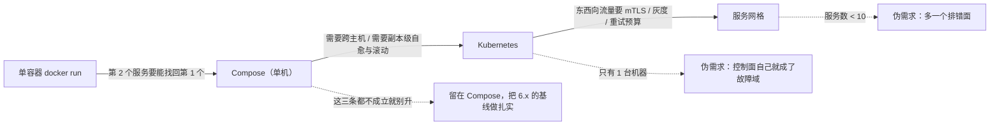

> **实战落点**：08 生态与附录篇的第一篇，也是全库**唯一一篇「决策文档」**——前面 22 篇都在教你这台机器上怎么做对，这一篇回答「下一步该不该换东西」。它的落点是段⑦/段⑧ 之后：链上八段全部走完、Harbor 这套九个服务的真实栈正在本机跑着，此时才谈「要不要 K8s、要不要换 Podman」，因为**判据可以拿真数据打分**（见「实战切入」那节的七问）。
> **本机基线**：Docker Engine `29.8.0` / API `1.56`、**Compose v5.5.1**（宿主 `docker-compose.exe` 与 `docker compose` 是同一入口）、Desktop `4.91.0 (239619)`、`runc 1.4.3`、`containerd` 提交 `db8809540e1a…`、`.Plugins.Network = [bridge host ipvlan macvlan null overlay]`、`.Plugins.Volume = [local]`、`.Plugins.Log` 九种、`docker plugin ls` 零条；K8s 侧只有 `kubectl` 客户端 `v1.36.1` / Kustomize `v5.8.1`，**无集群、无 context、`~\.kube` 不存在**。本篇取数跑了**五轮**（V / W / X / Y 四支脚本 + W 轮的九条假红重测），一次性对象一律 `kb28/kb29/kb30` 前缀，跑完按名清净。
> **前置依赖**：[/docs/04-单机编排/日常/多环境热重载与五服务完整实战/](/docs/04-单机编排/日常/多环境热重载与五服务完整实战/)（4.9，链上八段的起点）、[/docs/05-原理深入/网络与运行时/网络底层跨主机方案与运行时生态/](/docs/05-原理深入/网络与运行时/网络底层跨主机方案与运行时生态/)（5.6 的「为什么单机不够」与 5.7 的运行时分工，是 8.2、8.3 的地基）、[/docs/05-原理深入/隔离与资源/容器本质Namespace与Cgroups/](/docs/05-原理深入/隔离与资源/容器本质Namespace与Cgroups/)（5.2 的 namespace，8.3 的 rootless 差别靠它）、[/docs/06-工程化与生产/交付链路/CI-CD中的Docker与安全基线/](/docs/06-工程化与生产/交付链路/CI-CD中的Docker与安全基线/)、[/docs/07-运维手册/检索与规矩/命令速查症状索引与团队规范/](/docs/07-运维手册/检索与规矩/命令速查症状索引与团队规范/)（7.1 的存在性双口径，本篇整个「本机可得性」列就是它的应用）、[/docs/00-导读/怎么用这个库/使用指南与主线八站地图/](/docs/00-导读/怎么用这个库/使用指南与主线八站地图/)
> **本篇产出物**：一张**带本机读数的生态工具存在性表**（18 + 11 个工具，三口径判据）；一张**四阶段—问题—判据—代价**表与一张**三维判断表**（团队规模 + 服务数 + 是否需要跨主机，阈值明确标为示例）；一张 **Docker/Compose 与 K8s 的概念对照表**（16 行，每行标「本机可验 / 未验证」）；**Compose 转 K8s 的工具与差距的硬读数**（`unsupported format "kubernetes"`、35 个子命令里没有 `convert`、kompose 四种仓库写法全拒的原文、引擎根里五个断链的 kube 符号链接）；**K8s 学习路线**（reconcile → 对象模型 → CRI → CNI → 存储与 RBAC）；**Podman / nerdctl / containerd 直用的迁移成本表**（能带走的 / 带不走的）；服务网格的引入判据；一段**可以用链上真实数据打分的实战判定**（七问）。
> **难度·耗时**：8.1 ★☆☆ · 25m／8.2 ★★☆ · 30m／8.3 ★★☆ · 30m（合计约 85 分钟；这三章读起来轻松，**难的是忍住不照抄阈值**）
> **拓展接口**：概念对照表的右列全部指向「K8s 操作另开库」这条边界声明；5.7 的 `dockerd → containerd → shim → runc` 是本篇 8.3「没有 daemon 会怎样」的对照物；5.8 的 `uid_map` 与 `/etc/subuid` 缺席是 Podman rootless 那格的本地反面；6.4 的回滚演练与 6.6 的「声明 + 数据」迁移观是本篇「reconcile 先修」的单机版教材；7.5 的 containerd 快照落点与 3.9~3.12 的 OCI 分发解释「镜像层几乎不用迁移」；`argocd`/`flux` 那类 GitOps 工具在本机零安装，其判据落在下面「团队规模」那一档；8.4~8.7 的术语表与版本兼容矩阵见 [/docs/08-生态与附录/查阅件/术语表参考资料与版本兼容矩阵/](/docs/08-生态与附录/查阅件/术语表参考资料与版本兼容矩阵/)（版本兼容要现查命令，别拿本篇当快照）。
> **自测三题**：
> 1. 你要证明「这台机器没有 compose→K8s 的转换路」，除了跑一次 `docker compose convert`，还需要哪**两条**证据？为什么单看 `rc=1` 不够？
> 2. 本机 `kubectl` 存在、`kubectl version` 也回得出版本，为什么这不能推出「有集群」？把三个口径写出来。
> 3. 换 Podman 时，哪一层几乎不用动、哪三层必须重验？各给一条本库已实测的依据。

## 为什么要给这一篇做「本机可得性」这一列

三章合起来回答的是一个决策问题：**下一步该装什么、该学什么、该换什么**。这类章节最容易写成「把官方路线图抄一遍」，抄完读者还是不知道**自己这台机器上到底有没有、能不能用**。所以本篇定了一条规矩：**地图上每一格都必须带本机读数**——工具用 `where`/`wsl -l -v`/引擎根目录三个口径验存在性，转换路要真跑一次并把报错原文贴出来，装不了的地方就写「本机没有」而不是「建议安装」。

三条真实串味，就是这条规矩要治的：

```text
# 一：以为 compose 能一键转 K8s（批 22 本机实测，Compose v5.5.1）
$ docker compose -f compose.yaml config --format kubernetes
unsupported format "kubernetes"

# 二：以为装了 kubectl 就等于有集群
$ kubectl version
Client Version: v1.36.1
Kustomize Version: v5.8.1
Unable to connect to the server: dial tcp [::1]:8080: connectex: No connection could be made
because the target machine actively refused it.

# 三：以为 Docker Desktop 的引擎里带了 Kubernetes 组件就能用（那五个其实是断链）
crictl -> /var/lib/kube-binary-cache-debian/crictl        # 符号链接，mtime Sep 8 07:44
$ ls /var/lib/kube-binary-cache-debian
ls: /var/lib/kube-binary-cache-debian: No such file or directory
```

第 2 条尤其值得贴在显眼处：**`kubectl --version` 报的是客户端版本，与「有没有集群」是两件事**。7.1 那条「`--help` 的 `rc=0` 不能当存在性证据」的纪律，在本篇换了个面孔复现。

### 这三章在 08-生态与附录 里的位置：内容要点与产出物

| 章 | 触发条件（什么时候翻到这） | 前置依赖 | 难度·耗时 | 内容要点与产出物 |
|---|---|---|---|---|
| 8.1 容器生态地图 | 团队在「要不要引入新工具」上争执不下时 | 4.9 单机编排收官 | ★☆☆ · 25m | Docker → Compose → Kubernetes → 服务网格；各阶段何时引入什么工具；用「团队规模 + 服务数 + 是否需要跨主机」三个维度给判断依据 |
| 8.2 Kubernetes 衔接导读 | 要衔接 K8s、或有人提议「直接上云托管」时 | 5.6 跨主机网络、5.7 运行时生态 | ★★☆ · 30m | K8s 学习路线；Docker 与 K8s 概念对照表；Compose 转 K8s 的工具与差距。**边界声明：本库只讲到「为什么单机不够」为止，K8s 操作另开库** |
| 8.3 Docker 替代品与近亲 | 评估 Podman、或想绕开 Docker Desktop 授权/性能问题时 | 5.7 | ★★☆ · 30m | Podman、nerdctl、containerd 直用；什么场景值得迁移、迁移成本具体在哪 |

所属篇是第八篇 生态与附录；主线站 — ；这三章都不是「学会一个命令」，而是**给出判据**，所以每节末尾都有一条「本机能不能验」的说明。

## 先看本机：这张地图上每一格都验过

### 生态工具的存在性（三个口径一起看）

判据口径：**`where` 找到路径** + **`--version` 有真版本串** + **`--help` 不回落成别的东西的通用帮助**。只满足后一条的一律不算存在（本库 7.1 里 `docker trust`/`docker scp` 就是这么被误判的，本篇把同一个脚本改了一处：不存在的命令会让子进程抛 `FileNotFoundError`，必须把它当成**一种结果**返回，否则整节从第二个工具起就没读数——这是批 22 的第一次自伤）。

| 工具 | 本机是否存在 | 现读 |
|---|---|---|
| `docker` | 有 | `C:\Users\webtu\AppData\Local\Programs\DockerDesktop\resources\bin\docker` |
| `docker compose` / `docker-compose` | 有，**同一个入口** | 两条都是 `Docker Compose version v5.5.1`；`where` 给的两个路径同在 `resources\bin` 下 |
| `kubectl` | **只有客户端** | Client `v1.36.1`、Kustomize `v5.8.1`；`current-context is not set`、`~\.kube\config` 不存在 |
| `helm` / `kind` / `minikube` / `k3d` / `k3s` / `kubelet` / `kubeadm`（Windows 侧） | 无 | `where` 全部 rc=1 |
| `kompose` | **无 CLI，镜像也拉不到** | 见下面那节四条 pull 原文 |
| `skaffold` / `tilt` / `crane` / `cosign` | 无 | `where` rc=1（`trivy`、`hadolint` 是**镜像**在本机，不是宿主 CLI——6.2 用容器方式跑它们） |
| `podman` / `nerdctl` | 无 | `where` rc=1；`wsl -l -v` 只有 `docker-desktop`（Running / 2），没有 `podman-machine-default` 之类发行版；`C:\Program Files\Red Hat, Inc`、`%LOCALAPPDATA%\Programs\Podman Desktop`、`Rancher Desktop`、`orbstack`、`Mirantis` 目录都不存在 |
| 服务网格与观测面：`istioctl` / `linkerd` / `consul` / `envoy` / `argocd` / `flux` / `helmfile` / `k9s` / `lens` | 全部无 | `where` 一律 rc=1 |
| `%USERPROFILE%\.local\bin` | 存在 | 这一台机器上唯一命中的「第三方工具目录」，上面那些一个都没装进去 |

Docker Desktop 自带的宿主客户端只有这些（`resources\bin` 全清单，这就是「生态地图在本机的地基」）：

```console
com.docker.sailor.exe  docker  docker-compose  docker-compose.exe
docker-credential-desktop.exe  docker-credential-ecr-login.exe  docker-credential-wincred.exe
docker.exe  extension-admin.exe  kubectl.exe            # kubectl.exe 61,029,296 字节
```

### 引擎侧注册了什么（这一格决定 5.6 与 8.2 的边界）

`docker info` 的 `.Plugins` 是引擎**认得的驱动名**，不是「装好的集群能力」——这个区别很重要：

```console
$ docker info --format '{{json .Plugins}}'
{"Volume":["local"],
 "Network":["bridge","host","ipvlan","macvlan","null","overlay"],
 "Authorization":null,
 "Log":["awslogs","fluentd","gcplogs","gelf","journald","json-file","local","splunk","syslog"]}
$ docker plugin ls
（表头之后零条——本机没有安装任何外部插件）
```

读法三条：**网络驱动里确实有 `overlay`**，所以 5.6 那条 `This node is not a swarm manager` 不是「驱动没装」，而是**缺控制面**；日志驱动九种但只有 `json-file` 与 `syslog` 在本机验过通路（6.3、6.5）；卷驱动只有 `local`，所以 7.7 那条 NFS 卷 `create rc=0 / 挂载 operation not supported` 是有原因的。

> 💡 新人小结：生态地图不是「工具清单」，是**门口的鞋架**——你得先数清自己脚上有几双鞋（本机有什么），再看天气（团队与拓扑的需求），最后才决定要不要买那双雨鞋（新工具）。
> 对应到机制：`where` 找到路径 = 鞋在架子上；`--version` 回出版本串 = 那双鞋能穿；`kubectl` 有客户端但没有 context/集群 = **买了鞋但门外没有路**。所以本篇把「存在性」拆成三个口径而不是一个。
> 类比在何处失效：鞋架是静态的，而工具「存在」会随引擎状态变——`docker plugin ls` 空、`/var/lib/kube-binary-cache-debian` 缺失，都是**同一台机器上「注册了/预留了」与「实体在不在」两回事**。

## Docker → Compose → Kubernetes → 服务网格：各阶段解决的是哪个问题

这四段不是「从小到大」的同一件事，而是**四个不同的问题**；把问题分清，才不会用后一段的工具去解前一段的痛。

| 阶段 | 它替你解决的那一个问题 | 引入的**判据**（不是「推荐」，是「什么时候必须」） | 它带来的新成本 | 本机现状 |
|---|---|---|---|---|
| Docker（单容器） | 「在我机器上能跑」→ 一个可分发的镜像 | 有第二个环境要跑同一个服务 | 镜像构建与仓库习惯要建 | 引擎 29.8.0 / API 1.56，`Desktop 4.91.0(239619)` |
| Compose（单机多容器） | 一台机器上的**启动顺序、网络、卷、环境变量** | 两个以上服务要互相找得到（`getent` 按名解析、127.0.0.11 内嵌 DNS） | 声明式文件要维护；`up --wait` 与健康检查的语义坑（4.6、7.2） | **本机就在这段**：链上 `compose.yaml` 五个服务、Harbor 九个容器 |
| Kubernetes（多机 + 期望状态调和） | **副本、自愈、滚动发布、跨机调度**——即「声明了就要一直成立」 | 需要跨主机（多节点）、需要副本级滚动/回滚自动化、需要多人多团队共用一套机器 | 控制面、对象模型、网络插件、存储类、RBAC——每个都是新的故障域 | 本机**没有集群**：三条硬证据见上表与下面「转换差距」节 |
| 服务网格（东西向流量治理） | 服务之间的**mTLS、灰度、重试、可观测**，不改代码 | 服务间调用关系复杂到「光看日志说不通」，或合规要求 mTLS | 多一层 sidecar/代理：延迟、排错面、版本兼容 | 本机**零 mesh 工具**（`istioctl`/`linkerd`/`consul`/`envoy` 全无） |

判断「该进哪一段」用三个维度——**团队规模 + 服务数 + 是否需要跨主机**。下面这张表的**阈值是示例**（不同团队可以差很多，别当标准抄）：

| 维度 | 示例档位 | 到这一档时新出现的能力需求 | 还没出现、不值得提前引入的 |
|---|---|---|---|
| 服务数 | 1~2 | 只要 `docker run` | Compose 都算多一层 |
| 服务数 | 3~8 | Compose：网络、卷、`depends_on` 条件、profiles | K8s：副本/自愈在这里通常**用不上**（单机重启就等于全停） |
| 服务数 | 8 以上且开始出现「同服务多副本」 | 编排器：replicas、滚动更新、健康门 | 网格 |
| 是否需要跨主机 | **是**（≥2 台机器要互相调用同一组服务） | 控制面 + 跨机网络（5.6 那条 overlay/VXLAN 能力） | 手工给两台机器各跑一份 compose（漂移无法收敛） |
| 团队规模 | 3 人以上共享同一套环境 | 声明式基线 + CI 闸门（6.1）、镜像标签纪律（3.11）、命名规范（7.11） | K8s 的对象模型课 |
| 团队规模 | 出现「谁改了线上」的争议 | GitOps/审批流（argocd 那一类） | 自研发布脚本 |



## 什么时候**真的**不需要 Kubernetes（链上八段的对账）

这一节全部用贯穿示例链的真实数据，不虚构。链是八段（`段1-依赖跑起来` … `段8-故障演练`），到段⑦ 才第一次出现「生产形态」的要求，而它给的仍是 **Compose**：

| 对账项 | 本机现读 | 说明 |
|---|---|---|
| 链上 `compose.yaml` 默认 profile 的服务数 | **2**（`cache db`） | `docker compose -f compose.yaml config --services`（这是**权威口径**，别用正则数缩进——批 22 我先用正则数出 8，把 `volumes:` 的 `dbdata/cachedata` 和网络 `default` 都算成了服务） |
| 加 `--profile app` 之后 | **5**（`cache db api web proxy`） |  profiles 的可见性直接改变服务数，4.8 那条实测在这里复现 |
| 段⑦ `compose.prod.yaml` 的服务 | 需要 `--env-file .env.prod` 才能渲染 | 原文：`required variable API_TAG is missing a value: 段7 要显式给 API_TAG（--env-file .env.prod）`，另两条同形（`WEB_TAG`、`GIT_SHA`） |
| 链上有没有 K8s 味的字段 | `无 deploy`、`无 replicas`、`无 update_config` | `compose.yaml` 顶层只有 `name / services / networks / volumes` |
| 本机真实多服务栈的规模 | Harbor **9 个容器**（nginx / harbor-core / harbor-db / registry / registryctl / harbor-jobservice / harbor-portal / redis / harbor-log / harbor-log） | 9 个服务、单台机器、跨主机需求为**否** → 按上面的三维表，它不需要 K8s |
| 跨主机这一维 | 本机只有一台引擎（`wsl -l -v` 只有 `docker-desktop`），overlay 建不出来 | 「需要跨主机」这条**不成立**，这是最强的否决项 |

结论要写成可执行的一句话：**当「副本级自愈」「滚动发布」「跨机调度」三条都不成立时，引入 Kubernetes 的收益是负的**——它带来的控制面、网络插件、存储类与 RBAC 都是**新的故障域**，而你现在连一个都还没被真实事故教育过（段⑧ 的三次构造都发生在单机 Compose 上：OOM 137、跨网超时、ENOSPC）。

## K8s 学习路线：先修这三块，别从 kubectl 起手

顺序错了会学成「记 yaml」。按依赖关系排：

| 顺序 | 先修什么 | 为什么排在前面 | 本库已有的对应地基 |
|---|---|---|---|
| 1 | **声明式与调和循环（reconcile）**：你写「期望状态」，控制器不断把现实拉过去 | 这是 K8s 与 Compose 的**根本差别**——`docker compose up` 跑完就结束，K8s 的控制面永不停止比对 | 6.4 的回滚演练、7.9 的「声明 + 数据」迁移观（6.6）都在讲同一件事的单机版 |
| 2 | **对象模型**：Pod / Deployment / Service / ConfigMap / Secret / PVC 的分工与「谁持有谁」 | 不懂这层，`kubectl apply` 只会变成抄别人 yaml | 5.2（namespace 与 cgroup）、5.4（镜像层）、5.5（网络与 DNS）给了每个对象底下的机制 |
| 3 | **运行时与 CRI**：kubelet 通过 CRI 调 containerd，`k8s.io` namespace 与 `moby` namespace 并存 | 这一段最容易被跳过，但它解释了「为什么删掉 dockershim 不影响你的镜像」 | **5.7 已经把这条链量通了**：`dockerd → containerd（/run/containerd/containerd.sock，namespace=moby）→ containerd-shim-runc-v2 → runc`，`docker info .Containerd` 里 Namespaces 就两个值 |
| 4 | 网络模型（CNI）与 Service 的两跳 | 排错最费时间的地方 | 5.5 的三条数据包路径 + 跨网 DROP + `--internal`，5.6 的 overlay 能力面 |
| 5 | 存储（CSI/StorageClass）与访问控制 | 到多机才有意义 | 7.5 的「数据在 containerd 快照与卷里」、6.6 的备份闭环 |

学习路线里最值得提醒新人的一件事：**`kubectl` 的熟练度不等于 K8s 能力**。本机就有反面样本——`kubectl.exe` 装了 61,029,296 字节，但没有任何 context：

```console
$ kubectl config current-context
error: current-context is not set
$ kubectl config view --minify
error: current-context must exist in order to minify
$ ls $env:USERPROFILE\.kube
（目录不存在）
```

## Docker 与 K8s 概念对照表

**读表键**：左列的 Compose 侧全部是本机可跑可渲染的（`docker compose config` 的 canonical 输出 + 前批实测）；右列的 K8s 侧是**官方语义**，本机没有集群，**除标注外均未验证**——这一列只能当「映射关系」读，不能当「实测」读。

| Compose 字段 | K8s 对应 | 语义差别（坑在这里） | 本机验证状态 |
|---|---|---|---|
| `services.<x>` | 通常拆成 Deployment（有副本）+ Service（访问）+ 可选 ConfigMap/Secret | Compose 一个服务 = 一个容器组的一份定义；K8s 要自己组合三个对象 | 左列可验，右列未验证 |
| `deploy.replicas` | `spec.replicas` | Compose 的 replicas 在单机上是**同一台机器多份**（端口要变），K8s 是跨机调度 | 左列可验（`scale`）；右列未验证 |
| `ports: "18531:80"` | Service `type: NodePort/LoadBalancer` + `containerPort` | Compose 的发布端口是**内核 DNAT**（5.5 那条 `-A DOCKER -p tcp --dport 18531 -j DNAT`）；K8s 多一层 Service/iptables 或 IPVS 规则 | 左列已实测（含 `-p 127.0.0.1:` 只绑 v4 那条）；右列未验证 |
| `healthcheck.test/interval/retries` | `livenessProbe` / `readinessProbe` / `startupProbe` | Compose 只有一个健康检查，`--wait` 拿它当门（4.6 量到「无健康检查的服务被报 Healthy」）；K8s 把**存活**与**就绪**分开，误配会互相放大 | 左列已实测；右列未验证 |
| `stop_grace_period` | `terminationGracePeriodSeconds` | 同一件事的两种名字；本机默认值来自 daemon 的 `"default-stop-timeout": 3`（5.8 那节结清的旧账），K8s 侧默认 30 秒是另一个来源 | 左列已实测（`stop_grace_period` 落 `Config.StopTimeout`）；右列未验证 |
| `restart: unless-stopped/always` | `restartPolicy: Always/OnFailure/Never` | Compose 的重启由 dockerd 执行，`rm -f` 会打断；K8s 由 kubelet + 控制器执行，且重启**不会**替换 Pod 对象 | 左列已实测（`RestartCount` 与 backoff 序列 `[0.26,0.35,0.59,0.92,1.78,3.36,6.55]` 秒，7.3）；右列未验证 |
| `volumes:` 命名卷 | PersistentVolumeClaim + StorageClass（+ PV） | Compose 的卷是**本机目录**；K8s 要把「申请」与「提供」分开，没有 StorageClass 时 PVC 会一直 Pending | 左列已实测（`volume is in use`、`rm -f` 带不走匿名卷那两条）；右列未验证 |
| `volumes:` bind 挂载 | hostPath（或 ConfigMap 投影） | hostPath 几乎不该进生产；这是「翻译器最爱自动生成的东西」，也是**最危险的自动生成** | 左列可验；右列未验证 |
| `environment` / `env_file` | 容器 `env` + ConfigMap / Secret（`envFrom`） | Compose 的 `.env` 只在起容器时展开；K8s 的 ConfigMap 更新默认不会让已跑的容器感知（要滚动） | 左列已实测（4.7 的 `${VAR:?}` 硬失败、`--env-file` 非法行原文）；右列未验证 |
| `secrets` | Secret | 两者都不是「安全存储」；Secret 默认只是 base64 | 左列已实测（6.2 的四个泄漏面）；右列未验证 |
| `networks` + 服务名解析 | Service DNS（`<svc>.<ns>.svc.cluster.local`）+ CoreDNS | Compose 是 `127.0.0.11` 内嵌解析器（5.5 量到沙箱 DNAT 53→高位口）；K8s 是集群级 CoreDNS + 每 Service 一个 ClusterIP | 左列已实测；右列未验证 |
| `profiles` | **没有直接对应**（靠不同的 manifest 文件或 Kustomize overlay） | 「一套文件多份形态」这件事在 K8s 侧换了机制 | 左列已实测（默认 2 服务、`--profile app` 后 5）；右列：不适用 |
| `depends_on.condition: service_healthy` | **没有直接对应**（近似 initContainers + 应用内重试；或用 Job/Pod 依赖） | 这是最容易「以为有对应」的一格：**编排依赖不等价于运行时依赖**（批 17 量过裸 `depends_on` 的假绿） | 左列已实测；右列：不适用 |
| `develop.watch` / `build` | Kaniko/BuildKit-in-cluster 或 CI 里构建后推镜像 | 开发期热重载这件事在 K8s 侧通常交给 Tilt/Skaffold 一类工具 | 左列已实测（4.9）；右列未验证 |
| `extra_hosts: host.docker.internal` | 集群内用 Service 名访问，出集群走 Service/Ingress | Desktop 的 `host-gateway-ips`（5.8 那节读到的 daemon 配置）是**单机专属**机制 | 左列已实测（解析到 192.168.65.254，镜子看到 `peer=127.0.0.1`）；右列不适用 |

## Compose 转 K8s 的工具与差距：这台机器上根本没有这条路

这是本篇最硬的一节，也是 8.2 的核心差距读数。**结论先说：本机（Compose v5.5.1）没有任何可用的 compose→K8s 转换路。**

| 尝试 | 原文/读数 | 判读 |
|---|---|---|
| `docker compose convert --help` | 回落到总帮助：`Usage: docker compose [OPTIONS] COMMAND`（3636 字节，第一行就是回落证据） | 未知子命令回落——按 7.1 的双口径判据，**不是存在** |
| `docker compose --help` 子命令清单 | 35 条：`bridge attach build commit config cp create down events exec export images kill logs ls pause port publish pull push restart rm run scale start stats stop top unpause up version volumes wait watch` | **清单里没有 `convert`** |
| `docker compose config --format kubernetes` | **`unsupported format "kubernetes"`**（输出共 31 字节，rc=1） | 这是最直接的一条：转换能力已从 `config` 移除 |
| `config --help` 里 `--format` 的取值 | `Format the output. Values: [yaml \| json]` | 官方帮助自证只有两种格式 |
| `docker compose --compatibility config` | rc=0，输出 1082 字节 **仍是 Compose 规范格式**（`kind:` 一个都没有） | `--compatibility` 只做 spec 归一化，**不产出 K8s 对象**——别把它当转换开关 |
| `docker pull kompose/kompose:latest`（含 `kompose/kompose`、`docker.io/kompose/kompose:latest`） | `Error response from daemon: pull access denied for kompose/kompose, repository does not exist or may require 'docker login'` | Docker Hub 上这个名字拿不到镜像（三个写法同一句原文） |
| `docker pull ghcr.io/kompose/kompose:latest` | `Error response from daemon: error from registry: denied \| denied` | 也不通；`kompose` 这个工具在本机**既无 CLI 也无镜像** |
| 宿主 `helm / kind / minikube / k3d` | `where` 全部 rc=1 | 连「起个本地集群再对比」都没有工具 |
| 引擎根里的 `kubectl / kubeadm / kubelet / crictl / critest` | 全是指向 `/var/lib/kube-binary-cache-debian/*` 的符号链接（mtime `Sep 8 07:44`），而 `ls /var/lib/kube-binary-cache-debian` 回 **`No such file or directory`** | **预留了路径、实体从未下载**。这正是「K8s 可开启但本机没开」的物证 |
| Windows 侧开关 | `settings-store.json` 的 8 个键是 `AutoStart / DisplayedOnboarding / EnableDockerAI / InferenceCanUseGPUVariant / LastContainerdSnapshotterEnable / LicenseTermsVersion / SettingsVersion / UseContainerdSnapshotter`——**没有任何 K8s 相关键**；`~\.kube` 不存在 | 启用它属于「改本机引擎状态 + 重启」，本库授权范围外，**刻意未做** |

对照实验：同一个探针文件，`config --format yaml` **能出** 1219 字节、`--format kubernetes` 直接 `unsupported format`。所以这不是文件写错了——**是能力不在了**。

> [!WARNING] 批 22 自己踩的一次「假红」，留在正文里当反面样本
> 第一次跑这节（W 轮）时，探针文件本身不合法：`db` 带了 `profiles: ["app"]`，而 `web` 的 `depends_on` 引用它，于是报
> `service "web" depends on undefined service "db": invalid compose project`。
> 脚本却把这次失败的输出拿去做了「字段对账」，结果十格里九格被打成「被丢弃」——**九条假红**，全部作废。
> 改法两步：先 `config --quiet`（rc=0 且无输出）证明文件合法，再试转换；探针去掉 profile/depends_on 串味后重跑，才拿到上面那格 `unsupported format "kubernetes"`。
> 这条与本库第 115 条同源：**判据报大量问题时，先怀疑判据本身**；同一类错误的另一条形态见第 124 条（探针没断言前置状态）。

> 💡 新人小结：compose→K8s 的自动转换像**机翻一篇合同**——字都能对上，责任划分全错。
> 对应到机制：`healthcheck` 在 Compose 里是一个检查、在 K8s 里要拆成 liveness/readiness/startup 三种探针，语义不同（一个决定重启，一个决定摘流量）；`depends_on: service_healthy` 在 K8s 里**根本没有对应对象**，机翻要么丢掉它、要么生成一个 initContainer 假装等待；`bind` 挂载最容易被翻成 `hostPath`，而 `hostPath` 上生产等于埋雷。
> 类比失效处：机翻再差也是「同一种语言」，而这两个文件**背后是两套执行模型**（跑完就结束的启动器 vs 永不合眼的调和循环），所以差距不是「翻译质量」而是「表达不了」。

### 被放弃的四条路，各自为什么

| 方案 | 本机能不能做 | 放弃理由 |
|---|---|---|
| 用 `docker compose convert --format kubernetes` | 不能（无此子命令） | 读数即结论；即使别的版本能，产出的 `hostPath`/单一探针也要重写 |
| 拉 `kompose` 镜像跑一次转换 | 不能（Hub 与 GHCR 都拒） | 就算拿到，它生成的对象仍需人工拆探针、去 hostPath——省的是打字，省不掉判断 |
| 在 Desktop 里启用 Kubernetes 再对照 | 能（要下载组件、重启引擎） | **本库的授权边界是不重启、不改引擎状态**；且启用后得到的是「别人的集群」，与本篇要给的判据无关 |
| 装 kind/minikube 起个真集群 | 本机零工具，且要新发行版/新虚拟化 | 属于「另开一库」的量：本篇只讲到「为什么单机不够」（边界声明见下节） |

## 边界声明：本库只讲到「为什么单机不够」为止，K8s 操作另开库

不覆盖清单，避免读者以为「看完这篇就能上 K8s」：

| 不在本库范围 | 该去哪 |
|---|---|
| `kubectl` 命令、yaml 编写、`apply/diff/rollout` 的实操 | 另开一库（本篇只给概念映射与学习路线） |
| Helm chart、Kustomize、Operator | 同上 |
| CNI 网络插件选型、Ingress / Gateway API | 5.6 只讲到「overlay/VXLAN 需要什么能力」为止 |
| StorageClass / CSI、RBAC、PodSecurity | 6.2 只讲到单机最小权限五条；集群侧另开 |
| 托管集群（各家云）的配额与成本 | 6.x 的单机基线不替你回答这个问题 |

## Podman：同一个镜像，另一套进程模型

**本机没有 Podman**（宿主 `where` 找不到；没有 `podman-machine-default` 这类 WSL 发行版；`C:\Program Files\Red Hat, Inc` 与 `Podman Desktop` 目录都不存在）。所以这一节只写**能讲清的机制**与**迁移成本的具体位置**，命令级差异标未验证。

| 差异点 | Podman 的形态 | 迁移成本落在哪 | 本机可验性 |
|---|---|---|---|
| 有没有常驻 daemon | 每个容器一个 `conmon` 监控进程，**没有 dockerd** | 好处：引擎崩了不影响在跑的容器；代价：所有「daemon 侧」能力（`docker info`、网络驱动、构建器默认值）都要重想 | **对照面已在本库量过**：Desktop 的 dockerd 在引擎 netns/pidns 里（5.5、5.7），`docker info` 的 60 个键都是它的对外表现 |
| 默认是否 rootless | 默认 rootless（ userns 映射） | 本库 5.8 的读数正好是反面：这台引擎 `uid_map` 是 `0 0 4294967295`（**没映射**），VM 里连 `/etc/subuid` 都不存在 | 「映射原理」已实测；「Podman 上的实际表现」未验证（本机跑不了） |
| 网络默认栈 | 默认 rootless 下没有 bridge/docker0，常用 pasta/slirp4netns | 5.5 那套 `br-<NetworkID>` + DNAT + 内嵌 DNS 的排错手法**大部分失效**，要换成另一套 | 本机不可验 |
| 卷与属主 | rootless 下卷属主受 uid 映射影响 | 5.8 量到「非 root 往 root 拥有的卷里写 → `Permission denied`」，同一类坑会以另一种形态出现 | 机制面已实测，Podman 侧未验证 |
| `docker.sock` 兼容服务 | 可以起一个 API 兼容层 | 好处：多数 `docker` 脚本能跑；代价：兼容层支持的端点集合**不等于** Docker API（`docker info`、compose、buildx 各自踩不同的洞） | 本机无 Podman，未验证 |
| Compose 支持 | `podman compose` 走包装（后端可能是 docker-compose 或 podman-compose） | 4.x 全篇按 Compose v5.5.1 的实测语义写的判据（`--wait`、profiles、`--dry-run`、`config --format`）都要重跑一遍才能信 | 本机不可验 |
| 镜像格式 | **同一套 OCI 镜像** | 这是唯一几乎不用迁移的一层 | **已实测**：本机 `docker save` 的包是 OCI 布局（`blobs/index.json/manifest.json/oci-layout`）、`buildx --output type=oci` 缺 `manifest.json`、`docker load` 两种都认（5.7）；`image inspect` 的 `.Os/.Architecture` = `linux/amd64` |

> 💡 新人小结：从 Docker 换到 Podman，像**把公司班车换成合租的车**——车上拉的乘客（镜像）一模一样，谁掌握方向盘与钥匙（谁在管理进程、以什么身份）全变了。
> 对应到机制：镜像这一层不用重做，本机实测过它是同一套 OCI 格式（`docker save` 的包结构、`buildx --output type=oci` 的包结构与层摘要，见 5.7）；变掉的是三件事——**没有 dockerd 这个常驻管理者**（5.7 那条 `dockerd → containerd → containerd-shim-runc-v2 → runc` 换成 conmon 直接盯 runc）、**默认开 user namespace 映射**（本篇 5.8 量到的 `uid_map` 全量透传 `0 0 4294967295` 在那边是「真映射」，卷属主行为因此不同）、**网络栈换掉**（5.5 那三条数据包路径依赖的 `docker0`/`br-<NetworkID>`/内核 DNAT/`127.0.0.11` 内嵌 DNS 一整套不复存在）。
> 类比失效处：换车只换驾驶位，而换 Podman 会换**整本排错手册**——07 板块里那些命令与判据（桥名怎么认、哪条链丢的包、DNS 在哪个 netns）大部分不能照抄。这就是下面三维表里「带不走」那一列的具体内容。

「什么场景值得迁移」的答案要连着代价一起给：

| 场景 | 值得考虑 | 但要先确认 |
|---|---|---|
| 团队不想接受 Docker Desktop 的授权条款（>某规模） | 是主要动机 | 网络与编排语义要重验；本库所有 05/07 篇的读数都要标「Desktop 实测」 |
| CI runner 里要 rootless | 是 | 内核要有 userns 前提（本库 5.8 读到 `max_user_namespaces=192509` 而 `unshare -U` 被默认 seccomp 拒——环境差异会咬人） |
| 只是嫌 Desktop 慢/吃内存 | 未必 | 先按 7.7 的四存放处与 vmmem/vhdx 那两条量清楚瓶颈，再谈换工具 |
| 已经上 K8s | 顺带 | 那时真正的主角是 containerd，Docker 还是 Podman 都只是客户端 |

## nerdctl 与 containerd 直用：这台机器上三条都缺

「绕开 Docker，直接对 containerd」听起来干净，本机读数给的是另一面：

| 检查 | 现读 | 判读 |
|---|---|---|
| `ctr` / `nerdctl` 在哪 | WSL 默认 PATH 里 `containerd: not found`、`ctr`/`nerdctl` 都 `which` 不到；引擎根里只有 `containerd`、`containerd-shim-runc-v2`、`containerd-stargz-grpc`、`runc`、`runcon`、`sysbox-*`（**没有 ctr、没有 nerdctl、没有 podman**） | 有服务端、没有客户端 |
| containerd 的 socket | `srw-rw---- 1 root root 0 Oct 27 11:19 /proc/1/root/run/containerd/containerd.sock`（还有 `.ttrpc`） | 属主 root、权限 0660，且**在引擎自己的 mount namespace 里**——普通容器根本看不到那个路径 |
| 引擎的对外地址 | `docker info .Containerd` = `{"Address":"/run/containerd/containerd.sock","Namespaces":{"Containers":"moby","Plugins":"plugins.moby"}}` | dockerd 是它的客户端；你要直连，等于抢它的 namespace |
| 运行时注册 | `Runtimes` 三个键 `io.containerd.runc.v2 / nvidia / runc`；`--runtime sysbox-runc` 报 `unknown or invalid runtime name`（**二进制在 ≠ 注册**） | 5.7 那条纪律在这里同样适用：containerd 的运行时要在配置里注册 |
| 结论 | **本机不适合演示 containerd 直用**：要么改引擎状态（往 `moby` namespace 里建容器）、要么在 VM 里装客户端（改变环境）。本库两条都不做 | 标未验证 |

值得记住的一点是**镜像与存储这一层已经「在共享」了**：本机的 `docker info` 报 `Driver=overlayfs` + `DriverStatus=[[driver-type io.containerd.snapshotter.v1]]`，daemon.json 里 `"features": {"containerd-snapshotter": true}`（5.8 读到的全文）——也就是说**Docker 已经在用 containerd 的快照存储**，只是 API 仍走 dockerd。换客户端不换格式，换的是**编排与执行模型**。

## 服务网格：什么时候是解药，什么时候只是多一个故障域

本机零 mesh 工具（`istioctl`/`linkerd`/`consul`/`envoy` 全 `where` 找不到），所以这里只给判据与代价，不给安装步骤。

| 引入判据（满足才有戏） | 网格替你做的 | 立刻多出来的东西 |
|---|---|---|
| 服务间调用图复杂到「看日志说不通是哪一跳」 | 每跳的指标与追踪默认就位 | sidecar/代理进程 + 注入逻辑，排错面翻倍 |
| 合规要 mTLS，且应用层做不动 | 证书轮转与双向认证 | 控制面 + 证书信任链（本库 7.6 那套 x509 三信任链的教训会重演） |
| 要做流量切分（灰度、A/B、故障注入） | 权重路由与重试预算 | 版本兼容矩阵、性能基线（7.8 的 CPU 口径那类坑会以新形态出现） |
| 反例：只有 3~8 个服务、单机 Compose | — | **不值得**。7.4 的分段排查在多了 sidecar 之后每条都要重做（连「包在哪一跳被丢」都要重新定位——本篇 5.5 那条 `! -i br-X -o br-X DROP` 的经验要整个重来） |

一条与前面所有节一致的提醒：网格的可观测性**默认不会告诉你容器之间跨网被 DROP 这种事**——它看的是它自己那一层。工具替换不了机制理解，这也是本库把 05 篇放在 08 篇之前的原因。

## 迁移成本的三维表（能带走的 / 带不走的）

| 维度 | 能带走 | 带不走（要重写） | 本机依据 |
|---|---|---|---|
| 镜像与制品 | OCI 镜像、层、标签纪律、Harbor 里的制品 | 构建入口（`docker buildx` → kaniko/BuildKit-in-cluster 之类） | 5.7、3.9~3.12；批 18 第 105 条那条 Harbor 的 `Accept: application/vnd.oci.image.index.v1+json` 原文 |
| 编排声明 | 服务拆分、依赖关系、卷与配置的意识 | `compose.yaml` 本身、`profiles`、`depends_on.condition`、`develop.watch` | 本篇对照表 + X 轮 `config --format kubernetes` 的 `unsupported format` |
| 运维习惯 | 症状→判据→命令那套方法（7.1/7.2）、复盘纪律（7.10）、备份「声明+数据」原则（6.6） | 每一条命令的具体形态：`docker logs`/`exec`/`stats`/`inspect` 的等价物与字段名都不同 | 07 板块全篇；5.5/5.7 的命名空间读法 |

一句话总结这张表：**能带走的是「意识与制品」，带不走的是「命令与语义」**。所以真正划算的迁移时机只有一个：**你已经因为拓扑（跨主机）而非情绪（嫌慢）要换东西的时候**。

## 实战切入：用链上真实数据做一次「要不要上 K8s」的判定

这一段读者可以原样抄，全部只读，不新建任何东西。示例版本：Engine `29.8.0` / API `1.56`、Compose `v5.5.1`、Desktop `4.91.0(239619)`；前置是 4.9（链到段②/段⑦ 都能跑）。

| # | 你要回答的问题 | 命令 | 本机实测值 | 判定 |
|---|---|---|---|---|
| 1 | 现在有几个服务？ | `docker compose -f compose.yaml config --services` | 默认 profile 2 个（`cache db`） | 3~8 档：Compose 够用 |
| 2 | 打开 app profile 呢？ | `docker compose --profile app -f compose.yaml config --services` | 5 个（`cache db api web proxy`） | 仍 < 8，且**同机** |
| 3 | 需要跨主机吗？ | `wsl -l -v` / `docker node ls`（后者会报未 init swarm） | 只有 `docker-desktop` 一个发行版；overlay 建不出来 | **否** → 最强否决项成立 |
| 4 | 有副本级自愈需求吗？ | `docker compose -f compose.prod.yaml config --env-file .env.prod` | prod 文件里**没有** `deploy.replicas`（链上顶层键只有 `name/services`） | 无 |
| 5 | 本机有没有转换工具可以省活？ | `docker compose config --format kubernetes` | `unsupported format "kubernetes"` | 无 |
| 6 | 有集群吗？ | `kubectl config current-context` | `error: current-context is not set` | 无 |
| 7 | 那 9 个服务的 Harbor 怎么办？ | `docker ps --filter label=com.docker.compose.project=harbor --format '{{.Names}}'` | 9 个容器、单台机器、compose 起 | 连 9 服务的真实栈都不需要 K8s——**这就是本库的示例答案** |

看到什么算对：第 3、5、6 三条**必须**是否定的，判定才成立。若哪条变成肯定（比如你启用了 Desktop 的 Kubernetes，或装了 kind），结论就要按三维表重算，而不是沿用本篇。承前关系：本段用的文件是段② 的 `compose.yaml` 与段⑦ 的 `compose.prod.yaml`，**本批一个都没改**（实验全在临时目录的副本上跑，链上 `git status --porcelain` 仍为空，HEAD 未动）。

## 常见误读

| 误读 | 为什么错（本机证据） |
|---|---|
| 「Compose 是 K8s 的前奏，先把 Compose 玩熟自然就会 K8s」 | 两者共同点只有镜像；执行模型不同（跑完就结束 vs 调和循环），`depends_on`、`profiles` 在 K8s 侧**无对应对象** |
| 「`docker compose convert` 能一键迁到 K8s」 | 本机 Compose v5.5.1 的 35 个子命令里没有 `convert`，`config --format kubernetes` 回 `unsupported format "kubernetes"` |
| 「装了 kubectl 就有集群」 | `current-context is not set`、`~\.kube` 不存在、`dial tcp [::1]:8080` 被拒 |
| 「Desktop 引擎里有 kubeadm/kubelet，所以能跑 K8s」 | 那五个是指向 `/var/lib/kube-binary-cache-debian/` 的**断链**，目录本身不存在；`settings-store.json` 里也没有 K8s 键 |
| 「`--compatibility` 是 K8s 兼容开关」 | 它只把 spec 归一化，输出 1082 字节仍是 Compose 格式，一个 `kind:` 都没有 |
| 「overlay 驱动本机没有」 | `.Plugins.Network` 里明确有 `overlay`；缺的是 swarm 控制面（`This node is not a swarm manager`） |
| 「换 Podman 要重做镜像」 | 镜像是同一套 OCI 格式（`docker save`/`buildx` 的包结构、层摘要一致，5.7 已实测）；要重做的是网络、卷属主与 compose 语义 |
| 「containerd 直用可以完全绕开 Docker 的限制」 | 本机没有 `ctr`/`nerdctl`，socket 是 `srw-rw---- root` 且在引擎自己的 mount ns 里——三条都缺，本库刻意不碰 |
| 「服务数多了就该上 K8s」 | 本机 Harbor 就 9 个服务，单机 compose 跑着，跨主机这一维为否；**先看否决项，再看阈值**，且阈值只能是示例 |
| 「团队该用什么工具，文档能给标准答案」 | 不能。本篇给的是判据与代价；任何具体阈值（几台机器、几个服务）都得你按自己团队重定 |

## 本篇不覆盖什么

按 W6 的规矩，本篇**故意不讲**的东西逐条点名去处——写「不覆盖」不是免责声明，是防止你在这一篇里找不存在的答案：

- 运行时生态的机制细节（`containerd`、shim、runc 的分工）→ 见 **5.7**（`runc` 那一条链在那一篇展开）
- 单机方案为什么不够的机制原因 → 见 **5.6**（`overlay` 与 macvlan 的思路对比在那一篇）
- 术语定义与指回 → 见 **8.4**（`术语表` 那张表在那一篇）
- 团队规范、评审 checklist 与漂移防线 → 见 **7.11**（`规范` 的全库唯一事实源在那一篇）
- compose 文件字段与合并规则 → 见 **4.1**（`services` 字段速查在那一篇）
- K8s 的实际操作（部署、探针、流量摘除）→ 见 **8.3**（`K8s 操作另开库` 是本库的边界声明，本篇不给操作）

## 要点总结

1. **生态地图的每一格都要有本机读数**：`where` 找路径 + `--version` 出版本串 + 输出不回落，三个口径一起看才算「存在」。本机只有 `docker`、`docker compose`/`docker-compose`（同一入口，v5.5.1）与一个**孤零零的 kubectl 客户端**（v1.36.1 / Kustomize v5.8.1）。
2. **引擎注册 ≠ 能力可用**：`.Plugins.Network` 里有 `overlay`（但没有 swarm 控制面）、`docker plugin ls` 空、Volume 驱动只有 `local`。`Desktop resources\bin` 那十个文件就是本机的全部宿主客户端。
3. **四段解决四个问题**：Docker 管可分发、Compose 管一机的启动顺序/网络/卷、K8s 管副本/自愈/跨机调度、mesh 管东西向流量治理。**升级判据是需求出现，不是规模焦虑**。
4. **三维判据 = 团队规模 + 服务数 + 是否需要跨主机**；其中「跨主机」是最强否决项，本机三条硬证据（只有一个 WSL 发行版、overlay 要 swarm、`wsl -l -v` 只有 `docker-desktop`）说明它不成立。表里的阈值是示例，不是标准。
5. **K8s 学习路线的顺序**：reconcile → 对象模型 → CRI/运行时 → CNI → 存储与 RBAC；`kubectl` 熟练度不等于 K8s 能力。
6. **概念对照表的坑全在语义差**：`healthcheck` vs 三种探针（存活≠就绪）、`stop_grace_period` vs `terminationGracePeriodSeconds`（本机默认来自 daemon 的 `default-stop-timeout: 3`）、`depends_on`/`profiles`/`develop.watch` **无对应**、bind 挂载最容易被翻成危险的 `hostPath`。
7. **compose→K8s 的自动转换在本机不存在**（`unsupported format "kubernetes"` + 无 `convert` 子命令 + kompose 镜像四个写法全被拒）。即便存在，省的是打字、省不掉判断。
8. **Desktop 的 K8s 是「预留未装」**：引擎根五个断链符号链接 + `settings-store.json` 无相关键 + `~\.kube` 不存在；启用要重启引擎，本库授权范围外。
9. **Podman 的迁移成本在「没有 daemon + 默认 rootless + 网络栈不同」三处**，镜像层几乎不用迁移（同一套 OCI 格式，5.7 实测）；`nerdctl`/`containerd` 直用在本机三条都缺（无客户端、socket 权限、mount ns 隔离）。
10. **服务网格只在调用关系成为瓶颈时引入**，否则它是新故障域；本库把 05 篇排在 08 篇之前正是为此。
11. **边界声明**：本库只讲到「为什么单机不够」为止，K8s 操作另开库；上面第 6 条对照表的右列除注明外**均未在本机验证**。
12. **方法论可迁移，命令不可迁移**：07 板块那套「症状→判据→命令→根因」换平台仍成立，但每一条命令的形态与字段名都要重验——这也是本篇敢给「本机读数」而不给「通用结论」的原因。

## 本篇未验证项

| 未验证项 | 原因 | 对本篇结论的影响 |
|---|---|---|
| 概念对照表的 K8s 侧全部语义 | 本机无集群（`current-context is not set`、`~\.kube` 不存在、五个 kube 二进制是断链） | 右列只作「映射关系」用，正文与表格都逐格标了未验证 |
| Desktop 启用 Kubernetes 后的实际形态 | 要下载组件并重启引擎，超出本库「不改引擎状态、不停 Desktop」的边界 | 「预留未装」的读数成立；启用后的行为不外推 |
| `kompose` 生成的对象质量 | Docker Hub 与 GHCR 都拉不到（原文见「转换差距」表），宿主也没有 CLI | 只否证「本机有转换路」，不评价 kompose 的产出质量 |
| 其它 Compose 版本是否仍有 `convert` | 本机只有 v5.5.1 | 正文写法是「本机没有这条路」，不是「Compose 从来没有」 |
| Podman / nerdctl 的命令级差异（网络、卷属主、`docker.sock` 兼容层覆盖的端点） | 本机零安装，且装它要引入新 WSL 发行版 | 8.3 只给机制差别与成本位置，命令差异标未验证 |
| `kind` / `minikube` / `k3d` 起本地集群对照 | 未安装 | 「学习路线」那一节没有实操验证 |
| 服务网格（sidecar 注入后的排错面、mTLS 性能开销） | 本机零 mesh 工具 | 只给引入判据与代价方向，数值不外推 |
| 各版本间的兼容矩阵（Engine/Compose/K8s 版本组合） | 属 8.6，且要现查命令而非快照 | 本篇不钉版本兼容结论 |
| 团队阈值（几台机器、几个服务该升级） | 没有本团队真实拓扑与人力数据 | 三维表里的档位全部标为示例，读者须自定 |
