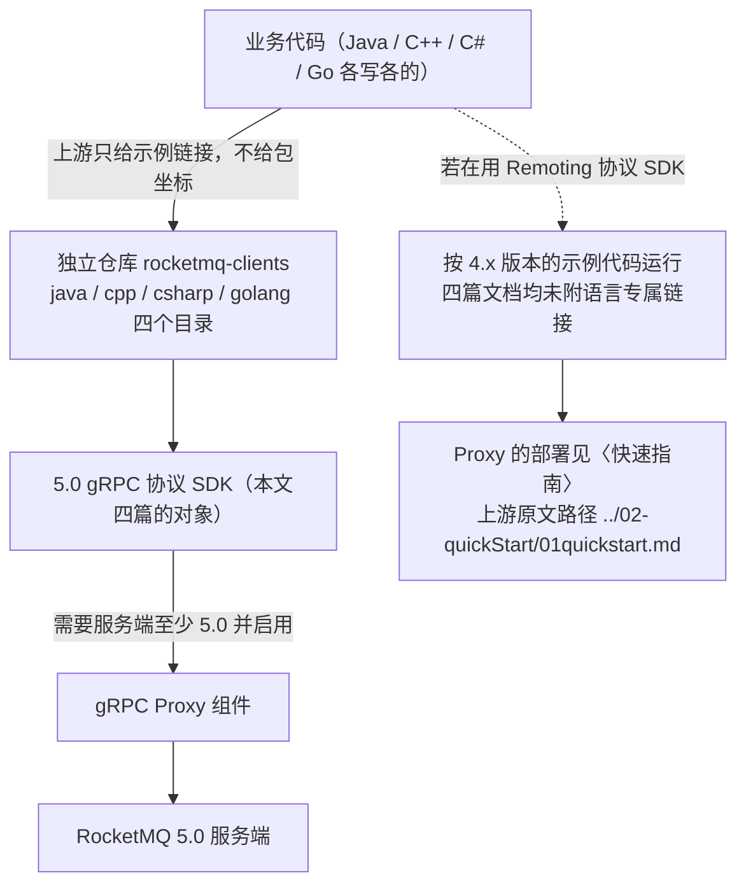
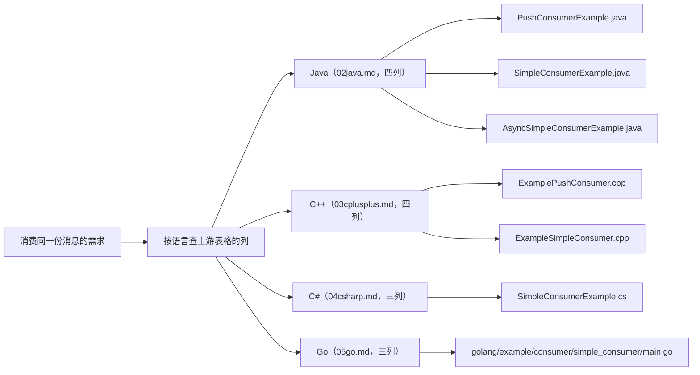

## 为什么需要「先按语言核对客户端能力」？（痛点引入）

同一套 Apache RocketMQ 5.0 服务端，摆在四种语言面前的**不是一份客户端，而是四份互不相同的客户端**。上游 5.0 文档为 Java、C++、C#、Go 各写了一篇 SDK 文档，四篇的结构一模一样（版本说明 + 示例代码表格），但表格的**列数、行数、链接锚定**都不一样。不看这四张表就动手选型，会发生下面这些真实事故：

1. **按 Java 的经验给 C# 团队排期**。C# 那篇的表格只有三列（消息类型 / 发送消息示例 / SimpleConsumer 消费消息示例），**没有 PushConsumer 这一列**；Java 与 C++ 的表格是四列，PushConsumer 列在普通、顺序、定时/延时、事务四行里都给了示例链接。C# 同学照着 Java 的「注册监听器就完事」的模型写，会发现上游根本没给可对照的 PushConsumer 示例。
2. **按 Java 的异步订阅经验给 C++/C# 团队承诺工期**。只有 Java 那篇同时给出「同步订阅：SimpleConsumerExample.java」和「异步订阅：AsyncSimpleConsumerExample.java」；C++ 只有 `ExampleSimpleConsumer.cpp`，C# 只有 `SimpleConsumerExample.cs`，Go 只有 `consumer/simple_consumer/main.go`——异步订阅形态上游只记载在 Java。
3. **复制链接时踩到「文件名对不上」**。Go 那篇的链接文字写作 `ExampleProducerNormalMessage.go`，但链接实际指向的是 `golang/example/producer/normal/main.go`；六个 Go 链接的 URL 末段全是 `main.go`。按链接文字去本地目录里找文件，一定找不到。
4. **以为四种语言的示例都指向同一个代码版本**。Java、C++、C# 的示例链接锚在 `master`；Go 的六个链接全部锚在 `rocketmq-client-golang-5.0.0`。同一时间点开两类链接，看到的代码不保证是同一份。
5. **在 4.x 服务端上直接跑 gRPC 示例**。四篇文档的提示框第一条写的是同一句话：本示例代码基于 gRPC 协议 SDK 构建，因此需要服务端至少升级到 5.0 版本，并启用 gRPC Proxy 才可兼容。四种语言在这一条上没有任何豁免。

| 维度 | 没有「语言 × 能力」核对表时的痛苦 | 有核对表之后 |
|------|----------------------------------|--------------|
| 选型判断 | 以为「官方支持四种语言」= 四种语言能力等价 | 看清上游每种语言各给了哪些形态的示例 |
| 排期承诺 | 把 Java 有的异步订阅当成四种语言都有 | 只有 Java 记载了异步订阅示例，其余标为上游未记载 |
| 找示例代码 | 按链接文字在仓库里找 `ExampleProducerNormalMessage.go` | 按 URL 原文找 `golang/example/producer/normal/main.go` |
| 版本复现 | 直接抄 `master` 链接，第二天内容漂移 | 知道 Go 锚在 `rocketmq-client-golang-5.0.0`，其余锚在 `master` |
| 服务端前提 | 只在 Java 文档里看到「需要 5.0 + Proxy」，以为其它语言宽松 | 四篇原文该句完全一致，任何语言都需要 |
| 缺失能力 | 拿「同类 SDK 一般有 Pull 接口」推定 | 明确写「上游未记载」，改去站内消费模型文档查证 |

> ### 💡 新人小结：四种语言客户端，像同一家连锁店的四家分店
>
> 把 `rocketmq-clients` 想象成一家连锁餐厅，Java、C++、C#、Go 是四家分店：
>
> - 后厨菜谱是同一份（四种语言的示例都来自同一个仓库，都按 5.0 gRPC 协议这套菜谱做），所以主菜（普通/顺序/定时/事务四种消息类型）家家都有。
> - 但**菜单印得不一样**：Java 与 C++ 的菜单上有「PushConsumer」这一栏，C# 与 Go 的菜单上这一栏整列缺失——不是厨师不会做，是菜单没写。
> - Go 分店贴的是**指定批次的原料单**（锚在 `rocketmq-client-golang-5.0.0`），另外三家贴的是「当日最新」（锚在 `master`）。
> - 四家门口的告示一字不差：本店只做 5.0 的菜品，服务端没升到 5.0、没开 gRPC Proxy，就别下单。
>
> **一句话总结：读多语言 SDK 文档，要读的是「四张表相不相同」，不是「支持哪些语言」。**

**学习路线图**

```text
痛点引入 → 共同底盘 → Java → C++ → C# → Go → 语言×能力矩阵 → 选型建议 → 排查清单
为什么要比  四篇一致处  四列全  Push有  仅Simple  锚定不同   空白格判定    按栈决策    缺项去哪查
```

**本文覆盖与不覆盖的范围（显式声明，避免读到一半找不到）**

| 项目 | 本文是否覆盖 | 说明 |
|------|--------------|------|
| 四种语言的仓库地址、版本说明、协议支持、示例链接 | 覆盖，且逐项落地 | 来源为 5.0 的四篇 SDK 文档 |
| Remoting 协议与 gRPC 协议的演进历史、兼容矩阵、选型问答 | 不重复论证 | 统一见〈[4.x 与 5.0 的差异及迁移选型](/docs/01-overview/版本演进与限制/4x与5x差异及迁移选型/)〉 |
| 4.x 的 Java 客户端代码（`DefaultMQProducer`、`DefaultMQPushConsumer` 等） | 只做命名对照，不重复贴代码 | 完整代码已收录在〈[领域模型全景与通信方式](/docs/02-core-concepts/领域模型/领域模型全景与通信方式/)〉 |
| 各消息类型的机制、限制与发送代码 | 不覆盖 | 见〈普通消息与定时延时消息〉〈顺序消息〉〈事务消息〉 |
| 消息过滤（Tag/SQL92）、消费者类型与推拉模型 | 不覆盖 | 见〈消息过滤Tag与SQL92〉〈消费者类型与推拉模型〉 |
| Maven 坐标、NuGet 包名、vcpkg/CMake、Go module 的具体取值 | 不提供 | 四篇源文件均未给出任何包坐标，本文不编造 |

---

## 术语表（先解释后使用）

| 术语 | 全称 | 通俗含义（用自己的话） | 在本文中的角色 |
|------|------|------------------------|----------------|
| SDK | Software Development Kit，客户端开发包 | 业务代码里用来收发消息的那套库 | 本文比较的就是四种语言各自的 SDK |
| gRPC | Google Remote Procedure Call，跨语言远程过程调用框架 | 用统一接口定义生成多种语言客户端的通信方案 | 四篇源文档全部以 5.0 gRPC 协议 SDK 为对象 |
| Remoting 协议 | RocketMQ 自研的远程通信协议 | 早期客户端与服务端之间用的那套协议 | 四篇文档都用同一句话把它指回 4.x 示例 |
| Proxy | 代理层（服务端组件） | 5.0 服务端上接收 gRPC 客户端连接的入口组件 | 四篇文档一致声明「启用 gRPC Proxy 才可兼容」 |
| Producer | 生产者 | 发消息的运行实体 | 四种语言的表格都有「发送消息示例」列 |
| PushConsumer | 推式消费者 | 注册监听器、由 SDK 回调处理消息的消费者形态 | 上游只在 Java、C++ 两张表里给它单列了示例 |
| SimpleConsumer | 简易消费者 | 业务自己调用取消息接口并确认的消费者形态 | 四种语言的表格都有它的示例列 |
| PullConsumer | 拉取式消费者 | 按队列与位点主动拉消息的消费者形态 | 四篇源文档均未出现，本文一律记「上游未记载」 |
| 消息类型 | 普通 / 顺序 / 定时（延时）/ 事务 | 上游四张表的四行，就是这四种 | 矩阵表的行判据全部来自这四行 |
| 仓库锚定（ref） | GitHub 链接中 `blob/` 之后那一段 | 决定你打开链接看到的是哪个代码版本 | Java/C++/C# 为 `master`，Go 为 `rocketmq-client-golang-5.0.0` |
| Maven 坐标 | groupId 与 artifactId 加版本号 | Java 项目声明依赖时写的那三行 | 本文的「上游未给出」典型样本：四篇都没有坐标 |
| NuGet | .NET 的包管理器与包仓库 | C# 项目安装依赖的渠道 | 同上，上游未给出 C# 包名 |
| vcpkg | Microsoft 维护的 C/C++ 包管理器 | C++ 项目拉第三方库的渠道之一 | 同上，上游未给出 C++ 安装方式 |
| CMake | 跨平台的构建配置工具 | C++ 用它描述依赖与编译目标 | 上游只说「参照 rocketmq-clients 配置运行」，未给 CMake 片段 |
| Go module | Go 的依赖声明机制（`go.mod` 里的模块路径） | Go 项目引用第三方库的写法 | 上游未给出模块路径，只给出示例文件的仓库内链接 |
| RocketMQ API | `rocketmq-apis` 协议接口约定 | 定义各语言 SDK 应有哪些接口与字段 | 用于解释为何四种语言的消息类型行完全一致 |
| SQL92 | Structured Query Language 1992 | 用类 SQL 表达式过滤消息 | 本文只在「上游未记载」行提到它 |
| ACL | Access Control List，访问控制列表 | 客户端连接服务端的权限控制 | 四篇源文档未涉及凭据配置，本文不展开 |

---

## 四篇源文档的共同底盘：先统一，再谈差异

四篇文档（`02java.md`、`03cplusplus.md`、`04csharp.md`、`05go.md`）的**非表格部分逐字相同**，只有语言名不同。原文照抄如下（把 `{语言}` 换成 Java、C++、C#、Go 即为对应文件的原文）：

```text
# {语言} 客户端

## 版本说明
本章节介绍使用 Apache RocketMQ 5.0 gRPC 协议 {语言} SDK 收发消息。

:::info
- 本示例代码基于gRPC 协议 SDK 构建，因此需要服务端至少升级到5.0版本，并启用 gRPC Proxy 才可兼容。
  关于Proxy的部署参考「快速指南」（上游原文链接 `../02-quickStart/01quickstart.md`）。
- 如果您使用的是 Remoting 协议 SDK，建议参考之前4.x 版本的示例代码即可运行.
  如何识别您使用的 SDK 类型，参考「概览」（上游原文链接 `./01overview.md`）。
:::

## 示例代码
下面给出 Apache RocketMQ gRPC 协议 {语言} SDK的消息收发示例代码链接，完整代码工程和运行环境，
参照[rocketmq-clients](https://github.com/apache/rocketmq-clients) 配置运行。
```

上述引文是四篇源文件公共段落的**原文照抄**：原文每条 info 提示是单行，此处为便于阅读做了换行，未改动任何字词；`{语言}` 依次替换为 Java、C++、C#、Go 即为对应文件的原句，链接路径也保持上游写法（`../02-quickStart/01quickstart.md`、`./01overview.md`、`https://github.com/apache/rocketmq-clients`）。

这段共同文字给出三条对四种语言同时成立的事实，后文所有结论都建立在它们之上：

| 事实 | 原文依据 | 对选型的影响 |
|------|----------|--------------|
| 版本口径是 5.0 gRPC 协议 SDK | 四篇「版本说明」首句 | 不存在「某语言可以按 4.x 口径读这四篇」的余地 |
| 服务端至少要 5.0，且要启用 gRPC Proxy | 四篇 info 框第一条同一句 | 服务端不达标时，四种语言的示例一个都跑不起来 |
| 完整工程与运行环境一律参照 `rocketmq-clients` 仓库 | 四篇「示例代码」引导句同一句 | 安装方式、依赖坐标、运行参数都要回仓库取，本文不猜 |

> [!NOTE] 版本适用：本板块四篇源文件全部是 5.0 口径
> 四篇文档对 Remoting 协议 SDK 只有一句话的处理：「建议参考之前 4.x 版本的示例代码即可运行」，并**没有为 Java、C++、C#、Go 分别给出 Remoting 示例链接**。因此本文里凡是标注「上游未记载」的格子，含义是这四篇 5.0 文档没写，而不是该能力不存在。如何识别自己用的是 Remoting 还是 gRPC 协议 SDK、两代协议的兼容矩阵与选型问答，统一见〈[4.x 与 5.0 的差异及迁移选型](/docs/01-overview/版本演进与限制/4x与5x差异及迁移选型/)〉，本文不重复论证。

下图是这四篇文档共同描述的分流关系：同一份业务诉求，落到两种协议上走的是两条完全不同的路，而本文的四篇源文件只覆盖左边那条。



图后解读，三点：

1. **gRPC 这条实线是本文的全部内容**：四种语言的示例都指向 `rocketmq-clients` 这一个仓库的四个语言目录，且都必须服务端 5.0 + gRPC Proxy。
2. **Remoting 这条虚线是本文的边界**：上游对它只留了一句话，没有链接、没有坐标、没有示例文件名，所以本文不能替它补任何 API。
3. **`快速指南` 这个链接在四篇里各出现一次**，路径同为 `../02-quickStart/01quickstart.md`；本站对应〈[本地二进制部署与消息收发](/docs/03-quickstart/单机部署/本地二进制部署与消息收发/)〉，Proxy 怎么起来要去那里看。

> ### 💡 新人小结：为什么四种语言都能讲同一句「要 5.0 + Proxy」？
>
> 把 `rocketmq-apis` 想成总店下发的**同一张点单模板**：
>
> - 模板只有一份，所以 Java、C++、C#、Go 四家分店印出来的「消息类型」四行完全一致（普通、顺序、定时/延时、事务）。
> - 但**接单窗口是新装的**（gRPC Proxy）：老门店没开这个窗口，任何分店递进来的单子都被退回。
> - 分店各自装修进度不同，于是菜单栏目数会差（C# 与 Go 的菜单没有 PushConsumer 这一栏）。
>
> **共同底盘说明「协议与版本」是统一的；差异全部出现在「每种语言给了哪些示例」这一层。**

---

## Java 客户端

### 仓库与坐标

| 项目 | 上游记载内容 | 来源 |
|------|--------------|------|
| 仓库地址 | `https://github.com/apache/rocketmq-clients` | `02java.md`「示例代码」引导句 |
| 示例代码目录 | `java/client/src/main/java/org/apache/rocketmq/client/java/example/` | 该文件全部链接的 URL 公共前缀 |
| 链接锚定 | `master` | 全部 8 个示例链接的 URL 形如 `blob/master/java/client/src/main/java/org/apache/rocketmq/client/java/example/` 加文件名 |
| Maven 坐标 | 上游未给出（无 groupId、artifactId、版本号） | `02java.md` 全文未出现坐标 |
| 安装/构建方式 | 上游未展开，只写「完整代码工程和运行环境，参照 rocketmq-clients 配置运行」 | 同上 |

### 版本状态与协议支持

- 版本口径：Apache RocketMQ 5.0 gRPC 协议 Java SDK（原文首句）。
- 服务端前提：服务端至少升级到 5.0 版本，并启用 gRPC Proxy 才可兼容。
- Remoting 协议 SDK：上游只建议参考 4.x 版本示例代码，未给 Java 专属链接。

### 示例代码获取方式（上游表格逐行保留，8 个链接全部落地）

| 消息类型（上游行名） | 发送消息示例 | PushConsumer 消费消息示例 | SimpleConsumer 消费消息示例 |
|----------------------|--------------|----------------------------|------------------------------|
| [普通消息](/docs/04-message-features/消息类型/普通消息与定时延时消息/) | 同步发送：[ProducerNormalMessageExample.java](https://github.com/apache/rocketmq-clients/blob/master/java/client/src/main/java/org/apache/rocketmq/client/java/example/ProducerNormalMessageExample.java)<br>异步发送：[AsyncProducerExample.java](https://github.com/apache/rocketmq-clients/blob/master/java/client/src/main/java/org/apache/rocketmq/client/java/example/AsyncProducerExample.java) | [PushConsumerExample.java](https://github.com/apache/rocketmq-clients/blob/master/java/client/src/main/java/org/apache/rocketmq/client/java/example/PushConsumerExample.java) | 同步订阅：[SimpleConsumerExample.java](https://github.com/apache/rocketmq-clients/blob/master/java/client/src/main/java/org/apache/rocketmq/client/java/example/SimpleConsumerExample.java)<br>异步订阅：[AsyncSimpleConsumerExample.java](https://github.com/apache/rocketmq-clients/blob/master/java/client/src/main/java/org/apache/rocketmq/client/java/example/AsyncSimpleConsumerExample.java) |
| [顺序消息](/docs/04-message-features/消息类型/顺序消息/) | [ProducerFifoMessageExample.java](https://github.com/apache/rocketmq-clients/blob/master/java/client/src/main/java/org/apache/rocketmq/client/java/example/ProducerFifoMessageExample.java) | [PushConsumerExample.java](https://github.com/apache/rocketmq-clients/blob/master/java/client/src/main/java/org/apache/rocketmq/client/java/example/PushConsumerExample.java) | 同步订阅：[SimpleConsumerExample.java](https://github.com/apache/rocketmq-clients/blob/master/java/client/src/main/java/org/apache/rocketmq/client/java/example/SimpleConsumerExample.java)<br>异步订阅：[AsyncSimpleConsumerExample.java](https://github.com/apache/rocketmq-clients/blob/master/java/client/src/main/java/org/apache/rocketmq/client/java/example/AsyncSimpleConsumerExample.java) |
| [定时/延时消息](/docs/04-message-features/消息类型/普通消息与定时延时消息/) | [ProducerDelayMessageExample.java](https://github.com/apache/rocketmq-clients/blob/master/java/client/src/main/java/org/apache/rocketmq/client/java/example/ProducerDelayMessageExample.java) | [PushConsumerExample.java](https://github.com/apache/rocketmq-clients/blob/master/java/client/src/main/java/org/apache/rocketmq/client/java/example/PushConsumerExample.java) | 同步订阅：[SimpleConsumerExample.java](https://github.com/apache/rocketmq-clients/blob/master/java/client/src/main/java/org/apache/rocketmq/client/java/example/SimpleConsumerExample.java)<br>异步订阅：[AsyncSimpleConsumerExample.java](https://github.com/apache/rocketmq-clients/blob/master/java/client/src/main/java/org/apache/rocketmq/client/java/example/AsyncSimpleConsumerExample.java) |
| [事务消息](/docs/04-message-features/消息类型/事务消息/) | [ProducerTransactionMessageExample.java](https://github.com/apache/rocketmq-clients/blob/master/java/client/src/main/java/org/apache/rocketmq/client/java/example/ProducerTransactionMessageExample.java) | [PushConsumerExample.java](https://github.com/apache/rocketmq-clients/blob/master/java/client/src/main/java/org/apache/rocketmq/client/java/example/PushConsumerExample.java) | 同步订阅：[SimpleConsumerExample.java](https://github.com/apache/rocketmq-clients/blob/master/java/client/src/main/java/org/apache/rocketmq/client/java/example/SimpleConsumerExample.java)<br>异步订阅：[AsyncSimpleConsumerExample.java](https://github.com/apache/rocketmq-clients/blob/master/java/client/src/main/java/org/apache/rocketmq/client/java/example/AsyncSimpleConsumerExample.java) |

上游链接原文（可复制，8 条 URL 逐条列出，与表格一一对应）：

```text
https://github.com/apache/rocketmq-clients/blob/master/java/client/src/main/java/org/apache/rocketmq/client/java/example/ProducerNormalMessageExample.java
https://github.com/apache/rocketmq-clients/blob/master/java/client/src/main/java/org/apache/rocketmq/client/java/example/AsyncProducerExample.java
https://github.com/apache/rocketmq-clients/blob/master/java/client/src/main/java/org/apache/rocketmq/client/java/example/ProducerFifoMessageExample.java
https://github.com/apache/rocketmq-clients/blob/master/java/client/src/main/java/org/apache/rocketmq/client/java/example/ProducerDelayMessageExample.java
https://github.com/apache/rocketmq-clients/blob/master/java/client/src/main/java/org/apache/rocketmq/client/java/example/ProducerTransactionMessageExample.java
https://github.com/apache/rocketmq-clients/blob/master/java/client/src/main/java/org/apache/rocketmq/client/java/example/PushConsumerExample.java
https://github.com/apache/rocketmq-clients/blob/master/java/client/src/main/java/org/apache/rocketmq/client/java/example/SimpleConsumerExample.java
https://github.com/apache/rocketmq-clients/blob/master/java/client/src/main/java/org/apache/rocketmq/client/java/example/AsyncSimpleConsumerExample.java
```

### 最小可运行示例：上游以仓库示例为准

**上游 `02java.md` 只给出上面这 8 个链接，没有内联任何 Java 代码，也没有给出包坐标。**因此本文不臆造 API 调用序列（不写 `ClientServiceProvider.loadService()` 之类的调用链），落地方式只有一条：按上游链接进仓库读示例文件。下面这段命令是可运行的，作用是**把「上游表格里的每一项」变成你本地可核对的一行**：

```bash
# ========== ✅ 推荐写法：先克隆，再按上游链接原文逐项核对 ==========
git clone https://github.com/apache/rocketmq-clients     # 仓库地址照抄上游四篇文档共同的引导句
cd rocketmq-clients
git ls-files 'java/client/src/main/java/org/apache/rocketmq/client/java/example/' \
  | grep -E 'ProducerNormalMessageExample|AsyncProducerExample|ProducerFifoMessageExample|ProducerDelayMessageExample|ProducerTransactionMessageExample|PushConsumerExample|SimpleConsumerExample|AsyncSimpleConsumerExample'
# 输出: 上面 8 个示例文件名对应的文件路径各一行（文件名逐条取自上游链接原文）

# ========== 不推荐写法（仅展示） ==========
# ❌ 凭 Java 4.x 的类名去 5.0 gRPC 示例里找 DefaultMQProducer：
#    DefaultMQProducer 属于 4.x Remoting 口径（其完整代码已收录在〈领域模型全景与通信方式〉），
#    上游 02java.md 通篇只出现 ProducerNormalMessageExample.java 这类示例文件名，二者不是同一套代码。
```

参数解释：`git ls-files` 后面那串是**上游 8 条 URL 去掉仓库前缀后的目录路径**，一字未改；`grep -E` 的十个候选串就是上游表格里出现过的示例文件名（含 PushConsumer 与 SimpleConsumer 两列）。跑不出对应行，说明你本地检出的代码版本与上游链接锚定的 `master` 有差异，此时以链接打开的网页版本为准，不要去改文件名硬凑。

### 与 4.x Java 用法的命名对照（只对照，不重复贴代码）

| 对照项 | 4.x Remoting 口径（另一篇文档已收录完整代码） | 5.0 gRPC 口径（上游 `02java.md` 的记载方式） |
|--------|-----------------------------------------------|----------------------------------------------|
| 生产者 | 类名 `DefaultMQProducer`（构造时传生产者组名） | 上游只给示例文件名 `ProducerNormalMessageExample.java`、`AsyncProducerExample.java` 等，未给类名 |
| 推式消费者 | 类名 `DefaultMQPushConsumer`、监听器 `MessageListenerConcurrently` | 上游给 `PushConsumerExample.java` 一个文件，四种消息类型行共用 |
| 简易/拉取消费者 | `LitePullConsumer`、`DefaultPullConsumer` | 上游给 `SimpleConsumerExample.java` 与 `AsyncSimpleConsumerExample.java`，未提 Pull 形态 |
| 依赖声明 | 上游 4.x 文档在别处给出坐标 | 上游 `02java.md` 未给 Maven 坐标 |
| 代码位置 | 与主仓库同步演进 | 独立仓库 `rocketmq-clients` 的 `java/` 目录，锚定 `master` |

这一层的语义差异（生产者匿名、消费组统一配置、负载均衡粒度等）属〈4.x 与 5.0 的差异及迁移选型〉，本文不重复。

---

## C++ 客户端

### 仓库与坐标

| 项目 | 上游记载内容 | 来源 |
|------|--------------|------|
| 仓库地址 | `https://github.com/apache/rocketmq-clients` | `03cplusplus.md`「示例代码」引导句 |
| 示例代码目录 | `cpp/examples/` | 该文件全部链接的 URL 公共前缀 |
| 链接锚定 | `master` | 全部 7 个示例链接的 URL 形如 `blob/master/cpp/examples/` 加文件名 |
| vcpkg / CMake 用法 | 上游未给出（既无包名，也无 CMake 片段） | `03cplusplus.md` 全文未出现安装配置内容 |

### 版本状态与协议支持

与 Java 完全一致：5.0 gRPC 协议 C++ SDK；服务端至少 5.0 并启用 gRPC Proxy；Remoting 协议 SDK 按 4.x 示例运行，上游未给 C++ 专属链接。

### 示例代码获取方式（上游表格逐行保留，7 个链接全部落地）

| 消息类型（上游行名） | 发送消息示例 | PushConsumer 消费消息示例 | SimpleConsumer 消费消息示例 |
|----------------------|--------------|----------------------------|------------------------------|
| [普通消息](/docs/04-message-features/消息类型/普通消息与定时延时消息/) | 同步发送：[ExampleProducer.cpp](https://github.com/apache/rocketmq-clients/blob/master/cpp/examples/ExampleProducer.cpp)<br>异步发送：[ExampleProducerWithAsync.cpp](https://github.com/apache/rocketmq-clients/blob/master/cpp/examples/ExampleProducerWithAsync.cpp) | [ExamplePushConsumer.cpp](https://github.com/apache/rocketmq-clients/blob/master/cpp/examples/ExamplePushConsumer.cpp) | [ExampleSimpleConsumer.cpp](https://github.com/apache/rocketmq-clients/blob/master/cpp/examples/ExampleSimpleConsumer.cpp) |
| [顺序消息](/docs/04-message-features/消息类型/顺序消息/) | [ExampleProducerWithFifoMessage.cpp](https://github.com/apache/rocketmq-clients/blob/master/cpp/examples/ExampleProducerWithFifoMessage.cpp) | [ExamplePushConsumer.cpp](https://github.com/apache/rocketmq-clients/blob/master/cpp/examples/ExamplePushConsumer.cpp) | [ExampleSimpleConsumer.cpp](https://github.com/apache/rocketmq-clients/blob/master/cpp/examples/ExampleSimpleConsumer.cpp) |
| [定时/延时消息](/docs/04-message-features/消息类型/普通消息与定时延时消息/) | [ExampleProducerWithTimedMessage.cpp](https://github.com/apache/rocketmq-clients/blob/master/cpp/examples/ExampleProducerWithTimedMessage.cpp) | [ExamplePushConsumer.cpp](https://github.com/apache/rocketmq-clients/blob/master/cpp/examples/ExamplePushConsumer.cpp) | [ExampleSimpleConsumer.cpp](https://github.com/apache/rocketmq-clients/blob/master/cpp/examples/ExampleSimpleConsumer.cpp) |
| [事务消息](/docs/04-message-features/消息类型/事务消息/) | [ExampleProducerWithTransactionalMessage.cpp](https://github.com/apache/rocketmq-clients/blob/master/cpp/examples/ExampleProducerWithTransactionalMessage.cpp) | [ExamplePushConsumer.cpp](https://github.com/apache/rocketmq-clients/blob/master/cpp/examples/ExamplePushConsumer.cpp) | [ExampleSimpleConsumer.cpp](https://github.com/apache/rocketmq-clients/blob/master/cpp/examples/ExampleSimpleConsumer.cpp) |

上游链接原文（7 条 URL 逐条列出）：

```text
https://github.com/apache/rocketmq-clients/blob/master/cpp/examples/ExampleProducer.cpp
https://github.com/apache/rocketmq-clients/blob/master/cpp/examples/ExampleProducerWithAsync.cpp
https://github.com/apache/rocketmq-clients/blob/master/cpp/examples/ExampleProducerWithFifoMessage.cpp
https://github.com/apache/rocketmq-clients/blob/master/cpp/examples/ExampleProducerWithTimedMessage.cpp
https://github.com/apache/rocketmq-clients/blob/master/cpp/examples/ExampleProducerWithTransactionalMessage.cpp
https://github.com/apache/rocketmq-clients/blob/master/cpp/examples/ExamplePushConsumer.cpp
https://github.com/apache/rocketmq-clients/blob/master/cpp/examples/ExampleSimpleConsumer.cpp
```

### 最小可运行示例：上游以仓库示例为准

同样地，**`03cplusplus.md` 只给链接、不给代码、不给安装方式**。上游表格有两处细节值得照抄进选型笔记：其一，定时/延时这一行用的文件名是 `ExampleProducerWithTimedMessage.cpp`（Timed），与事务行的 `Transactional` 是两个不同拼写，不要互相改名找文件；其二，SimpleConsumer 一列四行共用同一个 `ExampleSimpleConsumer.cpp`，上游**没有**给 C++ 的异步订阅示例（Java 有 `AsyncSimpleConsumerExample.java`）。

```bash
# ========== ✅ 推荐：把上游 cpp 表格里的 7 个文件名一次核对完 ==========
cd rocketmq-clients
git ls-files 'cpp/examples/' | grep -E 'ExampleProducer\.cpp|ExampleProducerWithAsync|WithFifoMessage|WithTimedMessage|WithTransactionalMessage|ExamplePushConsumer|ExampleSimpleConsumer'
# 输出: cpp/examples/ 下 7 个示例文件路径各一行，名称与上游 7 条 URL 的末段完全一致

# ========== 不推荐写法（仅展示） ==========
# ❌ 假设 C++ 与 Java 一样有 AsyncSimpleConsumer 示例：上游 cpp 表格没有这个文件，
#    要异步订阅形态请回到 02java.md 的 AsyncSimpleConsumerExample.java，或自行按仓库示例改。
```

参数解释：`grep -E` 里 `ExampleProducer\.cpp` 用了转义点号，否则会把 `ExampleProducerWithAsync.cpp` 也算命中——这条命令的作用是把「上游表格里的 7 项」和「你检出的代码」做集合比对，缺项即说明锚定版本不一致。

---

## C# 客户端

### 仓库与坐标

| 项目 | 上游记载内容 | 来源 |
|------|--------------|------|
| 仓库地址 | `https://github.com/apache/rocketmq-clients` | `04csharp.md`「示例代码」引导句 |
| 示例代码目录 | `csharp/examples/` | 该文件全部链接的 URL 公共前缀 |
| 链接锚定 | `master` | 全部 5 个示例链接的 URL 形如 `blob/master/csharp/examples/` 加文件名 |
| NuGet 包名与版本 | 上游未给出 | `04csharp.md` 全文未出现包名 |

### 版本状态与协议支持

与前两篇一致：5.0 gRPC 协议 C# SDK；服务端至少 5.0 并启用 gRPC Proxy；Remoting 协议 SDK 按 4.x 示例运行，上游未给 C# 专属链接。

### 示例代码获取方式（上游表格逐行保留，5 个链接全部落地）

C# 的表格**只有三列**：消息类型、发送消息示例、SimpleConsumer 消费消息示例；上游没有为 C# 写 PushConsumer 列。

| 消息类型（上游行名） | 发送消息示例 | SimpleConsumer 消费消息示例 |
|----------------------|--------------|------------------------------|
| [普通消息](/docs/04-message-features/消息类型/普通消息与定时延时消息/) | [ProducerNormalMessageExample.cs](https://github.com/apache/rocketmq-clients/blob/master/csharp/examples/ProducerNormalMessageExample.cs) | [SimpleConsumerExample.cs](https://github.com/apache/rocketmq-clients/blob/master/csharp/examples/SimpleConsumerExample.cs) |
| [顺序消息](/docs/04-message-features/消息类型/顺序消息/) | [ProducerFifoMessageExample.cs](https://github.com/apache/rocketmq-clients/blob/master/csharp/examples/ProducerFifoMessageExample.cs) | [SimpleConsumerExample.cs](https://github.com/apache/rocketmq-clients/blob/master/csharp/examples/SimpleConsumerExample.cs) |
| [定时/延时消息](/docs/04-message-features/消息类型/普通消息与定时延时消息/) | [ProducerDelayMessageExample.cs](https://github.com/apache/rocketmq-clients/blob/master/csharp/examples/ProducerDelayMessageExample.cs) | [SimpleConsumerExample.cs](https://github.com/apache/rocketmq-clients/blob/master/csharp/examples/SimpleConsumerExample.cs) |
| [事务消息](/docs/04-message-features/消息类型/事务消息/) | [ProducerTransactionMessageExample.cs](https://github.com/apache/rocketmq-clients/blob/master/csharp/examples/ProducerTransactionMessageExample.cs) | [SimpleConsumerExample.cs](https://github.com/apache/rocketmq-clients/blob/master/csharp/examples/SimpleConsumerExample.cs) |

上游链接原文（5 条 URL 逐条列出）：

```text
https://github.com/apache/rocketmq-clients/blob/master/csharp/examples/ProducerNormalMessageExample.cs
https://github.com/apache/rocketmq-clients/blob/master/csharp/examples/ProducerFifoMessageExample.cs
https://github.com/apache/rocketmq-clients/blob/master/csharp/examples/ProducerDelayMessageExample.cs
https://github.com/apache/rocketmq-clients/blob/master/csharp/examples/ProducerTransactionMessageExample.cs
https://github.com/apache/rocketmq-clients/blob/master/csharp/examples/SimpleConsumerExample.cs
```

### 最小可运行示例：上游以仓库示例为准

C# 表格有两个「与 Java 不同」的地方必须如实记录：

1. 发送列**没有出现「同步发送 / 异步发送」的标注**——Java 与 C++ 的普通消息行都写了这两个标注，C# 四行都只给一个文件名。这不代表 C# 没有异步发送能力，只代表**上游这篇文档未记载**。
2. 四种消息类型的示例文件名与 Java 的 `ProducerXxxExample.java` 一一对应（Normal / Fifo / Delay / Transaction，扩展名换成 `.cs`）；消费端只有 `SimpleConsumerExample.cs` 一个文件被四行共用。

```bash
# ========== ✅ 推荐：核对 csharp 表格里的 5 个文件名 ==========
cd rocketmq-clients
git ls-files 'csharp/examples/' | grep -E 'ProducerNormalMessageExample|ProducerFifoMessageExample|ProducerDelayMessageExample|ProducerTransactionMessageExample|SimpleConsumerExample'
# 输出: csharp/examples/ 下 5 个 .cs 示例文件路径各一行

# ========== 不推荐写法（仅展示） ==========
# ❌ 因为「Java 表格里有 PushConsumer 列」就假设 C# 也有：上游 04csharp.md 的表格没有这一列，
#    给不出 C# 的 PushConsumer 示例文件名，也就给不出可照抄的调用序列。
```

参数解释：这里刻意只用 `git ls-files` 列文件、不猜任何 C# 类名或方法名——上游未给出 C# 的命名空间与包名，任何 `using` 语句都写不出来。缺文件时以链接打开的网页版为准。

---

## Go 客户端

### 仓库与坐标

| 项目 | 上游记载内容 | 来源 |
|------|--------------|------|
| 仓库地址 | `https://github.com/apache/rocketmq-clients` | `05go.md`「示例代码」引导句 |
| 示例代码目录 | `golang/example/producer/normal/main.go`、`golang/example/producer/async/main.go`、`golang/example/producer/fifo/main.go`、`golang/example/producer/delay/main.go`、`golang/example/producer/transaction/main.go`、`golang/example/consumer/simple_consumer/main.go` | 该文件全部链接去掉仓库前缀后的原文路径 |
| 链接锚定 | `rocketmq-client-golang-5.0.0`（六条 URL 全部锚定此引用；上游未说明它是分支还是标签） | `05go.md` 全部示例链接 |
| Go module 路径 | 上游未给出 | `05go.md` 全文未出现 `go.mod` 或模块路径 |

### 版本状态与协议支持

与前三篇一致：5.0 gRPC 协议 Go SDK；服务端至少 5.0 并启用 gRPC Proxy；Remoting 协议 SDK 按 4.x 示例运行，上游未给 Go 专属链接。

### 示例代码获取方式（上游表格逐行保留，6 个链接全部落地）

Go 的表格与 C# 一样**只有三列**（无 PushConsumer 列）。注意上游的**链接文字与 URL 末段文件名不一致**：链接写作 `ExampleXxx.go`，URL 实际指向 `main.go`。下表同时保留两者。

| 消息类型（上游行名） | 发送消息示例（链接文字 → URL 末段） | SimpleConsumer 消费消息示例 |
|----------------------|--------------------------------------|------------------------------|
| [普通消息](/docs/04-message-features/消息类型/普通消息与定时延时消息/) | 同步发送：[ExampleProducerNormalMessage.go](https://github.com/apache/rocketmq-clients/blob/rocketmq-client-golang-5.0.0/golang/example/producer/normal/main.go)<br>异步发送：[AsyncExampleProducerNormalMessage.go](https://github.com/apache/rocketmq-clients/blob/rocketmq-client-golang-5.0.0/golang/example/producer/async/main.go) | [ExampleSimpleConsumer.go](https://github.com/apache/rocketmq-clients/blob/rocketmq-client-golang-5.0.0/golang/example/consumer/simple_consumer/main.go) |
| [顺序消息](/docs/04-message-features/消息类型/顺序消息/) | [ExampleProducerWithFifoMessage.go](https://github.com/apache/rocketmq-clients/blob/rocketmq-client-golang-5.0.0/golang/example/producer/fifo/main.go) | [ExampleSimpleConsumer.go](https://github.com/apache/rocketmq-clients/blob/rocketmq-client-golang-5.0.0/golang/example/consumer/simple_consumer/main.go) |
| [定时/延时消息](/docs/04-message-features/消息类型/普通消息与定时延时消息/) | [ExampleProducerDelayMessage.go](https://github.com/apache/rocketmq-clients/blob/rocketmq-client-golang-5.0.0/golang/example/producer/delay/main.go) | [ExampleSimpleConsumer.go](https://github.com/apache/rocketmq-clients/blob/rocketmq-client-golang-5.0.0/golang/example/consumer/simple_consumer/main.go) |
| [事务消息](/docs/04-message-features/消息类型/事务消息/) | [ExampleProducerWithTransactionalMessage.go](https://github.com/apache/rocketmq-clients/blob/rocketmq-client-golang-5.0.0/golang/example/producer/transaction/main.go) | [ExampleSimpleConsumer.go](https://github.com/apache/rocketmq-clients/blob/rocketmq-client-golang-5.0.0/golang/example/consumer/simple_consumer/main.go) |

上游链接原文（6 条 URL 逐条列出）：

```text
https://github.com/apache/rocketmq-clients/blob/rocketmq-client-golang-5.0.0/golang/example/producer/normal/main.go
https://github.com/apache/rocketmq-clients/blob/rocketmq-client-golang-5.0.0/golang/example/producer/async/main.go
https://github.com/apache/rocketmq-clients/blob/rocketmq-client-golang-5.0.0/golang/example/producer/fifo/main.go
https://github.com/apache/rocketmq-clients/blob/rocketmq-client-golang-5.0.0/golang/example/producer/delay/main.go
https://github.com/apache/rocketmq-clients/blob/rocketmq-client-golang-5.0.0/golang/example/producer/transaction/main.go
https://github.com/apache/rocketmq-clients/blob/rocketmq-client-golang-5.0.0/golang/example/consumer/simple_consumer/main.go
```

### 最小可运行示例：上游以仓库示例为准

Go 是四篇里**唯一把示例链接锚到具名引用**的一篇，这带来一个实操差异：本地克隆的 `master` 里，Go 示例的内容不保证与上游链接打开时一致。核对方式要按引用检出：

```bash
# ✅ 推荐：按上游链接的锚定引用核对，而不是只看 master
cd rocketmq-clients
git ls-files 'golang/example/producer/normal/main.go' 'golang/example/producer/async/main.go' \
  'golang/example/producer/fifo/main.go' 'golang/example/producer/delay/main.go' \
  'golang/example/producer/transaction/main.go' 'golang/example/consumer/simple_consumer/main.go'
# 输出: 6 行路径，末段全部是 main.go（上游链接文字里的 ExampleXxx.go 不是文件名）

# ❌ 不推荐：用链接文字去本地找文件
#    git ls-files | grep ExampleProducerNormalMessage.go   一定搜不到，
#    因为上游 URL 指向的是 golang/example/producer/normal/main.go。
```

参数解释：六条路径就是上游 6 条 URL 去掉 `https://github.com/apache/rocketmq-clients/blob/rocketmq-client-golang-5.0.0/` 前缀后的剩余部分；要看与链接完全一致的版本，需把检出切到 `rocketmq-client-golang-5.0.0` 这个引用（它是分支还是标签，上游未说明，本文不猜）。

> ### 💡 新人小结：`master` 与 `rocketmq-client-golang-5.0.0` 的差别，像「最新菜谱」和「某批次封样菜谱」
>
> - 锚在 `master` 的链接（Java 8 条、C++ 7 条、C# 5 条）= 店里当天用的菜谱：内容会变，你今天抄的写法明天可能改。
> - 锚在 `rocketmq-client-golang-5.0.0` 的链接（Go 6 条）= 封样存档的菜谱：打开就是那一版。
> - 于是同一个仓库里，四种语言的「可复现程度」天然不等——这不是 Go 特殊，是链接锚定方式不同。
> - 复现线上问题时，先确认自己打开的是哪一版链接，再讨论 API。
>
> **一句话总结：多语言选型时，把「示例锚定」当成一项独立能力去比，它决定你排查问题时能不能还原现场。**

---

## 客户端形态的分流：四种语言各自给了哪几种消费者

下图把四篇源文档表格里的**列**原样画出来，只表达一件事：同一份「消费消息」的需求，在四种语言里可照抄的形态数量不同。C# 与 Go 的 PushConsumer 分支在图里**故意不存在**，因为上游没给。



图后解读：

| 观察点 | 图上依据 | 结论的边界 |
|--------|----------|------------|
| Java 的消费侧示例最多 | 一个语言节点分出三条边（Push、Simple、AsyncSimple） | 只说明上游给了这三个文件，不代表 Java 只有这三种形态 |
| C++ 与 Java 同样有 PushConsumer 列 | `ExamplePushConsumer.cpp` 在四行里各出现一次 | 上游只给文件名，未说明其与 Java 版行为是否逐项一致 |
| C# 与 Go 只有 SimpleConsumer | 它们的语言节点只有一条出边 | 「上游未记载」，不等于该语言 SDK 不支持 PushConsumer |
| 异步订阅只在 Java 出现 | `AsyncSimpleConsumerExample.java` | 其余三篇无对应文件，选型时不要按四语言均摊 |

---

## 语言 × 能力矩阵

判据列写「`02java.md` 表格普通消息行」这类可回溯的位置；凡是四篇都没写的，一律填「上游未记载」，不填「不支持」。

| 能力维度 | Java | C++ | C# | Go | 判据（源文件与位置） |
|----------|------|-----|----|----|----------------------|
| 普通消息发送示例 | ✅ 同步 + 异步两个文件 | ✅ 同步 + 异步两个文件 | ✅ 一个文件，无同步/异步标注 | ✅ 同步 + 异步两个文件 | 四篇表格「普通消息」行的「发送消息示例」列 |
| 顺序消息发送示例 | ✅ `ProducerFifoMessageExample.java` | ✅ `ExampleProducerWithFifoMessage.cpp` | ✅ `ProducerFifoMessageExample.cs` | ✅ `producer/fifo/main.go` | 四篇表格「顺序消息」行 |
| 定时/延时消息发送示例 | ✅ `ProducerDelayMessageExample.java` | ✅ `ExampleProducerWithTimedMessage.cpp` | ✅ `ProducerDelayMessageExample.cs` | ✅ `producer/delay/main.go` | 四篇表格「定时/延时消息」行 |
| 事务消息发送示例 | ✅ `ProducerTransactionMessageExample.java` | ✅ `ExampleProducerWithTransactionalMessage.cpp` | ✅ `ProducerTransactionMessageExample.cs` | ✅ `producer/transaction/main.go` | 四篇表格「事务消息」行 |
| PushConsumer 消费示例 | ✅ 四行均给 | ✅ 四行均给 | 上游未记载（表格无此列） | 上游未记载（表格无此列） | `02java.md`、`03cplusplus.md` 有第 3 列；`04csharp.md`、`05go.md` 表头只有三列 |
| SimpleConsumer 消费示例 | ✅ 四行均给 | ✅ 四行均给 | ✅ 四行均给 | ✅ 四行均给 | 四篇表格最后一列 |
| SimpleConsumer 异步订阅示例 | ✅ `AsyncSimpleConsumerExample.java` | 上游未记载 | 上游未记载 | 上游未记载 | 仅 `02java.md` 的 SimpleConsumer 列出现「异步订阅」标签 |
| PullConsumer / 拉取式消费示例 | 上游未记载 | 上游未记载 | 上游未记载 | 上游未记载 | 四篇均无 Pull 相关字样 |
| 批量消息发送示例 | 上游未记载 | 上游未记载 | 上游未记载 | 上游未记载 | 四篇表格行只有普通/顺序/定时（延时）/事务四种消息类型 |
| 消息过滤（Tag / SQL92）示例 | 上游未记载 | 上游未记载 | 上游未记载 | 上游未记载 | 四篇正文未出现过滤表达式；站内见〈消息过滤Tag与SQL92〉 |
| Admin / 管控类接口示例 | 上游未记载 | 上游未记载 | 上游未记载 | 上游未记载 | 四篇只有收发示例链接 |
| 包坐标（Maven / NuGet / vcpkg / Go module） | 未给出 | 未给出 | 未给出 | 未给出 | 四篇均未出现坐标，只写「参照 rocketmq-clients 配置运行」 |
| 协议 | gRPC（5.0） | gRPC（5.0） | gRPC（5.0） | gRPC（5.0） | 四篇「版本说明」首句 |
| 服务端前提 | 至少 5.0 + 启用 gRPC Proxy | 同左 | 同左 | 同左 | 四篇 info 框第一条（原文逐字一致） |
| Remoting 协议 SDK 的语言专属示例链接 | 未提供（仅建议参考 4.x 示例） | 未提供 | 未提供 | 未提供 | 四篇 info 框第二条 |
| 示例链接锚定 | `master`（8 条） | `master`（7 条） | `master`（5 条） | `rocketmq-client-golang-5.0.0`（6 条） | 各文件全部示例链接中 `blob/` 之后的一段 |
| 链接文字与 URL 文件名是否一致 | 一致 | 一致 | 一致 | 不一致（文字 `ExampleXxx.go`，URL 末段 `main.go`） | `05go.md` 六条链接逐项比对 |
| 上游给出的示例文件总数 | 8 个 | 7 个 | 5 个 | 6 个 | 各文件去重后的链接计数 |

矩阵的两条使用纪律：

1. **空白格只写「上游未记载」，不写「不支持」。**这两句话在评审里完全不同：前者是文档没写，后者是能力没有；四篇源文件短到只有版本说明加一张表，不足以支撑任何「不支持」的结论。
2. **✅ 的意思是「上游给了一个可点开的示例文件」，不是「该语言对该能力的实现与 Java 一致」。**想比对行为语义，得进仓库读示例代码本身，或看站内对应消息类型文档。

---

## 选型建议表

每条建议的「判据」列直接指回源文件的具体位置，可复核。

| 团队情况 | 建议 | 判据（出处） | 站内延伸阅读 |
|----------|------|--------------|--------------|
| Java 技术栈，要 PushConsumer 的回调式消费 | Java 最稳：上游同时给了 Push、Simple、异步 Simple 三类消费示例 | `02java.md` 表格第 3、4 列，四行均有链接 | 〈消费者类型与推拉模型〉 |
| C++ 技术栈，要 PushConsumer | C++ 可以：上游给了 `ExamplePushConsumer.cpp`，四种消息类型共用 | `03cplusplus.md` 表格「PushConsumer消费消息示例」列 | 同上 |
| C# 或 Go 技术栈，业务想要 PushConsumer | 不要假设与 Java 等价；上游这两篇的表格**没有 PushConsumer 列**，只能照 `SimpleConsumerExample.cs` / `consumer/simple_consumer/main.go` 自己组织取消息循环 | `04csharp.md`、`05go.md` 表头均为三列 | 〈消费者类型与推拉模型〉 |
| 需要「异步发送」的样例参考 | Java、C++、Go 三篇有异步发送示例；C# 篇未记载 | 各文件表格「普通消息」行的标注 | 〈普通消息与定时延时消息〉 |
| 需要「异步订阅 SimpleConsumer」的样例参考 | 只有 Java 篇给了 `AsyncSimpleConsumerExample.java` | `02java.md` SimpleConsumer 列「异步订阅」标签 | — |
| 服务端还没升到 5.0，或升了但没启用 gRPC Proxy | 四种语言的这四篇示例都不能直接跑；先解决服务端 | 四篇 info 框第一条同一句 | 〈本地二进制部署与消息收发〉 |
| 服务端是 4.x，客户端仍要用 Remoting 协议 SDK | 按上游指引参考 4.x 版本示例代码，本文这四篇不适用 | 四篇 info 框第二条 | 〈4.x 与 5.0 的差异及迁移选型〉 |
| 线上要能精确复现问题现场 | Go 篇的链接自带具名引用，最容易还原；其余三篇锚 `master`，落库时要把 URL 与检出引用一并记下 | 各文件全部链接的 `blob/` 段 | — |
| 多语言混合团队，希望各端行为一致 | 四种语言同属一个仓库、同一 gRPC 协议族，主消息类型口径一致；但消费形态与示例锚定并不对称，需按本矩阵逐格确认 | 本文「语言 × 能力矩阵」 | 〈领域模型全景与通信方式〉 |
| 需要消息过滤 / 批量 / 管控接口 | 这四篇 SDK 文档给不出判据，改查站内专题文档与仓库示例 | 四篇正文均无相关字样 | 〈消息过滤Tag与SQL92〉等 |

---

## 两种链接锚定方式的对比

| 对比维度 | 锚定 `master`（Java / C++ / C#） | 锚定 `rocketmq-client-golang-5.0.0`（Go） |
|----------|----------------------------------|--------------------------------------------|
| 上游链接数量 | 8 + 7 + 5 = 20 条 | 6 条 |
| 打开链接看到的代码 | 仓库默认分支的当前内容，会随时间变化 | 固定在该引用对应的那一版 |
| 复现线上问题时 | 需要自己记录检出提交或时间点 | 直接对照该引用即可 |
| 与本地克隆的默认分支是否一致 | 通常一致（同为默认分支视角） | 不保证一致，需切换检出 |
| 文档里要不要写死版本 | 上游未给版本号，只有引用名 | 上游在 URL 里就写了 `5.0.0` |
| 实操建议 | 把 URL 与查阅日期一起记进工单 | 落库时把引用名与 6 条路径一起记 |

---

## 排查清单：客户端症状先查哪一层

| 症状 | 先核对什么 | 判据 |
|------|------------|------|
| 客户端启动即连不上 | 服务端是否 ≥5.0、是否启用 gRPC Proxy | 四篇 info 框第一条（四语言一致） |
| 示例文件在本地找不到 | 用的是链接文字还是 URL 末段 | `05go.md`：文字 `ExampleProducerNormalMessage.go`，URL 是 `main.go` |
| 昨天能跑今天编译不过 | 是否直接跟 `master` 链接取代码 | Java / C++ / C# 三篇链接均锚 `master` |
| C# 或 Go 找不到 PushConsumer 示例 | 上游这两篇表格是否有该列 | `04csharp.md`、`05go.md` 表头三列，无 PushConsumer |
| 想要异步订阅示例却只找到 C++ 的 | 上游是否只给 Java 写了异步订阅 | `02java.md` 的 `AsyncSimpleConsumerExample.java` |
| 想按坐标引依赖却找不到坐标 | 上游这四篇是否给过任何包坐标 | 四篇均只写「参照 rocketmq-clients 配置运行」 |
| 事务消息示例文件名对不上 | 各语言命名差异 | C++ 用 `ExampleProducerWithTransactionalMessage.cpp`，Java/C# 用 `ProducerTransactionMessageExample`，Go 用 `producer/transaction/main.go` |
| 定时消息示例文件名对不上 | C++ 用 Timed 而非 Delay | `ExampleProducerWithTimedMessage.cpp` 对 `ProducerDelayMessageExample` |
| 需要过滤、批量、Pull、Admin 的判据 | 不要在这四篇里找 | 四篇均无相关字样，转站内专题文档 |

---

## 上游内部链接在本地的落点

四篇源文件除了指向 GitHub 的示例链接，还各带了指向上游站内其它页面的链接。为避免「上游链接在复刻站里失效」，逐条列出原文路径与本站对应文档。

| 上游原文路径 | 出现位置 | 上游链接文字 | 本站对应文档 |
|--------------|----------|--------------|--------------|
| `../02-quickStart/01quickstart.md` | 四篇 info 框第一条，各一次 | 快速指南 | [本地二进制部署与消息收发](/docs/03-quickstart/单机部署/本地二进制部署与消息收发/) |
| `./01overview.md` | 四篇 info 框第二条，各一次 | 概览 | [4.x 与 5.0 的差异及迁移选型](/docs/01-overview/版本演进与限制/4x与5x差异及迁移选型/) |
| `https://github.com/apache/rocketmq-clients` | 四篇「示例代码」引导句，各一次 | rocketmq-clients | 保持原外链，未落地 |
| `../04-featureBehavior/01normalmessage.md` | 四篇表格「普通消息」行 | 普通消息 | [普通消息与定时延时消息](/docs/04-message-features/消息类型/普通消息与定时延时消息/) |
| `../04-featureBehavior/03fifomessage.md` | 四篇表格「顺序消息」行 | 顺序消息 | [顺序消息](/docs/04-message-features/消息类型/顺序消息/) |
| `../04-featureBehavior/02delaymessage.md` | 四篇表格「定时/延时消息」行 | 定时/延时消息 | [普通消息与定时延时消息](/docs/04-message-features/消息类型/普通消息与定时延时消息/) |
| `../04-featureBehavior/04transactionmessage.md` | 四篇表格「事务消息」行 | 事务消息 | [事务消息](/docs/04-message-features/消息类型/事务消息/) |

---

## 要点总结

1. **四篇文档的「相同」只有三处**：5.0 gRPC 协议的版本口径、服务端至少 5.0 且启用 gRPC Proxy 的前提、以及「完整工程与运行环境参照 rocketmq-clients 配置运行」这一句。任何跨语言的推断都只能建立在这三点上。
2. **四篇文档的「不同」全在表格里**：Java 8 个示例、C++ 7 个、C# 5 个、Go 6 个；Java 与 C++ 的表格有 PushConsumer 列（四列），C# 与 Go 没有（三列）；SimpleConsumer 的异步订阅示例只有 Java 给；示例链接锚定上 Go 独占一个具名引用 `rocketmq-client-golang-5.0.0`，其余锚 `master`。
3. **上游只给链接，不给坐标，也不给内联代码**：四篇都没有 Maven 坐标、NuGet 包名、vcpkg/CMake 片段或 Go module 路径，也没有一段可复制的语言代码。因此本文一律写「上游以仓库示例为准」并逐条落地链接（26 条示例 URL + 1 条仓库根 URL + 6 条上游站内路径），不臆造任何 API 调用序列。
4. **空白格的正确写法是「上游未记载」**：PullConsumer、批量消息、消息过滤、Admin 管控这四个维度在四篇里都无字样，说「不支持」是把文档缺口当结论；要判定能力，去仓库示例或站内专题文档。
5. **选型顺序是「先服务端、再语言、最后形态」**：服务端不满足 5.0 + Proxy 前提则四种语言一起出局；满足之后再按本文矩阵确认目标语言有没有你要的消费形态与发送形态示例。

---

> ### 💡 新人小结：多语言 SDK 学完了，记住这 5 点
>
> 1. **比「支持哪些语言」更有用的是「每种语言给了哪几列示例」**：Java 与 C++ 是四列（含 PushConsumer），C# 与 Go 是三列（只有 SimpleConsumer）——这就是同一套服务端面前，四家分店菜单栏目的差异。
> 2. **四种消息类型（普通 / 顺序 / 定时（延时）/ 事务）四种语言都给全了**，差异不在消息类型，而在消费形态与是否标注异步。
> 3. **链接锚定是能力项**：`master`（Java 8 条、C++ 7 条、C# 5 条）会漂，Go 的 6 条锚在 `rocketmq-client-golang-5.0.0`；排障要能还原现场，就把 URL 和引用名一起记进工单。
> 4. **别用链接文字当文件名**：Go 的六个链接文字写作 `ExampleXxx.go`，实际 URL 末段全是 `main.go`。
> 5. **文档没写不等于没有**：Pull、过滤、批量、Admin、包坐标这五项本文全部标「上游未记载」，要去仓库示例或站内专题文档实证，不要在评审里把它们说成「不支持」。
