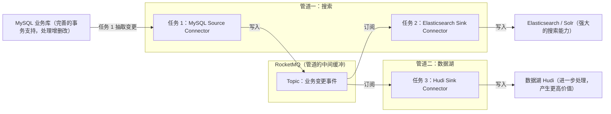
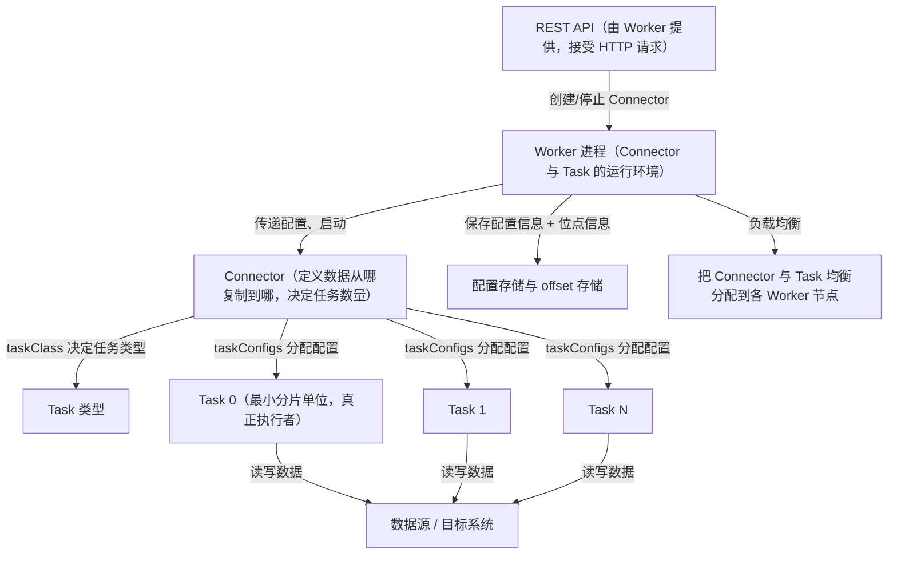
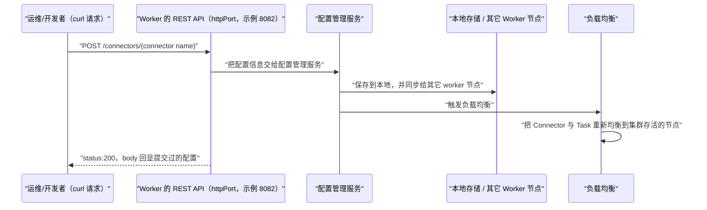
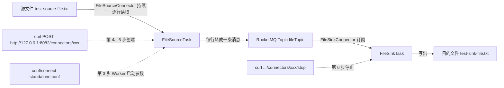
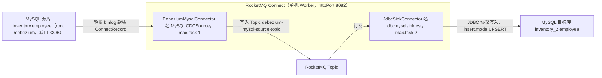
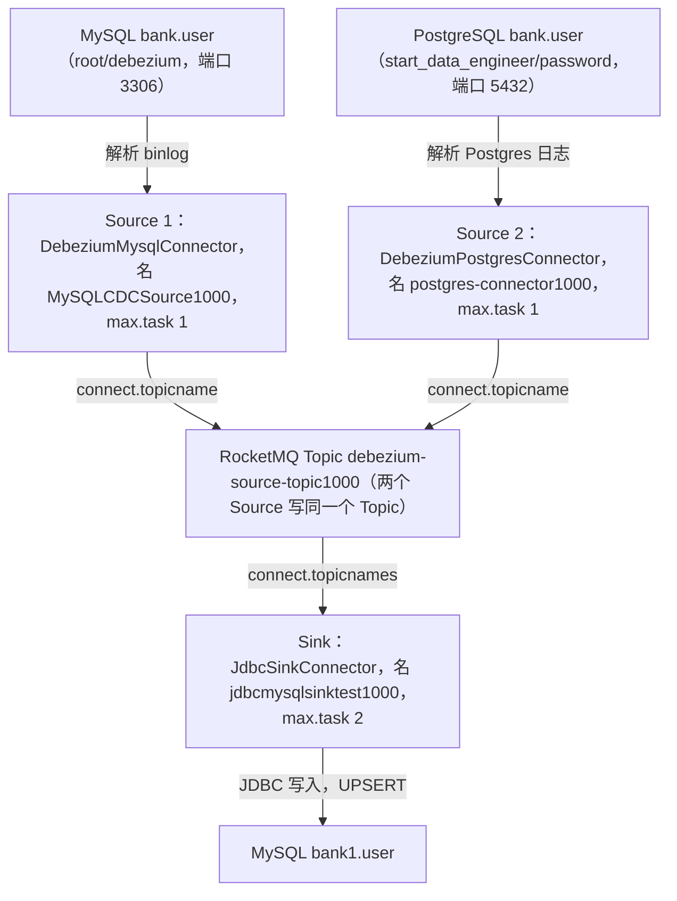

## 为什么需要 Connect？（痛点引入）

需求听着特别简单：「把 MySQL 里 `inventory.employee` 这张表的变更，持续同步进 RocketMQ，让下游的搜索服务和数据湖各自消费一份。」

于是你动手写了第一版：定时任务每 5 秒 `SELECT * FROM employee WHERE modify_time > ?`，把查到的行拼成消息发出去。上线第二天，问题开始一层层冒出来。

- **漏数据**。同步任务记下「上次读到 18:20:11」，可同一秒内有 30 行被更新，`modify_time` 精度不够，下一次用 `>` 就跳过了其中一批；改成 `>=` 又会重复捞上一批，下游开始收到重复消息。
- **删不掉**。行被 `DELETE` 之后表里什么都不剩，轮询 SQL 永远看不到这次变更，目标端的旧数据就一直留着。
- **断点会丢**。进程重启，位点记在内存里，只能从头再同步一遍；想持久化，就得自己建一张 `sync_offset` 表，再考虑这张表本身怎么备份。
- **重复消费要自己兜**。RocketMQ 提供的是「至少一次」交付，业务侧得自己判重，或者把目标端写入改成幂等的「有则更新、无则插入」。
- **一个进程跑不动就想拆分**。想按表分片、按主键范围分片并行跑，得自己设计分片方案，还得处理「分片任务挂了一个，谁来接管」。
- **上游改字段就崩**。`ALTER TABLE` 加了一列，你的拼装代码要跟着改；而改代码意味着重启，重启又回到断点问题。

把这些痛点和 Connect 的能力逐条摆在一起看：

| 你要解决的问题 | 自己写轮询程序时的做法 | 用 RocketMQ Connect 的做法 | 依据 |
|----------------|----------------------|----------------------------|------|
| 变更捕获 | 定时 `SELECT` + 时间戳比较，漏数与重复难两全 | 配置一个 Source Connector，由 Debezium 解析数据库日志捕获 INSERT/UPDATE/DELETE | CDC 可「近乎实时的捕获增量数据库 INSERT、UPDATE，DELETE 变化」，「通过 Connector 很容易实现 CDC」 |
| 是否要写代码 | 每接一个新系统都要写一套拉取、拼装、发送的代码 | 「用户不需要编程，只需要简单的配置即可使用」，同步 MySQL 只需配账号密码、链接地址、库名表名 | 概览页 Connector 工作原理一节 |
| 断点/位点保存 | 自建位点表，自己处理进程重启后的恢复 | Worker 保存 Task 同步数据的位点信息；单机模式持久化到 `storePathRootDir` | 概念页 Worker 一节、快速开始第 3 步 |
| 横向扩展 | 自己设计分片与并行方案 | Task 是「Connector 任务分片的最小分配单位」，多个 Task 可以并行执行，并行度主要体现在 Task 数量上 | 概念页 Task 一节 |
| 节点故障接管 | 自己写主备切换与抢占逻辑 | Worker 集群的扩缩容、故障处理「主要依赖 Worker 的负载均衡能力实现」 | 概念页 Worker 一节 |
| 一对多分发 | 每个下游都写一条独立的同步链路 | 一条 Source 链路写进一个 Topic，多个 Sink Connector 各自订阅该 Topic | 概览页「构建流式数据管道」一节：3 个任务拼出两条管道 |
| 接入异构系统 | 每种系统一套私有代码 | 官方按系统提供 Connector 插件包，编译后放进 `pluginPaths` 目录即可被 Worker 加载 | 实战 1–5 各自的插件编译一节 |

> ### 💡 新人小结：Connect 到底是干什么的？
>
> 把 RocketMQ Connect 想象成**小区里的智能快递中转站**：
> - 各住户（MySQL、PostgreSQL、SFTP、Elasticsearch、文件）都不需要自己跑腿，只需登记一条「取件规则」（Connector 配置）。
> - 中转站按规则派若干名跑腿员同时干活，每名跑腿员只负责一条街（Task 是任务分片的最小分配单位）。
> - 中转站自己记录「这个包裹取到第几件了」（位点信息），明天换一名跑腿员接手，也不用从头再跑。
> - 它不是快递公司的附属柜台，而是「独立于 RocketMQ 的，一个单独的分布式、可扩展、可容错系统」。
>
> **Connect 把「每个系统都要写一遍同步代码」变成「每个系统只需填一张配置表」。**

**学习路线图**（本文七段，按顺序读完即可独立搭链路）

```
痛点与定位 → 三个核心概念 → 部署模型 → 快速开始九步 → 五条实战链路 → 常见坑 → 术语与总结
为什么它   谁管谁        集群/单机   文件链路跑通    数据库/文件/ES   排查清单   带得走的东西
```

> [!NOTE] 版本适用：本文同时覆盖上游 4.x 与 5.0 两套 Connect 文档
> 上游 Connect 共 8 篇文章，4.x 与 5.0 各一份，合计 16 个源文件。经逐字节比对：概念篇（02）、实战 1（04）、实战 2（05）、实战 3（06）、实战 4（07）**5 篇两版完全相同**；概览篇（01）、快速开始（03）、实战 5-ES（08）**3 篇存在差异，且差异都只有 1–5 字节**，分别是：
> - 概览篇差 1 字节：集群模式一段中 4.x 写作 `减少Woker节点`（拼写漏了字母），5.0 写作 `减少Worker节点`，用词与结论完全一致。
> - 快速开始差 5 字节：**全部是行尾空白字符**。第 9 行句末多 1 个空格、第 20 行整行是 3 个空格（5.0 为空行）、第 76 行句末多 1 个空格；命令、REST 请求体、配置项与表格内容两版一字不差。因此本文的快速开始两版通用，不再分版本给两份命令。
> - 实战 5-ES 差 1 字节：Kibana Dev Tools 的外部参考链接版本号不同，4.x 指向 `.../kibana/7.15/console-kibana.html`，5.0 指向 `.../kibana/8.9/console-kibana.html`；正文的 ES 与 Kibana 镜像都是 `7.15.1`，链接版本号与镜像版本无关，不影响方案。
> 也就是说，Connect 板块不存在「4.x 一种写法、5.0 另一种写法」的分叉，本文按一份正文写，只在这些点上如实说明两版差异。

---

## Connect 是什么：定位、场景与能力边界

上游概览页给的定义是原话：

> RocketMQ Connect 是 RocketMQ 数据集成重要组件，可将各种系统中的数据通过高效，可靠，流的方式，流入流出到 RocketMQ，它是独立于 RocketMQ 的，一个单独的分布式、可扩展、可容错系统，它具备低延时，高可靠性，高性能，低代码，扩展性强等特点，可以实现各种异构数据系统的连接，以及构建数据管道，ETL，CDC，数据湖等能力。

这句话里有两个容易被略过、但对理解全局很关键的判断：

| 说法 | 含义 | 对使用者的直接影响 |
|------|------|--------------------|
| 「流入流出到 RocketMQ」 | Connect 的定位是把数据搬进 RocketMQ、再从 RocketMQ 搬出去 | 所有链路都是「外部系统 → RocketMQ → 外部系统」两段式，不存在从源直连目标的旁路 |
| 「独立于 RocketMQ 的，一个单独的分布式、可扩展、可容错系统」 | Connect 是独立的一套运行时，自己构建、自己起进程、自己有配置与位点存储 | 你要单独下载 `rocketmq-connect` 工程、单独构建、单独启动 Worker，不能指望 Broker 帮你把它带起来 |

概览页「Connector 工作原理」一节把这件事又说了一遍，原话是：RocketMQ Connect 是一个独立的的分布式，可伸缩，容错的系统（上游原文「的」字重复），它主要为 RocketMQ 提供与各种外部系统的数据的流入流出能力。用户不需要编程，只需要简单的配置即可使用 RocketMQ Connect，例如从 MySQL 同步数据到 RocketMQ，只需要配置同步所需的 MySQL 的账号密码，链接地址，和需要同步的数据库，表名就可以了。

注意最后这半句给的是**接一个新数据源时你要填的全部东西**：账号密码、链接地址、库名、表名。这就是「低代码」在上游文档里的具体落点。

上游架构图如下，注意它是「各种异构系统 ⇄ RocketMQ ⇄ 各种异构系统」的对称结构：


### 场景一：构建流式数据管道

上游给的业务画面是这样的：业务系统里利用 MySQL 完善的事务支持处理数据的增删改，使用 ElasticSearch、Solr 等实现强大的搜索能力，或者把产生的业务数据同步到数据分析系统、数据湖中（例如 hudi），对数据进一步处理从而让数据产生更高的价值。

关键在于「只需要配置 3 个任务」：第一个是从 MySQL 获取数据的任务，第二、三个是从 RocketMQ 消费数据到 ElasticSearch、Hudi 的任务。这 3 个任务就实现了从 MySQL 到 ElasticSearch、MySQL 到 hudi 的两条数据管道，既满足业务对事务、搜索的需求，也可以用于构建数据湖。

下图把这 3 个 Connector 任务与两条管道画出来：



上游接着说：使用 RocketMQ Connect 很容易实现这样的数据管道的能力。配置 3 个任务就实现了从 MySQL 到 ElasticSearch，MySQL 到 hudi 的两条数据管道，既可以满足业务对事务、搜索的需求，也可以用于构建数据湖。

图后解读三点：

1. **任务 1 只做一次，任务 2 与任务 3 各自独立消费同一份数据**。这是 RocketMQ 发布订阅模型在集成场景里的直接收益：新接一个下游不用改动上游代码。
2. **加一条管道 = 加一个 Sink Connector 配置**，而不是加一段同步代码。
3. 上游原文的措辞是「配置 3 个任务就实现了……两条数据管道」，这里的「任务」指的是 Connector 级别的任务（一个 Source + 两个 Sink），不是下文 Task 概念里的分片 Task——两者层次不同，后面概念一节会严格区分。

上游的使用场景示意图：


### 场景二：CDC

上游原话：CDC 作为 ETL 模式之一，可以近乎实时的捕获增量数据库 INSERT、UPDATE，DELETE 变化，RocketMQ Connect 流式数据传输，具备高可用，低延时等特性，通过 Connector 很容易实现 CDC。

先补术语，避免后面读实战时卡壳：

| 术语 | 全称 | 用自己的话说清它是什么 | 在本文中的位置 |
|------|------|------------------------|----------------|
| ETL | Extract-Transform-Load，抽取-转换-加载 | 把数据从源系统抽出来、按需要转换一下、再装进目标系统这套流程的总称 | 概览页把 CDC 说成「ETL 模式之一」 |
| CDC | Change Data Capture，变更数据捕获 | 不重扫全表，只盯着数据库「哪些行刚被增、改、删」，把变更本身当作事件流出来 | 实战 1、2、3 三条链路的源端能力 |
| binlog | Binary Log | 数据库把每一次改动按顺序记下来的流水账，CDC 就是读这本流水账而不是反复查表 | 实战 1 与实战 3 中 Debezium MySQL Source 的作用描述「通过解析 MySQL binlog 封装成通用的 ConnectRecord 对象」 |
| ConnectRecord | RocketMQ Connect 内部的通用记录对象 | 不论来源是 MySQL、PostgreSQL、文件还是 ES，进了 Connect 都被统一成这一个形状，下游 Sink 才可能只认一种输入 | 实战 1、3、4、5 的 source 作用描述中都出现 |
| 数据湖 | Data Lake | 存放原始与加工后数据的大容量存储层，供后续分析使用 | 上游举的例子是 hudi |

> ### 💡 新人小结：CDC 和我平时写的「定时查表」有什么本质不同？
>
> 想象你要知道家里这个月花了多少钱：
> - **轮询查表**：每月末把银行 App 打开，看**当前余额**是多少，再跟自己上次的记忆比。余额一样但你今天既存了一笔又取了一笔，你就漏了。
> - **CDC**：直接看**银行流水**。每一笔存、取、退都白纸黑字写着，包括「取走了 100 元」这种在当前余额里根本看不出来的动作。
>
> 数据库的 binlog 就是那份流水账。`DELETE` 一行之后表里什么都没有，轮询 SQL 永远看不见它；而 CDC 能捕获到这次删除——这正是概览页说 CDC 能捕获「INSERT、UPDATE、DELETE 变化」的含义。

---

## 核心概念：Connector、Task、Worker 谁管谁

这三者是 Connect 的全部骨架，也是阅读上游所有实战配置时不会迷路的地图。上游概念页的定义逐条摘录如下，先给职责边界表，再给关系图。

| 概念 | 上游定义要点（原样提炼） | 它决定的事 | 它不管的事 |
|------|--------------------------|------------|------------|
| Connector（连接器） | 「定义数据从哪复制到哪」；从源数据系统读取数据写入 RocketMQ 的是 **SourceConnector**，从 RocketMQ 读数据写入目标系统的是 **SinkConnector** | 需要创建多少个任务；从 Worker 接收配置并传递给任务 | 不亲自搬数据 |
| Task（任务） | 「Connector 任务分片的最小分配单位」，是实际把源数据复制进 RocketMQ（**SourceTask**）或把 RocketMQ 数据写入目标系统（**SinkTask**）的「真正的执行者」；无状态，可以动态启停；多个 Task 可以并行执行 | 实际读写数据的动作；Connector 复制数据的并行度主要体现在 Task 数量上 | 不定义数据流向（流向在 Connector 实现时已确定） |
| Worker（进程） | Connector 和 Task 的**运行环境**；提供 RESTFul 能力，接受 HTTP 请求，将获取到的配置传递给 Connector 和 Task | 启动 Connector 和 Task；保存 Connector 配置信息；保存 Task 同步数据的位点信息；负载均衡；扩缩容与故障处理 | 不关心具体某个业务系统怎么连（那是插件的事） |

上表是把概念页三段定义拆解成职责边界；下面把上游概念页的原文整段列出（照抄，含上游自带的重复字与漏字），便于逐字核对：

> **Connector**：连接器，定义数据从哪复制到哪，是从源数据系统读取数据写入 RocketMQ，这种是 SourceConnector，或从 RocketMQ 读数据写入到目标系统，这种是 SinkConnector。Connector 决定需要创建任务的数量，从 Worker 接收配置传递给任务。
>
> **Task**：Task 是 Connector 任务分片的最小分配单位，是实际将源数据源数据复制数据到 RocketMQ（SourceTask），或者将数据从 RocketMQ 读取数据写入到目标系统（SinkTask）真正的执行者，Task 是无状态的可以动态的启停任务，多个 Task 是可以并行执行的，Connector 复制数据的并行度主要体现在 Task 数量上。（上游原文「是实际将源数据源数据复制数据到」中「源数据」重复一次，照抄不改。）
>
> **Worker**：worker 进程是 Connector 和 Task 运行环境，它提供 RESTFul 能力，接受 HTTP 请求，将获取到的配置传递给 Connector 和 Task。除此之外它还负责启动 Connector 和 Task，保存 Connector 配置信息，保存 Task 同步数据的位点信息，负载均衡能力，Connect 集群高可用，扩缩容，故障处理主要依赖 Worker 的负载均衡能力实现的。

通过 Connect 的 Api 也可以看到 Connector 和 Task 各自的职责：Connector 实现时就已经确定数据复制的流向，Connector 接收数据源相关的配置，`taskClass` 获取需要创建的任务类型，通过 `taskConfigs` 指定最大任务数量，并且为 task 分配好配置。task 拿到配置以后从数据源取数据写入到目标存储。

下图是这三者的包含与调度关系：箭头方向读作「谁包含/驱动谁」。



图后解读，三条最容易被忽略的关系：

1. **Connector 是「规划者」，Task 是「干活的人」，Worker 是「办公室 + HR」**。上游概览页在部署一节也直接写了：Connector 包含逻辑的 Connector 连接器和执行数据复制的 Task（即物理线程）——所以「一个 Connector」在生产上通常对应「多个并行跑的 Task」。
2. **配置的流动是单向的**：REST 请求 → Worker → Connector → Task。上游概念页写得很具体：Connector 实现时就已经确定数据复制的流向，Connector 接收数据源相关的配置，`taskClass` 获取需要创建的任务类型，通过 `taskConfigs` 指定最大任务数量，并且为 task 分配好配置；task 拿到配置以后从数据源取数据写入到目标存储。这三个名字（`taskClass`、`taskConfigs`、以及「Connector 先拿到配置」）就是后面实战里 `max.task` 这类键的由来。
3. **位点与配置都存在 Worker 这一层，不存在 Task 里**。上游说 Task 是「无状态的可以动态的启停任务」——正因为状态（位点）由 Worker 保管，Task 才能随便启停、随便换机器。

上游概念页给出的基本模型图，可与上面的 Mermaid 对照：


### Connector 与 Task 的处理流程

上游接着给了一张处理流程图，并说明「通过下面的两张图可以清楚的看到，Connecotr 和 Task 处理基本流程」（上游原文此处 `Connecotr` 拼写有误，指 Connector）：


把两张上游图和概念定义合起来读，落到实战配置上就是三条判读规则：

| 你在配置文件里看到的键 | 它属于哪一层 | 该层职责 | 本文实战中的例子 |
|------------------------|--------------|----------|------------------|
| `connector.class` | Connector 层 | 指定实现 Connector 接口的类名称（包含包名），从而确定数据复制流向 | 五条链路各自的 JSON 请求体第一个键 |
| `max.task` / `max.tasks` | Connector 层 | 指定要创建多少个 Task，即并行度 | 实战 1 source `"max.task": "1"`、sink `"max.task": "2"` |
| `database.hostname`、`filename`、`filePath`、`elasticsearchHost` 等 | Task 运行时的连接参数 | 由 Connector 接收后再分配给各 Task 使用 | 各链路的请求体字段 |
| `workerId`、`httpPort`、`storePathRootDir`、`namesrvAddr`、`pluginPaths` | Worker 层 | 决定这个进程叫什么、REST 端口、位点放哪、连哪个 RocketMQ、从哪加载插件 | `connect-standalone.conf` |

> ### 💡 新人小结：Connector、Task、Worker 老记混怎么办？
>
> 把它们对应到**外卖站点**的三个角色：
> - Connector = 站点接的那张**配送协议**：写明「从哪家餐厅取、送到哪个小区、需要几名骑手」。它自己一份餐都不送。
> - Task = **骑手本人**，真正取餐送餐的执行者；一名骑手跑一条片区（分片），多名的并行，协议上写几个就派几个。
> - Worker = **站点这个门店**：门口那个接单窗口（REST API）、排班表、以及「这一单送到哪一步了」的记录本（位点）；站点关门了骑手没地方接单，门店倒闭时另一个门店会接手（负载均衡）。
>
> **配置里凡是「class / max.task / 业务连接参数」归协议和骑手；凡是「workerId / httpPort / storePathRootDir / pluginPaths」归门店。**

### Worker 收到一个 REST 请求之后做了什么

上游对 Worker 内部协作的描述是：Worker 通过提供的 REST Api 接收 http 请求，将接收到的配置信息传递给**配置管理服务**，配置管理服务将配置保存到本地并同步给其它 worker 节点，同时触发负载均衡。

上游概念页的 Worker 结构图如下，图中可以认出三个方块正好对应上面那句话里的三个环节——REST Api、配置管理服务、以及「同步给其它 worker 节点」的集群侧：


下图把这条链路画成一个处理顺序，注意最后一步「触发负载均衡」是紧跟在「同步配置」之后的：



图后解读：

- 上游实战与快速开始的每个 curl 都以 `http://127.0.0.1:8082/connectors/xxx` 或 `http://localhost:8082/connectors/xxx` 结尾，`8082` 就是配置文件里 `httpPort` 的值，`connectors` 后面那一段是**你给这个 Connector 起的名字**（同一个请求 URL 的名字就是后续用来停止它的名字）。
- 上游对返回结果的判据是统一的：「curl 请求返回 status:200 则表示创建成功」；停止 connector 时同样看 status:200。
- 集群模式下 Worker 之间靠 RocketMQ Topic 同步配置/位点/状态，单机模式靠本地文件目录（下一节展开）。

---

## 部署模型：一个 Connector 怎么摊成多个 Task，Worker 怎么摆

上游概览页「Connector 部署」一节给了四张图，按「逻辑拆分 → 并行度 → 集群 → 单机」的顺序排列，这里逐张对照讲解。

**第一张：Connector 与它的 Task 一一对应关系。** 上游说：创建 Connector，一般通过配置即可完成，Connector 包含逻辑的 Connector 连接器和执行数据复制的 Task（即物理线程），如下图所示，两个 Connector 连接器和它们对应的运行 Task 任务。


**第二张：一个 Connector 同时运行多个 Task 以提高并行度。** 上游举例：一个 Connector 也可以同时运行多个任务，提高 Connector 的并行度，例如下图所示的 Hudi Sink Connector 有 2 个任务，每个任务处理不同的分片数据，从而提高 Connector 的并行度，进而提高处理性能。


这两张图连起来读出的结论是：**并行度靠加 Task，不靠加 Connector**；而 Task 的数量正是由 Connector 决定的（概念页原话「Connector 决定需要创建任务的数量」）。这就是实战配置里 `max.task` / `max.tasks` 这个键存在的意义。

**第三、四张：Worker 的两种运行模式。** 上游原话：RocketMQ Connect Worker 支持两种运行模式，集群和单机。

集群模式，顾名思义，由多个 Worker 节点组成，推荐最少有 2 个 Worker 节点，组成高可用集群。集群间的配置信息，offset 信息，status 信息则通过指定的 RocketMQ Topic 进行存储，新增 Worker 节点也会获取到集群中的这些配置，offset，status 信息，并且触发负载均衡，重新分配集群中的任务，使集群达到均衡的状态，减少 Worker 节点或者 Worker 宕机也会触发负载均衡，从而保障集群中所有的任务都可以均衡的在集群中存活的节点中正常运行。


单机模式，Connector 任务运行在单机上，Worker 本身没有高可用，任务 offset 信息持久化在本地。适合一些对高可用没有什么要求或者不需要 Worker 保障高可用的场景，例如部署在 k8s 集群中，由 k8s 集群保障高可用。（上游原文这一句写作「对高可没有什么要求」，漏了一个「用」字，本文按上下文补正，其余照抄。）


两种模式逐项对比（下表只列上游写明的维度）：

| 对比维度 | 集群模式 | 单机模式（standalone） |
|----------|----------|------------------------|
| 节点数量 | 由多个 Worker 节点组成，推荐最少有 2 个 Worker 节点 | Connector 任务运行在单机上 |
| 高可用 | 组成高可用集群，Worker 宕机也会触发负载均衡 | Worker 本身没有高可用 |
| 配置 / offset / status 存在哪 | 通过指定的 RocketMQ Topic 进行存储 | 任务 offset 信息持久化在本地（快速开始进一步指明为 `storePathRootDir` 目录） |
| 新增节点的后果 | 新节点会获取到集群中的配置、offset、status 信息，并触发负载均衡，重新分配集群中的任务 | 上游未描述单机模式下的加节点行为（单机只有一台） |
| 减少节点 / 宕机的后果 | 触发负载均衡，保障所有任务均衡地在集群存活节点中正常运行 | Worker 本身没有高可用，上游未描述接管机制 |
| 适用场景 | 需要 Worker 自身保障高可用 | 对高可用没有什么要求，或不需要 Worker 保障高可用，例如部署在 k8s 集群中、由 k8s 集群保障高可用 |
| 本文后续示例采用 | 上游 Connect 板块的示例全部使用单机模式 | 是：快速开始与实战 1–5 都用 `connect-standalone.sh` |

> [!NOTE] 版本适用：本文全部实战示例为单机模式（standalone）
> 上游快速开始第 3 步标题即「单机模式运行 Connector Worker」，实战 1–5 的启动命令也都是 `sh bin/connect-standalone.sh -c conf/connect-standalone.conf &`。上游 Connect 板块**没有给出集群模式的启动命令与配置文件样例**，因此本文不编造集群命令；集群模式的行为依据只有概览页上面那段文字描述。

---

## 快速开始：单机模式跑通「文件 → RocketMQ → 文件」，九步全流程

上游快速开始页的原话是：本教程将采用单机模式启动一个 RocketMQ Connector 示例工程 `rocketmq-connect-sample`，来帮助你了解连接器的工作原理。示例工程中提供了源端连接器，作用是从源文件中读取数据然后发送到 RocketMQ 集群；同时提供了目的端连接器，作用是从 RocketMQ 集群中读取消息然后写入目的端文件。

**选它做入门链路的原因**（上游依据）：这条链路不需要任何外部数据库，源和目标都是普通文本文件，唯一的外部依赖就是 RocketMQ 本身；而且上游明确「本工程已默认包含 rocketmq-connect-sample 的代码，因此无需单独构建 rocketmq-connect-sample 插件」，所以连插件都不用编译，`pluginPaths` 可以留空。

整条链路的数据流与九步的落点如下：



图后解读：源端与目的端是**两个彼此独立的 Connector**，它们之间唯一的联系就是那个 Topic（`fileTopic`）；启动顺序必须「先 Source 后 Sink」，因为只有 Source 先把数据写进 Topic，Sink 才有东西可消费（上游快速开始正是按第 4 步 source、第 5 步 sink 的顺序编排的）。

### 第 1 步 准备：启动 RocketMQ

上游列出的前置条件（照抄，5 条一条不少）：

1. Linux/Unix/Mac
2. 64bit JDK 1.8+
3. Maven 3.2.x 或以上版本
4. 启动 RocketMQ。使用 [RocketMQ 4.x](https://rocketmq.apache.org/docs/4.x/) 或 [RocketMQ 5.x](https://rocketmq.apache.org/docs/quickStart/01quickstart/) 版本均可
5. 工具测试 RocketMQ 消息收发是否正常。详见 [RocketMQ 4.x](https://rocketmq.apache.org/docs/4.x/) 或 [RocketMQ 5.x](https://rocketmq.apache.org/docs/quickStart/01quickstart/) 文档

上游紧接着说明：这里利用环境变量 `NAMESRV_ADDR` 来告诉工具客户端 RocketMQ 的 NameServer 地址为 `localhost:9876`。

```shell
# ========== ✅ 推荐写法：先确认 RocketMQ 本身收发正常，再动 Connect ==========
#$ cd distribution/target/rocketmq-4.9.7/rocketmq-4.9.7     # 上游把 4.9.7 这一行注释掉了，示例走 5.1.4
$ cd distribution/target/rocketmq-5.1.4/rocketmq-5.1.4      # 进入 RocketMQ 发行版目录

$ export NAMESRV_ADDR=localhost:9876                        # 用环境变量告诉工具客户端 NameServer 地址
$ sh bin/tools.sh org.apache.rocketmq.example.quickstart.Producer
 SendResult [sendStatus=SEND_OK, msgId= ...                 # 输出：上游给的是截断样例，msgId 后续部分上游未给出

$ sh bin/tools.sh org.apache.rocketmq.example.quickstart.Consumer
 ConsumeMessageThread_%d Receive New Messages: [MessageExt...   # 输出：同上，上游未给出完整打印

# ========== 不推荐做法（仅展示） ==========
# ❌ 跳过收发自检直接起 Connect：Connect 侧报 namesrvAddr 连不上时，
#   你将无法区分「RocketMQ 本身没起来」还是「Connect 配置写错」
```

参数解释：

| 命令片段 | 作用 | 上游给出的依据 |
|----------|------|----------------|
| `distribution/target/rocketmq-5.1.4/rocketmq-5.1.4` | 构建产物里的 RocketMQ 发行版目录 | 上游同时给了 4.9.7 与 5.1.4 两行，实际启用 5.1.4 |
| `export NAMESRV_ADDR=localhost:9876` | 告诉工具客户端 NameServer 地址 | 上游说明原文 |
| `sh bin/tools.sh ...Producer` / `...Consumer` | 用示例工具验证收发 | 上游给出上述两行截断输出，未给出完整输出样例 |

上游补充说明：RocketMQ 具备自动创建 Topic 和 Group 的功能，在发送消息或订阅消息时，如果相应的 Topic 或 Group 不存在，RocketMQ 会自动创建它们。**因此不需要提前创建 Topic 和 Group**——这条也解释了为什么后面第 4、5 步直接写 `fileTopic` 而不先建 Topic。

> [!NOTE] 版本适用：Connect 对 RocketMQ 服务端版本不敏感
> 上游第 1 步写明「使用 RocketMQ 4.x 或 RocketMQ 5.x 版本均可」，实战 1–5 同样只写「启动 RocketMQ」而不锁版本。Connect 自身的发行版目录名是 `rocketmq-connect-0.0.1-SNAPSHOT`，与 RocketMQ 的版本号是两套编号，不要混。

### 第 2 步 构建 Connector Runtime

```shell
# ========== ✅ 推荐写法：clone 后用 release-connect profile 构建，并记住 RMQ_CONNECT_HOME ==========
git clone https://github.com/apache/rocketmq-connect.git

cd  rocketmq-connect

export RMQ_CONNECT_HOME=`pwd`        # 后面第 3、7 步都用这个变量定位发行版目录

mvn -Prelease-connect -Dmaven.test.skip=true clean install -U
# 输出: 上游未给出构建日志样例；产物路径在第 3 步以 $RMQ_CONNECT_HOME/distribution/target/
#       rocketmq-connect-0.0.1-SNAPSHOT/rocketmq-connect-0.0.1-SNAPSHOT 的形式给出

# ========== 不推荐做法（仅展示） ==========
# ❌ 去掉 -Prelease-connect：该 profile 才产出 distribution 下的可运行发行版目录，
#   少了它会找不到 conf/connect-standalone.conf 与 bin/connect-standalone.sh
# ❌ 再单独去 clone 并构建 rocketmq-connect-sample：
#   上游明确「本工程已默认包含 rocketmq-connect-sample 的代码，因此无需单独构建 rocketmq-connect-sample 插件」
```

参数解释：

| 片段 | 含义 | 注意 |
|------|------|------|
| `-Prelease-connect` | 激活 Maven 的 `release-connect` profile | 上游快速开始与实战 4、5 用的都是这个写法 |
| `-Dmaven.test.skip=true` | 跳过测试 | 实战 1、2、3 里构建 Runtime 用的是等价写法 `-DskipTests`（上游原文如此，两处用词不同但目的都是跳过测试） |
| `-U` | 强制更新依赖 | 上游原样照抄 |
| `export RMQ_CONNECT_HOME=\`pwd\`` | 记录工程根目录 | 第 3 步与第 7 步的 `cd` 都基于它 |

### 第 3 步 单机模式运行 Connector Worker

上游把这一步拆成「修改配置」和「采用单机模式启动 Connector Worker」两个小节。

#### 3.1 修改配置

上游说明：`connect-standalone.conf` 中配置了 RocketMQ 连接地址等信息，需要根据使用情况进行修改，具体参见第 9 步配置文件说明。

```shell
# ========== ✅ 推荐写法：进入发行版目录后再改配置 ==========
cd $RMQ_CONNECT_HOME/distribution/target/rocketmq-connect-0.0.1-SNAPSHOT/rocketmq-connect-0.0.1-SNAPSHOT

vim conf/connect-standalone.conf
```

关于位点目录，上游原话：单机模式（standalone）下，RocketMQ Connect 会把同步位点信息持久化到本地文件目录 `storePathRootDir`。

```properties
# ========== ✅ 配置项（上游样例路径，照抄） ==========
storePathRootDir=/Users/YourUsername/rocketmqconnect/storeRoot

# ========== 不推荐写法（仅展示） ==========
# ❌ 沿用 /Users/YourUsername/... 这个占位路径不改成自己的目录：
#   上游样例里的 YourUsername 是占位符，实战 1、2、3 就把它换成了 /tmp/storeRoot
```

想重置同步位点，则删除持久化的位点信息文件：

```shell
# ========== ✅ 上游给出的重置命令 ==========
rm -rf /Users/YourUsername/rocketmqconnect/storeRoot/*
# 输出: 上游未给出输出样例；上游对该动作的说明是「如果想重置同步位点，则需要删除持久化的位点信息文件」

# ========== 不推荐做法（仅展示） ==========
# ❌ 只想重置某一个 connector 的进度：上游给的是整个 storeRoot 目录通配删除，
#   一次会清掉该 Worker 上全部 connector/task 的配置、位点与状态（第 9 步的六个持久化文件同目录）
```

#### 3.2 启动 Worker 并确认启动成功

```shell
# ========== ✅ 推荐写法：后台启动，然后盯日志确认 boot success ==========
sh bin/connect-standalone.sh -c conf/connect-standalone.conf &
# 参数 -c 指定配置文件；结尾 & 表示放后台运行（上游写法如此）

# tips（上游原文）：可修改 docker/connect/bin/runconnect.sh 适当调整 JVM 启动参数
#   JAVA_OPT="${JAVA_OPT} -server -Xms256m -Xmx256m"

tail -100f ~/logs/rocketmqconnect/connect_runtime.log
# 输出: runtime 若启动成功则日志文件中能看到如下打印内容
#   The standalone worker boot success.
```

参数解释：

| 片段 | 含义 | 依据 |
|------|------|------|
| `-c conf/connect-standalone.conf` | 指定 Worker 启动用的配置文件 | 上游启动命令原样 |
| `&` | 后台运行 | 上游写法；第 7 步另有专门的 `connectshutdown.sh` 来停止它 |
| `JAVA_OPT="${JAVA_OPT} -server -Xms256m -Xmx256m"` | JVM 堆内存参数，上游给的示例值是 256m | 上游 tips 一行，位置在 `docker/connect/bin/runconnect.sh` |
| `~/logs/rocketmqconnect/connect_runtime.log` | 运行时日志 | 判据是日志出现 `The standalone worker boot success.` |

上游还提示：要退出 `tail -f` 命令的日志追踪模式，您可以按下 Ctrl + C 组合键。

### 第 4 步 启动 source connector

先准备源文件。上游命令与注意事项照抄：

```shell
# ========== ✅ 推荐写法：按上游路径创建源文件并写入测试数据 ==========
mkdir -p /Users/YourUsername/rocketmqconnect/
cd /Users/YourUsername/rocketmqconnect/
touch test-source-file.txt

echo "Hello \r\nRocketMQ\r\n Connect" >> test-source-file.txt
# 输出: 上游未给出该命令的打印；文件内容随后由 source connector 逐行读取

# ========== 不推荐写法（仅展示） ==========
# ❌ 文件里留空行：上游明确「不能有空行（demo 程序遇到空行会报错）」
# ❌ 以为文件写完就不用管：上游说 source connector 会「持续读取源端文件」，
#   每读取到一行数据就会转换为消息体发送到 RocketMQ，供 sink connector 消费
```

上游解释：source connector 会持续读取源端文件，每读取到一行数据就会转换为消息体发送到 RocketMQ，供 sink connector 消费。

再用 REST API 创建 Source Connector：

```shell
# ========== ✅ 推荐写法：POST 到 /connectors/<connector 名字>，body 是配置 JSON ==========
curl -X POST -H "Content-Type: application/json" http://127.0.0.1:8082/connectors/fileSourceConnector -d '{
	"connector.class": "org.apache.rocketmq.connect.file.FileSourceConnector",
	"filename": "/Users/YourUsername/rocketmqconnect/test-source-file.txt",
	"connect.topicname": "fileTopic"
}'
# 输出（curl 请求返回 status:200 则表示创建成功，上游给的返回样例）:
# {"status":200,"body":{"connector.class":"org.apache.rocketmq.connect.file.FileSourceConnector","filename":"/Users/YourUsername/rocketmqconnect/test-source-file.txt","connect.topicname":"fileTopic"}}

# ========== 不推荐写法（仅展示） ==========
# ❌ 把键名写成 "connect.topicnames"（复数）：上游 source 侧用的是单数 connect.topicname，
#   配置表里三个键都标 nullable=false，缺一个都起不来
# ❌ filename 用相对路径：上游配置说明写的是「建议使用绝对路径」
```

看到以下日志说明 file source connector 启动成功了：

```shell
tail -100f ~/logs/rocketmqconnect/connect_runtime.log
# 输出: Start connector fileSourceConnector and set target state STARTED successed!!
#       （上游原文即为 successed，本文照抄不改）
```

**source connector 配置说明**（上游表格三行完整保留）：

| key | nullable | default | description |
|-------------------|--------|---------------------|--------------------------|
| connector.class | false | | 实现 Connector 接口的类名称（包含包名） |
| filename | false | | 数据源端文件名称（建议使用绝对路径） |
| connect.topicname | false | | 同步文件数据所使用的 RocketMQ topic |

### 第 5 步 启动 sink connector

```shell
# ========== ✅ 推荐写法：Sink 侧键名是 connect.topicnames（复数） ==========
curl -X POST -H "Content-Type: application/json" http://127.0.0.1:8082/connectors/fileSinkConnector -d '{
	"connector.class": "org.apache.rocketmq.connect.file.FileSinkConnector",
	"filename": "/Users/YourUsername/rocketmqconnect/test-sink-file.txt",
	"connect.topicnames": "fileTopic"
}'
# 输出（返回 status:200 表示创建成功，上游给的返回样例）:
# {"status":200,"body":{"connector.class":"org.apache.rocketmq.connect.file.FileSinkConnector","filename":"/Users/YourUsername/rocketmqconnect/test-sink-file.txt","connect.topicnames":"fileTopic"}}

# ========== 不推荐写法（仅展示） ==========
# ❌ 把 connect.topicnames 的值写成与 source 的 connect.topicname 不同的 Topic 名：
#   上游给的两侧都是 fileTopic，Sink 订阅的必须就是 Source 写入的那个 Topic
```

看到以下日志说明 file sink connector 启动成功了：

```shell
tail -100f ~/logs/rocketmqconnect/connect_runtime.log
# 输出: Start connector fileSinkConnector and set target state STARTED successed!!
```

验证数据是否落到了目的端文件：

```shell
# ========== ✅ 推荐写法：直接查看目的端文件 ==========
cat /Users/YourUsername/rocketmqconnect/test-sink-file.txt
# 输出: 上游未给出文件内容样例，只给出判据 ——
#       「如果生成了 test-sink-file.txt 文件，并且与 source-file.txt 内容一样则说明整个流程正常运行」

# ========== 不推荐做法（仅展示） ==========
# ❌ 只看文件存在就宣布成功：上游的判据是「内容与源文件一样」，还要继续做下面的增量测试
```

继续向源端文件写入测试数据，验证增量同步：

```shell
# ========== ✅ 推荐写法：追加数据 → 等待 → 再看目的端文件 ==========
cd /Users/YourUsername/rocketmqconnect/

echo "Say Hi to\r\nRMQ Connector\r\nAgain" >> test-source-file.txt

# Wait a few seconds, check if rocketmq-connect replicate data to sink file succeed
sleep 10
cat /Users/YourUsername/rocketmqconnect/test-sink-file.txt
# 输出: 上游未给出打印样例；判据是目的端文件里能看到新追加的这几行

# ========== 注意事项（上游原文，别当成 bug） ==========
# 注意：文件内容可能顺序不一样，这是因为 rocketmq-connect-sample 向 RocketMQ Topic 中收发消息时，
#   使用的消息类型是普通消息，区别于顺序消息，消费普通消息时是不保证顺序的
```

**sink connector 配置说明**（上游表格三行完整保留）：

| key | nullable | default | description |
|--------------------|--------|-------|----------------------------------------|
| connector.class | false | | 实现 Connector 接口的类名称（包含包名） |
| filename | false | | sink 消费 RocketMQ 数据后保存到的目的端文件名称（建议使用绝对路径） |
| connect.topicnames | false | | sink 需要处理数据消息 topics |

Source 与 Sink 两侧的配置键并排对比，这张表是新手最容易踩空的地方：

| 对比项 | Source Connector（第 4 步） | Sink Connector（第 5 步） |
|--------|------------------------------|----------------------------|
| `connector.class` | `org.apache.rocketmq.connect.file.FileSourceConnector` | `org.apache.rocketmq.connect.file.FileSinkConnector` |
| 文件路径键 | `filename` = 源文件 `test-source-file.txt` | `filename` = 目的文件 `test-sink-file.txt` |
| Topic 键名 | `connect.topicname`（**单数**） | `connect.topicnames`（**复数**） |
| Topic 键值 | `fileTopic` | `fileTopic`（与 Source 同一个 Topic） |
| 三个键的 nullable | 全部 false | 全部 false |
| 在链路中的角色 | 外部系统 → RocketMQ（SourceConnector/SourceTask） | RocketMQ → 外部系统（SinkConnector/SinkTask） |

上游还有一条总括性提醒：source/sink 配置文件说明是以 `rocketmq-connect-sample` 为 demo，不同 source/sink connector 配置有差异，请以具体 source/sink connector 为准——所以下面五条实战链路的 JSON 字段各不相同，不要试图套用文件链路那三个键。

### 第 6 步 停止 connector

上游给的 RESTFul 命令格式是 `http://(your worker ip):(port)/connectors/(connector name)/stop`。

```shell
# ========== ✅ 推荐写法：上游给出的两条命令顺序（先 Sink 后 Source） ==========
curl http://127.0.0.1:8082/connectors/fileSinkConnector/stop
# 输出（curl 请求返回 status:200 则表示停止成功，上游给的返回样例）:
# {"status":200,"body":"Connector [fileSinkConnector] deleted successfully"}

curl http://127.0.0.1:8082/connectors/fileSourceConnector/stop
# 输出: 上游只给了 fileSinkConnector 的返回样例，Source 侧的返回体上游未给出

# ========== 不推荐写法（仅展示） ==========
# ❌ 用 kill Worker 进程来「停某个 connector」：上游为停止 connector 提供的是 /stop 这个 REST 动作，
#   为停整个进程另有第 7 步的 connectshutdown.sh，两者粒度不同
# ❌ URL 里的 connector name 随手改名：这个名字就是第 4、5 步 POST 路径里用的那个名字
```

看到以下日志说明 file sink connector 停止成功了——注意这里换了日志文件：

```shell
tail -100f ~/logs/rocketmqconnect/connect_default.log
# 输出: Completed shutdown for connectorName:fileSinkConnector
#       （启动与运行状态看 connect_runtime.log，connector 关闭完成看 connect_default.log）
```

### 第 7 步 停止 Worker 进程

```shell
# ========== ✅ 推荐写法：回到发行版目录，用上游给的脚本停止 ==========
cd $RMQ_CONNECT_HOME/distribution/target/rocketmq-connect-0.0.1-SNAPSHOT/rocketmq-connect-0.0.1-SNAPSHOT
sh bin/connectshutdown.sh
# 输出: 上游未给出输出样例

# ========== 不推荐做法（仅展示） ==========
# ❌ 绕过 connectshutdown.sh：第 3 步是用 & 把 Worker 放后台的，
#   上游为这一步提供的停止方式就是 sh bin/connectshutdown.sh，未提供其它停法
```

### 第 8 步 日志目录

上游说明：查看日志目录（下面 2 个命令是等价的）。

```shell
# ========== ✅ 两个等价命令（上游原样） ==========
ls $HOME/logs/rocketmqconnect
ls ~/logs/rocketmqconnect
# 输出: 上游未给出目录列表样例；本文用到的两个日志文件名是
#       connect_runtime.log（启动与 connector 启动成功判据）和 connect_default.log（connector 关闭判据）
```

### 第 9 步 配置文件说明

上游说明：`connect-standalone.conf` 配置文件中，配置了 [RESTful](https://restfulapi.cn/) 端口、storeRoot 路径、Nameserver 地址等信息，可根据需要进行修改。配置文件样例（逐行照抄，含上游自带注释）：

```properties
# ========== 上游配置文件样例（单机模式） ==========
#current cluster node uniquely identifies
workerId=DEFAULT_WORKER_1

# Http prot for user to access REST API
httpPort=8082

# Local file dir for config store
storePathRootDir=/Users/YourUsername/rocketmqconnect/storeRoot

#需要修改为自己的rocketmq nameserver 接入点
# RocketMQ namesrvAddr
namesrvAddr=127.0.0.1:9876

# 插件地址，用于Worker加载Source/Sink Connector插件
# rocketmq-connect 工程已默认包含 rocketmq-connect-sample 模块，因此这里无需配置。
pluginPaths=

# ========== 不推荐写法（仅展示） ==========
# ❌ 多机共用同一个 workerId：上游把 workerId 注释为「current cluster node uniquely identifies」，
#   即当前集群节点的唯一标识，集群里每个 Worker 节点必须各不相同
# ❌ namesrvAddr 不改成自己的接入点就启动：上游注释写明「需要修改为自己的 rocketmq nameserver 接入点」
# ❌ 加载了外部插件却不配 pluginPaths：本样例 pluginPaths= 为空的前提是
#   「rocketmq-connect 工程已默认包含 rocketmq-connect-sample 模块」，实战 1-5 都要填插件目录
```

逐项解释（含注释里上游自带的说明）：

| 配置键 | 上游注释原文 | 实际含义与用途 | 快速开始取值 | 实战 1 至 3 取值 | 实战 4、5 取值 |
|--------|--------------|----------------|----------------|----------------|----------------|
| `workerId` | current cluster node uniquely identifies | 当前集群节点的唯一标识 | `DEFAULT_WORKER_1` | `standalone-worker` | `standalone-worker` |
| `httpPort` | Http prot for user to access REST API（上游注释即如此拼写） | 供用户访问 REST API 的 HTTP 端口，所有 curl 命令里的 8082 就是它 | `8082` | `8082` | `8082` |
| `storePathRootDir` | Local file dir for config store | 单机模式下配置与同步位点持久化的本地目录 | `/Users/YourUsername/rocketmqconnect/storeRoot` | `/tmp/storeRoot` | `/Users/YourUsername/rocketmqconnect/storeRoot` |
| `namesrvAddr` | 需要修改为自己的 rocketmq nameserver 接入点 / RocketMQ namesrvAddr | RocketMQ NameServer 接入点 | `127.0.0.1:9876` | `localhost:9876` | `localhost:9876` |
| `pluginPaths` | 插件地址，用于 Worker 加载 Source/Sink Connector 插件 | 插件 jar 所在目录；Worker 从这儿加载 Source/Sink Connector | 空（示例工程内置） | `/usr/local/connector-plugins` | `/Users/YourUsername/rocketmqconnect/connector-plugins` |
| `aclEnable` | 上游配置样例中位于注释 `# RocketMQ acl` 之下 | 是否在 Connect 内启用 ACL；上游各篇给的示例值都是 `false` | 未出现在快速开始样例 | `false` | `false` |
| `accessKey` / `secretKey` | 同上，位于 `# RocketMQ acl` 之下 | ACL 的账号密钥对；上游给的示例值是 `rocketmq` / `12345678` | 未出现 | `rocketmq` / `12345678`（未注释） | 被注释掉（`#accessKey=rocketmq`、`#secretKey=12345678`） |
| `autoCreateGroupEnable` | 上游未给出注释说明 | 上游未记载其语义，仅出现在实战 1 至 3 的重点配置块中，取值 `false` | 未出现 | `false` | 未出现 |
| `clusterName` | 上游未给出注释说明 | 上游未记载其语义；实战 1 至 5 都写作 `"DefaultCluster"` | 未出现 | `"DefaultCluster"` | `"DefaultCluster"` |

**`storePathRootDir` 里到底存了什么**——上游给了一张持久化文件表，六个文件全部保留：

| key | description |
|----------------------|---------------------------|
| connectorConfig.json | connector 配置持久化文件 |
| position.json | source connect 数据处理进度持久化文件 |
| taskConfig.json | task 配置持久化文件 |
| offset.json | sink connect 数据消费进度持久化文件 |
| connectorStatus.json | connector 状态持久化文件 |
| taskStatus.json | task 状态持久化文件 |

这张表值得多看一眼，它把「Source 记的是读取进度、Sink 记的是消费进度」说得非常具体：**`position.json` 与 `offset.json` 是两个不同的文件，分别对应 source 侧与 sink 侧的进度**，再加上 `connectorConfig.json` / `taskConfig.json`（配置）和 `connectorStatus.json` / `taskStatus.json`（状态），正好对应集群模式下上游所说需要共享的三类信息——配置、offset、status。

> ### 💡 新人小结：为什么重置位点要「删文件」而不是「调接口」？
>
> 想象你在读一本很厚的小说，用**书签**记进度：
> - `position.json` = 夹在**原文书**上的书签（读到第几行）；`offset.json` = 夹在**抄写登记本**上的书签（抄到第几条了）。
> - 单机模式下这两枚书签就插在你家书桌抽屉（`storePathRootDir` 目录）里。
> - 「重置同步位点」= 把书签抽掉重来，上游给的动作就是删掉这个目录里的文件；书签还在，下次坐下就接着翻。
> - 抽屉里同时还有排班表与协议复印件（`connectorConfig.json`、`taskConfig.json`）和状态条（`connectorStatus.json`、`taskStatus.json`），一次清空是全清。
>
> **位点丢了不是数据丢了，而是「从头再来一遍」——这就是上游强调这些持久化文件的真正原因。**

---

## 实战：五条真实数据链路怎么落地

快速开始那条「文件 → RocketMQ → 文件」只是让你确认运行时是通的。上游另外给了五篇实战，是五条真实链路，覆盖面正好把 Connect 的能力边界讲完：

| 实战编号 | 源端（Source） | 目标端（Sink） | 是否需要 CDC | 需要编译的插件包 | 验证手段 |
|----------|----------------|----------------|--------------|------------------|----------|
| 快速开始 | 本地文件 `test-source-file.txt` | 本地文件 `test-sink-file.txt` | 否 | 无需（示例内置） | `cat` 目的端文件，比对内容与源文件一致 |
| 实战 1 | MySQL `inventory.employee` | MySQL `inventory_2.employee` | **是**（Debezium 解析 MySQL binlog） | `rocketmq-connect-debezium-mysql` + `rocketmq-connect-jdbc` | 对源表增删改，看目标表是否同步 |
| 实战 2 | PostgreSQL `bank.holding` | MySQL `bank1.holding` | **是**（Debezium 解析 Postgres 日志） | `rocketmq-connect-debezium-postgresql` + `rocketmq-connect-jdbc` | 对源表增删改，看 `bank1.holding` |
| 实战 3 | MySQL `bank.user` **与** PostgreSQL `bank.user`（两个 Source） | MySQL `bank1.user` | **是**（两种数据库各一个 Source Connector） | debezium-mysql + debezium-postgresql + jdbc **三个包都要** | 改任一源库，都会同步到同一个目标表 |
| 实战 4 | SFTP 服务器上的 `source.txt` | SFTP 服务器上的 `sink.txt` | 否 | `rocketmq-connect-sftp` | `cat` 目的端 `sink.txt`，与 `source.txt` 内容一致 |
| 实战 5 | Elasticsearch `connect_es` 索引 | Elasticsearch（es2）`connect_es` 索引 | 否（按自增字段增量拉取） | `rocketmq-connect-elasticsearch` | Kibana2 Dev Tools 查目标索引，与源端一致 |

上游实战 3 配的这张集成示意图，正好是「多源汇聚到一个 Topic 再分发」的整体样子，先看它再读下面的分链路：


五条链路共同的骨架是同一套四步动作，抓住它就不用逐篇死记：

```
编译插件 jar → 拷进插件目录 → 把目录写进 pluginPaths 并重启 Worker → curl 建 Source + curl 建 Sink
```

**五条链路共同的 Worker 主配置块**（取自实战 1，其余各篇的差异会在对应小节里点名）：

```properties
# ========== ✅ 实战 1 上游给的 connect-standalone.conf 重点配置（照抄） ==========
workerId=standalone-worker
storePathRootDir=/tmp/storeRoot

## Http port for user to access REST API
httpPort=8082

# Rocketmq namesrvAddr
namesrvAddr=localhost:9876

# RocketMQ acl
aclEnable=false
accessKey=rocketmq
secretKey=12345678

autoCreateGroupEnable=false
clusterName="DefaultCluster"

# 核心配置，将之前编译好debezium包的插件目录配置在此；
# Source or sink connector jar file dir,The default value is rocketmq-connect-sample
pluginPaths=/usr/local/connector-plugins

# ========== 不推荐写法（仅展示） ==========
# ❌ 编好 debezium 包却不写 pluginPaths：上游把这一行标注为「核心配置」，
#    注释直说「将之前编译好 debezium 包的插件目录配置在此」，不配就加载不到插件
# ❌ 直接沿用快速开始的 pluginPaths=（空值）跑 CDC：空值的前提是「工程已默认包含 rocketmq-connect-sample 模块」，
#    debezium / jdbc / sftp / elasticsearch 这些连接器都不在内置范围内
```

### 实战 1：MySQL CDC → RocketMQ → MySQL（JDBC Sink）

**目标与数据流**：上游标题写法是 `MySQL Source(CDC) -> RocketMQ Connect -> MySQL Sink(JDBC)`。源端用 Debezium 解析 MySQL binlog，把变更封装成通用的 ConnectRecord 对象发送进 RocketMQ Topic；目标端用 JDBC Connector 消费该 Topic，通过 JDBC 协议写入目标表。



**前置准备：环境要求与 RocketMQ**。上游列的四条是 Linux/Unix/Mac、64bit JDK 1.8+、Maven 3.2.x 或以上版本、启动 [RocketMQ](https://rocketmq.apache.org/docs/quick-start/)（实战 1、2、3 三篇给的都是这一个链接；快速开始与实战 4、5 给的是 4.x 与 5.x 两个链接，见上面第 1 步）。另给了一条 `${ROCKETMQ_HOME}` 位置说明（照抄）：bin-release.zip 版本对应 `/rocketmq-all-4.9.4-bin-release`；source-release.zip 版本对应 `/rocketmq-all-4.9.4-source-release/distribution`。

**前置准备：编译两个 Connector 插件**。

```shell
# ========== ✅ Debezium RocketMQ Connector（上游原文命令） ==========
$ cd rocketmq-connect/connectors/rocketmq-connect-debezium/
$ mvn clean package -Dmaven.test.skip=true

# 将 Debezium MySQL RocketMQ Connector 编译好的包放入 Runtime 加载目录。命令如下：
mkdir -p /usr/local/connector-plugins
cp rocketmq-connect-debezium-mysql/target/rocketmq-connect-debezium-mysql-0.0.1-SNAPSHOT-jar-with-dependencies.jar /usr/local/connector-plugins

# ========== ✅ JDBC Connector（上游原文命令） ==========
$ cd rocketmq-connect/connectors/rocketmq-connect-jdbc/
$ mvn clean package -Dmaven.test.skip=true
cp rocketmq-connect-jdbc/target/rocketmq-connect-jdbc-0.0.1-SNAPSHOT-jar-with-dependencies.jar /usr/local/connector-plugins

# ========== 不推荐写法（仅展示） ==========
# ❌ 只拷 debezium 包不拷 jdbc 包：这条链路是「Debezium Source + JDBC Sink」两个连接器，
#    上游分别给了两条 cp 命令，缺一不可
# ❌ 拷的是不带 jar-with-dependencies 的普通 jar：上游 cp 的源文件名一律是 -jar-with-dependencies.jar，
#    那才是含依赖的整包
```

**前置准备：构建并启动 Connect Runtime**（注意实战用的构建命令与快速开始略有差别，上游写的是 `-DskipTests`）：

```shell
# ========== ✅ 上游实战 1 的构建与启动序列 ==========
cd  rocketmq-connect
mvn -Prelease-connect -DskipTests clean install -U

cd  rocketmq-connect          # 上游此处再次 cd 到工程根目录后进入发行版目录
$ cd distribution/target/rocketmq-connect-0.0.1-SNAPSHOT/rocketmq-connect-0.0.1-SNAPSHOT
$ vim conf/connect-standalone.conf   # 按上面的重点配置块修改

cd distribution/target/rocketmq-connect-0.0.1-SNAPSHOT/rocketmq-connect-0.0.1-SNAPSHOT
sh bin/connect-standalone.sh -c conf/connect-standalone.conf &
# 输出: 上游实战 1 未给出启动输出样例；启动成功的判据沿用快速开始第 3 步的
#       The standalone worker boot success.（出现在 ~/logs/rocketmqconnect/connect_runtime.log）
```

**前置准备：用 docker 起一个 MySQL**。上游原话是「使用 debezium 的 MySQL docker 搭建环境 MySQL 数据库」：

```shell
# ========== ✅ 上游给的 MySQL 容器命令（整行照抄） ==========
docker run -it --rm --name mysql -p 3306:3306 -e MYSQL_ROOT_PASSWORD=debezium -e MYSQL_USER=mysqluser -e MYSQL_PASSWORD=mysqlpw quay.io/debezium/example-mysql:1.9
# 输出: 上游未给出容器输出样例；随后给出的连接信息见下表

# ========== 不推荐写法（仅展示） ==========
# ❌ 换掉镜像 tag：上游锁的是 quay.io/debezium/example-mysql:1.9，
#    这个镜像自带 demo 数据与 debezium 账号，实战的连接信息是按它写的
```

上游给出的 MySQL 信息（三条全列）：端口 `3306`；账号 `root/debezium`；`slave:debezium/dbz`。

| MySQL 信息项 | 上游给的值 | 用在哪 |
|--------------|------------|--------|
| 端口 | 3306 | Source 请求体 `database.port`、Sink 的 `connection.url` |
| root 账号 | root/debezium | 登录库建表建数据；Sink 侧 `connection.user` = `root`、`connection.password` = `debezium` |
| slave 账号 | debezium/dbz | Source 侧 `database.user` = `debezium`、`database.password` = `dbz`（Debezium 以从库身份读 binlog） |

**测试数据：源表与目标表**。上游要求「通过 root/debezium 账号登录数据库」，源数据库表是 `inventory.employee`，目标库是 `inventory_2.employee`。建表与插入语句整段照抄：

```sql
-- ========== ✅ 源库：inventory.employee（上游原文） ==========
CREATE database inventory;

use inventory;
CREATE TABLE `employee` (
`id` bigint NOT NULL AUTO_INCREMENT,
`name` varchar(128) DEFAULT NULL,
`howold` int DEFAULT NULL,
`male` int DEFAULT NULL,
`company` varchar(128) DEFAULT NULL,
`money` double DEFAULT NULL,
`begin_time` datetime DEFAULT NULL,
`modify_time` timestamp NULL DEFAULT CURRENT_TIMESTAMP ON UPDATE CURRENT_TIMESTAMP COMMENT '修改时间',
`decimal_test` decimal(11,2) DEFAULT NULL COMMENT 'test decimal type',
PRIMARY KEY (`id`)
) ENGINE=InnoDB AUTO_INCREMENT=16 DEFAULT CHARSET=utf8;

INSERT INTO `employee` VALUES (1, 'name-01', 24, 6, 'company', 9987, '2021-12-22 08:00:00', '2022-06-14 18:20:11', 321.11);
INSERT INTO `employee` VALUES (2, 'name-02', 19, 7, 'company', 32232, '2021-12-29 08:00:00', '2022-06-14 18:18:47', 77.12);
INSERT INTO `employee` VALUES (8, 'name-03', 20, 1, NULL, 0, NULL, '2022-06-14 18:26:05', 11111.00);
INSERT INTO `employee` VALUES (9, 'name-04', 21, 1, 'company', 12345, '2021-12-24 20:44:10', '2022-06-14 18:20:02', 123.12);
INSERT INTO `employee` VALUES (11, 'name-05', 50, 2, 'company', 33333, '2021-12-24 22:14:52', '2022-06-14 18:19:58', 123.12);
INSERT INTO `employee` VALUES (12, 'name-06', 19, 3, NULL, 0, NULL, '2022-06-14 18:26:12', 111233.00);
INSERT INTO `employee` VALUES (13, 'name-07', 20, 4, 'company', 3237, '2021-12-29 01:31:03', '2022-06-14 18:19:27', 52.00);
INSERT INTO `employee` VALUES (14, 'name-08', 25, 15, 'company', 32255, '2022-02-08 19:06:39', '2022-06-14 18:18:32', 0.00);
INSERT INTO `employee` VALUES (15, NULL, 0, 0, NULL, 0, NULL, '2022-06-14 20:13:29', NULL);

-- ========== ✅ 目标库：inventory_2.employee（上游原文，表结构与源表一致） ==========
CREATE database inventory_2;
use inventory_2;
CREATE TABLE `employee` (
`id` bigint NOT NULL AUTO_INCREMENT,
`name` varchar(128) DEFAULT NULL,
`howold` int DEFAULT NULL,
`male` int DEFAULT NULL,
`company` varchar(128) DEFAULT NULL,
`money` double DEFAULT NULL,
`begin_time` datetime DEFAULT NULL,
`modify_time` timestamp NULL DEFAULT CURRENT_TIMESTAMP ON UPDATE CURRENT_TIMESTAMP COMMENT '修改时间',
`decimal_test` decimal(11,2) DEFAULT NULL COMMENT 'test decimal type',
PRIMARY KEY (`id`)
) ENGINE=InnoDB AUTO_INCREMENT=16 DEFAULT CHARSET=utf8;

-- ========== 不推荐写法（仅展示） ==========
-- ❌ 自建一张更简单的表来试：上游 DDL 里刻意放了 decimal(11,2)、datetime、
--    带 ON UPDATE CURRENT_TIMESTAMP 的 timestamp 以及多列 NULL，这些正是用来验证类型转换的样本
-- ❌ 漏掉主键：两张表都写了 PRIMARY KEY (`id`)，而 Sink 配置里 pk.fields=id、pk.mode=record_key，
--    没有主键就没有 UPSERT 的判定依据
```

**关键配置与启动：Debezium source connector**。上游说明：同步原表数据 `inventory.employee`，作用是通过解析 MySQL binlog 封装成通用的 ConnectRecord 对象，发送的 RocketMQ Topic 当中。请求体逐键照抄：

```shell
# ========== ✅ 创建 Source：URL 末段 MySQLCDCSource 就是这个 connector 的名字 ==========
curl -X POST -H "Content-Type: application/json" http://127.0.0.1:8082/connectors/MySQLCDCSource -d '{
"connector.class": "org.apache.rocketmq.connect.debezium.mysql.DebeziumMysqlConnector",
"max.task": "1",
"connect.topicname": "debezium-mysql-source-topic",
"kafka.transforms": "Unwrap",
"kafka.transforms.Unwrap.delete.handling.mode": "none",
"kafka.transforms.Unwrap.type": "io.debezium.transforms.ExtractNewRecordState",
"kafka.transforms.Unwrap.add.headers": "op,source.db,source.table",
"database.history.skip.unparseable.ddl": true,
"database.history.name.srv.addr": "localhost:9876",
"database.history.rocketmq.topic": "db-history-debezium-topic",
"database.history.store.only.monitored.tables.ddl": true,
"include.schema.changes": false,
"database.server.name": "dbserver1",
"database.port": 3306,
"database.hostname": "数据库ip",
"database.connectionTimeZone": "UTC",
"database.user": "debezium",
"database.password": "dbz",
"table.include.list": "inventory.employee",
"max.batch.size": 50,
"database.include.list": "inventory",
"snapshot.mode": "when_needed",
"database.server.id": "184054",
"key.converter": "org.apache.rocketmq.connect.runtime.converter.record.json.JsonConverter",
"value.converter": "org.apache.rocketmq.connect.runtime.converter.record.json.JsonConverter"
}'
# 输出: 上游实战 1 未给出该请求的返回样例；快速开始给出的通用判据是「返回 status:200 则表示创建成功」

# ========== 不推荐写法（仅展示） ==========
# ❌ database.hostname 留着「数据库ip」这四个中文字不替换：上游原文就是占位串，必须换成真实 IP
# ❌ database.user/database.password 填 root/debezium：Source 侧要用的是上游给出的 slave 账号 debezium/dbz
# ❌ 把 table.include.list 写成 inventory（只到库级）：上游给的是表级 inventory.employee，
#    并且另有 database.include.list=inventory 单独限定库
```

这几个键的作用值得单独说明，它们是 Debezium 系连接器的共性：

| 键与取值（上游原样） | 在链路里干什么 |
|----------------------|----------------|
| `"max.task": "1"` | 只起 1 个 Task；对应概念页「Connector 决定需要创建任务的数量」 |
| `"kafka.transforms": "Unwrap"` + `"kafka.transforms.Unwrap.type": "io.debezium.transforms.ExtractNewRecordState"` | 声明一个名为 Unwrap 的转换，用 Debezium 的 ExtractNewRecordState 把「变更信封」拆成记录本身 |
| `"kafka.transforms.Unwrap.delete.handling.mode": "none"` | 删除事件的处理方式，上游给的值是 `none` |
| `"kafka.transforms.Unwrap.add.headers": "op,source.db,source.table"` | 把操作类型、源库、源表三样信息加到消息头；这正是 Sink 侧 `table.name.from.header` 能生效的前提 |
| `"database.history.name.srv.addr"` + `"database.history.rocketmq.topic"` | 表结构历史存到哪里：一个 RocketMQ NameServer 地址（`localhost:9876`）加一个专门 Topic（`db-history-debezium-topic`） |
| `"database.history.skip.unparseable.ddl": true`、`"database.history.store.only.monitored.tables.ddl": true`、`"include.schema.changes": false` | 上游给的三个 DDL/Schema 相关开关取值，实战 2、3 的 MySQL Source 与之完全一致 |
| `"snapshot.mode": "when_needed"`、`"database.server.id": "184054"`、`"max.batch.size": 50`、`"database.connectionTimeZone": "UTC"` | 快照模式、MySQL 复制身份 ID、批量大小、时区，全部是上游给的定值 |
| `"key.converter"` / `"value.converter"` = `...record.json.JsonConverter` | 记录与 RocketMQ 消息之间的 JSON 转换器；五条链路的每个请求体都带这两行 |

**关键配置与启动：JDBC sink connector**。上游说明：作用是通过消费 Topic 中的数据，通过 JDBC 协议写入到目标表当中。

```shell
# ========== ✅ 创建 Sink：名字 jdbcmysqlsinktest，max.task 2 ==========
curl -X POST -H "Content-Type: application/json" http://127.0.0.1:8082/connectors/jdbcmysqlsinktest -d '{
  "connector.class": "org.apache.rocketmq.connect.jdbc.connector.JdbcSinkConnector",
  "max.task": "2",
  "connect.topicnames": "debezium-mysql-source",
  "connection.url": "jdbc:mysql://数据库ip:3306/inventory_2",
  "connection.user": "root",
  "connection.password": "debezium",
  "pk.fields": "id",
  "table.name.from.header": "true",
  "pk.mode": "record_key",
  "insert.mode": "UPSERT",
  "db.timezone": "UTC",
  "table.types": "TABLE",
  "errors.deadletterqueue.topic.name": "dlq-topic",
  "errors.log.enable": "true",
  "errors.tolerance": "ALL",
  "delete.enabled": "true",
  "key.converter": "org.apache.rocketmq.connect.runtime.converter.record.json.JsonConverter",
  "value.converter": "org.apache.rocketmq.connect.runtime.converter.record.json.JsonConverter"
}'
# 输出: 上游实战 1 未给出该请求的返回样例

# ========== 不推荐写法（仅展示） ==========
# ❌ connection.user 用 debezium/dbz：Sink 是普通 JDBC 写库，上游用的是 root/debezium
# ❌ insert.mode 改成 INSERT：上游给的是 UPSERT，并配 pk.mode=record_key、pk.fields=id、delete.enabled=true，
#    这四件是一套「按主键判存在」的组合
# ❌ 去掉 errors.* 三行：上游显式打开了死信 Topic dlq-topic、错误日志与错误容忍 ALL
```

Sink 侧这套错误处理键，是上游五条链路里唯一成组出现的容错配置，逐个列清：

| 键与取值 | 上游给的语义（按字面） | 与其它链路的关系 |
|----------|------------------------|------------------|
| `errors.deadletterqueue.topic.name`: `dlq-topic` | 出错记录投递的目标 Topic 名称，键名即 dead letter queue | 实战 2、3 的 JDBC Sink 取值完全相同，也叫 `dlq-topic` |
| `errors.log.enable`: `"true"` | 是否记录错误日志，上游给值是字符串 `"true"` | 同上，三篇一致 |
| `errors.tolerance`: `"ALL"` | 错误容忍级别，上游给值是 `ALL` | 同上，三篇一致 |
| `delete.enabled`: `"true"` | 是否处理删除事件；上游同时把 Unwrap 的 `delete.handling.mode` 设为 `none`（保留删除标记而不丢弃） | 实战 2、3 一致 |
| `table.name.from.header`: `"true"` | 目标表名取自消息头；对应 Source 侧 `Unwrap.add.headers` 里的 `source.table` | 实战 2、3 一致 |

**验证方式**：上游给的收尾说明是——以上两个 Connector 任务创建成功以后，通过 root/debezium 账号登录数据库，对源数据库表 `inventory.employee` 增删改，即可同步到目标（上游原文写作「目标办」，指 `inventory_2.employee`）。上游未给出查询语句与结果样例。

> [!NOTE] 上游原文差异提示：实战 1 的 Source 与 Sink Topic 名不一致
> 上游实战 1 里 Source 写的是 `"connect.topicname": "debezium-mysql-source-topic"`，而 Sink 写的是 `"connect.topicnames": "debezium-mysql-source"`，两侧字面值不相同，上游未作解释。作为对照：实战 2 两侧都是 `debezium-postgres-source-01`，实战 3 两个 Source 与 Sink 都是 `debezium-source-topic1000`，快速开始两侧都是 `fileTopic`。本文按上游原文照抄，不擅自统一；实测时若目标是「让 Sink 消费到 Source 的数据」，两侧 Topic 名必须一致这一点由快速开始与实战 2、3 的写法共同支撑。

### 实战 2：PostgreSQL CDC → RocketMQ → MySQL（JDBC Sink）

**目标与数据流**：上游标题写法 `PostgreSQL Source(CDC) -> RocketMQ Connect -> MySQL Sink(JDBC)`，即跨引擎同步：源是 PostgreSQL 的 `bank.holding`，目标是 MySQL 的 `bank1.holding`。

**前置准备**：整体流程与实战 1 同构，只有三处不同——要拷的插件包换成 postgresql 那个、要多起一个 Postgres 容器、源端 DDL 换成 Postgres 语法。

```shell
# ========== ✅ 插件编译：与实战 1 唯一差别是 cp 的包名 ==========
$ cd rocketmq-connect/connectors/rocketmq-connect-debezium/
$ mvn clean package -Dmaven.test.skip=true

mkdir -p /usr/local/connector-plugins
cp rocketmq-connect-debezium-postgresql/target/rocketmq-connect-debezium-postgresql-0.0.1-SNAPSHOT-jar-with-dependencies.jar /usr/local/connector-plugins

# JDBC Connector（与实战 1 完全相同）
$ cd rocketmq-connect/connectors/rocketmq-connect-jdbc/
$ mvn clean package -Dmaven.test.skip=true
cp rocketmq-connect-jdbc/target/rocketmq-connect-jdbc-0.0.1-SNAPSHOT-jar-with-dependencies.jar /usr/local/connector-plugins

# ========== ✅ 起 Postgres 与 MySQL 两个容器（上游原文） ==========
# starting a pg instance
docker run -d --name postgres -p 5432:5432 -e POSTGRES_USER=start_data_engineer -e POSTGRES_PASSWORD=password debezium/postgres:14

# bash into postgres instance
docker exec -ti postgres /bin/bash

docker run -it --rm --name mysql -p 3306:3306 -e MYSQL_ROOT_PASSWORD=debezium -e MYSQL_USER=mysqluser -e MYSQL_PASSWORD=mysqlpw quay.io/debezium/example-mysql:1.9

# ========== 不推荐写法（仅展示） ==========
# ❌ 只起 Postgres 不起 MySQL：这条链路的写入端仍是 MySQL（目标库 bank1），Sink 需要它
# ❌ 只拷 postgresql 包却忘了 jdbc 包：与实战 1 同理，两个连接器两个包
```

上游给出的连接信息（照抄）：

| 库 | 端口 | 账号 | 上游标注的库表 |
|----|------|------|----------------|
| Postgres | 5432 | `start_data_engineer/password` | 同步的源数据库：`bank.holding`；目标库：`bank1.holding` |
| MySQL | 3306 | `root/debezium` | 作为 JDBC Sink 的写入端（`connection.url` 指向 `bank1`） |

Worker 主配置块与实战 1 **逐字相同**（`workerId=standalone-worker`、`storePathRootDir=/tmp/storeRoot`、`httpPort=8082`、`namesrvAddr=localhost:9876`、`aclEnable=false`、`accessKey=rocketmq`、`secretKey=12345678`、`autoCreateGroupEnable=false`、`clusterName="DefaultCluster"`、`pluginPaths=/usr/local/connector-plugins`），启动命令也是 `sh bin/connect-standalone.sh -c conf/connect-standalone.conf &`。

**测试数据**：源表建在 Postgres 里，目标表建在 MySQL 里，两处的字段类型不同（这是这条链路最值得看的点）。

```sql
-- ========== ✅ 源表：PostgreSQL bank.holding（上游原文） ==========
CREATE SCHEMA bank;
SET search_path TO bank,public;
CREATE TABLE bank.holding (
                              holding_id int,
                              user_id int,
                              holding_stock varchar(8),
                              holding_quantity int,
                              datetime_created timestamp,
                              datetime_updated timestamp,
                              primary key(holding_id)
);
ALTER TABLE bank.holding replica identity FULL;
insert into bank.holding values (1000, 1, 'VFIAX', 10, now(), now());
\q
insert into bank.holding values (1000, 1, 'VFIAX', 10, now(), now());
insert into bank.holding values (1001, 2, 'SP500', 1, now(), now());
insert into bank.holding values (1003, 3, 'SP500', 1, now(), now());
update bank.holding set holding_quantity = 300 where holding_id=1000;

-- ========== ✅ 目标表：MySQL bank1.holding（上游原文） ==========
create database bank1;
CREATE TABLE holding (
                          holding_id int,
                          user_id int,
                          holding_stock varchar(8),
                          holding_quantity int,
                          datetime_created bigint,
                          datetime_updated bigint,
                          primary key(holding_id)
);

-- ========== 不推荐写法（仅展示） ==========
-- ❌ 省略 ALTER TABLE bank.holding replica identity FULL;：上游专门写了这一行，
--    它决定 Postgres 日志里是否带上变更前的整行信息
-- ❌ 把目标表的 datetime_created / datetime_updated 建成 timestamp：上游给的就是 bigint，
--    与源表的 timestamp 不同，说明这条 demo 有意演示时间字段的跨库类型落法
```

**关键配置与启动**：Source 用 `DebeziumPostgresConnector`，连接器名 `postgres-connector`。

```shell
# ========== ✅ PostgreSQL Source（上游原文，注意与 MySQL Source 的键差异） ==========
curl -X POST -H "Content-Type: application/json" http://127.0.0.1:8082/connectors/postgres-connector -d  '{
  "connector.class": "org.apache.rocketmq.connect.debezium.postgres.DebeziumPostgresConnector",
  "max.task": "1",
  "connect.topicname": "debezium-postgres-source-01",
  "kafka.transforms": "Unwrap",
  "kafka.transforms.Unwrap.delete.handling.mode": "none",
  "kafka.transforms.Unwrap.type": "io.debezium.transforms.ExtractNewRecordState",
  "kafka.transforms.Unwrap.add.headers": "op,source.db,source.table",
  "database.history.skip.unparseable.ddl": true,
  "database.server.name": "bankserver1",
  "database.port": 5432,
  "database.hostname": "数据库ip",
  "database.connectionTimeZone": "UTC",
  "database.user": "start_data_engineer",
  "database.dbname": "start_data_engineer",
  "database.password": "password",
  "table.whitelist": "bank.holding",
  "key.converter": "org.apache.rocketmq.connect.runtime.converter.record.json.JsonConverter",
  "value.converter": "org.apache.rocketmq.connect.runtime.converter.record.json.JsonConverter"
}'
# 输出: 上游实战 2 未给出该请求的返回样例

# ========== ✅ JDBC Sink（与实战 1 同构，只换 URL、pk.fields、Topic 与连接器名） ==========
curl -X POST -H "Content-Type: application/json" http://127.0.0.1:8082/connectors/jdbcmysqlsinktest201 -d '{
  "connector.class": "org.apache.rocketmq.connect.jdbc.connector.JdbcSinkConnector",
  "max.task": "2",
  "connect.topicnames": "debezium-postgres-source-01",
  "connection.url": "jdbc:mysql://数据库ip:3306/bank1",
  "connection.user": "root",
  "connection.password": "debezium",
  "pk.fields": "holding_id",
  "table.name.from.header": "true",
  "pk.mode": "record_key",
  "insert.mode": "UPSERT",
  "db.timezone": "UTC",
  "table.types": "TABLE",
  "errors.deadletterqueue.topic.name": "dlq-topic",
  "errors.log.enable": "true",
  "errors.tolerance": "ALL",
  "delete.enabled": "true",
  "key.converter": "org.apache.rocketmq.connect.runtime.converter.record.json.JsonConverter",
  "value.converter": "org.apache.rocketmq.connect.runtime.converter.record.json.JsonConverter"
}'
# 输出: 上游实战 2 未给出该请求的返回样例

# ========== 不推荐写法（仅展示） ==========
# ❌ 照抄 MySQL Source 的键：Postgres 侧用 database.dbname 指定库名，MySQL 侧没有这个键；
#    表白名单 Postgres 用 table.whitelist，MySQL 用 table.include.list
# ❌ 不需要 database.server.id / max.batch.size / snapshot.mode / database.include.list：
#    上游实战 2 的 Postgres Source 里没有这四个键，不要凭空补
```

MySQL Source 与 PostgreSQL Source 的键差异单独列一张表，这是本链路最容易抄错的地方：

| 对比项 | 实战 1 MySQL Source | 实战 2 PostgreSQL Source |
|--------|---------------------|---------------------------|
| `connector.class` | `...debezium.mysql.DebeziumMysqlConnector` | `...debezium.postgres.DebeziumPostgresConnector` |
| 连接器名（URL 末段） | `MySQLCDCSource` | `postgres-connector` |
| 写入的 Topic | `debezium-mysql-source-topic` | `debezium-postgres-source-01` |
| `database.port` | `3306` | `5432` |
| `database.server.name` | `dbserver1` | `bankserver1` |
| 库名相关键 | `database.include.list`: `inventory` | `database.dbname`: `start_data_engineer` |
| 表白名单键 | `table.include.list`: `inventory.employee` | `table.whitelist`: `bank.holding` |
| 账号键值 | `database.user`=`debezium`，`database.password`=`dbz` | `database.user`=`start_data_engineer`，`database.password`=`password` |
| 是否带 `database.history.name.srv.addr` / `database.history.rocketmq.topic` | 带 | **不带** |
| 是否带 `snapshot.mode` / `database.server.id` / `max.batch.size` / `include.schema.changes` / `database.history.store.only.monitored.tables.ddl` | 带 | **不带** |
| 共同的转换与转换器配置 | `kafka.transforms*` 四键 + `key.converter` / `value.converter` | 同左，逐字一致 |

**验证方式**：上游收尾说明（照抄其内容）——以上两个 Connector 任务创建成功以后，通过 `start_data_engineer/password` 账号登录数据库，对源数据库表（上游原文写作 `bankholding`）增删改，即可同步到目标表 `bank1.holding`。上游未给出查询语句与结果样例。

### 实战 3：MySQL 与 PostgreSQL 双源汇聚 → 同一个 Topic → 单个 MySQL 目标

**目标与数据流**：这一篇演示的是「多个异构源写进同一个 Topic，再由一个 Sink 消费」的汇聚拓扑，上游标题给的是这张集成示意图（本文上面已引）。两个 Source 的 Topic 都是 `debezium-source-topic1000`，目标都是 MySQL 的 `bank1.user`。



图后解读：上游把这一篇的定位说得很直白——「以上三个 Connector 任务创建成功以后，通过 start_data_engineer/password 账号登录 PostgreSQL 数据库，或者通过 root/debezium 账号登录 MySQL 数据库，对源数据库表 `bank.user` 增删改，都会同步到同步到目标表 MySQL `bank1.user`」（后半句叠字是上游原文）。**改任意一个源都能看到目标表变化**，这才是这一篇要证明的能力。

**前置准备**：插件目录要同时放**三个** jar，这是它与实战 1、2 最大的准备差异。

```shell
# ========== ✅ 上游原文：debezium 一次编译，postgresql 与 mysql 两个包都拷 ==========
$ cd rocketmq-connect/connectors/rocketmq-connect-debezium/
$ mvn clean package -Dmaven.test.skip=true

# 将 Debezium MySQL PostgreSQL RocketMQ Connector 编译好的包放入Runtime加载目录。命令如下：
mkdir -p /usr/local/connector-plugins
cp rocketmq-connect-debezium-postgresql/target/rocketmq-connect-debezium-postgresql-0.0.1-SNAPSHOT-jar-with-dependencies.jar /usr/local/connector-plugins

cp rocketmq-connect-debezium-mysql/target/rocketmq-connect-debezium-mysql-0.0.1-SNAPSHOT-jar-with-dependencies.jar /usr/local/connector-plugins

# JDBC Connector
$ cd rocketmq-connect/connectors/rocketmq-connect-jdbc/
$ mvn clean package -Dmaven.test.skip=true
cp rocketmq-connect-jdbc/target/rocketmq-connect-jdbc-0.0.1-SNAPSHOT-jar-with-dependencies.jar /usr/local/connector-plugins

# ========== 不推荐写法（仅展示） ==========
# ❌ 只拷 postgresql 包：本篇有两个 Source，MySQL Source 需要 mysql 那个 jar；
#    少拷一个，pluginPaths 目录里就找不到对应 connector.class
# ❌ 拷完不重启 Worker：pluginPaths 是 Worker 启动时加载插件的地址（快速开始第 9 步注释），
#    运行中新增 jar 后需要重新启动 Worker
```

两个数据库容器与实战 2 的命令逐字相同（`debezium/postgres:14` 与 `quay.io/debezium/example-mysql:1.9`）。上游给的信息：Postgres 端口 5432、账号 `start_data_engineer/password`、同步的源数据库 `bank.user`；MySQL 端口 3306、账号 `root/debezium`、同步的源数据库 `bank.user`、目标库 `bank1.user`。Worker 主配置块与实战 1、2 **逐字相同**（含 `storePathRootDir=/tmp/storeRoot` 与 `pluginPaths=/usr/local/connector-plugins`）。

**测试数据**：三个表，`bank.user` 在 MySQL 与 Postgres 各建一份，目标 `bank1.user` 建在 MySQL。

```sql
-- ========== ✅ 源表一：MySQL bank.user（上游原文） ==========
create database bank;
use bank;

create table bank.user
(
    id       bigint NOT NULL AUTO_INCREMENT,
    user_id          integer,
    name    varchar(8),
    age integer,
    birthday date,
    datetime_created timestamp(3),
    datetime_updated timestamp(3),
    height           decimal(11, 2) null,
    PRIMARY KEY (`id`)
);

insert into bank.user values (1003, 1, 'lilei2', 10, now(), now(), now(), 1.72);
update bank.user set user_id = 1003 where id = 1003;

-- ========== ✅ 源表二：PostgreSQL bank.user（上游原文） ==========
CREATE SCHEMA bank;
SET search_path TO bank,public;
create table bank.user
(
    id       integer not null
        constraint user_pkey
            primary key,
    user_id          integer,
    name    varchar(8),
    age integer,
    birthday date,
    datetime_created timestamp(3),
    datetime_updated timestamp(3),
    height           numeric(11, 2)
);

insert into bank.user values (1001, 1, 'lilei1', 10, now(), now(), now(), 1.72);
update bank.user set user_id = 1001 where id = 1001;

-- ========== ✅ 目标表：MySQL bank1.user（上游原文） ==========
create database bank1;
create table bank1.user
(
    id               bigint auto_increment
        primary key,
    user_id          int            null,
    name             varchar(8)     null,
    age              int            null,
    birthday         date           null,
    datetime_created timestamp(3)   null,
    datetime_updated timestamp(3)   null,
    height           decimal(11, 2) null
);

-- ========== 不推荐写法（仅展示） ==========
-- ❌ 把两个源的 id 起始值写成同一个：上游给的 MySQL demo 行 id=1003、Postgres demo 行 id=1001，
--    两条都往同一个 bank1.user（主键 id）里写，id 相同就会互相覆盖
-- ❌ 把 Postgres 的 height 写成 decimal：上游 Postgres 用 numeric(11, 2)，MySQL 用 decimal(11, 2)，各按各方言
```

**关键配置与启动**：三个 Connector，请求体逐个照抄。

```shell
# ========== ✅ Source 1：MySQL（名 MySQLCDCSource1000） ==========
curl -X POST -H "Content-Type: application/json" http://127.0.0.1:8082/connectors/MySQLCDCSource1000 -d '{
"connector.class": "org.apache.rocketmq.connect.debezium.mysql.DebeziumMysqlConnector",
"max.task": "1",
"connect.topicname": "debezium-source-topic1000",
"kafka.transforms": "Unwrap",
"kafka.transforms.Unwrap.delete.handling.mode": "none",
"kafka.transforms.Unwrap.type": "io.debezium.transforms.ExtractNewRecordState",
"kafka.transforms.Unwrap.add.headers": "op,source.db,source.table",
"database.history.skip.unparseable.ddl": true,
"database.history.name.srv.addr": "localhost:9876",
"database.history.rocketmq.topic": "db-history-debezium-topic1000",
"database.history.store.only.monitored.tables.ddl": true,
"include.schema.changes": false,
"database.server.name": "dbserver1",
"database.port": 3306,
"database.hostname": "数据库ip",
"database.connectionTimeZone": "UTC",
"database.user": "debezium",
"database.password": "dbz",
"table.include.list": "bank.user",
"max.batch.size": 50,
"database.include.list": "bank",
"snapshot.mode": "when_needed",
"database.server.id": "184054",
"key.converter": "org.apache.rocketmq.connect.runtime.converter.record.json.JsonConverter",
"value.converter": "org.apache.rocketmq.connect.runtime.converter.record.json.JsonConverter"
}'
# 输出: 上游实战 3 未给出该请求的返回样例

# ========== ✅ Source 2：PostgreSQL（名 postgres-connector1000） ==========
curl -X POST -H "Content-Type: application/json" http://127.0.0.1:8082/connectors/postgres-connector1000 -d  '{
  "connector.class": "org.apache.rocketmq.connect.debezium.postgres.DebeziumPostgresConnector",
  "max.task": "1",
  "connect.topicname": "debezium-source-topic1000",
  "kafka.transforms": "Unwrap",
  "kafka.transforms.Unwrap.delete.handling.mode": "none",
  "kafka.transforms.Unwrap.type": "io.debezium.transforms.ExtractNewRecordState",
  "kafka.transforms.Unwrap.add.headers": "op,source.db,source.table",
  "database.history.skip.unparseable.ddl": true,
  "database.server.name": "bankserver1",
  "database.port": 5432,
  "database.hostname": "数据库ip",
  "database.connectionTimeZone": "UTC",
  "database.user": "start_data_engineer",
  "database.dbname": "start_data_engineer",
  "database.password": "password",
  "table.whitelist": "bank.user",
  "key.converter": "org.apache.rocketmq.connect.runtime.converter.record.json.JsonConverter",
  "value.converter": "org.apache.rocketmq.connect.runtime.converter.record.json.JsonConverter"
}'
# 输出: 上游实战 3 未给出该请求的返回样例

# ========== ✅ Sink：JDBC 写 MySQL bank1（名 jdbcmysqlsinktest1000） ==========
curl -X POST -H "Content-Type: application/json" http://127.0.0.1:8082/connectors/jdbcmysqlsinktest1000 -d '{
  "connector.class": "org.apache.rocketmq.connect.jdbc.connector.JdbcSinkConnector",
  "max.task": "2",
  "connect.topicnames": "debezium-source-topic1000",
  "connection.url": "jdbc:mysql://数据库ip:3306/bank1",
  "connection.user": "root",
  "connection.password": "debezium",
  "pk.fields": "id",
  "table.name.from.header": "true",
  "pk.mode": "record_key",
  "insert.mode": "UPSERT",
  "db.timezone": "UTC",
  "table.types": "TABLE",
  "errors.deadletterqueue.topic.name": "dlq-topic",
  "errors.log.enable": "true",
  "errors.tolerance": "ALL",
  "delete.enabled": "true",
  "key.converter": "org.apache.rocketmq.connect.runtime.converter.record.json.JsonConverter",
  "value.converter": "org.apache.rocketmq.connect.runtime.converter.record.json.JsonConverter"
}'
# 输出: 上游实战 3 未给出该请求的返回样例

# ========== 不推荐写法（仅展示） ==========
# ❌ 给两个 Source 起不同的 connect.topicname：本篇的要点就是两个 Source 写同一个 Topic，
#    上游两边都给 debezium-source-topic1000，Sink 也只订阅这一个
# ❌ 两个 Source 共用一个 database.history.rocketmq.topic 之外还共用连接器名：
#    REST 的连接器名必须各不相同（上游用的是 ...1000 后缀区分）
```

与实战 1、2 的取值差异集中在四处：`database.history.rocketmq.topic` 换成 `db-history-debezium-topic1000`，`table.include.list` / `table.whitelist` 换成 `bank.user`，`database.include.list` 换成 `bank`，连接器名统一加 `1000` 后缀。

**验证方式**：改任一源库的 `bank.user`，观察 `bank1.user`。上游未给出查询语句与结果样例。

> ### 💡 新人小结：实战 1、2、3 看起来很像，到底在练什么？
>
> 把三条链路想成**三条搬家的路线**：
> - 实战 1 = 同一栋楼里从 1 单元搬到 2 单元（MySQL → MySQL），先练通「电梯怎么运转」。
> - 实战 2 = 从一个城市搬到另一个城市（PostgreSQL → MySQL），练「两种房子格局不同，东西照样搬」，所以表结构两边字段类型不一样。
> - 实战 3 = 两个城市同时往同一个仓库发货（双源 → 一个 Topic → 一个目标表），练「多源汇聚」，插件目录里必须同时有两家的运输车。
>
> **Topic 是仓库，Source 是发货方，Sink 是收货方；加发货方只要多配一个 Source，收货方一行都不用改。**

### 实战 4：SFTP 文件 → RocketMQ → SFTP 文件

**目标与数据流**：上游标题写法 `SFTP Server(文件数据) -> RocketMQ Connect -> SFTP Server(文件)`。上游对 SFTP 的说明是：SFTP（SSH File Transfer Protocol）是一个文件传输协议，用于在计算机之间进行安全的文件传输；SFTP 建立在 SSH 连接之上，它是通过 SSH（Secure Shell）协议进行加密和身份验证的。

与数据库链路的关键不同：**不需要 CDC、不需要 Debezium**，Source 读一行就发一条消息，Sink 把一个消息转成一行文字写出去，格式由 `fieldSeparator` 与 `fieldSchema` 约定。

```
SFTP 上的 source.txt → 逐行按 | 切分成 7 个字段（username / idCardNo / orderNo / orderAmount / trxDate / trxTime / profit）→ RocketMQ Topic sftpTopic → 按同样字段序拼回一行 → SFTP 上的 sink.txt
```

**前置准备：构建 Runtime 与 SFTP 插件**。上游这一篇用的是快速开始那套 `$RMQ_CONNECT_HOME` 写法（注意与实战 1、2、3 的 `/usr/local/connector-plugins` 不同）。

```shell
# ========== ✅ 构建 Connector Runtime（与快速开始第 2 步逐字相同） ==========
git clone https://github.com/apache/rocketmq-connect.git

cd  rocketmq-connect

export RMQ_CONNECT_HOME=`pwd`

mvn -Prelease-connect -Dmaven.test.skip=true clean install -U

# ========== ✅ 构建 SFTP Connector Plugin ==========
cd $RMQ_CONNECT_HOME/connectors/rocketmq-connect-sftp/

mvn clean package -Dmaven.test.skip=true

# 将 SFTP RocketMQ Connector 编译好的包放入 Runtime 加载的 Plugin 目录
mkdir -p /Users/YourUsername/rocketmqconnect/connector-plugins
cp target/rocketmq-connect-sftp-0.0.1-SNAPSHOT-jar-with-dependencies.jar /Users/YourUsername/rocketmqconnect/connector-plugins

# ========== 不推荐写法（仅展示） ==========
# ❌ 把插件拷到 /usr/local/connector-plugins 却不改 pluginPaths：本篇上游给的目录是
#    /Users/YourUsername/rocketmqconnect/connector-plugins，两者必须与配置里的 pluginPaths 一致
# ❌ 忘记 cd $RMQ_CONNECT_HOME/connectors/rocketmq-connect-sftp/：
#    插件在自己的子工程目录里单独 mvn clean package，不在根目录一次构建出来
```

**前置准备：Worker 配置**。本篇的配置块与实战 1 有两处实质差别：`aclEnable=false` 时把 `accessKey` / `secretKey` **注释掉**了，而且没有 `autoCreateGroupEnable`。

```properties
# ========== ✅ 上游实战 4 给的 connect-standalone.conf 示例配置（照抄） ==========
workerId=standalone-worker
storePathRootDir=/Users/YourUsername/rocketmqconnect/storeRoot

## Http port for user to access REST API
httpPort=8082

# Rocketmq namesrvAddr
namesrvAddr=localhost:9876

# RocketMQ acl
aclEnable=false
#accessKey=rocketmq
#secretKey=12345678

clusterName="DefaultCluster"

# 插件地址，用于Worker加载Source/Sink Connector插件
pluginPaths=/Users/YourUsername/rocketmqconnect/connector-plugins

# ========== 不推荐写法（仅展示） ==========
# ❌ 把 #accessKey / #secretKey 的注释去掉却仍写 aclEnable=false：上游给的状态是 aclEnable=false
#    且两行处于注释状态，两者是配套给出的
# ❌ 沿用实战 1 的 pluginPaths=/usr/local/connector-plugins 跑本篇：
#    本篇的 sftp jar 拷在 /Users/YourUsername/rocketmqconnect/connector-plugins
```

启动命令是 `sh bin/connect-standalone.sh -c conf/connect-standalone.conf &`；重置位点仍是 `rm -rf /Users/YourUsername/rocketmqconnect/storeRoot/*`（上游本篇也给了这两句）。

**前置准备：搭一个 SFTP 服务**。上游的做法很取巧——不装额外软件：「这里为了方便演示，使用 MAC OS 自带的 SFTP 服务（只需开启『远程登录』即可访问）」，并给了苹果官方文档链接[允许远程电脑访问你的 Mac](https://support.apple.com/zh-cn/guide/mac-help/mchlp1066/mac)。上游未给出 Linux 下搭建 SFTP 服务的命令。

```shell
# ========== ✅ 创建源端测试文件（上游原文；这是一份「每行 7 个字段」的对账数据） ==========
mkdir -p /Users/YourUsername/rocketmqconnect/sftp-test/

cd /Users/YourUsername/rocketmqconnect/sftp-test/

touch source.txt

echo '张三|100000202211290001|20221129001|30000.00|2022-11-28|03:00:00|7.00
李四|100000202211290002|20221129002|40000.00|2022-11-28|04:00:00|9.00
赵五|100000202211290003|20221129003|50000.00|2022-11-28|05:00:00|12.00' >> source.txt

# 登录 SFTP 服务，验证是否能正常访问。输入下面命令，输入密码后即可进入SFTP服务器
# sftp -P port YourUsername@hostname
sftp -P 22 YourUsername@127.0.0.1
# 输出（上游给的交互过程）:
sftp> cd /Users/YourUsername/rocketmqconnect/sftp-test/
sftp> ls source.txt
sftp> bye

# ========== 不推荐写法（仅展示） ==========
# ❌ 跳过 sftp 登录自测直接建 connector：上游专门安排这一步，是为了先确认地址与端口通；
#    说明里写明「由于是本机 MAC OS 提供的 SFTP 服务，所以地址是 127.0.0.1，端口是默认的 22」
# ❌ 行内分隔符换成别的字符：上游数据用 | 分隔，配置里 fieldSeparator 也写的 "|",两处必须一致
```

**关键配置与启动**：两个 Connector 的字段定义完全对称。

```shell
# ========== ✅ SFTP Source（上游原文，含 --location 与 --http1.1 写法） ==========
curl -X POST --location "http://localhost:8082/connectors/SftpSourceConnector" --http1.1 \
    -H "Host: localhost:8082" \
    -H "Content-Type: application/json" \
    -d '{
          "connector.class": "org.apache.rocketmq.connect.http.sink.SftpSourceConnector",
          "host": "127.0.0.1",
          "port": 22,
          "username": "YourUsername",
          "password": "yourPassword",
          "filePath": "/Users/YourUsername/rocketmqconnect/sftp-test/source.txt",
          "connect.topicname": "sftpTopic",
          "fieldSeparator": "|",
          "fieldSchema": "username|idCardNo|orderNo|orderAmount|trxDate|trxTime|profit"
        }'
# 输出（curl 请求返回 status:200 则表示创建成功，上游给的返回样例是截断的）:
# {"status":200,"body":{"connector.class":"...

# ========== ✅ SFTP Sink（filePath 换成 sink.txt，Topic 键换成复数） ==========
curl -X POST --location "http://localhost:8082/connectors/SftpSinkConnector" --http1.1 \
    -H "Host: localhost:8082" \
    -H "Content-Type: application/json" \
    -d '{
          "connector.class": "org.apache.rocketmq.connect.http.sink.SftpSinkConnector",
          "host": "127.0.0.1",
          "port": 22,
          "username": "YourUsername",
          "password": "yourPassword",
          "filePath": "/Users/YourUsername/rocketmqconnect/sftp-test/sink.txt",
          "connect.topicnames": "sftpTopic",
          "fieldSeparator": "|",
          "fieldSchema": "username|idCardNo|orderNo|orderAmount|trxDate|trxTime|profit"
        }'
# 输出: {"status":200,"body":{"connector.class":"...（上游同样只给截断样例）

# ========== 不推荐写法（仅展示） ==========
# ❌ Sink 用 connect.topicname（单数）：上游 Sink 侧写的是 connect.topicnames，与快速开始第 5 步一致
# ❌ password 留着 yourPassword 占位串不改：Source 与 Sink 两边都要换成真实登录密码
# ❌ 以为 fieldSchema 只是注释：它决定一行文本如何被切成字段，两侧写得不一样就会串列
```

上游给出的启动成功判据（两条，日志文件是 `connect_runtime.log`）：

```shell
tail -100f ~/logs/rocketmqconnect/connect_runtime.log
# Source 侧输出: Start connector SftpSourceConnector and set target state STARTED successed!!
# Sink  侧输出: Start connector SftpSinkConnector and set target state STARTED successed!!
```

**验证方式**：上游原文——connector 将会订阅 RocketMQ Topic 的数据进行消费，并将每个消息转换为一行文字内容，然后通过 SFTP 协议写入到 sink.txt 文件中去。

```shell
# ========== ✅ 验证 + 增量验证（上游原文） ==========
cat /Users/YourUsername/rocketmqconnect/sftp-test/sink.txt
# 判据: 如果生成了 sink.txt 文件，并且与 source.txt 内容一样则说明整个流程正常运行

cd /Users/YourUsername/rocketmqconnect/sftp-test/

echo '张三x|100000202211290001|20221129001|30000.00|2022-11-28|03:00:00|7.00
李四x|100000202211290002|20221129002|40000.00|2022-11-28|04:00:00|9.00
赵五x|100000202211290003|20221129003|50000.00|2022-11-28|05:00:00|12.00' >> source.txt

# Wait a few seconds, check if rocketmq-connect replicate data to sink file succeed
sleep 10
cat /Users/YourUsername/rocketmqconnect/sftp-test/sink.txt
# 判据: 上游未给打印样例；期望看到新追加的三行（张三x / 李四x / 赵五x）

# ========== 注意事项（上游原文） ==========
# ⚠️ 文件内容可能顺序不一样，这是因为 rocketmq-connect-sftp 向 RocketMQ Topic 中收发消息时，
#    使用的消息类型是普通消息，区别于顺序消息，消费普通消息时是不保证顺序的
```

### 实战 5：Elasticsearch → RocketMQ → Elasticsearch

**目标与数据流**：上游标题写法 `Elasticsearch Source -> RocketMQ Connect -> Elasticsearch Sink`。上游对 ES 的说明是：Elasticsearch 是一个开源的实时分布式搜索和分析引擎；Kibana 是一个开源的数据可视化工具，用于对 Elasticsearch 中存储的数据进行搜索、分析和可视化展示，它提供了丰富的图表、图形和仪表盘等功能。这条链路特意起了**两个 ES 容器 + 两个 Kibana 容器**，源和目的分得很清楚，验证也最完整。

```mermaid
flowchart LR
    subgraph SRC["源端"]
        E1["Elasticsearch es1（主机端口 9200 / 9300）"]
        K1["Kibana1 http://localhost:5601"]
    end
    subgraph DST["目的端"]
        E2["Elasticsearch es2（主机端口 9201 / 9301）"]
        K2["Kibana2 http://localhost:5602"]
    end
    SC["ElasticsearchSourceConnector，名 elasticsearchSourceConnector，max.tasks 2"]
    SK["ElasticsearchSinkConnector，名 elasticsearchSinkConnector，max.tasks 2"]
    TP["RocketMQ Topic ConnectEsTopic"]
    K1 -->|"Dev Tools POST /_bulk 写 connect_es"| E1
    E1 -->|"按 id 从 1 起增量拉取"| SC
    SC -->|"写入"| TP
    TP -->|"消费"| SK
    SK -->|"文档写入 connect_es"| E2
    E2 -->|"GET /connect_es/_search 核对"| K2
```



图后解读：Source 只连 es1（`elasticsearchPort: 9200`），Sink 只连 es2（`elasticsearchPort: 9201`），两者共用同一个索引名 `connect_es` 与同一个 Topic `ConnectEsTopic`；两端各配一个 Kibana 是为了能分别查源和查目标。

**前置准备：构建 Runtime 与 ES 插件**。

```shell
# ========== ✅ 构建 Connector Runtime ==========
git clone https://github.com/apache/rocketmq-connect.git

cd  rocketmq-connect

export RMQ_CONNECT_HOME=`pwd`

mvn -Prelease-connect -Dmaven.test.skip=true clean install -U

# ========== ✅ 构建 Elasticsearch Connector Plugin ==========
cd $RMQ_CONNECT_HOME/connectors/rocketmq-connect-elasticsearch/

mvn clean package -Dmaven.test.skip=true

# 将 Elasticsearch RocketMQ Connector 编译好的包放入 Runtime 加载的 Plugin 目录
mkdir -p /Users/YourUsername/rocketmqconnect/connector-plugins
cp target/rocketmq-connect-elasticsearch-1.0.0-jar-with-dependencies.jar /Users/YourUsername/rocketmqconnect/connector-plugins

# ========== 不推荐写法（仅展示） ==========
# ❌ 按其它插件的习惯写成 -0.0.1-SNAPSHOT-jar-with-dependencies.jar：
#    上游本篇的 cp 源文件名版本号是 1.0.0，与 debezium / jdbc / sftp 的 0.0.1-SNAPSHOT 不同
```

**前置准备：Worker 配置**。与实战 4 的配置块**逐字相同**（`workerId=standalone-worker`、`storePathRootDir=/Users/YourUsername/rocketmqconnect/storeRoot`、`httpPort=8082`、`namesrvAddr=localhost:9876`、`aclEnable=false` 且 `#accessKey` / `#secretKey` 注释、`clusterName="DefaultCluster"`、`pluginPaths=/Users/YourUsername/rocketmqconnect/connector-plugins`），只有 `pluginPaths` 指向的目录里放的 jar 不同。启动与重置位点命令也与实战 4 相同。

**前置准备：起两个 Elasticsearch**。上游原文：这里为了方便演示，使用 docker 搭建 2 个 Elasticsearch 数据库，分别作为 Connector 连接的源和目的端 ES 数据库。

```shell
# ========== ✅ 上游原文命令 ==========
docker pull docker.elastic.co/elasticsearch/elasticsearch:7.15.1

docker run --name es1 -p 9200:9200 -p 9300:9300 -e "discovery.type=single-node" -e "ES_JAVA_OPTS=-Xms1g -Xmx1g" \
  -v /Users/YourUsername/rocketmqconnect/es/es1_data:/usr/share/elasticsearch/data \
  -d docker.elastic.co/elasticsearch/elasticsearch:7.15.1

docker run --name es2 -p 9201:9200 -p 9301:9300 -e "discovery.type=single-node" -e "ES_JAVA_OPTS=-Xms1g -Xmx1g" \
  -v /Users/YourUsername/rocketmqconnect/es/es2_data:/usr/share/elasticsearch/data \
  -d docker.elastic.co/elasticsearch/elasticsearch:7.15.1

# 查看 ES 日志，查看启动是否有报错
docker logs -f es1
docker logs -f es2

# 使用 curl 命令检查 Elasticsearch 是否正常
# check es1
curl -XGET http://localhost:9200
# check es2
curl -XGET http://localhost:9201
# 输出: 如果成功连接并且 Elasticsearch 已正常启动，您将看到与 Elasticsearch 相关的信息和版本号的 JSON 响应
#       （上游未给出该 JSON 的具体内容）

# ========== 不推荐写法（仅展示） ==========
# ❌ es2 也映射成 -p 9200:9200：两个容器要抢主机的同一个端口；上游给的是 9201:9200、9301:9300
# ❌ 不加 -e "discovery.type=single-node"：上游说明这是「设置 Elasticsearch 的发现类型为单节点模式，
#    这对于单机部署非常适用」
```

上游逐条给出的 docker 参数含义（原文口径）：

| 参数 | 上游解释 |
|------|----------|
| `--name es2` | 为容器指定一个名称，本例中为 es2 |
| `-p 9201:9200 -p 9301:9300` | 将 Elasticsearch 的 HTTP 端口 9200 和传输端口 9300 分别映射到主机的 9201 和 9301 端口，以便可以通过主机访问 Elasticsearch 服务 |
| `-e "discovery.type=single-node"` | 设置 Elasticsearch 的发现类型为单节点模式，这对于单机部署非常适用 |
| `-e "ES_JAVA_OPTS=-Xms1g -Xmx1g"` | 上游未逐条解释；给出的命令里两个 ES 容器都带这个配置 |
| `-v .../es/es2_data:/usr/share/elasticsearch/data` | 将主机上的一个目录挂载到容器内的 `/usr/share/elasticsearch/data` 目录，用于持久化存储 Elasticsearch 数据 |

上游对这一段命令的收尾说明（照抄）：通过以上命令，您可以运行一个带有自定义配置和数据存储的 Elasticsearch 容器，并且可以通过主机的 9200 端口访问其 HTTP API。这是在本地开发或测试环境中运行独立的 Elasticsearch 实例的常见方式。上游还写明，这里为了方便演示，使用 docker 搭建 2个 Elasticsearch 数据库，分别作为 Connector 连接的源和目的端 ES 数据库（上游写法是「2个」，中间无空格，此处照抄）。

**前置准备：起两个 Kibana**。

```shell
# ========== ✅ 上游原文命令 ==========
docker pull docker.elastic.co/kibana/kibana:7.15.1

docker run --name kibana1 --link es1:elasticsearch -p 5601:5601 -d docker.elastic.co/kibana/kibana:7.15.1

docker run --name kibana2 --link es2:elasticsearch -p 5602:5601 -d docker.elastic.co/kibana/kibana:7.15.1

# 查看 Kibana 日志，查看启动是否有报错
docker logs -f kibana1
docker logs -f kibana2
# 输出: 如果控制台页面能正常打开，则说明 Kibana 已正常启动；访问地址 kibana1: http://localhost:5601，kibana2：http://localhost:5602

# ========== 不推荐写法（仅展示） ==========
# ❌ 漏掉 --link es1:elasticsearch：上游解释是「将容器链接到另一个名为 es1 的 Elasticsearch 容器，
#    这将允许 Kibana 实例连接和与 Elasticsearch 进行通信」
```

上游逐条给出的 Kibana docker 命令说明（四条一行不少）：

| 参数 | 上游解释 |
|------|----------|
| `--name kibana2` | 为容器指定一个名称，本例中为 kibana2 |
| `--link es2:elasticsearch` | 将容器链接到另一个名为 es2 的 Elasticsearch 容器。这将允许 Kibana 实例连接和与 Elasticsearch 进行通信 |
| `-p 5602:5601` | 将 Kibana 的默认端口 5601 映射到主机的 5602 端口，以便可以通过主机访问 Kibana 的用户界面 |
| `-d` | 在后台运行容器 |

上游对这一段命令的收尾说明（照抄）：通过以上命令，您可以在 Docker 容器中启动一个独立的 Kibana 实例，并将其连接到另一个正在运行的 Elasticsearch 实例。这样，您可以通过浏览器访问主机的 5601、5602 端口，来分别访问 Kibana1、Kibana2 控制台。上游同样写明这里是「使用 docker 搭建 2 个 Kibana 服务，分别连接前面搭建的 2 个 ES 数据库」；使用浏览器访问 Kibana 控制台时，如果控制台页面能正常打开，则说明 Kibana 已正常启动。

**测试数据：向源端 ES 写入**。上游的说法是：Kibana 的 Dev Tools 可以帮助您在 Kibana 中与 Elasticsearch 进行直接的交互和操作，执行各种查询和操作，并分析和理解返回的数据；参见文档 console-kibana。**这里是 4.x 与 5.0 唯一的差异点**：

| 版本 | 上游给的链接 |
|------|--------------|
| 4.x | `https://www.elastic.co/guide/en/kibana/7.15/console-kibana.html` |
| 5.0 | `https://www.elastic.co/guide/en/kibana/8.9/console-kibana.html` |

正文步骤与镜像版本两版完全一致，链接版本号也不同步于本文使用的 `7.15.1` 镜像；按本文实际部署的 `7.15.1`，对应 elastic 官方 7.15 文档更贴合。

浏览器访问 Kibana1 控制台，左侧菜单找到 Dev Tools，进入页面后输入如下命令写入测试数据：

```json
// ========== ✅ 批量写入测试数据（上游原文，在 Kibana1 Dev Tools 里执行） ==========
POST /_bulk
{ "index" : { "_index" : "connect_es" } }
{ "id": "1", "field1": "value1", "field2": "value2" }
{ "index" : { "_index" : "connect_es" } }
{ "id": "2", "field1": "value3", "field2": "value4" }

// ========== 不推荐写法（仅展示） ==========
// ❌ 数据里没有一个可做 >= 比较的字段：上游明确「rocketmq-connect-elasticsearch 存在一个限制，
//    就是数据中必须要有一个可用于 >= 比较运算的字段（字符串 或 数字），该字段会被用于记录同步的位点信息」
// ❌ 该字段取值会回退或重复：上游接着写「上面的示例中 id 字段，就是一个全局唯一、自增的数值类型字段」
```

上游对这段数据的说明：`connect_es` 是数据的索引名称；`id/field1/field2` 是数据中的字段名称，1、value1、value2 分别是字段的值。

```json
// ========== ✅ 查数据（上游原文） ==========
GET /connect_es/_search
{
  "size": 100
}

// 若无数据，则返回示例为（上游原文，error 内部上游用省略号表示中间字段未列出）:
{
  "error" : {
    "type" : "index_not_found_exception",
    "reason" : "no such index [connect_es]",
    "resource.type" : "index_or_alias",
    "resource.id" : "connect_es",
    "index_uuid" : "_na_",
    "index" : "connect_es"
  },
  "status" : 404
}

// 若有数据，则返回示例为（上游原文，hits 内 _id 值以实际生成为准）:
{
  "hits" : {
    "total" : {
      "value" : 2,
      "relation" : "eq"
    },
    "max_score" : 1.0,
    "hits" : [
      {
        "_index" : "connect_es",
        "_type" : "_doc",
        "_id" : "_dx49osBb46Z9cN4hYCg",
        "_score" : 1.0,
        "_source" : {
          "id" : "1",
          "field1" : "value1",
          "field2" : "value2"
        }
      },
      {
        "_index" : "connect_es",
        "_type" : "_doc",
        "_id" : "_tx49osBb46Z9cN4hYCg",
        "_score" : 1.0,
        "_source" : {
          "id" : "2",
          "field1" : "value3",
          "field2" : "value4"
        }
      }
    ]
  }
}

// ========== ✅ 删除数据（上游原文：如果因重复测试等原因，需要删除索引下的数据，则可使用如下命令） ==========
DELETE /connect_es
```

**关键配置与启动**。上游对两个 Connector 的作用分别这样描述：运行以下命令启动 ES source connector，connector 将会连接到 ES 读取 `connect_es` 索引下的文档数据，并解析 Elasticsearch 文档数据封装成通用的 ConnectRecord 对象，发送到 RocketMQ Topic 当中，供 Sink Connector 进行消费；运行以下命令启动 ES sink connector，connector 将会订阅 RocketMQ Topic 的数据进行消费，并将每个消息转换为文档数据写入到目的端 ES 当中。

```shell
# ========== ✅ Elasticsearch Source（注意 index 是嵌套对象，max.tasks 带 s） ==========
curl -X POST -H "Content-Type: application/json" http://127.0.0.1:8082/connectors/elasticsearchSourceConnector -d  '{
  "connector.class":"org.apache.rocketmq.connect.elasticsearch.connector.ElasticsearchSourceConnector",
    "elasticsearchHost":"localhost",
    "elasticsearchPort":9200,
    "index":{
        "connect_es": {
            "primaryShards":1,
            "id":1
        }
    },
    "max.tasks":2,
    "connect.topicname":"ConnectEsTopic",
    "value.converter":"org.apache.rocketmq.connect.runtime.converter.record.json.JsonConverter",
    "key.converter":"org.apache.rocketmq.connect.runtime.converter.record.json.JsonConverter"
}'
# 输出: {"status":200,"body":{"connector.class":"...（上游给的是截断样例，未给完整 body）

# ========== ✅ Elasticsearch Sink（端口换成 es2 的 9201，Topic 键改复数） ==========
curl -X POST -H "Content-Type: application/json" http://127.0.0.1:8082/connectors/elasticsearchSinkConnector -d '{
  "connector.class":"org.apache.rocketmq.connect.elasticsearch.connector.ElasticsearchSinkConnector",
    "elasticsearchHost":"localhost",
    "elasticsearchPort":9201,
    "max.tasks":2,
    "connect.topicnames":"ConnectEsTopic",
    "value.converter":"org.apache.rocketmq.connect.runtime.converter.record.json.JsonConverter",
    "key.converter":"org.apache.rocketmq.connect.runtime.converter.record.json.JsonConverter"
}'
# 输出: {"status":200,"body":{"connector.class":"...（同样是截断样例）

# ========== 不推荐写法（仅展示） ==========
# ❌ Sink 也写 elasticsearchPort 9200：上游说明「启动命令中指定了目的端 ES 地址和端口，对应之前 docker 启动的 es2」，
#    es2 在主机上是 9201
# ❌ Sink 里照抄 index 那段：上游 Sink 请求体没有 index 键，索引由 Source 侧决定
# ❌ 把 max.tasks 写成 max.task：本篇上游用的是 max.tasks（带 s），
#    实战 1 至 3 用的是 max.task；跨链路复制 JSON 时最容易改错这一个字符
```

上游对 Source 请求体的说明（照抄）：启动命令中指定了源端 ES 要同步的索引为 `connect_es`，以及索引下自增的字段为 `id`，并从 `id=1` 开始拉取数据。把这段说明拆成键值对照：

| 键与取值 | 上游给出的含义 | 依据位置 |
|----------|----------------|----------|
| `elasticsearchHost`: `localhost`，`elasticsearchPort`: `9200` | 源端 ES 地址与端口（对应 docker 起的 es1） | Source 请求体 + docker 命令 |
| `index` 里的 `connect_es` | 要同步的索引名称 | 上游说明原文 |
| `index.connect_es.id`: `1` | 自增字段的起始拉取值，即「从 id=1 开始拉取数据」 | 上游说明原文 |
| `index.connect_es.primaryShards`: `1` | 上游未单独解释该键；给出的示例值为 1 | Source 请求体 |
| `max.tasks`: `2` | 任务数量（本篇写法带 s） | Source 与 Sink 请求体都是 2 |
| `connect.topicname`: `ConnectEsTopic` | Source 写入的 Topic | Source 请求体 |
| `connect.topicnames`: `ConnectEsTopic` | Sink 订阅的 Topic（复数） | Sink 请求体 |

启动成功判据（两条日志，均来自 `connect_runtime.log`）：

```shell
tail -100f ~/logs/rocketmqconnect/connect_runtime.log
# Source 侧输出: Start connector elasticsearchSourceConnector and set target state STARTED successed!!
# Sink  侧输出: Start connector elasticsearchSinkConnector and set target state STARTED successed!!
```

**验证方式**（上游给的判据原文是「查看 sink connector 是否将数据写入了目的端 ES 的索引当中」，共三步，是全篇验证最完整的一条）：

1. 浏览器访问 Kibana2 控制台地址 `http://localhost:5602`。
2. 在 Kibana2 Dev Tools 页面查询索引下的数据。
3. 若跟源端 es1 中的数据一致，则说明 Connector 运行正常。

```
GET /connect_es/_search
{
  "size": 100
}
```

上游未给出 Sink 启动后目的端查询的具体返回样例，只给出上面的判据。

---

## 五条链路横向对比：同一套骨架，五种填法

把快速开始与五条实战的所有可见差异摊在一张表上，读它比再读五遍正文快：

| 对比维度 | 快速开始（文件） | 实战 1（MySQL CDC） | 实战 2（PG CDC） | 实战 3（双源汇聚） | 实战 4（SFTP） | 实战 5（Elasticsearch） |
|----------|-------------------|---------------------|-------------------|---------------------|-----------------|--------------------------|
| 链路写法（上游标题） | 文件 → RocketMQ → 文件 | `MySQL Source(CDC) -> RocketMQ Connect -> MySQL Sink(JDBC)` | `PostgreSQL Source(CDC) -> RocketMQ Connect -> MySQL Sink(JDBC)` | 上游用集成示意图表达 | `SFTP Server(文件数据) -> RocketMQ Connect -> SFTP Server(文件)` | `Elasticsearch Source -> RocketMQ Connect -> Elasticsearch Sink` |
| Source 的 `connector.class` | `...connect.file.FileSourceConnector` | `...connect.debezium.mysql.DebeziumMysqlConnector` | `...connect.debezium.postgres.DebeziumPostgresConnector` | 上面两个都要 | `...connect.http.sink.SftpSourceConnector` | `...connect.elasticsearch.connector.ElasticsearchSourceConnector` |
| Sink 的 `connector.class` | `...connect.file.FileSinkConnector` | `...connect.jdbc.connector.JdbcSinkConnector` | 同实战 1 | 同实战 1 | `...connect.http.sink.SftpSinkConnector` | `...connect.elasticsearch.connector.ElasticsearchSinkConnector` |
| 需要外部数据库/服务 | 不需要 | MySQL（debezium demo 镜像） | PostgreSQL + MySQL | PostgreSQL + MySQL | SFTP 服务（用 macOS 自带） | 2 个 ES + 2 个 Kibana |
| 是否 CDC | 否 | **是**（解析 binlog） | **是**（解析 Postgres 日志） | **是**（两种都有） | 否 | 否（按自增字段增量拉取） |
| 要编译的插件子工程 | 无（内置） | `rocketmq-connect-debezium`（mysql 包）+ `rocketmq-connect-jdbc` | `rocketmq-connect-debezium`（postgresql 包）+ `rocketmq-connect-jdbc` | debezium（mysql + postgresql 两包）+ jdbc | `rocketmq-connect-sftp` | `rocketmq-connect-elasticsearch` |
| 插件目录（`pluginPaths`） | 空值 | `/usr/local/connector-plugins` | `/usr/local/connector-plugins` | `/usr/local/connector-plugins` | `/Users/YourUsername/rocketmqconnect/connector-plugins` | `/Users/YourUsername/rocketmqconnect/connector-plugins` |
| `storePathRootDir` | `/Users/YourUsername/rocketmqconnect/storeRoot` | `/tmp/storeRoot` | `/tmp/storeRoot` | `/tmp/storeRoot` | `/Users/YourUsername/rocketmqconnect/storeRoot` | `/Users/YourUsername/rocketmqconnect/storeRoot` |
| `namesrvAddr` / `httpPort` | `127.0.0.1:9876` / 8082 | `localhost:9876` / 8082 | `localhost:9876` / 8082 | `localhost:9876` / 8082 | `localhost:9876` / 8082 | `localhost:9876` / 8082 |
| `aclEnable` 与密钥两行 | 快速开始样例里没有这两行 | `false`，`accessKey=rocketmq` / `secretKey=12345678` **未注释** | 同实战 1 | 同实战 1 | `false`，两行**被注释** | `false`，两行**被注释** |
| `autoCreateGroupEnable` | 未出现 | `false` | `false` | `false` | 未出现 | 未出现 |
| Source 用的 Topic 键 | `connect.topicname`=`fileTopic` | `connect.topicname`=`debezium-mysql-source-topic` | `connect.topicname`=`debezium-postgres-source-01` | `connect.topicname`=`debezium-source-topic1000`（两个 Source 同值） | `connect.topicname`=`sftpTopic` | `connect.topicname`=`ConnectEsTopic` |
| Sink 用的 Topic 键 | `connect.topicnames`=`fileTopic` | `connect.topicnames`=`debezium-mysql-source` | `connect.topicnames`=`debezium-postgres-source-01` | `connect.topicnames`=`debezium-source-topic1000` | `connect.topicnames`=`sftpTopic` | `connect.topicnames`=`ConnectEsTopic` |
| 任务数键的写法 | 上游未给该键 | `max.task`：source 1、sink 2 | `max.task`：source 1、sink 2 | `max.task`：两个 source 各 1、sink 2 | 上游未给该键 | `max.tasks`（带 s）：source 2、sink 2 |
| 连接器名（REST URL 末段） | `fileSourceConnector` / `fileSinkConnector` | `MySQLCDCSource` / `jdbcmysqlsinktest` | `postgres-connector` / `jdbcmysqlsinktest201` | `MySQLCDCSource1000` / `postgres-connector1000` / `jdbcmysqlsinktest1000` | `SftpSourceConnector` / `SftpSinkConnector` | `elasticsearchSourceConnector` / `elasticsearchSinkConnector` |
| curl 写法差异 | `curl -X POST -H "Content-Type: application/json" URL -d '{...}'` | 同左 | 同左（`-d` 后多两个空格，上游原文） | 同左 | `curl -X POST --location "URL" --http1.1 -H "Host: localhost:8082" -H "Content-Type: application/json" -d '{...}'` | `curl -X POST -H "Content-Type: application/json" URL -d  '{...}'` |
| 上游是否给返回样例 | 给了完整 `{"status":200,"body":{...}}` | 未给 | 未给 | 未给 | 只给截断的 `{"status":200,"body":{"connector.class":"...` | 只给截断的 `{"status":200,"body":{"connector.class":"...` |
| 启动成功日志 | `Start connector fileSourceConnector / fileSinkConnector and set target state STARTED successed!!` | 上游未给 | 上游未给 | 上游未给 | `Start connector SftpSourceConnector / SftpSinkConnector and set target state STARTED successed!!` | `Start connector elasticsearchSourceConnector / elasticsearchSinkConnector and set target state STARTED successed!!` |
| 验证手段 | `cat` 目的文件比对内容，再追加数据验证增量 | 登录库对源表增删改，看目标表 | 同左（源是 Postgres） | 改任一源库，看 `bank1.user` | `cat` 目的文件比对，再追加三行验证增量 | Kibana2 Dev Tools `GET /connect_es/_search` 与源端比对 |
| 顺序是否保证 | 不保证（普通消息，上游原文说明） | 上游未提 | 上游未提 | 上游未提 | 不保证（普通消息，上游原文说明） | 上游未提 |

三个反复出现的规律，值得单独记住：

1. **Sink 永远用 `connect.topicnames`（复数），Source 永远用 `connect.topicname`（单数）**——六处示例无一例外。
2. **`pluginPaths` 与插件 jar 的存放目录必须是同一个**——快速开始为空（因为不加载外部插件），Debezium/JDBC 三篇统一 `/usr/local/connector-plugins`，SFTP/ES 两篇统一 `/Users/YourUsername/rocketmqconnect/connector-plugins`。
3. **每条链路都是「先建 Source，再建 Sink」**——上游六篇的编排顺序全部如此。

---

## 常见坑与排查清单

下面这张表的每一行都能在某个源文件里指出出处；上游确实没写的，我直接标「上游未记载」，不编造结论。

| 症状 | 先查这一处 | 依据（上游原文口径） | 上游是否给了明确判据 |
|------|------------|----------------------|----------------------|
| curl 建 connector 返回后，日志里没有 `Start connector ... STARTED`，或提示找不到 `connector.class` | `connect-standalone.conf` 里的 `pluginPaths` 是否指向了放 jar 的目录，且目录里的 jar 文件名是不是 `*-jar-with-dependencies.jar` | 快速开始第 9 步注释：「插件地址，用于 Worker 加载 Source/Sink Connector 插件」；实战 1 注释：「核心配置，将之前编译好 debezium 包的插件目录配置在此」，并注「The default value is rocketmq-connect-sample」 | 部分：上游强调这是核心配置，但未给出「未配置时的报错文本」样例 |
| 只有 debezium 的 Source 起不来，Sink 正常 | 插件目录里是否同时放了 mysql 与 postgresql 两个包（实战 3 需要两个都在） | 实战 3 给的是两条 cp 命令（postgresql 包与 mysql 包各一条），且标题为「将 Debezium MySQL PostgreSQL RocketMQ Connector 编译好的包放入 Runtime 加载目录」 | 部分：上游给了操作要求，未给失败现象 |
| CDC 链路里 Sink 收不到任何数据 | Source 的 `connect.topicname` 与 Sink 的 `connect.topicnames` 值是否一致；另外确认 Sink 侧用的是**复数**键名 | 快速开始两侧都是 `fileTopic`、实战 2/3 两侧同值；同时上游实战 1 两侧字面不同（`debezium-mysql-source-topic` vs `debezium-mysql-source`），是上游原文，不解释 | 部分：上游未把这条列为坑，需按上一段的差异提示自行核对 |
| 想重跑一遍 demo，但数据从中间开始、或位点像被上次污染 | 删除 `storePathRootDir` 目录下的持久化文件 | 快速开始第 3 步：「如果想重置同步位点，则需要删除持久化的位点信息文件」，命令 `rm -rf /Users/YourUsername/rocketmqconnect/storeRoot/*` | 是：命令与文件清单（6 个 json）都给了 |
| 文件类链路里目的文件行序与源文件不一致，怀疑丢数据 | 先确认这不是丢数据：demo 用普通消息，消费普通消息不保证顺序 | 快速开始第 5 步与实战 4 末尾的同一句注意：「文件内容可能顺序不一样……使用的消息类型是普通消息，区别于顺序消息，消费普通消息时是不保证顺序的」 | 是：两处都有原文 |
| Source 立刻报错、文件读不下去 | 源文件里是否有空行 | 快速开始第 4 步注意：「不能有空行（demo 程序遇到空行会报错）」 | 是：但上游未给具体异常类名与堆栈 |
| Worker 起不来 / curl 全是 connection refused | `httpPort` 是否被占用，改配置后 curl 的端口是否同步改了 | 快速开始第 9 步：`httpPort=8082`，注释为「Http prot for user to access REST API」；六处 curl 全部打 8082 | 部分：上游说明该键用途，但未记载端口冲突的现象与报错文本 |
| RocketMQ 侧连不上 / 报 namesrvAddr 相关错误 | `namesrvAddr` 是否改成了自己的接入点；Debezium MySQL Source 还要看 `database.history.name.srv.addr` | 快速开始第 9 步注释「需要修改为自己的 rocketmq nameserver 接入点」；实战 1/3 Source 里有 `"database.history.name.srv.addr": "localhost:9876"` | 部分：上游未给报错原文 |
| 找不到日志、不知道该看哪个文件 | `~/logs/rocketmqconnect/`；运行与启动成功看 `connect_runtime.log`，connector 关闭完成看 `connect_default.log` | 快速开始第 3、4、5、6、8 步分别使用了这两个文件；第 8 步给出两个等价查看命令 | 是 |
| 数据库类链路里连不上库 | Source 用 slave 账号、Sink 用 root 账号；`database.hostname` 与 `connection.url` 里的「数据库ip」占位串必须替换 | 实战 1：MySQL 信息「账号：root/debezium」「slave:debezium/dbz」；Source 请求体 `database.user=debezium`/`database.password=dbz`，Sink `connection.user=root`/`connection.password=debezium`；两处都写「数据库ip」 | 是（就配置而言） |
| ES 链路位点记录异常或拉不到数据 | 数据中必须有一个可用于 `>=` 比较运算的字段（字符串或数字），并在 `index` 段里给出起始拉取值 | 实战 5 注意原文：「`rocketmq-connect-elasticsearch` 存在一个限制，就是数据中必须要一个可用于 >= 比较运算的字段（字符串 或 数字），该字段会被用于记录同步的位点信息」；示例 `id` 为全局唯一自增数值 | 是：上游明确写了这是该插件的限制 |
| Kibana2 查目标索引返回 404 `index_not_found_exception` | 说明目的端还没有该索引，即 Sink 尚未写入数据；可先查源端 es1 是否有数据 | 实战 5 给的返回示例：`"reason" : "no such index [connect_es]"`、`"status" : 404`，并说明「若无数据，则返回示例为」 | 部分：上游把 404 解释成「无数据」，未列举其它成因 |
| 开了 ACL 但不知道该怎么配 | 上游各篇示例一律 `aclEnable=false`；实战 1/2/3 保留未注释的 `accessKey=rocketmq` / `secretKey=12345678`，实战 4/5 把这两行注释掉 | 五个实战文件的 `connect-standalone.conf` 配置块 | 否：上游未记载 `aclEnable=true` 的完整配置方法与权限语义，本文不推测 |
| 集群模式怎么起 | 上游 Connect 板块未给集群模式的命令与配置文件 | 概览页只有集群模式的**行为描述**（多节点、经 RocketMQ Topic 共享配置/offset/status、负载均衡触发条件） | 否：本文所有示例都是单机模式 |
| `autoCreateGroupEnable`、`clusterName` 这两个键改不改有影响吗 | 上游只给了取值，没给含义 | 实战 1/2/3：`autoCreateGroupEnable=false`、`clusterName="DefaultCluster"`；实战 4/5 只有 `clusterName` | 否：上游未记载这两个键的语义 |
| 一个 Connector 太慢想提速 | 提高 Task 数量（`max.task` / `max.tasks`），而不是多建几个 Connector | 概念页：「Connector 复制数据的并行度主要体现在 Task 数量上」；概览页 deploy2 示例是 Hudi Sink Connector 有 2 个任务 | 部分：上游给方向，未给性能数值与压测结论 |

> ### 💡 新人小结：Connect 出问题时的排查顺序怎么记？
>
> 把一次同步想成**寄一件跨城中转的快递**，出问题时按顺序问四个问题：
> - 站点开门了吗？→ Worker 是否启动成功（`The standalone worker boot success.`）。
> - 快递单是不是填给了错误的窗口？→ curl 的端口与连接器名（`httpPort` / URL 末段）。
> - 搬运工有没有工具？→ 插件 jar 在不在 `pluginPaths` 指的柜子里。
> - 中转仓库的地址对不对？→ `namesrvAddr` 与 Source/Sink 两侧的 Topic 是否同名。
>
> **九成问题都在这四个环节里，而且每个环节上游都给了对应的日志判据。**

---

## 术语表：本文用到的每个名词

| 术语 | 全称 | 通俗含义（用自己的话） | 在本文中的角色 |
|------|------|------------------------|----------------|
| RocketMQ Connect | — | RocketMQ 的数据集成组件，把各种系统的数据高效、可靠、以流的方式搬进搬出 RocketMQ；它是独立于 RocketMQ 的一套分布式、可扩展、可容错系统 | 本文主角；快速开始构建与启动的就是它 |
| Connector | 连接器 | 定义「数据从哪复制到哪」的那份配置，同时决定要创建多少个任务 | 五条链路每个 curl 建的就是一个 Connector；`connector.class` 指定其实现类 |
| SourceConnector | 源端连接器 | 从源数据系统读取数据并写入 RocketMQ 的那一类 Connector | 快速开始的 FileSourceConnector、五条链路的各 Source |
| SinkConnector | 目的端连接器 | 从 RocketMQ 读数据并写入目标系统的那一类 Connector | FileSinkConnector、JdbcSinkConnector、SftpSinkConnector、ElasticsearchSinkConnector |
| Task | 任务 | Connector 任务分片的最小分配单位，真正执行复制的人；无状态、可动态启停、可并行 | `max.task` / `max.tasks` 控制的数量；并行度就体现在它上面 |
| SourceTask / SinkTask | 源任务 / 目的任务 | Task 的两种角色：把源数据复制进 RocketMQ 的是 SourceTask，把 RocketMQ 数据写到目标系统的是 SinkTask | 概念页给出的两类执行者 |
| Worker | 工作进程 | Connector 和 Task 的运行环境，提供 RESTFul 能力、启动它们、保存配置与位点、负责负载均衡 | `connect-standalone.conf` 描述的就是一个 Worker；`workerId` 是它的身份 |
| 配置管理服务 | — | Worker 内部接收 REST 配置、保存到本地并同步给其它 Worker 节点、同时触发负载均衡的部件 | 「Worker 收到 REST 请求之后」一节的处理链主体 |
| REST API / RESTFul | REpresentational State Transfer | 通过 HTTP 请求来创建、停止 Connector 的那组接口，地址由 `httpPort` 决定 | 六处 curl 全部走它；`/connectors/{name}`、`/connectors/{name}/stop` |
| pluginPaths | 插件路径 | Worker 加载 Source/Sink Connector 插件 jar 的目录 | 五条链路唯一的「必须改」配置；空值只适用于内置示例 |
| `jar-with-dependencies` | Maven Assembly 产物命名 | 把依赖一起打进来的整包，上游所有 cp 命令拷的都是这个包 | 判断插件拷对没有的直观标志 |
| offset 存储 / 位点 | Offset Storage | 记录「同步到哪儿了」的持久化数据；集群模式经指定的 RocketMQ Topic 存储，单机模式持久化到 `storePathRootDir` | `position.json`（source 侧）与 `offset.json`（sink 侧）就是它 |
| `storePathRootDir` | — | 单机模式下配置与位点持久化的本地目录 | 重置位点就是删它下面的文件 |
| CDC | Change Data Capture，变更数据捕获 | 不重扫全表，只捕获数据库的 INSERT / UPDATE / DELETE 变化 | 实战 1、2、3 的源端能力；概览页列的两大场景之一 |
| ETL | Extract-Transform-Load | 抽取-转换-加载的数据处理总称 | 上游把 CDC 说成「ETL 模式之一」 |
| Debezium | — | 一个专门做 CDC 的开源框架，上游把它包装成 RocketMQ Connect 的连接器插件 | `DebeziumMysqlConnector` / `DebeziumPostgresConnector`，以及 `io.debezium.transforms.ExtractNewRecordState` |
| binlog | Binary Log | 数据库把每次改动按顺序记下的流水账 | 实战 1、3 中 Source「通过解析 MySQL binlog 封装成 ConnectRecord」 |
| replica identity FULL | PostgreSQL 复制标识 | 上游在实战 2 源表上用 `ALTER TABLE ... replica identity FULL;` 设置的东西，让日志带上整行 | 实战 2 建表脚本里的关键一行 |
| ConnectRecord | Connect 通用记录对象 | Connect 内部统一的数据形状，各来源都转成它再发送 | 五条链路 Source 作用描述里的共同宾语 |
| 数据管道 | 流式数据管道 | 用若干 Connector 串起来的一条端到端数据流 | 概览页场景一：配 3 个任务得 2 条管道 |
| 数据湖 | Data Lake | 存放并进一步加工数据的地方，上游举例 hudi | 场景一的第二条管道目标；概览页 deploy2 举例 Hudi Sink |
| UPSERT | Update or Insert | 有则更新、无则插入的写入模式 | JDBC Sink 三条链路的 `insert.mode` 取值 |
| pk.mode / `pk.fields` | Primary Key mode / fields | 用消息里的哪个键、表里的哪些列作为主键判定 | 实战 1 为 `record_key`+`id`，实战 2 为 `record_key`+`holding_id` |
| `delete.enabled` | — | JDBC Sink 是否处理删除事件，上游三条链路都置 `true` | 与 Unwrap 的 `delete.handling.mode=none` 配套出现的键 |
| 死信 Topic | Dead Letter Queue Topic | 出错记录被另行投递的 Topic | `errors.deadletterqueue.topic.name`=`dlq-topic` |
| `errors.tolerance` / `errors.log.enable` | 错误容忍 / 错误日志 | 上游给的取值分别是 `ALL` 与 `true` | JDBC Sink 的容错三件套之二 |
| ACL | Access Control List，访问控制列表 | RocketMQ 侧的账号权限控制；Connect 配置里体现为 `aclEnable` / `accessKey` / `secretKey` | 五条链路的配置块都出现，示例一律 `false` |
| namesrvAddr | NameServer Address | RocketMQ NameServer 接入点，Connect 需要它才能收发 | 每个 `connect-standalone.conf` 都要改的键 |
| `autoCreateGroupEnable` | — | 上游只给出取值 `false`，未解释含义 | 实战 1、2、3 配置块里的一个键；语义「上游未记载」 |
| `clusterName` | — | 上游只给出取值 `"DefaultCluster"`，未解释含义 | 五条实战配置块都有；语义「上游未记载」 |
| Snapshot | 快照 | CDC 首次接入时把存量数据先搬一遍的动作 | `snapshot.mode`=`when_needed` 是这个键的取值 |
| Kibana Dev Tools | — | 在浏览器里直接对 ES 发查询与写入命令的界面 | 实战 5 写数据、查数据、删索引全靠它 |
| 索引 | Index | ES 里存放文档的命名空间 | 实战 5 的 `connect_es`；`index` 段描述要同步哪个索引、从哪个值起 |
| `>=` 比较字段 | — | 一个可比较大小的字段，用来记同步位点 | 实战 5 上游明确写的插件限制 |
| SFTP | SSH File Transfer Protocol | 建立在 SSH 连接之上、通过 SSH（Secure Shell）协议加密与身份验证的文件传输协议 | 实战 4 的源与目标；上游原文给的解释 |
| `fieldSeparator` / `fieldSchema` | 字段分隔符 / 字段模式 | 一行文本按什么字符切分、切成哪些字段 | 实战 4 两侧 Connector 都要写一致的两个键 |
| 普通消息 | Normal Message | 消费时不保证顺序的消息类型，区别于顺序消息 | 解释「目的文件行序可能和源文件不一样」的依据 |
| 长轮询 / 消费位点 | — | 本文不讨论 RocketMQ 消费端机制 | 见「核心概念·领域模型」专页，不在此展开 |

---

## 要点总结

1. **Connect 解决的是「每接一个系统就重写一遍同步代码」的问题**。上游的定位写得很硬：它是独立于 RocketMQ 的分布式、可扩展、可容错系统，「用户不需要编程，只需要简单的配置即可使用」；同步 MySQL 只要配账号密码、链接地址、库名表名。两大场景是构建流式数据管道（3 个任务拼出 2 条管道）和 CDC（近乎实时捕获 INSERT、UPDATE、DELETE）。
2. **三层职责不能混：Connector 规划、Task 执行、Worker 承载**。Connector「定义数据从哪复制到哪」并决定任务数量；Task 是「任务分片的最小分配单位」，无状态可动态启停，并行度主要体现在 Task 数量上；Worker 是运行环境，提供 REST、保存配置与位点、扛负载均衡——集群高可用、扩缩容、故障处理「主要依赖 Worker 的负载均衡能力实现」。所以「配置里 class 和 max.task 归协议，workerId / httpPort / storePathRootDir / pluginPaths 归门店」。
3. **集群与单机的根本差别是位点存在哪**。集群模式推荐最少 2 个 Worker 节点，配置/offset/status 通过指定的 RocketMQ Topic 存储，增删节点与宕机都会触发负载均衡；单机模式 Worker 本身没有高可用，位点持久化在本地 `storePathRootDir`（`position.json` 是 source 进度、`offset.json` 是 sink 进度，共 6 个文件）。上游 Connect 板块的全部示例都是单机模式，未给集群启动命令。
4. **快速开始九步是一条可完整走完的闭环**：准备 RocketMQ（`NAMESRV_ADDR=localhost:9876`，RocketMQ 自动建 Topic/Group 所以不用提前建）→ 构建 Runtime（`mvn -Prelease-connect`）→ 改 `connect-standalone.conf` 并起 Worker（判据 `The standalone worker boot success.`）→ 建 source（`connect.topicname`）→ 建 sink（`connect.topicnames`）→ `/stop` 停 connector（判据 `Completed shutdown for connectorName:fileSinkConnector`）→ `connectshutdown.sh` 停 Worker → 日志在 `~/logs/rocketmqconnect/` → 配置文件九个键。
5. **五条链路练的是同一套四步动作**：编译插件 jar → 拷进插件目录 → 把目录写进 `pluginPaths` 并重启 Worker → curl 建 Source 再建 Sink。差异只在插件包名、外部服务的 docker 命令、Source 侧连接键（`table.include.list` vs `table.whitelist`、`database.include.list` vs `database.dbname`、`max.task` vs `max.tasks`）和验证手段。Sink 一律用复数 `connect.topicnames`，六处示例无一例外。
6. **两条容易被忽略的上游硬约束**：文件 demo 不能有空行（「demo 程序遇到空行会报错」）；`rocketmq-connect-elasticsearch` 的数据必须有一个可用于 `>=` 比较运算的字段（字符串或数字），该字段用于记录同步位点。另外，文件与 SFTP 两条链路的目的文件行序都可能与源文件不同，这是普通消息不保证顺序，不是丢数据。

---

> ### 💡 新人小结：Connect 学完了，记住这 5 点
>
> 把整套 Connect 想成**一个快递中转站**，带走这五句：
>
> 1. **先填单子再干活**：Connector 就是那张配送协议（`connector.class` + 业务参数 + Topic），你几乎不用写代码，上游原话是「不需要编程，只需要简单的配置」。
> 2. **跑腿的是 Task，不是 Connector**：想搬得快就加 Task（`max.task` / `max.tasks`），加 Connector 是开新线路，不是加人手。
> 3. **站点记进度，跑腿员不记**：位点存在 Worker 这一层（单机就是 `storePathRootDir` 里那几个 json），所以 Task 才能随便启停、随便换人。
> 4. **四步动作重复六遍**：编插件 → 拷进目录 → 写 `pluginPaths` 重启 Worker → curl 建 Source 再建 Sink。五条链路只是「外部服务」和「字段」不一样。
> 5. **出问题按四个环节查**：站点开门没（Worker 启动日志）、单子给对窗口没（端口与连接器名）、工具在不在柜子里（`pluginPaths`）、中转仓库地址对不对（`namesrvAddr` 与两侧 Topic 同名）。
>
> **Connect 的价值不是「多了个同步工具」，而是把「每个系统重写一遍同步程序」变成「每个系统填一张配置表」——从此新增一个下游，只是多配一个 Sink Connector。**
