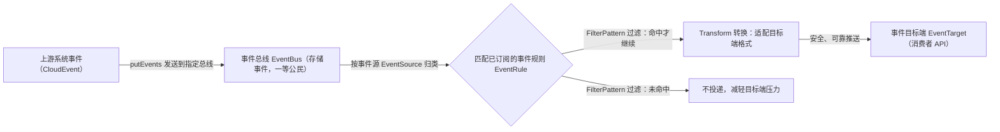
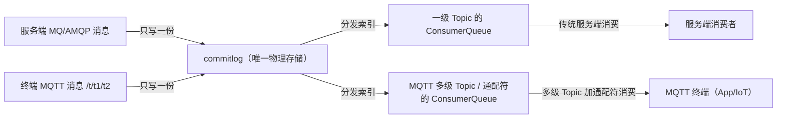
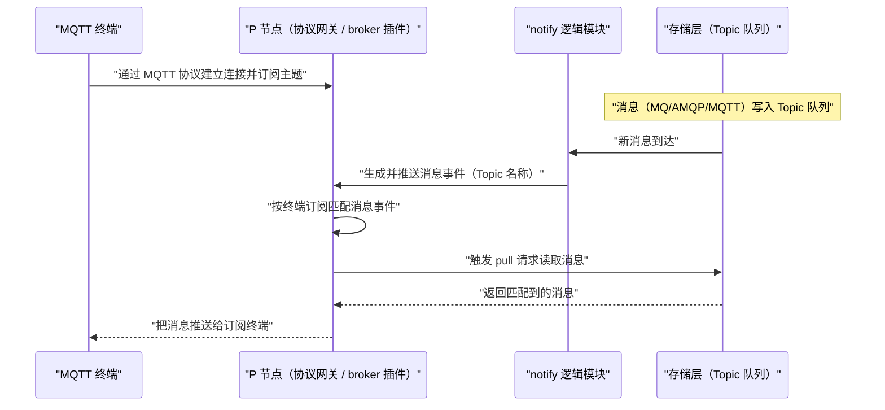
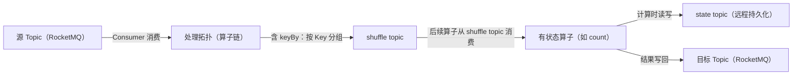
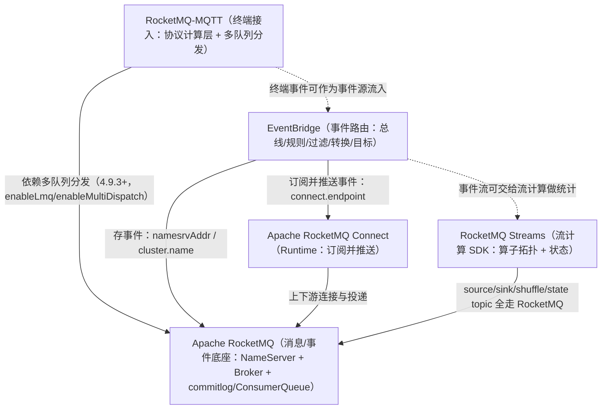

## 为什么需要这三件套？（痛点引入）

先看一个真实的场景：你维护的电商系统里，一笔「支付成功」发生了。接下来有三拨人想要知道这件事——

- 库存中心要**扣减库存**，它是个 Java 微服务，希望收到一个字段齐全的 JSON 事件；
- 仓库管理员要**收到手机推送**，他的手机 App 走的是 MQTT 长连接，只有 2KB 带宽；
- 实时大屏要**每 5 秒统计一次**支付金额的分位数，这是一段有状态的流计算。

三件事的诉求完全不同：一个是**跨系统的可靠投递与格式转换**，一个是**海量终端设备的轻量收发**，一个是**对事件流做聚合计算**。如果都为它们写一套「监听 + 解析 + 重试 + 落库」的胶水代码，很快就会发现：同样的解耦逻辑你在三个语言、三套 SDK、三种协议里各写了一遍，改一处要改三处。

Apache RocketMQ 用三个**生态组件**把这三类需求各自收敛成一个可复用的能力，而不是让你在业务里重新发明：

| 痛点（不装这些组件时） | EventBridge 的改善 | MQTT 的改善 | Streams 的改善 |
|------------------------|--------------------|-------------|----------------|
| 消费者要理解上游业务语义、写大量适配代码 | 由事件总线按目标 API 的格式过滤并转换后再投递 | —— | —— |
| IoT 设备/App 数量大、带宽窄、网络不稳，无法用重量级 SDK 接入 | —— | 提供基于 Pub/Sub 的轻量协议接入，统一到 RocketMQ 存储 | —— |
| 想做一段流式统计却要部署一套重型流计算服务端 | —— | —— | 以 SDK 方式嵌入应用即可获得流计算能力 |
| 上游消息格式一变就全线告警、运维成本高 | 事件总线在投递前做格式兼容性校验 | 存储与协议解耦，协议层可插拔 | 拓扑与状态跟随源数据分片，扩容不重写逻辑 |

> ### 💡 新人小结：这三件套到底各自是什么？
>
> 把它们想象成「一栋写字楼里的三种配套服务」，它们都围绕同一套水电（RocketMQ 的存储与投递），但服务对象不同：
> - **EventBridge = 前台收发室**：外面寄来的包裹（事件）格式五花八门，收发室按每家公司登记的「收件规则」（过滤 + 转换）拆开、重新打包，再送到对应公司门口（目标端 API）。公司不需要自己看得懂外面的包裹。
> - **MQTT = 外卖柜 + 跑腿系统**：面向海量、小而频繁的外部订单（IoT 设备、App），用一套统一的轻量下单协议（Pub/Sub）接单，货还是存进同一间冷库（RocketMQ 的 commitlog）。
> - **Streams = 楼里的中央厨房**：进来的食材（数据流）不必送到外面的重型加工厂，装一套小型灶台（SDK）就能就地切配、称重、出菜（map/count/window），把成品（结果）送回冷库。
>
> **一句话：EventBridge 管「事件怎么送到对的人手里并变成他要的格式」，MQTT 管「海量终端怎么收发」，Streams 管「数据流过的时候顺手做点计算」。**

**我要做什么 → 选哪个组件（决策树）**

```
你要做的事是什么？

事件要跨系统投递，且下游要的格式和上游不一样  →  EventBridge
        关注点：事件源/总线/规则/过滤/转换/目标端

接入的是 IoT 设备或手机 App，走多级 Topic 与通配符订阅  →  MQTT
        关注点：协议网关、多级 Topic 消费、存储统一

数据流过时要 map / keyBy / count / window 这类算子计算  →  Streams
        关注点：拓扑构建器、算子链、状态与扩缩容

三者可以叠加：MQTT 收上来的终端事件，交给 EventBridge 路由，交给 Streams 做统计——见文末「三组件联用时谁依赖谁」
```

**学习路线图**（本文按三块推进，每块都是「为什么 → 概念 → 架构 → 快速开始 → 常见坑」）

```
痛点与选型 → EventBridge → MQTT → Streams → 联用依赖 → 术语表 → 要点总结
为什么装它   事件模型与路由  三级话题映射  流计算DSL   谁依赖谁    概念对齐    带走几点
```

**三组件对比表（定位 / 协议或接口 / 状态管理 / 典型场景 / 部署依赖）**

| 维度 | EventBridge | MQTT | Streams |
|------|-------------|------|---------|
| 定位 | 事件驱动架构的事件中心，负责事件的路由、过滤与格式转换 | RocketMQ 的 IoT/移动终端接入扩展项目，实现终端与服务端消息的统一接入与互通 | 基于 RocketMQ 的轻量级流计算引擎 |
| 协议／接口 | 面向事件的 API（创建总线/源/规则/目标、putEvents），事件体遵循 CloudEvent | MQTT 协议接入（Pub/Sub），网关可作协议网关或 broker 插件 | 内嵌 SDK 的流式算子接口（StreamBuilder／RStream／GroupedStream／WindowStream） |
| 状态管理 | 规则/源/目标等配置存于 MySQL；事件本身落在事件总线（默认 RocketMQ） | 消息统一写一份到 commitlog，再分发为多级 ConsumerQueue 索引 | 有状态算子本地依赖 RocksDB 加速读取、远程依赖 RocketMQ 持久化；状态按源数据分片 MQ 保存 |
| 典型场景 | 事件通知（微服务间）、系统间集成（多 SaaS 产品间） | IoT 设备消息、手机 App 消息、服务端与终端一体化收发 | 单词计数、窗口聚合、双流 Join 等轻量流计算 |
| 部署依赖 | 需一个消息服务存事件（默认 RocketMQ）+ 一个 Runtime 订阅并推送（默认 RocketMQ Connect）+ EventBridge 本体 + MySQL | 依赖 RocketMQ 底层多队列分发，需 RocketMQ 4.9.3+ 且开启 enableLmq / enableMultiDispatch；先启 meta 再启 mqtt broker | 以 SDK 被应用依赖即可运行（本地需启动 RocketMQ；工程内运行示例要求 RocketMQ 5.0 及以上） |

> [!NOTE] 版本适用：本文的合并判据（照 `复刻覆盖矩阵.md` 的逐字节 MD5 结论，已实测复核）
> - **EventBridge**：4.x 与 5.0 的 3 篇源文件（Concepts／Overview／QuickStart）**两两逐字节相同**，MD5 前 10 位分别是 `7bba8df2b5`／`c16aff3459`／`4fdb351bc5`。因此本文对 EventBridge 只写一份，无需版本分栏。
> - **Streams**：4.x 与 5.0 的 3 篇源文件（Overview／Concept／QuickStart）**两两逐字节相同**，MD5 前 10 位分别是 `4b1a278550`／`089c5780a0`／`43438f3bb7`。同样只写一份。
> - **MQTT**：两版**存在差异**——Overview 为 3,647（4.x） vs 3,494（5.0） 字节、QuickStart 为 1,751（4.x） vs 1,739（5.0） 字节。差异点会在 MQTT 一节用「旧写法 / 新写法」对照表逐条列出，不取单一版本作通用结论。

---

## EventBridge：把「事件」送到对的人手里

### 核心概念逐个解释

理解 EventBridge 中的核心概念，能帮助我们更好地分析和使用 EventBridge。上游「核心概念」一节列出了六个术语，下面**逐个落地解释**（术语定义均来自上游，例句沿用上游类比）。

#### EventSource（事件源）

事件源，代表事件发生的源头，用来描述一类事件，一般与微服务系统一一对应。比如：交易事件源、考勤事件源等等。事件源是对事件的一个大的分类，一个事件源下面往往会包含多种事件类型（type），比如交易事件源下面可能包含下单事件、支付事件、退货事件等等。

需要注意：事件源**并不用来描述发生事件的实体**，取而代之的是，在 CloudEvent 中一般选用 `subject` 来表示产生这个事件的实体资源。事件源有点像市场经济大卖场中的大类分区（生鲜区、日化日用区、家用电器区……），在事件中心这个「大卖场」里可以通过事件源快速找到需要的事件。所有发送到 EventBridge 中的事件都必须标注事件源名称信息，对应 CloudEvent 事件体中的 `source` 字段。

#### EventBus（事件总线）

事件总线是存储事件的地方，其下可以有多种实现，包括 Local、RocketMQ、Kafka 等。

事件生产者发送事件的时候必须指定事件总线。事件总线是 EventBridge 的**一等公民**，其他所有资源都围绕事件总线形成逻辑上的隔离，即：事件源、事件规则必须都隶属于某一个事件总线下。不同事件总线下的事件源和事件规则可以重名，但是同一个事件总线下的事件源和规则必须不重名。

#### EventRule（事件规则）

当消费者需要订阅事件时，可以通过规则配置过滤和转换信息，将事件推送到指定的目标端。所以，**事件规则包含三部分：事件过滤 + 事件转换 + 事件目标**。官方给的规则结构图如下：


上图把一条规则拆成「过滤（FilterPattern）→ 转换（Transform）→ 目标（EventTarget）」三段流水，读图要点是：一条规则就是这三段的组合，缺一不可。

#### FilterPattern（事件过滤模式）

通过事件过滤模式，可以对事件总线上的事件进行过滤，只将目标端需要的事件推送过去，以减少不必要的开通、同时减轻消费者 Target 端的压力。目前 EventBridge 支持的事件过滤能力包括：

| 过滤能力 | 一句话说明 | 直觉类比 |
|----------|-----------|---------|
| 指定值匹配 | 字段值等于给定值才保留 | 「只要收件人是张三」 |
| 前缀匹配 | 字段值以给定前缀开头才保留 | 「单号以 ORD 开头」 |
| 后缀匹配 | 字段值以给定后缀结尾才保留 | 「文件名以 .pdf 结尾」 |
| 除外匹配 | 命中给定条件的反而排除 | 「除了测试账号」 |
| 数值匹配 | 按数值区间比较（如大于/介于） | 「金额 > 10000」 |
| 数组匹配 | 字段是数组时按元素命中 | 「标签数组含 vip」 |
| 复杂的组合逻辑匹配 | 以上多种条件按与/或组合 | 「(前缀 ORD 且金额>1000) 或 除外测试账号」 |

> [!NOTE] 上游说明：FilterPattern 各项能力的「详细介绍待见其他文章」。
> 本节的七种过滤能力名称逐条来自上游 `01RocketMQEventBridgeConcepts.md`，但上游未在这些名称之外给出具体语法、示例 JSON 或匹配优先级——因此本文不给出 FilterPattern 的可运行过滤表达式样例，避免编造。

#### Transform（事件转换）

生产者的事件可能会同时被多个消费者订阅，但不同消费者需要的数据格式往往不同。这个时候需要将生产者的事件转换成消费者 Target 端需要的事件格式。目前 EventBridge 支持的事件转换能力包括：

| 转换能力 | 上游原文口径 | 通俗理解 |
|----------|--------------|---------|
| 完整事件 | 不做转换，直接投递原生 CloudEvents | 整件原样转交 |
| 部分事件 | 通过 JsonPath 语法从 CloudEvents 中提取出需要投递到事件目标的内容 | 只取抽屉里那几样 |
| 常量 | 事件只起到触发器的作用，投递内容为常量 | 「按门铃」只用来触发，报固定文案 |
| 模板转换器 | 通过定义模板，灵活地渲染投递出去的事件格式 | 套一封填空式信件模板 |

> [!NOTE] 上游说明：Transform 各项能力的「详细介绍待见其他文章」。
> 四种转换能力名称逐条来自上游；上游在本板块未对 JsonPath 提取、模板语法给出完整可运行示例，故本文不虚构转换配置细节。

#### EventTarget（事件目标端）

事件目标端，也即我们的事件消费者。在 EventBridge 架构中，消费者只需要按照自己的业务领域模型设计，提供一个公共的 API（这个 API 既可用来接收事件，同时也用来前台管控面操作），EventBridge 就会按照 API 定义需要的数据格式，将事件安全、可靠地推送给 Target 消费者。

> ### 💡 新人小结：六个概念怎么串成一条投递流水？
>
> 还是把 EventBridge 想成写字楼收发室：
> - **EventSource** = 「这是哪个部门寄来的」（交易部/考勤部），对应 CloudEvent 的 `source`；寄件人是谁则写在 `subject` 上。
> - **EventBus** = 收发室里那个「总收件架」，是所有一等资源的归属，别的都要挂在某个架子下。
> - **EventRule** = 你登记的那张「代收单」，由「先筛（FilterPattern）+ 后改（Transform）+ 送到哪（EventTarget）」三段组成。
> - **FilterPattern** = 「只代收金额>1000 的件」，别的挡在门外，省得你拆无用包裹。
> - **Transform** = 把寄来的整箱，按你要求拆成「只要发票」或「套上你的表格」。
> - **EventTarget** = 你公司门口那个统一的收件 API，你只管按自己的格式开门。
>
> **一句话：事件从 source 进、按 bus 存、按 rule 筛与改、最后送到 target；六个概念就是一条流水的六个工位。**

### 什么时候用消息、什么时候用事件

RocketMQ EventBridge 致力于帮助用户构建高可靠、低耦合、高性能的事件驱动架构。在事件驱动架构中，微服务不需要主动订阅外部消息，而是可以把所有触发微服务系统发生改变的入口统一到 API，并只需要关注当前微服务自己的业务领域模型定义和设计 API，无需通过大量的胶水代码去适配解析外部服务的消息；EventBridge 则负责将外部服务产生的事件安全、可靠地适配并投递到当前微服务设计的 API。

那什么时候使用 RocketMQ 消息、什么时候使用 EventBridge 事件？事件的含义是什么，和消息有什么区别？上游给了事件的定义：

```text
事件是指过去已经发生的事，尤其是比较重要的事。
```

消息包含 Command 消息和 Event 消息。Command 消息是外部系统发送给本系统的一条操作命令；Event 消息则是本系统收到 Command 操作请求、系统内部发生改变之后而产生的事件。官方用一张图说明消息与事件的关系：


上图左半是 Command（外部发给本系统的操作命令），右半是 Event（本系统处理命令后内部状态改变而产生的事件）。

### 事件的四个特性

上游把事件相对消息的差别归纳为四个特性，逐条解释如下。

#### 1、已发生

事件一定是「已发生」的。「已发生」同时意味着**不可变**——这个特性非常重要：在处理、分析事件时，我们绝对可以相信这些事件，只要是收到的事件，一定是系统真实发生过的行为。

Command 则代表一种操作请求，是否真的发生不可得知。上游的对照例子：

```text
// Command（操作请求，是否发生不可得知）
* 把厨房的灯打开
* 去按下门铃
* 转给A账户10w

// Event（明确已经发生的事情）
* 厨房灯被打开了
* 有人按了门铃
* A账户收到了10w
```

#### 2、无期望

上游原文：事件是客观地描述一个事物的状态或属性值的变化，但对于如何处理事件本身并没有做任何期望；相比之下，Command 和 Query 则都是有期望的，他们希望系统做出改变或者返回结果，但 Event 只是客观描述系统的一个变化。

举例（沿用上游）：交通信号灯从绿灯变成黄灯，只是描述了一个客观事实，本身并没有客观期望。在不同国家地区，对这个事件赋予了不同的期望——比如在日本黄灯等于红灯，而在俄罗斯闯黄灯是被默许的。

与 Command 消息对比（沿用上游类比）：

| 概念 | 上游类比 | 含义 |
|------|----------|------|
| 事件 | 「市场经济」 | 商品被生产出来，摆放在商场的大橱窗里，消费者谁看着觉得好就买回去；如果一直没人买，商品可能就过期浪费了 |
| Command 消息 | 「计划经济」 | 按需生产，指定分配对象，也很少产生浪费 |

#### 3、天然有序且唯一

上游原文：同一个实体，不能同时发生 A 又发生 B，必有先后关系；如果是，则这两个事件必属于不同的事件类型。

比如针对同一个交通信号灯，不能既变成绿灯又变成红灯，同一时刻只能变成一种状态。如果看到了两个内容一样的事件，那么一定是发生了两次，而且一次在前、一次在后。这对于处理数据最终一致性、以及系统行为分析（比如 ABA 场景）都很有价值：看到的不仅是一个最终结果，而是变成这个结果之前的一系列中间过程。

#### 4、具像化

事件会尽可能地把「案发现场」完整地记录下来，因为事件不知道消费者会如何使用它，所以会做到尽量详尽。包括：

```text
什么时候发生的事件？
谁产生的？
是什么类型的事件？
事件的内容是什么？内容的结构是什么？
... ...
```

对比常见的消息，因为上下游一般是确定的，常常为了性能和传输效率会做到尽可能精简，只要满足「计划经济」指定安排的消费者需求即可。

### RocketMQ EventBridge 的典型应用场景

上游列举了两个场景，分别面向「一个产品内部」与「多个产品之间」。

#### 场景 1：事件通知

微服务中常常会遇到需要把一个微服务中生产的消息通知给其他消费者的场景。上游对比了三种方式：

| 方式 | 上游描述 | 代价 |
|------|----------|------|
| A：强依赖方式 | 生产者主动调用消费者的微服务，并适配消费者的 API | 生产者强依赖消费者、深度耦合；万一调用某消费者出现异常且未做有效隔离，极易导致整个微服务 Hang 起；新消费者进来时扩展性极差 |
| B：半解耦方式 | 生产者将消息发送到消息服务，消费者订阅消息服务获取消息，并解析成自己业务领域模型需要的数据格式 | 做到了调用链路解耦、降低系统风险；但消费者仍需理解并解析生产者业务语义，订阅多个生产者时要大量胶水代码为每个生产者做适配；上游消息格式变化时存在风险和运维成本 |
| B：完全解耦方式 | 消费者不引入 SDK 订阅 Broker，只按自己的业务领域模型设计 API，消息服务将上游事件过滤并转换成 API 需要的格式 | 既无调用链路依赖、也无业务依赖；上游事件数据格式变化时消息服务会做兼容性校验，可拒绝生产者发送事件或告警 |

> [!NOTE] 上游编号说明
> 上游原文把后两种方式都标作「B」（半解耦、完全解耦各一段），此处**照搬上游标注**、不擅自改成 A/B/C，以免与原文措辞冲突。官方对比图如下：


上图从左到右是「强依赖 → 半解耦 → 完全解耦」三阶段：直连箭头逐步收敛为「都只连中间层」，正是 EventBridge 想落地的形态。

#### 场景 2：系统间集成

场景 1 主要面向一个产品内部各微服务之间的事件通信；场景 2 则面向多个产品之间的事件通信。在一个企业中常常会用到多款产品，很多产品并非自己开发、而是购买的外部 SaaS 服务；此时若希望事件在不同外部 SaaS 产品之间流转是比较困难的，因为这些产品不是自己开发的、无法轻易修改其中的代码。EventBridge 提供的事件中心能力，能够帮助收集各个产品产生的事件并很好地组织管理起来——就像大卖场橱窗里的商品，精心摆放准备好、配备介绍说明书，供消费者挑选，同时提供送货上门服务。


上图是「事件中心」作为中转枢纽：多家外部产品的产出汇入中心，中心再按订阅关系分发到各消费方。

### RocketMQ EventBridge 是如何工作的？（从 5 个方面入手）

为了解决上述两个应用场景中提到的问题，上游说明 EventBridge 从以下 5 个方面入手：

1. **确定事件标准**：事件不是给自己看的，而是给所有人看的，它没有明确的消费者、所有都是潜在的消费者，所以要规范化事件的定义，让所有人都能看得懂。目前 CNCF 旗下的 CloudEvent 已逐渐成为广泛的事实标准，因此选取 CloudEvent 作为 EventBridge 的事件标准。
2. **建立事件中心**：事件中心里有所有系统注册上来的各种事件，就像市场经济大卖场，琳琅满目分类摆放，所有人即使不买也都可以进来瞧一瞧，看有哪些事件可能是自己需要的。
3. **定义事件格式**：事件格式用来描述事件的具体内容，相当于市场经济的一个买卖契约——生产者发送的事件格式得确定下来、不能总是变，消费者以什么格式接收事件也得确定下来，不然整个市场就乱套了。
4. **订阅「规则」**：要给消费者一个把事件投递到目标端的能力，并且投递前可以对事件进行过滤和转换，让它适配目标端 API 接收参数的格式，这个过程叫做创建订阅规则。
5. **事件总线**：最后还得有一个存储事件的地方，就是官方架构图最中间的「事件总线」。

下图把「事件从上游进来、经总线、被规则筛改、送达目标端」的流水画出来（依据上面第 2～5 步整理，非上游原图）：



图后解读：事件总线只负责「存与按源归类」，真正决定「给不给、给成什么样、给到谁」的是事件规则的三段（FilterPattern → Transform → EventTarget）。这也解释了为什么完全解耦方式下消费者无需引入 SDK 订阅 Broker——投递与格式适配都发生在总线侧的规则里。

官方给的「EventBridge 如何工作」总览图如下，可与上面的流水图对照看：


### 快速开始：部署依赖顺序与关键配置

RocketMQ EventBridge 需要一个消息服务来存储事件，另外需要一个 Runtime 来订阅并推送事件。上游默认**选择 Apache RocketMQ 作为消息服务、选择 Apache RocketMQ Connect 作为 Runtime 来订阅和推送事件**；当然也可以选择其他消息服务代替，EventBridge 并不对此做限制。未来 EventBridge 也计划基于 OpenMessaging Connect API 实现自己的 Runtime。

**系统要求**（照搬上游）：

- 64 位操作系统，推荐 Linux/Unix/macOS
- 64 位 JDK 1.8+

**部署依赖顺序**（必须先有存储、再有 Runtime、最后起 EventBridge）：

```
① 部署 Apache RocketMQ      →  作为 EventBus 的默认存储（上游称「很棒的消息服务，默认选择它作为 EventBus 的默认存储」）
② 部署 Apache RocketMQ Connect →  作为默认 Runtime，连接外部上下游服务
③ 部署 RocketMQ EventBridge   →  本体，读写 MySQL 存配置、连 RocketMQ、连 Connect
```

上游把这三步分别放在「部署Apache RocketMQ」「部署Apache RocketMQ Connect」「部署RocketMQ EventBridge」三个小节。第 ② 步在部署 RocketMQ Connect 之前，上游要求下载下列插件并放到 `rocketmq-connect` 中配置参数 `pluginPaths` 所定义的目录下（jar 名照搬上游链接文件名）：

```text
rocketmq-connect-eventbridge-0.0.1-SNAPSHOT-jar-with-dependencies.jar
rocketmq-connect-dingtalk-1.0-SNAPSHOT-jar-with-dependencies.jar
connect-cloudevent-transform-1.0.0-SNAPSHOT-jar-with-dependencies.jar
connect-filter-transform-1.0.0-SNAPSHOT-jar-with-dependencies.jar
connect-eventbridge-transform-1.0.0-SNAPSHOT-jar-with-dependencies.jar
```

第 ③ 步：从上游给出的下载地址获取 `rocketmq-eventbridge-xxx-bin-release.zip`，解压后得到如下目录（照搬上游）：

```text
/rocketmq-eventbridge-xxx-bin-release/
|——bin
|   |——runserver.sh
|   |——eventbridge.sh
|——config
|   |——application.properties
|——jar
|   |——rocketmq-eventbridge.jar
```

**关键配置**：运行前需要配置 EventBridge 的运行环境，修改 `config/application.properties`。下面的注释逐字照搬上游：

```properties
# 配置 EventBridge 运行环境：config/application.properties
# Mysql数据库的连接地址
spring.datasource.url=jdbc:mysql://xxxx:3306/xxxx?characterEncoding=utf8   # ✅ EventBridge 的总线/源/规则/目标等元数据存 MySQL，必须先建库
spring.datasource.username=xxx
spring.datasource.password=xxxx

# RocketMQ nameserver的连接地址
rocketmq.namesrvAddr=xxxxx:9876          # ✅ 指向第①步部署的 RocketMQ，事件实际落在这里

# RocketMQ的集群名称.
rocketmq.cluster.name=DefaultCluster     # 上游取值 DefaultCluster

# RocketMQ Connect的连接地址
rocketmq.connect.endpoint=xxxxxx:8082    # ✅ 指向第②步部署的 Connect Runtime，EventBridge 通过它订阅与推送

# log默认配置
log.path=～
log.level=INFO
app.name=rocketmq-eventbridge
# ❌ 反例：以上 xxxxx 全是占位串，原样上线会连不上 MySQL/NameServer/Connect
# ✅ 逐项替换为真实地址后再启动
```

参数解释：

| 配置项 | 作用 | 上游给的取值/说明 |
|--------|------|-------------------|
| `spring.datasource.url` | MySQL 连接地址（EventBridge 元数据存这里） | `jdbc:mysql://xxxx:3306/xxxx?characterEncoding=utf8`，占位串需替换 |
| `spring.datasource.username` / `password` | MySQL 账户口令 | 上游用 `xxx` / `xxxx` 占位 |
| `rocketmq.namesrvAddr` | RocketMQ NameServer 连接地址 | 上游 `xxxxx:9876` |
| `rocketmq.cluster.name` | RocketMQ 集群名称 | 上游示例为 `DefaultCluster` |
| `rocketmq.connect.endpoint` | RocketMQ Connect 连接地址 | 上游 `xxxxxx:8082` |
| `log.path` / `log.level` / `app.name` | 日志路径、级别、应用名 | 上游 `log.path=～`、`log.level=INFO`、`app.name=rocketmq-eventbridge` |

**启动 EventBridge**：

```shell
sh bin/eventbridge.sh start
# 输出: 上游未给出命令行输出样例；上游说明启动后可通过日志观察服务是否正常启动
```

上游补充：log 默认目录为 `～/rocketmq-eventbridge/rocketmq-eventbridge.log`，可以修改上述 `log.path` 和 `app.name` 进行修改，可以通过日志来观察服务是否正常启动：


上图是上游给的启动成功日志截图（截图内容以图片为准，本文不转述其逐行文字以免误读）。

**Demo：按顺序创建总线→源→规则→目标，再发送事件**。以下 HTTP 请求体照搬上游，示例中的 `demo.eventbridge.com` 为占位 Host。

创建事件总线：

```text
POST /bus/createEventBus HTTP/1.1
Host: demo.eventbridge.com
Content-Type: application/json; charset=utf-8
{
"eventBusName":"demo-bus",
"description":"a demo bus."
}
# 输出: 上游未给出输出样例（该 Demo 仅给出请求体）
```

创建事件源：

```text
POST /source/createEventSource HTTP/1.1
Host: demo.eventbridge.com
Content-Type: application/json; charset=utf-8
{
"eventBusName":"demo-bus",
"eventSourceName":"demo-source",
"description":"A demo source."
}
# 输出: 上游未给出输出样例
```

创建事件规则（注意 `filterPattern` 上游示例给的是空对象串 `"{}"`，即不过滤、全量匹配）：

```text
POST /rule/createEventRule HTTP/1.1
Host: demo.eventbridge.com
Content-Type: application/json; charset=utf-8
{
  "eventBusName":"demo-bus",
  "eventRuleName":"demo-rule",
  "description":"A demo rule.",
  "filterPattern":"{}"
}
# 输出: 上游未给出输出样例
```

创建事件目标——上游给了两种目标：一是投递到云上 EventBridge（`className` 为 `acs.eventbridge`），二是投递到钉钉机器人推送通知（`className` 为 `acs.dingtalk`）：

```text
// ✅ 目标一：投递到云上 EventBridge
POST /target/createEventTargets HTTP/1.1
Host: demo.eventbridge.com
Content-Type: application/json; charset=utf-8
{
    "eventBusName":"demo-bus",
    "eventRuleName":"demo-rule",
    "eventTargets":[
            {
            "eventTargetName":"eventbridge-target",
            "className":"acs.eventbridge",
                "config":{
                "RegionId":"cn-hangzhou",
                "AliyunEventBus":"rocketmq-eventbridge"
                }
            }
        ]
}

// ✅ 目标二：投递到钉钉机器人（WebHook/SecretKey/Body 均为上游示例串，实际须换成自己的）
POST /target/createEventTargets HTTP/1.1
Host: demo.eventbridge.com
Content-Type: application/json; charset=utf-8
{
    "eventBusName":"demo-bus",
    "eventRuleName":"demo-rule",
    "eventTargets":[
        {
            "eventTargetName":"dingtalk-target",
            "className":"acs.dingtalk",
            "config":{
            "WebHook":"https://oapi.dingtalk.com/robot/send?access_token=b43a54b702314415c2acdae97eda1e092528b7a9dddb31510a5b4430be2ef867",
            "SecretKey":"SEC53483bf496b8f9e0b4ab0ab669d422208e6ccfaedfd5120ea6b8426b9ecd47aa",
            "Body":"{\"template\":\"{\\\"text\\\":{\\\"content\\\":\\\"${content}\\\"},\\\"msgtype\\\":\\\"text\\\"}\",\"form\":\"TEMPLATE\",\"value\":\"{\\\"content\\\":\\\"$.data.body\\\"}\"}"
            }
        }
    ]
}
// 输出: 上游未给出输出样例
```

发送事件到 EventBus（注意 `Content-Type` 为 `application/cloudevents+json`，即 CloudEvent 载体；上游最后一步是「通过 API 发送一条事件，并验证 Target 端是否按预期收到对应的事件」）：

```text
POST /putEvents HTTP/1.1
Host: demo.eventbridge.com
Content-Type:"application/cloudevents+json; charset=UTF-8"
{
  "specversion" : "1.0",
  "type" : "com.github.pull_request.opened",
  "source" : "https://github.com/cloudevents/spec/pull",
  "subject" : "123",
  "id" : "A234-1234-1234",
  "time" : "2018-04-05T17:31:00Z",
  "datacontenttype" : "application/json",
  "data" : {
    "body":"demo"
  },
  "aliyuneventbusname":"demo-bus"
}
# 输出: 上游未给出输出样例（上游只说「验证 Target 端是否按预期收到对应的事件」，未附响应体）
```

CloudEvent 字段解释（这些字段名与示例值均来自上面这条上游请求）：

| 字段 | 含义 | 上游示例值 |
|------|------|-----------|
| `specversion` | CloudEvents 规范版本 | `1.0` |
| `type` | 事件类型，描述发生了什么类别的事 | `com.github.pull_request.opened` |
| `source` | 事件源，对应 EventSource 概念 | `https://github.com/cloudevents/spec/pull` |
| `subject` | 产生事件的实体资源（事件源不描述实体，实体放这里） | `123` |
| `id` | 事件唯一标识 | `A234-1234-1234` |
| `time` | 事件发生时间戳 | `2018-04-05T17:31:00Z` |
| `datacontenttype` | data 的内容类型 | `application/json` |
| `data` | 事件负载 | `{"body":"demo"}` |
| `aliyuneventbusname` | 目标事件总线名 | `demo-bus` |

### EventBridge 常见坑

| 坑 | 现象 | 正确做法 |
|----|------|---------|
| 没先起 RocketMQ / Connect 就配 EventBridge | `namesrvAddr`、`connect.endpoint` 指向不存在的地址，事件存不进、推不出 | 严格按「① RocketMQ → ② RocketMQ Connect → ③ EventBridge」顺序部署 |
| 漏放 Connect 插件 jar | 规则创建了却不投递，或目标端/转换不生效 | 把上游列的 5 个 jar 放到 `pluginPaths` 定义的目录 |
| 同一总线内事件源/规则重名 | 配置互相覆盖 | 上游明确：不同总线可重名，但同一总线下的事件源和规则必须不重名 |
| 把「事件」当「Command」用 | 期待投递即触发并拿到返回值 | 事件是「无期望」的客观记录；要「指定分配、按需生产」的场景是 Command 消息，不是事件 |
| 目标端格式没转换就对接 | 目标 API 解析失败 | 在规则里用 Transform（完整/部分/常量/模板）把事件转成目标端要的格式 |

---

## MQTT：让 IoT 设备与手机 App 也能连上 RocketMQ

### 为什么需要 RocketMQ-MQTT

传统消息队列 MQ 主要应用于服务端之间的消息通信，如电商领域的交易、支付、物流等消息。然而随着物联网（IoT）及移动互联网的发展，来自 IoT 设备和手机 App 端的消息呈爆炸式增长，规模远远超出了传统的服务端消息，这类终端设备消息需要更高效、更统一的消息系统来管理。

通过建立统一的消息系统，可实现多场景计算（如流式计算和事件驱动计算），并实现多场景（如 IoT 设备、手机 App 和服务端）消息的统一接入与管理。数据统一存储于同一系统，能有效降低存储成本，避免跨系统数据同步带来的数据一致性问题。


上图是上游「统一消息系统」的立意图：服务端消息与终端消息汇到同一套存储。因此上游引入了 **RocketMQ-MQTT 扩展项目，以实现 RocketMQ 统一接入 IoT 设备与服务端消息，提供一体化消息存储与互通能力**。

### 4.x 与 5.0 的差异（本文唯一需分版对照的组件）

上游明确：MQTT 的两篇源文件 4.x 与 5.0 **内容不同**（Overview 3,647 vs 3,494 字节、QuickStart 1,751 vs 1,739 字节）。逐段核对后，差异点如下——**架构与收发模型两版一致，差在「协议叙述」与「章节标题」**：

| 段落 | 4.x（旧写法） | 5.0（新写法） | 差异性质 |
|------|--------------|--------------|---------|
| 开篇立意 | 「规模远远超出了传统的服务端消息……需要更高效、更统一的消息系统来管理」 | 「然而在消息这个大类下，还有一个……IoT 类终端设备消息……数量级比传统服务端的消息要大很多量级并仍然在快速增长」 | 措辞更详实，结论一致 |
| 多场景计算举例 | 「多场景计算（如流式计算和事件驱动计算）」 | 「多场景计算（如 stream、event）」 | 举例用词：中文 vs 英文 |
| 协议小节标题 | `## MQTT协议简介` | `## MQTT协议` | 标题精简 |
| 协议出身描述 | 「……专为低带宽和网络不稳定的物联网环境设计。**它最初由 IBM 开发，现由 OASIS 联盟作为开放标准维护。**MQTT 广泛应用于物联网、智能硬件、车联网、智慧城市、远程医疗、电力、石油与能源等多个领域」 | 「……是起源于物联网 IoT 场景，**OASIS 联盟定义的标准的开放式协议**。因为 IoT 设备种类繁多，运行环境各异，一个标准的接入协议尤为关键」 | 4.x 独有「IBM 开发」与「六大行业清单」「低带宽/网络不稳定」表述；5.0 未写这些 |
| Pub/Sub 对比 | 「MQTT 的核心通信模型也是 Pub/Sub……支持多级 Topic 订阅（如 /t/t1/t2）和通配符订阅（如 /t/t1/+）」 | 「MQTT 协议定义的是一个 Pub/Sub 的通信模型……可以支持多级 Topic 订阅（如 "/t/t1/t2"），甚至可以支持通配符订阅（如 "/t/t1/+"）」 | 结论一致，标点/引号不同 |
| 模型小节标题 | `## RocketMQ MQTT 架构设计` + 一句总述 | `## 模型介绍`（无该总述句） | 4.x 独有「架构的目标是实现消息存储与分发的统一管理，并在不侵入 RocketMQ Broker 核心逻辑的前提下实现多协议接入。为此，我们设计了两大核心模型：队列存储模型和推拉模型」 |
| 推拉模型末句 | 「网关节点根据终端订阅的主题匹配消息事件，并触发 pull 请求至存储层，最终将消息推送至订阅终端」 | 「网关节点根据其连上的终端设备订阅情况进行内部匹配，找到哪些终端设备能匹配上，然后会触发 pull 请求去存储层读取消息再推送至终端设备」 | 描述更细化，机制一致 |
| 快速开始配置 | 有独立 `## 配置说明` 标题 | 无 `## 配置说明` 标题（配置正文直接接在部署段后） | 标题层级；配置项内容两版相同 |

> [!NOTE] 结论：写通用结论时以两版交集为准
> 「多级 Topic + 通配符」「Pub/Sub 模型」「队列存储模型 + 推拉模型」「依赖 RocketMQ 4.9.3+ 的多队列分发」这些**两版都写**，可作为通用结论；「IBM 开发」「六大行业清单」「低带宽」等**只有 4.x 写**，引用时须标注「4.x 概览原文」，不得当成 5.0 也有的事实。

### MQTT 协议是什么

在 IoT 终端场景，目前业界广泛使用的是 MQTT 协议。MQTT 起源于物联网 IoT 场景，是一种基于发布/订阅（Pub/Sub）模式的轻量级消息传输协议，专为低带宽和网络不稳定的物联网环境设计（此段「轻量级/低带宽/网络不稳定」为 4.x 概览原文）。

MQTT 的核心通信模型也是 Pub/Sub，与 RocketMQ 比较类似，但在订阅方式上更为灵活，支持**多级 Topic 订阅**（如 `/t/t1/t2`）和**通配符订阅**（如 `/t/t1/+`）。通过 MQTT，我们可以轻松实现消息的广播、组播及单播。

| 概念 | 上游给的说明 | 通俗理解 |
|------|--------------|---------|
| Pub/Sub | MQTT 的核心通信模型，与 RocketMQ 类似 | 发布者把消息发到某个 Topic，订阅了该 Topic 的终端都能收到 |
| 多级 Topic | 形如 `/t/t1/t2` 的分层话题 | 像文件夹层级，按 `/省份/城市/区` 逐层细分 |
| 通配符订阅 | 形如 `/t/t1/+` | `+` 匹配一层，让一个订阅覆盖一批子话题 |
| 广播/组播/单播 | 「通过 MQTT 可以轻松实现消息的广播、组播及单播」 | 发给所有人 / 一组人 / 一个人 |

> [!NOTE] 关于 QoS 与 Clean Session
> 「多级 Topic / 通配符 / Pub/Sub」是上游 MQTT 概览明确写了的概念。而 QoS（服务质量等级）、Clean Session（会话清理标志）是 MQTT 协议里的通用概念，**本文的 MQTT 源文件（4.x 与 5.0）均未提及、未定义其级别或行为**，因此本文不给出它们在本项目里的具体取值或语义（见文末术语表中的对应说明），以免编造。

### 队列存储模型：一份存储、多级消费

上游先说明架构目标（此总述仅见于 4.x 概览）：RocketMQ MQTT 架构的目标是实现消息存储与分发的统一管理，并在不侵入 RocketMQ Broker 核心逻辑的前提下实现多协议接入，为此设计了两大核心模型——队列存储模型和推拉模型。

先看队列存储模型：


上游解释（两版一致）：设计了一种多维度分发的 Topic 队列模型，如上图所示，消息可以来自各个接入场景（如服务端的 MQ/AMQP、客户端的 MQTT），但**只会写一份存到 commitlog 里面**，然后分发出多个需求场景的队列索引（ConsumerQueue）——如服务端场景（MQ/AMQP）可以按照**一级 Topic 队列**进行传统的服务端消费，客户端 MQTT 场景可以按照 MQTT **多级 Topic 以及通配符订阅**进行消费消息。这样一个队列模型就可以同时支持服务端和终端场景的接入和消息收发，达到一体化的目标。

下面用一张自绘 Mermaid 把「单写多读」的多级映射关系画清楚（结构依据上游 cq 段整理，非上游原图）：



图后解读：commitlog 是「一份真身」，ConsumerQueue 是「按需生成的多份索引」；同一笔消息既能被服务端按一级 Topic 消费、又能被终端按多级 Topic/通配符消费，靠的就是这套「单写多分发」的索引模型（该分发能力来自 RocketMQ 4.9.3+ 的多队列分发，见下文部署说明）。

### 推拉模型：notify 事件驱动的 pull

再看推拉模型：


上游解释：图中的 P 节点是一个**协议网关或 broker 插件**，终端设备通过 MQTT 协议连到这个网关节点。消息可以来自多种场景（MQ/AMQP/MQTT）发送过来，存到 Topic 队列后会有一个 **notify 逻辑模块**来实时感知这个新消息到达，然后会生成消息事件（就是消息的 Topic 名称），将该事件推送至网关节点，网关节点根据终端订阅的主题匹配消息事件，并触发 pull 请求至存储层，最终将消息推送至订阅终端（5.0 表述为：网关根据其连上的终端设备订阅情况进行内部匹配，找到哪些终端设备能匹配上，然后触发 pull 请求去存储层读取消息再推送至终端设备）。

下图把这段「push 通知 + pull 取数」的时序画成 sequenceDiagram（依据上游推拉段整理，非上游原图）：



图后解读：实时性来自 notify 的「push 事件」，而真正的数据读取是网关发起的「pull」。也就是说 MQTT 终端的「收到推送」= 网关先被 notify 唤醒、再去存储层 pull 到数据后转发——这与核心概念文里 PushConsumer「SDK 长轮询拉回来再回调」的思路一致，都是「通知走 push、取数走 pull」。

### 架构概览：抽象出协议计算层


上游（两版一致）：目标是期望基于 RocketMQ 实现一体化且自闭环，但不希望 Broker 被侵入更多场景逻辑，于是抽象了一个**协议计算层**——这个计算层可以是一个网关，也可以是一个 broker 插件；Broker 专注解决 Queue 的事情以及为了满足上面的计算需求做一些 Queue 存储的适配或改造；协议计算层负责协议接入，并且要可插拔部署。上图即该分层：终端连协议计算层，协议计算层连 Broker/存储层。

### 快速开始：系统要求 / 部署 / 配置 / 示例

**系统要求**（两版一致，照搬上游）：

- 64 位操作系统，推荐 Linux/Unix/macOS
- 64 位 JDK 1.8+

**部署说明**：由于 RocketMQ-MQTT 项目依赖 RocketMQ 底层的多队列分发，**RocketMQ 从 4.9.3 版本开始支持这一特性**，因此需要确认 RocketMQ 的版本升级到 4.9.3 或更高版本，并且确保以下配置项已开启：

```text
# ✅ RocketMQ Broker 侧必须先开这两项，MQTT 的多队列分发才成立
enableLmq = true
enableMultiDispatch = true
# ❌ 若忘记开启 enableLmq / enableMultiDispatch，MQTT 依赖的多队列分发不生效（上游把这两项列为部署前置检查）
```

RocketMQ-MQTT 的部署参考项目说明，下载工程 release 版本或直接从源码构建：

```text
git clone https://github.com/apache/rocketmq-mqtt
cd rocketmq-mqtt
mvn -Prelease-all -DskipTests clean install -U
cd distribution/target/
# 输出: 上游未给出构建输出样例
```

**配置说明**（此小节标题仅 4.x 概览的 QuickStart 有；配置项内容两版相同）：源码构建完成后，编辑 `conf/service.conf`，完成 MQTT 相关配置。注释照搬上游：

```text
username=xxx    // 权限验证账户配置
secretKey=xxx    // 权限验证账户配置
NAMESRV_ADDR=xxx  //namesrv接入点
eventNotifyRetryTopic=xx   //notify重试topic，提前创建
clientRetryTopic=xx  //客户端消息重试topic，提前创建
# 输出: 上游未给出输出样例（配置文件，无运行输出）
```

参数解释（注释来自上游行内说明）：

| 配置项 | 上游说明 | 注意 |
|--------|---------|------|
| `username` / `secretKey` | 权限验证账户配置 | 上游用 `xxx` 占位，实际须替换 |
| `NAMESRV_ADDR` | namesrv 接入点 | 指向已开 `enableLmq` 的 RocketMQ |
| `eventNotifyRetryTopic` | notify 重试 topic，**提前创建** | 上游注释标注「提前创建」 |
| `clientRetryTopic` | 客户端消息重试 topic，**提前创建** | 上游注释标注「提前创建」 |

还有其他更详细的配置和前置步骤，上游指向项目 README（`https://github.com/apache/rocketmq-mqtt/blob/main/README.md`）。

最后**先启动 meta 服务（MQTT 的元数据中心），再启动 mqtt broker**。进入 `distribution/target/bin` 目录，启动进程：

```text
sh meta.sh start
sh mqtt.sh start
# 输出: 上游未给出输出样例；上游仅给出「先 meta 后 mqtt」的启动顺序
```

**示例说明**：RocketMQ-MQTT 项目工程代码里提供了基本的 example 代码（`mqtt-example` 模块），详见代码示例。上游列出四个类文件：

```text
MqttConsumer.java     // MQTT客户端启动订阅消息
MqttProducer.java     // MQTT客户端启动发布消息
RocketMQConsumer.java // RocketMQ客户端启动订阅消息
RocketMQProducer.java // RocketMQ客户端启动发布消息
# 输出: 上游未给出运行输出样例（这四个类是示例代码入口，正文未附其控制台输出）
```

这四个类恰好印证「一体化收发」：MQTT 侧的 `MqttProducer/MqttConsumer` 与服务端侧的 `RocketMQProducer/RocketMQConsumer` 共存于一个工程，对应上文「同一份 commitlog、两种消费视角」。

> ### 💡 新人小结：MQTT 为什么要「先写一份、再分多份索引」？
>
> 把 commitlog 想成图书馆里**唯一的原件书**，ConsumerQueue 想成**多套卡片目录**：
> - 服务端按「一级分类」编一套卡片（一级 Topic 队列），MQTT 终端按「省/市/区」三级编另一套卡片（多级 Topic/通配符队列）。
> - 原件书只有一本（只写一份到 commitlog），但两套目录都能查到它——省空间，还保证「服务端和终端看到的是同一份数据」。
> - 谁来「按目录取书、送上门」？就是那个 notify + 网关 pull 的跑腿员。
>
> **MQTT 的一体化，本质是「一份存储 + 多视角索引 + 网关代为取数」三件事叠在 RocketMQ 底座上。**

### MQTT 常见坑

| 坑 | 现象 | 正确做法 |
|----|------|---------|
| RocketMQ 版本低于 4.9.3 | 多队列分发不成立，MQTT 依赖的底座缺失 | 升级到 4.9.3 或更高版本（上游硬性要求） |
| 没开 `enableLmq` / `enableMultiDispatch` | MQTT 多级 Topic/通配符消费异常 | 在 Broker 配置里把两项置 true 后再部署 |
| 重试 topic 没提前创建 | `eventNotifyRetryTopic` / `clientRetryTopic` 相关功能异常 | 上游注释两处都标注「提前创建」，部署前先把这两个 topic 建好 |
| 启动顺序颠倒 | 先起 mqtt broker 再起 meta，元数据中心未就绪 | 上游要求「先 meta.sh start，再 mqtt.sh start」 |
| 把「MQTT 概览」的 4.x 独有表述当通用事实 | 例如把「IBM 开发/六大行业」写成 5.0 也有 | 引用协议出身描述时注明来源版本（见上文差异表） |

---

## Streams：不必部署重型流服务端的轻量流计算

### 为什么需要 RocketMQ Streams

RocketMQ Streams 是基于 RocketMQ 的**轻量级流计算引擎**。它能以 SDK 方式被应用依赖，**无须部署复杂的流计算服务端即可获得流计算能力**，因此具有资源消耗少、扩展性好、支持流计算算子丰富的特点。

痛点很直接：你只想对流过 RocketMQ 的数据做一次「按 key 计数」或「5 秒窗口求和」，但传统做法要先拉起一套重型流计算集群、再打通与 RocketMQ 的连接器，运维成本远超收益。Streams 的思路是把「算子拓扑」直接嵌进你的应用进程——它就是依赖了 Streams SDK 的一个普通 client。

### 整体架构：读进来、算完、写回去

数据从 RocketMQ 中被 RocketMQ-streams 消费，经过处理最终被写回到 RocketMQ。上游给的第一张总体架构图：


上图是最粗的闭环：RocketMQ → 消费 → 处理 → 写回 RocketMQ。第二张图把「处理」这一步拆开——一旦涉及 keyBy 与有状态算子，就会出现 shuffle topic 与 state topic：


上游对第二张图的解释：数据被 RocketMQ Consumer 消费，进入处理拓扑被算子处理；如果流处理任务中含有算子 keyBy，则需要将数据按照 Key 进行分组，将分组数据写入 shuffle topic，后续算子从 shuffle topic 消费；如果还涉及 count 之类有状态算子，那么计算时需要读写 state topic，计算结束后将结果写回到 RocketMQ 中。

下图把这条「源 topic → 算子 → shuffle topic → 有状态算子（读写 state topic）→ 结果回写」的数据流整理成 Mermaid（依据上游总体架构二文字整理，非上游原图）：



图后解读：Streams 把「shuffle」和「state」这两个流计算里最容易出问题的环节都**下沉回 RocketMQ 的 topic** 上——shuffle topic 负责把相同 key 的数据汇到一起，state topic 负责有状态算子的持久化。这也是下文「扩缩容时状态跟着源数据分片走」的根因。

### 消费模型：实例数不能大于 MQ 数


上游：计算实例实质上是依赖了 Rocket-streams SDK 的 client，因此计算实例消费的 MQ 依赖 RocketMQ rebalance 分配；**计算实例总个数也不能大于消费总 MQ 个数，否则将有部分计算实例处于等待状态、消费不到数据**。一个计算实例可以消费多个 MQ，一个实例内也只有一张计算拓扑图。

> ### 💡 新人小结：为什么「实例比队列多」是浪费而不是更快？
>
> 把 MQ 想成收银台要处理的**传送带**，计算实例是**收银员**：
> - 传送带（消费队列）只有 4 条，你请 6 个收银员，多出来的 2 个只能站着等——对应「实例数大于 MQ 数时，部分实例等待、消费不到数据」。
> - 一个收银员可以管多条传送带（一个实例可消费多个 MQ）。
> - 每个收银员面前只有**一台 POS 机**（一个实例内只有一张计算拓扑图）。
>
> **扩容加的是「传送带」，不是「收银员」——先把 MQ 数提上去，再加实例才有意义。**

### 状态：本地 RocksDB 加速、远程 RocketMQ 持久化


上游：对于有状态算子，比如 count，需要先对 count 算子进行分组，然后才能求和。分组算子 keyBy 会将数据按照分组的 key 重新写回 RocketMQ，并且使相同 key 写入同一分区（这一过程称作 shuffle），保证含有相同 key 的数据被同一个消费者消费。**状态本地依赖 RocksDB 加速读取，远程依赖 RocketMQ 做持久化。**

| 状态的两层 | 依赖 | 作用 |
|------------|------|------|
| 本地 | RocksDB | 加速读取（算子运行时就近读写状态） |
| 远程 | RocketMQ（state topic） | 做持久化（进程重启/迁移后状态不丢） |

### 扩缩容：状态跟着源数据分片走


上游：当计算实例从 3 个缩容到 2 个，借助于 RocketMQ 集群消费模式下的 rebalance 功能，被消费的分片 MQ 会在计算实例之间重新分配；Instance1 上消费的 MQ2 和 MQ3 被分配到 Instance2 和 Instance3 上，这两个 MQ 的状态数据也需要迁移到 Instance2 和 Instance3 上——这也暗示，**状态数据是根据源数据分片 MQ 保存的**；扩容则是刚好相反的过程。

> [!NOTE] 忠于上游原文
> 上游这句「从 3 个缩容到 2 个」的举例里同时出现了 Instance2 与 Instance3，本文**照搬上游表述、不做改写**。可确认的机制结论是：分片 MQ 靠 rebalance 重新分配，且「状态数据根据源数据分片 MQ 保存」，扩缩容时状态随分片一起迁移。

### 核心概念：领域模型与五类对象

上游「核心概念」一节先给领域模型，再逐个展开 StreamBuilder、RStream、GroupedStream、WindowStream 四类可调用对象。

#### 领域模型


StreamBuilder 部分（上游要点，逐条保留）：

- 一个 StreamBuilder 实例，有 1 到 N 个 pipeline，pipeline 表示一个数据处理路径；
- 一个 pipeline 可以含有 1 到 N 个处理节点 GroupNode；
- 一个 StreamBuilder 实例，有一个 TopologyBuilder，TopologyBuilder 可构建出数据处理器 processor；
- 一个 JobId 对应一个 StreamBuilder 实例。


RocketMQStream 部分（上游要点，逐条保留）：

- 一个 RocketMQStream 实例，有一个拓扑构建器 TopologyBuilder；
- 一个 RocketMQStream 实例，可实例化 1 到 N 个 worker 线程；
- 每个线程 WorkerThread 实例，包含一个 engine；
- 一个 engine 包含执行数据处理的所有逻辑，包含一个 consumer 实例、一个 producer 实例、一个 StateStore 实例。

流处理实例（上游定义）：流处理实例表示一个运行 RocketMQ Streams 的进程；一个流处理实例包含一个 StreamBuilder、一个 RocketMQStream、一个拓扑图、一到多个 pipeline。

| 对象 | 上游要点 | 通俗理解 |
|------|---------|---------|
| StreamBuilder | 持有 1..N pipeline、一个 TopologyBuilder；一个 JobId 对应一个实例 | 「这张工单的装配说明书写在哪」 |
| pipeline / GroupNode | 一条数据处理路径，含 1..N 个处理节点 | 流水线上的工序链 |
| TopologyBuilder | 可构建出数据处理器 processor | 把说明书变成能跑的机器 |
| RocketMQStream | 持有 TopologyBuilder，可实例化 1..N worker 线程 | 真正把流水线跑起来的运行时 |
| WorkerThread → engine | 每个线程一个 engine，engine 含 consumer/producer/StateStore | 一条产线上的操作工 + 取料/出料/记账 |
| 流处理实例 | 一个运行 Streams 的进程 = 1 StreamBuilder + 1 RocketMQStream + 拓扑图 + 1..N pipeline | 一座小厂房 |

> [!NOTE] 关于「DSL」这个词
> 上游 Streams 文档没有出现「DSL」字样，它给的是一组可链式调用的算子接口（source/flatMap/keyBy/count/toRStream/print 等，见下文）。本文用「链式算子接口」描述上游原貌；「DSL（领域特定语言）」只是业界对这类嵌入式链式 API 的通称，不作为上游结论引用。

#### StreamBuilder（构建实例、定义 source）

上游方法清单（签名照搬）：

| 方法 | 上游说明 |
|------|---------|
| `StreamBuilder(jobId)` | 构建实例 |
| `<OUT> RStream<OUT> source(topicName, deserializer)` | 定义 source topic 和反序列化方式 |

#### RStream（无分组时的主流算子）

上游方法清单（签名照搬）：

| 方法 | 上游说明 |
|------|---------|
| `<K> GroupedStream<K, T> keyBy(selectAction)` | 按照特定字段分组 |
| `<O> RStream<O> map(mapperAction)` | 对数据进行一对一转化 |
| `RStream<T> filter(predictor)` | 对数据进行过滤 |
| `<VR> RStream<T> flatMap(mapper)` | 对数据进行一对多转化 |
| `<T2> JoinedStream<T, T2> join(rightStream)` | 双流 Join |
| `sink(topicName, serializer)` | 将结果输出到特定 topic |

#### GroupedStream（对含有相同 Key 的数据进行操作）

上游方法清单（签名照搬，完整保留每一行）：

| 方法 | 上游说明 |
|------|---------|
| `<OUT> GroupedStream<K, Integer> count(selectAction)` | 统计含有某个字段数据的个数 |
| `GroupedStream<K, V> min(selectAction)` | 对某个字段统计最小值 |
| `GroupedStream<K, V> max(selectAction)` | 对某个字段统计最大值 |
| `GroupedStream<K, ? extends Number> sum(selectAction)` | 对某个字段统计和 |
| `GroupedStream<K, V> filter(predictor)` | 对某个字段进行过滤 |
| `<OUT> GroupedStream<K, OUT> map(valueMapperAction)` | 对数据进行一对一转化 |
| `<OUT> GroupedStream<K, OUT> aggregate(accumulator)` | 聚合操作，且支持二阶聚合（例如窗口未触发时添加数据、窗口触发时计算结果这类算子） |
| `WindowStream<K, V> window(windowInfo)` | 对窗口划定 window |
| `GroupedStream<K, V> addGraphNode(name, supplier)` | 底层接口，向流处理拓扑中增加自定义算子 |
| `RStream<V> toRStream()` | 转化为 RStream，只是在接口形式上转化，对数据无任何操作 |
| `sink(topicName, serializer)` | 按照自定义序列化形式将结果写出到 topic |

#### WindowStream（对被划分 window 的数据进行操作）

上游方法清单（签名照搬）：

| 方法 | 上游说明 |
|------|---------|
| `WindowStream<K, Integer> count()` | 统计窗口内数据个数 |
| `WindowStream<K, V> filter(predictor)` | 过滤窗口内数据 |
| `<OUT> WindowStream<K, OUT> map(mapperAction)` | 对窗口内数据一对一转化 |
| `<OUT> WindowStream<K, OUT> aggregate(aggregateAction)` | 对窗口内数据多对一转化 |
| `<OUT> WindowStream<K, OUT> aggregate(accumulator)` | 聚合操作，且支持二阶聚合（例如窗口未触发时添加数据、窗口触发时计算结果这类算子） |
| `void sink(topicName, serializer)` | 按照自定义序列化形式将结果写出到 topic |

| 三种流的差别 | RStream | GroupedStream | WindowStream |
|--------------|---------|---------------|--------------|
| 操作对象 | 未经分组的数据流 | 含相同 Key 的数据 | 被划分 window 的数据 |
| 进入方式 | source 直接得到 | `keyBy(...)` 得到 | `window(windowInfo)` 得到 |
| 回到 RStream | — | `toRStream()`（仅接口形式转化，不动数据） | `sink` 写出（上游列出的收尾方法） |
| 典型算子 | map/filter/flatMap/join | count/min/max/sum/aggregate | count/filter/map/aggregate |

### 两种运行方式

上游「快速开始」给了两条路：在 Streams 工程里直接跑 example，或把它当 SDK 依赖引进你自己的应用。

#### 方式一：RocketMQ Streams工程中运行（在工程内直接跑）

参考 RocketMQ Streams 工程 `rocketmq-streams-examples` 模块下程序可以直接运行。上游给的运行 example 步骤：

```
① 本地启动 RocketMQ 5.0 及以上版本
② 使用 mqAdmin 创建 example 中数据源 topic
③ 启动 example 中例子
④ 向 RocketMQ 的源 topic 中写入合适数据（依据示例而定）
```

> [!NOTE] 版本适用
> 「本地启动 RocketMQ 5.0 及以上版本」是上游 Streams 快速开始（4.x 与 5.0 源文件逐字节相同）里的原文要求，照此为准。

#### 方式二：RocketMQ Streams以SDK方式被应用依赖

**环境准备**（照搬上游）：

- 64bit JDK 1.8 及以上
- Maven 3.2 及以上
- 本地启动 RocketMQ（上游给了「启动文档」链接）

**构建 RocketMQ Streams**：上游在本节只放了标题、未展开具体构建步骤（此处的空缺是上游原文如此，本文不代其补写命令）。

**添加 pom 依赖**（坐标与版本照搬上游示例）：

```xml
<!-- ✅ 上游示例坐标；注释「根据需要修改」也是上游原文 -->
<dependencies>
    <dependency>
        <groupId>org.apache.rocketmq</groupId>
        <artifactId>rocketmq-streams</artifactId>
            <!-- 根据需要修改 -->
        <version>1.1.0</version>
    </dependency>
</dependencies>
<!-- 输出: 无（pom 为依赖声明）；上游未给出应选的最新版本号，只写「根据需要修改」 -->
<!-- ❌ 反例：把 version 写死成某个「看起来最新」的版本号属于臆测；✅ 按上游「根据需要修改」在你自己的仓库选实际可用版本 -->
```

**编写流计算程序**（WordCount，逐行照搬上游；类名、方法名、参数名、数值均未改动）：

```java
public class WordCount {
    public static void main(String[] args) {
        //（1）用 jobId "wordCount" 构建 StreamBuilder
        StreamBuilder builder = new StreamBuilder("wordCount");

        builder.source("sourceTopic", total -> {   //（2）定义 source topic 与反序列化：把字节转成字符串
                    String value = new String(total, StandardCharsets.UTF_8);
                    return new Pair<>(null, value);
                })
                .flatMap((ValueMapperAction<String, List<String>>) value -> {   //（3）一对多：按非单词字符切词
                    String[] splits = value.toLowerCase().split("\\W+");
                    return Arrays.asList(splits);
                })
                .keyBy(value -> value)              //（4）按单词本身分组
                .count()                             //（5）有状态算子：计数
                .toRStream()                         //（6）回到 RStream 形式（接口转化，不动数据）
                .print();                            //（7）打印结果

        TopologyBuilder topologyBuilder = builder.build();   //（8）构建拓扑

        Properties properties = new Properties();
        properties.put(MixAll.NAMESRV_ADDR_PROPERTY, "127.0.0.1:9876");   //（9）指向本地 NameServer

        RocketMQStream rocketMQStream = new RocketMQStream(topologyBuilder, properties);   //（10）用拓扑+配置起运行时

        final CountDownLatch latch = new CountDownLatch(1);

        //（11）注册停机钩子：进程退出时 stop 流计算并放行主线程
        Runtime.getRuntime().addShutdownHook(new Thread("wordcount-shutdown-hook") {
            @Override
            public void run() {
                rocketMQStream.stop();
                latch.countDown();
            }
        });

        try {
            rocketMQStream.start();   //（12）启动计算实例
            latch.await();
        } catch (final Throwable e) {
            System.exit(1);
        }
        System.exit(0);
    }
}

// ========== 不推荐写法（仅展示，据上游要点推得） ==========
// ❌ 不加 shutdownHook 直接让 main 退出：有状态算子的状态迁移与 stop 流程走不到（上游在示例里显式注册了 wordcount-shutdown-hook）
```

代码块后参数解释（对象与方法语义均来自上文领域模型/清单，取值均来自上游示例）：

| 位置 | 用到什么 | 含义（出处） |
|------|---------|-------------|
| `new StreamBuilder("wordCount")` | jobId | 一个 JobId 对应一个 StreamBuilder 实例（领域模型） |
| `.source("sourceTopic", ...)` | source topic + deserializer | 定义 source topic 和反序列化方式（StreamBuilder 清单） |
| `.flatMap(...)` | 一对多转化 | 对数据进行一对多转化（RStream 清单） |
| `.keyBy(value -> value)` | 分组 | 按照特定字段分组（RStream 清单） |
| `.count()` | 有状态算子 | 统计含有某个字段数据的个数（GroupedStream 清单） |
| `.toRStream()` | 形式转化 | 只是在接口形式上转化，对数据无任何操作（GroupedStream 清单） |
| `.print()` | 输出 | 上游示例中的收尾输出（正文未单独展开其语义） |
| `properties.put(MixAll.NAMESRV_ADDR_PROPERTY, "127.0.0.1:9876")` | NameServer 地址 | 上游示例取值 `127.0.0.1:9876` |
| `new RocketMQStream(topologyBuilder, properties)` | 运行时 | 一个 RocketMQStream 实例持有一个 TopologyBuilder、可起 worker 线程（领域模型） |
| `addShutdownHook` / `rocketMQStream.stop()` | 优雅停机 | 上游示例中显式注册了名为 `wordcount-shutdown-hook` 的线程 |

> [!NOTE] import 与依赖坐标说明
> 上游示例正文只给了 `WordCount` 类体，未附 import 清单与 `Pair`/`ValueMapperAction`/`StandardCharsets`/`Arrays`/`MixAll` 等类型的完整包路径；本文**不做推测性补齐**（照 `AUTHOR_BRIEF.md` 第 2 条：不得按「同类 API 惯例」推定），请以 `rocketmq-streams-examples` 模块实际源码为准。

**向 sourceTopic 写入数据并观察结果**。上游给了输入（每行数据作为一个消息发送）与完整输出：

输入（照搬上游，注意上游把这段标为 `xml` 代码块，本文保留原始内容）：

```xml
"To be, or not to be,--that is the question:--",
"Whether 'tis nobler in the mind to suffer",
"The slings and arrows of outrageous fortune",
"Or to take arms against a sea of troubles,",
"And by opposing end them?--To die,--to sleep,--",
"No more; and by a sleep to say we end",
"The heartache, and the thousand natural shocks",
"That flesh is heir to,--'tis a consummation",
```

统计单词出现频率，上游给出的计算结果如下（逐行照搬，未改动任何 key/value）：

```xml
(key=to, value=1)
(key=be, value=1)
(key=or, value=1)
(key=not, value=1)
(key=to, value=2)
(key=be, value=2)
(key=that, value=1)
(key=is, value=1)
(key=the, value=1)
(key=whether, value=1)
(key=tis, value=1)
(key=nobler, value=1)
(key=mind, value=1)
(key=against, value=1)
(key=troubles, value=1)
(key=slings, value=1)
(key=die, value=1)
(key=natural, value=1)
(key=flesh, value=1)
(key=sea, value=1)
(key=fortune, value=1)
(key=shocks, value=1)
(key=consummation, value=1)
(key=to, value=3)
(key=to, value=4)
(key=to, value=5)
(key=say, value=1)
(key=end, value=1)
(key=end, value=2)
(key=to, value=6)
(key=to, value=7)
(key=to, value=8)
(key=or, value=2)
(key=them, value=1)
(key=take, value=1)
(key=arms, value=1)
(key=of, value=1)
(key=and, value=1)
(key=of, value=2)
(key=and, value=2)
(key=by, value=1)
(key=sleep, value=1)
(key=and, value=3)
(key=by, value=2)
(key=sleep, value=2)
(key=and, value=4)
(key=that, value=2)
(key=arrows, value=1)
(key=heir, value=1)
(key=question, value=1)
(key=is, value=2)
(key=the, value=2)
(key=suffer, value=1)
(key=a, value=1)
(key=the, value=3)
(key=no, value=1)
(key=a, value=2)
(key=opposing, value=1)
(key=the, value=4)
(key=the, value=5)
(key=a, value=3)
(key=in, value=1)
(key=more, value=1)
(key=heartache, value=1)
(key=outrageous, value=1)
(key=we, value=1)
(key=thousand, value=1)
(key=tis, value=2)
```

结果解读：这段输出是「每条数据到达即累计计数」的**流式增量**结果，而不是最终一次性聚合——所以同一个 key（如 `to`）会多次出现且 value 递增（`to=1` 到 `to=8`）。这正好体现了上文「count 是有状态算子、状态随 keyBy 分组累加」的行为，与「事件天然有序」的观测一致。

### Streams 常见坑

| 坑 | 现象 | 正确做法 |
|----|------|---------|
| 计算实例数 > 消费的 MQ 数 | 部分实例处于等待状态、消费不到数据 | 实例数不大于消费总 MQ 数；要提并行度先扩 MQ（消费模型） |
| 有状态算子没先 keyBy | count/sum 等聚合结果不正确 | 有状态算子需先分组再求和，keyBy 把相同 key 汇到同一分区（状态节） |
| 以为状态只在本机 | 进程重启/迁移后状态丢失 | 状态本地 RocksDB 加速、远程 RocketMQ 持久化，二者缺一不可 |
| 扩缩容时担心状态错乱 | 迁移期结果异常 | 状态按源数据分片 MQ 保存，rebalance 后随分片一起迁移（扩缩容节） |
| 以为必须部署重型流服务端 | 运维成本被放大 | Streams 可只作 SDK 依赖嵌入应用进程，无须独立流计算服务端 |

---

## 三组件联用时谁依赖谁

三个组件不是互斥的，实际项目里常常叠加。把它们对 RocketMQ 底座与彼此的依赖关系画清楚：



图后解读：

- **实线是「硬依赖」**——三个组件都直接压在 RocketMQ 底座上；EventBridge 还额外硬依赖两样：MySQL（存元数据）与 RocketMQ Connect（作 Runtime）。
- **虚线是「可选联用」**——MQTT 收上来的终端事件可以成为 EventBridge 的一个事件源；EventBridge 路由出来的事件流可以再喂给 Streams 做统计。
- **Connect 作为依赖被点名**：它是 EventBridge 默认的 Runtime（订阅并推送事件）；本文只在 EventBridge 一节把它当依赖提到，其自身的 Connector/Task/Worker 模型与实战见同板块的《Connect 数据集成与实战》。

| 组件 | 直接依赖 | 部署前置条件（均来自上游） | 与其他两组件的关系 |
|------|---------|---------------------------|--------------------|
| EventBridge | RocketMQ（存事件）+ RocketMQ Connect（Runtime）+ MySQL（元数据） | 部署顺序：RocketMQ → RocketMQ Connect（含 5 个插件 jar）→ EventBridge；64 位 OS + 64 位 JDK 1.8+ | 可作 MQTT 终端事件的下游路由；可把事件流交给 Streams 统计 |
| MQTT | RocketMQ 底层多队列分发 | RocketMQ 需 4.9.3+ 且开启 `enableLmq=true`、`enableMultiDispatch=true`；先 `meta.sh` 后 `mqtt.sh`；64 位 OS + 64 位 JDK 1.8+ | 其终端事件可视为 EventBridge 的一类事件源 |
| Streams | RocketMQ（源/目标/shuffle/state topic） | 工程内运行示例要求本地 RocketMQ 5.0 及以上；SDK 方式要求 64bit JDK 1.8+、Maven 3.2+ | 可消费 EventBridge/MQTT 落回 RocketMQ 的事件流做计算 |

> ### 💡 新人小结：三件套其实共用一根「水管」
>
> 把 RocketMQ 想成楼里的**总水管**：
> - EventBridge 是「分水器 + 过滤阀」——决定哪股水流向哪户、要不要先过滤/改压，但它自己**要再架一层泵（Connect）和一个台账本（MySQL）**才转得起来。
> - MQTT 是「入户细管」——把海量小龙头（设备/App）接进总水管，靠的是**先把主管改造出多路分流阀（4.9.3+ 的 enableLmq/enableMultiDispatch）**。
> - Streams 是「 inline 加药器」——水在管里流过时顺手计量、混合，**不必另起水厂（重型流服务端）**。
>
> **三者的共同前提是 RocketMQ 底座；差别在于「谁还要额外依赖别人」——只有 EventBridge 需要额外的 Connect + MySQL。**

---

## 术语表（术语 / 全称 / 通俗含义 / 在本文中的角色）

下表覆盖本文用到的全部专有名词与英文缩写。凡上游源文件未展开的概念（QoS、Clean Session、Checkpoint、DSL），本文按事实纪律只给「业界通用含义 + 明确标注上游未展开」，不编造其在本项目中的具体行为。

| 术语 | 全称 | 含义（用自己的话） | 在本文中的角色 |
|------|------|--------------------|----------------|
| EventBridge | RocketMQ EventBridge | 事件驱动架构的事件中心，负责事件的路由、过滤与格式转换 | EventBridge 一节的主体 |
| EventSource | 事件源 | 描述一类事件的源头，对应 CloudEvent 的 `source` 字段；不描述实体（实体放 `subject`） | 事件进入总线的「部门标签」 |
| EventBus | 事件总线 | 存储事件的地方，EventBridge 的一等公民，可有 Local/RocketMQ/Kafka 等实现 | 所有源/规则/目标都挂在它下面 |
| EventRule | 事件规则 | 消费者订阅事件时配置的「过滤 + 转换 + 目标」三件套 | 决定事件给不给、给成什么样、给到谁 |
| FilterPattern | 事件过滤模式 | 规则里的过滤条件（指定值/前缀/后缀/除外/数值/数组/组合） | 在总线上筛出目标端要的事件 |
| Transform | 事件转换 | 把事件转成目标端要的格式（完整/部分(JsonPath)/常量/模板） | 消除上游与下游的数据格式差异 |
| EventTarget | 事件目标端 | 真正的事件消费者，暴露一个公共 API 接收事件 | 投递流水的终点 |
| CloudEvent | CloudEvents（CNCF） | 事件的开放事实标准，EventBridge 选它作事件标准 | putEvents 请求体的格式依据 |
| JsonPath | JSON 路径表达式 | 从 JSON 结构里按路径抽取字段 | Transform「部分事件」用到的抽取语法（上游点名，未给完整示例） |
| MQTT | Message Queuing Telemetry Transport | 起源于 IoT、基于 Pub/Sub 的轻量级消息传输协议 | MQTT 一节的接入协议 |
| Pub/Sub | Publish/Subscribe，发布订阅 | 发布者发到 Topic、订阅者按 Topic 收 | MQTT 与 RocketMQ 共同的通信模型 |
| 通配符订阅 | Wildcard Subscription | 如 `/t/t1/+`，一层通配匹配一批子话题 | MQTT 灵活订阅能力（上游举例） |
| QoS | Quality of Service，服务质量等级 | MQTT 协议里的投递服务质量概念 | **本文 MQTT 源文件未提及、未定义其级别/行为，故不给出本项目取值**（术语表点名以避免读者误解） |
| Clean Session | MQTT 会话清理标志 | MQTT 协议里控制「重连后是否恢复旧会话/订阅」的概念 | **本文 MQTT 源文件未提及，故不给出本项目行为**（仅点名） |
| Topic 三级映射 | 多级 Topic 到队列索引的映射 | 一条消息只写一份 commitlog，按多级 Topic/通配符分发成不同 ConsumerQueue | MQTT 队列存储模型的核心（上游 `/t/t1/t2` 三级示例） |
| commitlog | 提交日志 | RocketMQ 唯一的物理存储真身 | 「单写多读」里被写的那一份 |
| ConsumerQueue | 消费队列索引 | 按不同消费视角生成的队列索引 | 服务端一级 / MQTT 多级两套索引 |
| notify 逻辑模块 | 新消息感知模块 | 实时感知新消息到达并生成 Topic 名称事件 | 推拉模型「push 通知」的来源 |
| 协议计算层 | 网关 / broker 插件 | 抽象出的可插拔协议接入层，不侵入 Broker 核心 | MQTT 架构概览的分层设计 |
| Streams | RocketMQ Streams | 基于 RocketMQ 的轻量级流计算引擎，可作 SDK 依赖 | Streams 一节的主体 |
| DSL | Domain-Specific Language，领域特定语言 | 业界对嵌入式链式 API 的通称 | **上游 Streams 文档未出现「DSL」字样**，本文以「链式算子接口」描述上游原貌（见 Streams 概念节 callout） |
| StreamBuilder | 流构建器 | 持有 pipeline 与 TopologyBuilder；一个 JobId 对应一个实例 | 声明拓扑的入口 |
| RStream | 结果流 | 未分组时的主流算子接口（map/filter/flatMap/join…） | 算子链的第一段 |
| GroupedStream | 分组流 | 对含相同 Key 的数据操作（count/min/max/sum/aggregate/window…） | keyBy 之后的有状态段 |
| WindowStream | 窗口流 | 对被划分 window 的数据操作 | window(...) 之后 |
| pipeline | 数据处理路径 | 一条 StreamBuilder 下的 1..N 条处理路径 | 领域模型结构单元 |
| TopologyBuilder | 拓扑构建器 | 由 StreamBuilder 持有，可构建 processor | builder.build() 的产物 |
| engine | 执行引擎 | WorkerThread 内含，含 consumer/producer/StateStore | RocketMQStream 的运行单元 |
| shuffle topic | 洗牌主题 | keyBy 把相同 key 写回同一分区所用的主题 | 保证同 key 被同一消费者消费 |
| state topic | 状态主题 | 有状态算子读写、做远程持久化的主题 | 状态远程持久化落点 |
| State | 状态 | 有状态算子（如 count）累计的中间数据 | 本地 RocksDB 加速、远程 RocketMQ 持久化 |
| StateStore | 状态存储 | engine 内含的状态存取组件 | 领域模型成员 |
| RocksDB | 嵌入式 KV 存储 | 状态本地加速读取所依赖的组件 | Streams 状态的本地层 |
| Checkpoint | 检查点 | 流处理里做状态快照/故障恢复的通用概念 | **本文 Streams 源文件未出现该词**；上游只描述「状态随源数据分片 MQ 保存、rebalance 后迁移」，本文不代其引入 checkpoint 机制（见状态/扩缩容节） |
| rebalance | 重平衡 | RocketMQ 集群消费模式下分片 MQ 在实例间的重新分配 | 消费模型与扩缩容的机制基础 |
| Connect | RocketMQ Connect | 作为 EventBridge 默认 Runtime，连接上下游、订阅并推送事件 | EventBridge 的硬依赖（本文只作依赖点名，详见《Connect 数据集成与实战》） |

---

## 要点总结

1. **三件套解决三类不同问题，别混用**：EventBridge 管「事件跨系统投递 + 过滤 + 格式转换」，MQTT 管「IoT/App 终端的轻量收发与统一存储」，Streams 管「数据流过时的轻量流计算」；共同底座是 RocketMQ。
2. **EventBridge 的六个概念是一条投递流水**：EventSource 进、EventBus 存、EventRule 用 FilterPattern 过滤并用 Transform 转换、最后送到 EventTarget；事件相对消息有「已发生、无期望、天然有序且唯一、具像化」四特性。
3. **EventBridge 部署有严格先后**：RocketMQ → RocketMQ Connect（含 5 个插件 jar）→ EventBridge 本体；配置里 MySQL、`rocketmq.namesrvAddr`、`rocketmq.cluster.name`、`rocketmq.connect.endpoint`、`log.*` 是关键项。
4. **MQTT 的「一体化」= 一份 commitlog + 多套 ConsumerQueue 索引 + 网关 notify/pull**：多队列分发依赖 RocketMQ 4.9.3+ 的 `enableLmq`/`enableMultiDispatch`；4.x 与 5.0 只在协议叙述与标题上有差异，架构与收发模型一致。
5. **Streams 把流计算下沉到 SDK**：算子链 source→flatMap→keyBy→count→toRStream→print；shuffle/state 都落回 RocketMQ topic，状态本地 RocksDB 加速、远程 RocketMQ 持久化、且随源数据分片 MQ 保存；实例数不能大于消费 MQ 数。
6. **版本判据要落到事实层面**：EventBridge 与 Streams 的 4.x/5.0 源文件逐字节相同（各合并写一份）；只有 MQTT 两版有差异，已用旧/新对照表逐条列明，不把某一版叙述当通用结论。

---

> ### 💡 新人小结：三件套学完了，记住这 5 点
>
> 1. **先问「我要做什么」再选组件**：跨系统投递并改格式选 EventBridge；海量终端收发选 MQTT；流上做聚合选 Streams——三者的对比表就放在本文开头。
> 2. **EventBridge 是「收发室」**：六个概念（源/总线/规则/过滤/转换/目标）串成一条流水，事件是「已发生、无期望」的客观记录，别把它当 Command 使。
> 3. **MQTT 是「一份真身、多套目录」**：commitlog 只写一次，服务端一级 Topic 与 MQTT 多级/通配符各查各的 ConsumerQueue；上线前先确认 RocketMQ 4.9.3+ 并开 `enableLmq`。
> 4. **Streams 是「嵌进应用的中央厨房」**：以 SDK 依赖即可跑，state 跟着源数据分片走，别把计算实例数开得比 MQ 数大。
> 5. **术语没核实就别脑补**：QoS、Clean Session、Checkpoint、DSL 在这几篇上游文档里都没展开，本文只在术语表点名、不编造它们在本项目的行为——这是「事实只能来自源文件」的底线。
