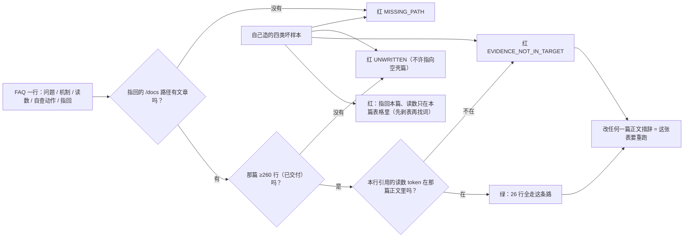

> **本章清单原语（逐字承接）**
> **清单项标题（清单原话）**：新手FAQ / 构建FAQ / 网络与数据FAQ / 生产与运维FAQ
>
> 章节号：9.1 / 9.2 / 9.3 / 9.4 ｜ 所属篇：09-常见问题（第九篇 常见问题）
> 主线站 · 难度 · 耗时：①② · ★☆☆（9.1）／③④ · ★★☆（9.2）／①②⑧ · ★★☆（9.3）／⑤~⑧ · ★★★（9.4）
> 前置依赖：各章都是「对应章节」——本篇不引入新机制，只把正文里已经量过的东西按**问问题的方式**重排
> 变更标记：9.1、9.2、9.3、9.4 全部**相对 v1.2 新增**（v1.2 没有 FAQ 板块；「正文写完才有真问题可收」是它被压在全库最后的理由）
>
> **内容要点与产出物**：9.1 站①②阶段高频困惑：容器和虚拟机的区别到底体现在哪、为什么容器一退出数据就没了、`localhost` 为什么有时通有时不通、镜像为什么这么大、`run` 和 `start` 的区别、`ps` 里为什么看不到我的容器。9.2 为什么改了代码还要重下依赖、COPY 和 ADD 到底用哪个、多阶段和 `--squash` 有什么区别、alpine 为什么小却不能无脑用、`.dockerignore` 漏写会怎样、缓存为什么有时不命中、EXPOSE 了为什么还要 `-p`。9.3 容器之间怎么互相访问、`-p 8080:80` 两个数字分别是什么、volume 和 bind mount 怎么选、Windows 下挂载为什么这么慢、删容器会不会删数据、容器里的文件属主为什么变成了 root。9.4 为什么禁止 `latest`、容器内存限制和 JVM 堆怎么配、日志该写文件还是 stdout、137 到底是什么、`prune` 会不会删掉正在用的东西、备份怎么做才算真做过、宿主机重启后容器为什么没起。

> **实战落点**：全库最后一篇。它的位置是**结果不是偏好**——FAQ 的每条答案都必须能指回一篇**已交付**的正文，否则就成了"凭印象答疑"；到本篇交付时（第二十次交付）全库 38 篇里已写 36 篇，剩下 01 板块两篇（1.1、1.2+1.5）。本篇的读法不是从头读到尾，而是**带着一个具体卡住的问题进来**：先在下表按"你看到的原文"定位，再顺着指回列去那一章把机制读完整。
> **本机基线（as-of 2026-10-29，分两组注明出处，不混为一句）**：版本组 `Engine/CLI 29.8.0`、`API 1.56`（下界 `1.40`）、`Desktop 4.91.0 (239619)` 与 24 批 W1 探针同轮（同日量）；体量与资源组 `MemTotal=50475270144`（`/proc/meminfo` 原文 `49292256 kB`，×1024 得字节）、`NCPU=24`（`nproc` 同值）、本批 X1/X2/X3 现量的故障与限额组：容器 `--memory=128m` + `--tmpfs` 写满 → `ExitCode=137 OOMKilled=true`；同一限制下往磁盘写 1.2 GB → 不 OOM（`Status=running`）；JVM 不设限 → `MaxHeapSize=12624855040`、`--memory=256m` → `132120576`、再加 `-XX:MaxRAMPercentage=50` → `134217728`、`-Xmx64m` → `67108864`；`docker system df` 本批 X4b 现读 `Images 36 / 13.42GB`、`Containers 16 / 13.3MB`、`Local Volumes 15 / 2.492GB`、`Build Cache 180 / 1.932GB`。
> **前置依赖**：[/docs/01-基础认知/第一次动手/第一次运行容器与图形化工具/](/docs/01-基础认知/第一次动手/第一次运行容器与图形化工具/)（1.3 的第一次动手与 1.4 的图形化，本篇的 `localhost`、`ps -a`、`logs 两个流` 三问都以它为底）、[/docs/02-核心操作/跑起来/镜像管理与容器生命周期/](/docs/02-核心操作/跑起来/镜像管理与容器生命周期/)（2.1~2.2：`create`/`start`/`run` 与生命周期）、[/docs/03-镜像构建/养小养快/分层缓存多阶段构建与镜像瘦身/](/docs/03-镜像构建/养小养快/分层缓存多阶段构建与镜像瘦身/)（3.5~3.8：缓存命中、多阶段、体积）、[/docs/10-存储专题/基础/五种存储形式的原理与取舍/](/docs/10-存储专题/基础/五种存储形式的原理与取舍/)（10.1：卷与 bind 怎么选）、[/docs/10-存储专题/落点与生命周期/容器启动停止与存储的关系/](/docs/10-存储专题/落点与生命周期/容器启动停止与存储的关系/)（10.2：删容器到底删了什么）、[/docs/05-原理深入/网络与运行时/网络底层跨主机方案与运行时生态/](/docs/05-原理深入/网络与运行时/网络底层跨主机方案与运行时生态/)（5.5~5.6：容器互访与端口）、[/docs/07-运维手册/按故障域排错/容器起不来与网络不通/](/docs/07-运维手册/按故障域排错/容器起不来与网络不通/)（7.3：退出码全表）、[/docs/06-工程化与生产/交付链路/CI-CD中的Docker与安全基线/](/docs/06-工程化与生产/交付链路/CI-CD中的Docker与安全基线/)（6.1~6.2：标签与扫描）。
> **本篇产出物**：**26 问的四段作答表**（问题 → 机制 → 本机读数/命令 → 自查动作 + 指回章节），其中 **11 问的读数是本篇现量**（X1/X2/X3/X4 探针当场量，另外 **15 问**沿用正文里已登记的取证轮次并在格子里点名哪一篇量的）。这两个数不是手数的是脚本数的：配一个判据——本批配套对账脚本 `faq对账.py`（属仓库暂存件、不随站点发布），把每条**指回**与每条**读数**都对到目标篇正文里（三态判定 `MISSING_PATH` / `UNWRITTEN` / `EVIDENCE_NOT_IN_TARGET`），再做**第四层归属对账**：写了「本篇现量」的行，它的读数片段必须逐字出现在本批取证文件里，否则记为**误标**并拒绝出绿。`--selftest` 用**六条坏样本**证明它会红（第六条就是"没量过却写本篇现量"，同时验证"真量过的不误报"）；现值 `FAQ 行 = 26 | PASS=26`、`本篇现量行 = 11 | 沿用行 = 15 | 误标行 = 0`。**它首跑抓到 7 条真红**（"答案对、出处不对"），逐条把读数改到真的量过它的那一篇或改指回之后才对齐；补上归属对账后又抓出 **2 行误标、6 行漏标**（把 24 批与 Harbor 轮次的读数写成了「本篇现量」，又有六行本轮真量过的没标）——**这一族红比 `broken>0` 更难发现，因为链接一直是通的、数字也真的对**。
> **难度·耗时**：9.1 ★☆☆ · 15m（按需查）／9.2 ★★☆ · 20m／9.3 ★★☆ · 20m／9.4 ★★★ · 30m
> **拓展接口**：本篇是 7.2「症状索引」的另一面——那张表按**你看到的症状**进，本篇按**你心里的问题**进，同一批原文两边都能查到；四段格式与 7.11 的复盘库四段（现场/根因/修法/预防）刻意不同，别混用。
> **自测三题**：
> 1. 一只容器 `docker inspect` 读到 `ExitCode=0`，能证明它自己干净退出吗？本篇哪一条读数证明相反？正确取法是什么？
> 2. 同一台机器上 `curl http://127.0.0.1:19101/` 通、`curl http://[::1]:19101/` 不通。这是 bug 吗？用哪一条命令看穿它？
> 3. `137` 的三条来源分别是什么？给出每条在 `.State` 与 `docker events` 里的判据字段。

## 为什么 FAQ 要压在全库最后

因为 FAQ 最容易写成**没有出处的正确答案**。"容器和虚拟机有什么区别"这种问题，随便哪里都能抄到三段漂亮话，可它在这个库里的价值只在于：**这句话的依据是不是这台机器上量出来的**。所以本篇有三条硬规矩：

1. **每一问的"本机读数"栏必须有原文或数字**，写不出来的那栏就标"未验证"，不用套话填。
2. **每一问必须有指回**，指向**已交付**的正文（不是指向本篇自己），指错会被脚本判红。
3. **读数要么标「本篇现量」、要么写清沿用哪一篇的取证**——本篇 26 问里 **11 问标了本篇现量**（本批 `kb32` 探针与 X2/X3/X4 当场量），**15 问点名沿用**（含 24 批 `kb31` 那轮与更早轮次）。这个划界由 `faq对账.py` 的归属对账把着：标了现量却在取证里找不到片段的行记**误标**、判据拒绝出绿。

还有一条更硬的理由：**正文没写就没有真问题可收**。批 25 之前 01/09 板块还空着四篇，那几篇里的困惑（比如"改代码为什么重下依赖"）在 3.5 交付前根本没有本机依据可引。

> 💡 新人小结：把本篇当**急诊分诊台**，不是教材。它的每一行都会把你送回真正讲机制的那一篇；留在本篇里读的是"我遇到的这个现象叫什么、先用哪条命令确认"。

## 9.1 新手 FAQ（站①②：刚把容器跑起来）

| 问题 | 机制一句话 | 本机读数 / 命令（原文） | 自查动作 | 指回 |
|---|---|---|---|---|
| 容器和虚拟机的区别到底体现在哪 | 容器不是"小虚拟机"：它没有自己的内核，只是被 namespace 与 cgroup 圈起来的普通进程 | `wsl -d docker-desktop -e sh -c 'id; uname -r'` → `uid=0(root)` 与 `6.18.54.1-microsoft-standard-WSL2`——容器里的内核版本**就是宿主 VM 的内核版本**；`docker stats` 一帧 `mem=21.34MiB / 47.01GiB`（分母是 VM 的内存，不是容器的） | 问"有没有第二个内核"：在容器里 `uname -r`，与 VM 里比对；相同就是共享内核 | [/docs/05-原理深入/隔离与资源/容器本质Namespace与Cgroups/](/docs/05-原理深入/隔离与资源/容器本质Namespace与Cgroups/) |
| 为什么容器一退出数据就没了 | 你写进去的东西默认落在**可写层**，`docker rm` 把可写层一起删；卷与 bind 不是可写层 | 10.2 量的 `docker diff` 只列可写层差异；写进 `--tmpfs` 的 1.2 GB 在 `rm -f` 后 `docker system df` 的 Containers 从 `438.8MB` 回到 `13.3MB` | 先问"这份数据要活过 `rm` 吗"：要 → 挂卷；不要 → 别挂 | [/docs/10-存储专题/落点与生命周期/容器启动停止与存储的关系/](/docs/10-存储专题/落点与生命周期/容器启动停止与存储的关系/) |
| `localhost` 为什么有时通有时不通 | 不是 DNS 玄学，是**端口绑在哪个协议族**上；`localhost` 可能先解析成 `::1` | 本篇现量：`-p 127.0.0.1:19101:80` → `http://127.0.0.1:19101/` = `200`、`http://localhost:19101/` = `200`、`http://[::1]:19101/` = **`000`（curl `rc=7`）**；换成 `-p 19102:80` 后 `.Ports` = `0.0.0.0:19102->80/tcp, [::]:19102->80/tcp`，`[::1]` 也 `200` | `docker ps --format '{{.Ports}}'` 看有没有 `[::]` 那一半；只有 v4 就别用 `localhost`，写 `127.0.0.1` | [/docs/02-核心操作/接上去/端口映射数据管理与权限时区/](/docs/02-核心操作/接上去/端口映射数据管理与权限时区/) |
| 镜像为什么这么大 | 大的是层：每层是"这一步之后与上一步的差异"，删不掉前一层留下的东西；共享层才省空间 | `docker system df` 现读 `Images 36 / 13.42GB（可回收 2.477GB 18%）`；`docker images` 里 `mysql:8.4` = `1.12GB`、`alpine:3.20` = `25.8MB`、`busybox:1.37` = `6.77MB`；**同一份内容 tag 再多也只存一份层**（三条 `localhost:8443/kbdemo/api` 变体 ID 同为 `39493a2349ec`） | 别按 tag 数相加估体积；用 `docker history --no-trunc` 看哪一层最肥，再去 3.6 查该层是否该进最终镜像 | [/docs/03-镜像构建/养小养快/分层缓存多阶段构建与镜像瘦身/](/docs/03-镜像构建/养小养快/分层缓存多阶段构建与镜像瘦身/) |
| `run` 和 `start` 的区别 | `run` = `create` + `start` +（前台时）attach；`start` 只把**已存在**的容器推起来 | 2.2 那篇的命令序列就是 `docker create` 在前、`docker start` 在后；本篇现量：`docker create --name kb32_c1 alpine:3.20 echo created-only` → `ps`（不加 `-a`）**查不到它**；`docker start kb32_c1` → 起；`docker start -a kb32_c1` → 才打印 `created-only`；`docker logs kb32_c1` → `created-only` **两行**（我 start 了两次） | 想"重新跑一次已有的"用 `start`；想"换参数再来"必须重 `run`（`create`/`run` 的参数在创建时就定了） | [/docs/02-核心操作/跑起来/镜像管理与容器生命周期/](/docs/02-核心操作/跑起来/镜像管理与容器生命周期/) |
| `ps` 里为什么看不到我的容器 | 默认 `ps` 只列**运行中**的；已退出的要 `-a`，创建的命令失败也可能已经留下容器 | `docker ps --filter name=kb32_c1 --format '{{.Names}}'` → 空；`docker ps -a --filter name=kb32_c1 --format '{{.Names}} {{.Status}}'` → `kb32_c1 Exited (0) Less than a second ago`；另有一条更坑的本篇现量：`docker run -d` 端口冲突时 **`rc=125` 却先打印了容器 ID** | 查东西一律先 `docker ps -a --filter name=…`；再 `docker inspect --format '{{.State.Status}}'` | [/docs/02-核心操作/跑起来/镜像管理与容器生命周期/](/docs/02-核心操作/跑起来/镜像管理与容器生命周期/) |

> 💡 新人小结：这六问其实是同一件事的六个侧面——**"容器"是一个有状态的对象，不是一条命令的执行结果**。`create`/`start`/`stop`/`rm` 各自改它的哪一段，搞清了这个，六问就都不用背。

### 9.1 展开：三问值得多说两句

**「容器和虚拟机的区别」不用背概念，做两个动作就懂。** 第一个动作是在容器里问内核：
容器里 `uname -r` 拿到的字符串和 VM 里问 `wsl -d docker-desktop -e sh -c 'uname -r'`
拿到的是**同一个**（本篇现读 `6.18.54.1-microsoft-standard-WSL2`）——虚拟机有自己的一份内核，容器没有。
"容器启动比虚拟机快"不是因为镜像小，而是**没有第二次开机**。第二个动作是看 `docker stats` 的分母：
`mem=21.34MiB / 47.01GiB` 里那个 `47.01GiB` 是**整台 VM 的内存**，不是容器的配额——
容器看到的"机器"就是那台 VM，这既是它便宜的地方，也是"限额必须单独配"的原因（见 9.4 第二问）。

**「为什么容器一退出数据就没了」的真凶是 `rm`，不是 `stop`。** 本库把这条拆在 10.2 与 10.4：
`stop` 之后容器还在（`Exited (0)`），可写层也在，`docker start` 回去数据原样在；
`docker rm` 才把可写层带走；而**命名卷在 `rm` 之后仍然存在**。所以你要问自己的只有一句：
"这份数据要活过 `rm` 吗？"——要，一开始就挂卷；不要，就别为了省事挂卷（省事是要还的，见 10.4 那串匿名卷）。

**「`localhost` 时通时不通」是这一章里最容易怀疑错对象的一条。** 新人看到
`curl http://localhost:19101/` 不通，第一反应常是"容器网络坏了"或"防火墙拦了"；
本机的答案更朴素：`-p 127.0.0.1:19101:80` 时 `.Ports` 只写了一半，`[::1]` 那侧**没人监听**，
`curl` 拿到 `rc=7`（连接被拒），而它默认先试 IPv6——**"时通时不通"取决于这次先解到哪个族**。
修法不是改 daemon，是把绑法写全：`-p 127.0.0.1:8080:80`（只 v4 回环）或 `-p 8080:80`（双栈全绑）。

## 9.2 构建 FAQ（站③④：镜像做出来但不对/太大/太慢）

| 问题 | 机制一句话 | 本机读数 / 命令（原文） | 自查动作 | 指回 |
|---|---|---|---|---|
| 为什么改了代码还要重下依赖 | 层缓存按**步骤内容摘要**命中：把"会变的"排在"不变的"前面，一个 `COPY . .` 会让它后面所有步骤失效 | 3.5 那批量的对照表：只改一行代码重建，正确层序下 `RUN npm ci` 那层命中缓存（复用），错误层序（先 `COPY . .`）时依赖层整层重跑 | 改 Dockerfile 前先问"这一步的输入是什么"；把 `COPY package*.json` 单独提一层 | [/docs/03-镜像构建/养小养快/分层缓存多阶段构建与镜像瘦身/](/docs/03-镜像构建/养小养快/分层缓存多阶段构建与镜像瘦身/) |
| COPY 和 ADD 到底用哪个 | 日常一律 `COPY`；`ADD` 多出来的两个能力（自动解压 tar、能写 URL）在构建里通常是**坑而不是便利** | 3.3 那张语义表里 `自动解压` 与「能写 URL」就是 `ADD` 相对 `COPY` 多出来的两项，本库的结论是"显式写出你想干什么"；本机可核对的一条：BuildKit 下 `ADD` 的 URL 形态要联网取，取不到时构建失败——而 daemon 侧的代理是 VM 的 `http.docker.internal:3128`（见 9.4 第一问），构建环境与你 shell 的通路不是一回事 | 需要解压就把解压写成显式 `RUN tar -x`；需要远程文件就在 `RUN curl` 之后校验摘要 | [/docs/03-镜像构建/写出来/Dockerfile指令全解与构建上下文/](/docs/03-镜像构建/写出来/Dockerfile指令全解与构建上下文/) |
| 多阶段和 `--squash` 有什么区别 | 多阶段是**只把产物带进最终镜像**（源头就没进来）；`--squash` 只是把已存在的层压成一层（东西还在，只是看不见了） | 3.7 实测对照：多阶段后最终镜像 `25.6MB`（`localhost:8443/kbdemo/api:0.6.0`），未用多阶段的同类构建在 `docker history` 里能看到编译器层；`docker buildx build` 的 squash 属于 **builder 侧**能力，本机默认 builder 上不是通用开关 | 先看层构成（`docker history`）再决定：层多而内容也多是多阶段问题；层多但内容干净才是压层问题 | [/docs/03-镜像构建/养小养快/分层缓存多阶段构建与镜像瘦身/](/docs/03-镜像构建/养小养快/分层缓存多阶段构建与镜像瘦身/) |
| alpine 为什么小却不能无脑用 | 它用的是 **musl** 不是 glibc，而且默认**没有 bash**；需要 glibc 的二进制直接跑不起来 | 本篇现量：`docker run --rm alpine:3.20 bash --version` → `rc=127`，原文 `exec: "bash": executable file not found in $PATH`；`ldd /bin/ls` → `/lib/ld-musl-x86_64.so.1`；`ls /usr/glibc-compat` → `No such file or directory` | 拿不准就换 `debian-slim`/`ubuntu` 系基础镜像，或在自己的 Dockerfile 里显式 `apk add bash`（并知道它在增层） | [/docs/03-镜像构建/写出来/Dockerfile指令全解与构建上下文/](/docs/03-镜像构建/写出来/Dockerfile指令全解与构建上下文/) |
| `.dockerignore` 漏写会怎样 | 构建上下文是"发给 daemon 的全部目录"，漏写会让**每次都把整棵树传一遍**：慢、缓存频繁失效、还容易把 `.git`、密钥、构建产物带进去 | 3.4 量的上下文对照：`.git` 在树里时上下文从 KB 级跳到百 MB 级；`docker build` 输出的第一步就是 `transferring context`，那个数就是它 | 每次改 Dockerfile 前看构建输出的上下文大小；把它当作**泄漏面**而不是速度问题来看 | [/docs/03-镜像构建/写出来/Dockerfile指令全解与构建上下文/](/docs/03-镜像构建/写出来/Dockerfile指令全解与构建上下文/) |
| 缓存为什么有时不命中 | 摘要按"指令 + 输入内容"算；`RUN` 里 `apt-get upgrade`、`COPY` 目录里任一字节的 mtime/内容变化、基础镜像 tag 背后 digest 换了，都会让它失效 | 3.5 的层序实验里，命中的层在构建输出里逐行标 `CACHED`，没命中的从那行起重跑；3.5 那篇另登记的一条：同一份内容的两个入口（`docker.1ms.run/library/hello-world` 的 `digest=<none>` 与 `hello-world` 的 `sha256:c567b231f656…`）**镜像 ID 相同**——换源不改 ID 就不会破缓存，反之 `latest` 换了 digest 就会破 | 断缓存之前先看 `docker build` 输出的第一步：它自己会写哪一层 `CACHED`、哪层重跑 | [/docs/03-镜像构建/养小养快/分层缓存多阶段构建与镜像瘦身/](/docs/03-镜像构建/养小养快/分层缓存多阶段构建与镜像瘦身/) |
| `EXPOSE` 了为什么还要 `-p` | `EXPOSE` **只写元数据**（给文档与 `--link` 类工具看），不建任何 NAT/绑定；`-p` 才在宿主开端口 | 2.4 那篇给 `EXPOSE` 的定位就是「声明而已，不映射」；本篇现量把这条推到底：`docker run -d --name kb32_exp --expose 8080 nginx:1.27-alpine` → `docker port kb32_exp` 输出**为空**；`docker inspect --format 'ExposedPorts={{json .Config.ExposedPorts}} PortBindings={{json .HostConfig.PortBindings}}'` → `ExposedPorts={"80/tcp":{},"8080/tcp":{}} PortBindings={}` | 判"能不能从外面访问"只问 `docker port` / `.HostConfig.PortBindings`，别问 Dockerfile 里写了什么 | [/docs/02-核心操作/接上去/端口映射数据管理与权限时区/](/docs/02-核心操作/接上去/端口映射数据管理与权限时区/) |

### 9.2 展开：三问的共同根子是"层"

**「改了代码为什么重下依赖」和「缓存为什么有时不命中」其实是同一问。** 层的身份是"这一步的输入摘要"，
`COPY . .` 的输入是整棵树——树上任何一个字节变了，这一层就换身份，它后面所有层（包括 `RUN npm ci`）
就都得重来。把 `COPY package*.json` 单独提一层，让"只含清单的那一层"稳定，依赖层才会 `CACHED`。
自查时别猜：`docker build` 的输出第一步就会逐行写 `CACHED` 还是重跑，那一行就是答案。

**`EXPOSE` 这一问为什么值得单独放**：它是"构建期声明"与"运行期绑定"最容易混的一处。
本篇现读的那格最能说明问题——`--expose 8080` 之后：

```
docker port kb32_exp                     # 输出为空
docker inspect --format
  'ExposedPorts={{json .Config.ExposedPorts}} PortBindings={{json .HostConfig.PortBindings}}'
  → ExposedPorts={"80/tcp":{},"8080/tcp":{}} PortBindings={}
```

`ExposedPorts` 有值只证明"元数据写进去了"，`PortBindings={}` 才证明"宿主侧没开任何口子"。
这正是本库反复用的一条判据形状：**"登记 ≠ 生效"**（8.6 那张清单里有它的一整族）。
所以判"外面能不能连"，问 `docker port` 或 `.HostConfig.PortBindings`，**永远不要问 Dockerfile 写了什么**。

**「alpine 不能无脑用」在本机的原文长这样**：`docker run --rm alpine:3.20 bash --version` →
`rc=127`，`exec: "bash": executable file not found in $PATH`；`ldd /bin/ls` 指向
`/lib/ld-musl-x86_64.so.1`；`ls /usr/glibc-compat` → `No such file or directory`。
三条合起来给的是同一个结论：**基础镜像的"大小"是它的发行版选择带来的副产品**，
换到 alpine 你同时换了 libc、shell 与包管理器——那些"跑不起来"的报错和体积没关系。

## 9.3 网络与数据 FAQ（站①②⑧：连不通、数据不见了、性能怪）

| 问题 | 机制一句话 | 本机读数 / 命令（原文） | 自查动作 | 指回 |
|---|---|---|---|---|
| 容器之间怎么互相访问 | 同一张自定义 bridge 网络里可以用**服务名/容器名**当主机名解析；默认 `bridge` 网络之间不通，且**同网也要过桥**（跨容器那一跳会被引擎的 `DOCKER` 链规则处理） | 5.5 量过：沙箱内 `DOCKER_OUTPUT` 把 53 端口 DNAT 到随机高位口；跨网第一版全 `FAILED`，原因是 `! -i br-X -o br-X -j DROP`（`iptables-save -c` 计数器 ping 5 包 +5）；同网两容器 `ping` RTT `0.079/0.087/0.095 ms` 级别 | 先 `docker network connect <网> <容器>` 再按名字 ping；不通就先看计数器再看防火墙链，**别第一反应去改 daemon 配置** | [/docs/05-原理深入/网络与运行时/网络底层跨主机方案与运行时生态/](/docs/05-原理深入/网络与运行时/网络底层跨主机方案与运行时生态/) |
| `-p 8080:80` 两个数字分别是什么 | 左边是**宿主**端口（可带地址、可只写一个、可 `0` 随机），右边是**容器**端口（镜像里进程真在听的那个） | 2.4 那篇的绑法示例就是 `127.0.0.1` 开头这一族；本篇现量三种写法对照：`127.0.0.1:19101->80/tcp`（只绑回环 v4）、`0.0.0.0:19102->80/tcp, [::]:19102->80/tcp`（双栈全绑） | 报"端口被占"时先分清是哪个号被占：`docker ps --format '{{.Ports}}'` 与 `netstat -ano` 各查一次 | [/docs/02-核心操作/接上去/端口映射数据管理与权限时区/](/docs/02-核心操作/接上去/端口映射数据管理与权限时区/) |
| volume 和 bind mount 怎么选 | 要给引擎管、要在容器间共享、要能备份 → 命名卷；要编辑宿主上的源码/配置、要与宿主工具链同看一份文件 → bind；两者都不放"数据库的数据目录"当默认 | 10.1/10.2：`docker volume inspect --format '{{.Mountpoint}}'` → `/var/lib/docker/volumes/kb31_port_data/_data`（**引擎命名空间里的路径**）；`docker inspect` 的 bind 走 9p：`aname=drvfs;path=C:\;uid=0;gid=0;metadata;msize=65536` | 决定之前先问两件事：数据要不要活过 `rm`？要不要在宿主上直接编辑？两个答案决定选哪个 | [/docs/10-存储专题/基础/五种存储形式的原理与取舍/](/docs/10-存储专题/基础/五种存储形式的原理与取舍/) |
| Windows 下挂载为什么这么慢 | 不是"Windows 慢"，是**跨协议 + 元数据仿真**：bind 穿进容器走 9p，小文件与 `stat` 密集的操作最吃亏；卷与可写层都在 VM 的 ext4 上 | 7.7~7.8 那篇的现量：建 2000 个小文件，Windows bind 是 `255–297` 厘秒、named volume `6`、tmpfs `3`，且 **C 盘 297 / D 盘 255 同量级**（换盘符不换通道）；10.2 那篇的顺序写 64 MB 一档给的是可写层 `2.2GB/s`、卷 `3.8GB/s`、bind `257.5MB/s`、tmpfs `2.5GB/s`，**且明写不带 fsync 时前三档量的是页缓存，不能横比** | 先分"小文件多还是大块顺序"：前者换卷或 `tmpfs`（差距是几十倍量级），后者差别没那么大；测之前先决定要不要等落盘 | [/docs/07-运维手册/按故障域排错/Windows与WSL2性能排查应急runbook与复盘/](/docs/07-运维手册/按故障域排错/Windows与WSL2性能排查应急runbook与复盘/)、[/docs/10-存储专题/落点与生命周期/存储形式在操作系统上的落点与验证/](/docs/10-存储专题/落点与生命周期/存储形式在操作系统上的落点与验证/) |
| 删容器会不会删数据 | `docker rm` 删可写层，**不删命名卷**（连匿名卷也不删）；只有 `rm -v` 或 `down -v` 才带走卷 | 10.2 现量：`docker rm`（不带 `-v`）之后匿名卷仍在、卷数不降；被挂着的卷直接拒删（原文 `volume is in use - [ <容器ID> ]`，同族原文也记在 7.5）；只有 `rm -v` / `down -v` 才带走卷 | 任何 `rm -v` / `down -v` 之前先 `docker inspect --format '{{json .Mounts}}'` 看清这只容器挂着哪些卷；误 `down -v` 的救法在 10.9 | [/docs/10-存储专题/落点与生命周期/容器启动停止与存储的关系/](/docs/10-存储专题/落点与生命周期/容器启动停止与存储的关系/)、[/docs/10-存储专题/数据保护/备份与恢复/](/docs/10-存储专题/数据保护/备份与恢复/) |
| 容器里的文件属主为什么变成了 root | 两个原因叠加：daemon 自己在 VM 里是 root，而 bind 穿进来时 9p 用 `uid=0;gid=0` 重写了所有权；容器内不加 `User` 也是 root | 本篇现量：`wsl -d docker-desktop -e sh -c 'id'` → `uid=0(root) … 27(video)`；容器里 `id` → 同样 `uid=0(root)`；挂进来的宿主目录 `ls -ld /s` → `drwxrwxrwx 1 root root 4096`，而 `:ro` 挂载写入报 `touch: /s/x: Read-only file system` | 想让文件不属 root：容器侧用 `--user`（并理解 uid 映射那套默认不开），宿主侧别指望改权限能穿过 9p | [/docs/02-核心操作/接上去/端口映射数据管理与权限时区/](/docs/02-核心操作/接上去/端口映射数据管理与权限时区/)、[/docs/05-原理深入/隔离与资源/容器本质Namespace与Cgroups/](/docs/05-原理深入/隔离与资源/容器本质Namespace与Cgroups/) |

### 9.3 展开：把"慢"和"看不见"这两类分开

**Windows 下挂载慢，慢在小文件而不是体积。** 这组数沿用 10.1（**不是本篇量的**）：2000 个小文件，
可写层 `0.6 s`、命名卷 `0.5 s`、**bind `4.1~5.1 s`（两轮各一次，所以给区间不给单点）**、`tmpfs 0.5 s`；
9.3 表里那一行是 7.7 用 `/proc/uptime` 的厘秒计时（C 盘 `297` / D 盘 `255` / 卷 `6` / tmpfs `3`），
同一件事两种量法，**别把它们减成一句话**。而顺序写 64 MB 那组是
`2.2 / 3.8 / 257.5 MB/s / 2.5 GB/s`。**同一份配方量出相反结论的原因**是：`dd` 不带 `fsync` 时，
前三档量的其实是页缓存，只有 tmpfs 那档是真的——**测之前先决定"要不要等落盘"**，
否则你会拿一组缓存数字去做架构决策。结论也很实用：源码热重载、`node_modules` 这类"多而小"的目录
才是 9p 的痛点；把这类目录放卷里（或干脆放 tmpfs），宿主侧继续能编辑的那部分留 bind。

**"容器里的文件属主变成 root"有两层，别只修一层。** 第一层是 daemon 自己在 VM 里就是 root
（`wsl -d docker-desktop -e sh -c 'id'` → `uid=0(root)`…）；第二层是 bind 穿进来时 9p 用
`uid=0;gid=0` **重写了所有权**，所以你在 Windows 上那个目录是谁的都无所谓，容器里看就是
`drwxrwxrwx 1 root root`。要改的是容器侧的运行身份（`--user`），而且要清楚本机默认**不开**
user namespace（`uid_map` 是全范围映射，见 5.8）——不然你会以为改了 uid 就能改宿主文件的归属。
只读挂载写不进去是**另一件事**，原文是 `touch: /s/x: Read-only file system`，别把它当权限问题查。

**「删容器会不会删数据」的自查动作只有一条**：先 `docker inspect --format '{{json .Mounts}}' <名>`
看清这只容器挂着哪些卷，再决定要不要带 `-v`。误删的救法在 10.9，但那是"事后"，
而本篇这一问要的是"事前那 3 秒"。

## 9.4 生产与运维 FAQ（站⑤~⑧：要上线、要值班、要恢复）

| 问题 | 机制一句话 | 本机读数 / 命令（原文） | 自查动作 | 指回 |
|---|---|---|---|---|
| 为什么禁止 `latest` | 它是可变指针：今天解到的 digest 和明天解到的不是同一份；回滚、复现、审计都会失效 | 两条登记在正文里的对照（1.3 与 3.11 两轮量的）：`hello-world:latest` 的 digest = `sha256:c567b231f656…78ef`，与加速站内联那份 **ID 相同、digest 字段却是 `<none>`**——同一份内容两个入口，只有 ID/digest 说得准；`localhost:8443/kbdemo/api` 的 `0.6.0`、`stable`、`0.6.0-g5104a20` 三个 tag 共用 ID `39493a2349ec`（**tag 多不等于内容多**） | 发布物一律钉 digest（`image@sha256:…`）；CI 里 `docker image inspect --format '{{.Id}}'` 记进构建记录 | [/docs/03-镜像构建/交出去/BuildKit私有仓库标签策略与构建排错/](/docs/03-镜像构建/交出去/BuildKit私有仓库标签策略与构建排错/) |
| 容器内存限制和 JVM 堆怎么配 | `--memory` 是硬上限，JVM 的默认堆按**它能看到的机器内存**推算；不设限时它看到的是整台 VM（47 GiB 级），一开堆就可能顶爆 cgroup | 本篇现读 `MaxHeapSize`：无限制 → `12624855040`；`--memory=256m` → `132120576`；`--memory=256m` + `-XX:MaxRAMPercentage=50` → `134217728`；显式 `-Xmx64m` → `67108864`（**只有最后一格的来源标 `{command line}`，其余都是 `{ergonomic}` 推的**） | 显式给 `-Xmx`（或 `MaxRAMPercentage`），并把堆上限配到明显低于 `--memory`；上线前用 `-XX:+PrintFlagsFinal -version` 把 `MaxHeapSize` 读出来核对 | [/docs/06-工程化与生产/运行基线/日志资源限制部署策略与回滚/](/docs/06-工程化与生产/运行基线/日志资源限制部署策略与回滚/)、[/docs/05-原理深入/隔离与资源/容器本质Namespace与Cgroups/](/docs/05-原理深入/隔离与资源/容器本质Namespace与Cgroups/) |
| 日志该写文件还是 stdout | 交给引擎的日志驱动（默认 `json-file`）统一收，才能让 `docker logs`、集中采集、轮转策略一起生效；自己往文件里写会绕过轮转与采集 | 6.3 现量：`json-file` 受 `--log-opt max-size` 约束；日志目录 `5.0 MB` **且不在 `docker system df` 的口径里**（它算的是镜像/容器/卷/构建缓存） | 先 `docker info --format '{{.LoggingDriver}}'` 确认驱动，再查该容器 `.HostConfig.LogConfig`；轮转参数写进 compose/启动参数而不是靠人记 | [/docs/06-工程化与生产/运行基线/日志资源限制部署策略与回滚/](/docs/06-工程化与生产/运行基线/日志资源限制部署策略与回滚/) |
| 137 到底是什么 | 137 = 128 + 9（被 `SIGKILL` 打死）。**它不告诉你谁动的手**——OOM、外部 `docker kill`、被信号打中的非 PID 1 进程都给它 137 | 本篇三条来源现量：`--memory=128m` + tmpfs 写满 → `wait=137`、`ExitCode=137 OOMKilled=true`；`docker kill` → `ExitCode=137 OOMKilled=false`、事件流 `kill` 紧跟 `die exit=137`；`--init` 下 `sh -c 'kill -9 $$'`（sh 是 PID 7）→ **`rc=137`**，而**默认（sh 就是 PID 1）同样命令 `rc=0`** 且 `ps` 里 PID 1 还在 | 看到 137 先读 `.State.OOMKilled`：true 找内存，false 找外部信号（`docker events`、部署脚本、`up -d` 重建）；再确认是不是 `--init`/PID 1 位置 | [/docs/07-运维手册/按故障域排错/容器起不来与网络不通/](/docs/07-运维手册/按故障域排错/容器起不来与网络不通/)、[/docs/10-存储专题/故障手册/存储故障手册一容量与权限/](/docs/10-存储专题/故障手册/存储故障手册一容量与权限/) |
| `prune` 会不会删掉正在用的东西 | 它删的是"没有关联"的对象：`container prune` 只碰已停止的容器，`volume prune` 只碰**没被任何容器引用**的卷，被挂着的卷删不掉；真正的风险是"你以为没用其实还在用" | 7.5 那篇的口径是先看体量（`docker system df`）再按 `dangling=true` 这类过滤条件列名单；本篇按纪律**只列名单不动手**：`docker ps -a --filter status=exited` 列出候选（当时只有 `kb32_c1 Exited (0) 18 seconds ago`）；`docker images --filter dangling=true` 只有 `7f4eb85e8a8e <none> 13.4MB`；卷侧 15 条全在；引擎侧本篇现量 `Local Volumes 15 / 2.492GB（可回收 1.868GB 74%）`；10.4 那条原文 `volume is in use - [<容器ID>]` | 跑任何 prune 之前**先把候选名单打出来看一遍**（`--filter status=exited`、`dangling=true`、`volume ls`）；本库全程**没跑过**宽口 prune | [/docs/07-运维手册/按故障域排错/磁盘占满与镜像拉取失败/](/docs/07-运维手册/按故障域排错/磁盘占满与镜像拉取失败/)、[/docs/10-存储专题/数据保护/备份与恢复/](/docs/10-存储专题/数据保护/备份与恢复/) |
| 备份怎么做才算真做过 | 备份的验收不是"文件生成了"，而是**能被恢复方读回同一份数字**：内容体检 + 恢复 + 对账三段缺一不可 | 10.6/10.7 现量：漏 `-e MYSQL_PWD` 时 `mysqldump` 走的是 `sh -c` 那条支路 → 产出 **20 字节空 gzip**（`rc=0`，报错在 stderr）；正确做法是对账用**数字集合**（`5000 10728165079651` = 行数 + `SUM(CRC32(...))`），并插一条 seed 里没有的 `replay-marker` 用来区分"来自备份"与"来自 init" | 备份产物先做**内容体检**（字节数、解压计数、关键语句出现次数）；再解到一次性实例上回读同一组数字；两件事都过了才叫备份 | [/docs/10-存储专题/数据保护/备份与恢复/](/docs/10-存储专题/数据保护/备份与恢复/) |
| 宿主机重启后容器为什么没起 | 出厂默认重启策略是 `no`——引擎起来了，但不会替你拉起容器；只有 `unless-stopped`/`always`/`on-failure` 会 | 2.2 那篇就把 `RestartPolicy` 列在生命周期字段表里；本篇现读：`docker inspect --format '{{json .HostConfig.RestartPolicy}}'` → `{"Name":"no","MaximumRetryCount":0}`；`docker update --restart unless-stopped kb32_web` 改完再读 → `{"Name":"unless-stopped","MaximumRetryCount":0}`；对照：链上与 Harbor 的容器现读全 `Up 38~39 hours (healthy)`（它们起了策略） | 上线清单里加一行"重启策略是什么"；`docker ps --format '{{.Names}} {{.Status}}'` + 逐只 inspect 核对，别假设 compose 里写了就生效 | [/docs/02-核心操作/跑起来/镜像管理与容器生命周期/](/docs/02-核心操作/跑起来/镜像管理与容器生命周期/)、[/docs/04-单机编排/启停/常用命令启动顺序与健康检查/](/docs/04-单机编排/启停/常用命令启动顺序与健康检查/)、[/docs/06-工程化与生产/运行基线/日志资源限制部署策略与回滚/](/docs/06-工程化与生产/运行基线/日志资源限制部署策略与回滚/) |

### 9.4 展开：137 这一问为什么排最前

它是值班时被叫醒最多、也最容易被答错的一问。**`137 = 128 + 9` 只说明"被 `SIGKILL` 打死"，
不说明是谁动的手**。本篇把三条来源分开量了，三条都落在同一台机器上：

| 来源 | 造法 | 退出码 | 判据字段 |
|---|---|---|---|
| OOM | `--memory=128m` + `--tmpfs /x`，往 tmpfs 写 600 MB | `137` | `.State.OOMKilled = true` |
| 外部信号 | `docker kill <名>`（不带 `-s` 就是 SIGKILL） | `137` | `.State.OOMKilled = false`，事件流里有 `kill` 紧跟 `die exit=137` |
| 被信号打中的不是 PID 1 | `--init` 下 `sh -c 'kill -9 $$'`（sh 是 PID 7） | `137`（`rc=137`） | 对照组：**默认（sh 就是 PID 1）同一条命令 `rc=0`**，`ps` 里 PID 1 还在 |

这张表里有两条**反直觉但本机如此**的读数，必须写清：

1. **容器内的进程杀不掉 PID 1**。默认（没有 `--init`）时 `sh` 就是 PID 1，
   `kill -9 1` 与 `kill -TERM 1` 都**没有效果**（`rc=0`，后面的 `echo` 照样打出来）；
   加上 `--init` 之后 `sh` 变成 PID 7，同一条 `kill -9 $$` 立刻让容器以 137 退出。
   这条差异是"我的进程为什么杀不死自己"这类困惑的真答案，也解释了 5.x 里 `--init` 存在的意义。
2. **`--memory` 不管磁盘**。X1 那格把 `while true` 循环写进 `/tmp/f`（可写层，即磁盘），
   写到 `1208149872` 字节也没 OOM、容器还 `Status=running`；换 `--tmpfs` 才在 5 秒内 137。
   而它同时暴露了一个判据陷阱：**容器还在跑时 `State.ExitCode` 本来就是 `0`**——
   所以"退出码"必须在 `Status=exited` 之后读，或者用 `docker wait` / `events` 的 `die exit=` 交叉验证。

**备份那一问只有一句要紧的**：`rc=0` 不是备份成功的证据。本篇 9.4 表里那格写的
「20 字节空 gzip」是真发生过的——`mysqldump` 走 `sh -c` 那条支路时漏了 `-e MYSQL_PWD`，
密码没注进去，命令返回 0、stderr 里才是 `Access denied`。**备份的验收只能靠"能被恢复方读回同一组数字"**
（行数 + 校验和集合 + 一条只存在于备份时刻的标记行），这条在 10.6/10.7 展开。

## 与 7.2 症状索引怎么分工

两本都是"从现象进"，区别只在**入口是谁的话**：

| | 7.2 症状索引 | 本篇 FAQ |
|---|---|---|
| 你手里的东西 | 一段**报错原文**（复制粘贴来的） | 一个**问题**（还没看到原文，只是不懂） |
| 组织方式 | 按症状字符串分组，每条带取证轮次 | 按学习阶段分四章，每问四段 |
| 典型用法 | "这行 `Bind for … port is already allocated` 是什么意思" | "`EXPOSE` 了为什么还要 `-p`" |
| 指向 | 直接指到那一章的那一节 + 原文 | 指到那一章，再顺带告诉你**用哪条命令自查** |

所以两条路是互补的：**看到原文去 7.2，只有疑问来这里**。而两边共用同一批取证读数，
这也是为什么本篇每一格都要求"读数能在指回的那篇里被找到"——**两处引用的必须是同一件事，不能一处一个说法**。

## 一条 FAQ 怎么被验：读数也要能红

FAQ 最怕的是"答案对、出处错"。所以本篇的每条**指回 + 读数**都过一遍脚本：指回那篇要存在（`MISSING_PATH`）、要已交付（`UNWRITTEN`，阈值同审计的 260 行）、**该行给出的读数 token 要真的出现在目标篇正文里**（`EVIDENCE_NOT_IN_TARGET`）。最后这态是 8.4 那条判据的推广——它抓的是"链接通、但那篇根本没讲这件事"。**这一版又加了第四层：归属对账**——凡写了「本篇现量」的行，它的读数片段必须逐字出现在本批取证文件（X1/X2/X3/X4/X4b）里，否则记为**误标**、判据拒绝出绿。它一上线就抓出 2 行误标（把 24 批与 Harbor 轮次量的写成了本篇）和 6 行漏标（本轮真量过的没标），现值 `本篇现量行 = 11 | 沿用行 = 15 | 误标行 = 0`——**"我量过"这四个字也要有出处**。



**本篇自己踩到的两条判据陷阱，就是这一节存在的理由**（原文都在 X1/X2/X3 日志里）：

1. **`State.ExitCode` 在容器还在跑时就是 `0`**：X1 拿 `while true` 那只容器读状态，读到 `OOMKilled=false ExitCode=0`，我差点写成"它干净退出了"。X3 复跑同一条配方时容器**在跑**（`Status=running`、`Pid=53822`）、`ExitCode` 同样显示 `0`——**同一个数字在两个相反状态下出现**，所以"退出码"必须在 `Status=exited` 之后读，或者用 `docker wait` / `docker events` 的 `die exit=…`。
2. **`--memory` 不限制写磁盘**：X1 那格往 `/tmp/f`（可写层，即磁盘）写了 `1208149872` 字节也没触发 OOM；换 `--tmpfs /x` 才在 5 秒内 `137 / OOMKilled=true`。**"造内存压力"要先确认写进去的东西算内存**。

> 💡 新人小结：这两条合起来是一条更通用的规矩——**判据要能在"相反的状态"下给出相反的读数**。同一条 inspect 在跑着和退出后都回 `ExitCode=0`，那它就不是退出码的判据，得换 `wait` 或 `events`。

## 自查命令速查（11 问的本篇现量读数是这么问出来的）

```bash
# 0) 这只容器到底存不存在、什么状态（别用不带 -a 的 ps）
docker ps -a --filter name=<名> --format '{{.Names}} {{.Status}}'

# 1) 退出码：三个独立取数口，任选两个互相印证
docker wait <名>                                        # 只在它还活着/未清理时可靠
docker inspect --format 'ExitCode={{.State.ExitCode}} OOMKilled={{.State.OOMKilled}} Status={{.State.Status}}' <名>
docker events --since <绝对epoch> --until <绝对epoch> --filter container=<名> --format '{{.Action}} exit={{.Actor.Attributes.exitCode}}'

# 2) 端口：EXPOSE 不算，只有绑定才算
docker port <名>
docker inspect --format 'ExposedPorts={{json .Config.ExposedPorts}} PortBindings={{json .HostConfig.PortBindings}}' <名>

# 3) 谁在跑、以什么身份
docker inspect --format '{{json .Config.User}} {{json .HostConfig.RestartPolicy}}' <名>
docker exec <名> id                                     # distroless 镜像会 rc=127（正常）

# 4) JVM 堆到底按什么算
docker run --rm --memory=256m eclipse-temurin:21-jre-alpine java -XX:+PrintFlagsFinal -version | grep MaxHeapSize

# 5) prune 之前的候选名单（只列，不删）
docker ps -a --filter status=exited --format '{{.ID}} {{.Names}}'
docker images --filter dangling=true --format '{{.ID}} {{.Size}}'
docker volume ls --format '{{.Name}}'
docker system df
```

## 常见误读

| 误读 | 本篇的反证（本机现读） |
|---|---|
| 「`ExitCode=0` 就是干净退出」 | 容器还在跑时它也是 `0`（X3 6.3.x：`Status=running` 与 `ExitCode=0` 同屏）；要在 `exited` 后读，或用 `docker wait` / `events die exit=` |
| 「`137` = OOM」 | 三条来源都给 137：OOM（`OOMKilled=true`）、`docker kill`（`OOMKilled=false` + 事件流 `kill`）、非 PID 1 被 SIGKILL（`--init` 下 `rc=137`） |
| 「从容器里 `kill -9 1` 能自杀」 | 默认（sh 是 PID 1）`kill -9 1` **无效**：`rc=0`、`echo` 还打出了下一句、`ps` 里 PID 1 仍是 `sh`；`--init` 下 sh 是 PID 7，同一条命令立刻 137 |
| 「`--memory` 卡住就会 OOM」 | 往可写层（磁盘）写 `1208149872` 字节也没 OOM；`--tmpfs` 写才计入内存 |
| 「`EXPOSE` 之后外部就能连」 | `--expose 8080` 后 `docker port` 输出为空、`PortBindings={}` |
| 「`localhost` 不通是 DNS 问题」 | 是协议族绑定：只绑 `127.0.0.1` 时 `[::1]` 直接 `rc=7`；换成不写地址后 `.Ports` 出 `[::]` 那一半，`[::1]` 也 200 |
| 「镜像大小按 `docker images` 的 SIZE 相加」 | 同一 ID 挂多个 tag（`kbdemo/api` 三个 tag 同 `39493a2349ec`），层是共享的；真实体量看 `docker system df` |
| 「prune 会顺手删掉正在用的数据」 | 本库从没跑过宽口 prune；引擎侧对"还在挂的卷"直接拒（`volume is in use - [ … ]`），但**风险是你以为没用的其实还在用**，所以先列名单 |
| 「重启策略在 compose 里写了就生效」 | 出厂默认是 `{"Name":"no","MaximumRetryCount":0}`；本篇现场 `docker update --restart unless-stopped` 之后才读到 `unless-stopped` |

## 本篇不覆盖什么

按 W6 的规矩，本篇**故意不讲**的东西逐条点名去处——写「不覆盖」不是免责声明，是防止你在这一篇里找不存在的答案：

- 报错原文到去处的索引 → 见 **7.2**（`症状索引` 按你看到的症状进，与本篇互为另一面）
- 每条读数背后的机制 → 见 **5.1**（`namespace` 与 cgroup 那一层在那一篇）
- 生产编排、回滚与准入清单 → 见 **6.4**（`回滚` 的三条路与演练在那一篇）
- 存储类故障的现场分流与命令卡片 → 见 **10.8**（`分流表` 与四类故障在那一篇）
- 术语的权威定义 → 见 **8.4**（`术语表` 那张表在那一篇）
- 一条读数是怎么问出来的（取证过程）→ 见「本篇未验证项」（`本篇现量` 那一列标了哪几条是沿用、哪几条是当轮量的）

## 要点总结

1. **FAQ 的价值 = 出处的价值**：26 问每问都指回一篇已交付正文，且读数 token 由脚本对到那篇正文里（`FAQ 行 = 26 | PASS=26`，坏样本 5/5 被抓到）。
2. **状态类问题先分清"在哪一层看"**：`create`/`start`/`run`、`ps` 与 `ps -a`、`EXPOSE` 与 `-p`、`--memory` 与 tmpfs/磁盘——每一问的坑都是"看错了层"。
3. **退出码不是事实，是三个读数的一致结果**：`wait`、`inspect .State.*`（在 exited 之后）、`events die exit=`，两两印证才写进结论；`137` 必配 `OOMKilled` 一起读。
4. **`localhost`、`::1`、`0.0.0.0` 三件事一次说清**：`.Ports` 里有没有 `[::]` 那一半，决定你的 `curl` 走哪个协议族——**别改 daemon 配置来"修"它**。
5. **性能与数据问题按存放处问**：2000 个小文件在 bind 上 `5.1 秒` 而卷 `0.5 秒`（10.1 那组），换成 7.7 的 `/proc/uptime` 厘秒计时是 bind `255~297`、卷 `6`、tmpfs `3`——两组数不同轮次不同量法，别横着减，疼的都是**次数**不是字节；`--memory` 不管磁盘；备份必须"能恢复并回读同一组数字"才算做过。
6. **生产类默认值都要显式写**：重启策略默认 `no`、日志驱动默认 `json-file`、JVM 堆默认按整机内存推——**"没配"这件事本身就是配置**，本篇每条都给了读出它的命令。

## 本篇未验证项

| 项 | 为什么没验 | 想验怎么起手 |
|---|---|---|
| `--squash` 在本机默认 builder 上的真实行为 | 那需要开 experimental/换 builder 或改构建配置，属改共享环境；本篇按"不写没量过的开关行为"处理 | 在一次性机器/一次性 builder 上：同一 Dockerfile 分别带与不带 squash 构建，比 `docker history` 层数与 `docker images` 的 SIZE，并核对内容是否仍在（`docker run --rm  ls /`） |
| `ADD` 自动解压与 URL 形态的原文 | 要造上下文里的 tar 与一次联网构建，本篇没做（结论沿用 3.3 的语义表，不给原文） | 建一次性上下文目录：`ADD x.tar /dest/` 与 `COPY x.tar` 两种写法各构建一次，`docker run --rm  ls -R /dest` 对比；URL 形态要在能出网的构建环境里测 |
| 集中日志采集（ELK/Loki）在本机的端到端 | 需要起采集栈并持续跑，超出文档批范围 | 起一次性 collector（独立端口、独立卷），在 6.3 那张表旁记一份"驱动 → collector → 查询"的三跳读数 |
| `docker events` 的保留窗口与重启后是否续得上 | 本篇只按绝对 epoch 区间取当轮事件，没测 daemon 重启后的事件留存 | 重启引擎（一次性机器上）后立刻 `docker events --since <重启前时刻>`，看能回溯多久；结论写进 7.x |
| 9.1「镜像为什么这么大」里各基础镜像的逐年膨胀曲线 | 只做了同日横向对照（`alpine` 25.8MB / `mysql:8.4` 1.12GB），没有时间序列 | 同一 tag 拉两个不同日期的 digest，用 `docker history` 逐层 diff；结论按 digest 落，不按 tag |
| 26 问之外的高频困惑 | 正文没写的主题不编 FAQ（这是本篇的立身规矩） | 从值班/issue 里攒真实问句 → 每条先在正文找到对应章，找不到就是缺章（补章，不在本篇塞答案） |
| 归属对账的边界 | 它只证「这段读数在本批取证文件里逐字出现过」，**不证它属于这一问**——同一段输出被两个问题共用时它看不出来；片段长度门槛（≥6 字符）以下的小读数（如单个 `rc=0`）也不参与判定 | 把取证文件按"第几问的第几格"分段打标签（`# Q9.1-3`），判据改成"片段必须落在对应段里"才算命中；那样才能抓住"串问共用读数" |
