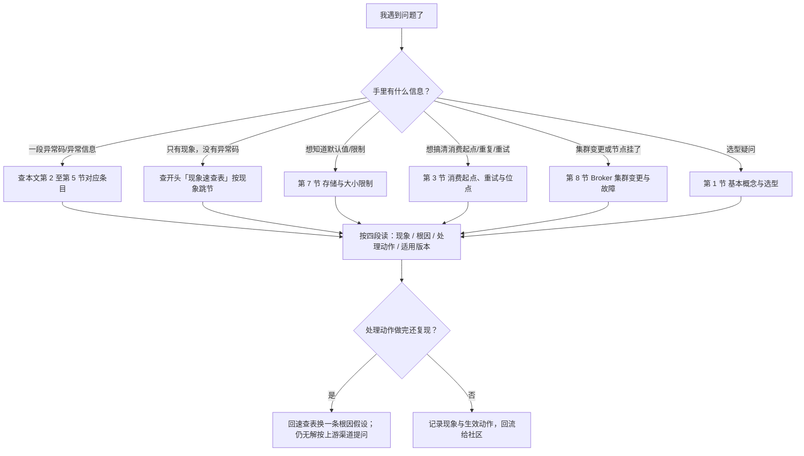
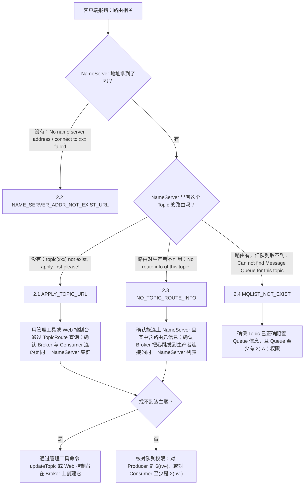
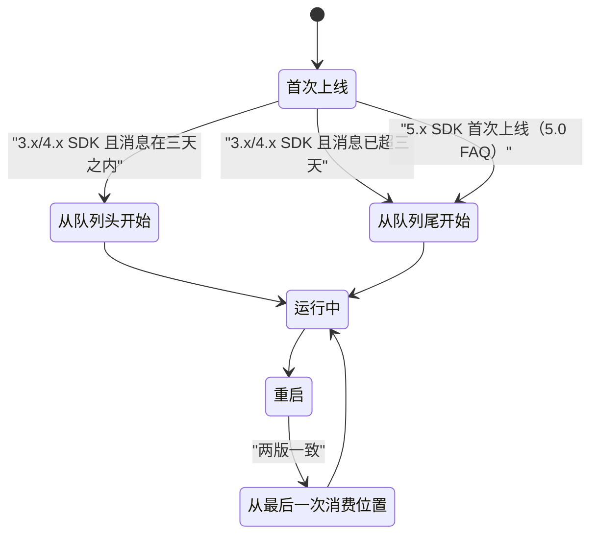
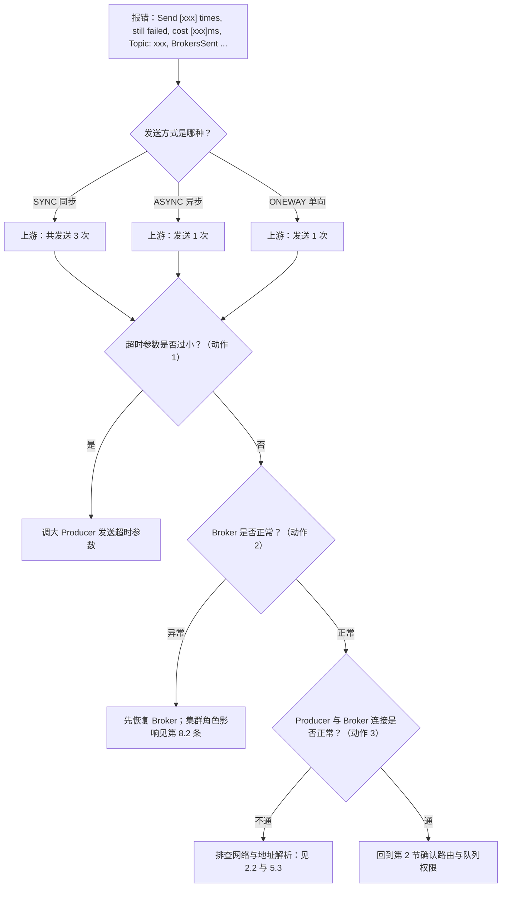
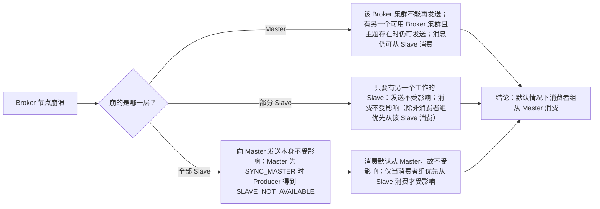

## 为什么需要按根因重排 FAQ？（痛点引入）

线上出问题时翻 FAQ 的体验通常是这样：报错 `No route info of this topic: OrderTopic`，你按关键词搜到「NO_TOPIC_ROUTE_INFO」这一条，看完它的四条解决方案，觉得都对，于是开始挨个试；试到第三条才想起——同一个「拿不到路由」的现象，在 FAQ 里还散落在 `APPLY_TOPIC_URL`、`MQLIST_NOT_EXIST`、`SUBSCRIPTION_GROUP_NOT_EXIST` 三条里，四条的解决清单互相重叠又各有细节。你其实是在**用同一份文档做四次重复排查**。

上游 FAQ 的组织方式是「基本 / 使用 / 配置相关 / 错误 / 其他」五组，其中第四组 12 条按**异常码名字**排序。这对「我已经知道异常码」的人是快的，对「我只知道现象」的人是慢的——而新人 90% 的时间属于后者。

| 维度 | 只按上游五组顺序读 | 本文的两层组织 |
|------|--------------------|----------------|
| 入口 | 必须先知道异常码或问题分组 | 先看「现象速查表」，从现象直接跳节 |
| 同一现象的多条 | 散落在 4 个条目里，靠通读发现 | 归到同一节，一次读完全部判据 |
| 排查顺序 | 条目内部是「原因 + 解决方案」两段 | 每条固定四段：现象 / 根因 / 处理动作 / 适用版本 |
| 版本差异 | 4.x 与 5.0 两版各说一遍，容易只看到一半 | 每条末尾显式标「适用版本」，差异处并列两版原文 |
| 高频项 | 纯文字，无判据流 | 补 Mermaid 排障流程，判据全部取自上游文本 |

> ### 💡 新人小结：这份 FAQ 该怎么用？
>
> 把排障想象成**去医院挂号**：
> - 速查表 = 大厅的「症状 → 科室」指示牌：先按症状找到科室（第几节），不用先知道病名。
> - 异常码 = 化验单上的指标名。你已经拿着化验单，就直接按码找条目。
> - 每条的四段结构 = 医生的四句话：你看到什么（现象）、为什么（根因）、做什么（处理动作）、这份结论适用于谁（适用版本）。
> - 「上游未给出」= 医生明说「这个要再做检查」，而不是随口给你一个答案。
>
> **FAQ 的价值不在条目多，而在你能在三分钟内定位到该看的那一条。**

**学习路线图**（先按现象分流，再进对应节）



读图要点：本 FAQ **不承诺覆盖所有问题**，它把上游已有的 23 条重排到可跳读的 8 个分组里；沿左侧分流进入，沿右侧四段结构阅读，最后用一个判定决定「换假设」还是「记录」。

---

## 术语表（本篇用到的名词与缩写）

下表只收**上游 FAQ 文本里实际出现的**名词与缩写；上游未出现的名词（如 DLedger、GC、操作系统参数调优）不在本文范围内，本文也不代为展开。全称一列凡上游未展开的，标注「上游未展开全称」。

| 术语 | 全称 | 通俗含义（用自己的话） | 在本文中的角色 |
|------|------|------------------------|----------------|
| NameServer | 上游未展开全称 | 集群的「通讯录服务器」：Producer/Consumer 要先从它这儿问到 Topic 的路由 | 第 2 节一半条目的根因都在这里（地址没配、路由不含） |
| Broker | 上游未展开全称 | 真正存消息、收发消息的服务节点，分 Master 与 Slave | 第 2、5、8 节的排查对象 |
| Topic | 主题 | 消息的分类容器；FAQ 里的异常大多与「Topic 的路由/队列/权限」有关 | 第 2 节核心变量 |
| MessageQueue | 上游在 FAQ 中以「Message Queue」出现（`Can not find Message Queue for this topic`） | Topic 下的实际队列，Producer 发送要落到具体队列 | `MQLIST_NOT_EXIST` 条目的主角 |
| 队列权限 6(rw-) / 2(-w-) | 上游原文写法，未展开数字编码规则 | 数字与括号里的符号一起表示这条队列允许谁读写 | 第 2 节多条处理动作里的判据 |
| Consumer ID | 上游 4.x 用词（`新创建的 Consumer ID 从哪里开始消费消息？`） | 消费端身份标识，即消费组 | 第 3 节；5.0 改称 ConsumerGroup |
| ConsumerGroup / Consumer Group | 上游 5.0 用词；4.x 亦以 Consumer Group 出现于异常条目 | 同一组消费者共享消费进度与负载均衡的身份 | 第 3、4 节；版本用词差异见对照表 |
| Producer Group | 生产者组；上游异常原文 `The producer group[xxx] has been created before` | 一类 Producer 的身份标识，同名不能重复启动 | `GROUP_NAME_DUPLICATE_URL` 条目的异常来源 |
| offset / 消费位点 | 上游未展开全称；FAQ 里以 `offsets.json`、`readLocalOffset` 形式出现 | 记录「消费到哪儿了」的进度指针 | 第 3 节（起点、重启续消费、本地文件） |
| 集群模式 / 广播模式 | 上游原文「在集群模式下」「在广播消费模式下」 | 集群模式组内分摊且可重试；广播模式每实例都收到且不重发 | 第 3 节重试与位点行为分野 |
| Action.ReconsumerLater | 上游 4.x 原文给出的返回值写法 | 4.x 消费端表示「这条没处理好，请重投」的返回动作 | 第 3 节 4.x 版本口径 |
| 最大重试次数 | 上游 5.0 原文「则会按照设置的最大重试次数重试」 | 5.0 不再写死 16 次，改为按配置项决定 | 第 3 节 5.0 版本口径 |
| Message ID / Message Key | 上游原文「主题和消息 ID」「主题和消息的 Key」 | 前者精确查一条，后者精确查同 Key 的一批 | 第 6 节失败消息查找的三种手段之二 |
| SYNC / ASYNC / ONEWAY | 上游原文「同步（SYNC）方式共发送 3 次，异步（ASYNC）和单向（ONEWAY）发送 1 次」 | 三种发送方式的次数口径，是 `SEND_MSG_FAILED` 里数字的出处 | 第 5 节 |
| SLAVE_NOT_AVAILABLE | 上游原文给出的状态，出现在「所有 Slave 节点崩溃」场景 | 消息没能写入任何 Slave 时 Producer 得到的反馈 | 第 8 节 |
| SYNC_MASTER | 上游原文写法，未展开全称 | 主节点的一种角色：写要等 Slave 回应；Slave 全挂时它会给 Producer 反馈 | 第 8 节 |
| JVM | Java Virtual Machine，Java 虚拟机进程 | FAQ 用它界定「同一个进程里起了几个实例」 | `CLIENT_SERVICE_NOT_OK` 的处理动作 |
| fastjson | 上游原文给出的库名 | 解析 `offsets.json` 的 JSON 库，版本不一致或文件损坏都会抛异常 | `LOAD_JSON_EXCEPTION` 条目的主角 |
| `offsets.json` | 上游原文给出的本地文件名 | 广播模式下消费者在本地保存的消费进度文件 | 第 3 节 |
| long polling | 上游原文写作 `Long polling mode` | 客户端挂住连接等新消息的取消息模式 | `CLIENT_PARAMETER_CHECK_URL` 第三个异常示例 |
| `brokerSuspendMaxTimeMillis` / `consumerTimeoutMillisWhenSuspend` | 上游原文给出的参数名 | 长轮询里 Broker 挂起上限与消费者等待上限，后者必须大于前者 | 第 4 节参数校验示例 |
| `allocateMessageQueueStrategy` | 上游原文给出的属性名 | 队列分配策略，为空会导致客户端参数校验失败 | 第 4 节参数校验示例 |
| `ConsumeThreadNums` / `setConsumeThreadMin` / `setConsumeThreadMax` | 上游 4.x 原文给出的属性名与方法名 | 消费线程数上下限 | 第 3 节线程数条目 |
| TopicRoute | 上游原文给出的查询入口名 | 从 NameServer 查 Topic 路由信息 | 第 2 节处理动作 |
| updateTopic | 上游原文给出的管理工具命令名 | 在 Broker 上创建/更新 Topic | 第 2 节处理动作 |
| ZooKeeper | 上游原文以「例如 ZooKeeper」出现 | 别的消息系统常依赖的外部协调组件 | 第 1 节：RocketMQ 不依赖它 |
| /etc/hosts | 上游原文给出的系统文件路径 | 域名到 IP 的本地解析表 | 第 5 节地址解析类异常 |

---

## 现象速查表（按现象查表）

| 你看到的现象 / 异常信息（上游原文照抄） | 上游给出的可能根因 | 跳到 |
|-------------------------------------------|---------------------|------|
| 不知道选不选 RocketMQ、要不要装别的东西 | 属于选型与部署依赖问题 | 第 1 节 |
| `topic[xxx] not exist, apply first please!` | Producer 发送或 Consumer 消费时，根据 Topic 获取路由信息失败 | 2.1 |
| `No name server address, please set it` 或 `connect to xxx failed, maybe the domain name xxx not bind in /etc/hosts` | Producer 或 Consumer 获取 NameServer 地址信息异常 | 2.2 |
| `No route info of this topic:` | 消息要发到一个路由信息对生产者不可用的主题 | 2.3 |
| `Can not find Message Queue for this topic` | 对 Producer，根据 Topic 未能获取对应的 Queue 信息 | 2.4 |
| 新建的消费组第一条消息从哪来、重启后从哪来 | 消息是否在三天内 + 是否首次上线 + SDK 版本 | 3.1 |
| 消费失败后消息会不会重投、重投几次 | 集群模式可重试（4.x 写死 16 次 / 5.0 按配置）；广播模式不重发 | 3.2 |
| 消费失败的那条消息去哪了、怎么找回来 | 按时间 / 按 Topic+消息 ID / 按 Topic+Key 三种查询能力 | 6.1 |
| 消息会不会重复 | RocketMQ 保证至少传递一次；大多数情况下不会重复 | 6.2 |
| 消费者线程数怎么调 | 4.x 有 `ConsumeThreadNums`；5.0 只说不同版本参数名不一样 | 3.3 |
| `readLocalOffset Exception` | 广播模式加载本地 `offsets.json` 异常；损坏的 fastjson 文件同样导致 | 3.4 |
| `The producer group[xxx] has been created before, specify another name please.` | 相同名称的 Consumer Group 已经启动，注册失败 | 4.1 |
| `consumerGroup can not equal ...` / `allocateMessageQueueStrategy is null ...` / `Long polling mode, the consumer consumerTimeoutMillisWhenSuspend must greater than brokerSuspendMaxTimeMillis ...` | Consumer 参数校验失败 | 4.2 |
| `subscription group not exist` | Consumer Group 或 DelayQueue（4.x 原文拼作 `DleayQueue`）获取订阅信息异常 | 4.3 |
| `the consumer's group info/subscription not exist` | Consumer 订阅 Topic 信息不存在 | 4.4 |
| `The xxx service state not OK, maybe started once` | 同一个 Producer/Consumer Group 在同一个 JVM 中启动了多个实例 | 5.1 |
| `Send [xxx] times, still failed, cost [xxx]ms, Topic: xxx, BrokersSent ...` | Producer 消息发送异常；SYNC 共发送 3 次，ASYNC 与 ONEWAY 发送 1 次 | 5.2 |
| `InetAddress java.net.InetAddress.getLocalHost() throws UnknownHostException` | 主机可能有很多网络接口，并且一个接口可能绑定到多个 IP 地址 | 5.3 |
| 消息在服务器上能存多久、消息体多大 | 默认值类问题：最多保存 3 天；体大小通常 256KB | 第 7 节 |
| 怎么加一台新 Broker | 新 Broker 注册进 NameServer 的 Broker 列表；业务主题与消费者组需手工复制 | 8.1 |
| Broker 挂了会怎样（Master / 部分 Slave / 全部 Slave） | 影响面按角色分三种情形 | 8.2 |

---

## 第 1 节 基本概念与选型（上游「1 基本」2 条，全部保留）

### 1.1 为什么要使用 RocketMQ 而不是选择其他产品？

- **现象**：选型阶段，需要在若干消息产品之间做决定，问「凭什么选它」。
- **根因**：上游未在本条给出对比论据，直接指向另一篇文档。
- **处理动作**：参考[为什么要选择 RocketMQ](http://rocketmq.apache.org/docs/motivation/)（上游原文给出的链接，本条不代为归纳其内容）。
- **适用版本**：4.x 与 5.0 文本一致。

### 1.2 我是否需要安装其他软件才能使用 RocketMQ，例如 ZooKeeper？

- **现象**：部署前的依赖疑问——会不会像某些系统那样必须先起一套 ZooKeeper 集群。
- **根因**：上游未展开架构原因，只给出结论。
- **处理动作**：上游原文「**不需要，RocketMQ 能够独立的运行。**」
- **适用版本**：4.x 与 5.0 文本一致。

```shell
# ✅ 推荐：按上游结论规划部署，不额外引入 ZooKeeper 依赖
#    本条上游只给结论，未给出可复制的部署命令，故此处不给
echo "RocketMQ 能够独立的运行（上游 FAQ 原文结论）"

# ❌ 不推荐：先搭一套 ZooKeeper 再装 RocketMQ
#    上游明确「不需要」，多出的组件只增加运维面
```

参数解释：本条没有参数；判据是「上游 FAQ 的结论句」，任何额外的架构解释都属于上游未给出，本文不补。

---

## 第 2 节 路由与寻址失败（4 条）

这一节把上游四条「拿不到东西」的异常码收在一起。它们根因不同层：NameServer 地址（2.2）→ NameServer 里有没有这个 Topic 的路由（2.1 / 2.3）→ 路由里的队列与权限（2.4）。判据全部来自上游文本。

下图是这四种情形的排查顺序，判据均为上游原文。



### 2.1 APPLY_TOPIC_URL

- **现象**：异常信息 `topic[xxx] not exist, apply first please!`。
- **根因**：上游原文一条——Producer 发送消息或 Consumer 消费消息时，根据 Topic 获取路由信息失败，会出现这个异常。
- **处理动作**（上游四条，逐条保留）：
  1. 确保 NameServer 确实包含 Topic 的路由信息。可以使用管理工具或 Web 控制台通过 TopicRoute 从 NameServer 查询路由信息；
  2. 确保 Broker 和 Consumer 连接的是**同一 NameServer 集群**；
  3. 确保主题的队列权限，对 Producer 是 `6(rw-)`，或对 Consumer 至少是 `2(-w-)`；
  4. 如果找不到此主题，请通过管理工具命令 `updateTopic` 或 Web 控制台在 Broker 上创建它。
- **适用版本**：4.x 与 5.0 文本一致。

```java
// ========== ✅ 推荐：排查顺序按上游四条动作走，先确认「路由里有没有」再做「建不建」 ==========
// 动作 1：用管理工具或 Web 控制台通过 TopicRoute 查询 NameServer 里的路由信息
//         （上游给出的查询入口名：TopicRoute）
// 动作 2：核对 Broker 与 Consumer 连接的是同一个 NameServer 集群
// 动作 3：核对队列权限 —— Producer 侧要 6(rw-)，Consumer 侧至少 2(-w-)
// 动作 4：查不到该主题时，用管理工具命令 updateTopic 或在 Web 控制台于 Broker 上创建

// ========== 不推荐 ==========
// ❌ 只重启客户端碰运气：上游根因是「根据 Topic 获取路由信息失败」，
//    路由本身不存在时，重启多少次都还是 topic[xxx] not exist
```

参数解释：`6(rw-)` 与 `2(-w-)` 是上游给定的队列权限取值写法，本文不解释数字与符号的推导规则（上游未展开）；`TopicRoute`、`updateTopic` 是上游点名的两个工具入口名。

### 2.2 NAME_SERVER_ADDR_NOT_EXIST_URL

- **现象**：两条异常信息之一（上游原文并列给出）：
  - `No name server address, please set it`
  - `connect to xxx failed, maybe the domain name xxx not bind in /etc/hosts`
- **根因**：Producer 或 Consumer，获取 NameServer 地址信息异常。
- **处理动作**：上游只给一条——请参考 [5.1 客户端寻址方式](https://github.com/apache/rocketmq/blob/develop/docs/cn/best_practice.md)。本条不再补具体参数名（上游未给出）。
- **适用版本**：4.x 与 5.0 文本一致；差异仅在排版——4.x 把「或」紧贴两段异常信息，5.0 在前后各加了空行，两版文字逐字相同。

```properties
# ✅ 推荐：先确认客户端到底有没有拿到地址（现象一），再确认域名能否解析（现象二）
# 现象一 No name server address, please set it
#   → 上游指向「客户端寻址方式」小节，按其说明配置寻址
# 现象二 connect to xxx failed, maybe the domain name xxx not bind in /etc/hosts
#   → 上游提示域名未绑定在 /etc/hosts，即本机 DNS/hosts 解析层的问题

# ❌ 不推荐：跳过寻址配置，直接在代码里硬写一个 IP
#    上游给的解法是「参考客户端寻址方式」，硬写会让多环境配置漂移
```

参数解释：本条唯一可执行判据是上游那两个异常字符串本身与 `/etc/hosts` 这个路径；其余细节以上游链接为准，本文不代为展开。

### 2.3 NO_TOPIC_ROUTE_INFO

- **现象**：异常信息 `No route info of this topic:`。
- **根因**：上游原文——将消息发送到一个路由信息对生产者不可用的主题时，就会发生这种情况。
- **处理动作**（上游五条，逐条保留）：
  1. 确保生产者可以连接到名称服务器并且能够从中获取路由元信息；
  2. 确保名称服务器确实包含主题的路由元信息。可以使用管理工具或 Web 控制台通过 TopicRoute 从名称服务器查询路由元信息；
  3. 确保你的 Broker 将心跳发送到你的生产者正在连接的**同一 NameServer 列表**；
  4. 确保主题的权限为 `6(rw-)`，或至少为 `2(-w-)`；
  5. 如果找不到此主题，请通过管理工具命令 `updateTopic` 或 Web 控制台在 Broker 上创建它。
- **适用版本**：4.x 与 5.0 文本一致。

| 对比项 | 2.1 APPLY_TOPIC_URL | 2.3 NO_TOPIC_ROUTE_INFO |
|--------|---------------------|--------------------------|
| 异常信息 | `topic[xxx] not exist, apply first please!` | `No route info of this topic:` |
| 上游点名的主体 | Producer 发送或 Consumer 消费 | 生产者（发送侧） |
| 动作条数 | 4 条 | 5 条 |
| 是否要求 Broker 心跳到同一 NameServer 列表 | 未提 | **要求（第 3 条）** |
| 队列权限表述 | 对 Producer 是 6(rw-)，或对 Consumer 至少是 2(-w-) | 主题为 6(rw-)，或至少为 2(-w-) |
| 是否都指引用 TopicRoute 与 updateTopic | 是 | 是 |

### 2.4 MQLIST_NOT_EXIST

- **现象**：异常信息 `Can not find Message Queue for this topic`。
- **根因**：对于 Producer，根据 Topic 未能获取对应的 Queue 信息。
- **处理动作**（上游两条）：
  1. 确保 Topic 已经正确配置 Queue 信息；
  2. 确保 Topic 对应的 Queue 至少有 `2(-w-)` 权限。
- **适用版本**：4.x 与 5.0 文本一致（差异为条目缩进与空行排版）。

> ### 💡 新人小结：路由、队列、权限是三层不同的东西
>
> 把它想成**寄快递**：
> - NameServer 地址 = 快递网点的电话。打不通 → 2.2。
> - Topic 的路由 = 电话本里有没有「这个小区」的登记。没登记 → 2.1 / 2.3。
> - Queue 信息 = 该小区下面具体有几条投递线路。线路查不到 → 2.4。
> - 队列权限 = 这条线路允不允许你收件/派件。线路在但不让你派 → 权限不足。
>
> **四条异常码对应四层，逐层确认比一次改四个配置更快收敛。**

---

## 第 3 节 消费起点、重试与位点（4 条）

### 3.1 新创建的 Consumer ID / ConsumerGroup 从哪里开始消费消息？

- **现象**：新建一个消费组上线，第一条消息是从头开始、还是从最新开始；重启后又会怎样。
- **根因**：取决于两件事——消息是否在三天之内、以及这是首次上线还是重启；**5.0 还多一个变量：用哪个 SDK**。
- **处理动作**：见下面的两版对照与状态图。
- **适用版本**：**4.x 与 5.0 文本不同**，两版都要读。

```text
# ✅ 4.x 原文口径（3 条，按顺序）
#   1）如果发送的消息在三天之内，那么消费者会从服务器中保存的第一条消息开始消费。
#   2）如果发送的消息已经超过三天，则消费者会从服务器中的最新消息开始消费，也就是从队列的尾部开始消费。
#   3）如果消费者重新启动，那么它会从最后一个消费位置开始消费消息。

# ✅ 5.0 原文口径（2 条，按 SDK 分岔）
#   1）5.x SDK：在首次上线时会从服务器中的最新消息开始消费，也就是从队列的尾部开始消费；
#              再次重新启动后，会从最后一次的消费位置继续消费。
#   2）3.x/4.x SDK 则比较复杂：如果首次启动时发送的消息在三天之内，那么消费者会从服务器中保存的
#              第一条消息开始消费；如果发送的消息已经超过三天，则消费者会从服务器中的最新消息开始消费，
#              也就是从队列的尾部开始消费。再次重新启动后，会从最后一次的消费位置继续消费。

# ❌ 不推荐：把 5.x SDK 的行为当成通用结论写进设计文档
#    5.x SDK 与 3.x/4.x SDK 的首次上线起点不同，跨版本迁移时这会直接决定「回溯得到回溯不到」
```

| 对比维度 | 4.x FAQ | 5.0 FAQ |
|----------|---------|---------|
| 提问主语 | 新创建的 **Consumer ID** | 新创建的 **ConsumerGroup** |
| 是否区分 SDK 版本 | 不区分 | 区分 5.x SDK 与 3.x/4.x SDK |
| 5.x SDK 首次上线起点 | 上游未给出 | 最新消息（队列尾部） |
| 3.x/4.x SDK 首次上线起点（三天内） | 服务器中保存的第一条消息 | 服务器中保存的第一条消息 |
| 3.x/4.x SDK 首次上线起点（超三天） | 最新消息（队列尾部） | 最新消息（队列尾部） |
| 重启后起点 | 最后一个消费位置 | 最后一次的消费位置 |
| 「三天」这个数值 | 上游给出 | 上游给出（仅用于 3.x/4.x SDK 分支） |

下图把两版判定合成一张状态图，每个转移条件都是上游原句。



「三天」这个数值与第 7.1 条「存储的消息最多保存 3 天，超过 3 天未使用的消息将被删除」是同一个口径。**上游未说明起点判断为什么以三天为界**，本文只指出这两个条目共用同一个数值：一条描述消息在服务器上还能留多久，一条描述新消费组按多久为界选择起点，二者引用的是同一个 3 天。

### 3.2 当消费失败的时候如何重新消费消息？

- **现象**：业务处理抛异常或返回失败，消息会不会自动重投。
- **根因**：取决于消费模式。集群模式走重试；广播模式不重发。
- **处理动作**：见下表两版口径 + 模式对照。
- **适用版本**：**4.x 与 5.0 文本不同**。

```java
// ========== 4.x FAQ 原文口径 ==========
// 1）在集群模式下，消费的业务逻辑代码会返回 Action.ReconsumerLater，NULL，或者抛出异常，
//    如果一条消息消费失败，最多会重试 16 次，之后该消息会被丢弃。
// 2）在广播消费模式下，广播消费仍然保证消息至少被消费一次，但不提供重发的选项。

// ========== 5.0 FAQ 原文口径 ==========
// 1）在集群模式下，消费的业务逻辑代码会返回消费失败状态，或者抛出异常，
//    如果一条消息消费失败，则会按照设置的最大重试次数重试，之后该消息会被丢弃。
// 2）在广播消费模式下，广播消费仍然保证消息至少被消费一次，但不提供重发的选项。

// ========== 不推荐 ==========
// ❌ 依赖广播模式做失败重投：上游明确「不提供重发的选项」
// ❌ 把 4.x 的「16 次」当成 5.0 的结论：5.0 口径是「按照设置的最大重试次数」
```

| 对比维度 | 4.x FAQ | 5.0 FAQ |
|----------|---------|---------|
| 失败时的返回值表述 | `Action.ReconsumerLater`、`NULL`、或抛出异常 | 返回消费失败状态、或抛出异常 |
| 重试次数 | 最多重试 **16 次** | 按照设置的**最大重试次数**（未写死数值） |
| 重试耗尽之后 | 该消息会被丢弃 | 该消息会被丢弃 |
| 广播模式 | 保证至少被消费一次，但不提供重发的选项 | 与 4.x 逐字相同 |

### 3.3 怎么设置消费者线程数？

- **现象**：想调整消费并发度，问线程数在哪里配。
- **根因**：这是消费端能力水平扩展的一个维度（上游 FAQ 只给配置入口，不展开扩展原理）。
- **处理动作**：见下面两版对照。
- **适用版本**：**4.x 与 5.0 文本不同，且 5.0 明显信息量更少**。

```java
// ========== ✅ 4.x FAQ 原文示例（照抄，不改方法名与数值） ==========
// 当你启动消费者的时候，可以设置 ConsumeThreadNums 属性的值，举例如下：
consumer.setConsumeThreadMin(20);   // 消费线程数下限，上游示例取值 20
consumer.setConsumeThreadMax(20);   // 消费线程数上限，上游示例取值 20
// 输出: 上游未给出运行输出，此处不编造

// ========== ✅ 5.0 FAQ 原文 ==========
// 当你启动消费者的时候，可以设置属性。不同版本的参数名不一样。

// ========== 不推荐 ==========
// ❌ 在 5.0 语境里照抄 4.x 的方法名当结论：5.0 原文只说「不同版本的参数名不一样」，未给方法名
// ❌ 只调 Min 不调 Max 却期待固定并发：两版示例都是成对赋值 20/20
```

| 对比维度 | 4.x FAQ | 5.0 FAQ |
|----------|---------|---------|
| 属性名 | `ConsumeThreadNums` | 未给出属性名 |
| 示例方法 | `consumer.setConsumeThreadMin(20)` / `consumer.setConsumeThreadMax(20)` | 无示例 |
| 是否提示跨版本差异 | 未提示 | 明确「不同版本的参数名不一样」 |
| 可执行性 | 可直接照抄示例 | 需按你所用 SDK 版本自行确认参数名（上游未给） |

### 3.4 LOAD_JSON_EXCEPTION

- **现象**：异常信息 `readLocalOffset Exception`。
- **根因**（上游两条）：
  1. 消费者在广播模式下，加载本地 `offsets.json` 文件异常；
  2. 损坏的 fastjson 文件也会导致同样的问题。
- **处理动作**（上游两条）：
  1. 检查 fastjson 版本和 RocketMQ 使用版本是否一致；
  2. 升级 fastjson 版本。
- **适用版本**：4.x 与 5.0 文本一致（差异为空行排版）。

```shell
# ✅ 推荐排查顺序（判据均来自上游两条动作）
# 步骤 1：确认异常发生在广播模式下 —— 上游根因 1 明确限定「消费者在广播模式下」
# 步骤 2：确认本地 offsets.json 能否被正常加载（现象即 readLocalOffset Exception）
# 步骤 3：核对 fastjson 版本与 RocketMQ 所用版本是否一致（上游动作 1）
# 步骤 4：不一致则升级 fastjson 版本（上游动作 2）
# 输出: 上游未给出成功日志，此处不编造

# ❌ 不推荐：把 offsets.json 直接删掉当作「清理缓存」
#    上游未把删除文件列为处理动作，位点文件承载消费进度，动作以外来手段属越界
```

参数解释：`readLocalOffset` 是上游给出的异常字符串；`offsets.json` 是上游给出的本地文件名；`fastjson` 是上游给出的库名，本条不涉及其它文件路径与命令。

> ### 💡 新人小结：位点这件事，三个名词别混
>
> 把它们想成**看剧的进度条**：
> - 服务器保存的第一条消息 / 最新消息 = 片源从头还是从最新一集开始（3.1 的起点问题）。
> - 最后一个消费位置 = 你上次看到第几集，续播从这里开始（重启）。
> - `offsets.json` / `readLocalOffset Exception` = 进度记录写在本机小本子上，本子被撕了或读的本子版本不对就报错（3.4）。
>
> **起点、进度、进度文件是三件事；FAQ 里三条不同的条目正好各管一件。**

---

## 第 4 节 分组与订阅关系（4 条）

### 4.1 GROUP_NAME_DUPLICATE_URL

- **现象**：异常信息 `The producer group[xxx] has been created before, specify another name please.`
- **根因**：相同名称的 Consumer Group 已经启动，注册失败。
- **处理动作**（上游两条）：
  1. 新 Consumer Group 重命名；
  2. 相同名称的 Consumer Group 正常关闭后，再启动。
- **适用版本**：4.x 与 5.0 文本一致。

```java
// ✅ 推荐：二选一，都来自上游
// 动作 1：换一个组名（上游异常原文即要求 specify another name）
// 动作 2：把同名实例正常关闭，再启动新实例

// ❌ 不推荐：同进程里再 new 一个同组实例指望它「覆盖」旧的
//    上游第 5.1 条（CLIENT_SERVICE_NOT_OK）给出的判据正是「同组同 JVM 起多实例会导致客户端无法启动」
```

参数解释：本条异常字符串写的是 `producer group`，而上游给出的根因写的是 Consumer Group——这是上游原文的措辞，本文照抄不做统一（不做推测性修正）。

### 4.2 CLIENT_PARAMETER_CHECK_URL

- **现象**（上游并列给出三段异常示例）：
  - `consumerGroup can not equal ...`
  - `allocateMessageQueueStrategy is null ...`
  - `Long polling mode, the consumer consumerTimeoutMillisWhenSuspend must greater than brokerSuspendMaxTimeMillis ...`
- **根因**：Consumer 参数校验失败。
- **处理动作**：请参考 [5.2 客户端配置](https://github.com/apache/rocketmq/blob/develop/docs/cn/best_practice.md)。
- **适用版本**：4.x 与 5.0 文本一致（5.0 仅在「或」前后加了空行）。

```properties
# ✅ 推荐：三个上游示例各对应一条可自检的判据
# consumerGroup can not equal ...            → 组名不能等于上游点明的受限值（本条未给出受限值，需查 5.2 客户端配置）
# allocateMessageQueueStrategy is null       → 队列分配策略不能为空
# Long polling mode, consumerTimeoutMillisWhenSuspend > brokerSuspendMaxTimeMillis
#                                            → 长轮询模式下消费者超时毫秒数必须大于 Broker 挂起最大毫秒数

# ❌ 不推荐：只改一个参数就重启
#    上游把这三段异常归为同一个根因类别「Consumer 参数校验失败」，需逐项对照配置清单
```

上游原文补充：「除此之外，还有其他异常，不再一一列举」（此为上游对该条目覆盖范围的自述，本文如实转述，不代表本文略去条目——本节条目数与上游一致）。

参数解释：`allocateMessageQueueStrategy`、`consumerTimeoutMillisWhenSuspend`、`brokerSuspendMaxTimeMillis` 三个名字均为上游原文给出的属性名；`Long polling mode` 为上游原文的场景限定。

### 4.3 SUBSCRIPTION_GROUP_NOT_EXIST

- **现象**：异常信息 `subscription group not exist`。
- **根因**：Consumer Group 或 DelayQueue 获取订阅信息异常。
- **处理动作**（上游三条）：
  1. 确保 Consumer 订阅 Topic 信息与 NameServer 中存在的 Topic 信息一致；
  2. 确保 Broker 和 Consumer 连接的是同一 NameServer 集群；
  3. 确保 Topic 的队列权限，对 Producer 是 `6(rw-)`，或对 Consumer 至少是 `2(-w-)`。
- **适用版本**：**4.x 与 5.0 有一处拼写差异**：

| 位置 | 4.x 原文 | 5.0 原文 | 说明 |
|------|----------|----------|------|
| 根因第 1 条 | `Consumer Group 或 DleayQueue 获取订阅信息异常` | `Consumer Group 或 DelayQueue 获取订阅信息异常` | 5.0 修正了 `DleayQueue` 的字母顺序拼写；除此之外文字相同。上游均未展开该名词全称 |

### 4.4 SAME_GROUP_DIFFERENT_TOPIC

- **现象**：异常信息 `the consumer's group info/subscription not exist`。
- **根因**：Consumer 订阅 Topic 信息不存在。
- **处理动作**（上游两条）：
  1. 检查 Consumer 所在的 Consumer Group 是否存在；
  2. 检查 Consumer 订阅 Topic 是否存在。
- **适用版本**：4.x 与 5.0 文本一致（差异为空行与尾随空格排版）。

| 对比项 | 4.3 SUBSCRIPTION_GROUP_NOT_EXIST | 4.4 SAME_GROUP_DIFFERENT_TOPIC |
|--------|-----------------------------------|---------------------------------|
| 异常信息 | `subscription group not exist` | `the consumer's group info/subscription not exist` |
| 上游根因条数 | 1 条 | 1 条 |
| 上游动作条数 | 3 条（含 NameServer 一致性与队列权限） | 2 条（只查分组与 Topic 是否存在） |
| 条目名暗示的场景 | 订阅组不存在 | 条目名直译为「同组不同 Topic」（上游未解释该命名，本文不代为推定） |

---

## 第 5 节 发送失败、实例状态与主机解析（3 条）

「Producer 消息发送异常」是新人最常撞上的高频项。下图把上游 `SEND_MSG_FAILED` 的三条处理动作与两条相关判据串成排障流程，**每个判据都出自上游文本**。



### 5.1 CLIENT_SERVICE_NOT_OK

- **现象**：异常信息 `The xxx service state not OK, maybe started once`。
- **根因**：使用同一个 Producer/Consumer Group 在同一个 JVM 中启动多个 Producer/Consumer 实例，可能会导致客户端无法启动。
- **处理动作**：确保一个 Producer/Consumer Group 对应的 JVM 只启动一个 Producer/Consumer 实例。
- **适用版本**：4.x 与 5.0 文本一致。

```java
// ========== ✅ 推荐（判据来自上游处理动作） ==========
// 一个 Producer/Consumer Group : 一个 JVM = 一个实例
// 需要更高吞吐时，请另起 JVM 或换组名，不要在同一 JVM 内用同一组名重复 start

// ========== 不推荐 ==========
// ❌ 同一个 JVM 里 new 两个 DefaultMQProducer 都用同一个组名并都 start()
//    上游现象字符串已经提示 "maybe started once"
// ❌ 看到该异常就换组名而不查实例数：上游动作是「确保一个 Group 对应的 JVM 只启动一个实例」
```

参数解释：本条没有参数；判据是「组 × JVM × 实例数」的一对一关系，出自上游原文。

### 5.2 SEND_MSG_FAILED

- **现象**：异常信息 `Send [xxx] times, still failed, cost [xxx]ms, Topic: xxx, BrokersSent ...`
- **根因**：Producer 消息发送异常。**同步（SYNC）方式共发送 3 次，异步（ASYNC）和单向（ONEWAY）发送 1 次。**
- **处理动作**（上游三条）：
  1. Producer 发送消息，超时参数是否过小；
  2. 确保 Broker 正常；
  3. 确保 Producer 和 Broker 连接是否正常。
- **适用版本**：4.x 与 5.0 文本一致（差异为缩进与空行排版）。

| 发送方式 | 上游给出的发送次数 | 出处 |
|----------|--------------------|------|
| 同步 SYNC | 共发送 3 次 | FAQ 第 4 组第 11 条根因 |
| 异步 ASYNC | 发送 1 次 | 同上 |
| 单向 ONEWAY | 发送 1 次 | 同上 |

```java
// ========== ✅ 推荐：先看次数，再按三条动作逐项确认 ==========
// 1) 超时参数：上游动作 1 —— 判断「超时参数是否过小」
// 2) Broker 状态：上游动作 2 —— 确保 Broker 正常（角色相关影响见第 8.2 条）
// 3) 连接状态：上游动作 3 —— 确保 Producer 和 Broker 连接正常（解析层见 2.2、5.3）

// ========== 不推荐 ==========
// ❌ 只看 cost [xxx]ms 就断定是 Broker 慢：上游三条动作是并列的，
//    超时参数过小同样会让每次尝试都失败，凑成 3 次的耗时
// ❌ 把 SYNC 的 3 次当成所有版本的通用结论：该数字来自 4.x/5.0 一致保留的这条 FAQ，
//    它描述的是这条 FAQ 的口径，不覆盖其它发送语义文档
```

参数解释：异常字符串里的 `Send [xxx] times` 与 `cost [xxx]ms` 是上游原文占位写法，`BrokersSent` 同样来自上游原文。

### 5.3 UNKNOWN_HOST_EXCEPTION

- **现象**：异常信息 `InetAddress java.net.InetAddress.getLocalHost() throws UnknownHostException`
- **根因**：主机可能有很多网络接口，并且一个接口可能绑定到多个 IP 地址。
- **处理动作**：确保 host 对应的 IP 能够正常访问，使用 Ping 等网络命令检查网络情况。
- **适用版本**：4.x 与 5.0 文本一致（差异为空白行与尾随空格）。

```shell
# ✅ 推荐（动作来自上游：用 Ping 等网络命令检查）
ping <host>
# 期望: 能解析到 IP 并收到回包；解析不到即对应上游「host 对应的 IP 能够正常访问」这一判据
# 输出: 上游未给出 Ping 的标准输出样例，此处不编造具体回包内容

# ❌ 不推荐：只试第一个网络接口的 IP 就下结论
#    上游根因明确写了「一个接口可能绑定到多个 IP 地址」，需逐个核对 host 对应关系
```

参数解释：本条涉及的 Java 类与方法名（`InetAddress`、`getLocalHost()`、`UnknownHostException`）全部为上游原文照抄；`Ping` 是上游点名的检查手段。

---

## 第 6 节 消息可见性与查找（2 条）

### 6.1 当消费失败的时候如何找到失败的消息？

- **现象**：重试用尽之后要人工找回那条消息（与 3.2 的「会不会重投」是前后两步）。
- **根因**：上游未展开根因，直接给查询能力。
- **处理动作**（上游三种查询手段，逐条保留）：
  1. 使用按时间的主题查询，可以查询到一段时间内的消息；
  2. 使用主题和消息 ID 来准确查询消息；
  3. 使用主题和消息的 Key 来准确查询所有消息 Key 相同的消息。
- **适用版本**：4.x 与 5.0 文本一致。

| 查询手段 | 需要的输入 | 上游承诺的精度 | 适合的场景 |
|----------|------------|----------------|------------|
| 按时间的主题查询 | 时间区间 | 查询到一段时间内的消息（非精确定位） | 只知道「大概什么时候开始出问题」 |
| 主题 + 消息 ID | Topic、Message ID | **准确查询消息** | 日志里记录了这条消息的 ID |
| 主题 + 消息 Key | Topic、Message Key | 准确查询所有消息 Key 相同的消息 | 按业务单号成批找回 |

```text
# ✅ 推荐：按手里已有的信息选手段
#   有消息 ID → 手段 2（精确到一条）
#   有业务 Key（订单号等）→ 手段 3（精确到同 Key 的一批）
#   只有时间 → 手段 1 先缩小范围，再用 2/3 精确定位
# 输出: 上游未给出查询命令的具体语法，本文不编造

# ❌ 不推荐：用按时间的主题查询去找「某一条」
#    上游给该手段的精度是「一段时间内的消息」，不承诺唯一定位
```

### 6.2 消息只会被传递一次吗？

- **现象**：业务担心重复消费（幂等设计要不要做）。
- **根因**：上游未展开，只给传递语义结论。
- **处理动作 / 结论**：上游原文——**RocketMQ 确保所有消息至少传递一次。在大多数情况下，消息不会重复。**
- **适用版本**：4.x 与 5.0 文本一致。

```text
# ✅ 按上游结论做设计：把「至少一次」当作契约
#    → 消费端逻辑要能承受同一条消息到达第二次（幂等）
#    → 「大多数情况下不会重复」不是可以依赖的保证，不能当设计依据
# ❌ 不推荐：因为「大多数时候不重复」就不做幂等
```

参数解释：本条的关键在区分两句话的性质——「至少传递一次」是上游给出的保证，「大多数情况下不会重复」是上游给出的经验性描述，二者强度不同。

---

## 第 7 节 存储与大小限制（默认值类，2 条）

上游在本组开头有一句重要限定：**「以下回答均为默认值，可通过配置修改。」**本组三条（7.1、7.2、线程数已归入第 3.3 条）都必须按「默认值」理解，不能当硬性上限。

### 7.1 消息在服务器上可以保存多长时间？

- **现象**：想确认消息回溯最多能回到多久以前。
- **根因**：默认保存策略。
- **处理动作 / 结论**：上游原文——存储的消息将最多保存 **3 天**，超过 3 天未使用的消息将被删除。
- **适用版本**：4.x 与 5.0 文本一致。

```text
# ✅ 正确理解：3 天是「默认值」，且上游在 3.1 条把它当作消费起点判断的分界
#    → 需要回溯超过 3 天的消息时，先确认该环境是否改过这个默认值（上游：可通过配置修改）
# ❌ 不推荐：把 3 天当不可变上限写进容量规划
```

### 7.2 消息体的大小限制是多少？

- **现象**：想知道一条消息能塞多大负载。
- **根因**：默认配置值。
- **处理动作 / 结论**：上游原文——**通常是 256KB**（注意「通常」二字是上游原文措辞，说明该值可配置）。
- **适用版本**：4.x 与 5.0 文本一致。

| 条目 | 上游给出的默认值 | 上游是否说明可修改 | 在本文中的作用 |
|------|------------------|--------------------|----------------|
| 7.1 消息保存时间 | 3 天 | 是（第 3 组开头统一声明「均为默认值，可通过配置修改」） | 与 3.1 消费起点判断互相引用 |
| 7.2 消息体大小 | 通常是 256KB | 同上 | 与「消息体过大导致发送失败」类现象相关，上游未在本条展开 |

```text
# ✅ 推荐用法：先按默认值假设，再用配置确认
#    上游给的口径是「默认值 + 可通过配置修改」，两条都要写进排查前提
# ❌ 不推荐：把 256KB 当协议级硬限制，据此设计分片逻辑
#    上游本条未给出任何超限行为（如报错文本），本文不代为推定
```

参数解释：`256KB` 与 `3 天` 均直接来自上游 FAQ 文本，属于上游在本组开头声明的「默认值」口径；本节不引用其它文档的数值，也不推定超过默认值之后的行为（上游未在本组给出超限行为）。

---

## 第 8 节 Broker 集群变更与故障（2 条）

### 8.1 如何增加一个新的 Broker？

- **现象**：容量或可用性需要，要往集群里加节点。
- **根因**：新节点默认只有系统资源，业务资源不会自动出现在新节点上。
- **处理动作**（上游两条，逐条保留）：
  1. 启动一个新的 Broker 并将其注册到 NameServer 中的 Broker 列表里。
  2. 默认只自动创建内部系统 Topic 和 Consumer Group。如果你希望在新节点上拥有你的业务主题和消费者组，请从现有的 Broker 中复制它们。我们提供了管理工具和命令行来处理此问题。
- **适用版本**：4.x 与 5.0 文本一致。

```shell
# ✅ 推荐（两条动作均来自上游）
# 步骤 1：启动新 Broker，并注册到 NameServer 的 Broker 列表
# 步骤 2：确认业务主题与消费者组是否需要复制到新节点
#         上游说明：默认只自动创建「内部系统 Topic 和 Consumer Group」
# 步骤 3：需要复制时使用上游提供的管理工具和命令行（上游未在本条给出具体命令名，本文不代为指定）
# 输出: 上游未给出成功输出样例，此处不编造

# ❌ 不推荐：加完节点就认为业务 Topic 自动可用
#    上游明确「默认只自动创建内部系统 Topic 和 Consumer Group」
```

参数解释：本条的两个关键资源名是「内部系统 Topic」与「Consumer Group」，均照抄上游；「管理工具和命令行」是上游给出的工具类别，具体命令名上游未在本条展开。

### 8.2 Broker 崩溃以后有什么影响？

- **现象**：节点宕机，要评估业务侧的收发影响面。
- **根因**：影响取决于挂的是 Master 还是 Slave、以及 Master 的角色。
- **处理动作 / 结论**：上游给出三种情形，逐条保留：

| 情形 | 发送侧影响（上游原文） | 消费侧影响（上游原文） |
|------|------------------------|------------------------|
| 1）Master 节点崩溃 | 消息不能再发送到该 Broker 集群，但如果您有另一个可用的 Broker 集群，那么在主题存在的条件下仍然可以发送消息 | 消息仍然可以从 Slave 节点消费 |
| 2）一些 Slave 节点崩溃 | 只要有另一个工作的 Slave，就不会影响发送消息 | 对消费消息也不会产生影响，除非消费者组设置为优先从该 Slave 消费；默认情况下，消费者组从 Master 消费 |
| 3）所有 Slave 节点崩溃 | 向 Master 发送消息不会有任何影响；但如果 Master 是 `SYNC_MASTER`，Producer 会得到一个 `SLAVE_NOT_AVAILABLE`，表示消息没有发送给任何 Slave | 对消费消息也没有影响，除非消费者组设置为优先从 Slave 消费；默认情况下，消费者组从 Master 消费 |



读图要点：三条分支最后都收敛到同一句上游结论——**默认情况下，消费者组从 Master 消费**；这就是「Slave 挂了对消费通常没影响」的依据。而 `SLAVE_NOT_AVAILABLE` 只在 Master 为 `SYNC_MASTER` 且所有 Slave 都崩溃这一组合下才出现在 Producer 侧。

- **适用版本**：4.x 与 5.0 文本一致（差异为行尾空白与空行排版）。

> ### 💡 新人小结：节点故障的影响面为什么不能一刀切？
>
> 把它想成**一家有两台收银机的超市**：
> - 理货台（Master）停了，这条线进不了货；但隔壁分店（另一个可用 Broker 集群）还能进货，前提是那家分店也登记了你要的品类（主题存在）。
> - 一台收银机（Slave）坏了，只要有另一台能用，顾客结账不受影响。
> - 所有收银机都坏了，理货台照常出货，但如果你是「必须两边都记完账才算数」的那家店（`SYNC_MASTER`），系统会明确告诉你 `SLAVE_NOT_AVAILABLE`。
> - 顾客默认去理货台取货（消费者组默认从 Master 消费），所以收银机全坏通常也不影响取货。
>
> **先问「哪一层挂了」「这家店是不是 SYNC_MASTER」「顾客默认去哪」，再谈影响面。**

---

## 两版 FAQ 的差异汇总

上游 `FAQ.md` 两版均存在差异（4.x 319 行 / 9,569 字节，5.0 327 行 / 9,631 字节，MD5 分别为 `870cbc1da9` 与 `073e71c7f7`），因此本文按「并集去重」逐条落地，共 **23 条**。差异分三类：

**A 类：实质口径差异（3 条，正文均已并列两版原文）**

| 条目 | 4.x 口径 | 5.0 口径 | 正文位置 |
|------|----------|----------|----------|
| 新消费组从哪里开始消费 | 主语是 Consumer ID；只按「三天之内/超三天/重启」三种情形描述 | 主语是 ConsumerGroup；先按 5.x SDK 与 3.x/4.x SDK 分岔，5.x SDK 首次上线从最新消息（队列尾部）开始 | 3.1 |
| 消费失败如何重新消费 | 返回 `Action.ReconsumerLater`、`NULL` 或抛异常；最多重试 16 次后丢弃 | 返回消费失败状态或抛异常；按设置的**最大重试次数**重试后丢弃 | 3.2 |
| 怎么设置消费者线程数 | 给出 `ConsumeThreadNums` 与 `setConsumeThreadMin(20)`/`setConsumeThreadMax(20)` 示例 | 只说「可以设置属性。不同版本的参数名不一样」，无示例 | 3.3 |

**B 类：拼写修正（1 条）**

| 条目 | 4.x | 5.0 | 正文位置 |
|------|-----|-----|----------|
| SUBSCRIPTION_GROUP_NOT_EXIST 根因 | `DleayQueue` | `DelayQueue` | 4.3 |

**C 类：排版噪声（其余条目）**：空行增删、列表项行尾尾随空格、5.0 文件末尾无换行符。这类差异不改变任何结论，本文正文对相应条目统一标注「4.x 与 5.0 文本一致（差异为排版）」。

---

## 处理动作里的通用判据（速查）

下表把散落在各条里的**可核对判据**集中一处，方便排查时逐项打勾。左列全部来自上游，右列指出该判据出现的条目。

| 判据（上游原文口径） | 出现的条目 |
|----------------------|------------|
| 队列权限：对 Producer 是 `6(rw-)`，或对 Consumer 至少是 `2(-w-)` | 2.1、2.3、4.3、2.4（仅 2(-w-)） |
| Broker 与 Consumer/Producer 必须连接**同一 NameServer 集群/列表** | 2.1、2.3、4.3 |
| Consumer 订阅 Topic 信息要与 NameServer 中存在的 Topic 信息一致 | 4.3 |
| 一个 Producer/Consumer Group 对应的 JVM 只启动一个实例 | 5.1（并与 4.1 互证） |
| SYNC 共发送 3 次；ASYNC 与 ONEWAY 发送 1 次 | 5.2 |
| 消息最多保存 3 天；超过 3 天未使用的消息将被删除 | 7.1（并作为 3.1 起点判断的分界） |
| 消息体大小通常是 256KB | 7.2 |
| 默认只自动创建内部系统 Topic 和 Consumer Group，业务资源需从现有 Broker 复制 | 8.1 |
| 默认情况下，消费者组从 Master 消费 | 8.2 三种情形中的两种 |
| 广播消费保证消息至少被消费一次，但不提供重发的选项 | 3.2 |

```text
# ✅ 推荐：把这张表当「排查清单」用，逐项核对后再改配置
#   同一判据在多条里重复出现，说明它是这几条异常的共同前提
# ❌ 不推荐：只看单条 FAQ 的解决方案，不核对跨条重复判据
#   典型后果：路由与权限都改了，但 Broker 与客户端连的不是同一个 NameServer 集群，问题照旧
```

---

## 要点总结

1. **先按现象分流，再按异常码定位**：上游 23 条 Q&A 被重组为 8 个根因分组——选型（第 1 节）、路由与寻址（第 2 节，4 条）、消费起点与位点（第 3 节，4 条）、分组与订阅（第 4 节，4 条）、发送失败与实例状态（第 5 节，3 条）、消息查找与传递语义（第 6 节，2 条）、默认值限制（第 7 节，2 条）、集群变更与故障（第 8 节，2 条）。
2. **路由类四条异常是四层问题**：NameServer 地址（`No name server address` / `/etc/hosts`）→ Topic 路由是否存在（`topic[xxx] not exist` / `No route info of this topic:`）→ 队列信息（`Can not find Message Queue for this topic`）→ 队列权限（Producer 要 `6(rw-)`、Consumer 至少 `2(-w-)`）；跨条重复的判据（同一 NameServer 集群、`TopicRoute` 查询、`updateTopic` 创建）集中在速查表里。
3. **三条高频项在两版 FAQ 里口径不同，必须分版本陈述**：新消费组起点（4.x 只看三天与重启，5.0 先看 5.x SDK 还是 3.x/4.x SDK）、失败重投（4.x 写死最多重试 16 次，5.0 按设置的最大重试次数）、消费线程数（4.x 给 `ConsumeThreadNums` 与 20/20 示例，5.0 只说不同版本参数名不一样）。
4. **传递语义与默认值要按原文强度理解**：「至少传递一次」是保证，「大多数情况下不会重复」不是保证；「3 天」「256KB」都受上游第 3 组开头的「均为默认值，可通过配置修改」限定。
5. **发送次数与实例数的数字有出处**：`SEND_MSG_FAILED` 的「SYNC 3 次、ASYNC/ONEWAY 1 次」与 `CLIENT_SERVICE_NOT_OK` 的「同组同 JVM 只起一个实例」是两条独立判据，排查发送失败时按 5.2 上图的三条动作顺序收敛；Broker 崩溃影响面按 Master / 部分 Slave / 全部 Slave 三种情形分开评估，`SLAVE_NOT_AVAILABLE` 只在 Master 为 `SYNC_MASTER` 且所有 Slave 都崩溃时出现在 Producer 侧。

---

> ### 💡 新人小结：这份 FAQ 学完了，记住这 5 点
>
> 1. **别一上来搜异常码**：先在「现象速查表」里按你看到的现象找到分组，异常码只是这一组里的细分标签。
> 2. **路由问题分四层看**：地址 → 路由 → 队列 → 权限；每层都有对应的异常字符串，逐层确认比一次改四个配置快。
> 3. **版本口径要分清**：5.x SDK 的新消费组从队列尾开始；4.x FAQ 里「三天内从头开始」的说法对应的是 3.x/4.x SDK；「重试 16 次」只在 4.x 口径里成立。
> 4. **默认值不是硬限制**：3 天保存、256KB 消息体、线程数配置，都受「均为默认值，可通过配置修改」这句限定；跨版本迁移时先确认目标环境有没有改过。
> 5. **上游没写的别当成结论**：本 FAQ 的处理动作里，凡是上游只给链接的（如客户端寻址方式、客户端配置），本文照抄链接而不编步骤；需要更细的操作，按社区渠道提问（`users@rocketmq.apache.org` 与 GitHub Issue，见贡献篇）。
