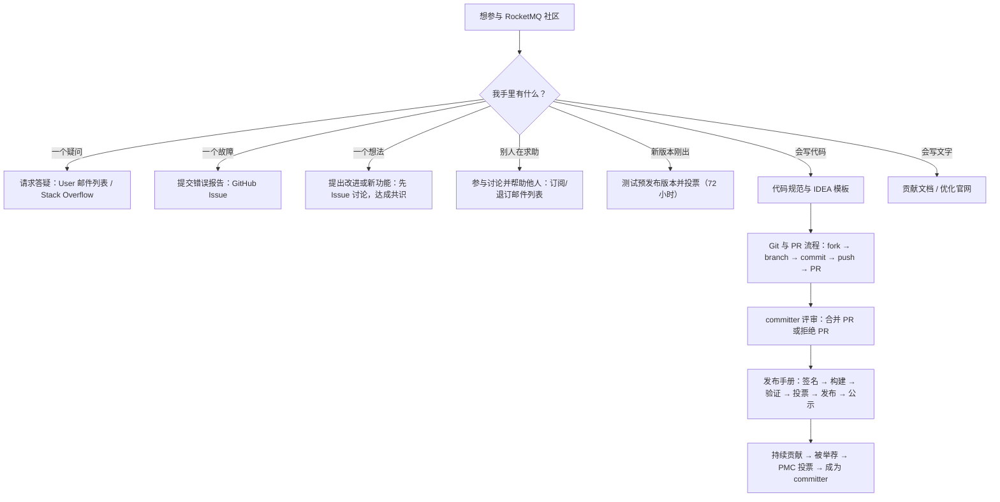
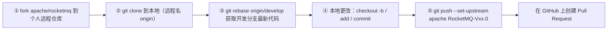
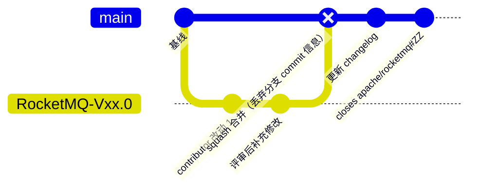
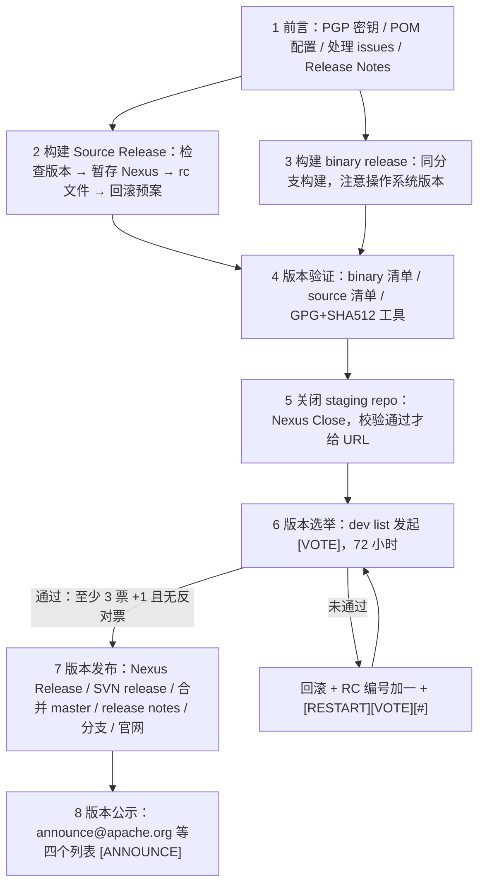

## 为什么需要贡献流程？（痛点引入）

第一次给 Apache 项目提 PR 的人，几乎都在同一套流程上摔过跤。下面是真实会发生的三轮往返：

**第一轮：文件头被打回。** 你加了两个新类、改了三行逻辑，自觉干净利落。CI 与评审者第一眼看到的不是逻辑，而是你新文件里没有 Apache License 头——上游要求把 `rocketmq/style/copyright/Apache.xml` 导入 IDEA 作为文件头模板，并要求移除 `File Header` 里的 Javadoc 标签；你没导入，新建的每个 `.java` 都带 IDE 默认的 `@author/@version` 注释块。于是「改动没变，先重做文件头」。

**第二轮：PR 描述不规范。** 你在 PR 标题写「fix some bugs」，正文空白。上游对 PR 摘要的要求是「填写首字母大写的 PR 摘要」，并且「PR 摘要以 `[ISSUE #XXX]` 开始并简要描述变更需求」，还要「概述 PR 变更需求，变更日志，验证信息」，参考的 PR Demo 是 `apache/rocketmq` 的第 152 号 PR。更要紧的是第 1 条前置确认：**已创建与 PR 对应的 GitHub Issue**——你根本没开 Issue，评审者连要解决什么都找不到。

**第三轮：测试与签名。** 上游要求「提交内容具备完整的测试用例，并确保基本检查、单元测试、集成测试通过」；发布环节还要 Release Manager 用 GPG 私钥对产物做 `.asc` 签名与 `.sha512` 摘要，投票至少要 3 票通过且无反对票。这一层你不用做，但你需要知道它存在——它决定了为什么社区对「一个 PR 只解决一个 Issue」这么执着。

| 维度 | 没有贡献流程时的痛苦 | 有了流程之后 |
|------|----------------------|--------------|
| 文件与许可 | 新文件缺 Apache License 头，整批返工 | IDEA 导入 `rmq_codeStyle.xml` 与 `Apache.xml`，一次配好，reformat 自动带上 |
| 代码风格 | 本地格式与 CI 校验不一致，来回 push 碰运气 | Code Style 模板 + IDEA 自动 reformat，以通过 Travis CI 风格校验为目标 |
| 需求共识 | 直接闷头写代码，写完被判定「超出项目范围」 | 先提 Issue 讨论细节与影响范围，达成共识再动手 |
| PR 沟通 | 标题随意、无 Issue 关联，评审者不知在改什么 | `[ISSUE #XXX]` 摘要 + 变更需求/变更日志/验证信息三段 |
| 合并责任 | 贡献者以为自己能合并，误操作他人分支 | 合并由 committer 执行，squash、changelog、关闭 PR 各有固定指令 |
| 版本质量 | 用户拿到未验证的包，出问题无法追责 | 签名、摘要、验证清单、投票、公示五道关口，72 小时门槛 |

> ### 💡 新人小结：开源社区贡献到底在贡献什么？
>
> 把开源项目想象成一家**24 小时不打烊的社区图书馆**：
> - 提问 = 在前台问管理员要一本书（`users@rocketmq.apache.org`、Stack Overflow）。
> - 报错 = 发现书页掉了，登记到「报修本」（GitHub Issue）。
> - 提改进 = 建议图书馆加自习区，得先在读者大会上说（Issue 上讨论、达成共识）。
> - 交代码 = 你真的动手砌了自习区，验收单要写清做了什么、怎么验（PR 描述 + 测试）。
> - 发布 = 图书馆换钥匙要全体理事签字、贴封条并公示（GPG 签名、投票、公示邮件）。
>
> **一句话：社区收的不是「你的代码」，而是「别人能接手、能追溯、能信任的一整套证据」。**

**学习路线图**（含分支，故用 Mermaid 表达；下面这张图也是本文的目录）



图后解读三条：左侧四条是**零代码贡献途径**，今天就能做；中间 `H → J → K` 是本文第三、四章的代码贡献主线；右侧 `L` 是第五章的 Release Manager 视角，绝大多数贡献者不执行它，但必须读懂它，因为投票、签名、公示都会出现在 `dev@` 邮件列表里。

---

## 先把社区专名对齐（术语表）

本章术语全篇复用。**全称一列凡是上游未展开的，都明确标注「上游未展开全称」**，不做推测性补全。

| 术语 | 全称 | 通俗含义（用自己的话） | 在本文中的角色 |
|------|------|------------------------|----------------|
| ASF | Apache Software Foundation；上游原文写作「ASF」，在贡献代码一节也写作「AFS Apache 软件基金会」（拼写笔误，指同一机构） | 基金会本体，管许可证、管商标、管发布合规 | 全篇所有流程合规的最终依据来源 |
| IPMC | 上游未展开全称 | 上游本篇未出现该缩写，本文亦不使用，仅在此登记以免与 PPMC 混淆 | 不在本文范围内 |
| PMC | Project Management Committee，上游以「PMC 成员」「PMC 权限」「PMC 投票表决」形式出现 | 项目管理委员会：一个 Apache 项目里拥有投票权和发布权限的那批人 | 决定谁能上传 RELEASE KEYS、谁投票表决新 committer |
| PPMC | 上游未展开全称（5.0 原文写作「Apache RocketMQ PPMC 投票通过后」） | 项目里承担投票的那一层成员组织；上游只给出用法未给定义 | 第 7 节版本发布的前置条件（5.0 版本原文） |
| Committer | 上游原文：「Committers 是社区中修改项目仓库的成员，可修改代码，文档和网站或接纳其他成员的贡献」 | 有写权限的人；负责合并或拒绝别人的 PR | 第五章合并 PR 的执行者；第八章「如何成为 committer」的目标 |
| Contributor | 上游未展开该词，通篇以「贡献者」表述 | 没有写权限、通过 PR 提交改动的人 | 第二章到第四章的主角 |
| PR | Pull Request，上游文中以「提交 PR」「创建合并请求」表述 | 「我改好了，请合进你的分支」这个请求及其讨论页 | 第四章主体 |
| Issue | GitHub Issue，上游给的地址是 `https://github.com/apache/rocketmq/issues` | 工单：报 Bug、提需求、PR 必须关联的那张单子 | PR 前置确认第 1 条 |
| RFC | 上游未使用该缩写，对应上游「提出改进或新功能」一节的「提案」 | 先写清楚要改什么、影响多大，让社区评审的设计提案 | 第一章「达成共识再动手」的载体 |
| CLA | 上游未使用该缩写，对应上游原文「AFS Apache 软件基金会 贡献者协议」，地址 `https://www.apache.org/licenses/contributor-agreements.html` | 贡献者协议：你签字确认「我贡献的代码允许 Apache 分发」 | 贡献代码一节的前置动作（提交电子签名） |
| Vote | 上游给出 `[ ] +1 approve`、`[ ] +0 no opinion`、`[ ] -1 disapprove with the reason` 三种勾选 | 邮件列表投票：+1 赞成、+0 弃权、-1 反对并说明理由 | 预发布测试评分、版本选举两处使用 |
| binding / non-binding | 上游公示邮件原文：「has passed with [number] binding +1s, [number] non-binding +1s and no 0 or -1」 | 有效票与参考票：委员会成员的票计入门槛，外部的只作参考 | 版本选举结果公示的口径 |
| quorum | 上游未使用该词，但给出了门槛数值：「若至少有 3 票通过而没有反对票」 | 法定人数：投票至少要几个人参与才成立 | 6.2 结果公示的判定依据（3 票） |
| GPG / PGP | 上游 1.2 节标题写作「PGP 签名」，正文命令全部使用 `gpg` | 开源签名工具：用私钥给产物签名、用公钥验真伪 | 发布手册第一步，必须先有密钥 |
| KEYS file | 上游给出 DEV 与 RELEASE 两个地址，分别是 `dist/dev/rocketmq/KEYS` 与 `dist/release/rocketmq/KEYS` | 项目公钥花名册：投票人用它核对签名是不是委员会成员签的 | 1.2 节末尾要做的动作；投票邮件里必附链接 |
| Maven staging repo | 上游原文「Nexus staging repo」，地址 `https://repository.apache.org/#stagingRepositories` | ASF Nexus 的「暂存货架」：构建好的产物先放这儿等关闭与投票 | 第 5 节「关闭 staging repo」的对象 |
| ASF 产物签名 | 上游要求每个包配 `.asc`（GPG clearsign）与 `.sha512`（摘要） | 封条（签名）+ 指纹（摘要），二者一起才叫可信产物 | 2.3 生成、4.3 验证 |
| RC | 上游写作「rc 版本文件」「RC<RC Number>」，目录形如 `x.x.x-rcx/` | Release Candidate，候选版；投票未过就 RC 编号加一重来 | 选举邮件主题与 SVN 目录命名 |
| NOTICE | 上游验证清单：「若引入了第三方依赖，需要更新 NOTICE」 | 许可证声明文件，写清依赖都来自哪儿、什么许可 | 第 4 节验证清单第 3 条 |
| Travis CI | 上游原文：「IDEA 设置完成后会自动 reformat 代码，以便通过 Travis CI 的代码风格校验」 | 持续集成服务，风格不过就直接红灯 | 第二章导入 Code Style 的目的 |
| MQVersion | 上游原文 `public static final int CURRENT_VERSION = Version.V4_5_0.ordinal();` | 代码里写死的当前版本常量 | 2.1 检查版本、4.1 用 clusterList 复核 |
| SVN | 上游给出 `dist.apache.org/repos/dist/dev/rocketmq/` 与 `.../release/rocketmq/` | ASF 的产物仓库，分 dev（候选）与 release（正式发布）两个区 | 第 5 节与第 7 节的落库位置 |
| JIRA | 上游给的地址 `https://issues.apache.org/jira/browse/ROCKETMQ/` | ASF 侧的工单系统，Release Notes 由它生成 | 1.4 处理 issues、1.5 发布 Release Notes |

---

## 一、贡献途径全景

上游「如何贡献」把社区入口列成 7 条，本节**逐条对应、不做抽样**。原清单：提出问题、提交错误报告、提出新特性、参与邮件列表上的讨论、贡献代码或文档、优化网站、测试预发布版本。

| 途径 | 具体动作 | 渠道（照抄上游地址） | 是否需要 CLA 电子签名 |
|------|----------|----------------------|------------------------|
| 提出问题（请求答疑） | 社区提供完备的处理流程帮您解答问题 | User mailing list `users@rocketmq.apache.org`；Stack Overflow 标签 `rocketmq` | 不需要 |
| 提交错误报告 | 使用过程中出现问题时提交报告 | GitHub Issue `https://github.com/apache/rocketmq/issues` | 不需要 |
| 提出改进或新功能 | 在 GitHub 上创建 Issue，写明细节描述与影响范围 | 同上 GitHub Issue | 不需要（提 Issue 阶段） |
| 参与讨论并帮助他人 | 订阅邮件列表，回答问题、交流新特性与预发布版本 | `users@rocketmq.apache.org`、`dev@rocketmq.apache.org`；订阅页 `/contact` | 不需要 |
| 测试预发布版本 | 拉 RC 包测试并投票 | `dev@rocketmq.apache.org` 邮件列表 | 不需要 |
| 贡献代码 | 遵循 code-guidelines 的贡献流程提交源代码 | GitHub PR + `code-guidelines` | **需要**（上游：请阅读 ASF 贡献者协议并提交电子签名） |
| 贡献文档 | 报告文档缺失/错误/过期，或直接改进 | GitHub Issue；文档在 `apache/rocketmq-site` 仓库 `new-official-website` 分支的 `/docs` 目录，Markdown 书写 | 上游未单独说明 |
| 优化官网 | 提建议与创意，或自己动手更新网站 | `https://github.com/apache/rocketmq-site/issues` | 上游未单独说明 |
| 更多贡献途径 | 介绍给伙伴使用；组织线下交流会或组建线上用户群；化身布道师 | 无固定渠道 | 不需要 |
| 成为 committer | 见本章最后一节 | 邮件列表 + PMC 投票 | 需要 |

> 上游「更多贡献途径」一节列了上述三条具体方式，原文该列表末尾还有一个未填内容的空条目；本文如实保留前三条，不代为补写。

### 1.1 请求答疑与提交错误报告

- **请求答疑**：通过 [User mailing list](mailto:users@rocketmq.apache.org) 和 [Stack Overflow #rocketmq](https://stackoverflow.com/questions/tagged/rocketmq) 提问。
- **提交错误报告**：在使用 RocketMQ 过程中出现问题，在 [GitHub Issue](https://github.com/apache/rocketmq/issues) 上提交错误报告。

### 1.2 提出改进或新功能（RFC 式提案）

社区在持续寻找反馈意见以改善 Apache RocketMQ，你的改进方案或新特性需求将惠及所有用户。上游要求提案**包含适当的细节描述和影响范围，尽可能详述需求**，理由是三条：

1. 实现的改进和新特性最终符合你的需求；
2. 根据需求评估投入成本和设计解决方案；
3. 便于社区围绕该提案展开建设性的讨论。

上游明确：**推荐先在社区达成共识再着手实现功能**——通过讨论新特性的必要性及实现方案，可以早发现超出项目范围的提案。若你计划自己实现提案，同样需要提供详细描述信息，并遵循 code-guidelines 的编码规范。

提案正文的最小骨架（按上游三条理由倒推的填写清单，字段名与要求均来自上游）：

```markdown
# ========== ✅ 推荐：按上游要求把「细节描述 + 影响范围」写全 ==========
标题：<一句话说明要改进什么>
背景：当前行为是什么，为什么不够
需求细节：期望的行为、输入输出、边界（上游：尽可能详述其需求）
影响范围：涉及哪些模块、是否影响兼容性（上游：适当的细节描述和影响范围）
成本与方案：大致投入、可选设计方案（上游：根据您的需求评估投入成本和设计解决方案）
是否自行实现：是 / 否（选「是」则须遵循 code-guidelines 编码规范）

# ========== ❌ 不推荐 ==========
# 标题 "feature request"，正文一句「希望支持 xxx」。
# 社区无法评估成本与影响范围，提案会长期停在讨论阶段。
```

### 1.3 参与讨论并帮助他人：邮件列表订阅与退订

上游给出两个列表：

| 邮件列表 | 地址 | 用途（上游原文口径） |
|----------|------|----------------------|
| User mailing list | `users@rocketmq.apache.org` | 用户提问以寻求帮助或建议；你可以通过订阅它、帮他人解决问题来贡献社区；也可在 Stack Overflow 检索 `rocketmq` 标签回答用户问题 |
| Development mailing list | `dev@rocketmq.apache.org` | 开发者交流新特性、预发布版本、一般的开发流程；热衷贡献代码可以加入 |

**订阅步骤**（上游以 `dev@rocketmq.apache.org` 为例）：

```shell
# ✅ 推荐：严格按上游五步执行，第 3 步「直接回复」，不要改主题、不要加正文
# 步骤 1：向订阅网关发一封「不包含任何内容或主题」的邮件
收件人: dev-subscribe@rocketmq.apache.org
主题:   (留空)
正文:   (留空)

# 步骤 2：等待收到确认邮件，主题为：confirm subscribe to dev@rocketmq.apache.org
#   上游提示：如果长时间未收到，先确认该邮件是否被你的邮箱拦截；
#   确认没有被拦截且仍长时间未收到，则返回步骤 1 重发
# 步骤 3：直接回复该确认邮件，不用修改主题和添加邮件内容
# 步骤 4：等待收到主题为  WELCOME to dev@rocketmq.apache.org  的邮件
# 步骤 5：收到 dev 的邮件即订阅成功；
#   想发起讨论直接往 dev@rocketmq.apache.org 发送，所有订阅者都会收到
echo "订阅完成，可直接发信到 dev@rocketmq.apache.org"
# 输出: WELCOME to dev@rocketmq.apache.org（以实际收到的邮件主题为准）
```

**退订步骤**（与订阅类似，上游同样给五步）：

```shell
# ❌ 不推荐：把 unsubscribe 邮件的正文写成投诉、或改掉确认邮件的主题 —— 会中断自动流程
# 步骤 1：发送一封不包含任何内容或主题的邮件到 dev-unsubscribe@rocketmq.apache.org
# 步骤 2：等待主题形如 confirm unsubscribe from dev@rocketmq.apache.org 的邮件
# 步骤 3：直接回复该邮件，不用修改主题和添加邮件内容
# 步骤 4：等待主题为 GOODBYE from dev@rocketmq.apache.org 的邮件
# 步骤 5：退订成功
echo "退订完成的标志是收到 GOODBYE from dev@rocketmq.apache.org"
# 输出: GOODBYE from dev@rocketmq.apache.org（以实际收到的邮件主题为准）
```

上游还补充：可以通过订阅 mailing lists 获取更多社区信息（原文该处链接指向官网 contact 页；本站为离线复刻，不保留该外链）。

> [!NOTE] 版本适用：`01how-to-contribute.md` 的 4.x 与 5.0 差异
> 两版**正文文字完全一致**，差异全部在 Markdown 列表标记与行尾空白：4.x 把「订阅步骤」「退订步骤」写成 `*` 项目符号并在步骤前留空行，5.0 改成 `-` 项目符号并取消空行；5.0 在「优化官网」段落链接行与「如何成为 committer」两行末尾多写了尾随空格，且文件末尾无换行符。字节数 8,189（4.x）对 8,181（5.0）。
> 结论：本节内容对 4.x 与 5.0 通用，无需分版本改写。

### 1.4 测试预发布版本

上游说「每隔几周我们会发布 RocketMQ 的新版本，以修复漏洞，提升性能，新增特性等」，并给出三步流程：

```
推出新的预发布版本并启动投票流程（时效 72 小时）
   ↓
测试预发布版本并评分：+1 未发现问题，-1 测试出问题
   ↓
未测出问题则发布；否则回到第一步（RC 编号加一，见第五章 6.2）
```

上游明确「测试预发行版是项大工程，我们需要吸纳更多人的参与」，并说明收益：**你将确信新的 RocketMQ 版本仍将为你的程序提供正常服务，并确实在支持版本升级**。发布流程的完整操作在第五章发布手册展开。

### 1.5 贡献代码与贡献文档、优化官网

- **贡献代码**：上游说明社区遵循 code-guidelines 中的贡献流程，编码手册包含构建开发环境指南、社区编码指南和编码风格，并介绍如何提交贡献的代码；并加粗提醒「**请务必在编码之前仔细阅读 code-guidelines**」；同时要求阅读 ASF 贡献者协议并**提交电子签名**。寻找合适 Issue 的入口是 GitHub Issue 列表，那里列出了目前已提出的改进和推荐特性。
- **贡献文档**：优秀的说明文档对任何一种软件都是至关重要的，社区致力于提供简明、精准、完备的技术文档。两条动作：在 GitHub Issue 上报告文档缺失、错误、过期等情况；文档以 Markdown 书写，存放在 `apache/rocketmq-site` 仓库 `new-official-website` 分支的 `/docs` 目录下。
- **优化官网**：上游列出官网的三个主要功能——通晓访问者 Apache RocketMQ 及其功能特性、支持访问者下载并使用 RocketMQ、引导访问者参与并贡献社区；建议与创意通过创建 `apache/rocketmq-site` 的 GitHub Issue 提交，想动手则访问 `apache/rocketmq-site` 的 `new-official-website` 分支页面。

### 1.6 如何成为 committer

上游口径整理成一张「条件表」：

| 问题 | 上游回答 |
|------|----------|
| Committer 是什么 | 社区中修改项目仓库的成员，可修改代码、文档和网站，或接纳其他成员的贡献 |
| 有没有严格的协议 | 没有；候选人通常是社区中活跃的贡献者 |
| 「活跃」具体指什么 | 参加邮件列表中的讨论，帮助他人解决问题，验证预发布版本，礼贤下士并持续优化社区管理（这部分关乎社区在 Apache 中的发展） |
| 代码/文档贡献重要吗 | 无疑同样至关重要；好的开端可以是优化性能、开发新特性、修复漏洞 |
| 贡献之后要做什么 | 为您所贡献的代码负责：提供测试用例和说明文档并持续维护 |
| 谁提名 | 社区内的 committer 或 PMC 成员举荐 |
| 谁决定 | 最终由 PMC 投票表决 |
| 现在该做什么 | 积极融入社区并以上述任意方式贡献；社区内 committer 成员会非常热衷与你分享交流，并给予适时的建议和指导 |

> ### 💡 新人小结：为什么「提问」也算贡献？
>
> 把邮件列表想象成**小区业主群**：
> - 你在群里问清一个坑，管理员会把它置顶（Issue 与 FAQ 的素材来源）。
> - 你替新人答一次疑，等于替管理员分担了值班（上游：通过订阅邮件系统以帮助他人解决问题来贡献社区）。
> - 你在新版本发布前跑一遍并回一个 `+1`，等于帮整个小区验了一次门锁（预发布测试投票）。
> - 你持续做这些事，物业理事会就会邀请你进业委会（committer 由活跃贡献者产生，PMC 投票）。
>
> **写代码是贡献的一条路，不是唯一一条；committer 的门票是「持续参与」，不是「一次大 PR」。**

---

## 二、代码规范与 IDEA 模板

上游 `02code-guidelines.md` 的 4.x 与 5.0 版本**逐字节相同**（MD5 均为 `d70ce79f19`，1,950 字节），因此本章只写一份，不分版本。

### 2.1 前言：为什么规范值得强制推行

上游给的理由是一段数据结论：「研究表明软件开发的 80% 时间用于软件维护，包括源码解读、源码重构、源码维护等」。据此，约定并强制推行编码规范和编码指南的作用是：

- 提高代码的可读性；
- 维护开发团队代码所有权；
- 帮助工程师快速深入理解新增代码；
- 简化维护成本。

| 对比维度 | 不做约定（各人一套格式） | 强制推行 code-guidelines |
|----------|--------------------------|--------------------------|
| 阅读成本 | 每次评审先花时间适配别人的缩进与命名 | 格式统一，评审注意力全在逻辑 |
| 所有权 | 「这块是谁写的」无人接得住 | 团队代码所有权可维护 |
| 新代码上手 | 靠口头讲解 | 靠约定即可读懂 |
| CI 表现 | 反复因风格问题失败，靠 push 试错 | IDEA 自动 reformat，一次通过风格校验 |
| 维护成本 | 高（占 80% 时间的那部分继续膨胀） | 上游目标即为简化维护成本 |

### 2.2 导入 Code Style（第 1 张截图）

上游原文分 5 步，逐条落地如下。

**第 1 步：找到文件。** 位置在源码 `rocketmq/style` 目录下的 `rmq_codeStyle.xml`。

```xml
<!-- ✅ 文件位置（上游原文口径） -->
<!-- rocketmq/style/rmq_codeStyle.xml -->
<!-- 该文件指定了代码的缩进格式、命名规范、标准 Java 约定等 -->

<!-- ❌ 不推荐：不导入该文件，直接用自己的 IDEA 默认 Scheme -->
<!-- 后果：本地格式与仓库约定不一致，无法通过 Travis CI 的代码风格校验 -->
```

**第 2 步：按操作系统选择导入路径。**

| 操作系统 | 上游给的菜单路径 | 补充动作 |
|----------|------------------|----------|
| Apple OS（macOS） | `IntelliJ IDEA > Settings > Editor > Code Style` | 进入 `Code Style` 标签页，依次选择 `Manage > Import`，导入文件并命名 `Scheme` |
| Windows OS | `IntelliJ IDEA > Settings > Editor > Code Style > Import Scheme` | 直接走 Import Scheme 入口 |

**第 3 步：对照界面确认导入结果。**


**第 4 步与第 5 步：导入生效后的行为。** 上游说明导入的 `rmq_codeStyle.xml` 指定了代码的缩进格式、命名规范与标准 Java 约定；IDEA 设置完成后会**自动 reformat 代码，以便通过 Travis CI 的代码风格校验**。

### 2.3 导入 Apache V2 许可头（第 2 张截图）

这一节解决痛点引入里「第一轮返工」的根因——新文件没有 License 头。

**第 1 步：文件位置。** 源码 `rocketmq/style/copyright` 目录下的 `Apache.xml`。


**第 2 步：许可说明。** 该模板对应 [Apache License, Version 2.0](https://www.apache.org/licenses/LICENSE-2.0)。

```text
# ✅ 推荐：把 rocketmq/style/copyright/Apache.xml 作为 File Header 模板导入
#    之后每个新建 .java 自动带上 Apache License, Version 2.0 头
#    → 与仓库既有文件一致，评审者不必再让你补文件头

# ❌ 不推荐：复制别人文件头手工粘贴
#    漏一个文件就是一次 CI 返工；且手写容易改错年份/许可名
```

### 2.4 选择 Apache 版权（第 3 张截图）


上游在这一节给出延伸阅读链接，指向五种开源协议（GPL、LGPL、BSD、MIT、Apache）的对比说明，用于理解「为什么是 Apache 而不是别家」。

| 协议 | 上游给出的定位 | 对贡献者的含义 |
|------|----------------|----------------|
| Apache（Apache License, Version 2.0） | 本项目采用；`Apache.xml` 即该许可的文件头模板 | 贡献即默认以 Apache V2 分发，需提交 ASF 贡献者协议电子签名 |
| GPL / LGPL / BSD / MIT | 上游以「五种开源协议」链接形式提供对比参考，未在本篇展开细节 | 本文不代为归纳其条款差异（上游未展开） |

### 2.5 移除 Javadoc 标签（第 4 张截图）

这是最容易被漏掉的一步，也是评审意见里最机械的一类。

```text
# ✅ 推荐（上游两步）
# 1. 依次选择：Settings > Editor > File and Code Templates > Includes
# 2. 进入 File Header 页签下，删除其中的 Javadoc 标签

# ❌ 不推荐：保留 IDE 默认的 Javadoc 标签块
#    新建文件会带上自动生成的注释标签，与仓库约定不符，
#    且每次都要手工删，容易漏
```


> ### 💡 新人小结：四个 IDEA 模板配置到底在配什么？
>
> 把它们想成**给新员工发工服和工牌**：
> - `rmq_codeStyle.xml` = 统一工服（缩进、命名、Java 约定），不穿工服进不了车间（Travis CI 风格校验）。
> - `Apache.xml` 文件头 = 工牌上的公司声明（每件作品都写清「这是 Apache V2 的东西」）。
> - 选择 Apache 版权 = 确认工牌模板版本没选错（别把 BSD 的牌子挂上）。
> - 删掉 Javadoc 标签 = 撕掉工服口袋里上一任留下的旧名片。
>
> **这四步全是「一次配好、终身受益」的本地设置，配完之后你的注意力才能回到真正的业务改动上。**

---

## 三、Git 与 PR 流程

上游 `03pull-request.md` 两版**存在差异但极小**（6,249 字节对 6,251 字节）：全文唯一实质差异在第 ① 步 fork 后展示仓库地址那一行——4.x 写作 `https://github.com/cuser/rocketmq.git # cuser's rocketmq repo[repository] url`（行首无 `$`），5.0 写作 `$ https://github.com/cuser/rocketmq.git # ...`（行首补了 `$`）。其余文字逐字相同。差异详见本章末的差异表。

### 3.1 前置：远程仓库为什么存在

上游用一段反问铺垫：从开发者角度，如何与他人协作完成项目？如果你想到「打包压缩然后复制粘贴」，请再试想一下把参与者范围扩大到 10k+ 级别。这就是远程仓库的意义：**开发者可以很方便地从 GitHub 上获取仓库代码，并提交开发分支到远程仓库与他人交流和共享**。


上游接着抛出两个待解决的问题，正好对应下面两章内容：**如何下载远程仓库的代码？如何提交开发分支到远程仓库？**

### 3.2 五步 Git 贡献指南

下图是这五步的关系，注意 `origin` 是你个人 fork 的远程名，上游示例里另用 `apache` 指代上游仓库这一远程名。



**① fork 仓库至个人 GitHub 远程仓库**

```shell
# ✅ 推荐：fork 之后到「个人主页 Repositories」里找到复刻仓库并复制其地址
https://github.com/cuser/rocketmq.git    # cuser's rocketmq repo[repository] url（4.x 原文，行首无 $）
$ https://github.com/cuser/rocketmq.git  # 同一行在 5.0 原文中行首带 $（仅排版差异）

# ❌ 不推荐：把这一行当命令执行
#    它是「仓库地址」的展示，不是可执行指令；照抄 $ 前缀去回车什么也不会发生
```

说明：`cuser` 是 GitHub 用户名。

**② 自行安装 Git 并克隆到本地仓库**

```shell
$ git clone https://github.com/cuser/rocketmq.git   # git clone [repo url]
# 输出: 本地仓库以 GitHub 仓库作为远程仓库，并以 origin 命名该远程仓库
```

**③ 获取开发分支最新代码**

```shell
$ git rebase origin/develop   # git rebase [branch]
# 作用: 把本地开发基点换到 origin/develop 最新提交上（rebase 的基本说法是「换基」）
# ❌ 不推荐: 跳过这一步直接改，PR 时基点落后，冲突与无关 diff 都会出现在评审页面上
```

上游在此处给出 [rebase `<branch>`](https://git-scm.com/docs/git-rebase) 的文档链接，说明该步的必要性可通过链接示例了解。

**④ 在本地仓库执行更改**

```shell
$ git checkout -b RocketMQ-Vxx.0   # git checkout [-b] [new-branch]  新建并切到开发分支
$ git add /rocketmq/pom.xml        # git add [dir/file]             把改动纳入暂存区
$ git commit -a -m "pom"           # git commit [-all] [-msg] [message] 一次性提交并写说明
# 说明（上游原文）：使用相对路径请切换至 .git 同级目录
# ❌ 不推荐：在任意目录用相对路径 git add，路径会解析失败
```

**⑤ 推送更改到远程仓库**

```shell
$ git push --set-upstream apache RocketMQ-Vxx.0
# 上游行尾注释原文：push branch to https://github.com/cuser/rocketmq-site.git
# 作用：--set-upstream 把本地分支与远程分支绑定，之后可省略远程名
```

### 3.3 在 GitHub 上提交 PR

上游以「提交 PR 至 `new-official-website` 分支」为例说明流程。先在本地把分支推上去：

```shell
$ git checkout new-official-website      # 上游行尾注释原文：git checkout -b new-official-website
$ git push origin new-official-website   # push to https://github.com/cuser/rocketmq-site.git
```

随后六步：

```
① GitHub 远程仓库切换至开发分支 new-official-website
② 创建合并请求：点击 Contribute 下的 Open pull request
③ compare across forks：选择请求分支和开发分支
④ 填写首字母大写的 PR 摘要，并在 Write 标签下简要描述 PR 内容
⑤ 点击 "Create pull request"，请求合并该分支
⑥ PR 在 apache/rocketmq-site 远程仓库上可见，所有协作者都可以 Review 并提供建议
```

第 ③ 步的分支对应关系是新手最容易点反的地方：


| 界面字段 | 上游含义 | 点反了的后果 |
|----------|----------|--------------|
| base repository / base | **请求仓库及请求分支**（改动要合入的目标） | 若把个人 fork 当 base，PR 会合进你自己的仓库，社区看不到 |
| head repository / compare | **开发仓库及开发分支**（改动来源） | 若把 develop 当 compare，等于「把自己的目标分支合给自己」，diff 为空 |

上游警告：请务必正确选择请求分支与开发分支，并请在得到分支所有者许可后再请求合入。

第 ④ 步的界面：


**提交 PR 前的五项确认（上游原文逐条保留）**：

| 序号 | 确认项 | 上游给的参考 |
|------|--------|--------------|
| 1 | 已创建与 PR 对应的 GitHub Issue | `https://github.com/apache/rocketmq/issues` |
| 2 | 修改内容符合 Coding Guidelines 编程规范 | 本文第二章 |
| 3 | PR 摘要以 `[ISSUE #XXX]` 开始并简要描述变更需求 | — |
| 4 | 概述 PR 变更需求、变更日志、验证信息 | PR Demo：`https://github.com/apache/rocketmq/pull/152` |
| 5 | 提交内容具备完整的测试用例，并确保基本检查、单元测试、集成测试通过 | — |

```markdown
# ========== ✅ 推荐：标题与正文都满足上游五项确认 ==========
标题: [ISSUE #XXX] Add retry backoff option for async send   # 以 [ISSUE #XXX] 开始，首字母大写
正文:
  ## 变更需求（对应确认项 4）
  ...按第 1.2 节提案骨架填写...
  ## 变更日志（对应确认项 4）
  - 新增开关 xxx；默认行为不变。
  ## 验证信息（对应确认项 4、5）
  - 基本检查、单元测试、集成测试均通过；补充了针对新增逻辑的测试用例。

# ========== ❌ 不推荐 ==========
# 标题: fix some bugs
# 正文: （空）
# 问题：无 [ISSUE #XXX]、无摘要、无验证信息，违反确认项 1/3/4/5
```

评审阶段：你可以根据评论在本地完成修改并进行**多次提交**；请求合并和提交修改的相关信息会同步展示在 **PR 页面、issue 列表、RocketMQ 的邮件列表**中，以便提醒 committer 及时审核 PR。

### 3.4 合并 PR（committer 视角）

上游明确：**开源项目开发分支合并由 committer 完成**。下图是合并与拒绝两条分支的走向。



读图要点：贡献者分支上的多次提交，在合并时被压缩成一次（上游建议用 `--squash` 压缩为一次 commit，并提醒「squash 会丢弃开发分支的 commit 信息」）；合并之后 committer 还要补 changelog 提交和「关闭 PR」的提交。

**① 合并 contributor 的 PR**

```shell
$ git checkout develop   # switch to local develop branch（切到本地 develop 分支）
$ git pull apache develop    # fast-forward to current remote HEAD（先把上游 develop 拉齐）
$ git pull --squash https://github.com/cuser/rocketmq.git RocketMQ-Vxx.0   # merge to branch
# 输出: 改动进入本地工作区与暂存区，但没有 commit —— 这正是 --squash 的效果
# 上游建议: 拉取的请求合并分支可能包含多次提交，建议使用 --squash 指令压缩为一次 commit
# 上游硬性前提: 合并前务必要解决合并冲突，并确保当前分支同步于远程分支
```

上游给出 [Git pull](https://git-scm.com/docs/git-pull) 链接以了解 fast-forward 等相关详情。

**② 合并 committer 自己的 PR**

```shell
# 上游：若 committer 合并自己的 PR，使用 Git merge 即可
$ git checkout develop      # switch to local develop branch
$ git pull apache develop   # fast-forward to current remote HEAD
$ git merge --squash RocketMQ-Vxx.0    # merge to branch
```

| 对比维度 | 合并 contributor PR | 合并 committer 自己的 PR |
|----------|---------------------|--------------------------|
| 上游指定的指令 | `git pull --squash <仓库地址> <分支>` | `git merge --squash <分支>` |
| 改动来源 | 他人 fork 的远程仓库 | 本地已有分支 |
| 是否需要仓库 URL | 需要（示例：`https://github.com/cuser/rocketmq.git`） | 不需要 |
| 提交署名要求 | 上游要求用 `--author` 回馈贡献者（见第 ④ 步） | 上游未单独要求 |
| 共同前提 | 都要先解决冲突、确保分支同步于远程，并跑补丁检查与内置测试用例 | 同左 |

**③ 补丁检查与 changelog**：进行常规的补丁检查，使用内置的测试用例构建项目，并**务必修改 changelog**。

**④ 提交合并并关闭 PR**

```shell
$ git commit --author="contributor_name <contributor_email>" -a -m "RocketMQ-Vxx.0 description closes apache/rocketmq#ZZ"
# --author: 把署名还给贡献者（上游：回馈开发者分支状态）
# closes apache/rocketmq#ZZ: 在提交信息里声明关闭 GitHub 上编号 ZZ 的 PR
# 上游参考: Close PR 文档 https://docs.github.com/cn/issues/tracking-your-work-with-issues/closing-an-issue
# ❌ 不推荐：漏写 --author，贡献者的名字不会出现在提交记录上
```

**⑤⑥ 推送**

```shell
$ git push apache develop   # ⑤ 将合并后的分支推送到 apache/rocketmq 远程仓库
$ git push origin develop   # ⑥ PR 被提交后会保留到 GitHub 远程仓库，也可同步更新个人 GitHub 仓库
```

### 3.5 拒绝 PR

上游定义：**拒绝 PR 意味着并不执行 pull 或 merge，而仅仅提交拒绝 PR 信息**。

```shell
$ git commit --allow-empty -m "RocketMQ-Vxx.0 closes apache/rocketmq#ZZ *Won't fix*"
# --allow-empty: 允许提交一个不含任何文件改动的空提交，仅用于留下这条决策记录
$ git push apache develop
# 结果: 关闭 GitHub 上编号 #ZZ 的 PR
# ❌ 不推荐：既想拒绝又执行 git pull --squash —— 上游明确拒绝时不执行 pull 或 merge
```

### 3.6 `03pull-request.md` 的两版差异

| 位置 | 4.x 原文 | 5.0 原文 | 影响 |
|------|----------|----------|------|
| Git 贡献指南第 ① 步代码块 | `https://github.com/cuser/rocketmq.git # cuser's rocketmq repo[repository] url` | `$ https://github.com/cuser/rocketmq.git # cuser's rocketmq repo[repository] url` | 5.0 在行首补了 `$ `；该行是仓库地址展示而非命令，两版语义一致 |
| 文件字节数 | 6,249 字节 | 6,251 字节 | 差 2 字节，正是上面 `$ ` 两个字符 |
| MD5（前 10 位） | `c4c7d2362a` | `c86eb82145` | 判定为「存在差异」，但差异不触及流程与命令 |

> [!NOTE] 版本适用
> 本文第三章的 Git 与 PR 流程对 4.x 与 5.0 **完全通用**。上游两版仅在示例代码块的行首排版上有 1 处差异，不涉及任何命令语义、分支名或确认项。

---

## 四、发布手册：Release Manager 视角

本章覆盖上游 `04release-manual.md` 的 8 个一级章节与全部小节。**4.x 是 551 行 / 17,654 字节，5.0 是 536 行 / 16,904 字节，相差 750 字节**，差异集中在 5 处（本章末有逐处对照表）。本章正文以 4.x 为主干（内容超集），凡 5.0 有不同口径处，就地用「版本适用」标注写出两版写法。



### 4.1 前言

#### 1.1 Apache 版本发布文档

先读三份上游链接，了解 ASF 版本发布流程：

| 文档 | 地址 |
|------|------|
| Apache Release Guide | `http://www.apache.org/dev/release-publishing` |
| Apache Release Policy | `http://www.apache.org/dev/release.html` |
| Maven Release Info | `http://www.apache.org/dev/publishing-maven-artifacts.html` |

#### 1.2 PGP 签名

上游说明：遵循 Apache 版本发布指南，对发布版本签名，用户也可据此判断下载的版本是否被篡改。创建 `pgp` 密钥用于版本签名，使用 **`<your Apache ID>@apache.org`** 作为密钥 USER-ID。详情参考 [Apache Releases Signing documentation](https://infra.apache.org/release-signing) 与 [Cryptography with OpenPGP](http://www.apache.org/dev/openpgp.html)。

生成密钥的简要流程（上游五条逐条保留）：

1. 通过 `gpg --gen-key` 生成一个新的 `gpg` 密钥，设置密钥长度为 4096 并设置永不过期；
2. 通过 `gpg --keyserver keys.openpgp.org --send-key <your key id>` 上传密钥到公钥服务器；
3. 通过 `gpg --armor --export <your key id> >> gpgapachekey.txt` 导出公钥到文本文件；
4. 获得其他 committer 签名的密钥（可选）；
5. 将生成的密钥添加到 KEYS file——**这一步两版不同**：

```shell
# ✅ 4.x 原文：添加到两个文件
#    DEV KEYS file  https://dist.apache.org/repos/dist/dev/rocketmq/KEYS
#    RELEASE KEYS file  https://dist.apache.org/repos/dist/release/rocketmq/KEYS
#    4.x 的 tip：DEV SVN 仓库可以由 Release Manager 自行添加；
#                Release SVN 仓库需要 PMC 权限，可以由 PMC 协助将 KEY 进行上传。

# ✅ 5.0 原文：只提到一个文件
#    将生成的密钥添加到 KEYS file https://dist.apache.org/repos/dist/dev/rocketmq/KEYS
#    （由 release manager 上传至 svn 仓库）

# ❌ 不推荐：以为 Release Manager 一定能自行写 RELEASE KEYS
#    4.x 已写明该仓库需要 PMC 权限；无权限时须由 PMC 协助上传
```

**Tips（上游原文）**：需要设置默认公钥；若有多个公钥，请修改 `~/.gnupg/gpg.conf`。

上游给出的 `gpg --gen-key` 完整交互输出（照抄，含关键选择点注释）：

```shell
[root@localhost ~]# gpg --gen-key
gpg (GnuPG) 2.0.22; Copyright (C) 2013 Free Software Foundation, Inc.
...
# 密钥生成目录
gpg: directory `/root/.gnupg' created
gpg: new configuration file `/root/.gnupg/gpg.conf' created
gpg: WARNING: options in `/root/.gnupg/gpg.conf' are not yet active during this run
gpg: keyring `/root/.gnupg/secring.gpg' created
gpg: keyring `/root/.gnupg/pubring.gpg' created
Please select what kind of key you want:
   (1) RSA and RSA (default)
   (2) DSA and Elgamal
   (3) DSA (sign only)
   (4) RSA (sign only)
Your selection?
RSA keys may be between 1024 and 4096 bits long.
What keysize do you want? (2048) 4096        # ← 上游要求：设 4096
Requested keysize is 4096 bits
Please specify how long the key should be valid.
         0 = key does not expire
      <n>  = key expires in n days
      <n>w = key expires in n weeks
      <n>m = key expires in n months
      <n>y = key expires in n years
Key is valid for? (0)                         # ← 上游要求：永不过期，答 0
Key does not expire at all
Is this correct? (y/N) y

GnuPG needs to construct a user ID to identify your key.
# 设置 USER-ID
Real name: rocketmq
Email address: rocketmq@apache.org
Comment: rocketmq
You selected this USER-ID:
    "rocketmq (rocketmq) <rocketmq@apache.org>"

Change (N)ame, (C)omment, (E)mail or (O)kay/(Q)uit? O
You need a Passphrase to protect your secret key.

...
gpg: /root/.gnupg/trustdb.gpg: trustdb created
gpg: key 7DE280AF marked as ultimately trusted
public and secret key created and signed.

gpg: checking the trustdb
gpg: 3 marginal(s) needed, 1 complete(s) needed, PGP trust model
gpg: depth: 0  valid:   1  signed:   0  trust: 0-, 0q, 0n, 0m, 0f, 1u
pub   4096R/7DE280AF 2022-07-05
      Key fingerprint = 421D C10E 9CC3 D261 9F89  C777 86BB 17AA 7DE2 80AF
uid                  rocketmq (rocketmq) <rocketmq@apache.org>
sub   4096R/65B9828A 2022-07-05
```

生成的公钥和私钥地址：

```shell
gpg: keyring `/root/.gnupg/secring.gpg' created     # 私钥环
gpg: keyring `/root/.gnupg/pubring.gpg' created     # 公钥环
```

将生成的公钥和私钥转化为 ASCII 形式：

```shell
gpg --armor --output /root/gpgtest/public-key.txt  --export 7DE280AF
gpg --armor --output /root/gpgtest/private-key.txt --export-secret-keys 7DE280AF
# --armor: 输出 ASCII 可打印形式，便于贴进 KEYS file
# ❌ 不推荐：把 private-key.txt 提交进任何仓库或邮件
```

查看密钥列表：

```shell
[root@localhost ~]# gpg --list-keys
/root/.gnupg/pubring.gpg
------------------------
pub   4096R/7DE280AF 2022-07-05
uid                  rocketmq (rocketmq) <rocketmq@apache.org>
sub   4096R/65B9828A 2022-07-05
```

上传公钥到公钥服务器：

```shell
[root@localhost gpgtest]# gpg --keyserver keys.openpgp.org --send-key 7DE280AF
gpg: sending key 7DE280AF to hkp server keys.openpgp.org
# 输出: 该 key 已进入 keys.openpgp.org，其他人可据此验证你的 .asc 签名
```

#### 1.3 POM 配置

配置 POM 文件，以便将版本部署到 ASF Nexus 仓库。

**① 添加 Apache POM 继承默认设置**

```xml
<parent>
    <groupId>org.apache</groupId>
    <artifactId>apache</artifactId>
    <version>XX</version>
</parent>
```

**② Maven `settings.xml` 中添加密钥信息**

```xml
<settings>
    <profiles>
        <profile>
            <id>signed_release</id>   <!-- 后续 mvn 命令用 -Psigned_release 引用 -->
            <properties>
                <mavenExecutorId>forked-path</mavenExecutorId>
                <gpg.keyname>yourKeyName</gpg.keyname>
                <deploy.url>https://dist.apache.org/repos/dist/dev/rocketmq/</deploy.url>
            </properties>
        </profile>
    </profiles>
    <servers>
        <!-- To publish a snapshot of some part of Maven -->
        <server>
            <id>apache.snapshots.https</id>
            <username>yourApacheID</username>
            <!-- Use the password encryption by maven -->
            <password>yourApachePassword</password>
        </server>
        <!-- To stage a release of some part of Maven -->
        <server>
            <id>apache.releases.https</id>
            <username>yourApacheID</username>
            <password>yourApachePassword</password>
        </server>
        <server>
            <id>gpg.passphrase</id>
            <passphrase>yourKeyPassword</passphrase>
        </server>
    </servers>
</settings>
```

参数解释：

| 字段 | 含义 | 注意 |
|------|------|------|
| `profile id = signed_release` | 发布用 profile，被 `-Psigned_release` 引用 | 上游 2.2 步命令显式带该 profile |
| `mavenExecutorId = forked-path` | 上游给出的执行器取值，本文不推测其底层语义 | 照抄上游配置 |
| `gpg.keyname` | 用来签名的 GPG key 名 | 与 1.2 节生成的 key 对应 |
| `deploy.url` | 部署目标，写作 dev 区 SVN 地址 | 与第 5 节「拷贝至 `/dev/rocketmq`」呼应 |
| `apache.snapshots.https` / `apache.releases.https` | 快照与发布两套凭据，用户名是 Apache ID | 上游注释区分了 snapshot 与 stage a release |
| `gpg.passphrase` | 私钥口令 | 上游 Tips：推荐使用 [Maven's password encryption capabilities](http://maven.apache.org/guides/mini/guide-encryption.html) 加密 |

```shell
# ✅ ③ 构建 Artifacts 并签名
mvn clean install -Papache-release
# 输出: 本地构建产物，并按 profile 触发签名相关步骤

# ❌ 不推荐：把 yourKeyPassword / yourApachePassword 明文提交进版本库
#    上游给出的加密手段即上面的 Maven password encryption
```

#### 1.4 处理 issues

解决与该发布版本相关的 JIRA issues 和 GitHub issues；检查 MQVersion 是否与发布版本一致。

#### 1.5 发布 Release Notes

通过 [RocketMQ JIRA](https://issues.apache.org/jira/browse/ROCKETMQ/) 生成 Release Notes，推送到 `rocketmq-site`，并**添加链接至版本选举邮件**（该链接在第 6 节选举邮件正文的 `Release Notes` 字段使用）。

### 4.2 构建 Source Release

上游说明：使用 [Maven Release plugin](https://maven.apache.org/maven-release/maven-release-plugin/) 版本发布插件，发布 Artifact 至 ASF Nexus 暂存库，完成版本验证和版本投票后，拷贝至 Apache SVN 版本库。

> [!NOTE] 版本适用：4.x 在此处多出一条 tip
> **4.x 原文**：由于当前 develop 为保护分支，因此需要拉出一个新的预发版分支 `prepare-release-x.x.x` 进行操作，并在 2.2 步结束后通过提交 PR 的方式合入到 develop 分支。
> **5.0 原文**：删除了该 tip。
> 影响：4.x 的操作路径是「develop → 拉 `prepare-release-x.x.x` → 在该分支上跑 release 插件 → PR 合回 develop」；5.0 未描述该绕行方案。

#### 2.1 检查 RocketMQ 版本

确认 MQVersion 版本，若与 `release-4.5.0` 形式不符或版本不一致，修改至正确并推送到 `develop` 分支。

```java
public static final int CURRENT_VERSION = Version.V4_5_0.ordinal();
// 上游示例取值 V4_5_0；发布前须与目标版本号一致
// ✅ 推荐：版本常量与本次 release 版本一致，后续 clusterList 才能核对上
// ❌ 不推荐：代码已发布 4.9.2 但该常量仍停在旧值，验证清单第 8 项直接不过
```

#### 2.2 暂存至 ASF Nexus 仓库

切换至 `develop` 分支，确认与该版本相关的 GitHub PRs 均已合并。

**① 配置 pom.xml 文件**

```xml
<scm>
    <url>git@github.com:apache/rocketmq.git</url>
    <connection>scm:git:git@github.com:apache/rocketmq.git</connection>
    <developerConnection>scm:git:git@github.com:apache/rocketmq.git</developerConnection>
    <tag>rocketmq-all-x.x.x</tag>   <!-- release 插件据此打 tag -->
</scm>
```

**② maven release plugin 的三个目标**

```shell
mvn release:clean
mvn release:prepare
mvn release:perform
```

上游把实际执行序列写成带 profile 的三步：

```shell
# 1. 清除构建失败及丢弃的版本
mvn clean release:clean

# 2. 根据 SCM 属性更新 tag
mvn release:prepare -Psigned_release -Darguments="-DskipTests"

# 3. 将生成 artifacts 暂存到 Nexus repo
mvn -Psigned_release release:perform -Darguments="-DskipTests"
# 可添加 -DdryRun=true 参数执行预演（上游原文提示）
```

参数解释：`-Psigned_release` 引用 1.3 节 profile；`-Darguments="-DskipTests"` 把参数透传给 release 插件派生的构建；`-DdryRun=true` 用于预演不真正落地。

执行完上述流程可在 [Nexus staging repo](https://repository.apache.org/#stagingRepositories) 或本地分支的 `target` 目录下找到预发布版本的 Artifacts。

> [!NOTE] 版本适用：同一步的两版口径不同
> **4.x 原文（tip）**：该步结束后，需要将预发版分支 `prepare-release-x.x.x` 内容通过提交 PR 的方式合入到 develop 分支，并以 develop 被合入的 commit `[maven-release-plugin] prepare release rocketmq-all-4.9.2` 为基准重新打 release Tag。
> **5.0 原文（Tips）**：只发布源码版本，仅需要保留源码和相关 jar 文件，Nexus GUI 中右键 `delete` 其余 artifact。
> 两处口径完全不同：4.x 讲「分支回并与重新打 Tag」，5.0 讲「Nexus 里删掉不需要的 artifact」。

#### 2.3 rc 版本文件

预发布版本投票通过前会暂存在 [/dev/rocketmq](https://dist.apache.org/repos/dist/dev/rocketmq/)，存放于 `x.x.x-rcx/` 目录下，需要提供的文件（上游六行清单，完整保留）：

```text
rocketmq-all-x1.x2.x3-bin-release.zip
rocketmq-all-x1.x2.x3-bin-release.zip.asc
rocketmq-all-x1.x2.x3-bin-release.zip.sha512
rocketmq-all-x1.x2.x3-source-release.zip
rocketmq-all-x1.x2.x3-source-release.zip.asc
rocketmq-all-x1.x2.x3-source-release.zip.sha512
```

通过 `gpg` 指令生成签名文件和验证文件：

```shell
# 生成 .asc 文件
gpg --clearsign rocketmq-all-x1.x2.x3-bin-release.zip
gpg --clearsign rocketmq-all-x1.x2.x3-source-release.zip

# 生成 .sha512 文件
gpg --print-md SHA512 rocketmq-all-x1.x2.x3-bin-release.zip   > rocketmq-all-x1.x2.x3-bin-release.zip.sha512
gpg --print-md SHA512 rocketmq-all-x1.x2.x3-source-release.zip > rocketmq-all-x1.x2.x3-source-release.zip.sha512

# ✅ 推荐：bin 与 source 两套包各配一对 .asc + .sha512，与上面六文件清单严格一致
# ❌ 不推荐：只签 bin 包不签 source 包 —— 4.2 的 source 验证清单要求两者都验
```

**Tips（上游原文）**：源码版本和二进制版本应以 `rocketmq-all` 开头，以便使用 Docker 构建 [RocketMQ Docker Build](https://github.com/apache/rocketmq-docker/blob/a2672f62cc5171263ffc856ab5657291efba1912/image-build/Dockerfile-centos#L58-L59)。

| 后缀 | 由哪条命令生成 | 作用 | 谁消费 |
|------|----------------|------|--------|
| `.zip` | Maven 构建产物 | 发布本体 | 用户下载 |
| `.zip.asc` | `gpg --clearsign` | 签名，证明出自持有私钥的那个人 | 4.3 的 `gpg --verify` |
| `.zip.sha512` | `gpg --print-md SHA512` | 摘要，证明包体未被篡改 | 4.3 的 `gpg --print-md` 比对 |

#### 2.4 回滚并重试

若执行 staging 过程出现问题，按如下流程回滚。

**第一步：删除 2.2 步骤中创建的 tag**

```shell
# 列出所有 tag，并找到最新创建的
git tag -ln

# 删除本地仓库的 tag
git tag -d rocketmq-all-x1.x2.x3

# 推送更新至 GitHub
git push origin :refs/tags/rocketmq-all-x1.x2.x3
# ❌ 不推荐：只删本地不推 origin —— GitHub 上的 tag 仍在，投票邮件会指向已废弃的 tag
```

**第二步：删除 2.2 步骤中开发分支的提交记录**

```shell
git log
# 找到最新的提交记录，上游示例标注为：
#   des1: [maven-release-plugin] prepare release rocketmq-all-4.9.2
#   des2: [maven-release-plugin] prepare for next development iteration
```

这里两版给出了**两种不同的回退指令**：

```shell
# ✅ 4.x 原文（"revert commits"）：不改历史，追加反向提交
git revert -n commit-idA..commit-idB

# 5.0 原文（"删除 commits"）：直接把分支指针移回去并强推
git reset --hard commit-id
git push origin HEAD --force
```

| 对比维度 | 4.x：`git revert -n commit-idA..commit-idB` | 5.0：`git reset --hard commit-id` + `git push origin HEAD --force` |
|----------|---------------------------------------------|-------------------------------------------------------------------|
| 上游给该步起的名字 | revert commits | 删除 commits |
| 对历史的影响 | 追加反向提交，历史保留 | 指针前移并强推，历史被改写 |
| 是否需要 `--force` | 上游未给出 force | 上游明确给出 `--force` |
| 需要的 commit 参数 | 一段区间 `commit-idA..commit-idB` | 单个 `commit-id` |
| 示例提交说明写法 | `rocketmq-all-4.9.2`（行末无右方括号） | `rocketmq-all-4.9.2]`（行末带右方括号，为上游排版原文） |

**第三步与第四步**：删除 [Nexus](https://repository.apache.org/#welcome) 中待回退版本；回退至步骤 2.1 重做。

### 4.3 构建 binary release

上游要点（四条全部保留）：

- 二进制版本和源码版本使用相同的代码分支构建，需要注意操作系统版本；
- 有些依赖，比如 `netty tc-native` 对操作系统敏感；
- 确保 checkout 至预发布版本分支；
- 确保所有单元测试均可通过 `mvn clean install`；确保所有集成测试均可通过 `mvn clean install -Pit-test`。

```shell
# ✅ 推荐顺序（上游原文顺序）
git checkout <预发布版本分支>       # 上游：确保 checkout 至预发布版本分支
mvn clean install                   # 上游：确保所有单元测试均可通过
mvn clean install -Pit-test         # 上游：确保所有集成测试均可通过

# ❌ 不推荐：在 source release 之外换个分支或换台不同 OS 的机器现取现构建
#    上游警告 netty tc-native 之类依赖对操作系统敏感，产物与签名会对不上
```

成功构建后，同样需要生成 `.asc` 文件和 `.sha512` 文件（命令见 2.3 节），完成验证和投票后，最终拷贝到 [svn](https://dist.apache.org/repos/dist/release/rocketmq/) 仓库。

### 4.4 版本验证

#### 4.1 binary release 验证清单（上游 8 条全列）

1. 检查构建依赖包的操作系统，netty-tcnative 操作系统敏感；
2. 确保许可证为 Apache V2；
3. 若引入了第三方依赖，需要更新 NOTICE；
4. 提取压缩文件检查版本是否正确；
5. 验证 ASC 签名、SHA512 摘要；
6. 运行 Quick-Start 启动 nameserver 和 broker；
7. 运行 clusterList 命令检查版本是否正确；
8. 确保没有 nohup.out 文件。

#### 4.2 source release 验证清单（上游 6 条全列）

1. 确保许可证为 Apache V2；
2. 若引入了第三方依赖，需要更新 NOTICE；
3. 提取压缩文件检查版本是否正确；
4. 验证 ASC 签名、SHA512 摘要；
5. 编译源码，运行 Quick-Start 启动 nameserver 和 broker；
6. 运行 clusterList 命令判断版本是否正确。

| 对比维度 | binary release 清单 | source release 清单 |
|----------|---------------------|---------------------|
| 条目数 | 8 条 | 6 条 |
| 检查构建操作系统 | 有（netty-tcnative 敏感） | 无 |
| 许可证 Apache V2 | 有 | 有 |
| 更新 NOTICE | 有 | 有 |
| 提取压缩文件检查版本 | 有 | 有 |
| 验证 ASC 签名与 SHA512 摘要 | 有 | 有 |
| Quick-Start 启动 nameserver 和 broker | 有（直接运行） | 有（**先编译源码**再运行） |
| clusterList 判断版本 | 有 | 有 |
| 确保没有 nohup.out 文件 | **有，独有** | 无 |

#### 4.3 验证工具

按照下面的流程验证 GPG 签名、SHA512 摘要：

1. 下载发布版本的依赖包、`.asc` 文件、`.sha512` 文件；
2. 在 Unix 系统上执行如下指令：

```shell
for file in `find . -type f -iname '*.asc'`
do
    gpg --verify ${file}
done
```

或：

```shell
gpg --verify rocketmq-all-%version-number%-source-release.zip.asc rocketmq-all-%version-number%-bin-release.zip
# 上游原文即如此书写两个文件名，照抄不改
```

出现 `Good signature` 说明签名正确：

```text
gpg: Good signature from ... gpg: Signature made ...
```

3. 根据 SHA512 进行版本一致性验证：

```shell
gpg --print-md SHA512 rocketmq-all-%version-number%-source-release.zip
gpg --print-md SHA512 rocketmq-all-%version-number%-bin-release.zip
# ✅ 推荐：把这里的输出与包内 .sha512 文件内容逐字符比对
# ❌ 不推荐：只看 Good signature 就下结论 —— 摘要才是「包体未变」的证据，签名是「谁发的」证据
```

### 4.5 关闭 staging repo

预发布版本完成清单验证后，关闭 Nexus 暂存库，准备进行版本选举。

```text
操作（上游原文口径）：
1. 选择 Nexus 上的 orgapacherocketmq-XXX 待发布版本，点击 Close 图标，关闭暂存库
2. 关闭之前，Nexus 会进行一系列签名验证和文本校验
3. 校验通过：Nexus 关闭仓库并提供暂存库 URL，在选举邮件中标注为 The staging repo
4. 校验失败：修复 issues，回滚并重新执行版本发布流程
5. 以上工作均已完备：使用 SVN 拷贝至 /dev/rocketmq Apache 远程仓库
```

| 分支 | 触发条件 | 上游规定的下一步 |
|------|----------|------------------|
| 校验通过 | Nexus 关闭仓库并给出 URL | 进入第 6 节版本选举，URL 填入 `The staging repo` 字段 |
| 校验失败 | 签名验证或文本校验未过 | 修复 issues → 回滚（见 2.4）→ 重新执行版本发布流程 |

### 4.6 版本选举

RocketMQ 社区通过 **`dev@rocketmq.apache.org`** 邮件列表进行版本选举。参考 [voting process](http://www.apache.org/foundation/voting.html) 了解 Apache 投票流程。

#### 6.1 社区投票

- 邮件列表：[dev list](mailto:dev@rocketmq.apache.org)
- 邮件主题：**[VOTE]: Release Apache RocketMQ \<release-version\> RC\<RC Number\>**

```text
Hello RocketMQ Community,

This is the vote for <release version> of Apache RocketMQ.

${A brief introduction to RocketMQ and the features of this release.}

The artifacts:
https://dist.apache.org/repos/dist/dev/rocketmq/${release version}

The staging repo:
https://repository.apache.org/content/repositories/orgapacherocketmq-XXX/

Git tag for the release:
<link to the tag of GitHub repo>

Hash for the release tag:
<Hash value of the release tag>

Release Notes:
<insert link to the rocketmq release notes>

The artifacts have been signed with Key : <ID of signing key>, which can be found in the keys file:

https://dist.apache.org/repos/dist/dev/rocketmq/KEYS

The vote will be open for at least 72 hours or until necessary number of votes are reached.

Please vote accordingly:

[ ] +1  approve
[ ] +0  no opinion
[ ] -1  disapprove with the reason

Thanks,
The Apache RocketMQ Team
```

**Tips（上游原文）**：Hash for the release tag 可使用 commit id。

| 投票标记 | 上游含义 | 出处 |
|----------|----------|------|
| `+1 approve` | 赞成 | 6.1 选举邮件 |
| `+0 no opinion` | 无意见（弃权） | 6.1 选举邮件 |
| `-1 disapprove with the reason` | 反对，且必须给出理由 | 6.1 选举邮件 |
| `+1 未发现问题 / -1 测试出问题` | 预发布测试阶段的评分口径 | 第一章「测试预发布版本」 |

#### 6.2 结果公示

72 小时后，**若至少有 3 票通过而没有反对票**，则发送如下邮件庆祝版本发布。

- 邮件主题：**[RESULT][VOTE]: Release Apache RocketMQ \<release-version\> RC\<RC Number\>**

```text
Hello RocketMQ Community,

The Apache RocketMQ `<release version>` vote is now closed and has passed with [number] binding +1s, [number] non-binding +1s and no 0 or -1:

Binding votes +1s:
User Name (Apache ID)
User Name (Apache ID)
User Name (Apache ID)
....

Non-binding votes +1s:
User Name (Apache ID)
....

The release will be published soon.

Thanks,
The Apache RocketMQ Team
```

若投票未通过：修复 issues、回滚、**增加 RC 的编号**，重新启动版本发布流程，重新发起版本投票流程；更新邮件主题：**[RESTART][VOTE][#\]: Release Apache RocketMQ \<release-version\> RC\<RC Number\>**。

### 4.7 版本发布

投票通过后，发布版本到 Maven Nexus 仓库和 Apache 版本仓库。上游六步全部落地：

```text
1. 发布到 Nexus 仓库：选择暂存区的 orgapacherocketmq-XXX，点击 Release 图标发布
2. 发布到 Apache 版本仓库：使用 SVN 拷贝版本至
   /release/rocketmq（https://dist.apache.org/repos/dist/release/rocketmq/）
3. 合并 apache/rocketmq 的 develop 分支至 master 分支
4. 添加 release notes 到 Releases · apache/rocketmq
   （https://github.com/apache/rocketmq/releases）
5. 创建新分支，并命名为 release-x.x.x
6. 更新 apache/rocketmq-site 官网主页：
   - 添加 release note，参考 4.9.3 release notes
     （https://github.com/apache/rocketmq-site/commit/4b662a197a0a77fd460614df9e231e6ffdd7c622）
   - 更新 release note，参考 docs updates for 4.9.3
     （https://github.com/apache/rocketmq-site/commit/0fd4d231c06f1d641a0cc30f8ffe22775043e89d）
```

> [!NOTE] 版本适用：第 7 节是三处差异的集中点
> **主语**：4.x 写「投票通过后」；5.0 写「**Apache RocketMQ PPMC** 投票通过后」。
> **第 2 步**：4.x 紧跟一条 tip「Release SVN 仓库需要 PMC 权限，若没有权限，可以由 PMC 协助将 KEY 进行上传」；5.0 无此 tip。
> **第 5 步**：4.x 紧跟一条 tip「请将该分支的 commit 重置回 `[maven-release-plugin] prepare release rocketmq-all-x.x.x` 处」；5.0 无此 tip。

### 4.8 版本公示

- 邮件列表：**`announce@apache.org`**、**`users@rocketmq.apache.org`**、**`private@rocketmq.apache.org`**、**`dev@rocketmq.apache.org`**
- 邮件主题：**[ANNOUNCE] Release Apache RocketMQ \<release-version\>**

```text
Hi all,

The Apache RocketMQ team would like to announce the release of Apache RocketMQ <release version>.

${A brief introduction to RocketMQ and the features of this release.}

More details regarding Apache RocketMQ can be found at:

http://rocketmq.apache.org/

The release artifacts can be downloaded here:

https://dist.apache.org/repos/dist/release/rocketmq/${release-version}

The release notes can be found here:

<insert link to the rocketmq release notes>

Thanks,
The Apache RocketMQ Team
```

四个列表在上游原文中只以地址形式并列给出（`announce@apache.org`、`users@rocketmq.apache.org`、`private@rocketmq.apache.org`、`dev@rocketmq.apache.org`），各自的角色与权限含义上游未展开，本文不代为界定；可确认的事实是：这封公告邮件必须同时投递到这四个列表。

### 4.9 `04release-manual.md` 的 750 字节差异逐处对照

| 序号 | 位置 | 4.x（551 行 / 17,654 字节） | 5.0（536 行 / 16,904 字节） | 差异性质 |
|------|------|------------------------------|-------------------------------|----------|
| 1 | 1.2 PGP 签名 第 5 条 | 密钥要添加到 **DEV KEYS file 与 RELEASE KEYS file 两个文件**，并附 tip：DEV SVN 可由 Release Manager 自行添加，Release SVN 需要 PMC 权限，可由 PMC 协助上传 | 只添加到 **一个 KEYS file**（dev 区），行尾写「（由 release manager 上传至 svn 仓库）」，**无 tip** | 4.x 多一行链接加一整段 tip |
| 2 | 第 2 章 构建 Source Release 引言后 | 有 tip：develop 为保护分支，需拉预发版分支 `prepare-release-x.x.x`，并在 2.2 步结束后通过提交 PR 合入 develop | **无该 tip** | 4.x 独有的分支绕行方案 |
| 3 | 2.2 步末尾 | tip：预发版分支内容通过 PR 合回 develop，并以被合入的 commit `[maven-release-plugin] prepare release rocketmq-all-4.9.2` 为基准重新打 release Tag | 换成 Tips：**只发布源码版本**，仅需保留源码和相关 jar 文件，Nexus GUI 中右键 `delete` 其余 artifact | 两版内容完全不同主题 |
| 4 | 2.4 回滚的第二步 | 小标题「revert commits」，命令 `git revert -n commit-idA..commit-idB`；示例行末无右方括号 | 小标题「删除 commits」，命令 `git reset --hard commit-id` + `git push origin HEAD --force`；示例行末带 `]` | 回退策略与示例排版都不同 |
| 5 | 第 7 章 版本发布 | 主语「投票通过后」；第 2 步后有 tip（Release SVN 需 PMC 权限，可由 PMC 协助上传 KEY）；第 5 步后有 tip（把 `release-x.x.x` 分支 commit 重置回 `[maven-release-plugin] prepare release rocketmq-all-x.x.x` 处） | 主语「**Apache RocketMQ PPMC** 投票通过后」；**两条 tip 均无** | 主语更明确，但删掉了权限与分支基点说明 |

处理原则：本文第四章主干保留 4.x 的全部信息（超集），并在上述 5 处就地以 `> [!NOTE] 版本适用` 标注 5.0 的不同写法；第 3、4 处两版口径互不涵盖，因此**都完整落地**，不做「取新版弃旧版」的取舍。

> ### 💡 新人小结：发布手册到底在防什么？
>
> 把它想成**银行金库的双人复核流程**：
> - GPG 私钥 = 你个人的那把钥匙，`USER-ID` 用 `<你的 Apache ID>@apache.org`，钥匙不能给别人。
> - KEYS file = 金库门口张贴的「合法钥匙清单」，投票前先核对签名人是否在列。
> - `.asc` + `.sha512` = 封条加重量指纹，收件人能独立复核。
> - Nexus Close = 柜员先把钱装袋、机算复核通过才封袋，并给出「袋号」（staging repo URL）。
> - 72 小时投票、3 票通过且无反对票 = 双人复核与最低在场人数；不足就换 RC 重来。
>
> **发布流程的价值不在「把包发出去」，而在让任何陌生人都能验证「这个包确实是 Apache 发的、且没被换过」。**

---

## 五、四条常见误区自检

| 场景 | ❌ 常见错误做法 | ✅ 上游规定的做法 |
|------|------------------|--------------------|
| 新建 Java 文件 | 手工复制别人的注释，保留 IDE 自动 Javadoc 标签 | 导入 `Apache.xml` 模板，并在 `File Header` 中删除 Javadoc 标签 |
| 想做新特性 | 直接写代码再提 PR，让社区「看看效果」 | 先建 Issue 写清细节与影响范围，达成共识后再动手 |
| 提交 PR | 标题 `fix bugs`、正文空白 | 摘要以 `[ISSUE #XXX]` 开头且首字母大写，正文写变更需求/变更日志/验证信息，五项确认全部就位 |
| 合并 PR | 保留贡献者分支的全部提交直接 push | 用 `--squash` 压缩为一次 commit，`--author` 署名回馈贡献者，务必修改 changelog，并在提交信息里 `closes apache/rocketmq#ZZ` |

---

## 要点总结

1. **贡献途径一共七条，写代码只是其中一条**：提出问题、提交错误报告、提出新特性、参与邮件列表讨论并帮助他人、测试预发布版本、贡献代码或文档、优化网站；上游还额外给出「更多途径」与「如何成为 committer」两节。committer 由活跃贡献者经 committer 或 PMC 成员举荐、最终 PMC 投票表决。
2. **规范先在本地配好再动手**：`rmq_codeStyle.xml`（缩进/命名/Java 约定，Windows 走 `Code Style > Import Scheme`，macOS 走 `Code Style > Manage > Import`）+ `Apache.xml` 许可头 + `File Header` 里删 Javadoc 标签，目标是自动 reformat 并通过 Travis CI 风格校验；上游的依据是「软件开发的 80% 时间用于维护」。
3. **PR 有硬性前置**：必须有对应 Issue、符合 Coding Guidelines、摘要以 `[ISSUE #XXX]` 开头且首字母大写、正文含变更需求/变更日志/验证信息、测试用例完整并保证基本检查/单元测试/集成测试通过；base 是「请求仓库及请求分支」、compare 是「开发仓库及开发分支」，点反了 PR 就提错地方。合并与拒绝都由 committer 执行，拒绝用 `git commit --allow-empty` 且不做 pull/merge。
4. **发布手册是八段闭环**：前言（PGP 密钥 + POM 配置 + issues + Release Notes）→ Source Release（2.1 版本、2.2 Nexus 暂存、2.3 六件套 rc 文件、2.4 回滚）→ binary release（同分支构建，注意 netty-tcnative 对 OS 敏感）→ 验证（binary 8 条、source 6 条清单 + `gpg --verify` 与 SHA512 比对）→ 关闭 staging repo → 选举（`[VOTE]`，72 小时，至少 3 票通过且无反对票）→ 发布（Nexus Release、SVN release、develop 合 master、release notes、`release-x.x.x` 分支、官网）→ 公示（四个列表 `[ANNOUNCE]`）。
5. **两版 release-manual 差 750 字节，是 5 处实质差异而非排版噪声**：DEV/RELEASE 两个 KEYS 文件与 PMC 权限 tip（仅 4.x）、`prepare-release-x.x.x` 保护分支绕行方案（仅 4.x）、2.2 末尾「重新打 Tag」对「只保留源码与相关 jar」、回滚策略 `git revert -n` 对 `git reset --hard` + `--force`、第 7 章主语 PPMC 及两条 tip 的取舍——执行前必须确认自己按哪一版做。

---

> ### 💡 新人小结：本篇学完了，记住这 5 点
>
> 1. **先当用户，再当贡献者**：订阅 `dev@`/`users@`、帮人答疑、给 RC 投一个 `+1`，这些都是被认可的贡献，也是被举荐成 committer 的积累。
> 2. **IDEA 的四次配置是一次性的**：Code Style、Apache V2、Apache 版权、删 Javadoc——配好后你的 diff 里只剩真正的逻辑改动，评审者看得舒服，CI 也不会拦你。
> 3. **PR 的价值在证据链**：Issue 关联 + `[ISSUE #XXX]` 摘要 + 变更需求/变更日志/验证信息 + 测试用例，少一项就多一轮往返。
> 4. **合并权限不属于你**：squash、changelog、`--author` 署名、`closes #ZZ`、push 到 `apache`，这五件事是 committer 的活；你只需把分支推到 `origin` 并按评论反复修改。
> 5. **发布是可信分发链**：`gpg --gen-key`（4096、永不过期、USER-ID 用 `<Apache ID>@apache.org`）→ KEYS file → `.asc`/`.sha512` → Nexus Close → `[VOTE]` 72 小时且至少 3 票通过 → `[ANNOUNCE]` 四个列表。跑不通就回滚、RC 加一、`[RESTART][VOTE][#]`。
