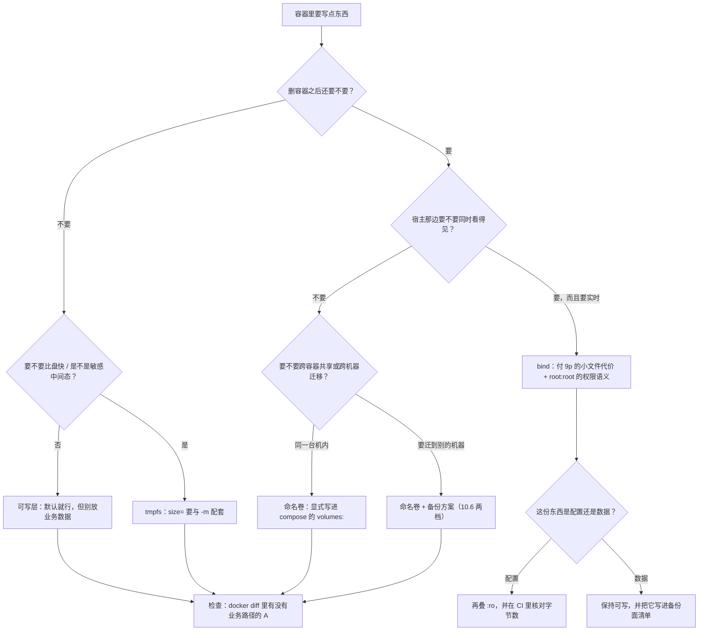

> **实战落点**：10.1 给出三条判据（谁写、谁读、活多久），这一篇把判据变成**选择表**：五种形式各解决什么、最优在哪、不足在哪、代价落在哪个维度。所有取舍都用双案例（Nginx + MySQL）与本专题另两轮探针（轮 4 的最小实验、轮 7 的语法矩阵）的真实读数撑着。
> **本机基线**：Engine `29.8.0` / API `1.56`；`.Driver = "overlayfs"`、`.DriverStatus = [["driver-type","io.containerd.snapshotter.v1"]]`（containerd snapshotter 已启用）；`.Plugins.Volume = ["local"]`、`docker plugin ls` 零条——**没有外部卷驱动、没有快照能力**，这一点直接决定了本篇「快照式热备」那一格只能标未验证。
> **前置依赖**：[/docs/10-存储专题/基础/存储是什么与为什么会出现/](/docs/10-存储专题/基础/存储是什么与为什么会出现/)（三条判据与可写层的性质）、[/docs/10-存储专题/落点与生命周期/存储形式在操作系统上的落点与验证/](/docs/10-存储专题/落点与生命周期/存储形式在操作系统上的落点与验证/)（每种形式在 VM/宿主上的物理落点与验证命令）、[/docs/05-原理深入/隔离与资源/联合文件系统与镜像分层/](/docs/05-原理深入/隔离与资源/联合文件系统与镜像分层/)（5.4 的 overlayfs 与 copy-up）、[/docs/04-单机编排/定义/Compose语法基线与文件全字段参考/](/docs/04-单机编排/定义/Compose语法基线与文件全字段参考/)（`volumes:` 长语法与本篇 `--mount` 的对应关系）。
> **本篇产出物**：一张**五形式 × 三判据 × 代价**的取舍主表；每种形式各自的「应对场景 / 最优场景 / 不足之处」三格（不足那一栏全是本机读数，不是套话）；**`-v` 与 `--mount` 的八条真实语法读数**（含 `--mount type=bind` 在这台机器上**也会**建缺失目录这一条与常见说法相反的实测）；**被放弃的方案为什么被放弃**（数据库为什么不放可写层、配置为什么不建议塞进镜像、tmpfs 为什么不能当缓存层的唯一答案）；一组**性能与语义代价数字**（2000 个小文件：可写层 0.6 秒、卷 0.5 秒、bind 5.1 秒、tmpfs 0.5 秒）。
> **难度·耗时**：10.2 ★★☆ · 50m（表好背，**难的是每一格都要能说出代价落在哪个维度**）
> **拓展接口**：主表的「生命周期」列由 10.4 展开成「哪一步会丢什么」矩阵；「性能」列由 10.3 的 9p/ext4 落点解释；「备份面」列由 10.6 展开；权限那一格（9p 的 `uid=0;gid=0` 与卷里的 `999 ping`）是 10.8 故障④的成因；预填充规则（空命名卷复制镜像内容、bind 不复制）是 10.9 故障⑥的机制底座。
> **自测三题**：
> 1. 你要放一份「宿主会手工编辑、容器只读、偶尔要重新部署」的配置文件。按三条判据它该走哪条路？说出这条路的**两个不足**。
> 2. `-v mydata:/x` 与 `-v ./mydata:/x` 差一个点斜杠，行为差在哪？用哪条读数可以当场分辨？
> 3. 为什么「数据库放可写层」的失败不是立刻失败？给出本机能够演示的那一步。


> **本章清单原语（逐字承接）**
> **清单项标题（清单原话）**：卷/绑定挂载/tmpfs/镜像层/可写层的原理、应对场景、最优场景与不足
>
> 章节号：10.2
> 所属篇：10-存储专题（第十篇 存储专题）
> 主线站 · 难度 · 耗时：— · ★★☆ · 50m
> 前置依赖：10.1
>
> **内容要点与产出物**：五种形式的原理与数据流向：**镜像只读层、容器可写层、命名卷、绑定挂载、tmpfs**（外加 `--volumes-from` 与 image 内 `VOLUME` 声明这两个变体）；每种给「应对场景 / 最优场景 / 不足之处」三格，并写清代价落在哪（性能、可移植、权限、生命周期、备份面）；`-v` 与 `--mount` 的语法差别与默认值；**被放弃的方案要写出来**（为什么数据库不放可写层、为什么配置不建议塞进镜像）
## 为什么要给每种形式都写「不足」

选型表最容易写成优点表：卷好、bind 灵活、tmpfs 快。真到排错时，救人的是**不足那一栏**——卷会静默堆积（`docker rm` 不带 `-v` 就留下）、bind 会遮蔽镜像内容、tmpfs 会把容器打成 `137`、可写层会在删除那天爆掉、镜像层里的配置会在某天变成「没人知道哪版在跑」。

本篇的规矩是：**每一格不足都要有一条本机读数或一句可复现的命令**。给不出读数的，写进未验证项而不是硬凑。

## 主表：五种形式 × 三条判据 × 代价

| 形式 | 谁写 | 谁读 | 活多久 | 物理落点（本机） | 性能 | 可移植 | 权限语义 | 备份面 |
|---|---|---|---|---|---|---|---|---|
| 镜像只读层 | 构建时 | 所有容器 | 与镜像同寿 | containerd 快照（`.GraphDriver` 在本机是 `null`） | 读命中缓存 | 最好（跟镜像走） | 只读，改不动 | 不需要（重拉或 `save`） |
| 容器可写层 | 运行期进程 | **只有这只容器** | **到 `docker rm` 为止** | `/var/lib/docker/rootfs/overlayfs/<容器ID>/` | ext4 同盘 | 无（带不走） | 容器内 uid | 无（**出现业务路径就是告警**） |
| 命名卷 | 进程或你 | 多容器（显式挂） | 活过容器删除 | `/var/lib/docker/volumes/<名>/_data`（`/dev/sdd` ext4） | ext4，2000 小文件 0.5 秒 | 靠备份迁机 | VM 里的数字 uid/gid | **要备**（冷备或逻辑） |
| 绑定挂载 | 你（宿主侧）为主 | 宿主 + 容器 | 活过一切，直到你删宿主目录 | Windows 上 NTFS，经 `9p` 穿进容器 | 2000 小文件 **5.1 秒** | **最差**（路径与权限绑机器） | 全显 `root:root`（`uid=0;gid=0`） | 就是宿主目录本身 |
| tmpfs | 进程 | 只有这只容器 | 到容器停止/重启为止 | 内存（`df` 里 `tmpfs`，总量按 `size=`） | 2.3 GB/s（本机实测写入速率） | 无 | 容器内 uid | **不该备** |

一句总结这张表的话：**镜像层解决分发，可写层解决"这次要能写"，卷解决"要活得比容器久"，bind 解决"要和宿主共享"，tmpfs 解决"要快且不必留下"。**

> 💡 新人小结：五种形式里只有**两种**有「独立于容器的生命周期」——命名卷与 bind。所有关于持久化的讨论都只在这两格里发生；可写层与 tmpfs 谈持久化是问错了问题，镜像层谈持久化是把数据塞进了分发物。

## 一、镜像只读层

**应对场景**：应用本体、依赖、默认配置、静态资源的**出厂版**。
**最优场景**：任何「重建环境时必须可复现」的东西——它跟着镜像摘要走，天然带版本（`localhost:8443/kbdemo/api:0.7.0` 这类标签策略见 3.9~3.12）。
**不足之处（三条，都有读数）**：

1. **改不动**：`--read-only` 之外，正常运行时也不该改它；一改进可写层，从此和镜像分叉。本机证据：c1 往 `/usr/share/nginx/html/c1.txt` 写完之后 `docker diff c1` 出 `A /usr/share/nginx/html/c1.txt`，而**新容器只看到出厂的 `50x.html index.html`**——改动没有进镜像。
2. **写了不消失，但会变成"没人知道的版"**：`docker commit c1 kbst4/layer:withfile` 造出 `73.6MB` 新镜像，原镜像仍 `74.5MB`。配置类内容一旦走这条路，线上那版配置就只存在于某只容器的一次 commit 里。
3. **体积会计进所有分发**：把运行期产物塞进镜像层（日志、缓存、临时上传）会让每次构建都带上它们。3.5~3.8 的瘦身纪律与此同源。

## 二、容器可写层

**应对场景**：这次运行的临时改动、PID 文件、socket、容器内解压出来的东西。
**最优场景**：**当且仅当**「删了不可惜」。判据也很硬：`docker diff` 出来的条目应该只落在 `/run`、`/tmp` 一类路径。本机的 db 容器实测 7 条，全部是 `/run/mysqld/*.sock|.pid`；web 容器 19 条含 `A /cache`（tmpfs 挂载点自己）与 `A /root/layer-only.txt`。
**不足之处**：

- **删除即销毁**，而且**没有任何告警**。10.1 的最小实验、10.10 故障⑨都指向同一条：`docker rm` 之后新容器读 `/app-data.txt` 得到 `cat: can't open '/app-data.txt': No such file or directory`。
- **不省空间**：可写层与卷在同一块盘（`df -T` 里 `overlay` 与 `/dev/sdd` 总量同为 `1055762868`）。"为了省地方别写可写层"是错的，正确的理由是生命周期。
- **`commit` 不是补救**：轮 6 专门验了 commit 会不会把卷内容一起带走——把 `/layer.txt`（可写层）与 `/v/vol.txt`（卷）都写好后 commit，**不挂卷**跑那个新镜像，得到：

```text
in-layer | . ..
```

  也就是说：可写层的东西进了镜像，**卷里的东西没进**。这条读数的用处很实在：`commit` 既不能替你备份数据，也不会替你带走数据——它只固化差异层。

## 三、命名卷

**应对场景**：数据库、上传目录、需要跨容器共享或需要备份的一切。
**最优场景**：`mysqldata:/var/lib/mysql` 这种——本机 5000 行的聚合校验和（`5000	10728165079651`）在 `restart`（7.7 秒）、`stop/start`（10.5 秒）、`compose down` 不带 `-v` 之后都一字不变。**这才是"数据库放卷"的真实含义**：不是性能，是可验证的存活。
**不足之处（四条）**：

1. **静默堆积**。镜像自带 `VOLUME` 声明时，不带 `-v` 起容器会白得一个匿名卷。本机读数：`卷数 14 -> 15，新增 d7cf33f78555…`；`docker rm`（不带 `-v`）之后**卷还在**；`docker system df` 的 `Local Volumes 14` 里 **13 个可回收、1.641GB (87%)** 是悬空卷。清理必须按记录下的名字删，不能按模式删（本机 Harbor 的卷也在同一张表里）。
2. **删不掉时的报错很硬**：`remove kbst_weblogs: volume is in use - [6217561b8409…]`——挂着它的容器 ID 会给出来，这是定位入口，不是失败原因。
3. **不可移植**：卷只存在于这台机器的 VM 里。迁机 = 备份 + 恢复（10.6），不是复制 compose 文件。
4. **预填充是个隐藏行为**：空卷挂到镜像里已有内容的目录，会把那份内容复制进去。轮 3 的两步验证：第一次挂进去看到 `50x.html index.html`（复制发生了），删掉 `index.html` 之后**第二次挂同一只卷只看到 `50x.html`**——复制只在卷为空时做一次，不是每次启动都补。

## 四、绑定挂载

**应对场景**：宿主与容器要同时看得见的内容——站点静态文件、配置、初始化 SQL。
**最优场景**：开发期「改一下宿主文件立刻生效」。本机实测这一条最干净的样子：把宿主 `nginx/default.conf` 换回原文之后，容器里那份文件**当场**变成 728 字节的新内容（`grep -c 'probe-ok'` 得 `1`），而 HTTP 服务仍回旧文案 `probe-ok v2 (config edited on host)`，直到 `nginx -s reload` 才切成 `probe-ok from ro-bind config`。**挂载是实时的，应用不是**（这是 10.5 的第一成因）。
**不足之处（三条，一条比一条疼）**：

1. **遮蔽**。bind 挂上去，镜像里那个路径原有的内容就看不见了：镜像出厂 `/usr/share/nginx/html` 是 `50x.html index.html`，案例挂上 `./web-content` 之后变成 `big.txt index.html`。`docker diff` 也不会告诉你被遮了什么（10.9 故障⑤）。
2. **跨系统语义与性能**。`/proc/mounts` 里它是 `9p`，选项带着 `aname=drvfs;path=C:\;uid=0;gid=0;metadata;symlinkroot=/mnt/host/` 与 `msize=65536`。后果有两条实测：**2000 个小文件 5.1 秒**（同机卷只要 0.5 秒）；容器里穿进来的文件一律 `root:root`，非 root 进程写不进（10.8 故障④的另一半成因）。
3. **不可移植 + 危险面**。路径写死到这台机器；`rm -rf` 那个宿主目录就是删数据；`docker compose down -v` 不会动它（本机 `down -v` 只报 `Volume kbst_* Removed`）。

## 五、tmpfs

**应对场景**：需要比盘快、且明确不该留下的中间态——解密后的密钥文件、编译中间产物、会话缓存、敏感临时目录。
**最优场景**：**容量算得清**的地方。本机两条：`--tmpfs /t:size=8m,mode=1777` → `df -m /t` 得 `8 0 8 0%`、权限 `drwxrwxrwt`；不写 `size=` 时按默认（`--mount type=volume,volume-opt=device=tmpfs,volume-opt=type=tmpfs` 得到 `24068` MB 的默认容量）。
**不足之处**：

1. **它吃的是内存配额，不是磁盘**。本机硬读数：`docker run -m 128m --tmpfs /t:size=512m` 往 `/t` 写 400 MB → 终态 `exited 137 true`（`OOMKilled = true`）；同样的命令把内存放到 `-m 512m` → `419430400 bytes copied, 0.211246 seconds, 1.8GB/s` 正常完成。写进去的字节可以在 `/sys/fs/cgroup/memory.current` 里读到（一次 64 MB 写入后为 `69697536`）。
2. **停止/重启即清零**。双案例的 `/cache` 放一个标记文件后 `restart`，重启后目录里只剩 `. ..`，而同一只容器的卷目录 `/var/log/nginx` 里的文件还在（10.4）。
3. **`df -h` 会骗你**。`nr_inodes` 用满时：`df -h` 说 `64.0M 0 64.0M 0%`，`df -i` 说 `120 120 0 100%`，实际报的是 `touch: /d/f120: No space left on device`（10.8 故障②）。

## 变体一：镜像里的 `VOLUME` 声明

`mysql:8.4` 自己声明了 `{"VOLUME":{"/var/lib/mysql":{}}}`（本机 `docker inspect` 原文）。它的效果是「**任何**在这条路径下的写入都不进可写层」——这既是保护（数据库不会把可写层撑爆），也是坑（不带 `-v` 就得到一个匿名卷，见不足 1）。另一面：`docker inspect` 里那个匿名卷的 `Mode` 字段是 `"z"`，本机原文：

```text
{"Type":"volume","Name":"kbst7-timing","Source":"/var/lib/docker/volumes/kbst7-timing/_data","Destination":"/d","Driver":"local","Mode":"z","RW":true,"Propagation":""}
```

## 变体二：`--volumes-from`

不指定路径、直接继承另一只容器的全部挂载。本篇用它做备份容器（10.6）与破坏/取证（10.10），它的特点是**继承的是"哪些卷"，不继承"挂到哪"**的语义歧义——目标容器上的 `Destination` 原样复用，所以 `tar -C /var/lib/mysql` 这种写法要求你清楚源容器把卷挂在哪。

## `-v` 与 `--mount`：八条真实语法读数

常见说法是「`-v` 简洁但含糊，`--mount` 显式且严格」。这台机器上的边界在哪儿，逐条跑出来的原文：

| 写法 | rc | 原文/结果 | 结论 |
|---|---|---|---|
| `-v <绝对路径>:/x` | 0 | `挂载点内容: 0 条 \| 9p`，宿主目录被建出来 | 三段式按「是不是绝对/相对路径」判 bind |
| `-v ./rel:/x` | 0 | `0 条 \| 9p`，宿主目录被建出来 | 相对路径也算 bind（相对**当前 CLI 目录**） |
| `-v mydata:/x`（无斜杠） | 0 | `0 条 \| ext4` | **裸名字 = 命名卷**，落 VM 的 ext4 |
| `-v KbSt5Bad:/x`（带大写） | 0 | `ext4`，卷表里真出现 `Kbst5Bad`/`KbSt5Bad` | 大写不改变判定，一样建卷 |
| `-v <带空格的路径>:/x` | **125** | `invalid mode: /x` | **空格会截断解析**，`:/x` 被当成 mode 段 |
| `-v src:/x:ro,rw` | **125** | `invalid mode: ro,rw` | 两个矛盾模式直接被拒 |
| `-v a:b:c:d` | **125** | `mkdir a:b: The system cannot find the path specified.` | 段数超限时报的是「把 a:b 当路径去 mkdir」 |
| `-v src:/x:z` | 0 | 正常起来 | `z/Z` 被接受（SELinux 用，本机无 SELinux 也无副作用） |

`--mount` 一侧：

| 写法 | rc | 原文 | 结论 |
|---|---|---|---|
| `type=bind,source=<不存在>,target=/x` | **0** | `drwxrwxrwx 1 root root 4`，且宿主目录被建出来 | **与常见说法相反**：这台机器上 `--mount type=bind` 也建缺失目录，**不会**像宣传的那样拒绝 |
| `type=bind,source=<存在>,target=/x,bind-propagation=rslave` | 0 | 读到 `from-host` | propagation 写法就叫 `bind-propagation` |
| `type=bind,...,readonly` | 0 | `touch: /x/nope: Read-only file system` | 与 `-v :ro` 同一条内核拒绝 |
| `type=bind,source=<目录>`（缺 target） | **125** | `invalid mount config for type "bind": field Target must not be empty` | 缺字段名报错，定位最快 |
| `type=nope,...` | **125** | `invalid mount config for type "nope": mount type unknown` | type 白名单严格 |
| `type=tmpfs,tmpfs-size=4m,target=/t` | 0 | `4 0 4 0%` | tmpfs 的 size 在这里叫 **`tmpfs-size`**，不是 `size=` |
| `type=volume,volume-opt=device=tmpfs,volume-opt=type=tmpfs,target=/t` | 0 | `24068 0 24068 0%` | `volume-opt` 需要成对给出 `device` 与 `type`；只给 `device=tmpfs` 会被拒（另一轮原文 `create kbst5-opt: missing required option: "type"`） |
| `--tmpfs /t:nr_inodes=120,size=32m` | 0 | `df -i` → `120 1 119` | tmpfs 的选项串原样透传给 mount，**能**限 inode |

一句话的取舍：**compose 文件里用长语法（`type`/`source`/`target`/`read_only`/`bind.propagation`），一次性命令行用 `-v` 但绝不允许路径里带空格**。`--mount` 唯一的实质优势是**字段名报错**（`field Target must not be empty` 这种）与可读性；别指望它替你挡住拼错的源路径——上面那条实测已经把它这个指望打掉了。

> 💡 新人小结：`-v` 的判定只有一条要背死：**源里出现 `/` 或 `./` 或盘符 → bind；否则是卷**。所以 `-v data:/x` 与 `-v ./data:/x` 差一个点，差的是「VM 里的 ext4 目录」和「你脚下这个目录」，而不是"写法风格"。

## 被放弃的方案要写出来

| 放弃的做法 | 会被什么打死 | 本机能演示的那一步 |
|---|---|---|
| 数据库放可写层 | 删除即丢；无备份面；`docker diff` 里出现 `/var/lib/mysql` 才是正常（不放）| 轮 4：写 `/root/layer-only.txt` → `docker rm` → 新容器读不到；`--volumes-from` 备份打的是卷，可写层里没有数据可备 |
| 配置塞进镜像再靠 `commit` 更新 | 线上那版配置只存在于某次 commit；回滚语义变成镜像标签游戏 | `docker commit` 出的镜像里 `/layer.txt` 在、`/v/vol.txt` 不在——两条一起说明"commit 只管差异层" |
| bind 挂到镜像已有内容的目录当"数据盘" | 遮蔽 + 9p 的小文件代价 + 宿主目录被误删 = 数据没了 | 轮 3 故障⑤：出厂 `50x.html index.html` → 挂上后只剩 `big.txt index.html` |
| tmpfs 当持久缓存层 | 重启清零 + 吃内存配额 + `nr_inodes` 撞墙 | `-m 128m` + 512 MB tmpfs → `exited 137 true`；重启后 `/cache` 只剩 `. ..` |
| 「空命名卷会每次自动补内容」的幻想 | 预填充只做一次 | 第二次挂同一只卷，被删掉的 `index.html` 不会回来（只剩 `50x.html`） |

## 选型流程图：从「我要写一个东西」出发



## 五种形式各一条成本清单

把"不足"翻译成**可执行的成本项**，选型时才不会被"这很常见啊"带跑：

| 形式 | 你要付的具体成本 | 什么时候会收到账单 |
|---|---|---|
| 镜像只读层 | 每次改动都要重新构建、重新分发；层越多镜像越大 | 构建时长与 `docker images` 的 size；CI 里表现为构建缓存失效 |
| 容器可写层 | 数据随 `docker rm` 消失；无备份面 | 事故当天。之前没有任何提示（只有 `docker diff` 肯说真话） |
| 命名卷 | 生命周期要自己管；不可移植；备份要单独做 | 迁机、`docker volume ls` 越堆越长、盘满（`system df` 里卷占大头） |
| bind 挂载 | 遮蔽镜像内容；9p 的小文件代价；权限映射；路径绑死这台机器 | 开发期表现为"慢"，换机器表现为"起不来"，误删宿主目录表现为"数据没了" |
| tmpfs | 内存配额；重启清零；`nr_inodes` 之类隐藏上限 | `exit=137` + `OOMKilled=true`，或"缓存莫名每次都要重建" |

## 三个反问（评审用，逐条要能答出读数）

1. **「它跟着镜像走，还是跟着机器走？」** 跟着镜像 = 分发；跟着机器 = 要么卷要么 bind，二者的备份与迁移方式完全不同（10.6 的备份面清单按这条分栏）。
2. **「同一次运行里，另一个容器看得见它吗？」** 看不见 → 可写层或 tmpfs；看得见且要求显式声明 → 命名卷；看得见且宿主也看得见 → bind。答不出这句，通常说明挂载关系没画进设计文档。
3. **「它坏了，我怎么知道？」** 有读数可对（聚合校验和、字节数、清单）→ 可运维；只能说"看起来正常"→ 就是把发现成本推给了用户投诉。双案例为什么坚持 `COUNT + SUM(CRC32)` 一个数字，答案在这条反问里。

## 组合使用的三条经验（都来自本案例）

- **配置与内容分两条挂载**：`nginx/default.conf` 走 `:ro` 单文件 bind，`web-content` 走可写 bind。两条混成一条目录挂载时，配置就变成可写的，`Read-only file system` 那道防线消失。
- **日志走卷不等于日志在卷里**：`weblogs:/var/log/nginx` 里只有两条指向标准流的符号链接（10.3 的目录读数），正文走日志驱动。挂载形式与数据落点要分别确认。
- **初始化 SQL 用只读 bind + 一次性**：`./mysql-init:/docker-entrypoint-initdb.d:ro` 只在数据目录为空时被读一次，所以它天然是"首次运行"的载体；任何"改完 SQL 期望已存在的库跟着变"的想法都会落空（10.5 成因、10.6 只备数据的代价）。

> 💡 新人小结：真正的选型不是问"哪种最好"，而是问"**这笔成本我愿意在什么时候付**"：镜像层付在构建期、bind 付在日常 I/O 与迁移期、卷付在备份与清理期、可写层把账全推到删除那一天。

## 容量与配额的三条硬规则

选形式的时候，容量口径是最容易想反的一栏。三条规则都出自本专题的量：

1. **可写层与卷同池**。`df -T` 里 `overlay` 与 `/dev/sdd` 的总量同为 `1055762868` 个 1K 块（约 1007 GB），剩余额 `984170252`。所以「用卷能省盘」是错的；用卷是为了生命周期与语义（10.3、10.4）。
2. **bind 的容量归宿主**。同一条 `df -T` 里 bind 那行是 `C:\ 9p 499667268 221554840 278112428 44%`——476 GB 是 **Windows C 盘**，`docker system df` 完全看不见它。C 盘满的时候，容器里的表现和"卷满了"一模一样（`No space left on device`），但清理对象在另一侧（10.8 故障①）。
3. **tmpfs 的容量是内存配额**。`--tmpfs /t:size=8m` 就是一条 `tmpfs 8 0 8 0%`；还能加 `nr_inodes=120` 这样的上限（本机 `df -i` 读到 `120 1 119`）。写进去的字节会出现在 `/sys/fs/cgroup/memory.current`（本机一次 64 MB 写入后为 `69697536`），于是 `-m` 与 `size=` 必须配套设计（10.8 故障③）。

三条合起来给的是一个**排查顺序**：先 `df -T <路径>` 认文件系统，再按文件系统去找对应的配额来源，最后才谈"清什么"。跳过第一步的清理动作，十有八九清错对象。

> 💡 新人小结：把「形式」和「配额」分开记。**形式决定语义**（谁写谁读活多久），**配额决定失败**（`No space left` / `137` / `Permission denied`）。同一形式在不同配额下的失败长相不同，这就是为什么选型表里要单列"代价落在哪"。

## 五形式速查卡（背这一张就够）

| 形式 | 一句话定义 | 现场怎么认（一条命令） | 本机那条读数 |
|---|---|---|---|
| 镜像只读层 | 构建出来的、共享的、改不动的内容 | `docker run --rm <镜像> ls <路径>` | 出厂 `50x.html index.html`；size `74.5MB` 不随容器写而变 |
| 容器可写层 | 这次运行的差异 | `docker diff <c>` | db 只有 7 条，全在 `/run`；写 8 MB 后 `ps -s` 报 `8.4MB` |
| 命名卷 | 引擎管的独立数据对象 | `docker volume inspect --format '{{.Mountpoint}}'` | `/var/lib/docker/volumes/kbst_mysqldata/_data`，`df -T` 里是 `/dev/sdd` |
| 绑定挂载 | 宿主目录贴进来 | `grep <路径> /proc/mounts` | `9p … aname=drvfs;path=C:\;uid=0;gid=0 …` |
| tmpfs | 内存里的一次性文件系统 | `df -T <路径>` | `tmpfs 32768 0 32768 0% /cache`；restart 后清空 |

这张卡的用处在于**每一条都能在 10 秒内跑完**。选型讨论僵住的时候，别争概念，把这一列命令跑一遍——落点读数通常直接终止争论。

> 💡 新人小结：五格里有两格（可写层、tmpfs）属于「这次运行」，三格（镜像层、卷、bind）属于「你」。所有关于数据安全的讨论，都从这条分界线开始。

## 常见误读

| 误读 | 本机反证 |
|---|---|
| 「`--mount` 源不存在会拒绝，`-v` 才会建目录」 | 这一版引擎上 `--mount type=bind` 也建了（`rc=0` + 宿主侧目录存在 `True`） |
| 「卷比可写层省空间」 | 同一块盘：`overlay` 与 `/dev/sdd` 的 `df` 总量相同（`1055762868`） |
| 「tmpfs 只影响内存，不影响写失败」 | `nr_inodes` 撞满时报的是 `No space left on device`，`df -h` 看着还有 64 MB |
| 「匿名卷会跟着容器一起删」 | `卷数 14 -> 15`，`docker rm` 之后**卷还在**（`docker system df` 里 87% 可回收） |
| 「commit 能把卷里的数据一起固化」 | 新镜像不挂卷跑：`in-layer`、`/v` 是空目录（`. ..`） |
| 「配置挂进容器就等于生效」 | 文件已是新的（728 字节、`grep` 命中），HTTP 仍回旧文案，直到 `nginx -s reload` |

## 本篇不覆盖什么

按 W6 的规矩，本篇**故意不讲**的东西逐条点名去处——写「不覆盖」不是免责声明，是防止你在这一篇里找不存在的答案：

- 每种形式落到 VM/宿主上到底是哪个目录 → 见 **10.3**（`9p` 与 ext4 的落点差异在那一篇量到）
- 备份面与「备得回来」的证明 → 见 **10.6**（`三级对账` 在那一篇用恢复演练跑通）
- 写满、inode 耗尽、权限不匹配的现场四格 → 见 **10.8**（`ENOSPC` 那一格在那一篇做成命令卡片）
- compose 里 `volumes:` 长语法与本篇 `--mount` 的对应 → 见 **4.1**（`volumes` 字段速查在那一篇）
- 层与可写层的文件系统实现机制 → 见 **5.4**（`GraphDriver` 与 copy-up 在那一篇）

## 要点总结

1. **五种形式各管一条需求线**：镜像层管分发、可写层管"这次要能写"、卷管活得比容器久、bind 管与宿主共享、tmpfs 管快且不留。选错的表现通常是**延迟发作**。
2. **性能代价要按维度读**：2000 个小文件 bind 要 5.1 秒而卷 0.5 秒——疼的是**次数**不是字节；数据库与大元数据负载一律放卷。
3. **权限语义两套世界**：9p 侧全部 `root:root`（`uid=0;gid=0` 在挂载选项里定死），卷侧是真实数字 uid（MySQL 的 datadir 在 VM 里是 `999 ping`）。`--user` 换身份不换目录属主，就产生 10.8 故障④。
4. **`-v` 的判定规则只有一条**：有 `/`、`./` 或盘符 → bind，否则 → 卷；路径里不要带空格（`invalid mode: /x`）。`--mount` 换来的是清晰的字段名报错，不是更严格的存在性校验（本机实测它同样建目录）。
5. **两种生命周期之外的东西不要放进镜像**：`commit` 只固化差异层（可写层进去、卷不进），它不是备份也不是配置管理。
6. **tmpfs 的账要算进内存配额**：`-m` 与 `--tmpfs size=` 之间要有余量，否则 `137`+`OOMKilled=true`；同时记住 `nr_inodes` 能让 `df -h` 说谎。

## 本篇读数分别来自哪几轮

本篇不是单一实验的产物，读数分属四轮，写在这里是为了让每条数字都能被追回现场：

| 轮次 | 造了什么 | 本篇用到的读数 |
|---|---|---|
| 轮 1b（落点与生命周期） | 双案例起来之后逐条读挂载、做 restart/kill 对照 | `docker diff` 19 条与 7 条、restart 7.7 秒、tmpfs 清零、卷里符号链接 |
| 轮 4（最小实验与形式代价） | 同镜像两只容器 + 2000 小文件 | `c1.txt` 互不可见、commit `73.6MB`、bind `5.1 秒` vs 卷 `0.5 秒` |
| 轮 5（可写层与快照目录） | 造一只写 8 MB 的容器，去 VM 里找文件 | `.GraphDriver=null`、`rootfs/overlayfs/<容器ID>`、`ps -s 8.4MB` |
| 轮 7（`-v` 与 `--mount` 语法矩阵） | 十几种写法各跑一次，逐条留 rc 与原文 | `invalid mode: ro,rw`、`--mount` 也建缺失目录、`tmpfs-size` 与 `size=` |

四轮合起来才够写这张取舍表——**任何一栏只有说法没有读数的，都被移进下一节**。

## 本篇未验证项

| 项 | 为什么没验 | 想验怎么起手 |
|---|---|---|
| 外部卷驱动（NFS、云盘、加密盘）的行为与代价 | `.Plugins.Volume = ["local"]`、`docker plugin ls` 零条；装驱动要动引擎 | 在能装插件的机器上重复「三、命名卷」那四条不足，看 `Mountpoint` 与 `Options` 变成什么 |
| `--cap-add`/rootless 下 bind 的属主映射 | 本机没有 rootless daemon（`uid_map` 那格见 5.8） | 起 rootless dockerd 后重复 `-v` 语法矩阵，重点看 `uid=0` 那组选项是否消失 |
| 卷的 `nocopy` 选项（关掉预填充） | 本机 CLI 与 Compose 的长语法里可写，但本轮未实测其效果 | 用 `--mount type=volume,volume-nocopy=true` 挂空卷到镜像有内容的目录，对比 `ls` 结果（与故障⑥同一条判据） |
| 大文件顺序写的**真实**差距 | 轮 4b 用 `bs=1M count=64` 量到四档速率（见下），但 `dd` 不带 `sync` 时 ext4/overlay/tmpfs 三档写的其实是页缓存，只有 9p 那一档真的跨了系统 | 在四种落点各做一次「dd 之后显式 `sync` 再取时间」，或直接对比 fsync 型负载（数据库刷盘）的耗时 |
| 五种形式在**同一负载**下的长期退化 | 本轮每个数字都是单次一次性容器跑出来的，没有 30 分钟以上的持续负载观察 | 用同一支脚本跑 30 分钟写入，记每分钟 p95 延迟与 `df` 变化 |

## 顺序写的四档读数（以及为什么不能直接横比）

轮 4b 修掉了 busybox 的两个语法坑（`bs=1m` 小写被拒、`conv=fdatasync` 被拒）之后，四种落点各写 64 MB，`dd` 自己打印的原文：

```text
可写层 overlay    67108864 bytes (64.0MB) copied, 0.028467 seconds, 2.2GB/s
命名卷 ext4       67108864 bytes (64.0MB) copied, 0.016237 seconds, 3.8GB/s
bind 到 Windows   67108864 bytes (64.0MB) copied, 0.248502 seconds, 257.5MB/s
tmpfs             67108864 bytes (64.0MB) copied, 0.024886 seconds, 2.5GB/s
```

**读这三行要小心**：`dd` 不带 `conv=fsync`（busybox 也不认这个选项）时，前三行测到的主要是**页缓存写入速率**，`2.2GB/s`、`3.8GB/s` 这些数不代表落盘能力；而 9p 那一行是真的把 64 MB 通过协议推给了宿主，`257.5MB/s` 已经是跨系统传输的结果。所以这一组数只能得出一个结论：**顺序大文件写入下 bind 的代价是可见的（慢一个数量级），但四者之间不能横比"谁更快"**。

真正可以横比的是小文件那一组（元数据操作每次都要走完协议）：可写层 `0.6 秒`、卷 `0.5 秒`、bind `4.1~5.1 秒`（两轮各一次）、tmpfs `0.5 秒`——同一次跑出来的相对差距稳定，跨轮绝对值有 ±20% 抖动，所以**引用时给区间而不是给单点**。

> 💡 新人小结：性能读数要先问一句"这一档穿过边界没有"。同一条 `dd`，在 ext4 上量的是缓存，在 9p 上量的是协议——把两档并列成"卷比 bind 快 15 倍"就是错读。
