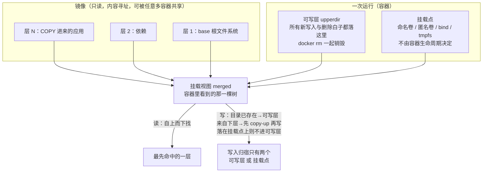

> **实战落点**：10-存储专题的第一篇，负责把「容器里的文件到底在哪」这件事**一次性问到底**，后面九节都建立在这三句话上。它假设你已经会让容器跑起来（2.x）并且知道镜像是分层拼出来的（5.4）。落点的操作台是 `Docker知识库/示例/存储双案例`——Nginx + MySQL 两个真实容器、七条挂载、5000 行真数据，本篇每一个数字都来自那套案例跑起来的现场。
> **本机基线**：Docker Engine `29.8.0` / API `1.56`、Compose `v5.5.1`、Desktop `4.91.0 (239619)`，Linux 内核在 WSL2 虚拟机里；VM 数据盘 `/dev/sdd`（ext4，`1055762868` 个 1K 块），宿主 Windows C 盘以 `9p` 穿进容器；`Volume` 驱动只有 `local`。镜像 `nginx:1.27-alpine`（`74.5MB`）、`mysql:8.4`、`alpine:3.20`。
> **前置依赖**：[/docs/01-基础认知/为什么是容器/为什么需要容器/](/docs/01-基础认知/为什么是容器/为什么需要容器/)（容器与虚拟机的分工，本篇第 4 节「出现之前」站在它上面）、[/docs/05-原理深入/隔离与资源/联合文件系统与镜像分层/](/docs/05-原理深入/隔离与资源/联合文件系统与镜像分层/)（5.4 的 lower/upper/work 三层，本篇「可写层」的物理实现）、[/docs/02-核心操作/接上去/端口映射数据管理与权限时区/](/docs/02-核心操作/接上去/端口映射数据管理与权限时区/)（2.6 第一次 `-v`，本篇解释它为什么必须存在）、[/docs/10-存储专题/落点与生命周期/存储形式在操作系统上的落点与验证/](/docs/10-存储专题/落点与生命周期/存储形式在操作系统上的落点与验证/)（10.3，本篇每条结论的取证方法）。
> **本篇产出物**：一套**三条判据**（谁写、谁读、活多久），拿到任何新挂载都能 30 秒分类；一张**「没有容器存储会怎样」对照表**（四种做法各自的失败模式）；一个**能自己跑的最小实验**（同一镜像两只容器各写各的，含 `docker diff`、`docker commit`、`docker ps -s` 三份原文读数）；一张**双案例七条挂载的落点表**（每条对应正文哪一节）；四条常见误解的**当场更正**。
> **难度·耗时**：10.1 ★☆☆ · 45m（概念不多，**难在把「容器里有这个文件」和「这个文件存在」这两件事彻底分开**）
> **拓展接口**：三条判据在 10.2 变成五种形式的取舍表，在 10.3 变成 `stat`/`df` 的物理读数，在 10.4 变成「哪一步会丢什么」矩阵，在 10.6 变成备份面；「出现之前」那一节是 5.4 分层与 8.3「同一个镜像另一套进程模型」的历史前提；第 6 节的 `commit` 对照直接接 3.x 的镜像构建纪律。
> **自测三题**：
> 1. 同一镜像起两只容器，容器 A 在 `/etc/passwd` 里追加一行。容器 B 读到的是追加后的还是追加前的？说出**判据**而不是结论。
> 2. `docker rm myc` 与 `docker rm -v myc` 差在哪一类数据上？为什么 `docker system df` 里「卷」和「可写层」要分开列？
> 3. 一句「数据放在卷里更安全」在什么场景下反而更危险？（提示：备份面与迁移面）


> **本章清单原语（逐字承接）**
> **清单项标题（清单原话）**：存储是什么、为什么要有它、出现之前是什么
>
> 章节号：10.1
> 所属篇：10-存储专题（第十篇 存储专题）
> 主线站 · 难度 · 耗时：— · ★☆☆ · 45m
> 前置依赖：2.6、5.4
>
> **内容要点与产出物**：容器存储是什么（镜像只读层 + 容器可写层 + 挂载点三件事）；为什么要出现（镜像不可变、进程要写文件、数据要活过容器）；**出现之前是什么**（把目录直接铺在宿主机上、chroot/虚拟机的两种极端、LXC 时代的 bind 手工活）；一套「三条判据」把三者分开。产出：一张「没有容器存储会怎样」对照表 + 一次能自己跑的最小实验（同镜像两容器各写各的）
## 为什么要单独给存储开一篇

因为「容器里的文件」是一个**会骗人**的说法。

你在容器里 `ls` 看到一个目录，它可能是：镜像某一层的一个路径、容器自己可写层里的一个新文件、VM 数据盘上的一个 ext4 目录、宿主 Windows 上 NTFS 里一个真实文件夹，或者内存里的一块 tmpfs。**这五种情况在容器内看起来一模一样，在故障、备份、性能、迁移四个维度上完全不同。**

这套库前面 22 篇里已经出现过三次因它而起的误判：`docker system prune` 到底会不会动卷、数据库写在可写层为什么"当时没事"、bind 挂上来之后镜像里原有的文件"不见了"。每一个问题的根都不在命令上，在**落点**上。所以本篇先把一件事说死：

> **容器存储 = 三类对象的合称**：① 镜像的只读层（谁都不该写它）；② 容器的可写层（只活着这一次）；③ 挂载点（卷 / bind / tmpfs，由你决定它活多久）。

> 💡 新人小结：把这三类想成**三种所有权**。只读层属于镜像（所有人共享、谁都改不动），可写层属于这一次运行（容器一删就没），挂载点属于你（可以比容器老、比机器老，甚至可以比镜像老）。排错时先问「这块数据属于谁」，比问「它在哪」有用。

## 三条判据：这一字节现在落在谁身上

任何一处写入，用这三个问题就能归类。三条判据后面每一节都在用：

| 判据 | 问法 | 落点结果 |
|---|---|---|
| ① **谁写它** | 是容器里那个进程写的，还是镜像构建时/宿主侧写好的？ | 进程写 → 可写层或挂载点；构建时写 → 镜像层；宿主侧写 → bind |
| ② **谁读它** | 只有这只容器读，还是同镜像的其他容器、其他机器也要读？ | 只有它读 → 可写层够用；跨容器 → 卷或 bind；跨机器 → bind 不行，要走镜像或卷备份 |
| ③ **要活多久** | 容器删了要不要留？机器换了呢？ | 不留 → 可写层/tmpfs；留到容器之后 → 卷；留到机器之后 → 卷备份或宿主目录同步 |

三条判据的判据本身也要能验，所以第 5 节给的是一个能自己跑的实验，不是一段讲道理。

## 容器存储是什么：只读层、可写层、挂载点三件事



三件事各自的硬定义：

1. **镜像只读层**。内容寻址、可共享、不可原地修改。`nginx:1.27-alpine` 在本机是 `74.5MB`，同一台机器上无论起多少只容器，**镜像大小不变**（第 5 节有前后对照）。
2. **容器可写层**。5.4 讲的 overlayfs `upperdir`。它记录的是**这次运行的差异**：新增文件、改写的文件（先 copy-up）、删除的文件（whiteout）。`docker diff` 只看得到它，`docker ps -s` 的 `SIZE` 列只算它。
3. **挂载点**。引擎把别处的一个目录/文件接进这棵树。它有三个子族：命名卷与匿名卷（引擎管理，落 VM 数据盘）、bind 挂载（宿主路径直连，本机穿的是 9p）、tmpfs（内存，`size=` 说话）。

> 💡 新人小结：一个最容易记住的操作性区分——**「删容器会不会带走它」**。可写层会，挂载点不会（除非你显式 `-v` 删卷或 bind 的那个目录本来就归你）。所以任何你说「这是数据」的东西，都不该出现在可写层里。

## 出现之前是什么：两个极端和一段手工活

「容器存储」不是凭空发明的，它填的是两个极端之间的一段空。三种**没有它时**的做法：

| 做法 | 数据放哪 | 它解决不了什么 |
|---|---|---|
| **直接把目录铺在宿主机上**（传统部署） | 宿主机 `/srv/应用名/` 一类路径 | 应用对文件系统的假设（路径、属主、库版本）与宿主绑死；同机两个版本互相踩；换机=重装环境。「一次构建到处运行」在存储侧断裂 |
| **虚拟机** | 每份客户机自己的虚拟盘 | 隔离过头：一份应用一套内核+全盘，起得慢、镜像（VM 模板）动辄数十 GB 且难以增量分发；数据与"这台机器"绑定，容器那套「镜像共享 + 差异层」的经济学不成立 |
| **chroot + 手工 bind**（LXC 之前的常见拼法） | 宿主真实目录，用 `chroot` 换根、用 `mount --bind` 把要共享的目录贴进去 | 根文件系统靠人手复制/链接，共享库、`/proc`、`/dev`、`/etc` 全要手工处理；`--bind` 是**特权操作**且**没有生命周期概念**——贴进去的目录既是数据也是配置，谁都不敢删 |

这三行共同缺的是同一样东西：**一个既能「跟着镜像分发」、又能「独立于容器生死」的数据对象**。于是有了卷（数据对象，生命周期归引擎）与 bind（宿主目录，生命周期归你）两条路；有了镜像层的不可变约定；有了 `VOLUME` 声明让镜像可以自带「这里必须有独立存储」的要求。

一句诚实的边界：上表第三行是**机制层的说明**，本机没有 chroot/LXC 现场可比（这台机器上只有 Docker Desktop 一条路），所以本篇把它标进「未验证项」，不作为读数引用。

## 最小实验：同一个镜像，两只容器各写各的

这是本篇的产出物之一，可以直接照抄。它要证明的不是「有可写层」，而是**可写层的三个性质同时成立**：私有、可枚举、不改镜像。

```bash
docker run -d --name c1 --entrypoint sh nginx:1.27-alpine -c 'sleep 600'
docker run -d --name c2 --entrypoint sh nginx:1.27-alpine -c 'sleep 600'

docker exec c1 sh -c 'echo only-c1 > /usr/share/nginx/html/c1.txt && ls /usr/share/nginx/html'
docker exec c2 sh -c 'ls /usr/share/nginx/html; cat /usr/share/nginx/html/c1.txt 2>&1 | tail -1'
docker diff c1
docker diff c2
docker run --rm nginx:1.27-alpine ls /usr/share/nginx/html
docker ps -s --filter name=c
```

本机跑出来的原文（逐字，`|` 是换行处的标记）：

```text
c1 写：50x.html | c1.txt | index.html
c2 看同一目录：50x.html | index.html | cat: can't open '/usr/share/nginx/html/c1.txt': No such file or directory
docker diff c1：C /usr | C /usr/share | C /usr/share/nginx | C /usr/share/nginx/html | A /usr/share/nginx/html/c1.txt
docker diff c2：(空)
全新容器：50x.html | index.html
docker ps -s：c2 4.1kB (virtual 52.6MB) | c1 36.9kB (virtual 52.7MB)
```

四条读数各对一个性质：

1. **私有性**：c1 写的文件，c2 看不见（同镜像、同路径、同主机）。
2. **可枚举性**：`docker diff` 用 `C`（copy-up）和 `A`（added）把可写层里发生了什么列全了——注意 `C /usr/share/nginx/html` 这一行：目录本身也被"复制"了一次，overlayfs 的 copy-up 粒度是**逐个路径分量**，不是整棵树。
3. **镜像不可变**：第三只全新容器看到的仍是出厂两件套；`nginx:1.27-alpine` 的 size 前后都是 `74.5MB`，**没变**。
4. **可写层很"小"且独立计量**：`ps -s` 的 `36.9kB` 就是 c1 可写层的全部（含 `sleep` 进程留下的零星文件），括号里的 `virtual 52.7MB` 才是「镜像 + 可写层」。这两列的分工是 7.5 磁盘排查的基础。

再加一个对照，说明「可写层能固化、但数据不该待在那」：

```bash
docker commit c1 kbst4/layer:withfile
docker images --format '{{.Repository}}:{{.Tag}} {{.Size}}' kbst4/layer:withfile
```

本机读数：`kbst4/layer:withfile 73.6MB`，而原镜像仍是 `74.5MB`。`commit` 造出的是一层**新镜像**，那条 `c1.txt` 从此跟着镜像走，而不是跟着数据走——这正是「把数据写进可写层再 commit」为什么是反模式：它把易变的东西做成了不可变，把不可变的东西（镜像）变得每改一次就多一份。

> 💡 新人小结：`docker commit` 是这条链上最容易让人误以为「可写层也算一种持久化」的东西。它确实能让文件活过容器删除，代价是**每次都要重出一版镜像**、而且没有版本回滚语义（镜像标签不是快照）。数据要持久，请走 10.2 的卷或 bind。

## 数据活不活得过容器：四种落点各来一遍

同一条动作（往某处写一个文件 → 删容器 → 用新容器读它），四种落点四种结果。本机原文：

| 落点 | 写入方式 | 删容器之后再读 | 判定 |
|---|---|---|---|
| 可写层 | `echo A1-unique > /usr/share/nginx/html/mine.txt`（`--rm`） | 新容器只有 `50x.html`、`index.html` | **没了**（随容器销毁） |
| 命名卷 | `-v kbst4-perf:/v` 里写 `/v/f.txt`，`ls -li` 得 `151387` | 新容器挂同一卷读到 `vol-from-first`，`ls -li` 仍是 **`151387`** | **同一个对象**（inode 都对得上，不是重建） |
| bind 到 Windows | `-v <TEMP>/kbst4-bind:/b` 里写 `see-me.txt` | Windows 侧 `os.path.exists` = `True`，内容 `from-container`；宿主追加一行后容器再读得到 `from-container` 与 `appended-from-windows` 两行，宿主侧字节数 `37` | **双向、实时** |
| tmpfs | `--tmpfs /t:size=64m` 里写 `/t/x` | 容器一退出，这块 tmpfs 就没了；新容器同参数挂的是一个**全新空 tmpfs** | **只活这一次**（10.4 里用 restart 复现） |

三条判据在这里正好各管一行：**可写层**是「只有它读、不留」，**卷**是「跨容器读、要留」，**bind** 是「宿主也要读、且实时」，**tmpfs** 是「谁都不留、但要比盘快」。

## 没有容器存储会怎样：一张对照表

把「四种落点」倒过来问，就是本篇要的对照表——如果这些对象不存在，只剩「应用直接写镜像里那个路径」这一条路，会发生什么：

| 场景 | 只有镜像层可写会怎样 | 容器存储给出的答案 |
|---|---|---|
| 同镜像起 10 个副本 | 要么 10 份互踩，要么 10 份都得同一份配置写进镜像 | 只读层共享 + 每副本一个可写层 + 数据走卷 |
| 更新应用 | 「新数据」和「新版本」混在一起，回滚会把数据一起滚掉 | 镜像换标签、卷不动 → 10.6/6.4 的回滚语义才成立 |
| 备份 | 没有「只备数据」这个动作的落点 | `mysqldump` 或 tar 一个卷目录（10.6 两条路） |
| 两个容器共享一份内容 | 只能靠宿主目录手工约定 | 命名卷 + 显式声明（`--volumes-from`、compose `volumes:`） |
| 换一台机器继续跑 | 文件散在各容器的可写层里，带不走 | 卷备份 → 新机器建同名卷 → 解回去（10.4 有现场） |

## 双案例里七条挂载各管什么

| # | 形式 | 挂到哪 | 三条判据的回答（谁写 / 谁读 / 活多久） | 正文 |
|---|---|---|---|---|
| ① | 命名卷 `mysqldata` | `/var/lib/mysql` | mysqld 写 / 只有 db 读 / 活过一切 | 10.2、10.4、10.6 |
| ② | 只读 bind `mysql-init` | `/docker-entrypoint-initdb.d` | 你写 / 入口脚本读 / 活到宿主改 | 10.5 |
| ③ | 可写 bind `web-content` | `/usr/share/nginx/html` | 你和容器都能写 / 宿主也读 / 活到目录被删 | 10.3、10.5 |
| ④ | 只读 bind `nginx/default.conf` | `/etc/nginx/conf.d/default.conf` | 你写 / nginx 读 / 活到目录被删 | 10.5、10.9 |
| ⑤ | 命名卷 `weblogs` | `/var/log/nginx` | nginx 写 / 运维读 / 活过容器 | 10.4、10.9 |
| ⑥ | 命名卷 `img2`（两处） | `/usr/share/nginx/html2`、`/probe/volume-on-missing-path` | 你写 / 两处同一个对象 / 活过容器 | 10.3 |
| ⑦ | tmpfs `/cache` | `/cache` | 容器写 / 只有它读 / **不留** | 10.4、10.8 |

## 把三条判据在双案例上走一遍

三条判据只有落到具体挂载上才记得住。下表是 `compose.yaml`（1519 字节）里每一条挂载按判据填出来的答案，右列同时给出「填不出来时该去看哪一节」：

| 挂载 | ① 谁写 | ② 谁读 | ③ 活多久 | 判据落点 |
|---|---|---|---|---|
| `mysqldata:/var/lib/mysql` | mysqld 进程（卷里文件属主 `999 ping`） | 只有 db 容器 | 活过容器、活过 `down`，直到 `volume rm` 或 `down -v` | 10.6 的两条备份路 |
| `./mysql-init:/docker-entrypoint-initdb.d` `:ro` | 你在宿主上写 | 入口脚本，且**只在数据目录为空时** | 与宿主目录同寿 | 10.5「应用时机」、10.6「只备数据的代价」 |
| `./web-content:/usr/share/nginx/html` | 你 + nginx（双向都写得了） | 宿主与容器 | 宿主目录被删才没 | 10.3 穿层对账（两侧同为 `1179648`） |
| `./nginx/default.conf:/etc/nginx/conf.d/default.conf` `:ro` | 你在宿主上写 | nginx（且需 `reload`） | 同上 | 10.5 成因①（728 字节 vs 旧文案那组读数） |
| `weblogs:/var/log/nginx` | nginx（但里面是两条符号链接） | 运维通过 `docker logs` | 活过容器 | 10.2「日志走卷不等于日志在卷里」 |
| `img2` 挂两处 | 你写 | 两个入口是**同一个对象**（`in=149273`） | 活过容器 | 10.3 的 `stat` 那一格 |
| `tmpfs: /cache:size=32m,mode=1777` | 容器进程 | 只有它 | **一次运行**，restart 即清零 | 10.4 的重启对照、10.8 故障③ |

七条里有五条能一眼归类，两条（`weblogs` 与 `mysql-init`）是"看着是数据落点、其实是别的东西"——这两格正是把判据用熟的分界线。

> 💡 新人小结：给自己一个硬规矩：**任何新写的 `volumes:` 都要能填完这三列**。填不出「谁写」，说明你不了解这个应用；填不出「活多久」，说明备份方案迟早要在半夜问你要答案。

## 五分钟自检清单（可直接拷进评审模板）

```bash
# 1) 这只容器一共挂了几条、分别是什么类型
docker inspect --format '{{range .Mounts}}{{.Type}} {{.Source}} -> {{.Destination}} ({{.Mode}}){{"\n"}}{{end}}' <c>
# 2) 业务数据的落点是不是卷：先看内核给的文件系统，再看设备号
docker exec <c> sh -c 'grep " <数据路径> " /proc/mounts; stat -c "%n dev=%D in=%i" <数据路径>'
# 3) 可写层里有没有不该在的东西（业务路径的 A）
docker diff <c> | grep -vE ' /run| /tmp' || echo "可写层干净"
# 4) 一次性任务有没有留下匿名卷
docker volume ls -q --filter dangling=true | wc -l
# 5) 停起一次，数据还在不在（唯一能证明生命周期的动作）
docker stop <c> && docker start <c> && <读一次业务数字>
```

第 5 步是这份清单里唯一需要"动手"的，但它最便宜也最值钱：前四步证明的是"现在看起来对"，第五步证明的是"这次运行结束之后的归属你对不对"。双案例上这条命令的量是 `stop 1.1 秒` + 起回 `10.5 秒`，聚合数字回到 `5000	10728165079651`。

## 一个动手练习：同一份数据的四种命运

这个练习十分钟能跑完，把本篇的所有结论串成一次体验。只需要 `alpine:3.20`：

```bash
# 起点：写一句"我是数据"到四个位置
docker run --rm --name p1 -v prjvol:/v -v "$PWD/宿主目录:/b" --tmpfs /t alpine:3.20 \
  sh -c 'echo data > /layer.txt; echo data > /v/invol; echo data > /b/inbind; echo data > /t/intmpfs'

# 再起来两次，分别只挂卷、只挂 bind、什么都不挂，看谁还在
docker run --rm -v prjvol:/v alpine:3.20 sh -c 'cat /v/invol'          # 在
docker run --rm -v "$PWD/宿主目录:/b" alpine:3.20 sh -c 'cat /b/inbind' # 在
docker run --rm alpine:3.20 sh -c 'cat /layer.txt'                     # 不在（No such file）
docker run --rm --tmpfs /t alpine:3.20 sh -c 'ls /t'                   # 空的（新的一块）
```

四种结果对应本篇四句话：**可写层属于这次运行、卷属于你、bind 属于宿主、tmpfs 属于内存**。做这个练习时顺手记两条数：`docker diff p1`（只列出可写层那一条 `A /layer.txt`）与 `ls 宿主目录`（NTFS 上真的多了一个文件）。

再加一条进阶判据，用来把「我能读到」和「它真的存在」分开：

```bash
docker run --rm -v prjvol:/v alpine:3.20 sh -c 'ls -i /v/invol'   # 记下 inode
docker run --rm -v prjvol:/v alpine:3.20 sh -c 'ls -i /v/invol'   # 同一个 inode → 同一个对象
```

本机的实际值两轮分别是 `151387` 与 `151566`（不同卷内不同，但**同一只卷内两次挂都相同**），这正是「同一个对象」而不是「又生成了一份」的证据（10.3 的 `stat` 那一格就是从这里长出来的）。这一步的意义在于：**它排除的不是"文件不见了"，而是"文件被重新生成了"**——对配置类内容，这两者的严重程度完全不同。

## 常见误解与更正

| 误解 | 更正（本机读数或机制） |
|---|---|
| 「容器里的文件系统是独立的一块盘」 | 可写层与命名卷在同一块 VM 数据盘上：`df -T` 里 `overlay` 与 `/dev/sdd` 的总量一字不差（`1055762868` 块） |
| 「写进容器的文件会写回镜像」 | 第三只全新容器只看到 `50x.html` 和 `index.html`；原镜像 size 前后都是 `74.5MB` |
| 「`docker diff` 能看到卷里的改动」 | 看不到。`docker diff kbst-web` 那 19 条只包含可写层，卷里的 `probe.access.log` 一条都不在里面（10.4） |
| 「可写层会额外吃很多空间，所以要用卷」 | 空间上两者同盘同池；用卷是因为**生命周期**，不是因为省地方 |
| 「镜像里的文件我还能改回来」 | 改动全落在可写层：`docker diff c1` 出 `C /usr/share/nginx/html` 这串 copy-up，原镜像 size 前后都是 `74.5MB` |
| 「tmpfs 只是慢一点的磁盘」 | 它占的是内存配额：`MemTotal 49292256 kB` 的机器上，`-m 128m` 的容器写满 512 MB tmpfs 会得到 `exited 137 true` |
| 「commit 能当备份用」 | 它把数据变成镜像层，每次备份=新镜像；10.6 的三条对账（行数、聚合、标记行）它一条都给不了干净答案 |

## 本篇不覆盖什么

按 W6 的规矩，本篇**故意不讲**的东西逐条点名去处——写「不覆盖」不是免责声明，是防止你在这一篇里找不存在的答案：

- 五种形式逐条的「不足」与选型流程 → 见 **10.2**（`选型流程图` 那一节把本篇的三条判据换成一张取舍表）
- 每种形式在操作系统上的物理落点与取证命令 → 见 **10.3**（`stat` 的设备号与 `df -T` 的三种盘满在那一篇）
- 启停九个动作各删了什么、留了什么 → 见 **10.4**（`可写层` 的生与死在那一篇按动作重排）
- 配置注入的四条路径与遮蔽胜负规则 → 见 **10.5**（`遮蔽` 那一类「没报错但没生效」在那一篇）
- 联合挂载本身的机制（lower/upper/whiteout）→ 见 **5.4**（`GraphDriver` 在本机给 null 那格在那一篇）

## 要点总结

1. **容器存储是三类对象的合称**：镜像只读层（共享、不可改）、容器可写层（这次运行、`docker rm` 带走）、挂载点（卷/bind/tmpfs，生命周期归你）。
2. **三条判据够用**：谁写、谁读、活多久。任何新挂载先过这三问，再决定写法。
3. **可写层的三个性质都能当场验**：私有（c2 看不见 c1 的文件）、可枚举（`docker diff` 的 `C`/`A`）、不改镜像（原镜像 size 不变、新容器看到出厂内容）。
4. **四种落点各管一类需求**：可写层=临时、卷=跨容器持久、bind=与宿主实时共享、tmpfs=快且不留。选错落点产生的不是"报错"，是**延迟到某个删除动作才爆发的数据丢失**。
5. **「出现之前」不是为了考古**：直铺宿主、虚拟机、chroot+手工 bind 三个极端各自的失败模式，正好解释了为什么容器存储同时需要「不可变镜像」和「独立数据对象」这两半。
6. **`commit` 不是持久化方案**：它让易变的东西不可变，把备份语义换成镜像分发语义；数据库与站点内容请走 10.2 的选择。
7. **验证要落到"停起一次还在不在"**：`docker stop` + `docker start` 之后重读同一个业务数字，是这套案例里最便宜也最决定性的动作（本机 `stop 1.1 秒` + 起回 `10.5 秒`，聚合回到 `5000	10728165079651`）。看挂载表只能证明"配置写对了"，不能证明"数据归属理解对了"。

## 本篇未验证项

| 项 | 为什么没验 | 要验怎么起手 |
|---|---|---|
| chroot + 手工 bind 的完整现场 | 本机只有 Docker Desktop 一条路，没有 LXC/chroot 的服务栈可比 | 在一个干净的 Linux 发行版（或一台测试 VM）里手工建根目录、`mount --bind` 一个数据目录，比较删除根容器时的数据归属 |
| 虚拟机方案的启动/分发成本数字 | 本机没有可比 VM 模板（数十 GB 的量级没法当场称） | 用同版本虚拟化栈各起一次，记冷启动耗时与模板字节数 |
| `overlayfs` 之外的快照驱动下的可写层行为 | 本机 daemon 用的是 containerd snapshotter + overlayfs，没有第三种驱动可切 | 换驱动需要改 daemon 配置——本库的纪律是不在共享引擎上改配置，只在专用测试机上做 |
| Windows 容器（非 Linux 容器）下的落点差异 | 本机 Desktop 跑的是 Linux 容器栈 | 切到 Windows 容器模式后重跑第 5、6 节的同一批命令；判据不变，fstype 与路径形态会变 |
