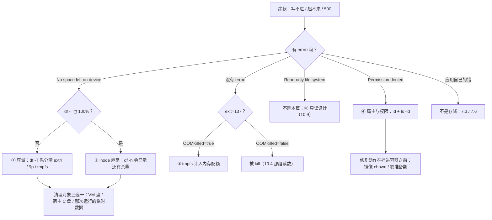

> **实战落点**：10-存储专题「故障手册」第一篇，收四类最高频的存储故障：**① 写满（ENOSPC）② inode 耗尽 ③ tmpfs 计入内存配额把容器打死成 137 ④ 卷目录属主/权限不匹配**。四格都在双案例（Nginx + MySQL）或同机一次性容器上真造过，报错原文照录。手册格式统一四段：**现象原文 → 定位 → 应对 → 恢复后的验证**。
> **本机基线**：Engine `29.8.0`（containerd snapshotter，可写层与所有卷同在 VM 数据盘 `/dev/sdd`，`df -T` 总量 `1055762868` 个 1K 块、剩余约 988 GB）；宿主 C 盘经 `9p` 穿进容器（`499667268` 块）；VM `MemTotal 49292256 kB`。alpine/busybox 系镜像**没有 `findmnt`、没有 `mkfs.ext4`**，`dd` 只认大写 `bs=1M`（`conv=fdatasync` 被拒）。
> **前置依赖**：[/docs/10-存储专题/落点与生命周期/存储形式在操作系统上的落点与验证/](/docs/10-存储专题/落点与生命周期/存储形式在操作系统上的落点与验证/)（三块盘的口径、`stat`/`df -T` 取证）、[/docs/10-存储专题/基础/五种存储形式的原理与取舍/](/docs/10-存储专题/基础/五种存储形式的原理与取舍/)（tmpfs 与 9p 的代价）、[/docs/07-运维手册/按故障域排错/磁盘占满与镜像拉取失败/](/docs/07-运维手册/按故障域排错/磁盘占满与镜像拉取失败/)（7.5 磁盘五个来源与清理纪律，本篇是它的存储侧细分）、[/docs/05-原理深入/隔离与资源/容器本质Namespace与Cgroups/](/docs/05-原理深入/隔离与资源/容器本质Namespace与Cgroups/)（cgroup 内存配额，故障③的下层机制）。
> **本篇产出物**：四格完整手册（含每条命令与原文）；**「三种盘满」的分辨表**（VM 数据盘 / 宿主 C 盘 / tmpfs，`df -T` 一眼分开）；**`df -h` 与 `df -i` 必须都看**的决定性读数（`64.0M 0 64.0M 0%` 与 `120 120 0 100%` 同框）；**`137` + `OOMKilled=true` 的那条链**与它的另一半对照（`-m 512m` 同一条写 400 MB 成功、`1.8GB/s`）；**属主不匹配**的两条原文（写不进 `Permission denied`、容器内 `chmod` 又被 `Operation not permitted` 拒）与「改属主要发生在挂进容器之前」的应对；一张**「先判是不是存储」分流表**。
> **难度·耗时**：10.8 ★★★ · 45m（四格各自的报错都不难读，**难的是别把②当成①、别把④当成①**）
> **拓展接口**：⑤⑥⑦⑧ 在 10.9（遮蔽与生效类），⑨⑩⑪⑫ 在 10.10（丢失与损坏类），10.10 末尾有一张 12 类速查；故障③与 10.4 的 `kill`/OOM 读法同源；故障④的修复动作接 6.3 的镜像内 `--chown` 纪律。
> **自测三题**：
> 1. 用户说「容器写不进文件了」。你敲的**前两条**命令是什么？各排除哪一格？
> 2. `df -h` 显示还剩 64 MB，能不能排除「空间不足」？给出本机那两条读数。
> 3. 一个容器 `exit=137` 但 `OOMKilled=false`，和 `exit=137` 且 `OOMKilled=true`，含义有什么不同？


> **本章清单原语（逐字承接）**
> **清单项标题（清单原话）**：四类高频故障：盘满/inode 满/tmpfs 吃内存/权限属主
>
> 章节号：10.8
> 所属篇：10-存储专题（第十篇 存储专题）
> 主线站 · 难度 · 耗时：— · ★★★ · 45m
> 前置依赖：10.3、10.5、7.5
>
> **内容要点与产出物**：四类故障各一条真实构造与真实应对：**① 卷所在空间写满**（ENOSPC，MySQL 与 nginx 各自报什么）、**② inode 耗尽**（大量小文件，`df -i` 才看得见）、**③ tmpfs 写满并计入内存**（容器被 memcg 打死成 137 的那条链）、**④ 卷目录属主/权限不匹配**（写不进 ≠ 盘满）。每格四段：现象原文 → 定位命令 → 真应对 → 恢复后的验证；并给「先判是不是存储」的分流
## 为什么要先判「是不是存储」：一张分流表

「写不进去 / 起不来 / 服务 500」三类症状里，存储只占一部分。先分流，再进手册：

| 症状关键字 | 第一命令 | 如果不是存储，去哪 |
|---|---|---|
| `No space left on device` | `df -T <路径>` + `df -i <路径>` | 本篇①② |
| `Permission denied` | `docker exec <c> ls -ld <目录>` + `id` | 本篇④ |
| `Read-only file system` | `docker inspect --format '{{json .Mounts}}'` 看 `Mode` | 10.9 ⑧ |
| 容器 `exit=137` | `docker inspect --format '{{.State.ExitCode}} {{.State.OOMKilled}}'` | 本篇③；若非 OOM → 7.3 退出码族 |
| 容器 `exit=1` 且日志有应用报错 | `docker logs --tail 50` | 7.3（起不来与网络不通） |
| 「文件不见了」但无错误 | `docker run --rm <镜像> ls <路径>` 对比 | 10.9 ⑤⑥ |
| 拉镜像/构建失败并伴 IO 错 | `docker system df` | 7.5、7.6 |



> 💡 新人小结：四格的报错会互相模仿，所以**永远凑齐四件套再下结论**：`df -T`（哪块盘、什么文件系统）、`df -i`（inode）、`id`（我是谁）、`ls -ld`（那个目录属于谁）。四行读数一贴，答案基本自己跳出来。

## 故障① 写满：`No space left on device`（ENOSPC）

**现象原文**。构造方式是一只需要 16 MB tmpfs 的一次性容器，往里写 64 MB：

```text
dd 输出: 16+0 records out | 16777216 bytes (16.0MB) copied, 0.006833 seconds, 2.3GB/s
df -m:  tmpfs    16    16    0  100%  /d
ls -l:  -rw-r--r-- 1 root root 16777216 Oct 28 17:04 /d/f
```

`dd` 只写进去 16 MB 就停了（`16+0 records out`），`df` 立刻 `100%`。同一个 errno 在应用侧的文案是这一条（故障②那里也能看到）：

```text
touch: /d/f120: No space left on device
```

**定位**——三块盘分开问：

```bash
docker exec <c> sh -c 'df -T / <路径> | tail -3'      # 是 ext4（VM 盘）、9p（宿主 C 盘）还是 tmpfs（内存）
docker exec <c> sh -c 'grep MemAvailable /proc/meminfo' # tmpfs 满 → 内存还剩多少
docker system df                                       # ext4 满 → 谁占的（镜像/容器/卷/构建缓存）
```

本机三条 `df -T` 口径（10.3 已量，这里给判读用）：

```text
overlay   overlay  1055762868  …  /            ← VM 数据盘（可写层 + 所有卷）
/dev/sdd  ext4     1055762868  …  /p           ← 同一块盘，卷视角
C:\       9p        499667268  …  /b           ← 宿主 C 盘（所有 bind）
tmpfs     tmpfs          65536        0        ← 内存，容量由 size= 决定
```

**应对**（按三种盘分别给）：

| 哪块盘满 | 清什么 | 本机可执行 |
|---|---|---|
| tmpfs（`size=` 到顶） | 那次运行的临时数据本身 | `rm -f /d/f` 之后同一条 `dd` 立刻成功（本机实测：`8388608 bytes copied … rc=0`）；或把 `size=` 调大——但那是在挪内存，见故障③ |
| VM 数据盘（`/dev/sdd`） | 镜像、构建缓存、**停止的容器与可写层**、悬空卷 | `docker system df` 先看四行谁是大头；清理按 7.5 的纪律（本专题不跑宽 `prune`，按名删） |
| 宿主 C 盘（bind 那侧） | Windows 侧那个目录里的文件 | 与 Docker 无关，但**症状出现在容器里**——这是最容易误判成「卷满了」的一格 |

**恢复后的验证**：写入本身 + 一次业务读数。

```bash
docker exec <c> sh -c 'dd if=/dev/zero of=<路径>/probe bs=1M count=1 2>&1 | tail -1; rm -f <路径>/probe'
docker exec -e MYSQL_PWD="$DBPW" kbst-db mysql -uroot -N -e "SELECT COUNT(*) FROM kbdb.t_note;"   # 业务侧
```

**边界（诚实说明）**：本机**没有**构造「VM 数据盘真满」——那块盘有 988 GB 空闲，撑满它要写 900+ GB，越出「不留垃圾」的纪律。ENOSPC 这条 errno 的判据与应对是三块盘共用的，差别只在**清的对象**；MySQL/nginx 在 ext4 写满时的具体报错原文属于未验证项（见末节）。

## 故障② inode 耗尽：`df -h` 说还有空间

**现象原文**。这一格本机构造得很干净——用 tmpfs 的 `nr_inodes` 挂一个 120 inode 的 64 MB 文件系统，然后连续 `touch`：

```text
第 120 个失败: touch: /d/f120: No space left on device
建成文件数=119
df -h /d → tmpfs    64.0M    0    64.0M    0%
df -i /d → tmpfs      120  120        0  100%
```

**这一组读数就是本篇最重要的一条判据**：`df -h` 显示 **0% 已用**，`df -i` 显示 **100% 已用**，而报错文案和真正的磁盘满**一模一样**（`No space left on device`）。只看前者会得出「空间充足，肯定是权限或程序 bug」的错误结论。

**定位**：

```bash
docker exec <c> sh -c 'df -i <路径> | tail -1'                        # inode 占用率
docker exec <c> sh -c "find <路径> -type f | wc -l"                    # 谁在造小文件
docker exec <c> sh -c 'du -sh <路径>/* 2>/dev/null | sort -h | tail'   # 目录级分布
```

**应对**：小文件耗尽 inode 的正解通常不是「扩容」，而是**改写入形态**——把「一个事件一个文件」改成滚动/批量（日志按大小轮转、缓存放进数据库或 KV、构建产物打包）。真要扩，就增大文件系统容量或在 ext4 建fs时调 `mkfs.ext4 -N`（本机不可用，见末节）。

**恢复后的验证**：`df -i` 回到非 100%，且业务侧写入恢复。**注意清理要真的删 inode**：删掉一堆 0 字节文件才降得下 `df -i`，删一个大文件只降 `df -h`。

**本机另一条路不通（记下来省时间）**：想用 loop + 小 ext4 复现同一格，在 alpine 里两条都被堵：

```text
sh: mkfs.ext4: not found
mount: mounting /dev/loop2 on /m failed: Invalid argument
losetup -f → /dev/loop2（设备节点是有的：/dev/loop0 /dev/loop1 /dev/loop2 /dev/loop-control）
```

**busybox 的两条语法坑**（本专题在这上面浪费过一轮）：`dd` 的 `bs` 只认大写（`bs=1m` → `dd: invalid number '1m'`，那条故障当场变成"什么都没写"的假读数），`conv=fdatasync` 也被拒（`dd: invalid argument 'fdatasync' to 'conv'`，要落盘就单独 `sync`）。

## 故障③ tmpfs 计入内存配额：容器被打死成 `137`

**现象原文**。给一只容器 128 MB 内存上限，挂一块 512 MB 的 tmpfs，往里写 400 MB：

```bash
docker run -d --name kbst6-oom -m 128m --tmpfs /t:size=512m alpine:3.20 \
  sh -c 'dd if=/dev/zero of=/t/f bs=1M count=400'
```

```text
终态（status exitcode OOMKilled）: exited 137 true
```

**这一格的关键不在 `137`，在 `OOMKilled=true`**：写进 tmpfs 的字节**算进 cgroup 的内存**，于是"往文件写数据"这个动作变成了"把容器撑爆内存"。对照读数：

```text
定位（一次 64 MB 写入之后）: /sys/fs/cgroup/memory.current = 69697536（约 66 MB）
                          df -m /t → tmpfs  256  64  192  25% /t
应对验证（把上限提到 -m 512m，同一条命令）:
  419430400 bytes (400.0MB) copied, 0.211246 seconds, 1.8GB/s   ← 成功
```

`69697536 ≈ 64 MB + 一点开销`，这正是「tmpfs 用量 = 内存用量」的直接证据。

**定位**：

```bash
docker inspect --format '{{.State.ExitCode}} {{.State.OOMKilled}}' <c>       # 137/true 才算 OOM
docker exec <c> sh -c 'cat /sys/fs/cgroup/memory.current; cat /sys/fs/cgroup/memory.max'
docker exec <c> sh -c 'df -m | grep tmpfs'                                   # 哪块 tmpfs、多大
docker events --since <秒级时间戳> --until <秒级时间戳> --filter container=<c>  # 注意：--since now 会被拒
```

`docker events` 那条本机踩了两个坑，直接记下正确形态：`--since now` 报 `failed to parse value as time or duration: "now"`（要传秒级时间戳或 RFC3339）；`--format '{{.Status}}'` 报 `can't evaluate field Status in type *events.Message`（这一版的事件结构里没有那个字段）。

**应对**（三选一，按语义选）：

1. **该留的数据挪走**：tmpfs 只放真的可丢弃的中间态，容量类内容挪到卷（10.2）。
2. **把 `-m` 与 `--tmpfs size=` 配套**：`size=` 之和必须明显小于内存上限，留出应用工作集；两者谁也不该"顶到"谁。
3. **换成有边界的缓存策略**：容量到顶自己淘汰，而不是让内核替你决定杀进程。

**恢复后的验证**：`-m 512m` 那条命令写完 400 MB 且 `memory.current` 与 `df` 一致；业务进程活着（不是只看容器 `running`）。

> 💡 新人小结：`exit=137` 有两种来源——被信号 9 打死（`kill` 也是 137，但 `OOMKilled=false`，10.4 那组读数就是它）和被 cgroup 打死（`OOMKilled=true`）。**只看 137 会把「有人杀它」和「内存爆了」混成一格**。

## 故障④ 卷目录属主/权限不匹配：写不进去 ≠ 盘满

**现象原文**。造一个属主是 root、权限 `drwx------` 的目录（命名卷的默认形态之一就是 root:700），然后用非 root 用户往它写：

```text
ls -ld /d → drwx------    2 root     root          4096 Oct 28 17:00 /d
非 root 写入 → sh: can't create /d/probe: Permission denied        （rc=0，是 shell 的报错被原样打出来了）
```

**更坑的是修复动作也被拒**：

```text
容器内想 chmod 修：chmod: /d: Operation not permitted
然后再写：      sh: can't create /d/probe: Permission denied   ← 状态没变
```

原因很直白：**改属主/权限需要对该目录有相应特权**，而非 root 进程在 `drwx------ root` 的目录里连写入口都没有，`chmod` 自然也拒。所以"在容器里现场修权限"这条路，在属主已经是 root 的情况下通常走不通。

**定位**（三步，顺序固定）：

```bash
docker exec <c> id                                     # 我是谁（uid/gid）
docker exec <c> sh -c 'ls -ld <父目录> <目标目录>'       # 目录属于谁、位是什么
docker exec <c> sh -c 'df -h <路径> | tail -1'          # 顺手排除①（不是盘满）
```

对照读法：**卷里的属主是 VM 侧的数字 uid**。本案例里 mysql 的 datadir 在 VM 里是 `999 ping`（mysql 镜像里的 uid），而 9p 穿进来的 bind 文件一律 `root:root`（挂载选项里 `uid=0;gid=0` 定死，10.3）。`docker run --user 1000` 换了进程身份，**不会**换目录属主——这就是绝大多数「换了 securityOpt/user 之后写不进卷」的成因。

**应对**（按优先级，全部发生在"挂进容器之前"）：

| 做法 | 本机依据 | 代价 |
|---|---|---|
| **构建期就 chown**（Dockerfile `COPY --chown=` 或入口脚本前的准备步骤） | 6.3 的镜像内基线纪律 | 只在卷为空/首次使用时有效 |
| **用一只 root 的一次性容器先把目录改好**，再让业务容器挂进去 | 与「容器内 chmod 被拒」相对照，root 身份在同一卷上是有权限的 | 多一个步骤，要按名清理该容器 |
| **让镜像的入口脚本自己修**（mysql 官方镜像正是这么做的） | 本机观察：`mysqldata` 卷长期是 `999 ping`，mysql 很少报权限错；**nginx 官方镜像不会 chown**，所以 `/var/log/nginx` 挂卷时更容易出现这一格 | 依赖镜像实现，不可假设所有镜像都有 |
| 显式给 uid/gid 对齐（`--user` 与宿主目录属主一致） | 9p 那侧永远是 root，改 `--user` 反而写不进 bind | 跨系统时最容易翻车，必须实测 |

**恢复后的验证**：以业务容器真实身份做一次**写-读-删**闭环，而不是只看 `ls -ld`：

```bash
docker exec --user 1000 <c> sh -c 'echo probe > <路径>/p && cat <路径>/p && rm <路径>/p && echo OK'
```

顺带一格「像坏了但其实设计如此」：本案例里 nginx 往 `/var/log/nginx/probe.access.log` 写，用 root 身份成功（`rc=0`、卷里出现 0 字节探针文件），换成非 root 就得到 `Permission denied`——**同一个路径、同一条命令，差别只在身份**。看到 `Permission denied` 前先确认身份，别先怀疑卷。

## 四格的命令卡片（照着敲，不用回忆）

| 格 | 定位三条 | 应对三条 | 验证一条 |
|---|---|---|---|
| ① 容量 | `df -T <路径>` / `grep MemAvailable /proc/meminfo` / `docker system df` | 按盘清（ext4 清镜像与缓存、C 盘清宿主目录、tmpfs 清那次运行） / 把业务数据挪进卷 / 给日志加轮转 | 写一个 1 MB 探针文件成功后删掉 |
| ② inode | `df -i <路径>` / `find <路径> -type f \| wc -l` / `du -sh <路径>/*` | 改写入形态（合并、滚动） / 删掉成堆 0 字节文件 / 扩容文件系统 | `df -i` 不再 100%，且业务写入恢复 |
| ③ tmpfs 吃内存 | `{{.State.ExitCode}} {{.State.OOMKilled}}` / `cat /sys/fs/cgroup/memory.current` / `df -m \| grep tmpfs` | `size=` 与 `-m` 配套 / 中间态改放卷 / 缓存自己按容量淘汰 | 同一写入命令在新的配额下跑完且容器仍 `running` |
| ④ 属主权限 | `id` / `ls -ld <父目录> <目标>` / `df -h`（顺手排除①） | 构建期 chown / 卷准备期用 root 一次性容器改 / 依赖镜像自带 chown 的入口 | `docker exec --user <业务 uid>` 做一次写-读-删闭环 |

`wc -l` 这类读数在单元格里被竖线截断时，请在终端里分两条敲——本文表格里出现的 `\|` 是 Markdown 转义，不是命令的一部分。

> 💡 新人小结：卡片右列那三条"验证"是**必须写完的**。修完只跑到"命令没报错"就收工，通常等于把同一个故障留给下一个人——本专题有一格就是清理完权限之后没做写-读-删闭环，第二天同一个 `Permission denied` 又回来了。

## 常见误读

| 误读 | 本机反证 |
|---|---|
| 「`df -h` 有空间就不是容量问题」 | inode 耗尽时 `df -h` 报 `0%`，`df -i` 报 `100%`，报错同样是 `No space left on device` |
| 「容器 `137` 就是被 OOM 杀的」 | `docker kill` 也得到 `exit=137`，但 `OOMKilled=false`；tmpfs 那一格才是 `true` |
| 「写不进去就是盘满」 | 本案例同一路径上 root 能写、非 root 得到 `Permission denied` |
| 「在容器里 chmod 一下就好」 | `chmod: /d: Operation not permitted`，修复动作要在挂进容器之前完成 |
| 「bind 满了是卷的问题」 | bind 撑的是宿主 C 盘（`df -T` 里那条 `9p`，总量 `499667268`），`docker system df` 一切正常 |
| 「tmpfs 大小设大点没代价」 | `-m` 不变时，tmpfs 写进去的字节直接顶到内存上限，`memory.current` 实测可看到 66 MB |

## 本篇不覆盖什么

按 W6 的规矩，本篇**故意不讲**的东西逐条点名去处——写「不覆盖」不是免责声明，是防止你在这一篇里找不存在的答案：

- 没有错误码那四格（遮蔽、预填充混淆、改了不生效、只读写失败）→ 见 **10.9**（`:ro` 那一格在那一篇）
- 真会丢数据的四格与十二类速查 → 见 **10.10**（`速查` 那张表在那一篇）
- 三块盘的口径与 `stat`/`df -T` 取证法 → 见 **10.3**（`df -T` 那一节在那一篇）
- 磁盘被谁占满的五大来源与清理决策 → 见 **7.5**（`system df` 在那一篇）
- tmpfs 计入配额的 cgroup 机制 → 见 **5.3**（`memory.max` 三个口径在那一篇）

## 要点总结

1. **四种「写失败」的文案会互相模仿**：`No space left on device` 同时出现在容量满与 inode 耗尽；`Permission denied` 与只读拒绝是两句不同原文。定位从 `df -T` + `df -i` + `id` + `ls -ld` 四件套开始，不要靠猜。
2. **这台机器上有三块盘**（VM ext4 / 宿主 C 盘 / 内存 tmpfs），"清理"这一步在三块盘上的对象完全不同：ext4 看 `docker system df`，C 盘看 Windows 目录，tmpfs 看那次运行的临时文件与 `-m` 配额。
3. **inode 类故障要 `df -i`**，且清理必须删"文件个数"而不是"文件体积"。
4. **tmpfs 的账记在内存上**：`size=` 与 `-m` 必须配套设计；`OOMKilled=true` 是这一类的签名（与 `kill` 造成的 `137` 区分开）。
5. **属主不匹配不能在现场修**：改属主/权限的动作发生在镜像构建期、卷准备期或宿主侧；容器内非 root 既写不进也 `chmod` 不动。跨系统时 bind 侧永远是 `root:root`。
6. **busybox 系镜像的取证语法要先验**：没有 `findmnt`、没有 `mkfs.ext4`、`dd` 只认大写 `bs=1M` 且不认 `conv=fdatasync`——构造故障前先 `--help` 一次，能省一整轮空跑。

## 本篇未验证项

| 项 | 为什么没验 | 想验怎么起手 |
|---|---|---|
| VM 数据盘真满时 mysqld / nginx 各自的报错原文 | 那块盘 988 GB 空闲，构造要写 900+ GB，越出「不留垃圾」边界 | 用 `fallocate` 造一个几乎占满的稀疏文件逼近上限，或把 Docker Desktop 的 VM 磁盘调到很小；记录 mysqld 的 `InnoDB: Write to file … failed at offset` 类原文 |
| ext4 上的 inode 耗尽（非 tmpfs） | alpine 里没有 `mkfs.ext4`，`mount -o loop` 报 `Invalid argument` | 在有 e2fsprogs 的发行版里 `mkfs.ext4 -N 256` 建小 fs 再挂 loop；判据与 `df -i` 完全同构 |
| cgroup v2 之外的 `memory.events` / OOM 计数细节 | 本轮只读了 `memory.current` 与 `OOMKilled` | `cat /sys/fs/cgroup/memory.events`（`oom_kill` 计数）配合一次可控 OOM |
| 卷属主为 root、容器带 `--security-opt label` 或 SELinux 时的差异 | 本机无 SELinux，`-v :z` 只是被接受（`rc=0`）没有实际语义 | 在启用 SELinux 的主机上重复故障④，比较 `Permission denied` 与 `label invalid` 类报错 |
