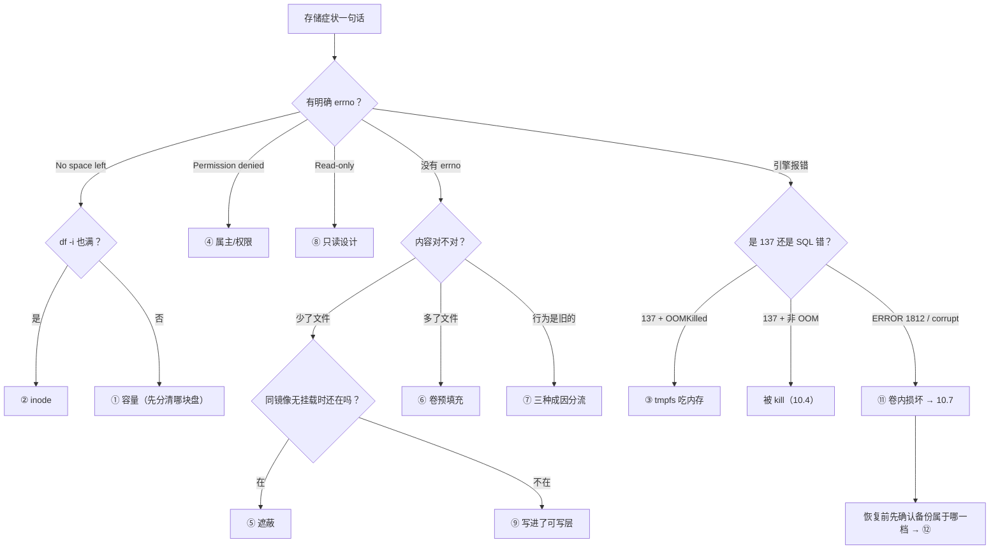

> **实战落点**：10-存储专题「故障手册」第三篇，也是整个专题的收口。本篇四格是**真的会丢数据**的那四类：**⑨ 数据写进可写层，容器一删就没 ⑩ 匿名卷堆积与 `volume is in use` ⑪ 卷内数据文件被外部破坏 ⑫ 热拷出来的备份不一致**。末尾给一张**十二类故障一页速查**（现象关键字 → 第一命令 → 是不是存储 → 去哪一节），这张表是本篇的交付物，也是整个专题最常被翻回来的一页。
> **本机基线**：Engine `29.8.0` + containerd snapshotter（可写层 `/var/lib/docker/rootfs/overlayfs/<容器ID>/`）；`.Plugins.Volume=["local"]`、`docker plugin ls` 零条；`docker system df` 现值 `Local Volumes 14 → 13 个可回收、1.641GB (87%)`；MySQL `8.4.13`，datadir `du -sh` 为 `196.4M`~`209.4M`（视是否热拷中间态）。
> **前置依赖**：[/docs/10-存储专题/故障手册/存储故障手册一容量与权限/](/docs/10-存储专题/故障手册/存储故障手册一容量与权限/)（分流表在这）、[/docs/10-存储专题/故障手册/存储故障手册二遮蔽与失效/](/docs/10-存储专题/故障手册/存储故障手册二遮蔽与失效/)（安静类故障在那）、[/docs/10-存储专题/数据保护/内容损坏与修复/](/docs/10-存储专题/数据保护/内容损坏与修复/)（⑪ 的机制与修复决策）、[/docs/10-存储专题/数据保护/备份与恢复/](/docs/10-存储专题/数据保护/备份与恢复/)（⑫ 的三级对账判据）。
> **本篇产出物**：四格完整手册（现象原文 / 定位 / 应对 / 恢复后的验证）；**故障⑨的"延迟发作"结构**（写的时候全好、删的那一刻全没）与 `docker diff` 的告警用法；**故障⑩的三条原文**（`卷数 14 -> 15`、`docker rm` 后卷仍在、`volume is in use - [6217561b8409…]`）与「只按记下的名字删」的纪律；**故障⑪的报错原文与单表重放闭环**（`Tablespace … is missing!` → `ERROR 1812` → 重放 `rc=0` → `5000	10728165079651` 逐字节回基线 → 清掉 `.gone` 残留）；**故障⑫的两组包与恢复读数**（热拷 `6747958` 字节解出 `209.4M`、冷备 `6705000` 字节解出 `196.6M`，两者恢复后都读到 `5001	10731067400943`）与由此得出的判据修正；**十二类故障速查表**。
> **难度·耗时**：10.10 ★★★ · 45m（四格单看都不难，**难在速查表要能在症状只有一句话时使用**）
> **拓展接口**：速查表右列把本专题十节串起来，并与 7.x 的排错手册（容器起不来、网络不通、磁盘占满、拉取失败）互为分流；⑨⑩ 的清理纪律接 7.5；⑪⑫ 的判据接 10.6 的三级对账与 6.6 的恢复演练。
> **自测三题**：
> 1. 「容器删了，数据没了」这件事，在删除**之前**有哪两个可观测信号？
> 2. `volume is in use` 报错里的十六进制串是干什么用的？给出你接下来要敲的命令。
> 3. 一次热拷备份恢复后聚合完全正确，能不能判定这份备份可用？为什么。


> **本章清单原语（逐字承接）**
> **清单项标题（清单原话）**：四类高频故障：数据落可写层/匿名卷堆积/卷内损坏/备份不一致
>
> 章节号：10.10
> 所属篇：10-存储专题（第十篇 存储专题）
> 主线站 · 难度 · 耗时：— · ★★★ · 45m
> 前置依赖：10.6、10.7、10.9
>
> **内容要点与产出物**：四类故障各一条真实构造与真实应对：**⑨ 数据写进可写层，容器一删就没**（`--rm` 现场）；**⑩ 匿名卷堆积与 `volume is in use`**（镜像 VOLUME 声明的副作用）；**⑪ 卷内数据文件被外部破坏**（MySQL 起不来，读日志定位到哪张表/哪个文件）；**⑫ 热拷出来的备份不一致**（恢复后校验和对不上，正确做法是停容器或用只读快照/逻辑备份）。收口给一张「12 类故障一页速查」：现象关键字 → 第一命令 → 是不是存储 → 去哪一节
## 为什么这四格与手册一、二不同

手册一的四格有明确 errno，手册二的四格安静但**不丢数据**。本篇四格的差别在于：**它们的损失通常在动作之后才显现，而且显现时已经没有回退点**。

- ⑨ 写进可写层：写的时候全好，`docker rm` 那一刻全没；
- ⑩ 匿名卷堆积：不丢数据，但会把盘吃满并让下一次删除变成事故现场；
- ⑪ 卷内文件被破坏：进程照起、健康检查照过，只有真去查那张表才知道；
- ⑫ 备份不一致：恢复点其实不可用，但要等到真的需要恢复那天。

所以这四格的「定位」段全都包含同一个动作：**在事发之前建立一个可对照的基线读数**（`docker diff`、`docker volume ls`、聚合校验和、备份包的内容体检）。没有基线，这四格就只能认栽。

## 故障⑨ 数据写进可写层，容器一删就没了

**这一格的结构是「延迟发作」**：写入时一切正常，运行几天也没事，直到某一次 `docker rm` 或 `--rm` 的一次性任务结束。

**现象原文**：

```text
在的时候能读到: 重要数据没有挂卷
删掉之后再起一只同镜像容器: cat: can't open '/app-data.txt': No such file or directory
```

**定位**（删除之前就能做的两个观察）：

```bash
# 1) 这个路径有没有挂载兜着
docker inspect --format '{{range .Mounts}}{{.Destination}}{{"\n"}}{{end}}' <c>
# 2) 这个文件是不是在可写层里
docker diff <c> | grep '<文件路径>'
```

`docker diff` 出现 `A /app-data.txt` 而 `.Mounts` 里没有对应 `Destination`，就是这一格的确诊。案例里 db 容器的可写层只有 7 条、全部落在 `/run`（PID 与 socket），**这是健康形态**；web 容器有 `A /root/layer-only.txt` 这样的条目，就是"有人在可写层放了东西"。

**读法上有个陷阱要避开**：`docker diff` 里会出现 `A /cache`、`A /probe/volume-on-missing-path` 这类条目，**它们是挂载点目录自身**（镜像里没这个路径，创建动作发生在可写层），不是数据落错地方。判据是看条目后面**有没有真文件**、以及该路径是否出现在 `.Mounts` 里。

**应对**：

| 场景 | 做法 |
|---|---|
| 一次性任务（`--rm`）产出的结果 | 挂卷或 bind 到宿主，把结果写到挂载点里；`--rm` 只清可写层，不动卷 |
| 长期服务 | 该路径进 compose 的 `volumes:`，并在评审清单里加一条「写路径是否被挂载覆盖」 |
| 已经写进去了、容器还活着 | **先 `docker cp` 出来，再动容器**。顺序反了就是事故 |
| 想固化成镜像内容 | `docker commit` 能把可写层带进新镜像，但 10.2 已实测它**不带卷内容**（`in-layer`、`/v` 空），所以它只适合"配置/脚本误写进可写层"这种补救，不适合数据 |

**恢复后的验证**（这一步必须在改动之后重跑）：

```bash
docker exec <c> sh -c 'ls -l <路径>'                                  # 数据现在在挂载点上
docker inspect --format '{{json .Mounts}}' <c> | grep <路径关键词>       # 有对应挂载条目
docker stop <c> && docker start <c> && <再读一次>                      # 停起一次不丢
docker rm <c>                                                          # 最后按预案重建，验证新容器读得到
```

> 💡 新人小结：判断「这个文件安全吗」只看一件事——**它所在的路径有没有被挂载覆盖**。`ls -l` 看得见、`cat` 读得出，都不算证据；`.Mounts` 里有那条 `Destination` 才算。

## 故障⑩ 匿名卷堆积与 `volume is in use`

**现象原文**（不带 `-v` 起一只镜像自带 `VOLUME` 声明的 mysql）：

```text
卷数 14 -> 15，新增: d7cf33f78555…
Mounts: …"Source":"/var/lib/docker/volumes/d7cf33f78555c736e93d5a5ff9852e92c9f825e96ae8d71719b1458dcef2445b/_data",
        "Destination":"/var/lib/mysql","Driver":"local","Mode":"","RW":true…
docker rm -f 那只容器之后 → 卷还在吗: True
当前悬空卷数（docker volume ls -q --filter dangling=true）: 1
```

删除时如果卷还挂着，报的是这一条（**ID 是定位入口**）：

```text
Error response from daemon: remove kbst_weblogs: volume is in use -
  [6217561b840973828b7a64519a4b10cf62c2c6e6fd62c988f2c75d6728d4a4f0]
```

**定位**：

```bash
docker volume ls -q --filter dangling=true          # 悬空卷清单（只看不删）
docker ps -a --no-trunc --filter volume=<卷名>       # 谁还挂着它
docker inspect --format '{{json .Mounts}}' <那个容器ID>
docker system df                                     # 总量口径：本机 Local Volumes 14 中 13 可回收、1.641GB (87%)
```

**应对（纪律，不是命令）**：

1. **起容器就显式命名卷**（compose 里写 `volumes:` 具名段），把匿名卷的产生面压到零；一次性任务用 `--tmpfs`（不进卷表）或 bind（TEMP 目录，跑完删）。
2. **只按本批记下的名字删**。本机同一张卷表里躺着 8 个 64 位十六进制的匿名卷——**Harbor 栈的也在里面**。按 `dangling=true` 批量删或 `docker volume prune` 会带走不属于本次任务的数据，本专题全程未跑 `prune`。
3. **`volume is in use` 不要 `docker volume rm -f` 硬来**（在某些引擎版本上会强拆正在使用的卷）；按报错里的容器 ID 先处理容器。

**恢复后的验证**：

```bash
docker volume ls --format '{{.Name}}' | grep -c '^<前缀>'   # 期望 0（按前缀数，不是全局数）
docker volume ls -q --filter dangling=true | wc -l          # 与动手前对比，确认没有新增
```

## 故障⑪ 卷内数据文件被外部破坏

**现象原文**（把 `t_note.ibd` 移走、重启容器）：

```text
破坏前: -rw-r----- 1 mysql mysql 475136 Oct 28 17:04 /var/lib/mysql/kbdb/t_note.ibd
已移走 → 重启后就绪=True（10.6 秒）| 健康=healthy            ← 注意：healthy
日志关键行:
  [Warning] [MY-012351] [InnoDB] Tablespace 2, name 'kbdb/t_note', file './kbdb/t_note.ibd' is missing!
那张表: ERROR 1812 (HY000) at line 1: Tablespace is missing for table `kbdb`.`t_note`.
别的库还在: information_schema | kbdb | mysql | performance_schema | sys
```

**定位到哪张表 / 哪个文件**（顺序固定，三步）：

```bash
docker logs --since 5m kbst-db 2>&1 | grep -iE 'tablespace|missing|corrupt|ERROR'   # ① 引擎说哪个文件
docker exec kbst-db sh -c 'ls -l /var/lib/mysql/<库名>/'                              # ② 目录对照（大小与基线比）
docker exec -e MYSQL_PWD="$DBPW" kbst-db mysql -uroot -N -e \
  "SELECT TABLE_SCHEMA, TABLE_NAME FROM information_schema.TABLES WHERE TABLE_TYPE='BASE TABLE';"  # ③ 逻辑面还有哪些表
```

本机③的读数是 `1`（`kbdb` 里那张表在数据字典里还登记着，但表空间文件没了）——**「登记在」与「文件在」是两件事**，这就是 `ERROR 1812` 而不是 `Table doesn't exist` 的原因。

> 💡 新人小结：`healthy` 只说"进程活着、能应答 ping"。损坏类故障的第一条铁律是**用一道业务查询去问数据**，而且要问的是聚合而不是行数——行数字段可能来自元数据，聚合必须真读页。

**应对**：有逻辑备份 → 单表重放（10.7 形态一）；没备份 → 走整卷恢复（10.6 路径 A：新卷 + 备份重建 datadir）；两条都没有 → 止损而不是修复（停写入、保全现场、评估能否接受该表回退）。

**本机重放闭环的完整读数**：

```text
备份 rc=0 | 58074 字节 | sha256 2844358e64eb6b0234c9271f…
重放 rc=0 | stderr: ''
重放后: 5000	10728165079651 | 基线 5000	10728165079651 | 一致: True
新的 ibd 文件: -rw-r----- 1 mysql mysql 475136 Oct 28 17:05 t_note.ibd
残留:        -rw-r----- 1 mysql mysql 475136 Oct 28 17:04 t_note.ibd.gone
```

**恢复后的验证（含一条常被漏掉的收尾）**：

```bash
docker exec -e MYSQL_PWD="$DBPW" kbst-db mysql -uroot -N -e \
  "SELECT COUNT(*), SUM(CRC32(CONCAT(id,body,tag,crc))) FROM kbdb.t_note;"    # 聚合逐字节回基线
docker exec kbst-db sh -c 'ls -l /var/lib/mysql/kbdb/' | grep -vE ' \.ibd$|^total'  # 找残留
rm 掉 .gone 之后再量一次（本机：清掉残留之后仍是 5000	10728165079651）
```

那个 `.gone` 必须清：`tar -C /var/lib/mysql .` 不看数据字典，只看目录——**残留会让下一次冷备把一个坏文件一起打包出去**，等真要恢复时才发现包里有个不认识的东西。

## 故障⑫ 热拷出来的备份不一致

**现象**（同一次运行里，先插入一条在跑的小写入，再分别热拷与冷备）：

```text
插入一条在跑的小写入: 5001
热拷 rc=0 用时 2.6 秒 | 6747958 字节 sha 721536cc06b0…
冷备 rc=0 用时 2.5 秒 | 6705000 字节 sha d37e25b527f1…
原实例对照: 现查 5001	10731067400943 | 去掉探针行 5000	10728165079651
热拷包恢复：解包 209.4M | 就绪=True（10.8 秒）| 查 5001	10731067400943
冷备包恢复：解包 196.6M | 就绪=True（10.8 秒）| 查 5001	10731067400943
```

**先把这一格的结论按读数写清，而不是按传闻写**：这两份包**都恢复成功、聚合都与运行中的实例一致**，`ERROR` 一个也没有。也就是说——**这一次热拷没有暴露出问题**。而这正是本篇要处理的判断陷阱：

- 单次热拷成功**不能**证明热拷可用；一致性不是"这次对不对"，而是**有没有可重复的保证**（10.6：保证只能来自事务快照或停机）；
- 可重复的保证缺失时，风险以「**你不知道多久发生一次**」的形式存在；
- 两处可观察的差别提示了这一点：热拷包解出来是 `209.4M`，冷备包是 `196.6M`（同一份数据、相隔 30 秒），**这 12.8 MB 的差我解释不了**（可能是 copy-up/临时页文件/未合并的 redo 状态）。解释不了的差异本身就足以让这份备份降级为「取证素材」而不是「恢复点」。

**本轮也留了一条自伤，按规矩记下来**：脚本里那句 `与原实例（去掉探针行）一致: False` 是我的**比较口径配错**——拿"恢复后含探针行的 5001 行"去比"原实例过滤掉探针行的 5000 行"，两边本就不是同一集合。判据要**同一口径**：`WHERE id < 777777` 加到恢复侧再比，或直接比"含探针行"的两个值（本机这两个值是相等的）。

**定位（怎么知道手里的包是哪一类）**：

```bash
ls -l backups/                       # 包大小与生成时间：有没有对应的停机记录
tar -tzf backups/xxx.tar.gz | head   # 有没有 #ib_16384_*.dblwr、redo 目录（datadir 级备份的特征）
gunzip -c dump.sql.gz | grep -m1 'mysqldump dump'  # 逻辑包会写明来源主机与版本
```

**应对**（三档，按可接受的停机选）：

| 档 | 做法 | 一致性来源 | 本机依据 |
|---|---|---|---|
| 首选 | `mysqldump --single-transaction` | InnoDB 事务快照（不停写） | `58074` 字节 / `0.1 秒`（5001 行时） |
| 次选 | `docker stop` → tar 卷 → 起回 | 停机窗口（文件静止） | `stop 1.1 秒`、`tar 2.5 秒`、恢复 `10.8 秒` |
| 不可作为恢复点 | 运行中直接 tar/datadir 拷贝 | **没有来源** | 本机能恢复≠可靠；只在别无选择时用作取证 |

**恢复后的验证**（永远同一套，见 10.6 的三级对账）：

```bash
# 新卷 → 解包/灌入 → 干净实例 → 就绪（连续 5 次 ping）→ 读聚合 → 读标记行 → 对基线
```

> 💡 新人小结：判断一份备份属于哪一档，看的不是"用的是什么工具"，而是**一致性从哪来**。答得出"事务快照"或"停机窗口"就可用；答不出，就只能当作那次运行的现场照片——出事时能帮你看清坏了什么，不能帮你变回去。

## 十二类故障一页速查

| # | 故障 | 现象关键字 | 第一命令 | 是不是存储 | 去哪一节 |
|---|---|---|---|---|---|
| ① | 卷/挂载所在文件系统写满 | `No space left on device` | `df -T <路径>` | 是（容量） | 10.8 ① |
| ② | inode 耗尽 | 同一句 ENOSPC，但 `df -h` 显示有余量 | `df -i <路径>` | 是（容量） | 10.8 ② |
| ③ | tmpfs 计入内存配额 | `exit=137` 且 `OOMKilled=true` | `docker inspect --format '{{.State.ExitCode}} {{.State.OOMKilled}}'` | 是（落点选错） | 10.8 ③ |
| ④ | 卷目录属主/权限不匹配 | `Permission denied`；`chmod` 又被拒 | `id` + `ls -ld <目录>` | 是（权限） | 10.8 ④ |
| ⑤ | bind 把镜像原有内容遮住 | 「文件不见了」，无报错 | `docker run --rm <镜像> ls <路径>` | 是（挂载视图） | 10.9 ⑤ |
| ⑥ | 空卷预填充 vs bind 不填充 | 卷里凭空多了镜像的内容 | VM 里 `ls -l <Mountpoint>` | 是（引擎隐式行为） | 10.9 ⑥ |
| ⑦ | 配置改了不生效 | 文件新、行为旧 | `grep` 容器内文件 + 打探针路由 | 一半（注入通了、应用没重读） | 10.9 ⑦ / 10.5 |
| ⑧ | `:ro` 或只读根写失败 | `Read-only file system` | `{{json .Mounts}}` 看 `Mode` + `ReadonlyRootfs` | 否（设计如此） | 10.9 ⑧ |
| ⑨ | 数据写进可写层 | 删容器后 `No such file or directory` | `docker diff <c> \| grep <路径>` | 是（落点选错） | 10.10 ⑨ / 10.4 |
| ⑩ | 匿名卷堆积 / `volume is in use` | 删不掉，或 `system df` 一堆可回收 | `docker volume ls -q --filter dangling=true` | 是（生命周期） | 10.10 ⑩ / 7.5 |
| ⑪ | 卷内数据文件被破坏 | `Tablespace … is missing!` / `ERROR 1812` | `docker logs` + `ls -l /var/lib/mysql/<库>/` | 是（损坏） | 10.10 ⑪ / 10.7 |
| ⑫ | 备份不一致（热拷） | 恢复后聚合对不上，或差异解释不了 | 新卷恢复后读聚合与标记行 | 是（一致性来源缺失） | 10.10 ⑫ / 10.6 |



## 常见误读

| 误读 | 本机反证 |
|---|---|
| 「运行期间没问题，说明数据放对了地方」 | ⑨ 的确诊信号是 `docker diff` 里的 `A`，不是运行是否正常 |
| 「`docker rm` 会自动清掉它用的卷」 | 那只 mysql 的匿名卷 `d7cf33f78555…` 在删容器之后**仍在** |
| 「悬空卷直接用 `prune` 清最省事」 | 本机 `dangling` 与 8 个匿名卷里混着别人栈的卷；只按记下的名字删 |
| 「`healthy` 说明卷里的数据没问题」 | 移走 `.ibd` 后仍 `healthy`；`ERROR 1812` 只在你真去查那张表时才出现 |
| 「备份恢复成功一次，这份备份就可用」 | 热拷与冷备这次**都**恢复成功；差别在一致性的来源，不在一次的结果 |
| 「包大小差不多就说明内容一样」 | 热拷包解出 `209.4M`、冷备包 `196.6M`；包字节数 `6747958` 对 `6705000` |

## 本篇不覆盖什么

按 W6 的规矩，本篇**故意不讲**的东西逐条点名去处——写「不覆盖」不是免责声明，是防止你在这一篇里找不存在的答案：

- 备份怎么做、恢复演练的三级对账判据 → 见 **10.6**（`三级对账` 在那一篇）
- 损坏形态分类与修复决策树 → 见 **10.7**（`修复决策树` 在那一篇）
- 容量与权限那四格的命令卡片 → 见 **10.8**（`ENOSPC` 那一格在那一篇）
- 可写层与匿名卷在各删除动作下的下场 → 见 **10.4**（`匿名卷` 那一列在那一篇）
- 磁盘五大来源与不可清理项 → 见 **7.5**（`system df` 在那一篇）
- 与 7.x 排错手册的分流（不是存储的那一类去哪）→ 见 **7.2**（`症状索引` 那张表在那一篇）

## 要点总结

1. **四类"会丢数据"的故障，三类可以在丢之前用一条命令看到**：`docker diff`（⑨）、`docker volume ls --filter dangling=true`（⑩）、聚合校验和 + 目录 `ls -l`（⑪⑫）。把它们放进例行检查，比背故障描述有用。
2. **`docker diff` 是"落点选错"的探测器**，判据是"有没有业务路径的 `A`"；成串 `C /etc/...` 是手工改配置的自白（与 10.9 ⑦的 D 同源）。
3. **匿名卷纪律只有两条**：起容器就显式命名；删除只按记下的名字。`volume is in use` 后面那串 ID 是入口不是障碍。
4. **损坏的定位是「日志说哪个文件 → 目录对照 → 逻辑面还有哪些表」三步**；重放之后必须清残留（`.gone` 会被下一次冷备带走）。
5. **备份分三档**：事务快照（逻辑备份）、停机窗口（冷备）、以及**没有一致性来源**的热拷。热拷只能在别无选择时用作取证；判据是"来源"而不是"这次成不成功"。
6. **速查表的使用方式是先分 errno 有无**：有 errno 的四格走手册一/二，无 errno 的四格走遮蔽-预填充-生效-落点，最后一类是引擎/SQL 层的报错。

## 本篇未验证项

| 项 | 为什么没验 | 想验怎么起手 |
|---|---|---|
| 热拷在真高写入负载下的失败率 | 本机案例的写入只有单条 `INSERT`，量级不足以暴露撕裂；要构造"边写 400 MB 边 tar"会把 VM 内存/磁盘推到危险区 | 在专用机上用 `sysbench` 持续写入同时热拷 N 份，逐份恢复对聚合，记失败率与包字节数分布 |
| `--volumes-from` 备份正在写的容器时卷快照语义 | 本轮 `--volumes-from` 都是配合 stop 使用的 | 对比 `stop` 前后同一卷的 `du` 与包字节数，并检查包里 redo 目录里的文件是否非零 |
| 匿名卷批量清理的实际影响面 | 本机与 Harbor 栈共用引擎，`prune` 属于越界动作（本专题纪律禁止） | 在隔离机上建 3 个匿名卷 + 1 个需要保留的卷，跑 `prune` 前后各 `ls` 一次 |
| 多容器共用同一卷时的写冲突与损坏 | 案例没有造并发写同一卷的两个容器 | 起两只容器挂同一卷同时 `dd` 同名文件，观察 `ls -l`、报错与恢复后一致性 |
