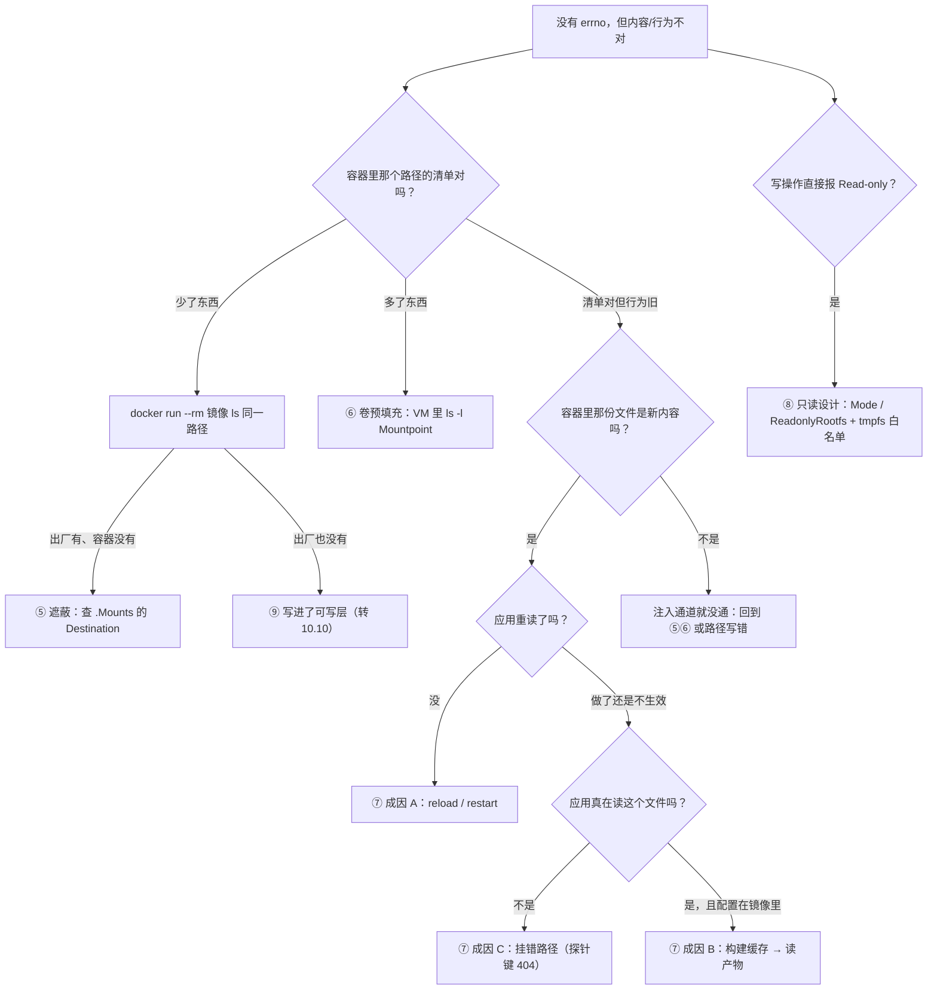

> **实战落点**：10-存储专题「故障手册」第二篇，收四类**「看起来坏了其实设计如此」**的故障：**⑤ bind 把镜像原有内容遮住 ⑥ 空命名卷预填充与 bind 不预填充的混淆 ⑦ 配置改了不生效 ⑧ `:ro` 或只读根导致写失败**。这四格的共同点是**没有任何错误码**（或者错误码是内核层的正确行为），所以最容易被误诊成损坏或容量问题——10.7 的手册因此和本篇互为分流的两半。
> **本机基线**：nginx `1.27-alpine`（出厂 `/usr/share/nginx/html` = `50x.html index.html`；`/etc/nginx/conf.d/` 出厂一份 `default.conf`）、MySQL `8.4.13`（`/docker-entrypoint-initdb.d` 只在数据目录为空时执行）；案例侧 `nginx/default.conf` 是 728 字节的单文件 bind，探针路由 `/storage-probe/` 只存在于这份配置里。
> **前置依赖**：[/docs/10-存储专题/配置与内容/配置应用内容覆盖与失效/](/docs/10-存储专题/配置与内容/配置应用内容覆盖与失效/)（四条注入路径与胜负规则，本篇是它的故障版）、[/docs/10-存储专题/故障手册/存储故障手册一容量与权限/](/docs/10-存储专题/故障手册/存储故障手册一容量与权限/)（分流表与「先判是不是存储」）、[/docs/04-单机编排/日常/多环境热重载与五服务完整实战/](/docs/04-单机编排/日常/多环境热重载与五服务完整实战/)（4.9 的热重载手段，故障⑦的应对在这里）、[/docs/06-工程化与生产/交付链路/CI-CD中的Docker与安全基线/](/docs/06-工程化与生产/交付链路/CI-CD中的Docker与安全基线/)（6.2 的镜像内基线：配置该不该塞进镜像）。
> **本篇产出物**：四格完整手册（现象原文 / 定位 / 应对 / 恢复后的验证）；**「文件不见了」的三行对照读数**（出厂清单、遮蔽后清单、`docker diff` 为空）；**预填充的二次验证**（第一次挂得到内容、删一个之后第二次挂不再补）；**故障⑦的三种成因分流表**，其中「没 reload」那一格给的是**文件已是新内容、HTTP 仍回旧文案**的决定性现场（含 `nginx -s reload` 之后 `200 29` 的读数）；**「只读」三种写失败的原文**（`sh: can't create …: Read-only file system`、`touch: /i/x: Read-only file system`、只读根同句）与**tmpfs 白名单做法**（`--read-only --tmpfs /tmp --tmpfs /var/tmp` 本机跑通）；一条 `-v` 模式串的错法原文（`invalid mode: ro,rw`）。
> **难度·耗时**：10.9 ★★★ · 45m（四格都"没有报错"，**难的是建立"没有报错不等于没发生"**）
> **拓展接口**：⑨⑩⑪⑫（真正会丢数据的四格）在 10.10，末节有 12 类一页速查；故障⑥ 的机制在 10.2「三、命名卷」不足 4；故障⑦ 的构建缓存那一路接 3.5~3.8；故障⑧ 的 `:ro` 与只读根是 6.2 安全基线的落地项之一。
> **自测三题**：
> 1. 「镜像里本来有的文件，挂上目录之后没了」——两条命令分清这是遮蔽还是被删？
> 2. 容器里 `cat` 配置文件已是新内容，行为没变。给出**下一步**的两个候选动作与各自的判别读数。
> 3. `--read-only` 上线之后应用起不来。你的处置顺序是什么（不许直接去掉 `--read-only`）？


> **本章清单原语（逐字承接）**
> **清单项标题（清单原话）**：四类高频故障：bind 遮蔽/预填充混淆/配置不生效/只读写失败
>
> 章节号：10.9
> 所属篇：10-存储专题（第十篇 存储专题）
> 主线站 · 难度 · 耗时：— · ★★★ · 45m
> 前置依赖：10.5、10.8
>
> **内容要点与产出物**：四类故障各一条真实构造与真实应对：**⑤ bind 把镜像原有内容遮了**（「文件不见了」）；**⑥ 空命名卷预填充与 bind 不预填充的混淆**（同一目录两种结果）；**⑦ 配置改了不生效**的三种成因分流（没 reload / 构建缓存 / 挂错路径）；**⑧ `:ro` 或只读根导致写失败**（含该写 tmpfs 的位置判据）。每格同样「现象原文 → 定位 → 应对 → 验证」，并标注哪些是「看起来坏了其实设计如此」
## 这四格为什么单独成一组

手册一的四格都有明确报错（ENOSPC / Permission denied / OOM）。本篇四格的特征是**安静**：

- 遮蔽不产生错误，只是内容换了一批；
- 预填充不产生错误，只是卷里凭空多了镜像的内容；
- 配置不生效不产生错误，只是行为停在旧版；
- 只读写失败有错误，但那句 `Read-only file system` 是**设计要求**，不是异常。

「安静」意味着排错时不能靠退出码，必须靠**对照读数**。所以本篇每一格的「定位」都是成对的：一边是应有状态，一边是现场状态。

## 故障⑤ bind 把镜像原有内容遮住（「我的文件不见了」）

**现象原文**（案例里 `./web-content` 挂到 `/usr/share/nginx/html`）：

```text
镜像侧出厂清单: 50x.html index.html
案例里挂 bind 之后: big.txt index.html
```

`50x.html` 消失了。没有报错、容器健康、`docker diff` 干净：

```text
docker diff kbst-web 里没有任何与 50x.html 相关的条目（遮蔽不产生可写层条目）
```

**定位**（三条命令，顺序固定）：

```bash
# 1) 挂载点是不是正好压在那个文件/目录上
docker inspect --format '{{range .Mounts}}{{.Type}} {{.Destination}} <- {{.Name}}{{.Source}}{{"\n"}}{{end}}' kbst-web
本机原文：
/probe/volume-on-missing-path <- volumekbst_img2
/var/log/nginx <- volumekbst_weblogs
/etc/nginx/conf.d/default.conf <- bind
/usr/share/nginx/html <- bind
/usr/share/nginx/html2 <- volumekbst_img2

# 2) 出厂清单（同镜像、无挂载）
docker run --rm nginx:1.27-alpine ls /usr/share/nginx/html

# 3) 确认不是被删：diff 里如果有 D 才是删除
docker diff kbst-web | grep '^D' || echo "（没有删除条目 → 是遮蔽）"
```

**应对**（按意图三选一）：

| 意图 | 做法 | 本机依据 |
|---|---|---|
| 只要宿主那份内容 | 什么都不用改，接受遮蔽；但把「出厂清单」写进 README，避免下一个人再问一次 | 案例的 `web-content/index.html`（121 字节）确实覆盖了出厂首页 |
| 要「宿主内容 + 镜像默认内容」 | 挂到**另一个路径**（案例的做法：`img2:/usr/share/nginx/html2`），或入口脚本先 `cp -n` | 案例里 `/usr/share/nginx/html2` 与 `/probe/volume-on-missing-path` 是同一个卷（`stat` 同 inode） |
| 怀疑是别人删了 | 用上面第 3 条 `diff` 之后只看有没有 `D` 开头那行（写作 `diff \| grep D`）证伪 | 遮蔽与删除在读数上不同：删除有 `D` + whiteout |

**恢复后的验证**（"恢复"在这里是"让预期内容重新可见"）：

```bash
docker exec kbst-web sh -c 'ls /usr/share/nginx/html'                       # 现在这套内容
docker exec kbst-web sh -c 'ls /usr/share/nginx/html2'                       # 出厂那份（如果走了另挂方案）
curl -s http://127.0.0.1:18899/ | head -1
→ <html><body>kbst bind-mounted index v1 — 这份文件在 Windows 上，容器里改它就等于改磁盘</body></html>
```

最后那条 HTTP 读数是判据的闭环：**首页内容来自 bind（121 字节），不是来自镜像**——访问日志里也能看到 `GET / 200 121`。

> 💡 新人小结：遮蔽是「换了整个目录」，不是「盖了一个文件」。挂 `./conf` 到 `/etc/nginx/conf.d` 会把该目录下**所有**文件藏掉；只挂 `./conf/default.conf` 到同名文件只影响那一个。想保住镜像默认内容，就永远挂得比它更细或更远。

## 故障⑥ 空命名卷预填充 vs bind 不预填充的混淆

**现象原文**（同一个镜像目录，三种挂法）：

```text
① 什么都不挂              → 50x.html index.html
② 挂一个空命名卷           → 50x.html index.html   ← 内容被复制进卷了
③ 挂一个空的宿主目录（bind） → 0 条                 ← 什么都没有
```

**关键的第二步**（证明复制只发生一次）：

```text
第一次挂进去 → 50x.html index.html
删掉 index.html，第二次再挂同一只卷 → 50x.html     ← 镜像里那份不会回来
```

**定位**：

```bash
docker volume inspect --format '{{.Name}} {{.Mountpoint}}' <卷名>
# 进引擎 mount namespace 看卷目录里到底是什么（10.3 的读法）
docker run --rm --privileged --pid=host alpine:3.20 nsenter -t 1 -m -- sh -c 'ls -l <Mountpoint>'
```

本机案例里那两条符号链接就是这一格的产物：

```text
lrwxrwxrwx 1 root root 11 Apr 16 2025 access.log -> /dev/stdout
lrwxrwxrwx 1 root root 11 Apr 16 2025 error.log  -> /dev/stderr
```

也就是说，`weblogs` 卷并不是空的——它带着镜像 `/var/log/nginx` 的一份拷贝（含两条软链）。**「挂卷就是空目录」这个前提在很多排错推理里是错的**。

**应对**：

| 想要什么 | 做法 |
|---|---|
| 真的空目录 | 用 bind；或用 `--mount type=volume,volume-nocopy=true`（本机未实测，见末节）；或在入口脚本里显式清理 |
| 稳定可预期的内容 | **不要依赖预填充**：在镜像入口前加一步显式 `cp -n /defaults/. /data/`，让"复制"成为应用逻辑而不是引擎隐式行为 |
| 想知道这次挂上去到底有没有被填 | 比较 `docker run --rm <镜像> ls <路径>` 与 `docker exec <c> ls <路径>` 与 VM 卷目录三者的清单 |

**恢复后的验证**：改动之后**重建卷**（`docker compose down -v` 或 `docker volume rm` 按名删）再看一次清单——因为预填充只在卷为空时发生，不重建就观察不到行为变化，很容易得出"改了没生效"的错判（这正是 10.5 成因④的近亲）。

## 故障⑦ 配置改了不生效：三种成因分流

**现象**：改了配置，行为还是旧的。三种成因各有独立读数。

### 成因 A：应用没重读（最常见）

决定性现场（把宿主 `nginx/default.conf` 换回原文，**不动容器**）：

```text
容器里的文件 → 728 字节，第 9 行 return 200 "probe-ok from ro-bind config
grep -c 'probe-ok' → 1                       ← 注入通道通了（bind 实时）
HTTP 实际回    → probe-ok v2 (config edited on host)   ← 行为还停在旧版
```

`nginx -s reload` 之后：

```text
HTTP 实际回 → probe-ok from ro-bind config
访问日志    → "GET /storage-probe/ HTTP/1.1" 200 29
```

**定位**（两条命令，必须都跑）：

```bash
docker exec <c> grep -c '<只在新配置里出现的键>' <容器内路径>   # 通道
docker exec <c> wget -q -O - http://127.0.0.1/<探针路由>        # 行为
```

**应对**：按应用各自的重读方式——nginx `nginx -s reload`、多数进程 SIGHUP、Java 应用多半只能重启、compose 下 `up -d --force-recreate <服务>`。**不要**养成「改配置就重启整个栈」的习惯：重启会带走 tmpfs 内容并让入口脚本按数据目录状态做别的事（10.4）。

### 成因 B：构建缓存把旧内容留在层里

```text
第二次构建（文件没改） → #6 CACHED
改了文件再构建        → 仍有一行 #5 CACHED，但容器读到 v2-after-edit
```

**定位**：判据是**读产物**，不是读日志。

```bash
docker build -t tag:3 . && docker run --rm --entrypoint sh tag:3 -c 'grep -o "v[0-9]" /etc/nginx/conf.d/app.conf'
```

**应对**：确认缓存键是不是内容本身（`COPY` 按内容摘要）；构建上下文里有没有 `.dockerignore` 把你的改动排除了（这一条常被忽略）；`docker build --no-cache` 是核弹，用完要清构建缓存（`docker builder prune` 按 7.5 的纪律）。

### 成因 C：挂错路径 / 文件名对不上应用真正读的那份

```text
把同一份配置挂成 /etc/nginx/conf.d/extra.conf   → 容器 running，nginx 日志正常，探针路由 HTTP 404 Not Found
把同一份配置挂成 /etc/nginx/conf.d/default.conf → 探针路由 probe-ok from ro-bind config
```

**定位**：探针键必须**只存在于你要注入的那份内容里**。404 说明应用没读你那一份（读了也不会 404）。

**应对**：先 `docker exec <c> ls -l <应用真正读的目录>` 确认文件名与 `include` 规则（nginx 是 `conf.d/*.conf`，`include` 顺序也影响 location 匹配）；再考虑「挂目录还是挂单文件」——挂目录会把该目录其余文件一起遮掉（回到故障⑤）。

### 三条都排除之后：成因 D（改在可写层，下次重建就没了）

```text
docker diff 里出现成串的 C /etc/...
```

这意味着有人 `docker exec` 进去改了配置，而这份改动没有任何持久化载体。**恢复后的验证**统一一句：**从外部重新读一次行为**（HTTP/SQL），而不是读容器里的文件。

| 成因 | 一句话判据 | 本机读数 |
|---|---|---|
| A 没 reload | 文件新、行为旧 | 728 字节 + `probe-ok v2 …` → reload 后 `probe-ok from ro-bind config` |
| B 构建缓存 | 读产物而不是读日志 | `#5 CACHED` 存在但容器读到 `v2-after-edit` |
| C 挂错路径 | 探针键根本没被读到 | 挂 `extra.conf` 时 `HTTP 404 Not Found` |
| D 改在可写层 | `docker diff` 里成串 `C /etc/…` | 新容器里没有该改动 |

## 故障⑧ `:ro` 与只读根导致写失败

**现象原文**（三种写法，同一条 errno）：

```text
a) 单文件 :ro bind  → sh: can't create /etc/nginx/conf.d/default.conf: Read-only file system
b) 目录   :ro bind  → touch: /i/x: Read-only file system
c) 只读根 --read-only → sh: can't create /etc/y: Read-only file system
```

**定位**（三问，各有命令）：

```bash
docker inspect --format '{{json .Mounts}}' <c> | grep -o '"Mode":"[^"]*"'   # 哪几条是 ro
docker inspect --format '{{.HostConfig.ReadonlyRootfs}}' <c>                # 根是不是只读
docker exec <c> sh -c 'grep " /路径 " /proc/mounts'                          # 内核给的 ro 还是 rw
```

**应对**：`--read-only` 想跑起来必须配**可写点白名单**，本机实测两种写法都能跑：

```bash
docker run --rm --read-only --tmpfs /tmp --tmpfs /var/tmp alpine:3.20 sh -c 'echo x > /tmp/ok && cat /tmp/ok'
→ x    rc=0
```

判据是「这个写点是什么性质」：

| 写入目的 | 该挂哪 | 理由 |
|---|---|---|
| 可丢弃的中间态（解压、编译、会话缓存） | tmpfs | 快、不留；但要按 10.8 故障③ 配套 `-m` |
| 要活过容器（日志、上传、数据库） | 命名卷 | 只读根不影响卷的写入 |
| 要与宿主共享 | bind（**不要**再叠 `:ro`） | `:ro` 是给"配置类"用的，数据类挂 `:ro` 直接写失败 |

**顺带一条模式串的错法**（写 compose 时容易碰到）：

```text
-v <目录>:/x:ro,rw → Error response from daemon: invalid mode: ro,rw
```

`ro` 与 `rw` 不能同时给；`-v <目录>:/x:z` 在本机被接受（`rc=0`），因为没有 SELinux，它是无害的空操作。

> 💡 新人小结：`:ro` 与 `--read-only` 的报错是**同一句内核文案**，但来源不同——前者是某一条挂载只读，后者是整个根只读。所以定位要从 `Mode` 字段和 `ReadonlyRootfs` 两处分别确认，别只查一处就下结论。

**恢复后的验证**：以业务身份做一次写-读-删闭环，且**确认根仍是只读**（避免"为了跑通把 `--read-only` 去掉"这种止损失败）：

```bash
docker inspect --format '{{.HostConfig.ReadonlyRootfs}}' <c>   # 仍应为 true
docker exec <c> sh -c 'echo probe > /tmp/p && rm /tmp/p && echo OK'
```

## 安静类故障的取数路线（一张图）



> 💡 新人小结：这张图的每一条分支都是**取一次对照读数**，不是猜。四类安静故障之所以难，是因为它们的"看起来正常"和"真的正常"共用同一套退出码——只有成对的读数能把它们分开。

## 常见误读

| 误读 | 本机反证 |
|---|---|
| 「文件不见了 = 被删了」 | `docker diff` 没有任何 `D` 条目；同镜像无挂载时清单还在（`50x.html index.html`） |
| 「挂了卷，目录就是空的」 | `weblogs` 卷里带着两条符号链接和一个探针文件 |
| 「预填充每次启动都会补齐」 | 删掉 `index.html` 后第二次挂同一只卷只有 `50x.html` |
| 「`cat` 到的是新配置，说明生效了」 | 文件 728 字节已是新内容，HTTP 仍回 `probe-ok v2 (config edited on host)` |
| 「构建日志里有 CACHED = 内容没更新」 | 改了文件那次仍有一行 `#5 CACHED`，而容器读到 `v2-after-edit` |
| 「挂上文件 = 应用在读它」 | 挂成 `extra.conf` 时容器一切正常，探针路由 `404 Not Found` |
| 「只读导致写失败 = 存储坏了」 | 三种写失败同句 `Read-only file system`；补两个 tmpfs 可写点就正常跑 |

## 本篇不覆盖什么

按 W6 的规矩，本篇**故意不讲**的东西逐条点名去处——写「不覆盖」不是免责声明，是防止你在这一篇里找不存在的答案：

- 四条注入路径与胜负规则的完整展开 → 见 **10.5**（`胜负规则` 那一节在那一篇）
- 会报错的那四类（写满、inode、137、权限）→ 见 **10.8**（`ENOSPC` 那一格在那一篇）
- 构建缓存被谁占、`builder prune` 的影响面 → 见 **3.9**（`buildx` 两个驱动在那一篇）
- 只读根与最小权限怎么在上生产前落地 → 见 **6.2**（`最小权限` 五条对照在那一篇）
- 预填充机制为什么这样设计 → 见 **10.2**（`预填充` 那一格在那一篇）

## 要点总结

1. **本篇四格的共同解法是"对照读数"**：应有状态（同镜像无挂载的清单、探针键应有的响应）与现场状态各取一次，缺一就无法判断是遮蔽、没 reload 还是挂错。
2. **遮蔽是目录级替换**：挂细（单文件）影响一个文件，挂粗（整目录）影响该目录全部内容。`docker diff` 对遮蔽无感，别拿它当遮蔽的证据。
3. **预填充是卷的首次行为，不是每次**：想依赖它维持默认内容必然失败；要可控就在入口显式复制，并**重建卷**才能观察到行为变化。
4. **配置类故障的四成因分流表**（A 没 reload / B 构建缓存 / C 挂错路径 / D 改在可写层）是这一类的收敛工具，其中 A 的判据是「文件新、行为旧」这一对读数。
5. **只读不是故障而是设计**：`--read-only` 必须配 tmpfs/卷白名单，判据是"这个写点的性质"；修复后仍然验证根目录是只读的，别把安全基线当障碍拆掉。
6. **compose 与命令行的模式串有硬约束**：`ro,rw` 直接 `invalid mode`；写错模式串的报错发生在创建期，不是运行期，别把这类 rc=125 当成应用故障。

## 本篇未验证项

| 项 | 为什么没验 | 想验怎么起手 |
|---|---|---|
| `--mount type=volume,volume-nocopy=true`（关闭预填充） | 本机 CLI/Compose 允许写，但这轮没跑对照实验；把未实测的选项写进手册会变成误导 | 同一镜像路径分别用 `volume-nocopy=true` 与普通挂法各挂一次空卷，比较 `ls` 清单 |
| nginx `include` 顺序与多个 `conf.d/*.conf` 的覆盖关系 | 案例只有一份配置；404 那格证明的是"没读到"，不是"读到了但被覆盖" | 造两份定义同一 `location` 的文件（`10-a.conf`、`20-b.conf`），看响应来自哪份，再改名试 `zz.conf` |
| 其它应用的重读语义（SIGHUP 是否安全、是否泄漏旧 worker） | 双案例里只有 nginx 一种 | 对每个要上线的应用做一次「改配置 → 重读 → 观察 30 分钟」的演练并记录 PID 树变化 |
| Windows 侧改文件后容器视图的可见延迟分布 | 本轮只证了"已经可见"，没量延迟 | 宿主写标记 + 容器轮询读取，样本 ≥ 200 次，记 p50/p95/p99（与 10.3 的 9p 那格同一族） |
