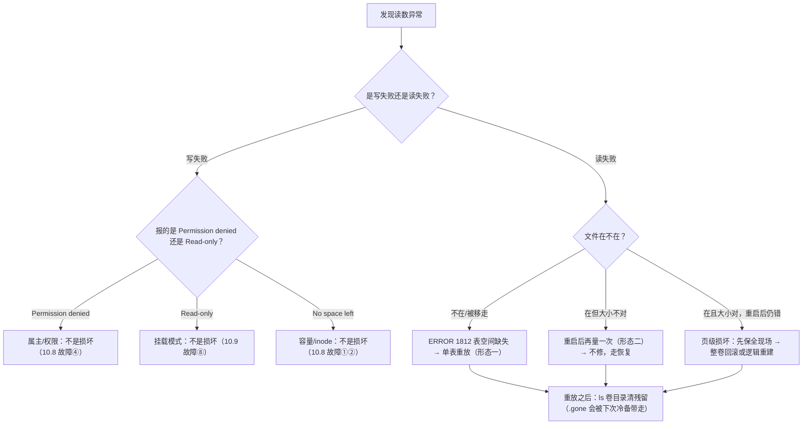

> **实战落点**：10-存储专题「数据保护」第二篇。10.6 证明「备得回来」，本篇处理另一半问题：**东西真的坏了的时候，怎么判断坏到哪一层、还能不能修、修不了怎么止损**。四格损坏形态都在双案例上真造过（截断 `.ibd`、移走 `.ibd`、截断站点文件、把权限错当损坏），报错原文全部照录。
> **本机基线**：MySQL `8.4.13`（InnoDB，datadir 在命名卷 `mysqldata`，`t_note.ibd` 满数据时 `475136`~`491520` 字节）、nginx `1.27-alpine`；引擎 `29.8.0` + containerd snapshotter；**没有快照能力**（`.Plugins.Volume=["local"]`、无外部驱动），所以「损坏现场保全」只能靠复制卷目录。
> **前置依赖**：[/docs/10-存储专题/数据保护/备份与恢复/](/docs/10-存储专题/数据保护/备份与恢复/)（三级对账与恢复演练判据，本篇每一步都用它）、[/docs/10-存储专题/落点与生命周期/存储形式在操作系统上的落点与验证/](/docs/10-存储专题/落点与生命周期/存储形式在操作系统上的落点与验证/)（卷里到底是哪些文件、`du` 与 `ls -l` 取证法）、[/docs/07-运维手册/按故障域排错/磁盘占满与镜像拉取失败/](/docs/07-运维手册/按故障域排错/磁盘占满与镜像拉取失败/)（7.5 的磁盘来源，本篇的写满那类归它）、[/docs/05-原理深入/隔离与资源/容器本质Namespace与Cgroups/](/docs/05-原理深入/隔离与资源/容器本质Namespace与Cgroups/)（进程与挂载视图，解释为什么容器 healthy 与数据可用无关）。
> **本篇产出物**：**四种可构造的损坏形态**，每种四段（现象原文 → 判定 → 修不修得回来 → 止损路径）；两条**「容器 healthy 但数据坏了」的决定性读数**（截断 `.ibd` 之后仍 healthy、查询甚至还能返回正确聚合，靠的是缓冲池）；InnoDB 三条报错原文的**读法**（`Tablespace 2, name 'kbdb/t_note', file './kbdb/t_note.ibd' is missing!` / `ERROR 1812` / `Lost connection to MySQL server during query`，分别对应哪一层坏）；**用逻辑备份重放单表**的完整闭环（`DROP TABLE IF EXISTS` 对丢了表空间的表**也能生效**，重放后 `5000	10728165079651` 逐字节回基线）；**残留文件告警**（`.ibd.gone` 仍躺在卷里，会被下一次冷备一起打包）；三类**「像坏了其实不是损坏」**的对照；一条硬规矩：**先复制再动手**（本机可执行的命令）。
> **难度·耗时**：10.7 ★★★ · 45m（报错不难读，**难的是判断「这一层还能不能信」**）
> **拓展接口**：本篇的 ⑤⑪⑫ 三格在 10.10 以手册形式重排；判定用的聚合校验和来自 10.6；「权限不像损坏」与 10.8 故障④同源；「tmpfs 当持久层」的机制在 10.4；损坏不可构造的那些（位翻转、底层 ext4 坏）全部列在末节。
> **自测三题**：
> 1. `docker inspect` 报 `healthy`、`SELECT COUNT(*)` 还返回 5001——你能说数据没坏吗？说出你还要看的**两个**东西。
> 2. 一条 `Tablespace is missing for table` 和一个 `Lost connection`，哪个更靠近"文件不在了"、哪个更靠近"文件在但读不出"？依据是什么。
> 3. 重放备份之后，为什么还要在卷目录里 `ls` 一次？


> **本章清单原语（逐字承接）**
> **清单项标题（清单原话）**：存储内容损坏的真实形态、判定与修复决策
>
> 章节号：10.7
> 所属篇：10-存储专题（第十篇 存储专题）
> 主线站 · 难度 · 耗时：— · ★★★ · 45m
> 前置依赖：10.6、7.5
>
> **内容要点与产出物**：损坏的四种可构造形态：卷内文件被外部截断/删除、数据库页损坏（含 InnoDB 报错原文与判定读法）、权限/属主错乱导致的「写不进去但其实没坏」、tmpfs 被误当持久层；每种给「怎么发现（可执行的检查）→ 还修不修得回来 → 修不了的止损路径」，并把「先复制再动手」写成硬规矩；明确哪些损坏在本机无法构造（磁盘位翻转、卷底层 ext4 损坏）并标未验证
## 为什么要先给「损坏」分类

「数据坏了」在这台机器上至少有四个不同层面：**文件没了**（表空间被移走）、**文件在但内容不合法**（被截断）、**应用能起来但读不出**（缓冲池兜住了一半）、**根本没坏只是写不进去**（权限、只读、配额）。四类的处置完全不同：第一类靠备份，第二类可能靠引擎自恢复，第三类要先保全现场，第四类改的是配置而不是数据。

所以本篇每一格都严格按四段走：**现象原文 → 判定 → 能不能修 → 修不了的止损**。

> 💡 新人小结：动手之前先回答一句「**我能不能重建这块卷**」。能（有备份且演练过）就先复制再折腾；不能，就什么都别改，先进入止损分支（把容器停在只读状态、把卷目录整个拷走）。这一条比任何具体命令都值钱。

## 硬规矩：先复制，再动手

```bash
# 1) 停写入（容器可以继续起着，只是别再让它写）
docker stop kbst-db
# 2) 整卷复制走（不依赖任何快照能力，本机 --volumes-from 就能做）
docker run --rm --volumes-from kbst-db -v "$BK":/b alpine:3.20 sh -c \
  'tar -czf /b/forensic-$(date +%s).tar.gz -C /var/lib/mysql . && echo 现场已保全'
# 3) 之后所有尝试都在副本上做，原件不动
```

为什么强调「本机没有快照」：`.Plugins.Volume = ["local"]`、`docker plugin ls` 零条，所以「只读快照 + 在快照上试验」这条理想路径**在这台机器上不存在**。能用的只有停机 + 打包。10.6 那句「备份面 = 数据 + 声明」在这里同样适用：动手前顺手记下 `docker inspect --format '{{json .Mounts}}'` 与 `docker image ls` 的对应版本。

## 形态一：卷内单个表空间被移走（库还在、那张表读不出）

**现象原文**（把 `t_note.ibd` 移走、重启容器之后）：

```text
破坏前: -rw-r----- 1 mysql mysql 475136 Oct 28 17:04 /var/lib/mysql/kbdb/t_note.ibd
日志关键行:
  2026-10-28T17:05:08.077897Z 1 [Warning] [MY-012351] [InnoDB] Tablespace 2, name 'kbdb/t_note', file './kbdb/t_note.ibd' is missing!
那张表: ERROR 1812 (HY000) at line 1: Tablespace is missing for table `kbdb`.`t_note`.
别的库还在: information_schema | kbdb | mysql | performance_schema | sys
重启后就绪=True（10.6 秒）| 健康=healthy
```

**判定**：坏的是**一张表的物理文件**，不是实例、不是库。三条读数一起看才能定这一层——服务起来了（进程与系统表空间都好）、`SHOW DATABASES` 完整、只有那道 `SELECT` 报 `ERROR 1812`。**注意 `healthy` 在这一格仍然是 `healthy`**：健康检查用的是 `mysqladmin ping`，它测不到表。

**能不能修**：能，前提是**有逻辑备份**。本机闭环：

```text
备份 rc=0 | 58074 字节 | sha256 2844358e64eb6b0234c9271f…
重放 rc=0 | stderr: ''
重放后: 5000	10728165079651 | 基线 5000	10728165079651 | 一致: True
新的 ibd 文件: -rw-r----- 1 mysql mysql 475136 Oct 28 17:05 t_note.ibd
```

机制要说清：备份里有 `DROP TABLE IF EXISTS t_note`（10.6 那条体检读数）。很多人担心「表空间都丢了，DROP 会不会失败」——本机实测**能成**：InnoDB 在没有 `.ibd` 的情况下仍能把数据字典里那张表拆掉，随后 `CREATE TABLE` + `INSERT` 重新生成一个干净的 `.ibd`（大小恰好回到 `475136`）。

**止损/注意**：重放之后，被移走的那个文件还躺在卷里：

```text
-rw-r----- 1 mysql mysql 475136 Oct 28 17:04 /var/lib/mysql/kbdb/t_note.ibd.gone
```

**它会被下一次冷备原样打包带走**（`tar -C /var/lib/mysql .` 不看数据字典，只看目录）。所以损坏处理收尾必做一次目录核对：

```bash
docker exec kbst-db sh -c 'ls -l /var/lib/mysql/kbdb/' | grep -vE ' \.ibd$|^total'
```

## 形态二：文件在、内容不合法（被截断）

**现象原文**（把 `t_note.ibd` 从 `475136` 截到 `4096`）：

```text
截断前: -rw-r----- 1 mysql mysql 475136 Oct 28 16:57 /var/lib/mysql/kbdb/t_note.ibd
截断后: -rw-r----- 1 mysql mysql 4096  Oct 28 16:58 /var/lib/mysql/kbdb/t_note.ibd
查询现场: 5001	10731326210444                ← 注意这一行：查得出来，而且和坏之前一模一样
健康检查此刻仍说: healthy
（更早一轮，同一种截断，重启之后）:
  ERROR 2013 (HY000) at line 1: Lost connection to MySQL server during query
```

**这一格是本篇最有教学价值的一处**：截断之后**当场查还是正确的聚合**。为什么？那些页还在 InnoDB 缓冲池里，查询根本没碰磁盘。也就是说：

- **能查对 ≠ 文件没坏**。判据必须是「重启之后再查」或「把缓冲池清掉再查」，不是「现在查一下没事」；
- 同一种损坏，**在重启前和重启后表现完全不同**（`5001 10731326210444` vs `Lost connection`），所以排错时的时间顺序要如实记下来。

**判定动作**（可执行）：

```bash
docker exec kbst-db sh -c 'ls -l /var/lib/mysql/kbdb/t_note.ibd'    # 大小与基线（475136）比
docker restart kbst-db                                             # 让缓冲池失效
docker exec -e MYSQL_PWD="$DBPW" kbst-db mysql -uroot -N -e 'SELECT COUNT(*) FROM kbdb.t_note;'
docker logs --since 60s kbst-db 2>&1 | grep -iE 'ERROR|corrupt|tablespace'
```

**能不能修**：截断属于「页内容与文件长度都不合法」，**不在本机可修范围内**——正路是恢复（单表重放或整卷回滚）。`innodb_force_recovery` 那类逐级救援要改启动参数并重启实例，本机按纪律未做（见末节未验证）。

**止损**：如果业务能接受该表回退到备份点，就先做备份点的单表重放；如果不能接受丢数据，就把形态一/形态二当成**换卷 + 从逻辑备份重建**处理（10.6 的恢复路径 A），并在重建后立刻补一次全量。

## 形态三：卷里的普通文件被截断（站点内容、日志类）

**现象原文**（案例里把一个站点数据文件截成 0 字节，两侧同时读）：

```text
容器内: 0 /usr/share/nginx/html/site-data.txt
宿主侧看到同一个 0 字节文件吗: 0        ← 同一个对象，两侧一起坏
```

**判定**：bind 上的损坏是**共享的**——宿主和容器指向同一个 NTFS 文件（10.3 的穿层证据），一侧写坏了两侧一起坏，别指望容器里有另一份副本。卷上的损坏只在 VM 那份目录里，宿主看不到。

**能不能修**：能，只要备份面存在。这一类的正确修复方式不是「在容器里重建」，而是回到**内容的源头**：站点内容回宿主目录的版本控制/同步源，日志类直接放弃（可再生），数据库文件回 10.6 的两条路。

**止损与预防**：内容类文件一旦被容器写脏，最常见的补救是**改成只读挂载**：本机 `nginx/default.conf` 挂成 `:ro` 之后任何写入都被内核拒（`Read-only file system`），从根上消灭「有人在容器里手改配置」。可写 bind（`web-content`）保留给真的需要宿主/容器双向写的场景。

## 形态四：tmpfs 被当成持久层（"内容不见了"但谁都没坏）

**现象**：`restart` 之后 `/cache` 只剩 `. ..`，而同一只容器的卷目录里四个文件都在（10.4）。

```text
restart 前 /cache: before-restart 那个标记文件
restart 后 /cache: . ..
/var/log/nginx（卷）: access.log error.log from-container.txt probe.access.log
```

**判定**：这不是损坏，是**用错落点**。判据是同一条数据在两种落点上的对比：

```bash
docker exec kbst-web sh -c 'ls /cache; ls /var/log/nginx'   # 前者空、后者满 → 设计如此
```

**修复**：没有"修"，只有"改设计"。要么挪到卷/bind，要么接受每次运行从零开始（并把「重建缓存」写进入口流程）。

## 三类「像坏了其实不是损坏」

这三类每次都排在损坏前面排除掉，因为它们的修复动作完全不同（改配置/改权限，不是恢复数据）。

| 表现 | 报错原文 | 真实原因 | 排除动作 |
|---|---|---|---|
| 写不进挂载目录 | `sh: can't create /var/log/nginx/probe.access.log: Permission denied` | 属主不匹配：卷里那个目录是 `drwx------ root root`，容器换成了非 root 用户（`sh: can't create …`，同一轮里 root 身份写同类路径 rc=0） | `docker exec … ls -ld <目录>` + `id`；修属主要**在挂进容器之前**做（容器内 `chmod` 报 `Operation not permitted`） |
| 只读位置写失败 | `Read-only file system`（三种写法同一条） | `:ro` 或 `--read-only`，内核层设计 | 挪到 tmpfs/卷；或去掉 `:ro`（想清代价） |
| 镜像里"文件不见了" | 目录里少文件，但无任何错误 | 被 bind/卷遮蔽（10.5 规则一） | `docker run --rm <镜像> ls <路径>` 拿出厂清单对照 |

顺带把 mysql 侧的一个好设计记下来：**官方镜像的入口脚本会自己 chown datadir**，所以 `mysqldata` 卷里的文件长期是 `999 ping`（mysql 用户），很少报权限错；nginx 官方镜像**不会**，所以挂卷到 `/var/log/nginx` 时权限类问题更容易出现（10.8 故障④）。

## 一次完整时间线（把四格串起来看）

损坏事故的读数是**按时间分布**的，任何一次"事后回看"都要保住时间轴。本专题轮 6 那一格的全过程：

| 时刻 | 动作 | 读数 | 这一行防的是什么 |
|---|---|---|---|
| T0 | 打逻辑备份 | `rc=0`、`58074` 字节、`sha256 2844358e64eb…` | 防"其实没备成"（20 字节空包那一类） |
| T1 | 移走 `t_note.ibd` | `-rw-r----- … 475136` 消失 | 造故障（生产上是误删/坏盘） |
| T2 | `docker restart` | 就绪 `True`、`10.6 秒`、**`健康=healthy`** | 防"起得来就当没事" |
| T3 | 读日志 | `Tablespace 2, name 'kbdb/t_note', file './kbdb/t_note.ibd' is missing!` | 定位到**哪个文件** |
| T4 | 查那张表 | `ERROR 1812 … Tablespace is missing for table` | 定位到**哪张表** |
| T5 | 查其它库 | `information_schema \| kbdb \| mysql \| performance_schema \| sys` | 界定**影响范围** |
| T6 | 重放备份 | `rc=0`、`stderr` 为空 | 修复动作本身要留证 |
| T7 | 对聚合 | `5000	10728165079651` == 基线 | 证明**数据回来了** |
| T8 | `ls -l` 卷目录 | `t_note.ibd 475136` 新文件 + `t_note.ibd.gone` 残留 | 防残留被下一次冷备打包 |

> 💡 新人小结：这张表的每一行都是**一条命令 + 一条原文**。事故复盘里如果只有"重启后好了"，那下一次同样的损坏还会再来一次；把 T2、T4、T8 这三行留住，才谈得上"我们知道了怎么判"。

## 修复决策的三种收敛姿势

| 你的处境 | 收敛动作 | 不要做 |
|---|---|---|
| 有逻辑备份、丢的是一张表 | 单表重放（T6→T8） | 别顺手 `docker volume rm` 整卷 |
| 有卷冷备、丢的是整个库/权限 | 新卷解包 + 让实例指过去（10.6 路径 A） | 别在旧卷上"再试一次"，旧卷已被引擎登记过 |
| 什么都没有 | 停写入、`tar` 走现场、按可丢范围评估 | 别 `--rm` 容器、别 restart 超过一次、别跑 `prune` |

> 💡 新人小结：三种姿势的共同点是**先固定证据再动手**。这台机器没有快照能力，所以"复制一份再试"不是保守，是唯一可行的保守。

## 判定的正确顺序（五步，可照抄）

```bash
# 1) 进程与挂载还在不在
docker inspect --format '{{.State.Status}} {{.State.Health.Status}}' kbst-db
docker inspect --format '{{range .Mounts}}{{.Type}} {{.Destination}}{{"\n"}}{{end}}' kbst-db
# 2) 目录里该有什么文件（与已知基线比大小）
docker exec kbst-db sh -c 'ls -l /var/lib/mysql/kbdb/'
# 3) 引擎日志里有没有表空间/页级报错
docker logs --since 120s kbst-db 2>&1 | grep -iE 'tablespace|corrupt|missing|ERROR'
# 4) 业务读数：用聚合而不是 COUNT(*)（COUNT 会被缓冲池和元数据骗）
docker exec -e MYSQL_PWD="$DBPW" kbst-db mysql -uroot -N -e \
  "SELECT COUNT(*), SUM(CRC32(CONCAT(id,body,tag,crc))) FROM kbdb.t_note;"
# 5) 判"能不能信"：让缓冲池失效之后再量一次
docker restart kbst-db && <重复 4>
```

第 5 步是本篇从形态二那里学到的：**没有第 5 步的前四步都可能给出假阳性**。

## 修复决策树



## 判据的三档置信度

同样是"我检查过了"，三档置信度差得很远。本专题踩过的每一处都落在低档上：

| 档 | 你做了什么 | 能排除什么 | 排除不了什么 |
|---|---|---|---|
| 低 | 看容器状态 / `docker ps` | 进程活着 | 数据、表、页、权限（本机两次 `healthy` 撞上损坏） |
| 中 | 查一次 `COUNT(*)` 或聚合 | 大部分"表整个没了" | 缓冲池兜住的截断（形态二：当场查得对，重启才暴露） |
| 高 | 让缓冲池失效（restart）后再查 + `ls -l` 目录 + 读引擎日志 | 文件级与页级的大多数形态 | 位翻转与底层文件系统坏（本机不可构造） |

三档之间的落差就是事故的空间。**把"中档"当"高档"用**是最常见的一种自我安慰：查得到行数，不等于读得出内容。

## 常见误读

| 误读 | 本机反证 |
|---|---|
| 「容器 healthy，所以数据没坏」 | 截断 `.ibd` 之后 health 仍是 `healthy`；移走 `.ibd` 之后也还是 `healthy` |
| 「现在查得对，说明文件没问题」 | 截断当场仍返回 `5001	10731326210444`；重启才暴露（缓冲池兜住） |
| 「`Lost connection` 和 `ERROR 1812` 是同一类」 | 前者是「文件在但读不出/服务端连接被打断」，后者是「数据字典里那张表没有对应表空间」，处置不同 |
| 「表空间丢了，备份里的 `DROP TABLE IF EXISTS` 会失败」 | 本机重放 `rc=0`、`stderr` 为空，聚合逐字节回基线 |
| 「坏文件删了容器就干净了」 | `t_note.ibd.gone` 重放之后仍留在卷里，会被下一次冷备打包 |
| 「bind 文件坏了容器里还有一份好的」 | 两侧同时读到 0 字节（同一个对象） |
| 「清理完就不用再看了」 | 重放成功之后 `t_note.ibd.gone` 仍留在卷里；`du` 从 `196.4M` 变到 `209.4M` 这类解释不了的差值，都要留一行记录 |

## 本篇不覆盖什么

按 W6 的规矩，本篇**故意不讲**的东西逐条点名去处——写「不覆盖」不是免责声明，是防止你在这一篇里找不存在的答案：

- 怎么备才备得回来、三级对账怎么跑 → 见 **10.6**（`三级对账` 的完整数字在那一篇）
- 写满与 inode 耗尽这两类「不是损坏」→ 见 **10.8**（`inode` 那一格在那一篇有 `df -h` 说还有空间的现场）
- 真会丢数据的四格（可写层、匿名卷、外部破坏、热拷不一致）→ 见 **10.10**（`速查` 那张十二类表在那一篇）
- 卷内文件系统实现与 copy-up 的机制 → 见 **5.4**（`GraphDriver` 在那一篇）
- 真·介质损坏（`位翻转`、底层 ext4 坏）本专题造不出来 → 见「本篇未验证项」（末节列了哪些不可构造）

## 要点总结

1. **损坏分四层**：文件不在（`ERROR 1812`）、文件在但内容非法（截断，重启才暴露）、实例级（本机能造的只有单表级）、以及**三类根本不是损坏的写失败**（权限/只读/容量）。判定顺序按那五步走。
2. **`healthy` 与「数据可用」无关**，两次现场都证明了这一点；聚合校验和 + 缓冲池失效（重启）才是可信的两次量。
3. **单表级损坏可以用逻辑备份重放修复**，机制是 `DROP TABLE IF EXISTS` 在没有表空间时同样生效；重放后必须做一次卷目录核对，把 `.gone` 这类残留清掉。
4. **bind 上的损坏是共享的**，容器里没有第二份；卷上的损坏只在 VM 那份目录。这决定了「先复制再动手」的具体命令形态（`--volumes-from` + `tar`）。
5. **本机没有快照能力**，所以现场保全是停机打包，不是只读快照。这条边界决定了本篇所有「修不了就止损」的止损方式。
6. **`innodb_force_recovery` 一类的引擎级救援本篇未在本机做**（要改启动参数并重启实例）。遇到该走这条路的情况，优先用恢复而不是救援。

## 本篇未验证项

| 项 | 为什么没验 | 想验怎么起手 |
|---|---|---|
| `innodb_force_recovery=1..6` 逐级救援 | 要改 mysqld 启动参数并重启实例，属引擎外动作；本专题纪律是不在共享引擎上改配置 | 在专用机器上按级起库，逐级记「能读到什么、写会怎样、日志报什么」，并在级 4 以上明确标注数据风险 |
| 磁盘位翻转 / 底层 ext4 损坏 | 本机无法构造（需要真坏块或 dm-error 设备）；`mkfs.ext4` 在 alpine 里也不存在（实测 `sh: mkfs.ext4: not found`、`mount -o loop` 报 `Invalid argument`） | 在有权限的 Linux 主机上用 `dm-error`/`dm-flakey` 造坏块，或直接把 `.ibd` 中间若干字节改成随机值后重启，观察校验失败原文 |
| InnoDB 页级校验失败的具体报错串（`Checksum …`、`Page … is corrupt`） | 本机造的是**截断**（文件长度非法），引擎报的是 missing/连接中断，未覆盖页校验 | 用同一手法在副本卷上做「保持文件大小、改写中间页头」，再重启容器读日志 |
| 备份链断裂时（无逻辑备份）的兜底 | 本案例始终有备份，无法验证「真的什么都没有」那条路 | 在没有备份的副本卷上试验，并把结论写成止损预案而不是修复步骤 |
| 双主/复制环境下损坏的一致性判定 | 本机只有一个 db 实例 | 起两只实例配复制后，在其中一只上造损坏，观察另一只与错误日志 |
