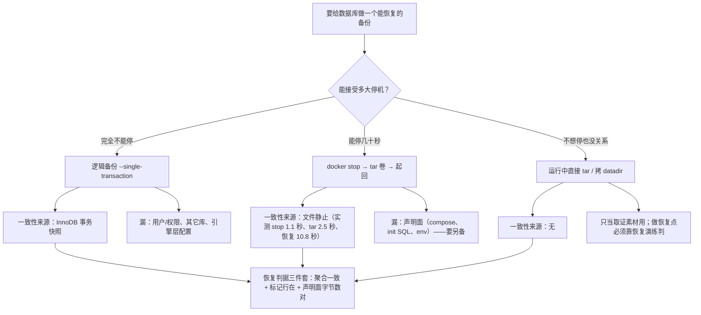

> **实战落点**：10-存储专题的「数据保护」第一篇。它回答的不是「有没有备份」，而是**这份备份能不能在新机器上把 5000 行原样变回来**——这条判据只能用恢复演练证明。操作台是 `Docker知识库/示例/存储双案例`（Nginx + MySQL，5000 行真数据，聚合校验和 `10728165079651`）。
> **本机基线**：MySQL `8.4.13`（镜像 `mysql:8.4`，datadir 在命名卷 `mysqldata`）、nginx `1.27-alpine`；卷在 VM 数据盘 `/dev/sdd`（ext4）；引擎 `29.8.0` + containerd snapshotter，`.Plugins.Volume = ["local"]`（**没有快照驱动、没有第三方卷插件**，所以「只读快照」这条路在本机只能靠停容器或事务快照来实现）。
> **前置依赖**：[/docs/10-存储专题/落点与生命周期/容器启动停止与存储的关系/](/docs/10-存储专题/落点与生命周期/容器启动停止与存储的关系/)（10.4：卷与可写层的生命周期，是「冷备要在 stop 之后」的前提）、[/docs/06-工程化与生产/运行基线/监控最小集与备份容灾/](/docs/06-工程化与生产/运行基线/监控最小集与备份容灾/)（6.6 的备份面清单与恢复演练纪律）、[/docs/10-存储专题/落点与生命周期/存储形式在操作系统上的落点与验证/](/docs/10-存储专题/落点与生命周期/存储形式在操作系统上的落点与验证/)（10.3：`du` 与 `volume ls SIZE=N/A` 那一格，本篇的容量对账靠它）、[/docs/04-单机编排/定义/Compose语法基线与文件全字段参考/](/docs/04-单机编排/定义/Compose语法基线与文件全字段参考/)（`volumes:` 与 `--volumes-from` 的声明面）。
> **本篇产出物**：两条备份路各自的**真实产物与耗时**（逻辑包 `58113` 字节 / 冷备包 `6499255` 字节，同一份数据目录 `du` 出 `196.4M`）；一套**三级校验和对账**（写入 → 解回 → 在另一只容器里再读，用行数 + `SUM(CRC32(...))` 而不是「起没起来」）；一份**可复现的恢复演练**（起一只干净 MySQL、灌备份、查回 `5001	10731326210444`，含标记行反证数据来源）；**只备数据不备配置的代价**的实测（init 脚本挂过去也不再跑，日志里 `docker-entrypoint-initdb.d` 出现 **0 次**）；热拷与冷备的**一致性差别怎么验**（以及为什么「tar 成功」不是判据）；`--volumes-from` 备份容器模式的可照抄命令；一张**备份面清单**（三种形式各备什么、漏了什么）。
> **难度·耗时**：10.6 ★★☆ · 50m（命令都短，**难的是忍住不把「包做出来了」当成「能恢复」**）
> **拓展接口**：10.7 接本篇的备份面清单讲「损坏了怎么判、修不修得回来」；10.10 的故障⑫就是本篇热拷那一格的故障版；6.6 的「声明 + 数据」两件套迁移观在本篇有具体的字节数；10.4 的 `stop_grace_period: 40s` 与入口脚本初始化时机决定冷备的可行窗口。
> **自测三题**：
> 1. 你有一份 `mysqldata` 卷的 tar 包。要证明它可用，最少需要几个独立读数？说出每个读数在防什么。
> 2. 逻辑备份恢复出来的实例查得到 5000 行，你怎么排除「其实是挂载的 init 目录又跑了一遍 seed」这种假阳性？
> 3. 为什么「把 `weblogs` 卷打包」在这套案例里几乎等于什么都没备？


> **本章清单原语（逐字承接）**
> **清单项标题（清单原话）**：卷与数据库的备份恢复：一致性、校验和、演练
>
> 章节号：10.6
> 所属篇：10-存储专题（第十篇 存储专题）
> 主线站 · 难度 · 耗时：— · ★★☆ · 50m
> 前置依赖：10.4、6.6
>
> **内容要点与产出物**：两层备份：**逻辑备份**（mysqldump / nginx 配置与站点内容）与**卷冷备**（停容器后 tar 卷目录）；一致性从哪来（为什么运行中直接拷 `.ibd` 会拿到不一致的东西）；三级校验和对账（写入 → 解回 → 在另一只容器里再读）；恢复演练的可复现步骤与判据（真起 MySQL 真查 5000 行、真起 nginx 真取回那个文件）；`--volumes-from` 备份容器模式；恢复后的验证不能只看「起没起来」
## 为什么要先分清「备份什么」再谈「怎么备」

存储专题前三节把落点讲清了，这一节要把落点翻译成**备份面**。同一句「我备份了数据库」，在这台机器上可能指三件完全不同的事：

| 说法 | 实际备到的东西 | 漏掉的东西 | 能不能变回 5000 行 |
|---|---|---|---|
| 「备了 datadir（tar 卷）」 | `/var/lib/mysql` 整棵树（含 `mysql` 系统库、用户与密码、InnoDB redo、双写文件） | `./mysql-init` 那份 SQL、compose 里的环境变量、镜像版本 | **能**（本篇实测，起干净实例查回原聚合） |
| 「备了 mysqldump」 | `kbdb` 库的 DDL + 数据 + 存储过程/触发器 | 用户与权限（`mysql` 系统库不在 `--databases kbdb` 里）、其它库、`innodb` 层配置 | 能（数据），权限要另备 |
| 「备了卷 `weblogs`」 | 里面只有两个符号链接与一个 0 字节探针文件 | **日志正文根本不在卷里**（`access.log -> /dev/stdout`） | 不适用 |

第三行值得多说一句，它是这套案例里最容易被忽略的一格。`docker volume inspect` 之后进引擎 mount namespace `ls -l` 那个 `_data`，原文：

```text
total 0
lrwxrwxrwx 1 root root 11 Apr 16 2025 access.log -> /dev/stdout
lrwxrwxrwx 1 root root 11 Apr 16 2025 error.log  -> /dev/stderr
-rw-r--r-- 1 root root  0 Oct 28 16:29 probe.access.log
```

`nginx` 官方镜像出厂就把 `/var/log/nginx/*` 软到标准流，日志正文走的是**日志驱动**（本机默认 `json-file`，落点与轮转纪律见 [/docs/06-工程化与生产/运行基线/日志资源限制部署策略与回滚/](/docs/06-工程化与生产/运行基线/日志资源限制部署策略与回滚/)）。所以「把日志卷打包」备到的只有符号链接。**卷里有目录不等于卷里有内容**——这是备份面最常见的空包。

> 💡 新人小结：备份面的正确数法是「**每一种形式各自的数据在哪**」：卷看 `/var/lib/docker/volumes/<名>/_data` 的真实文件（`ls -l`，不是 `ls`），bind 看宿主那个目录，tmpfs **永远不进备份面**（它的设计就是不留下），镜像层不进备份面（重新 `pull` 或 `save` 就回来），可写层**要么空着要么就是漏了**（10.4 的判据）。

## 路 A：逻辑备份 —— 一次真实 dump 的全部数字

命令（认证走 `MYSQL_PWD`，不要 `-p`，见下面那条自伤）：

```bash
docker exec -e MYSQL_PWD="$DBPW" kbst-db sh -c \
  'mysqldump -uroot --single-transaction --routines --triggers --databases kbdb' | gzip > backups/kbdb-logical.sql.gz
```

本机读数（库里 5001 行时）：

```text
dump rc=0 | gzip 后 58113 字节 | 耗时 0.1 秒 | sha256 7f09c49ab2d1fe873f145765231a1475…
stderr: ''
备份体检: 未压缩字节=367581 行数=66 | INSERT 语句数=1 | marker 次数=1 | DROP TABLE 行=1
CREATE DATABASE /*!32312 IF NOT EXISTS*/ `kbdb` ...
gzip -t 自洽: gzip_ok
```

四个数字各有各的说法：

- **`58113` 字节 / `367581` 字节 / 66 行**：mysqldump 默认把整表压成**一条扩展 INSERT**（`INSERT 语句数=1`），所以「行数=66」不是数据行数而是语句+注释行数。**别拿备份文件的行数当数据行数**，那是本轮差点踩到的坑（见下）。
- **`DROP TABLE IF EXISTS` 有一行**：这条决定了重放能不能覆盖一张坏表（10.7 用得上）。
- **`CREATE DATABASE ... IF NOT EXISTS` 在包里**：所以这个包能直接灌进一个**空实例**（不必先建库）。
- **`stderr=''`**：认证用 `-e MYSQL_PWD=`，输出里就不会混进 `mysql: [Warning] Using a password on the command line interface can be insecure.`。**这条 Warning 一旦混进 stdout，会污染对账字符串**——本专题在轮 1b/2 连着吃了两次：一次把 Warning 当成查询结果去比「一致」，一次 `mysqldump` 干脆因为没带环境变量而报 `Access denied for user 'root'@'localhost' (using password: NO)`，做出一个 **20 字节的空 gzip**，后面「恢复」整条链全建在空包上，出来的却是 `一致: False` 这种看起来像结论的数字。

> 💡 新人小结：备份的第一个判据不是大小，是**内容体检**：`gzip -t`（包自洽）+ 关键语句计数（`CREATE DATABASE`、`DROP TABLE`、`INSERT`）+ 一行**只存在于备份时刻的数据**（下面那个 `replay-marker`）。三样齐了才有资格谈恢复。

## 让「来自备份」与「来自 init」在数字上可区分

这是本篇最重要的一条判据设计。恢复出来的实例查得到 5000 行，有两种可能：备份真的灌进去了，或者挂载的 `./mysql-init/10-seed.sql` 又跑了一遍。两种都可能「看起来成功」。

做法：备份之前先插一条 **seed 里没有的行**，重放之后看它在不在。

```sql
INSERT INTO kbdb.t_note (id, body, tag, crc)
VALUES (90001, 'replay-marker', 'backup', SUBSTRING(MD5(CONCAT('salt-', 90001)), 1, 8));
```

本机读数（一次完整链路）：

```text
插入后: 5001	10731326210444（应为 5001）
seed.sql 里有没有 90001 这个 id: 0        ← 反证：这条不可能来自 init
恢复实例: 5001	10731326210444            ← 与原实例逐字节相同
恢复实例的标记行: 90001	replay-marker
```

三个数一起看才叫证明：**5001**（行数）、**`10731326210444`**（聚合校验和）、**标记行在**。只有前两个还不足以排除「init 又跑了一遍再被人为补一条」这种荒唐但真实存在的情形。

## 恢复到全新卷 / 全新容器：三级对账

「三级」指的是同一份数据被读三次的三个位置：**写入时的原实例** → **备份包本身（解 gzip 数语句）** → **恢复后的另一只容器**。第二级很多人省掉，而 20 字节空包那件事只有第二级能当场拦住。

```bash
docker volume create restored
docker run -d --name restored-db -e MYSQL_ROOT_PASSWORD="$DBPW" -v restored:/var/lib/mysql mysql:8.4
# 等就绪（判据见下），然后：
gunzip -c backups/kbdb-logical.sql.gz | docker exec -i -e MYSQL_PWD="$DBPW" restored-db mysql -uroot
```

本机读数：

```text
干净实例 rc=0 就绪=True 用时 13.0 秒（init 完成标记=True）
恢复前 kbdb 里的表: ERROR 1049 (42000) at line 1: Unknown database 'kbdb'
导入 rc=0 耗时 0.2 秒 | stderr: ''
三级对账：原实例 = 5001	10731326210444
          恢复实例 = 5001	10731326210444
          一致: True
认证来自卷（用户表在 datadir 里）: root@localhost	8.4.13
卷体积读数: kbst2d-restored N/A
```

三条要记的：

1. **`就绪` 不等于 `起得来`**。就绪判据是「连续 5 次 `mysqladmin ping` 通过」+（首次初始化时）日志里出现 `MySQL init process done`。只用 `docker logs | grep 'ready for connections'` 会被入口脚本的**临时服务器**骗过去——本专题轮 2c/2d 两次因此拿到一片 `ERROR 2002 ... socket ... (2)`。
2. **恢复前那个 `Unknown database 'kbdb'` 是对的**：新容器的 `MYSQL_DATABASE` 没给，`kbdb` 只存在于备份包里。这条读数顺便回答了「库是谁建的」。
3. **`docker volume ls` 的 `SIZE` 是 `N/A`**，卷的大小只能 `du`（10.3）。备份容量对账要用 `du` 与包字节数两个数，别指望那张表。

## 路 B：卷冷备 —— 停容器之后 tar 整个数据目录

```bash
docker stop kbst-db                     # 落盘并退出；compose 里写了 stop_grace_period: 40s
docker run --rm --volumes-from kbst-db -v "$BK":/b alpine:3.20 sh -c \
  'tar -czf /b/mysqldata.tar.gz -C /var/lib/mysql . && du -sh /var/lib/mysql'
```

本机读数：

```text
docker stop kbst-db 用时 1.1 秒
冷备 rc=0 | 打包完成 | 196.4M /var/lib/mysql
包 6499255 字节 sha256 a56c52664d2f4dd180495b83…
解包到新卷 rc=0 | 196.4M /r
用恢复卷起实例：就绪=True 用时 10.8 秒（init 标记=False）
恢复实例查询 = 5001	10731326210444
标记行在不在: replay-marker
```

`--volumes-from` 这条模式的要点：**备份容器不挂任何新卷，只继承目标容器的挂载**，于是 `tar -C /var/lib/mysql .` 打到的是那只卷的真实内容，不需要知道 VM 路径，也不需要宿主有权限。

三个数放在一起就是本篇最有信息量的一组对照：

| 读数 | 值 | 它说明什么 |
|---|---|---|
| datadir `du -sh` | `196.4M` | 卷里真实的字节（含 InnoDB 系统表空间、redo、双写、`mysql` 系统库） |
| 冷备包 | `6499255` 字节 ≈ 6.2 MB | gzip 之后小 30 倍；**包大小 ≠ 数据大小**，别拿包大小估恢复后的空间 |
| 逻辑包 | `58113` 字节 | 只含 `kbdb` 一个库的表与行；比冷备包小两个数量级 |

而 `10.8 秒` 那个就绪时间与 `init 标记=False` 是同一件事的两面：**数据目录非空 → 入口脚本跳过初始化**，mysqld 直接从这份目录启动。这既是冷备恢复快的原因，也是下面那格的代价来源。

## 只备数据、不备配置的代价（实测）

把冷备包解进新卷、再把 `./mysql-init` 一起挂回去起库，本机读数：

```text
日志里 init 完成标记出现吗: 没有（数据目录非空 → 跳过初始化）
日志里 running /docker-entrypoint-initdb.d 的次数: 0
恢复后的 compose db: 5001	10731326210444
标记行: 90001	replay-marker	backup
```

也就是说：**init 目录挂过去也不会再跑**，`10-seed.sql` 里那些「顺便建的用户、权限、参照数据、存储过程」在恢复现场一个都不会重放。轮 2 更早那次同样拿到 `零次提到 initdb`。

所以备份面必须写两行，而不是一行：

- **数据**：卷冷备或逻辑备份；
- **声明**：`compose.yaml`、`nginx/default.conf`、`mysql-init/*.sql`、镜像版本与标签、环境变量与 secret 的来源。

第二行的每一项都是**宿主侧的普通文件**（bind 的那一侧），不在任何卷里；只备卷的备份方案在这一格上是全漏的。恢复完成后要立刻核对：`docker image ls` 里镜像版本、`docker inspect` 的 env、以及**声明面文件的字节数**（本机 `compose.yaml 1519 B`、`nginx/default.conf 728 B`、`mysql-init/10-seed.sql 1317 B`）。

## 一致性从哪来：三档备份与它们的保证来源



## 一致性从哪来：热拷为什么会撕裂，以及怎么验

不停容器直接 `tar` 同一份 datadir，本机两轮：

```text
（轮 2）热拷 rc=0 用时 2.7 秒 | 6375149 字节 sha 193e7ab6…
        冷备 rc=0 用时 2.7 秒 | 6354836 字节 sha 3251a9ff…
        两包 sha 相同吗: False
（轮 3）热拷包 6474406 字节
```

**sha 不同是必然**（tar 里有 mtime、内容有并发写入），它本身不能证明热拷坏了。真正能判的只有一件事：**恢复演练 + 校验和**。

而「为什么热拷有风险」的机制在这一组文件上（10.3 里那份 VM 目录清单）：

```text
#ib_16384_0.dblwr   4194304      ← 双写缓冲：InnoDB 靠它防页撕裂
#innodb_redo/                    ← redo 日志：崩溃恢复靠它
```

外置 `tar` 是在**文件系统层面**逐文件拷贝，没有「一次事务快照」这种语义：一个 16 KB 的页可能在拷贝中间被写脏两次，包里的 `.ibd` 就可能带撕裂页；redo 与数据文件的相对位置也可能不一致。InnoDB 的恢复能救大部分情况，但**这不是可验证的备份**。

所以判据写成这样（本专题的实测顺序）：

1. 记下**原实例**的 `COUNT(*)` 与 `SUM(CRC32(...))`；
2. 热拷 / 冷备各打一份；
3. 两份分别解到**两个新卷**，各起一只实例；
4. 查同一道聚合，与原实例对；
5. 不一致的那一份，**判为不可用**，不解释、不补救。

一个诚实的补记：轮 3 的第一版把顺序排错了——热拷排在「把 `t_note.ibd` 移走」之后，于是「热拷包恢复后报错」其实是**拷到了一份已经损坏的库**，那条 `与原实例一致: True` 比的是两条相同的报错串。这类顺序污染只能靠「对账用数字而不是报错串 + 损坏动作放在最后」来防。

> 💡 新人小结：**逻辑备份的一致性来自事务快照**（`--single-transaction`，InnoDB 不锁表），**冷备的一致性来自停机窗口**（进程不在，文件才是静止的）。热拷两者都不占，所以它的正确定位不是「快捷备份」，而是「灾后的取证素材」。

## nginx 那一侧：备份面就是宿主目录

站点内容（`./web-content`，bind）与配置（`./nginx/default.conf`，bind）**不需要 Docker 侧的备份动作**——它们本来就是宿主上的真文件。本机对账：

```text
容器内 stat -c %s /usr/share/nginx/html/big.txt = 1179648
Windows 侧 os.path.getsize(web-content/big.txt) = 1179648
```

两侧字节数一致，是因为它们本来就是同一个对象（10.3 的穿层证据）。所以这一侧的备份纪律变成两个问题：

1. **谁把这个宿主目录同步出去**（版本库、文件同步、备份软件），Docker 在这里帮不上忙；
2. **别把 bind 目录当卷来清**：`docker compose down -v` 不动 bind 的宿主目录（本机实测：`down -v` 只报 `Volume kbst_* Removed`），但 `rm -rf` 那个目录就等于删数据。

对照下来，五种形式在备份面上的分工是这样的：

| 形式 | 备份动作 | 恢复动作 | 不备份的后果 |
|---|---|---|---|
| 命名卷 | 冷备 tar 或逻辑 dump | 建新同名卷 → 解/灌 → 指回 | 换机即丢（卷只在本机 VM 里） |
| bind | 宿主目录同步 / 版本库 | 放回宿主路径 | 与镜像绑死的配置会变成「说不清是哪版」 |
| tmpfs | **不该有备份** | 不该有恢复 | 想要恢复 = 用错落点 |
| 可写层 | 不该存在（`docker diff` 里出现业务路径就是告警） | — | 数据随容器删除消失（10.10 故障⑨） |
| 镜像层 | `docker save` 或仓库里的标签 | `pull` / `load` | 可重建，但重建依赖构建环境一致性 |

## 恢复演练的可照抄清单

```bash
# 0. 记录参照值（这一步没做，后面所有"成功"都没有意义）
docker exec -e MYSQL_PWD="$DBPW" kbst-db mysql -uroot -N -e \
  "SELECT COUNT(*), SUM(CRC32(CONCAT(id,body,tag,crc))) FROM kbdb.t_note;"
# 1. 造全新卷 + 全新实例，等就绪（连续 5 次 ping 通过）
# 2. 灌备份（逻辑包直接 gunzip | mysql；冷备包先解进卷再起实例）
# 3. 查同一道聚合，逐字节对
# 4. 读只存在于备份时刻的标记行
# 5. 核对声明面：镜像版本、env、bind 文件的字节数
# 6. 清理：按记下的名字删容器与卷（不跑 prune）
```

三条判据要同时成立才算「演练通过」：**聚合对得上** + **标记行在** + **声明面文件一字不差**。前两条防数据，第三条防「数据回来了但应用起不来看」。

## 常见误读

| 误读 | 本机反证 |
|---|---|
| 「备份包 66 行，数据只有 66 行」 | 扩展 INSERT 把 5001 行压成一条语句；未压缩是 `367581` 字节 |
| 「`tar` 成功 = 备份可用」 | 唯一判据是恢复后聚合对得上；热拷包连「不一致」都不能自己说明（sha 必然不同） |
| 「备了 datadir 就备了全部」 | init 目录挂过去也不再跑（日志 `docker-entrypoint-initdb.d` 次数 **0**），声明面全漏 |
| 「备了日志卷就备了日志」 | 卷里只有 `access.log -> /dev/stdout` 两个符号链接与一个 0 字节文件 |
| 「容器起得来 = 恢复成功」 | 本专题遇到过表被破坏而容器 **healthy** 的现场（10.7）；起没起来与数据对不对是两个维度 |
| 「`volume ls` 能看卷多大」 | 这一台全是 `N/A`，要 `du` |

## 本篇不覆盖什么

按 W6 的规矩，本篇**故意不讲**的东西逐条点名去处——写「不覆盖」不是免责声明，是防止你在这一篇里找不存在的答案：

- 东西真坏了怎么判定与修 → 见 **10.7**（`修复决策树` 那一节在那一篇）
- 卷里到底有哪些文件、`du` 与 `SIZE=N/A` 的口径 → 见 **10.3**（`du` 那两格在那一篇）
- 磁盘占满之后怎么清、哪些不能清 → 见 **7.5**（`system df` 与五大来源在那一篇）
- 误 `down -v` 之后的现场救援链 → 见 **7.9**（`down -v` 的救援 runbook 在那一篇）
- 备份该定到什么时候、谁告警 → 见 **6.5**（`node-exporter` 与关键指标清单在那一篇）
- 热拷撕裂的内核层成因 → 见 **5.4**（`GraphDriver` 与写时复制在那一篇）

## 要点总结

1. **备份面按形式数，不按容器数**：卷要备（两种路）、bind 是宿主目录的同步问题、tmpfs 不进备份面、可写层里出现业务数据本身是告警、镜像靠仓库或 `save`。
2. **逻辑备份与冷备的取舍**：dump 包小（`58 KB`）、可跨版本、但要备份时刻的语义一致；冷备包（`6.5 MB` / `du 196.4 MB`）恢复快（10.8 秒起、不跑 init）、带权限与全部库，但要停机窗口。
3. **三级对账**：原实例读数 → 备份包内容体检 → 恢复实例读数。缺第二级就拦不住 20 字节的空包。
4. **一条只存在于备份时刻的标记行**（`replay-marker`）能把「来自备份」与「来自 init」彻底分开——这是防假阳性的最便宜手段。
5. **一致性只有两个来源**：事务快照或停机。热拷两者都不是，所以它的验收只能是恢复演练。
6. **就绪判据要跨得过入口脚本的临时服务器**：连续多次 `mysqladmin ping` + `MySQL init process done`（首次初始化时）；「容器 healthy」不能替代它。

## 本篇未验证项

| 项 | 为什么没验 | 想验怎么起手 |
|---|---|---|
| 只读快照式热备（LVM/ZFS 快照、文件系统级快照） | 本机 `.Plugins.Volume = ["local"]`、`docker plugin ls` 零条，VM 里没有 LVM/ZFS 池 | 在有 LVM 的主机上对 `/var/lib/docker` 的底层 LV 打快照，再对快照做 `tar`，与本篇热拷那组数字对照 |
| `innodb_force_recovery` 逐级救援 | 要改启动参数并重启容器，属引擎外动作，本专题纪律是不在共享引擎上做配置改动 | 在专用测试机上按 1→6 逐级起库，记录每级能读到什么、代价是什么（10.7 里那格标的就是这条） |
| 大库（几十 GB）的 dump 耗时与增量备份策略 | 本机案例只有 5000 行 / `196 MB` datadir，外推无意义 | 用 `sysbench` 或合成数据放大到 GB 级，重跑同一组读数并记每次的包大小/耗时 |
| binlog 点位与时间点恢复（PITR） | 本案例没开 binlog（`SHOW VARIABLES LIKE 'log_bin'` 出厂值未采） | 先确认 `log_bin` 与 `binlog_format`，再在同一事务序列里做「全量 + binlog 重放到指定时刻」的演练 |
| 备份异地与加密 | 属于 6.6 的策略面，本篇只管「备得出、变得回」 | 与 6.6 的核对单合并，别在存储篇里写阈值 |
