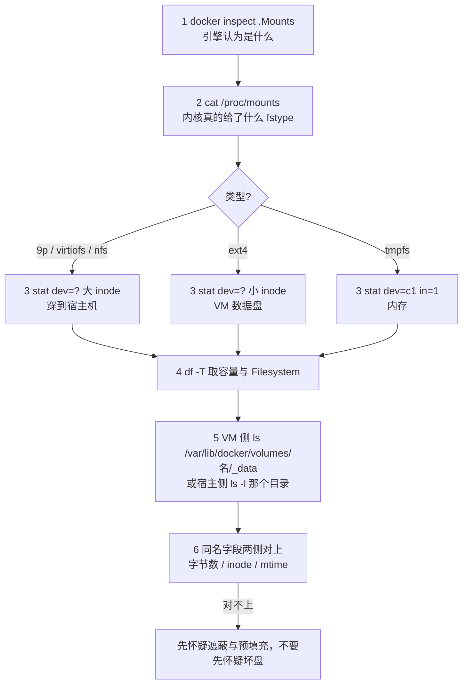

> **实战落点**：10-存储专题这一篇是整篇的**眼睛**。前面 10.1、10.2 讲「有什么、怎么选」，靠的是概念；从这一节起，每一个说法都必须能在**这台机器的文件系统上指出一个目录、一个设备号、一行 `/proc/mounts`**。落点是双案例（Nginx + MySQL，`Docker知识库/示例/存储双案例/compose.yaml`，1519 字节）起来之后：七条挂载同在一个容器组里，正好拿来逐条验。
> **本机基线**：Docker Engine `29.8.0` / API `1.56`、Compose `v5.5.1`、Desktop `4.91.0 (239619)`；Linux 内核在 WSL2 虚拟机里，VM 数据盘是 `/dev/sdd`（ext4，`1055762868` 个 1K 块 ≈ 1007 GB），Windows 侧系统盘以 `9p` 协议穿进容器；`Volume` 驱动只有 `local`（`.Plugins.Volume = ["local"]`）。VM 内存 `MemTotal: 49292256 kB`。
> **前置依赖**：[/docs/10-存储专题/基础/五种存储形式的原理与取舍/](/docs/10-存储专题/基础/五种存储形式的原理与取舍/)（10.2 的五种形式与取舍，本节给它们各自的物理落点）、[/docs/05-原理深入/隔离与资源/联合文件系统与镜像分层/](/docs/05-原理深入/隔离与资源/联合文件系统与镜像分层/)（5.4 的 overlayfs lower/upper/work，是「可写层落在哪个目录」的地基）、[/docs/02-核心操作/接上去/端口映射数据管理与权限时区/](/docs/02-核心操作/接上去/端口映射数据管理与权限时区/)（2.6 第一次写 `-v` 的那一节）、[/docs/07-运维手册/按故障域排错/Windows与WSL2性能排查应急runbook与复盘/](/docs/07-运维手册/按故障域排错/Windows与WSL2性能排查应急runbook与复盘/)（7.7 的跨系统 I/O 代价，本节的 9p 那一列与它同一条线）。
> **本篇产出物**：一条**六步核对流程**（`.Mounts` → `/proc/mounts` → `stat` → `df -T` → VM 侧目录 → 宿主侧目录），每步都给这台机器上的**原文输出**；一张**「同名不同源」对照表**（两个挂载点同一个 inode 的反例、一个目录名在 9p 与 ext4 下的两套设备号）；一份**容量口径表**（三种「盘满」分别看哪一块）；一条**Windows 侧 bind 的穿层证据**（容器里的 dev/inode/size 与 NTFS 上的字节数一一对上）；一个**可直接照抄的排错入口**：先分清「类型」再谈「为什么慢/为什么读不到」。
> **难度·耗时**：10.3 ★★★ · 50m（命令都短，**难在每一步都要认原文**——同一条 `df` 在不同挂载点上给出的是三块不同的盘）
> **拓展接口**：本节的设备号口径直接接到 [/docs/07-运维手册/按故障域排错/磁盘占满与镜像拉取失败/](/docs/07-运维手册/按故障域排错/磁盘占满与镜像拉取失败/)（7.5 的五个磁盘来源）；卷与备份的落点差异见 [/docs/06-工程化与生产/运行基线/监控最小集与备份容灾/](/docs/06-工程化与生产/运行基线/监控最小集与备份容灾/)；本节「bind 在 Windows 上的语义代价」是 10.8（故障手册一：容量与权限）里权限那一格的物理原因。
> **自测三题**：
> 1. 容器里 `ls -l /usr/share/nginx/html` 和 `/usr/share/nginx/html2` 看起来都是普通目录，你要用**哪两条命令**、看**哪两个字段**，才能在 10 秒内断定前者在 Windows 的 NTFS 上、后者在 VM 的 ext4 上？
> 2. 同一个卷挂到两个不同路径，`stat` 会给出什么？为什么这个结果是「同一个卷」的铁证而不是巧合？
> 3. `docker volume ls` 的 `SIZE` 列这一台机器上显示什么？为什么不能用它来估卷的大小？


> **本章清单原语（逐字承接）**
> **清单项标题（清单原话）**：不同存储形式在操作系统上的真实形态与验证命令
>
> 章节号：10.3
> 所属篇：10-存储专题（第十篇 存储专题）
> 主线站 · 难度 · 耗时：— · ★★★ · 50m
> 前置依赖：10.2、5.4
>
> **内容要点与产出物**：每种形式在**这台机器的操作系统上**到底落在哪、怎么验：VM 内 `/var/lib/docker/volumes/<名>/_data`、containerd 快照目录与可写层目录、`docker inspect .Mounts` 三种 source 形态、`/proc/mounts` 的文件类型（overlay/tmpfs/9p 或 drvfs）、`stat` 的设备号与 inode、`df -T`、`findmnt`、`du` 与卷真实大小；Windows 侧 bind 跨系统穿了一层什么（性能与语义代价的实测）；一条「同名不同源」的核对流程
## 为什么要先落到操作系统上再谈存储

「我用的是命名卷」这句话在容器里没有任何可验证含义。它可能是 VM 数据盘上的一个 ext4 目录，可能是宿主机上的一个路径，也可能在远端 NFS 上——**同一句配置文字，三种完全不同的故障域**：容量算在谁头上、备份怎么打、权限怎么映射、重启后还在不在，全都由「物理落点」决定，而不是由 `-v` 的写法决定。

所以这一节不接受任何口头结论。每一个说法后面都贴这台机器上跑出来的原文。取数用了三个轮次（1b 做落点与生命周期、2d 做备份与恢复、4b 做最小实验与形式代价），全部在双案例起来之后跑，脚本每次跑完按记下的名字清干净。

> 💡 新人小结：这一节像**验钞灯**。你以后每写一条挂载，都值得先在一个空容器里照一次：`.Mounts` 看引擎认为它是什么，`/proc/mounts` 看内核真的给了什么文件系统，`stat` 看设备号。三句话不一致的时候，**永远信后两个**。

## 双案例此刻的七条挂载

把 `compose.yaml` 起来之后（`docker compose up -d --wait`，本机一轮实测 12.3 秒、另一轮 6.8 秒），`docker inspect` 的 `.Mounts` 一共七条。原文逐条照录：

| 容器 | Type | Source 形态（原文） | Destination | Mode | RW |
|---|---|---|---|---|---|
| kbst-db | bind | `desktop/mnt/host/c/Users/webtu/Desktop/Docker文档站/Docker知识库/示例/存储双案例/mysql-init` | `/docker-entrypoint-initdb.d` | ro | False |
| kbst-db | volume | `/var/lib/docker/volumes/kbst_mysqldata/_data` | `/var/lib/mysql` | rw | True |
| kbst-web | volume | `/var/lib/docker/volumes/kbst_img2/_data` | `/probe/volume-on-missing-path` | rw | True |
| kbst-web | volume | `/var/lib/docker/volumes/kbst_weblogs/_data` | `/var/log/nginx` | rw | True |
| kbst-web | bind | `C:\Users\webtu\Desktop\Docker文档站\Docker知识库\示例\存储双案例\nginx\default.conf` | `/etc/nginx/conf.d/default.conf` | ro | False |
| kbst-web | bind | `C:\Users\webtu\Desktop\Docker文档站\Docker知识库\示例\存储双案例\web-content` | `/usr/share/nginx/html` | rw | True |
| kbst-web | volume | `/var/lib/docker/volumes/kbst_img2/_data` | `/usr/share/nginx/html2` | rw | True |

这张表里有两个坑值得先指出来：

1. **同一个 bind，`Source` 有两种拼法**。同一次 inspect 里，`mysql-init` 那条是 `/run/desktop/mnt/host/c/...` 规范化之后的形态（打印时前缀被裁成 `desktop/mnt/host/c/...`），另外两条是原样的 `C:\Users\...`。**别拿字符串拼法当挂载类型的判据**。
2. **`kbst_img2` 这个卷出现了两次**，指向两个不同的 `Destination`。这是第 5 小节 `stat` 那一格的伏笔。

```bash
# 照抄这一条就能拿到上表；不要 --format '{{json .Mounts}}' 之外再加花活
docker inspect --format '{{json .Mounts}}' kbst-web | python -m json.tool
docker inspect --format '{{range .Mounts}}{{.Type}} {{.Source}} -> {{.Destination}} mode={{.Mode}} rw={{.RW}}{{"\n"}}{{end}}' kbst-db kbst-web
```

## 容器内 `/proc/mounts`：三种文件系统同框

引擎的 `.Mounts` 是「引擎以为」，`/proc/mounts` 是「内核真的给了」。双案例的 web 容器里一次 `cat /proc/mounts`，三条相关行原文如下（`grep` 出来的字节级内容，只在中间打了折行）：

```text
.../default.conf 9p ro,noatime,aname=drvfs;path=C:\;uid=0;gid=0;metadata;symlinkroot=/mnt/host/,cache=0x5,access=client,msize=65536,trans=fd,rfd=5,wfd=5
/usr/share/nginx/html 9p rw,noatime,aname=drvfs;path=C:\;uid=0;gid=0;metadata;symlinkroot=/mnt/host/,cache=0x5,access=client,msize=65536,trans=fd,rfd=5,wfd=5
/usr/share/nginx/html2 ext4 rw,relatime
```

三条行给出三种事实：

| 挂载 | `/proc/mounts` 的 fstype | 关键选项 | 这一行说明什么 |
|---|---|---|---|
| 只读配置 `default.conf` | `9p` | `ro` + `aname=drvfs;path=C:\` + `metadata` | 文件穿到了 Windows 的 C 盘，`ro` 是内核级的，不是 nginx 层的 |
| 站点内容 `html` | `9p` | `rw`，其余同上 | 同一块 C 盘，可写 |
| 命名卷 `html2` | `ext4` | `rw,relatime` | 落在 VM 的 ext4 数据盘上，与 Windows 无关 |

`9p` 那一行的三个细节值得单独记住，它们后面每一篇都用得上：

- **`path=C:\`**：整个选项里出现的只有盘根，**没有你挂的那个目录**。`aname=drvfs` 是导出点标识，具体路径要靠 `symlinkroot=/mnt/host/` 前缀还原。所以看 `/proc/mounts` 判断「这个 bind 对应宿主哪个目录」是不可能的——要回去读 `.Mounts`。
- **`uid=0;gid=0`**：9p 侧的属主映射是**挂载时定死**的，容器里所有穿进来的文件都是 `root:root`。这是 10.8「权限」那一格的物理原因。
- **`msize=65536`**：单次 9p 传输 64 KB。跨系统 I/O 的代价就藏在这类小数字里（第 9 小节的 2000 个小文件实测把它量出来了）。

## `stat` 的设备号与 inode：同名不同源一眼可分

`df` 看容量、`stat` 看身份。容器里对六个路径各跑一次 `stat -c '%n dev=%D in=%i'`，原文：

```text
/usr/share/nginx/html        dev=46   in=562949954507941
/usr/share/nginx/html2       dev=830  in=149273
/var/log/nginx               dev=830  in=149269
/etc/nginx/conf.d/default.conf dev=46 in=562949954507943
/probe/volume-on-missing-path dev=830 in=149273
/cache                       dev=c1   in=1
```

三处立刻可以下结论：

1. **`dev=46` 的两条是 bind**（穿到 Windows），**`dev=830` 的三条是卷**（VM ext4），**`dev=c1 in=1` 的那条是 tmpfs**。设备号是内核给的，**字符串拼不出这种一致性**。
2. **`html2` 与 `/probe/volume-on-missing-path` 的 inode 完全相同（`149273`）**：这就是第 3 小节埋的那条——`kbst_img2` 一个卷挂两处，两处看到的是**同一个目录对象**，不是两份副本。往任一处写，另一处立刻可见。
3. **9p 的 inode 号是一百五十万亿量级，ext4 的是十四万量级**。这不是巧合：`metadata` 映射下 9p 侧的 inode 由宿主文件系统派生，天然带高位前缀。以后只要看到 `in=` 一大串 9 以上位数，先怀疑它是穿出来的。

> 💡 新人小结：`stat` 这一格的价值在于它**不接受解释**。你不需要知道 Docker Desktop 怎么实现 bind，只需要知道「dev 号不同 = 不是同一块盘 = 容量、备份、权限三件事都得分开谈」。

## `df -T` 与容量口径：三种「盘满」是三回事

同一个 web 容器里 `df -T`，三条相关行原文：

```text
C:\            9p     499667268 217249436 282417832  43% /etc/nginx/conf.d/default.conf
/dev/sdd       ext4  1055762868  14020540 988038856   1% /etc/hostname
tmpfs          tmpfs      32768         0     32768   0% /cache
```

再取一轮（4b）里，容器根目录与一个命名卷的对照：

```text
overlay        overlay 1055762868  17889144 984170252   2% /
/dev/sdd       ext4    1055762868  17889152 984170244   2% /p
C:\            9p       499667268  221554840 278112428  44% /b
tmpfs          tmpfs        65536          0     65536   0% /t
```

把两组数字合起来读，容量这件事在这台机器上其实是**三块互不相干的盘**：

| 挂载类型 | `df` 里的 Filesystem | 总容量（1K 块） | 谁被撑满会影响它 | 备份要备哪一侧 |
|---|---|---|---|---|
| 容器可写层（overlay） | `overlay`，与 `/dev/sdd` **同总量** | `1055762868` | VM 数据盘 | 不需要（本来就该是空的） |
| 命名卷 / 匿名卷 | `/dev/sdd` | `1055762868` | 同上，同一块盘 | VM 内的 `/var/lib/docker/volumes/<名>/_data` |
| bind 到 Windows | `C:\`（9p） | `499667268` | **宿主机 C 盘**，与 VM 盘无关 | Windows 侧那个目录 |
| tmpfs | `tmpfs` | 由 `size=` 决定（`32m` → `32768`） | **VM 内存**，不是任何盘 | 不需要（设计成不留） |

三条硬结论：

- **可写层和卷在同一块盘上**。`overlay` 与 `/dev/sdd` 的 total 一字不差，意味着「把数据写进可写层」和「写进卷」在**容量**上没有区别，区别只在生命周期（10.4 讲）。凡是按「可写层会挤爆卷」来解释故障的，都是错的。
- **bind 撑的是宿主盘**。`499667268` ≈ 476 GB 那一列是 Windows C 盘，`df` 在容器里看到它，说明 9p 只是把容量数字透传进来。C 盘满 → 所有 bind 写失败，而 `docker system df` 一切正常。
- **tmpfs 占的是内存配额**。`size=32m` 就是一条 `tmpfs 32768` 行；这一轮 VM 的 `MemTotal` 是 `49292256 kB`，容器如果带 `-m` 限制，tmpfs 用量算进那个限制里（10.9 里有一条把容器打成 `137` 的实测）。

## VM 侧的真实目录：卷里面到底有什么文件

命名卷不是「一块盘」，它就是一个目录。`docker volume inspect` 给的路径原文：

```text
kbst_mysqldata   Mountpoint=/var/lib/docker/volumes/kbst_mysqldata/_data
kbst_weblogs     Mountpoint=/var/lib/docker/volumes/kbst_weblogs/_data
kbst_img2        Mountpoint=/var/lib/docker/volumes/kbst_img2/_data
```

进引擎的 mount namespace 去 `ls -l` 这三个 `_data`（读法是 `--privileged --pid=host` 再走 `/proc/1/root/...`，同一套读法在 5.4 与 7.5 都用过），原文：

```text
kbst_mysqldata/_data :  ... #ib_16384_0.dblwr   4194304 Oct 28 16:29
                        -rw-r----- 1 999  ping  12582912 Oct 28 16:29  #ib_16384_1.dblwr
                        drwxr-x--- 2 999  ping       4096 Oct 28 16:29  #innodb_redo
                        drwxr-x--- 2 999  ping       4096 Oct 28 16:29  #innodb_temp
kbst_weblogs/_data   :  lrwxrwxrwx 1 root root 11 Apr 16 2025 access.log -> /dev/stdout
                        lrwxrwxrwx 1 root root 11 Apr 16 2025 error.log  -> /dev/stderr
                        -rw-r--r-- 1 root root  0 Oct 28 16:29 probe.access.log
kbst_img2/_data      :  total 0
```

这张目录清单一次回答了四个常见疑问：

1. **卷的属主是数字**。MySQL 官方镜像里是 `mysql`，在 VM 侧裸看就是 `999:ping`（uid/gid 直接落 ext4，没有 9p 那层 `uid=0` 映射）。10.8 的「权限不匹配」类故障就是在这里发生的。
2. **空卷挂到有内容的目录会把原内容复制进去**（`weblogs` 那两个符号链接是镜像 `/var/log/nginx` 里原有的，`total 0` 的 `img2` 挂到镜像里不存在的路径就什么都没有）。这条预填充规则只在**命名卷/匿名卷 + 目录为空**时成立，bind 完全没有——10.5 与 10.9 各有一格实测。
3. **`docker volume ls` 的 `SIZE` 列在这台机器上是 `N/A`**（原文 `kbst_img2 N/A | kbst_mysqldata N/A | kbst_weblogs N/A`）。要大小就自己 `du`：这一轮 datadir `du -sh` 是 `196.4M`，而冷备 tar 包是 `6584094` 字节——两个数都是真的，差的是 gzip 与稀疏文件。
4. **卷目录的 mtime 就是它的出生时间**（`Oct 28 16:29` 对上一轮 `up` 的时刻）。排错时「这个卷是新起的还是老的」不用猜。

## 可写层落在哪个目录：这台机器上没有 overlay2

看到「可写层」就报 `/var/lib/docker/overlay2/<id>/diff` 是旧直觉。这台机器的引擎启用了 **containerd snapshotter**，两条读数把那条路堵死：

```text
$ docker info --format '{{.Driver}} {{json .DriverStatus}}'
overlayfs [["driver-type","io.containerd.snapshotter.v1"]]

$ docker inspect --format '{{json .GraphDriver}}' kbst-web
null
```

`.GraphDriver` 直接是 `null`——所有按 `GraphDriver.Data.UpperDir` 取可写层路径的脚本，在这台机器上都拿不到东西（这不是命令写错，是引擎实现换了）。进引擎的 mount namespace 把目录列出来：

```text
/var/lib/docker      → buildkit containers engine-id image network plugins policy rootfs runtimes stats swarm tmp volumes
ls /var/lib/docker/overlay2 → ls: cannot access '/var/lib/docker/overlay2': No such file or directory
/var/lib/docker/rootfs      → overlayfs
/var/lib/containerd         → (空)
```

那可写层到底在哪？造一只写了 8 MB 的一次性容器，直接在 VM 里找那个文件，答案是**目录名就是容器 ID**：

```text
/var/lib/docker/rootfs/overlayfs/4d9e7fe444a6c6084a13fd5728f2f0f38e4d97777f91d8b6042548bd9f6893d8/big.bin
-rw-r--r-- 1 root root 8388608 Oct 28 16:59 ...
docker ps -s → kbst5-layer 8.4MB (virtual 16.9MB)
docker diff  → A /d | A /d/one.txt | A /big.bin
```

三条读数合起来给了一个可用的对账法：`docker ps -s` 的 `8.4MB` 与那个文件的 `8388608` 字节对得上，说明 **SIZE 列只算可写层、且算得准**；而 `docker diff` 列出的三条与 VM 目录里的东西一致，说明可写层的可见面就是这一个目录。排「谁把盘吃满了」时，这个目录才是入口（7.5 的五个来源里，可写层那一格在本机要按这条路径找）。

> 💡 新人小结：`null` 不是「命令失败」。这一格最容易被误读成 inspect 用错了模板——`rc=0`、输出就是 `null`。看到 `.GraphDriver` 为空，第一反应应该是**这台机器换了快照实现**，而不是「数据不见了」。

## Windows 侧：bind 的那一侧是 NTFS 上的真文件

同一批文件的宿主侧清单（PowerShell/Git Bash 直接 `ls -l` 得到，字节数原文）：

```text
web-content   big.txt      1179648 B
web-content   index.html       121 B
nginx         default.conf     728 B
mysql-init    10-seed.sql     1317 B
compose.yaml                  1519 B
```

穿层证据要两侧对上，这一轮对的是**同一个文件的三组字段**：

| 视角 | 命令 | 读数 |
|---|---|---|
| 容器内 | `stat -c 'dev=%D in=%i size=%s' /usr/share/nginx/html/big.txt` | `dev=46 in=562949954507946 size=1179648` |
| Windows | `os.stat(...).st_size` | `1179648` |
| 判定 | 字节数一致 + 容器侧 `dev=46`（9p 那台） | **同一个对象，不是副本** |

双向可见性也当场各跑了一次：容器里往 `/usr/share/nginx/html` 写一个 `from-container.txt`，Windows 侧 `listdir` 立刻得到 `['big.txt', 'from-container.txt', 'index.html']`；反过来在 Windows 侧追加一行，容器里 `tail` 立刻读到。这一格在 10.5 里是「配置实时可见」的基础，也是 10.9 里「bind 遮蔽镜像内容」的另一面。

## findmnt 不在场：busybox 的退路

`findmnt` 常常是回答「这个路径挂在哪」最顺手的一条命令，但 alpine 系镜像不带它。本机原文：

```text
$ findmnt /usr/share/nginx/html
sh: findmnt: not found
```

退路按优先级排：

```bash
cat /proc/self/mountinfo        # 信息最全：挂载点、可选字段、major:minor
grep ' /usr/share/nginx/html ' /proc/mounts   # 最短路径，够用
stat -c '%d %i' <路径>           # 不读挂载表，直接用设备号反推
df -T <路径>                     # 只答 fstype 与容量，不答来源
```

`mountinfo` 与 `mounts` 的差别在**可选字段**（`maj:min` 就在 `mountinfo` 里），需要设备号时用后者。

## 六步核对流程：任何一个挂载都能这么查



逐条给这台机器上的实际取法（可以直接贴进终端）：

```bash
# 1) 引擎侧
docker inspect --format '{{range .Mounts}}{{.Type}}|{{.Source}}|{{.Destination}}|{{.Mode}}{{"\n"}}{{end}}' kbst-web
# 2) 内核侧
docker exec kbst-web sh -c "grep -E 'html2|nginx/html |conf.d' /proc/mounts"
# 3) 身份
docker exec kbst-web sh -c "stat -c '%n dev=%D in=%i' /usr/share/nginx/html /usr/share/nginx/html2 /cache"
# 4) 容量
docker exec kbst-web sh -c "df -T / /usr/share/nginx/html2 /cache | tail -3"
# 5) 落点：卷走 volume inspect，bind 走宿主目录
docker volume inspect --format '{{.Name}} {{.Mountpoint}}' kbst_img2
# 6) 对账：两侧同一文件的字节数
docker exec kbst-web sh -c "stat -c '%s' /usr/share/nginx/html/big.txt"
```

> 💡 新人小结：六步里**第 3 步是唯一不能省的**。前两步可能因为镜像不同、内核不同而写法不同，但 `dev=` 这个字段在所有 Linux 上都成立，而且是唯一一个「同名不同源」能被它当场戳穿的地方。

## 跨系统语义代价：把 9p 慢在哪量出来

「bind 到 Windows 上会慢」这句话太糊。4b 那一轮在同一台机器上对四种落点各建 **2000 个小文件**（`echo x > f$i` 循环，`--rm` 一次性容器），墙钟原文：

| 落点 | fstype | 2000 个小文件墙钟 | 顺带读数 |
|---|---|---|---|
| 容器可写层 | `overlay`（ext4 之上） | **0.6 秒** | `docker diff` 里全是 `A` |
| 命名卷 | `ext4` | **0.5 秒** | 卷 `du` 到 VM 数据盘 |
| bind 到 Windows | `9p` | **4.1 秒 / 5.1 秒**（两轮各一次） | NTFS 上真出现 2000 个文件 |
| tmpfs | `tmpfs` | **0.5 秒** | 容器退出即消失 |

同一轮里还量了顺序写 64 MB（`dd bs=1M count=64`，不带 fsync）：可写层 `2.2GB/s`、卷 `3.8GB/s`、bind `257.5MB/s`、tmpfs `2.5GB/s`。**前三行是页缓存速率、只有 9p 那行真的跨过系统边界**，所以这组数不能横比"谁更快"，只能说明"顺序大文件下 bind 的代价可见"。四档差别的完整读法在 10.2 末尾。

**十倍**这一说是站得住的，但要点是它的成因：9p 是**每个文件操作一次网络往返式协议交互**（`msize=65536` 也帮不上小文件），而 ext4/tmpfs 是同内核调用。所以：

- **元数据密集型的活**（日志轮转、大量小文件、构建上下文、git 工作树）放 bind → 慢的是**次数**不是**字节**；
- **大文件顺序读写**（`big.txt` 1179648 字节这种）放 bind 的代价相对小；
- **数据库一定放卷**，不只是「活得过容器」，也是这条 10 倍差；
- 反过来，**需要宿主编辑的内容**（站点静态文件、配置文件）只能放 bind——这是 10.5 的主题，慢一点换「宿主改一下容器立刻看见」。

一条诚实的边界：这组数字是这台机器、这个 Desktop 版本、WSL2 + 9p 这一个组合下的读数，**换 WSL 的 `virtiofs`/`gRPC-FUSE` 实现或换 macOS 都要重测**；但「按次数而不是按字节」这个读法不变。

## 常见误读

| 误读 | 这台机器上的反证 |
|---|---|
| 「`.Mounts` 里 source 带 `C:\` 才是 bind，带 `/` 的是卷」 | 同一次 inspect 里 bind 出现两种拼法（`C:\Users\...` 与 `.../mnt/host/c/Users/...`） |
| 「卷是一块独立盘」 | `df -T` 里卷是 `/dev/sdd`，可写层 `overlay` 的 total 与它一字不差——同一块盘 |
| 「`/proc/mounts` 能告诉我 bind 对应宿主哪个目录」 | 9p 行里只有 `path=C:\` 与 `symlinkroot=/mnt/host/`，具体目录被导出点吃掉 |
| 「`docker volume ls` 能看卷多大」 | 这一台三个 kbst 卷的 `SIZE` 全是 `N/A`；要用 `du`（实测 `196.4M`） |
| 「空卷挂上去目录就是空的」 | `weblogs` 里出现 `access.log -> /dev/stdout` 两个符号链接：卷预填充，且 `img2` 挂到镜像没有的路径时才是 `total 0` |
| 「alpine 里能用 findmnt」 | `sh: findmnt: not found`；退路是 `/proc/mounts` 与 `stat` |
| 「可写层在 `/var/lib/docker/overlay2/<id>/diff`」 | 本机 `ls` 该目录报 `No such file or directory`，`.GraphDriver` 是 `null`；真路径是 `/var/lib/docker/rootfs/overlayfs/<容器ID>/` |

## 本篇不覆盖什么

按 W6 的规矩，本篇**故意不讲**的东西逐条点名去处——写「不覆盖」不是免责声明，是防止你在这一篇里找不存在的答案：

- 形式之间怎么选、各牺牲什么 → 见 **10.2**（`取舍` 那张主表在那一篇）
- 哪个动作会删掉哪一块（生命周期矩阵）→ 见 **10.4**（`匿名卷` 与可写层在删除动作里各是什么下场在那一篇）
- 备份面清单与恢复演练 → 见 **10.6**（`tar` 冷备与三级对账在那一篇）
- 磁盘被谁占满、清理决策与不可清理项 → 见 **7.5**（`system df` 的列读法在那一篇）
- 跨系统 I/O 慢在排错侧怎么定位 → 见 **7.7**（`vmmem` 与跨盘符 bind 那两格在那一篇）

## 要点总结

1. **落点只有三类可验证对象**：`.Mounts`（引擎以为）、`/proc/mounts` + `stat`（内核真的给了）、VM 或宿主上的目录（字节真待在哪）。三者不一致时信后两者。
2. **`stat` 的 `dev=` 是这一节的脊柱**：`46` 是穿到 Windows 的 9p，`830` 是 VM 的 ext4，`c1 in=1` 是 tmpfs。同一卷挂两处 → 两处 inode 相同（`149273`），这是「同一个对象」的铁证。
3. **这台机器上容量是三块盘**：VM 数据盘（可写层 + 所有卷，`1055762868` 块）、宿主 C 盘（所有 bind，`499667268` 块）、内存（所有 tmpfs，按 `size=` 计）。排「盘满」先问是哪一块。
4. **9p 的三个选项决定行为**：`path=C:\`（看不出具体目录）、`uid=0;gid=0`（穿进来的文件全是 root:root，属主映射在挂载时定死）、`msize=65536`（大文件凑合、小文件疼）。
5. **别信 `volume ls` 的 SIZE**：这一台全是 `N/A`。`du` 与 `df -T` 才是能拿去和备份包字节数对账的两个数。
6. **小文件 10 倍差是次数不是带宽**：2000 个文件 bind 5.1 秒 vs 卷 0.5 秒。数据库与大元数据负载放卷，需要宿主编辑的配置与内容放 bind，两者都要写清代价来源。

## 本篇未验证项

| 项 | 为什么没验 | 想验的话怎么起手 |
|---|---|---|
| macOS / Linux 上的 bind fstype | 本机只有 Windows + WSL2 + 9p 这一条路 | 在同一条脚本里只换 `df -T` 那一格，Linux 上 bind 通常是同一 fstype（如 ext4/xfs），**dev 号可能相同**，判据要换成「inode 两侧是否一致」 |
| `virtiofs` 与 `gRPC-FUSE` 两种共享实现的小文件差 | Desktop 4.91 出厂用的是 9p，没在开关面板上验证过切换 | Desktop 设置里改文件共享实现后**重跑同一支 4b 脚本**，别手改命令；两次都要留 `df -T` 的 fstype 原文 |
| 卷在远端驱动（NFS/云盘）下的落点 | `.Plugins.Volume = ["local"]`、`docker plugin ls` 零条，本机装不了第二个卷驱动 | 换有插件的环境，`volume inspect` 的 `Driver` 字段那格才有对照 |
| `mountinfo` 与 `mounts` 在超深层挂载下的差异 | 本案例只有七条挂载，没造嵌套 | 用 `--volumes-from` 叠两层容器，读 `mountinfo` 的 optional 字段 |
