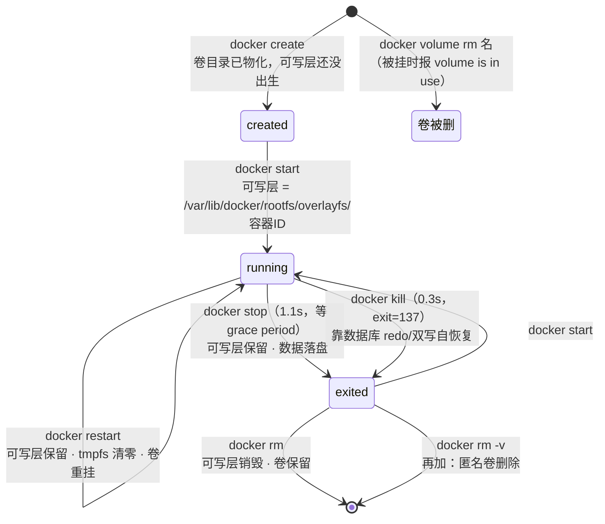

> **实战落点**：10-存储专题「落点与生命周期」第二篇。10.3 回答「字节现在躺在哪」，本篇回答「**每一步动到谁**」——把 `create / start / stop / restart / kill / rm / rm -v / down / down -v` 这九个动作逐条量一遍，每个动作都给「丢什么、留什么、多少秒」。操作台还是那套双案例（Nginx + MySQL，5000 行真数据）。
> **本机基线**：Engine `29.8.0`（containerd snapshotter，可写层在 `/var/lib/docker/rootfs/overlayfs/<容器ID>/`）、Compose `v5.5.1`、MySQL `8.4.13`、nginx `1.27-alpine`；`compose.yaml` 里 `stop_grace_period: 40s`、`restart: unless-stopped`、`db` 的 healthcheck 是 `["CMD","mysqladmin","ping","-h","localhost","-p…"]`。
> **前置依赖**：[/docs/10-存储专题/落点与生命周期/存储形式在操作系统上的落点与验证/](/docs/10-存储专题/落点与生命周期/存储形式在操作系统上的落点与验证/)（落点与验证命令，本篇所有"目录还在不在"都按它取证）、[/docs/04-单机编排/启停/常用命令启动顺序与健康检查/](/docs/04-单机编排/启停/常用命令启动顺序与健康检查/)（`depends_on: service_healthy` 与就绪语义）、[/docs/05-原理深入/隔离与资源/容器本质Namespace与Cgroups/](/docs/05-原理深入/隔离与资源/容器本质Namespace与Cgroups/)（进程与命名空间的生灭，是可写层生灭的下层机制）、[/docs/10-存储专题/数据保护/备份与恢复/](/docs/10-存储专题/数据保护/备份与恢复/)（冷备为什么必须排在 stop 之后）。
> **本篇产出物**：一张**「哪一步会丢什么」矩阵**（九个动作 × 四种落点，全部本机读数）；**可写层的诞生与销毁**的现场读数（`create` 时目录还不存在、`start` 时出现、`rm` 后消失）；**卷挂载时机**的硬结论（`docker create` 之后卷目录就已存在，无需启动）；**优雅停机与强杀的两组时间**（`stop` 1.1 秒 vs `kill` 0.3 秒、退出码 `143`/`137`）与**崩溃后 InnoDB 自己说了什么**（`Starting XA crash recovery...` / `XA crash recovery finished.`，已提交行存活）；**`restart` 与 tmpfs/卷的对照**（`/cache` 清零、`/var/log/nginx` 保留）；**匿名卷与 `volume is in use`** 的原文与按名清理法；一条**自愈判据**（启停之后怎么用一个数字确认存储没被动过）。
> **难度·耗时**：10.4 ★★☆ · 40m（动作不难记，**难的是把「容器健康」与「数据可用」这两个时间轴分开**）
> **拓展接口**：本篇的时间数字直接喂给 10.6（冷备窗口）与 10.7（损坏判定）；`stop_grace_period` 与 `default-stop-timeout` 的关系见 6.3 与 5.x 的运行基线；故障手册一（10.8）的第③格「tmpfs 打死成 137」就是本篇 `kill/OOM` 那一组的近亲；10.10 的故障⑩「匿名卷堆积」对应本篇 `rm` 不带 `-v` 那一列。
> **自测三题**：
> 1. `docker compose down` 与 `down -v` 各自删掉什么、留下什么？用哪条命令当场证明 bind 的宿主目录没被碰？
> 2. 容器 `healthy` 的那一刻，数据库能查吗？给出台阶上的两个读数。
> 3. 一条已提交的数据在 `docker kill` 之后为什么还在？说出承担它的那个文件（在本机 VM 里能 `ls` 到的那种）。


> **本章清单原语（逐字承接）**
> **清单项标题（清单原话）**：容器生命周期每一步对存储做了什么
>
> 章节号：10.4
> 所属篇：10-存储专题（第十篇 存储专题）
> 主线站 · 难度 · 耗时：— · ★★☆ · 40m
> 前置依赖：10.3、2.7
>
> **内容要点与产出物**：容器创建/启动/停止/重启/删除/`--rm` 各步对存储的影响：可写层的诞生与销毁、卷的挂载时机、`restart` 与 `stop -t` 时数据库的落盘、tmpfs 内容随重启消失、匿名卷随镜像 `VOLUME` 声明被带出（以及 `docker rm` 不带 `-v` 留下什么）、`volume is in use` 为什么挡住删除、崩溃后 InnoDB 的恢复读法；一张「哪一步会丢什么」矩阵 + 一条自愈判据
## 为什么要按「动作」而不是按「形式」来谈生命周期

10.2 按形式讲了一遍存活规则，但事故从来不是按形式发生的，是**按动作**发生的：一次 `docker rm`、一次 `compose down`、一次 OOM 重启、一次 `--rm` 的一次性任务。同一条数据，在不同的动作序列里命运完全不同——而**这些动作的差别是可以逐条量的**。

本篇就用双案例量。每个动作前后都读同一个数：

```bash
docker exec -e MYSQL_PWD="$DBPW" kbst-db mysql -uroot -N -e \
  "SELECT COUNT(*), SUM(CRC32(CONCAT(id,body,tag,crc))) FROM kbdb.t_note;"
```

出厂基线是 `5000	10728165079651`。这个数字在后面的表里出现十几次，它对不上，就说明这一步动了数据。

## 九个动作 × 四种落点：一张矩阵

| 动作 | 可写层 | 命名卷 | bind（宿主侧） | tmpfs | 本机读数 |
|---|---|---|---|---|---|
| `create`（不启动） | **还没出生** | **目录已存在**（空） | 不动 | 还没出生 | 状态 `created`，`.Mounts` 已含卷条目，VM 里 `_data` 是 `drwxr-xr-x 2 root root 4096`、内容 0 条 |
| `start` | 出生（目录名=容器 ID） | 挂上 | 挂上 | 出生（空） | 可写层路径 `/var/lib/docker/rootfs/overlayfs/<容器ID>/` |
| `stop` | **保留**（容器还在，还能 `start`） | 卸载但保留 | 卸载 | **销毁** | `docker stop kbst-db 用时 1.1 秒`（配了 `stop_grace_period: 40s`）；重启后数据 `5000	10728165079651` |
| `restart` | 保留（同一容器对象） | 重挂 | 重挂 | **清零** | 7.7 秒；`/cache` 只剩 `. ..`，而 `/var/log/nginx` 里的 `from-container.txt` 还在 |
| `kill`（SIGKILL） | 保留 | 卸载 | 卸载 | 销毁 | `0.3 秒`，`exit=137`、`OOMKilled=false`；起来 10.7 秒、healthy，XA 崩溃恢复两行日志 |
| `rm`（不带 `-v`） | **销毁** | **保留**（匿名卷也保留） | 保留 | 销毁 | 匿名卷实验：`卷数 14 -> 15`，删容器之后 `docker rm` 后**卷还在** |
| `rm -v` | 销毁 | **具名卷也保留**（`-v` 只删匿名卷） | 保留 | 销毁 | 与上一条对照：`docker volume ls` 里命名卷 `kbst_*` 三个都还在 |
| `compose down` | 容器没了 | **保留** | 保留 | 没了 | 输出里没有 `Volume ... Removed` |
| `compose down -v` | 容器没了 | **删除** | **不动宿主目录** | 没了 | `Volume kbst_img2 Removed \| Volume kbst_weblogs Removed \| Volume kbst_mysqldata Removed`；宿主 `web-content/` 与 `nginx/` 完好 |

矩阵里三条最容易被记错，单独钉一下：

1. **`rm -v` 删的是匿名卷，不是命名卷**。命名卷的存在不依赖任何容器，`docker volume rm <名>` 才是它的删除命令。
2. **`down -v` 删的是"这个项目创建的"卷**（按项目前缀 `kbst_`），不是"容器挂过的所有卷"。外部卷被引用时它删不掉，会报 `volume is in use`。
3. **bind 的宿主目录不受任何 Docker 动作影响**。这条是安全边界，也是危险面（`rm -rf` 那个目录 = 删数据，Docker 无从拦截）。

## 可写层的生与死：三个时刻各看一次目录

```bash
# 时刻 1：只 create，不 start
docker create --name c1 -v kbst7-timing:/d alpine:3.20 true
docker inspect --format '{{.State.Status}}' c1        # created
docker inspect --format '{{json .Mounts}}' c1          # 卷条目已经在
# 时刻 2：start 之后，去 VM 里找可写层
docker start c1
docker run --rm --privileged --pid=host alpine:3.20 nsenter -t 1 -m -- \
  sh -c 'ls /var/lib/docker/rootfs/overlayfs | head'
# 时刻 3：rm 之后
docker rm c1
```

本机三次读数：

```text
容器状态: created
.Mounts 里有这条吗: [{"Type":"volume","Name":"kbst7-timing","Source":"/var/lib/docker/volumes/kbst7-timing/_data","Destination":"/d","Driver":"local","Mode":"z","RW":true,"Propagation":""}]
VM 侧那个目录此刻存在吗: drwxr-xr-x 2 root root 4096 Oct 28 17:08 /var/lib/docker/volumes/kbst7-timing/_data | 0 条
```

两条结论：

- **卷的目录在 `create` 阶段就被物化了**，不需要容器真的跑起来。这条对备份脚本有用：看到 `.Mounts` 里有卷条目，`Mountpoint` 就可以直接 `tar`，不必等进程。
- **可写层的目录名就是容器 ID**（10.3 实测：`/var/lib/docker/rootfs/overlayfs/4d9e7fe444a6…/big.bin`），所以 `docker rm` 之后那个目录必然消失——可写层没有任何独立生命周期。

`docker diff` 是唯一能读可写层内容的命令。双案例跑一段时间后本机原文：

```text
kbst-web（19 条）：A /cache ;; A /probe ;; A /probe/volume-on-missing-path ;; C /root ;; A /root/layer-only.txt ;; C /run ;; A /run/nginx.pid ;; C /usr
kbst-db （7 条）： C /run ;; C /run/mysqld ;; A /run/mysqld/mysqld.sock.lock ;; A /run/mysqld/mysqlx.sock ;; A /run/mysqld/mysqlx.sock.lock ;; A /run/mysqld/mysqld.pid ;; A /run/mysqld/mysqld.sock
```

读法三条：

- `A` = 新增，`C` = copy-up（下层本来有、这次被复制进可写层），`D` = 删除（会留 whiteout）。
- **`A /cache` 与 `A /probe/volume-on-missing-path` 是挂载点自己**，不是数据——因为挂载点目录在镜像里不存在，创建它的动作发生在可写层。**这条读数常被误读成「数据写进可写层了」**，要看的是路径后面有没有真文件。
- db 的 7 条全在 `/run`（PID/socket），**这才是"健康容器应有的可写层"**。任何一条落在 `/var/lib/mysql`，就说明数据库在往可写层写——而它本该落在卷里。这就是本篇的**自愈判据**：

```bash
# 一条判据：可写层里不该出现业务路径
docker diff kbst-db | grep -v '^A /run' || echo "（干净）"
```

## 启动：为什么 `healthy` 的时刻数据还不能查

这是本篇最实用的一格。双案例的 db 用 `down -v` 清成空卷后重新 `up -d`，逐 2 秒读数：

```text
   6.2s health=healthy   查=0            init完成标记=n
   8.4s health=healthy   查=5000         init完成标记=Y
汇总：第一次 healthy=6.2s | 第一次出现 init 完成标记=8.4s | 第一次真查到 5000 行=8.4s
```

**在 6.2 秒那一刻，健康检查已经说 `healthy`，而表里是 0 行。** 原因是 compose 里那条 healthcheck：

```yaml
test: ["CMD", "mysqladmin", "ping", "-h", "localhost", "-pKbSt#Test2026"]
```

mysql 镜像的入口脚本在初始化阶段会**先起一台临时 mysqld**（跑 `docker-entrypoint-initdb.d` 里的 SQL），跑完关掉再正式起。`mysqladmin ping` 对临时服务器同样回答 `mysqld is alive`，于是：

- 健康检查测的是「**有没有 mysqld 在听**」，不是「数据准备好没有」；
- `depends_on: db: condition: service_healthy` 因此**挡不住未初始化完的 db**——`web` 在 6.2 秒就被放行起来了。

正确的就绪判据（本篇与 10.6 都用它）：

```bash
# ① 连续 5 次 ping 通过（跨过入口脚本重启那一瞬的空档），② 首次初始化还要求日志里有这条
docker logs kbst-db | grep 'MySQL init process done'
```

只靠 `docker logs | grep 'ready for connections'` 也不行——临时服务器也打印这一句。本专题在轮 2c/2d 两次因为这条被判据放倒，出一片 `ERROR 2002 ... socket ... (2)`。

**时间成本**（同一台机器）：`compose up -d --wait` 一次 12.3 秒、一次 6.7 秒、一次 6.8 秒（这三个数分别对应「空卷首次初始化」「已初始化」「已初始化」三种状态——**首次初始化贵，因为要跑 seed**）；`docker restart` 7.7 秒；`docker stop` 1.1 秒；`docker kill` 0.3 秒。

> 💡 新人小结：健康检查、`--wait`、`ready for connections` 是**三个不同的东西**。排「应用连不上数据库」时，先分清你拿到的是哪一个信号：`healthy` 只说进程活着，`--wait` 只说健康检查过了，只有**真查一道业务 SQL** 才说数据可用。

## 停止：优雅与强杀的两组读数

```bash
docker stop kbst-db      # SIGTERM → 等 → 必要时 SIGKILL
docker kill kbst-db      # 直接 SIGKILL
```

本机两组：

| 动作 | 用时 | 终态读数 | 停机期间数据 |
|---|---|---|---|
| `docker stop` | **1.1 秒** | `exited`，`stop_grace_period: 40s` 允许它自己收摊 | `5000	10728165079651` 一字不变 |
| `docker kill` | **0.3 秒** | `exited exit=137 OOM=false` | 起来后 `Starting XA crash recovery...` / `XA crash recovery finished.`，10.7 秒 healthy，**已提交的那条探针行还在** |

`kill` 那组的完整读数（10.4 最需要的一条）：

```text
基线: 5000	10728165079651
提交一条之后: 5001
docker kill（SIGKILL）rc=0 用时 0.3 秒
终态: exited exit=137 OOM=false
重新起来用时 10.7 秒 | 状态 running healthy
日志里与崩溃恢复有关的行:
  2026-10-28T17:08:15.166527Z 0 [System] [MY-010229] [Server] Starting XA crash recovery...
  2026-10-28T17:08:15.175517Z 0 [System] [MY-010232] [Server] XA crash recovery finished.
恢复后的行数: 5001 | 那条已提交的 660001 在吗: pre-kill-committed
聚合对照基线（多一条探针行属预期）: 5000	10728165079651 vs 5000	10728165079651
```

读法：**承担「已提交数据在强杀后不丢」的不是 Docker，是数据库自己的写前日志**。在 VM 侧那个卷目录里能 `ls` 到它们（10.3 的清单）：`#innodb_redo/` 与两个 `#ib_16384_*.dblwr`（双写文件，防页撕裂）。Docker 在这里只负责把进程杀掉；数据文件的一致性由 mysqld 重启时那次 recovery 兜住。

推论要写清，因为它常被越过：

- 这条链**不保证**「未提交事务」与「没落盘的缓存」——所以 10.6 的冷备仍然要在 `stop` 之后打，而不是靠 `kill` 之后打；
- 换引擎就没有这个保证：如果挂载的是 nginx 的 `proxy_cache` 或应用本地缓存，`kill` 之后目录里可能就是半截文件（10.10 故障⑫ 那一类）。

**优雅停机的日志长什么样**（`stop` 之后 `docker logs --tail` 里的关键行，本机原文）：

```text
[System] [MY-013172] [Server] Received SHUTDOWN from user <via user signal>. Shutting down mysqld (Version: 8.4.13).
[System] [MY-010910] [Server] /usr/sbin/mysqld: Shutdown complete (mysqld 8.4.13)  MySQL Community Server - GPL.
```

`Received SHUTDOWN from user <via user signal>` + `Shutdown complete` 两行齐了，才叫"这个进程自己收的摊"。缺第二行就要按异常停机读（配合 `exit=137`）。

## 重启：tmpfs 清零、卷保留

`docker restart kbst-web` 之后同目录对照（本机）：

```text
restart 前 /cache: before-restart 那个文件在
restart 后 /cache: . ..                     ← tmpfs 归零
/var/log/nginx（卷）: access.log error.log from-container.txt probe.access.log   ← 全在
```

`/run/nginx.pid` 这类可写层内容也保留（restart 不重建容器对象），但 tmpfs 是**每次 start 新建的一块内存文件系统**——这与「容器重启」无关，与「tmpfs 的生命周期等于一次运行」有关。10.2 的 tmpfs 不足 2 与此同源。

一个实操推论：**不要把会话状态放 tmpfs 然后指望 restart**。要跨 restart 的东西只有卷与 bind 两种可能。

## 删除：三种删除动作留下的东西

```bash
docker rm myc              # 可写层没了；命名卷与匿名卷都还在
docker rm -v myc           # 再加：这只容器的匿名卷一起删
docker volume rm 名字       # 命名卷的唯一删除入口
docker compose down [-v]   # 按项目删容器；带 -v 时删项目自己的卷
```

本机三条原文，把「删不掉」这一面也记下来：

```text
不带 -v 起一只 mysql（镜像自带 VOLUME 声明）→ 卷数 14 -> 15，新增 d7cf33f78555…
docker rm -f 那只容器 → 卷还在吗: True
删挂着的卷 → Error response from daemon: remove kbst_weblogs: volume is in use - [6217561b840973828b7a64519a4b10cf62c2c6e6fd62c988f2c75d6728d4a4f0]
```

三条判据：

1. **`volume is in use` 后面的那串 ID 就是定位入口**：拿它去 `docker ps -a --no-trunc` 找容器，先删容器再删卷。
2. **匿名卷要按记下的 ID 删，不按模式删**。本机同一张卷表里躺着 8 个 64 位十六进制的匿名卷（Harbor 栈的也在里面），`docker volume prune` 或按 `dangling=true` 批量删会把不属于本次任务的卷一起带走。本篇全程只按记录下的名字删，最后核对到 `卷总数` 与起点一致。
3. **`down -v` 的作用域是项目**：本机原文只列了 `kbst_img2/kbst_weblogs/kbst_mysqldata` 三个（都带项目前缀 `kbst_`），`trivy-cache` 与其它匿名卷一条没动。

## 一张动作—后果图



> 💡 新人小结：把「删容器」拆成两种意图来记——**我要不要连数据一起丢**。想丢就 `--rm`（一次性任务），不想丢就必须让数据不在可写层里，并且删容器时不要带 `-v`。这两句之间的所有事故，都是把意图写错了。

## 自愈判据：一次启停之后怎么确认存储没被动

```bash
# 1) 数据面：一道聚合，与出厂基线逐字节比
docker exec -e MYSQL_PWD="$DBPW" kbst-db mysql -uroot -N -e \
  "SELECT COUNT(*), SUM(CRC32(CONCAT(id,body,tag,crc))) FROM kbdb.t_note;"
# 2) 挂载面：七条挂载、bind 三条 volume 四条，一条不少
docker inspect --format '{{range .Mounts}}{{.Type}} {{.Destination}}{{"\n"}}{{end}}' kbst-web kbst-db
# 3) 可写层面：diff 里除 /run 之外没有业务路径
docker diff kbst-db | grep -v '/run' || echo 干净
# 4) 宿主面：bind 那几个文件的字节数还是那两个数
ls -l Docker知识库/示例/存储双案例/nginx/default.conf Docker知识库/示例/存储双案例/web-content/big.txt
```

四个读数一起对，才叫「这次重启没动存储」。只跑第 1 条会漏掉挂载丢失（卷被换名、bind 路径写错），只跑第 2 条会漏掉数据面。第 4 条是这套案例专门设计的：`nginx/default.conf` 应当是 **728 字节**、`web-content/big.txt` 应当是 **1179648 字节**——两个数字对不对，一眼能看出来。

> 💡 新人小结：判据要**四件套**，而且每一件都有具体的期望值。一条只说「容器起来了」的自愈判据，价值接近于零——本篇 6.2 秒那一刻就证明了「起来」和「可用」可以差整整一个初始化流程。

## 常见误读

| 误读 | 本机反证 |
|---|---|
| 「`healthy` = 数据库可用」 | 6.2 秒 healthy 时查是 `0` 行，8.4 秒才有 `5000` |
| 「`docker stop` 会等满 40 秒」 | 实测 1.1 秒就退出了，`stop_grace_period` 是**上限**不是等待时长 |
| 「强杀会丢已提交数据」 | `exit=137` 之后 XA 崩溃恢复完成，探针行 `pre-kill-committed` 还在，聚合与基线一致 |
| 「`restart` 之后 tmpfs 里的东西还在」 | `/cache` 只剩 `. ..`，同一只容器的卷目录里四个文件都在 |
| 「`docker rm -v` 会删掉命名卷」 | 删完之后 `kbst_img2/kbst_mysqldata/kbst_weblogs` 三个都还在（`-v` 只管匿名卷） |
| 「`down -v` 会把项目挂过的卷都清掉」 | 只删带项目前缀 `kbst_` 的三个，`trivy-cache` 与匿名卷一条未动 |
| 「`docker diff` 能看卷里改了什么」 | 19 条 diff 里没有任何 `/var/log/nginx` 条目（那在卷里） |

## 本篇不覆盖什么

按 W6 的规矩，本篇**故意不讲**的东西逐条点名去处——写「不覆盖」不是免责声明，是防止你在这一篇里找不存在的答案：

- 停机为什么等满宽限期、信号规则的机制 → 见 **5.3**（`PID 1` 的信号那一节在那一篇）
- 每个落点在 OS 上的目录与设备号取证 → 见 **10.3**（`Mountpoint` 要站对命名空间那格在那一篇）
- 冷备为什么要排在 stop 之后、怎么验一致性 → 见 **10.6**（`三级对账` 在那一篇）
- 健康门与 `depends_on` 的编排语义 → 见 **4.6**（`healthcheck` 的两种写法与优先级在那一篇）
- tmpfs 计入内存配额把容器打死成 137 的现场 → 见 **10.8**（`137` 那一格在那一篇有报错原文）

## 要点总结

1. **九个动作各有明确的存储后果**，其中只有 `rm`/`rm -v`/`down -v` 会带走东西；`stop`/`restart`/`kill` 都不动卷与 bind。把这张矩阵背下来，比背五种形式的定义有用。
2. **可写层的目录名就是容器 ID**，随 `start` 出生、随 `rm` 消失；`docker diff` 是它唯一的可读者，而 `A /cache` 这类条目是挂载点自身、不是数据。
3. **`create` 阶段卷目录就已物化**，所以备份/取证不需要容器在跑；反之，容器跑着的时候数据面也不停写（这是冷备要停机的原因）。
4. **健康检查与就绪是两条时间轴**：`mysqladmin ping` 会被入口脚本的临时服务器骗过；连续 5 次 ping + `MySQL init process done` 才算可用。`up -d --wait` 首次 12.3 秒、后续 6.7~6.8 秒，差的就是初始化。
5. **强杀之后数据靠数据库自己**：`exit=137` + XA crash recovery 两行 + 已提交行存活，承担者是卷里的 redo 与双写文件，不是 Docker。冷备仍然要排在 `stop` 之后。
6. **匿名卷的清理只能按记录的名字删**：`volume is in use` 给的容器 ID 是入口，`dangling=true` 与 `prune` 在共享引擎上是危险动作。

## 本篇未验证项

| 项 | 为什么没验 | 想验怎么起手 |
|---|---|---|
| `--init` / PID 1 信号转发缺失导致 SIGTERM 被吞 | 要换 entrypoint 造一只不处理信号的进程，属另一条链（7.3 的启动失败族） | 用一只 `sleep` 当 PID 1 的容器分别 `stop` 与 `kill`，看是否要等满 grace period |
| `stop_grace_period` 用尽后被强杀的现场 | 需要一个「收到 SIGTERM 但不退出」的应用，双案例里两个应用都会正常收摊 | 写一个 trap 掉 TERM 的 shell 当 entrypoint，测 `stop` 是否满 40 秒并记退出码 |
| OOM 触发时卷里数据的撕裂程度 | 本机 `kill` 走的是 mysqld 自恢复那条路；真 OOM 撕裂要看非事务型写入 | 往 bind 目录连续写大文件同时 `-m` 限制打到 OOM，之后比对字节数与 sha（与 10.10 故障⑫ 同一条判据） |
| `docker update --restart=always` 与守护进程重启后的挂载顺序 | 要重启 Docker Desktop，本专题纪律禁止 | 在专用机器上重启引擎，观察卷挂载与容器启动的先后、以及 `volume is in use` 是否出现 |
