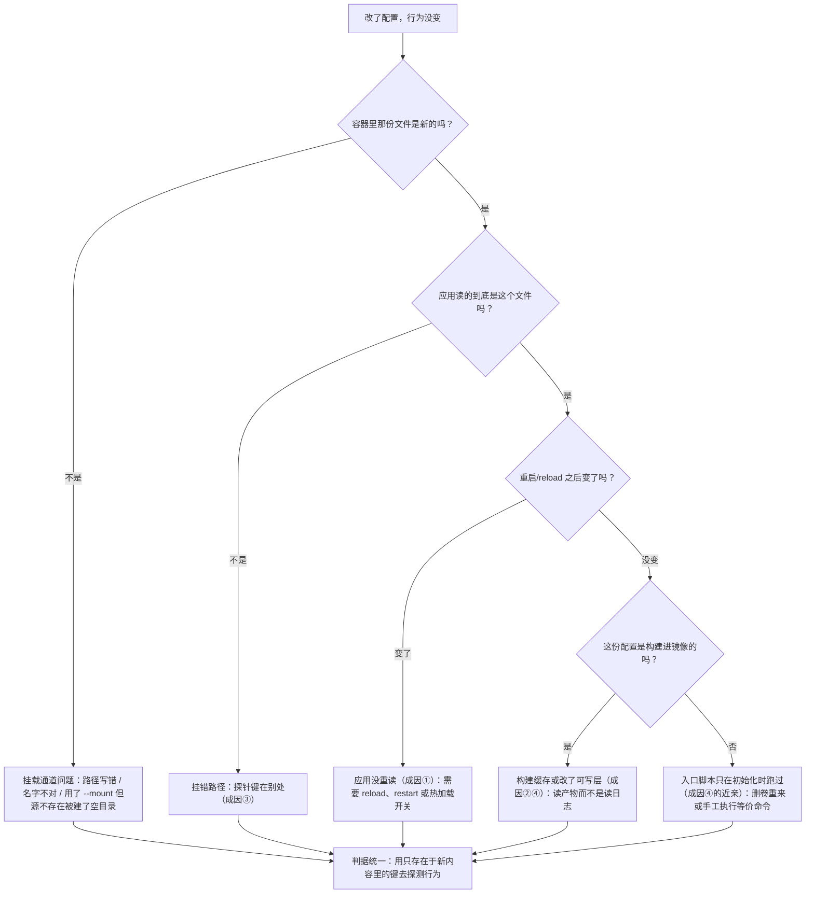

> **实战落点**：10-存储专题「配置与内容」这一篇，把前面三节（形式、落点、生命周期）合到一件天天做的事上：**把一份配置或一份内容放进容器，并确认它真的在起作用**。双案例在这里正好是一套完整的实验装置：同一只 nginx 容器上同时挂着「可写 bind 的站点目录」「只读 bind 的单文件配置」「只读 bind 的初始化 SQL」「空命名卷」四种注入方式，再加上镜像自带的出厂内容。
> **本机基线**：Engine `29.8.0` / Compose `v5.5.1` / nginx `1.27-alpine`（出厂 `/usr/share/nginx/html` 是 `50x.html index.html`，`/etc/nginx/conf.d/` 出厂只有一份 `default.conf`）；MySQL `8.4.13`（`/docker-entrypoint-initdb.d` 只在数据目录为空时执行）。案例侧资产字节数：`compose.yaml 1519`、`nginx/default.conf 728`、`mysql-init/10-seed.sql 1317`、`web-content/index.html 121`、`web-content/big.txt 1179648`。
> **前置依赖**：[/docs/10-存储专题/基础/五种存储形式的原理与取舍/](/docs/10-存储专题/基础/五种存储形式的原理与取舍/)（遮蔽、预填充、`:ro` 的机制底座）、[/docs/10-存储专题/落点与生命周期/存储形式在操作系统上的落点与验证/](/docs/10-存储专题/落点与生命周期/存储形式在操作系统上的落点与验证/)（`stat`/`df` 的取证方法）、[/docs/10-存储专题/落点与生命周期/容器启动停止与存储的关系/](/docs/10-存储专题/落点与生命周期/容器启动停止与存储的关系/)（可写层与 `docker diff` 的读法、初始化时机）、[/docs/04-单机编排/日常/多环境热重载与五服务完整实战/](/docs/04-单机编排/日常/多环境热重载与五服务完整实战/)（4.9 的热重载与 profile，本篇是它的存储侧解释）。
> **本篇产出物**：**四条注入路径 × 应用时机**表（打进镜像 / bind / 命名卷 / env + 入口脚本生成），每条给「什么时候被读、改了要不要动容器」；**内容覆盖的胜负规则**四条，每条一个本机现场（bind 遮蔽、空卷预填充、同一路径挂两处、`:ro` 与只读根）；**内容失效的四种成因**，每种一条判别命令与真实原文——其中「没 reload」那一格给的是一个**同时看到文件是新的、服务还是旧的**的决定性现场；`docker diff` 的完整读法（`A/C/D` 与 copy-up 粒度）；一张「改了没生效」的分流图。
> **难度·耗时**：10.5 ★★★ · 50m（四个成因各有一套证据链，**最容易搞混的是「挂载已生效」与「应用已重读」**）
> **拓展接口**：本篇的故障面在 10.9 以手册形式重排（现象→定位→应对→验证）；「配置塞进镜像」的反模式接 10.2 的 `commit` 那一格；初始化 SQL 只在空目录跑一次接 10.6 的「只备数据不备配置的代价」；env 注入与入口脚本生成配置的完整字段见 [/docs/02-核心操作/跑起来/进容器调试与状态查看/](/docs/02-核心操作/跑起来/进容器调试与状态查看/)。
> **自测三题**：
> 1. 你改了宿主上的 `nginx.conf`，容器里 `cat` 出来已经是新内容，但行为没变。**最少两条**能区分「没 reload」与「挂错路径」的命令是什么？
> 2. `weblogs` 卷里为什么会出现 `access.log -> /dev/stdout`？这个现象与 `./web-content` 挂上来的结果差别，规则是什么？
> 3. 同一份镜像内容被 bind 遮住之后，`docker diff` 会告诉你什么？为什么"看不见"不等于"没被遮住"？


> **本章清单原语（逐字承接）**
> **清单项标题（清单原话）**：配置怎么进容器、谁覆盖谁、什么情况下看起来生效其实没生效
>
> 章节号：10.5
> 所属篇：10-存储专题（第十篇 存储专题）
> 主线站 · 难度 · 耗时：— · ★★★ · 50m
> 前置依赖：10.2、10.3
>
> **内容要点与产出物**：配置进入容器的四条路（打进镜像 / bind 挂载 / 命名卷 / env+entrypoint 生成）与各自「应用」时机；**内容覆盖的胜负规则**：挂载遮蔽镜像内容、bind 不预填充而空命名卷预填充、同一路径多挂的先后、`:ro` 与只读根；**内容失效的四种成因**（没 reload、构建缓存命中、挂错路径、改在可写层又被销毁），每种给一条能自己跑的判别命令与真实原文；`docker diff` 读法
## 为什么要分清「进得去」与「起作用」

配置类事故几乎都是同一个结构：**挂载成功了，配置没生效**。这两件事之间隔着三个可能失效的环节——应用有没有重读、镜像构建有没有把旧内容缓存住、路径名对不对得上应用真正读的那个文件。

所以本篇的次序是：先讲配置**怎么进去**（四条路），再讲进去之后**谁覆盖谁**（胜负规则），最后讲**看起来生效其实没生效**（四种成因，各给一条判别命令）。

> 💡 新人小结：一条通用口诀——**「文件是新的 ≠ 行为是新的」**。前者归存储管，后者归应用的配置加载模型管。Docker 只保证前者。

## 四条注入路径与各自的应用时机

| 路径 | 本机案例里的写法 | 何时被读 | 改了要怎么才生效 | 不足 |
|---|---|---|---|---|
| ① 打进镜像 | Dockerfile `COPY conf/app.conf /etc/nginx/conf.d/app.conf` | 构建时进层、运行时被应用读 | **重新构建 + 重新起容器** | 每改一次出一版镜像；线上那版只存在于标签里 |
| ② bind 挂载 | `-v ./nginx/default.conf:/etc/nginx/conf.d/default.conf:ro` | 内核层面**实时**（同一个对象） | 应用侧重读（`nginx -s reload`、进程重启、或入口脚本重新生成） | 遮蔽镜像原有内容；Windows 上穿 9p（慢、`root:root`） |
| ③ 命名卷 | `weblogs:/var/log/nginx`、`mysqldata:/var/lib/mysql` | 挂载即生效 | 直接改卷里的文件即可（但要停容器才安全） | 空卷预填充只在第一次；不可移植；匿名卷会堆积 |
| ④ env + 入口脚本生成 | `MYSQL_DATABASE=kbdb`、`MYSQL_ROOT_PASSWORD=…` → `docker-entrypoint.sh` 写配置/建库 | **只在数据目录为空时**跑一次 | 要么删卷重来，要么手工执行等价的 SQL/命令 | 「改了 env 却发现什么都没发生」的头号来源；镜像必须有入口脚本 |

第 ④ 条那条「只在数据目录为空时」在本篇和第 6 节各出现一次，因为它是新手最频繁撞上的规则。案例里的实证：把冷备包解进新卷、`./mysql-init` 照旧挂着，起来之后日志里 `running /docker-entrypoint-initdb.d` 出现 **0 次**——init 不再跑（10.6 那格）。

## 内容覆盖的胜负规则：四条，每条一个现场

### 规则一：挂载遮蔽镜像内容（bind 与卷都遮）

镜像出厂 `/usr/share/nginx/html` 里是：

```text
50x.html index.html
```

挂上 `./web-content` 之后，同一个路径里是：

```text
big.txt index.html
```

`50x.html` **不见了**——不是被删，是被遮蔽（overlay 视图上那层的这个目录被挂载点整个换掉）。三条现场判据：

```bash
docker inspect --format '{{range .Mounts}}{{.Destination}}{{"\n"}}{{end}}' kbst-web   # 看 Destination 是否压在那个文件上
docker diff kbst-web | grep 'html'     # 什么也查不到（遮蔽不产生可写层条目）
docker run --rm nginx:1.27-alpine ls /usr/share/nginx/html   # 出厂清单在这里，作对照
```

**`docker diff` 不显示被遮蔽的东西**，这一条最反直觉：diff 读的是可写层的增删，遮蔽是挂载视图的替换，两者不在一个层面。

> 💡 新人小结：遮蔽最容易冤枉人是"文件被删了"。三条读数一起看就能翻案：`.Mounts` 里有那条 `Destination`、同镜像无挂载时文件还在、`docker diff` 里没有 `D`。缺任何一条，结论都只是猜测。

### 规则二：空命名卷预填充，bind 不预填充

同一个镜像目录 `/usr/share/nginx/html`，三种挂法，本机三种结果：

```text
① 什么都不挂          → 50x.html index.html
② 挂一个空命名卷      → 50x.html index.html      ← 引擎把镜像里的内容复制进了卷
③ 挂一个空的宿主目录  → 0 条                     ← 直接空，什么都不复制
```

再验一步，证明复制**只发生一次**（不是每次启动都补）：

```text
第一次挂进去        → 50x.html index.html
删掉 index.html，第二次再挂同一只卷 → 50x.html      ← 镜像里那份不会回来
```

于是案例里 `weblogs:/var/log/nginx` 卷内出现的那两条符号链接（`access.log -> /dev/stdout`、`error.log -> /dev/stderr`）有了来源：它们是**镜像里原有的文件被预填充进空卷**的结果。

这条规则的实际后果有两个方向：想「用卷做干净的空目录」会失败（拿到的是镜像内容的一份拷贝）；想「靠卷保留镜像默认内容」则会在某次手工删除后失效。要可控就用 bind，或者在入口脚本里显式 `cp`。

### 规则三：同一路径挂两处、一个卷挂两处

案例把同一个 `img2` 卷挂了两个位置：`/usr/share/nginx/html2` 与 `/probe/volume-on-missing-path`。`stat` 的读数坐实它们是同一个对象：

```text
/usr/share/nginx/html2          dev=830 in=149273
/probe/volume-on-missing-path   dev=830 in=149273
```

推论：**后一次挂载覆盖前一次**这条常见说法，只在「同一个 target 被挂两次」时成立；不同 target 挂同一个源，得到的是同一份数据的两个入口。compose 里若对同一个 `Destination` 写了两条（例如同时挂 `/etc/nginx/conf.d` 与 `/etc/nginx/conf.d/default.conf`），结果取决于挂载顺序，且**不会报错**——这类"重叠挂载"建议在 CI 里用 `docker inspect` 的 `Destination` 去重检查。

### 规则四：`:ro` 与只读根是内核级拒绝

三条原文（三种写法，同一条 errno）：

```text
单文件 :ro bind   → sh: can't create /etc/nginx/conf.d/default.conf: Read-only file system
目录   :ro bind   → touch: /i/x: Read-only file system
只读根 --read-only → sh: can't create /etc/y: Read-only file system
```

`--read-only` 的配套判据：只给根目录只读，nginx 起不来；补上可写点就行——本机 `--read-only --tmpfs /tmp --tmpfs /var/tmp` 跑通（写入 `/tmp/ok` 成功）。所以「容器里写不了文件」在 `--read-only` 之下是**设计**，不是损坏（10.9 故障⑧给完整的 tmpfs 白名单做法）。

## 内容失效的四种成因，各一条判别

### 成因①：应用没重读配置（挂载是实时的，应用不是）

这一格本篇给的是最干净的一组现场。做法：把宿主上 `nginx/default.conf` 改回原文（`probe-ok from ro-bind config`），**不做任何容器动作**，然后两侧各读一次：

```text
容器里的文件            → 728 字节，第 9 行是 return 200 "probe-ok from ro-bind config
grep -c 'probe-ok'      → 1                      ← bind 已经把新内容送进来了
HTTP 实际回什么         → probe-ok v2 (config edited on host)   ← 服务还在用内存里那版
```

然后：

```bash
docker exec kbst-web nginx -s reload
curl -s http://127.0.0.1:18899/storage-probe/
→ probe-ok from ro-bind config
访问日志: "GET /storage-probe/ HTTP/1.1" 200 29
```

**决定性的一点**：在 `reload` 之前，「文件是新的」和「行为是旧的」**同时成立**。任何只看 `cat` 的排错都会在这里下错结论。判别命令就是这两条：

```bash
docker exec <c> grep -c '<新配置里独有的字符串>' <容器内路径>   # 注入通道是否通
docker exec <c> wget -q -O - http://127.0.0.1/<探针路由>        # 行为是否跟上
```

两者不一致 → 缺的是**重读**（reload、restart，或该应用自己的热加载开关）。

### 成因②：构建缓存把旧内容留在层里

轮 6 现场（一个两行 Dockerfile，`COPY conf/app.conf /etc/nginx/conf.d/app.conf`）：

```text
第一次构建        rc=0 | #1 DONE 0.0s … #4 DONE 0.0s
第二次（没改文件） rc=0 | CACHED 行数=1 → 原文: #6 CACHED
改了文件再构建     rc=0 | #5 CACHED
容器里读到         v2-after-edit
```

读法要小心，这里有个容易写错的结论：**不能只看输出里有没有 `CACHED` 行**。改文件那一次仍然打印了一行 `#5 CACHED`（那是别的步骤命中），而真正承载内容的 `COPY` 层重建了——证据是容器里读到的是 `v2-after-edit`。正确的判据是**读产物**，不是读构建日志：

```bash
docker build -t kbst6/cache:3 . && \
  docker run --rm --entrypoint sh kbst6/cache:3 -c 'grep -o "v[0-9]" /etc/nginx/conf.d/app.conf'
```

顺带两条与缓存有关的边界（都在 3.5~3.8 有展开）：`COPY` 的缓存键是**内容摘要**，所以同尺寸不同内容会重建、同内容不同 mtime 不会；而 `--no-cache` 与 `buildcache` 的清理属于另一条链（7.5 的磁盘来源之一）。

### 成因③：挂错路径（文件名对、目录不对）

轮 6 用同一份配置文件试了两种挂法：

```text
挂成 /etc/nginx/conf.d/extra.conf  → 容器 running，nginx 日志正常，请求 /storage-probe/ 得 HTTP 404 Not Found
挂成 /etc/nginx/conf.d/default.conf → 请求 /storage-probe/ 得 probe-ok from ro-bind config
```

404 的原因不是"挂载失败"（容器起得好好的），而是**这条路由在镜像自带的那份 `default.conf` 里不存在**，而 nginx 读的是 `default.conf`，不是你挂上来的 `extra.conf`（它确实被 `include` 了，但你的路由走的是另一个 location 顺序问题——这里最省事的判据就是「探针路由到底有没有被读到」）。

判别命令就一条：**用只在你的配置里存在的键去探测**，而不是去 `ls` 挂载点。

```bash
docker exec <c> ls -l /etc/nginx/conf.d/      # 看到文件在里面（说明挂上了）
docker exec <c> wget -q -O - http://127.0.0.1/<只在你配置里出现的路由>   # 404 → 应用没在读它
```

同族错法还有三种：挂到 `/etc/nginx/nginx.conf` 但应用其实读 `conf.d/*.conf`；挂目录时把目录里的 `*.conf` 命名成了 `*.conf.bak`；compose 里 `volumes:` 写了 `./conf:/app/conf` 而镜像工作目录是 `/app/config`。都归到这条判据：**探针键名必须只存在于你要注入的那份内容里**。

### 成因④：改在可写层，下次重建就没了

现场（轮 4/轮 6）：往容器里一个镜像层路径写文件，`docker diff` 看得见，`rm` 之后新容器看不见：

```text
写：/usr/share/nginx/html/c1.txt → 这只容器 ls 得到；同镜像另一只容器 cat 报 No such file or directory
docker diff c1 → C /usr | C /usr/share | C /usr/share/nginx | C /usr/share/nginx/html | A /usr/share/nginx/html/c1.txt
```

`C` 那一串就是 overlayfs 的 **copy-up**：为了让「原本在只读层里的目录」可写，内核沿路径把每一层目录都复制进可写层。读法：

| 标记 | 含义 | 排错含义 |
|---|---|---|
| `A` | 新增（下层没有） | 这个路径的内容只存在于这次运行 |
| `C` | copy-up（下层有，被复制上来改） | 你改的是镜像里的东西——最常见的「手工修复没进镜像」 |
| `D` | 删除（留 whiteout） | 下层文件被遮死；重新起容器会回来 |

所以 `docker diff` 里出现成串的 `C /etc/...`，基本就是在宣告：**有人手工改了配置，而这份改动没有任何持久化载体**。应对与 10.2 一致：要么进镜像（重建），要么挪到 bind/卷。

## 「改了没生效」的分流图



## `docker diff` 之外还有三个可读面

| 想读什么 | 命令 | 本机读数样例 |
|---|---|---|
| 可写层改了什么 | `docker diff <c>` | db 只有 7 条，全在 `/run` |
| 应用真的在读哪份配置 | 在配置里放一条**只存在于该文件的路由**，然后打它 | `/storage-probe/` 回 `probe-ok from ro-bind config` |
| 文件与宿主是不是同一个对象 | `stat -c '%d %i %s'` 两侧对 | 容器内 `big.txt` `1179648` == 宿主 `1179648` |
| 内容被谁遮住了 | `docker run --rm <镜像> ls <路径>` 拿出厂清单，与容器里比 | 出厂 `50x.html index.html` vs 容器 `big.txt index.html` |

## 四条注入路径的小抄（贴在手边）

| 你的处境 | 选哪条路 | 生效条件 | 一个必查读数 |
|---|---|---|---|
| 配置随版本发布、不允许现场改 | ① 打进镜像 | 重新构建 + 重建容器 | 产物内容：`docker run --rm --entrypoint sh  -c 'cat <配置>'` |
| 配置要现场调，但不允许现场改坏 | ② bind + `:ro` | 应用重读（reload/重启） | `Mode` 是 `ro` 且探针键通 |
| 内容要与宿主双向同步 | ② bind 可写 | 立即（同一对象） | 两侧字节数一致（本机 `1179648`） |
| 运行期产生的、要活下来的东西 | ③ 命名卷 | 挂载即生效 | VM 里 `ls -l <Mountpoint>` 有真文件 |
| 一次性初始化（建库、建表、种子数据） | ④ env + init 目录 | **只在数据目录为空时** | 日志里 `running /docker-entrypoint-initdb.d` 的次数 |
| 只活着这一次的中间态 | tmpfs | 立即 | `df` 里那条 `tmpfs <size>`；restart 后应空 |

> 💡 新人小结：**最后那一列"必查读数"比选哪条路更重要**。选错路会在几周后以故障形式回来；查了读数则当场就能发现"哦，原来 init 根本没跑"。

## 常见误读

| 误读 | 本机反证 |
|---|---|
| 「`cat` 到的是新内容，说明配置生效了」 | reload 之前：文件已新（728 字节、`grep` 命中），HTTP 仍回旧文案 |
| 「构建日志里没有 CACHED 就是没缓存」 | 改了文件那次仍打印 `#5 CACHED`（别的步骤），而内容层确实重建了——判据要读产物 |
| 「文件挂进容器就说明应用在读它」 | 挂成 `extra.conf` 时容器一切正常，探针路由 `404 Not Found` |
| 「被 bind 遮住的镜像文件可以从 `docker diff` 看到」 | 看不到：diff 只报可写层，遮蔽不产生条目 |
| 「空卷挂上去一定是空的」 | 预填充把 `50x.html index.html` 复制进卷；第二次挂同一只卷才显出"只复制一次" |
| 「`:ro` 只是防手滑，进程还能绕过」 | 三条写失败原文同为 `Read-only file system`，是内核层拒绝 |

## 本篇不覆盖什么

按 W6 的规矩，本篇**故意不讲**的东西逐条点名去处——写「不覆盖」不是免责声明，是防止你在这一篇里找不存在的答案：

- 五种形式各自的基础语义与不足 → 见 **10.2**（`预填充` 规则（空卷复制镜像内容、bind 不复制）在那一篇）
- 遮蔽与「改了不生效」的故障版四格 → 见 **10.9**（`:ro` 与只读根那一格在那一篇）
- 构建期怎么把配置放进镜像、该不该放 → 见 **3.1**（`COPY` 与构建上下文的规矩在那一篇）
- 热重载 `watch` 的三档与真实代价 → 见 **4.8**（`watch` 那三档在那一篇实测）
- env 注入与入口脚本生成配置的完整字段清单 → 见 [/docs/02-核心操作/跑起来/进容器调试与状态查看/](/docs/02-核心操作/跑起来/进容器调试与状态查看/)（`--env-file` 的解析规则在那一篇）

## 要点总结

1. **四条注入路径的应用时机各不相同**：镜像层是构建时，bind 是实时（内核层），卷是挂载即生效，env+入口脚本只在数据目录为空时跑一次。**「什么时候被读」比「怎么放进去」更重要**。
2. **遮蔽看 `Destination`，不看 `diff`**：挂载替换整个目录视图，`docker diff` 对此无感；对照要用「同一镜像不带挂载的出厂清单」。
3. **预填充只做一次**：空命名卷会拷镜像内容进去，但这是卷的**首次**行为；靠它维持默认内容必然在第一次手工删除后失效。
4. **「文件新、行为旧」是独立的一格**：reload/restart 之前两侧可以同时成立——本篇那组现场就是证据。统一判据是**用只存在于新内容里的键探测行为**。
5. **构建缓存不要读日志判断**，读产物；可写层里的手工改动要靠 `docker diff` 的 `A/C/D` 暴露，成串 `C /etc/...` 就是「手工修复没进镜像」的自白。
6. **`:ro` 与只读根是设计而非故障**：要跑就得配 tmpfs 白名单（本机 `--read-only --tmpfs /tmp --tmpfs /var/tmp` 可跑通）。

## 本篇未验证项

| 项 | 为什么没验 | 想验怎么起手 |
|---|---|---|
| 应用自身的热加载（`--reload` 看门狗、SIGHUP 之外的 inotify 方案） | 双案例里 nginx 走的是 `nginx -s reload`；换 inotify 要装额外进程，属另一条链（4.9 已讲热重载形态） | 用 `docker exec -i … inotifywait -m` 观察宿主改文件时容器内收到的事件时间戳 |
| Windows 上 bind 的「改一次文件、容器多久看到」延迟量级 | 本篇只证了「已经看到」，没测延迟分布；9p 的属性缓存可能引入亚秒级滞后 | 同一脚本里循环：宿主写标记 → 容器读，记每次往返毫秒数与失败次数，样本 ≥ 200 |
| 同一 target 被两条挂载重复覆盖时的确定性顺序 | 案例没有造这种重叠配置；结论在文档层面也未见明确保证 | 造一份同时挂 `/etc/nginx/conf.d` 与 `/etc/nginx/conf.d/default.conf` 的 compose，多次重建容器看是否稳定 |
| 卷内文件被外部改动时预填充的边界（只拷一次是否含符号链接权限位） | 只观察到 `access.log -> /dev/stdout` 两条链接被复制 | 用一个「目录里有 0700 文件 + 符号链接 + 空目录」的镜像路径挂空卷，比对 `ls -l` 与 `stat` 的属主页 |
