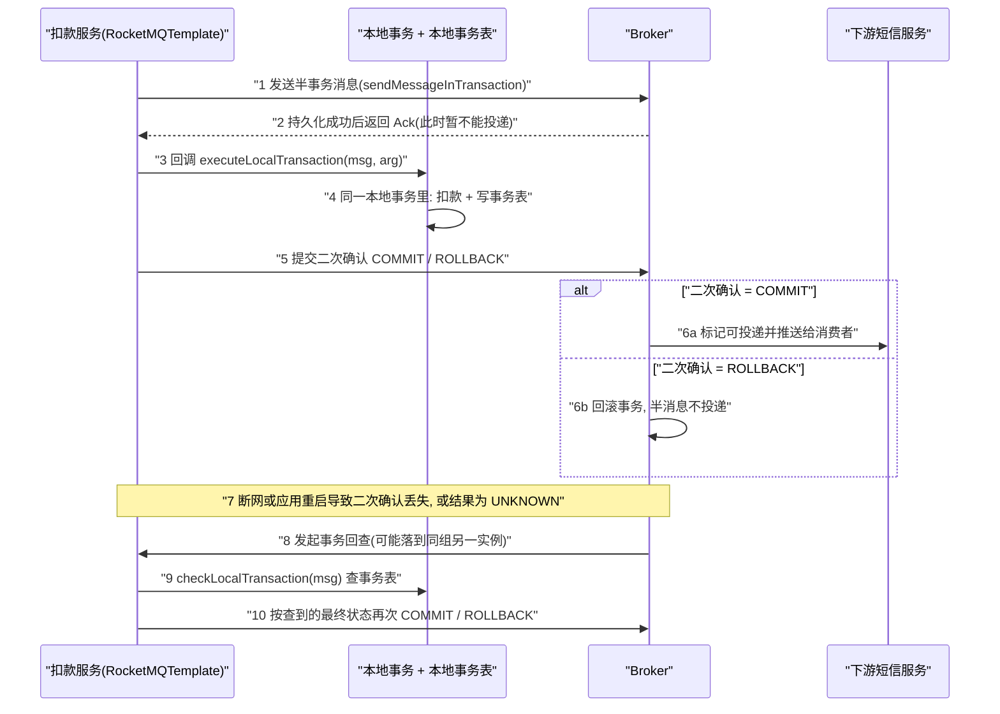

## 为什么需要事务消息？（痛点引入）

上游对事务消息的场景定位只有一句话，但这句话就是本文的全部需求说明书：

> 在银行扣款的场景中，要保持上游的扣款操作和下游的短信通知保持一致，此时就要使用事务消息
>
> —— 上游 4.x《消息类型·生产者》（`docs/02-producer/01concept1.md` L92，同一段还给出了延时/顺序/批量三类消息的对应场景）

把它翻译成 Spring Boot 里的代码，就是一条再普通不过的业务方法：

```java
public void deduct(String accountNo, BigDecimal amount, String bizId) {
    accountMapper.deduct(accountNo, amount);      // 本地事务：扣款，一次 UPDATE
    smsNotifyProducer.send(bizId, accountNo);     // 通知下游：发一条普通消息
}
```

这两行写在同一个方法里，看起来「要么都执行、要么都不执行」，实际上它们分属两个提交点：一个在数据库连接上，一个在 Broker 上。谁也不能回滚对方。四种失败形状逐个看：

| 失败形状 | 什么时候发生 | 后果 | 普通消息能自愈吗 |
|----------|--------------|------|------------------|
| 扣款成功，消息没发出去 | 发语句执行前进程被杀、网络闪断、序列化抛异常 | 用户钱扣了，收不到短信，下游积分/物流分支全丢 | 不能，没人知道该补发 |
| 消息发出去了，扣款回滚 | 先发消息后提交事务，事务因余额不足回滚 | 用户没被扣钱却收到「扣款成功」短信 | 不能，消息已经不可撤回 |
| 发送超时，结果未知 | 客户端没收到 Broker 应答 | **此刻既不敢提交事务，也不敢回滚**，只能人工查 | 不能，语义上无解 |
| 消息成功、事务成功，但下游消费失败 | 消费端处理异常 | 属于消费侧问题，与发送事务无关 | 与事务消息无关，见消费重试 |

前三行是同一件事：**普通消息没有「提交 / 回滚 / 协调」能力**。站内〈事务消息〉页把根因概括成一句「普通消息无法像单机数据库事务一样，具备提交、回滚和统一协调的能力」，机制原理（半消息、二次确认、回查、四步语义、悬挂排查清单）全部在那一页，本文不重抄，只做一件事：**把这套协议写成 Spring Boot 里能落地的一个类**。

> ### 💡 新人小结：事务消息是「先寄存、后签字」，回查是「快递站打电话来追问」
>
> - 你先跟快递站说「这个包裹先收着，别送」（**半消息**：Broker 收到并回执，但下游看不见）；
> - 你回家确认订单真的下成了（**执行本地事务**），再回驿站签字：「发」（COMMIT）或「撤」（ROLLBACK）；
> - 你中途手机没电、人重启了，驿站**不替你猜**，会打电话问你，或问同一家公司的其他分店（同生产者组的另一实例）——这就是**回查**，`checkLocalTransaction` 就是这通电话；
> - 问不到结果就一直问到期限，超期按「撤」处理（强制回滚）。所以「电话打得通、答得出」是业务责任，不是协议责任。
>
> **一句话总结：事务消息只保证「本地事务的结局」和「消息投不投」最终一致，代价是你必须实现一个查得出真相的回查方法。**

**本文路线**：官方时序 → starter 侧入口 `sendMessageInTransaction` 的源码事实 → 默认模板为什么天然能做事务（含一处常见误传的更正）→ 监听器的注册时机与六类异常 → 三分支与本地事务表的完整实现 → 六参数线程池 → 回查次数与时效的口径纪律 → ✅/❌ 对照 → 多模板与 `ExtRocketMQTemplate` → 消费端怎么收。

环境口径按站内基线：Spring Boot Web 2.7.18 + JDK 8 + Apache RocketMQ 4.9.8 + rocketmq-spring-boot-starter 2.2.3。starter 2.2.3 的**构建基线**是 Boot 2.5.9 / Spring 5.3.20 / 客户端 5.0.0 / JDK 1.8（依据 `org.apache.rocketmq:rocketmq-spring-boot-parent:2.2.3` 的 pom 属性），Boot 2.7.18 属同一大版本内的向后兼容使用；自动装配生效条件与全量参数表见[SpringBoot集成方案与版本基线](/docs/11-springboot-integration/集成基线/SpringBoot集成方案与版本基线/)。本文所有代码只用于讲解，**本轮没有搭建、也没有运行任何工程**，代码块里的 `// 预期输出:` 一律是「按源码路径推定」的结构说明，不是本机运行读数；凡本文依据材料未给出数值的参数（尤其是回查次数与间隔），一律不写具体数字。

---

## 术语表（先对齐名词，再读正文）

| 术语 | 全称 / 出处 | 通俗含义（用自己的话） | 在本文中的角色 |
|------|-------------|------------------------|----------------|
| 半事务消息 | Half / prepare message，上游 `docs/02-producer/06message5.md` L21 | 已经躺在 Broker 上、但下游看不见的草稿 | `sendMessageInTransaction` 的第一步 |
| 二次确认 | Commit / Rollback，同文件 L34-36 | 本地事务跑完后你给 Broker 的最终答复 | 监听器第一个方法的返回值 |
| 回查 | Transaction Check，同文件 L37、L41-43 | Broker 迟迟等不到答复时反向问你 | 监听器第二个方法 |
| `sendMessageInTransaction` | `RocketMQTemplate.java` L1176 | starter 唯一的事务发送入口，三行实现 | 本文的发送侧 API |
| `@RocketMQTransactionListener` | `annotation/RocketMQTransactionListener.java` L40-71 | 「这个类是本模板的事务监听器」的声明，附带线程池参数 | 本文的注册入口 |
| `RocketMQLocalTransactionListener` | `core/RocketMQLocalTransactionListener.java` L21-25 | starter 版的两方法接口，比 4.x 原生接口更像 Spring | 你要实现的接口 |
| `RocketMQLocalTransactionState` | `core/RocketMQLocalTransactionState.java` L20-24 | 三分支枚举：COMMIT / ROLLBACK / UNKNOWN | 两个方法的返回值 |
| 本地事务表 | 本文对「与业务变更同事务写入的状态表」的称呼 | 回查时唯一能查的真相来源 | 回查方法的数据支撑 |
| 业务唯一键 | bizId，落到消息属性或消息 Key | 「这笔事务的身份证号」，回查靠它定位 | 半个协议的关键 |
| `TransactionMQProducer` | 4.x 客户端事务生产者类 | 能发半消息、能应答回查的那类 producer | 强转的目标类型 |
| 事务监听器装配 | `RocketMQTransactionConfiguration`（`SmartInitializingSingleton`）L41、L52-59 | 容器把所有单例造好后，逐个把注解类挂到模板上 | 决定异常何时抛 |
| `rocketMQTemplateBeanName` | 注解属性，默认 `"rocketMQTemplate"`（L71） | 「这个监听器挂在哪个模板上」 | 多集群的关键 |
| `ExtRocketMQTemplate` | 官方示例的空子类 + `@ExtRocketMQTemplateConfiguration` | 第二个（第 N 个）模板，通常连另一套集群 | 多模板写法 |
| `arg` | `sendMessageInTransaction(dest, msg, arg)` 的第三参，L1176/L1183 | 你传给本地事务的额外入参，**回查时拿不到** | 一个容易踩的边界 |

---

## 官方时序：半消息 → Ack → 本地事务 → 二次确认 → 投递/回滚 → 回查

先看完整链路。下图按上游 4.x《事务消息发送》的步骤 1~8 与 starter 的方法名对齐画出（`docs/02-producer/06message5.md` L31-43）：



逐段解读五个裁决点，每一条都能指回原文：

1. **步骤 1~2：「持久化成功」不等于「可消费」。** 原文：「`RocketMQ Broker` 将消息持久化成功之后，向生产者返回 Ack 确认消息已经发送成功，此时消息暂不能投递，为半事务消息」（L32）。starter 侧这一步就是 `RocketMQTemplate.sendMessageInTransaction(...)` 内部 `producer.sendMessageInTransaction(rocketMsg, arg)`（`RocketMQTemplate.java` L1183）做的第一件事。
2. **步骤 3：本地事务是被 SDK 回调触发的，不是你手动调的。** 原文步骤 3「生产者开始执行本地事务逻辑」（L33）在 starter 里对应 `RocketMQUtil.convert(...)` 包装出的 `executeLocalTransaction` 回调（`RocketMQUtil.java` L62-65）——也就是说，**你的业务代码不调用 `executeLocalTransaction`，Broker 半消息发成功后 SDK 才调它**。这决定了下面「顺序写反」那条 ❌ 为什么是错的。
3. **步骤 4~6：三分支决定投递命运。** 「二次确认结果为 Commit：服务端将半事务消息标记为可投递，并投递给消费者；结果为 Rollback：服务端将回滚事务，不会将半事务消息投递给消费者」（L35-36）。半消息**只有 commit 状态才会真正向下游投递**（L21）。
4. **步骤 5~8 之间的回查触发条件有两类**：「若服务端未收到发送者提交的二次确认结果，**或**服务端收到的二次确认结果为 Unknown 未知状态，经过固定时间后，服务端将对消息生产者即生产者集群中任一生产者实例发起消息回查」（L37）。注意「生产者集群中任一生产者实例」——回查不保证回到原来那台机器，这是本地事务表必须共享的根本原因。
5. **回查有次数上限，且上游明确警告。** L39 的 note 原文：「需要注意的是，服务端仅仅会按照参数尝试指定次数，超过次数后事务会强制回滚，因此未决事务的回查时效性非常关键，需要按照业务的实际风险来设置」。这条口径的分寸感很重要，详见下文〈回查次数与强制回滚〉一节。

---

## starter 侧入口：`sendMessageInTransaction` 的三行硬事实

`rocketmq-spring` 仓库 tag `rocketmq-spring-all-2.2.3`，文件 `rocketmq-spring-boot/src/main/java/org/apache/rocketmq/spring/core/RocketMQTemplate.java` L1176-1187，方法体原文如下（注释按源码 L1167-1175 的 javadoc 保留结构）：

```java
public TransactionSendResult sendMessageInTransaction(final String destination,   // L1176
    final Message<?> message, final Object arg) throws MessagingException {
    try {
        if (((TransactionMQProducer) producer).getTransactionListener() == null) {  // L1179
            throw new IllegalStateException("The rocketMQTemplate does not exist TransactionListener");  // L1180
        }
        org.apache.rocketmq.common.message.Message rocketMsg = this.createRocketMqMessage(destination, message);  // L1182
        return producer.sendMessageInTransaction(rocketMsg, arg);                   // L1183
    } catch (MQClientException e) {
        throw RocketMQUtil.convert(e);                                              // L1185
    }
}
```

三件事要说清：

- **第一件事就是强转。** L1179 在发送前把 `producer` 字段直接 cast 成 `TransactionMQProducer`，用来查「有没有监听器」。返回类型 `TransactionSendResult` 也是从这个 cast 起就默认了「模板的生产者是事务生产者」。
- **destination 照旧支持 `topic:tag`。** 转换走 `createRocketMqMessage(destination, message)`（L1182 → L1189-1194），最终由 `RocketMQUtil.getAndWrapMessage` 按冒号切两段（`RocketMQUtil.java` L172-177）。官方示例正是这么写的：`springTransTopic + ":" + tags[i % tags.length]`（`ProducerApplication.java` L217）。
- **异常只有两种出口。** 没有监听器 → `IllegalStateException`（L1180）；客户端抛 `MQClientException` → 统一包成 Spring 的 `MessagingException`（L1184-1185，转换实现 `RocketMQUtil.java` L90-92）。所以捕获时按 `MessagingException` 兜，别指望 `MQClientException` 冒出来。

`arg` 的归宿也在这三行里：它被原样交给客户端（L1183），再由 starter 的适配层原样递进你的 `executeLocalTransaction(msg, arg)`（`RocketMQUtil.java` L62-63）。**但回查方法没有 arg**——`RocketMQLocalTransactionListener` 的第二个方法签名只有一个参数：`checkLocalTransaction(final Message msg)`（`core/RocketMQLocalTransactionListener.java` L22-24）。于是得到本文第一条硬规则：

> [!IMPORTANT]
> 凡是回查时要用的一切信息，必须在发送时就放进消息本身（业务唯一键 → 消息 Key 或自定义属性；正文 → payload）。放进 `arg` 的东西只在第一次执行本地事务时存在，进程重启后的回查拿不到它。

顺带一条容易忽略的形态事实：监听器里收到的 `msg.getPayload()` 是**字节数组**，不是你发送时的对象——适配层用 `MessageBuilder.withPayload(message.getBody())` 构造 Spring 消息（`RocketMQUtil.java` L97、L133）。官方示例直接把 payload 打进日志（`ProducerApplication.java` L262）就是图省事；生产代码要按发送时的序列化方式自己还原，见下文实现。

---

## 默认模板为什么天然能做事务（附一处常见误传的更正）

事务发送要求生产者是 `TransactionMQProducer`，那么 starter 自动装配出来的 `rocketMQTemplate` 用的是哪种 producer？答案在 `RocketMQUtil.createDefaultMQProducer(...)` 里，两个分支都是事务生产者（`support/RocketMQUtil.java` L258-268）：

```java
public static DefaultMQProducer createDefaultMQProducer(String groupName, String ak, String sk,
    boolean isEnableMsgTrace, String customizedTraceTopic) {                       // L258-259
    boolean isEnableAcl = StringUtils.hasLength(ak) && StringUtils.hasLength(sk);
    DefaultMQProducer producer;
    if (isEnableAcl) {
        producer = new TransactionMQProducer(groupName, new AclClientRPCHook(new SessionCredentials(ak, sk)));  // L264
        producer.setVipChannelEnabled(false);
    } else {
        producer = new TransactionMQProducer(groupName);                            // L267
    }
    // ... 消息轨迹相关设置（L270-282），返回值声明为 DefaultMQProducer（L284）
}
```

**方法签名声明的返回类型是 `DefaultMQProducer`，但 new 出来的实际对象是 `TransactionMQProducer`**（`TransactionMQProducer extends DefaultMQProducer`，所以这是合法的向上转型）。装配链路一路把它传下来：

| 装配环节 | 源码位置 | 实际类型 | 说明 |
|----------|----------|----------|------|
| 生产者 Bean `defaultMQProducer` | `autoconfigure/RocketMQAutoConfiguration.java` L89-123（工厂调用在 L106） | `TransactionMQProducer`（由 L264/L267 创建） | 声明类型是 `DefaultMQProducer`，实例是事务生产者 |
| 模板 Bean `rocketMQTemplate` | 同文件 L157-170（取 Bean 在 L162-163） | 注入上面那个实例 | `@ConditionalOnMissingBean(name = "rocketMQTemplate")`；模板里的字段声明是 `private DefaultMQProducer producer;`（`RocketMQTemplate.java` L65），读它的 getter 在 L75 |
| 事务发送入口 | `core/RocketMQTemplate.java` L1179 | cast 回 `TransactionMQProducer` | 因为实例本来就是它，cast 成功 |
| 监听器注册 | `autoconfigure/RocketMQTransactionConfiguration.java` L72-74 | 同一实例 | `setExecutorService(...)` + `setTransactionListener(...)` |

结论与更正：

- ✅ **2.2.3 里默认的 `rocketMQTemplate` 天生就能发事务消息**，只要按官方示例那样标一个 `@RocketMQTransactionListener`（示例就是用默认模板发的：`ProducerApplication.java` L216 `rocketMQTemplate.sendMessageInTransaction(...)`，没有任何额外配置）。
- ❌ **不要写「starter 默认模板调用 `sendMessageInTransaction` 必抛 `ClassCastException`」**。这句话在 2.2.3 + 默认自动装配的组合下不成立，L264/L267 就是反证；把别的版本或别的配置当成通说是这类文章最常见的讹传。
- ⚠️ **真正会失败的是「你自己声明了一个普通 `DefaultMQProducer` Bean」**：`defaultMQProducer` 带 `@ConditionalOnMissingBean(DefaultMQProducer.class)`（L90），容器里一旦出现同类型 Bean，自动配置就让位，你的 `new DefaultMQProducer()` 就成了模板的生产者；此时 `RocketMQTransactionConfiguration` 里的三处 `(TransactionMQProducer) rocketMQTemplate.getProducer()`（L69、L72、L74）第一处就抛 `ClassCastException`。同一段代码在 `sendMessageInTransaction` 里也会以同样的方式失败（`RocketMQTemplate.java` L1179）。

> ### 💡 新人小结：为什么「让位」这件事容易出事故
>
> Spring Boot 的自动配置像医院分诊台：**只要你自带了挂号单（同类型 Bean），分诊台就不给你挂**（`@ConditionalOnMissingBean`）。默认那张单子（`TransactionMQProducer`）能办业务窗口（事务消息），你自己随手打印的那张（`new DefaultMQProducer()`）只能办普通窗口。
>
> 更糟的是这份「不兼容」不在启动日志里喊出来，而是等你第一次发事务消息、或者事务配置类扫描到监听器时才炸。所以要养一个习惯：**用 starter 就别自己造 producer Bean；非造不可，就造 `TransactionMQProducer`。**

---

## 监听器怎么被挂上去：注册时机与六类异常清单

`RocketMQTransactionConfiguration` 是个 `@Configuration` + `SmartInitializingSingleton`（`autoconfigure/RocketMQTransactionConfiguration.java` L40-41），并且被自动配置 `@Import` 进来（`RocketMQAutoConfiguration.java` L58）。它的装配时机是**容器里所有单例都实例化完成之后**：

```java
@Override
public void afterSingletonsInstantiated() {                                        // L53
    Map<String, Object> beans = this.applicationContext.getBeansWithAnnotation(RocketMQTransactionListener.class)  // L54
        .entrySet().stream().filter(entry -> !ScopedProxyUtils.isScopedTarget(entry.getKey()))
        .collect(Collectors.toMap(Map.Entry::getKey, Map.Entry::getValue));
    beans.forEach(this::registerTransactionListener);                              // L58
}
```

`registerTransactionListener` 的六行原文（L61-76）就是异常清单的来源：

```java
private void registerTransactionListener(String beanName, Object bean) {
    Class<?> clazz = AopProxyUtils.ultimateTargetClass(bean);                                                  // L62
    if (!RocketMQLocalTransactionListener.class.isAssignableFrom(bean.getClass())) {
        throw new IllegalStateException(clazz + " is not instance of " + RocketMQLocalTransactionListener.class.getName());  // L64-65
    }
    RocketMQTransactionListener annotation = clazz.getAnnotation(RocketMQTransactionListener.class);         // L67
    RocketMQTemplate rocketMQTemplate = (RocketMQTemplate) applicationContext.getBean(annotation.rocketMQTemplateBeanName());  // L68
    if (((TransactionMQProducer) rocketMQTemplate.getProducer()).getTransactionListener() != null) {         // L69
        throw new IllegalStateException(annotation.rocketMQTemplateBeanName() + " already exists RocketMQLocalTransactionListener");  // L70
    }
    ((TransactionMQProducer) rocketMQTemplate.getProducer()).setExecutorService(new ThreadPoolExecutor(     // L72
        annotation.corePoolSize(), annotation.maximumPoolSize(),
        annotation.keepAliveTime(), annotation.keepAliveTimeUnit(),
        new LinkedBlockingDeque<>(annotation.blockingQueueSize())));                                        // L73
    ((TransactionMQProducer) rocketMQTemplate.getProducer()).setTransactionListener(RocketMQUtil.convert((RocketMQLocalTransactionListener) bean));  // L74
    log.debug("RocketMQLocalTransactionListener {} register to {} success", clazz.getName(), annotation.rocketMQTemplateBeanName());  // L75
}
```

由此得到这张异常清单（文案逐字摘自上面的行号，触发条件由装配链路推出）：

| 异常与原文文案 | 抛出点 | 触发条件 | 正确做法 |
|----------------|--------|----------|----------|
| `IllegalStateException: "<类名> is not instance of org.apache.rocketmq.spring.core.RocketMQLocalTransactionListener"` | `RocketMQTransactionConfiguration.java` L64-65 | 类标了 `@RocketMQTransactionListener`，但没实现 `RocketMQLocalTransactionListener` | 实现那两个方法，别只写一半 |
| 容器取 Bean 失败（`applicationContext.getBean(annotation.rocketMQTemplateBeanName())`） | 同文件 L68 | `rocketMQTemplateBeanName` 写成了容器里不存在的 Bean 名 | 名字用默认 `rocketMQTemplate`，或确实声明了对应的 `@ExtRocketMQTemplateConfiguration` 子类 |
| `ClassCastException`（`DefaultMQProducer` 无法转 `TransactionMQProducer`） | 同文件 L69、L72、L74；`RocketMQTemplate.java` L1179 同样会炸 | 应用自声明了一个**普通** `DefaultMQProducer` Bean，令 `@ConditionalOnMissingBean`（`RocketMQAutoConfiguration.java` L90）退让，模板拿到的是非事务生产者 | 删掉自声明 Bean 交给自动配置；或自己声明 `TransactionMQProducer` |
| `IllegalStateException: "<beanName> already exists RocketMQLocalTransactionListener"` | 同文件 L69-70 | 同一个模板上注册了第二个监听器（两个类的 `rocketMQTemplateBeanName` 相同） | 一个模板一个监听器；要给第二套集群做事务，再建一个模板 |
| `IllegalStateException: "The rocketMQTemplate does not exist TransactionListener"` | `RocketMQTemplate.java` L1179-1180 | 监听器还没注册成功就调用 `sendMessageInTransaction`（常见于监听器类不在组件扫描路径里、或该类被判定为 scoped target 过滤掉了 L55） | 确认监听器类是 Bean；`@RocketMQTransactionListener` 自带 `@Component` 元注解（`RocketMQTransactionListener.java` L39），在扫描路径内就会被注册 |
| `MessagingException`（由 `MQClientException` 包装） | `RocketMQTemplate.java` L1184-1185；包装实现 `RocketMQUtil.java` L90-92 | 发送阶段客户端抛错，例如生产者未启动、拿不到主题路由 | 先按站内 mqadmin 页把主题建出来，再核对 `rocketmq.name-server` |

三个结构性推论：

- **注解就是 Bean 声明。** `@RocketMQTransactionListener` 自身被 `@Component` 标注（`annotation/RocketMQTransactionListener.java` L36-40，`@Target({TYPE, ANNOTATION_TYPE})`、`@Retention(RUNTIME)`、`@Documented`、`@Component`），所以标了它的类天然是容器里的单例，不需要再加 `@Component`；官方示例就把它用在内部类上（`ProducerApplication.java` L245-246）。
- **一个模板只能挂一个监听器。** L69-70 的判断是「已经有一个就抛异常」，因此**线程池参数也只能有一套**（L72-73 只在注册时设置一次），同一模板的所有事务消息共用这一个池。
- **注册发生在启动收尾。** `SmartInitializingSingleton.afterSingletonsInstantiated()`（L53）保证监听器在应用可用前就挂好了；换句话说，「启动成功了但监听器没挂上」这种中间态不存在——要么启动就失败（上面那张表），要么挂好了。

`RocketMQUtil.convert(...)` 是 starter 接口与 4.x 接口之间的唯一一层薄适配（`RocketMQUtil.java` L59-73）：把原生 `Message`/`MessageExt` 转成 Spring `Message`（L63、L69），再把三分支枚举翻译回 4.x 的 `LocalTransactionState`（L75-88）：`UNKNOWN → UNKNOW`、`COMMIT → COMMIT_MESSAGE`、`ROLLBACK → ROLLBACK_MESSAGE`。注意 4.x 那个「未决」枚举的原文拼写是 `UNKNOW`（少一个 N），这是上游历史拼写，starter 用规范的 `UNKNOWN` 把它包掉了——你在 Spring 侧只管写 `UNKNOWN`。

---

## 完整实现：本地事务表 + 三分支 + 可查的回据

官方示例的监听器（`ProducerApplication.java` L245-300）用 `AtomicInteger` 取模模拟三种结局、用 `ConcurrentHashMap` 记账，它要演示的是**三分支怎么返回**和**回查怎么读状态**（`executeLocalTransaction` 依次给出 COMMIT / ROLLBACK / UNKNOWN，L259-274；`checkLocalTransaction` 按 `transId` 把状态映射回三分支，L278-299）。示例里的内存 Map 不适合生产：回查可能落在重启后的进程或同组另一实例上（上游 `docs/02-producer/06message5.md` L37「生产者集群中任一生产者实例」、L161 的 caution「联系同一生产者组的其他生产者实例回查」）。生产写法是把状态落库。

先看业务键怎么进消息（发送侧）：

```java
@Service
public class DeductTxProducer {
    @Resource
    private RocketMQTemplate rocketMQTemplate;                       // 默认模板，实例已是 TransactionMQProducer

    public SendResult deductAndNotify(DeductCommand cmd) {
        Message<String> msg = MessageBuilder
            .withPayload(JSON.toJSONString(cmd))                     // payload 会被序列化成字节
            .setHeader(RocketMQHeaders.KEYS, cmd.getBizId())         // 消息索引键：可用 mqadmin queryMsgByKey 反查
            .setHeader("bizId", cmd.getBizId())                      // 自定义属性：回查时原样回到 msg 的 header
            .build();
        // 第三个参数 arg 只在 executeLocalTransaction 里可见，回查拿不到（接口签名只有 msg）
        TransactionSendResult result = rocketMQTemplate.sendMessageInTransaction(
            "TP_ACCOUNT_DEDUCT:deduct-sms", msg, cmd);               // destination 支持 topic:tag
        // 预期输出: result.getSendStatus() 为半消息发送后的状态；官方示例打印的就是这个字段
        //          （ProducerApplication.java L216-219）。结构依据 L1176 的返回类型，非本机运行读数。
        return result;
    }
}
```

两个键都给的原因，源码里能对上：`RocketMQHeaders.KEYS`（常量值 `"KEYS"`，`support/RocketMQHeaders.java` L24）会被 `getAndWrapMessage` 取出来写成消息的 Key（`RocketMQUtil.java` L180-187，先按原名取、取不到再按 `rocketmq_` 前缀取），这是服务端建哈希索引、可用 `queryMsgByKey` 反查的那个字段（命令与参数见[mqadmin命令参考-消息消费与连接](/docs/06-operations/命令行工具/mqadmin命令参考-消息消费与连接/)）；其余 header 则原样 `putUserProperty`（同文件 L201-208），到监听器里由 `addUserProperties` 原样放回（L118-128）。**要点名一处容易看错的地方**：适配层还会写一个带前缀的 `rocketmq_TRANSACTION_ID` 头，值取自客户端的 `message.getTransactionId()`（L138，回查那条消息则在 L107），那是框架维护的事务标识，不是你发送时放进 header 的业务键；两者靠 `rocketmq_` 前缀区分（`RocketMQHeaders.PREFIX` L23）。官方示例恰好把业务键命名为 `RocketMQHeaders.TRANSACTION_ID`（常量值是不带前缀的 `"TRANSACTION_ID"`，L33；示例用法 `ProducerApplication.java` L215、L253），它走的是**用户属性**通道，所以能在两个回调里都读到。为避免和框架头混淆，本文示例改用明确自定义的名字 `bizId`。

再看监听器本体：

```java
@RocketMQTransactionListener(corePoolSize = 2, maximumPoolSize = 8, keepAliveTime = 1000 * 60)
public class DeductTxListener implements RocketMQLocalTransactionListener {

    private static final Logger log = LoggerFactory.getLogger(DeductTxListener.class);

    @Resource
    private JdbcTemplate jdbc;
    @Resource
    private AccountService accountService;      // 真正执行扣款，方法上有 @Transactional

    @Override
    public RocketMQLocalTransactionState executeLocalTransaction(Message msg, Object arg) {
        String bizId = bizIdOf(msg);
        try {
            // 半消息已送达，Broker 正等你的答复：这里把「扣款」和「写本地事务表」放进同一个本地事务
            DeductCommand cmd = JSON.parseObject(new String((byte[]) msg.getPayload(), StandardCharsets.UTF_8),
                                                 DeductCommand.class);
            accountService.deductAndRecord(bizId, cmd, arg);           // arg 原样传下来，此处是发送时的命令对象
            return RocketMQLocalTransactionState.COMMIT;             // 本地事务提交成功 -> 消息可投递
        } catch (InsufficientBalanceException e) {
            // 业务性拒绝：本地事务回滚，事务表里的记录也随之消失，明确告诉 Broker 丢弃半消息
            return RocketMQLocalTransactionState.ROLLBACK;           // 消息被丢弃，下游不会收到
        } catch (Exception e) {
            // 超时、连接中断、结果不可判：既不 COMMIT 也不 ROLLBACK，把裁决交给回查
            log.error("local transaction undetermined, bizId={}", bizId, e);
            return RocketMQLocalTransactionState.UNKNOWN;            // 等待服务端回查
        }
    }

    @Override
    public RocketMQLocalTransactionState checkLocalTransaction(Message msg) {
        String bizId = bizIdOf(msg);
        String state = queryTxState(bizId);
        // SELECT state FROM mq_local_transaction WHERE biz_id = ?
        if (state == null) {
            // 本方案里事务表与扣款同事务写入：查不到记录 == 本地事务没提交
            return RocketMQLocalTransactionState.ROLLBACK;
        }
        if (TxStateName.COMMITTED.equals(state)) {
            return RocketMQLocalTransactionState.COMMIT;
        }
        if (TxStateName.FAILED.equals(state)) {
            return RocketMQLocalTransactionState.ROLLBACK;
        }
        // INIT：本地事务可能还在跑，绝不能给出结论，等下一轮回查
        return RocketMQLocalTransactionState.UNKNOWN;
    }

    private String bizIdOf(Message msg) {
        Object v = msg.getHeaders().get("bizId");                    // 自定义用户属性，原样回到 header
        return v == null ? null : String.valueOf(v);
    }

    private String queryTxState(String bizId) {
        List<String> rows = jdbc.query("SELECT state FROM mq_local_transaction WHERE biz_id = ?",
            (rs, i) -> rs.getString(1), bizId);
        return rows.isEmpty() ? null : rows.get(0);
    }
}

// 预期输出: 结构层面的输出只有三分支返回值与本地事务表的状态列取值；
//          本文没有运行任何工程，不涉及耗时、回查发生时刻等任何数值。
```

三分支语义（上游 `docs/02-producer/06message5.md` L151-155 原文，对应 starter 的 `RocketMQLocalTransactionState`）：

| 返回值 | 上游语义原文 | 服务端行为 | 什么时候该用 |
|--------|--------------|------------|--------------|
| `COMMIT` | 「提交事务，允许消费者消费该消息」（L153） | 半消息标记为可投递并推送 | 本地事务**明确成功**（扣款 UPDATE 与事务表写入一起提交） |
| `ROLLBACK` | 「回滚事务，消息将被丢弃不允许消费」（L154） | 半消息丢弃，永不投递，流程终止 | 本地事务**明确失败**（余额不足、状态不允许扣款） |
| `UNKNOWN` | 「暂时无法判断状态，等待固定时间以后 Broker 端根据回查规则向生产者进行消息回查」（L155） | 挂起，进入回查窗口 | **只有「不知道」时才用**：超时、连接断、事务还在跑 |

回查规则同样有原文依据：「本地事务执行完成后，若 Broker 端收到的本地事务返回状态为 …UNKNOW…，或生产者应用退出导致本地事务未提交任何状态。则 Broker 端会向消息生产者发起事务回查，第一次回查后仍未获取到事务状态，则之后每隔一段时间会再次回查」（L157）。这句话给出两个必须留人的入口：**返回 UNKNOWN** 和 **进程退出前没表态**。第二种入口正是「应用重启」事故的主要来源，也因此回查必须能靠消息内容独立裁决——不能依赖内存。

支撑这套裁决的表结构（示意，字段命名按团队规范）：

```sql
-- 本地事务表：与业务变更在同一个本地事务里写入，是回查唯一可读的真相
CREATE TABLE mq_local_transaction (
  id            BIGINT       NOT NULL AUTO_INCREMENT,
  biz_id        VARCHAR(64)  NOT NULL COMMENT '业务唯一键，等于消息里的 bizId / KEYS',
  topic_tag     VARCHAR(128) NOT NULL COMMENT '目的地，便于排查时对齐半消息',
  state         VARCHAR(16)  NOT NULL COMMENT 'INIT / COMMITTED / FAILED',
  biz_ref       VARCHAR(64)           COMMENT '业务主表外键，例如扣款流水号',
  create_time   DATETIME     NOT NULL,
  update_time   DATETIME     NOT NULL,
  PRIMARY KEY (id),
  UNIQUE KEY uk_biz_id (biz_id)          -- 唯一键：回查靠它精确命中，重复投递被吸收
);
```

「`state == null` 表示 ROLLBACK」这条判断**只在事务表与业务变更同事务写入时成立**。如果你的工程把 INIT 记录放在业务事务之外单独提交（另一种常见设计，好处是能看到「开始过」的痕迹），那么「查不到」不再等价于「没提交」，此时应返回 UNKNOWN 而不是 ROLLBACK，并把这条语义写进方法注释。两种设计选一种，别让读代码的人猜。

> ### 💡 新人小结：`executeLocalTransaction` 是「当场签字」，`checkLocalTransaction` 是「电话回访」
>
> - 当场签：半消息一送到，SDK 立刻回调你，扣款成功就 COMMIT、明确失败就 ROLLBACK，两者都不用等回查；
> - 答不出就别说：只有「真不知道」才返回 UNKNOWN。UNKNOWN 不是「稳妥的默认值」，它是把问题推给回查时间线；
> - 电话回访时你得靠纸面记录回答：`checkLocalTransaction` 只能看到消息本身，所以要查库——表里有 COMMITTED 就提交，有 FAILED 或按你的设计「根本没记录」就回滚，是 INIT（还在跑）就继续 UNKNOWN；
> - 同组任何一台都可能接到这通电话（上游 L37、L161），所以「纸面记录」必须是共享的数据库，不能是本地内存。
>
> **一句话总结：回查方法的本质是一个「按业务唯一键查本地事务结局」的只读接口，写它的时候把自己当成对账员，而不是业务开发。**

---

## 六参数线程池：回查并发由它承载

`@RocketMQTransactionListener` 的六个属性全部服务于同一件事：给该模板的生产者装一个 `ThreadPoolExecutor`（`RocketMQTransactionConfiguration.java` L72-73 的实参顺序就是注解属性）。默认值取自 `annotation/RocketMQTransactionListener.java` L45-71 原文：

| 属性 | 默认值（源码原文） | 落到线程池的哪一格 | 含义 | 什么时候需要显式调整 |
|------|--------------------|--------------------|------|----------------------|
| `corePoolSize` | `1`（L45） | `ThreadPoolExecutor` 核心线程数 | 常驻的回查/本地事务执行线程数 | 未决事务多、回查要同时处理多条时；默认值意味着回查任务实际是排队串行执行 |
| `maximumPoolSize` | `1`（L50） | 最大线程数 | 允许扩到的上限 | 同上；注意队列未满时线程数不会扩到它，所以只调大它不调 `corePoolSize` 效果有限 |
| `keepAliveTime` | `1000 * 60`（L55） | 空闲存活时间 | 超出核心数的线程多久回收 | 与 `maximumPoolSize` 成对调整；单独调它没有意义 |
| `keepAliveTimeUnit` | `TimeUnit.MILLISECONDS`（L60） | 时间单位 | 上一行的量纲 | 只在改 `keepAliveTime` 时一起确认单位，避免按秒读成毫秒 |
| `blockingQueueSize` | `2000`（L65） | `LinkedBlockingDeque` 容量（L73） | 排队等待执行的任务数上限 | 回查任务在库里慢、积压明显时；调大只改变「能排多少」，不改变「同时跑几个」 |
| `rocketMQTemplateBeanName` | `"rocketMQTemplate"`（L71） | 不参与线程池 | 该监听器挂到哪个模板 | 多集群 / 多模板时必填目标模板 Bean 名，见下一节 |

三点判断依据（都不涉及具体数值推荐）：

- **这个池承载的就是回查并发。** 上游 4.x 原生示例里，同一个 setter 被明确称作「设置了事务回查的线程池」，并补了一句「如果不设置也会默认生成一个」（`docs/02-producer/06message5.md` L63、L122）。starter 把这条路径收进了注解，所以注解上的 `corePoolSize` / `maximumPoolSize` 就是回查（以及 `executeLocalTransaction` 回调）的执行并发。
- **默认配置是「一个线程 + 一条 2000 长的队」。** 因为 `corePoolSize` 与 `maximumPoolSize` 都是 1（L45、L50），队列容量 2000 未满时池不会扩线程（这是 `ThreadPoolExecutor` 的通行规则）。这六个属性的用途注解自己已经写明——L42-65 的每行注释都是 `Set ExecutorService params -- xxx`，逐项对应 L72-73 那次 `new ThreadPoolExecutor(...)` 的实参位置。因此**调大的正确顺序是先调 `corePoolSize`，再按需要调 `maximumPoolSize`，最后才看队列**。
- **调大的动机是「回查打不出去」而不是「发送太慢」。** 上游对回查时效的警告（L39）与站内〈事务消息〉页收录的 5.0《使用建议》口径（大量事务检查会让系统性能受损、容易引发事务处理延迟）合起来指向同一个判据：**如果监控上看到未决事务在积压、回查应答排不上队，就调大该池并同步优化 `checkLocalTransaction` 里的 SQL**。本文不给出任何具体线程数或队列长度建议值，因为依据材料里没有经过验证的数值。

另外两条边界：注解上的 `corePoolSize` / `maximumPoolSize` 等参数**在注册时一次性写死**（L72-73 只在 `registerTransactionListener` 里执行），改它们要重启；而且**一个模板一个池**（同一模板注册第二个监听器会被 L69-70 直接拒），所以多套集群做事务时，池参数要按模板分别规划。

---

## 回查次数与强制回滚：能说的与不能说的

上游 4.x 事务消息篇的第六步只有一句 note，原文照录（`docs/02-producer/06message5.md` L39，去掉站点指令语法）：

> 需要注意的是，服务端仅仅会按照参数尝试指定次数，超过次数后事务会强制回滚，因此未决事务的回查时效性非常关键，需要按照业务的实际风险来设置

这句话能支撑三个结论，也仅限这三个：

1. **回查尝试次数有上限**，上限由服务端参数决定；
2. **超过上限后事务被强制回滚**——如果这时你的本地事务其实成功了，主分支与下游分支就永久不一致，这是真实的事故形状，不是理论风险；
3. **回查时效性是业务风险项**：它要求 `checkLocalTransaction` 又快又准（查库有索引、不跑全表、不被业务大事务锁住）。

**不能说的那件事是「指定次数到底是几次、间隔多久」。** 本文依据的材料里没有给出可核的数值，因此一个数字也不写：4.x 事务消息本篇未列数值，参数篇 `docs/06-parameterConfiguration/01local.md` 里与事务相关只有一句「DefaultMQProducer、TransactionMQProducer、DefaultMQPushConsumer、DefaultMQPullConsumer 都继承于 ClientConfig 类，ClientConfig 为客户端的公共配置类」（L47），没有收录回查次数或回查间隔的参数行。要落到参数层面，请按站内配置页去查：

| 想查什么 | 去哪查 | 说明 |
|----------|--------|------|
| 4.x 客户端/服务端参数的名称、类型与上游给出的默认值 | [客户端与服务端参数配置](/docs/07-configuration/参数与日志配置/客户端与服务端参数配置/) | 站内该页按上游参数表逐行照录；事务相关的服务端行是处理提交/回滚请求的线程池（`endTransactionThreadPoolNums`、`endTransactionPoolQueueCapacity`），**它们不是回查次数**，别拿它当「指定次数」的答案 |
| 半消息的时间线（第一次回查间隔、最大超时被强制回滚）与 5.0 侧参数口径 | [事务消息](/docs/04-message-features/消息类型/事务消息/) | 该页给出的是 5.0 参数表口径，与 4.9.8 的默认值不是同一套，跨版本引用必须带着「哪一版」这个前缀 |
| 悬挂事务的排查动作清单 | [事务消息](/docs/04-message-features/消息类型/事务消息/) 的「悬挂事务」一节 | 八步清单在彼页，本文只补 Spring 侧的对应物：监听器是否注册成功、回查 SQL 是否走唯一键、事务表是否共享库 |

Spring Boot 侧能做的「按时效性设置」只有两件，且都在本文范围内：**让回查快**（唯一键 + 只读查询 + 该池并发足够）与**让回查准**（状态来自共享库，不来自内存）。这两条之外的数值纪律是：谁的来源没给数，就不许出现数。

---

## ✅ 推荐与 ❌ 不推荐：六组成对写法

| 场景 | ❌ 不推荐（错在哪） | ✅ 推荐 | 依据 |
|------|--------------------|---------|------|
| 回查实现 | `checkLocalTransaction` 里直接 `return RocketMQLocalTransactionState.COMMIT;` 不查库。**等于没有回查**：Broker 问一次就得到「提交」，本地事务其实失败时半消息照样投递，下游收到一条「扣款成功」的假通知；反之恒返 ROLLBACK 会把成功的事务也判死 | 按业务唯一键查本地事务表，`COMMITTED → COMMIT`、`FAILED`（或本设计下无记录）→ `ROLLBACK`、`INIT → UNKNOWN` | 上游 L35-36（Commit 才投递）、L41-43（回查是「检查对应消息的本地事务执行的最终结果」）、L157 |
| 发送与本地事务的顺序 | 先 `accountMapper.deduct(...)` 提交数据库，再调 `sendMessageInTransaction(...)`。半消息根本没参与你的本地事务，中途崩溃就没有可回查的半消息，退化成「普通消息 + 本地事务」那一行行失败形状 | 只调 `sendMessageInTransaction`，把本地事务写在 `executeLocalTransaction` 里（SDK 在半消息成功后回调，你不需要也不能自己调它） | 上游步骤 1~3（L31-33）明确半消息先行；starter 的回调装配见 `RocketMQUtil.java` L62-65 |
| 一个模板注册多个监听器 | 给同一模板再写一个 `@RocketMQTransactionListener` 类（`rocketMQTemplateBeanName` 都是默认值），启动即抛 `IllegalStateException("rocketMQTemplate already exists RocketMQLocalTransactionListener")` | 一个模板一个监听器；确实要两条事务链路（两套集群、两类业务），就再建一个 `ExtRocketMQTemplate`，各自挂各自的事务表与监听器 | `RocketMQTransactionConfiguration.java` L69-70 |
| 自声明普通生产者 | 为了「统一管理」写一个 `@Bean DefaultMQProducer producer() { return new DefaultMQProducer(group); }`，此后所有事务发送在启动装配阶段就以 `ClassCastException` 失败，报错还不直指原因 | 交给 starter 自动装配（L264/L267 造的就是 `TransactionMQProducer`）；需要自定义就显式 `new TransactionMQProducer(group)` 并保留监听器注册链路 | `RocketMQAutoConfiguration.java` L90（`@ConditionalOnMissingBean(DefaultMQProducer.class)`）、`RocketMQUtil.java` L264/L267、`RocketMQTransactionConfiguration.java` L69/L72/L74 |
| 回查时才发现信息不够 | 把回查要用的字段全塞进 `sendMessageInTransaction` 的第三个参数 `arg`，`checkLocalTransaction` 里只能干瞪眼 | 业务唯一键同时写进 `RocketMQHeaders.KEYS`（可被 `mqadmin` 按 Key 反查）和一个自定义属性（回查时原样回到 header） | 接口签名 `RocketMQLocalTransactionListener.java` L22-24（check 只有一个入参）；属性透传见 `RocketMQUtil.java` L201-208、L118-128；KEYS 处理见 L180-187 |
| 拿事务消息当延时/顺序用 | 用事务消息做「30 分钟后投递」或「同一订单严格有序」：`sendMessageInTransaction` 的入参里既没有档位也没有 hashKey，二阶段协议只回答「投不投」，不回答「什么时候投」「投到哪个队列」 | 延时走档位入参的 `syncSend(dest, msg, timeout, delayLevel)`，见[延时消息与订单超时关单](/docs/11-springboot-integration/六种消息实战/延时消息与订单超时关单/)；顺序走 `syncSendOrderly(hashKey)`，见[顺序消息与分区有序落地](/docs/11-springboot-integration/六种消息实战/顺序消息与分区有序落地/)；需要绝对时刻见[定时消息与任意时刻投递](/docs/11-springboot-integration/六种消息实战/定时消息与任意时刻投递/) | 事务消息全篇（`docs/02-producer/06message5.md`）只有提交/回滚/回查语义；另一条运维红线是「生产环境中不同消息类型需要使用不同的主题，不要在同一个主题内使用多种消息类型」（`docs/02-producer/01concept1.md` L94 的 note） |

还有一条属于「方案选择」层面的 ❌：**用事务消息做同步等待**。它的承诺是最终一致，半消息在 COMMIT 之前对下游完全不可见，下游状态必然滞后于本地状态；要求「扣款瞬间下游就可见」的场景应该走同步调用或本地事件表 + 轮询，而不是事务消息（口径见[事务消息](/docs/04-message-features/消息类型/事务消息/)的使用限制一节）。

---

## 多集群与多模板：`ExtRocketMQTemplate` + `rocketMQTemplateBeanName`

一个应用连两套 RocketMQ 集群（或同一集群里两套完全不同的 producer 配置）做事务，官方给的形态就是「继承一次 + 指定 Bean 名两次」。`ExtRocketMQTemplate` 全文就是一个空子类（tag `rocketmq-spring-all-2.2.3` 的 `rocketmq-spring-boot-samples/rocketmq-produce-demo/src/main/java/org/apache/rocketmq/samples/springboot/ExtRocketMQTemplate.java`，L17-24）：

```java
package org.apache.rocketmq.samples.springboot;                        // L17

import org.apache.rocketmq.spring.annotation.ExtRocketMQTemplateConfiguration;
import org.apache.rocketmq.spring.core.RocketMQTemplate;               // L19-20

@ExtRocketMQTemplateConfiguration(nameServer = "${demo.rocketmq.extNameServer}",
        tlsEnable = "${demo.rocketmq.ext.useTLS}", instanceName = "pztest33")   // L22
public class ExtRocketMQTemplate extends RocketMQTemplate {            // L23
}
```

三点说明：

- **子类不写任何方法。** 事务能力来自继承的 `sendMessageInTransaction`（`RocketMQTemplate.java` L1176），配置来自注解上的占位符（示例用了 `nameServer`、`tlsEnable`、`instanceName` 三个属性；属性全集以该注解的源码为准，本轮未取到 `@ExtRocketMQTemplateConfiguration` 与 `ExtProducerResetConfiguration` 的源码文件，因此本文不列它的属性清单）。
- **Bean 名是 `extRocketMQTemplate`。** 官方示例用 `@Resource(name = "extRocketMQTemplate")` 注入它（`ProducerApplication.java` L75-76），发送时直接换成该模板（L233）。配置里那个占位符的值在示例的 `rocketmq-spring-boot-samples/rocketmq-produce-demo/src/main/resources/application.properties` 里写作 `demo.rocketmq.extNameServer=127.0.0.1:9876`（L32），与默认的 `rocketmq.name-server=localhost:9876`（L16）、`rocketmq.producer.group=my-group1`（L17）分开放置。
- **监听器必须点名挂到哪个模板。** 官方示例里两个监听器成对出现：默认模板的 `@RocketMQTransactionListener`（L245）和 ext 模板的 `@RocketMQTransactionListener(rocketMQTemplateBeanName = "extRocketMQTemplate")`（L302-303），后者只演示最简形态——`executeLocalTransaction` 返回 UNKNOWN、`checkLocalTransaction` 查完返回 COMMIT（L305-314），恰好是「把裁决完全交给回查」的写法。

工程上的完整组合长这样：

```java
// application.properties（节选）
rocketmq.name-server=localhost:9876
rocketmq.producer.group=account-deduct-group
demo.rocketmq.extNameServer=127.0.0.1:9876

// 第二个模板的监听器：一个模板一个监听器、一个线程池
@RocketMQTransactionListener(rocketMQTemplateBeanName = "extRocketMQTemplate",
                             corePoolSize = 2, maximumPoolSize = 4)
public class ExtDeductTxListener implements RocketMQLocalTransactionListener {
    @Override
    public RocketMQLocalTransactionState executeLocalTransaction(Message msg, Object arg) {
        return settle(msg, arg);                       // 与默认模板同一套本地事务表逻辑
    }
    @Override
    public RocketMQLocalTransactionState checkLocalTransaction(Message msg) {
        return lookUp(msg);                            // 回查读的是同一张表（共享库）
    }
    // 预期输出: 无；两个方法各自返回三分支之一，注册在启动收尾阶段完成
}
```

> [!WARNING]
> 多模板做事务时有两个新增风险点。其一，`registerTransactionListener` 是**遍历所有带注解的 Bean** 逐个注册的（`RocketMQTransactionConfiguration.java` L54-58），漏写 `rocketMQTemplateBeanName` 的第二个监听器会和默认模板的监听器撞车，启动即抛 `already exists RocketMQLocalTransactionListener`（L69-70）。其二，生产者组名不能随手起：回查时「如果发现原始生产者已经崩溃，则会联系同一生产者组的其他生产者实例回查本地事务执行情况以 Commit 或 Rollback 半事务消息」（上游 `docs/02-producer/06message5.md` L161 的 caution 原文），因此同组每个实例都必须有同样的回查逻辑、读得到同一份事务表。默认模板的组名来自 `rocketmq.producer.group`（`RocketMQAutoConfiguration.java` L95 读取、L97 断言原文 `[rocketmq.producer.group] must not be null`），ext 模板那套集群的组名由其自身注解配置给出，本文未取到该注解源码，故不列它的配置项。

主题的前置准备仍然要走 `mqadmin updateTopic`，命令与参数口径见[mqadmin命令参考-主题集群与Broker](/docs/06-operations/命令行工具/mqadmin命令参考-主题集群与Broker/)；4.9.8 侧没有「主题必须是 TRANSACTION 类型」的属性校验，但生产环境请按「不同消息类型不同主题」执行（`docs/02-producer/01concept1.md` L94 的 note），5.0 升级后的类型要求见[事务消息](/docs/04-message-features/消息类型/事务消息/)。

---

## 消费端：事务消息到了下游就是普通消息

这是全套事务协议里最容易把复杂度放错地方的部分。**结论只有一句：半消息一旦被 COMMIT，就按普通消息投递；消费端不需要、也没有「事务消费」这回事。** 依据有两条，都是原文：

- 半消息**只有 commit 状态才会真正向下游投递**（`docs/02-producer/06message5.md` L21），Commit 后「服务端将半事务消息标记为可投递，并投递给消费者」（L35）——投递之后的动作与普通消息完全同一条链路。
- 事务注解只管生产端：`@RocketMQTransactionListener` 的 javadoc 明写「Note: The annotation is used only on RocketMQ client producer side, it can not be used on consumer side.」（`annotation/RocketMQTransactionListener.java` L33-34）。

官方 consume-demo 里也确实以普通监听器的形态组织事务消息的消费（该 tag 的 samples 树中存在 `rocketmq-spring-boot-samples/rocketmq-consume-demo/src/main/java/org/apache/rocketmq/samples/springboot/consumer/StringTransactionalConsumer.java` 这一文件名；**本轮没有取到该文件的内容，因此本文不复述它的实现细节**，只采用上面两条有原文支撑的结论）。落到代码就是站内通用的那套写法：

```java
@RocketMQMessageListener(consumerGroup = "sms-notify-group",
                         topic = "TP_ACCOUNT_DEDUCT",
                         selectorExpression = "deduct-sms")            // 与 destination 冒号后的 tag 对应
public class SmsNotifyListener implements RocketMQListener<String> {

    @Resource
    private JdbcTemplate jdbc;

    @Override
    public void onMessage(String body) {
        DeductSmsEvent event = JSON.parseObject(body, DeductSmsEvent.class);
        // 幂等闸门：同一业务唯一键只发一次（并发消费可能重复投递，去重靠唯一键）
        int inserted = jdbc.update("INSERT IGNORE INTO sms_sent(biz_id, phone, create_time) VALUES (?,?,NOW())",
                                   event.getBizId(), event.getPhone());
        if (inserted == 0) {
            return;                                                     // 已处理过，直接确认
        }
        smsGateway.send(event.getPhone(), event.getText());
    }
    // 预期输出: 无异常即视为 CONSUME_SUCCESS；抛异常则进入消费重试链路
}
```

三条消费侧要点，本文只点到为止，细节归站内专页：

- **消费模式保持默认并发即可**（`consumeMode` 默认 `CONCURRENTLY`）：事务消息的「有序」不在协议范围内，需要严格有序请改用顺序消息并配 `ORDERLY`，见[顺序消息与分区有序落地](/docs/11-springboot-integration/六种消息实战/顺序消息与分区有序落地/)。
- **重复投递要靠业务唯一键去重**，事务消息保证的是「本地事务成功 ⇒ 消息最终投递」，不是「只投一次」；失败重投与死信的完整口径见[消费重试与死信队列](/docs/05-consumption/均衡进度与重试/消费重试与死信队列/)。
- **下游失败不会回滚上游事务**：这是事务消息的明确边界（站内[事务消息](/docs/04-message-features/消息类型/事务消息/)的「消费事务性」限制），别把「补偿」当成上游的责任。消费组的订阅一致性要求见[基本最佳实践订阅一致性与JVM调优](/docs/08-best-practice/使用规范与调优/基本最佳实践订阅一致性与JVM调优/)。

> ### 💡 新人小结：上下游是两件事，别把它们缝在一起
>
> - 生产端的事务只负责一句话：**「我这笔业务到底成没成，成就让消息可见，没成就当没写过。」**
> - 消息一旦被下游看见，后面发生什么（消费失败、重试、进死信、下游自己要不要补偿）都归消费链路管，事务消息不提供跨到下游的回滚。
> - 你要在消费端补的东西只有一个：**幂等**。因为「至少送达一次」的现实形态就是同一笔业务可能被投递多次，而唯一键去重的成本远低于对账。
>
> **一句话总结：事务消息管「说到」，消费重试管「做到」，幂等管「只做一次」——三者缺一都不是完整方案。**

---

## 常见故障与定位顺序

| 现象 | 先看哪里 | 源码/原文依据 |
|------|----------|----------------|
| 应用启动就失败，日志里有 `ClassCastException` | 是否有自声明的 `DefaultMQProducer` Bean 让自动配置退让 | `RocketMQAutoConfiguration.java` L90；`RocketMQTransactionConfiguration.java` L69/L72/L74 |
| 启动失败，`... is not instance of ...RocketMQLocalTransactionListener` | 注解类是否真实现了那两个方法（少实现一个也会编译不过，但用 Lambda/代理包装时容易漏） | `RocketMQTransactionConfiguration.java` L64-65 |
| 启动失败，`rocketMQTemplate already exists RocketMQLocalTransactionListener` | 是否有两个监听器都指向默认模板；多模板时是否漏写 `rocketMQTemplateBeanName` | 同文件 L69-70 |
| 发送时抛 `IllegalStateException: The rocketMQTemplate does not exist TransactionListener` | 监听器类是否在组件扫描路径内、是否被 scoped-proxy 过滤掉 | `RocketMQTemplate.java` L1179-1180；过滤逻辑 `RocketMQTransactionConfiguration.java` L55 |
| 发送抛 `MessagingException` | 生产者组与主题是否就绪；`rocketmq.name-server` 是否可达 | 包装点 `RocketMQTemplate.java` L1184-1185；建主题见 mqadmin 页 |
| 下游一条都收不到，但库里扣款成功了 | 十有八九是本地事务恒返 ROLLBACK/或回查恒答 ROLLBACK；先核对回查 SQL 命中的状态值 | 上游 L35-36（只有 Commit 才投递） |
| 下游收到「成功」通知，但库里其实没扣成功 | 回查恒答 COMMIT（没查库），等于关掉了对账 | 上游 L41-43（回查必须检查本地事务最终结果） |
| 半消息长时间悬挂、最后消失 | 未决事务超过服务端尝试次数被强制回滚；先修回查时效性，再看次数参数 | 上游 L39 的 note；参数去向见[客户端与服务端参数配置](/docs/07-configuration/参数与日志配置/客户端与服务端参数配置/) |

---

## 要点总结

1. **入口只有一个，硬事实有三行。** `RocketMQTemplate.sendMessageInTransaction(destination, message, arg)`（L1176）先强转 `TransactionMQProducer` 检查监听器（没有就抛 `"The rocketMQTemplate does not exist TransactionListener"`，L1179-1180），再转换消息（`topic:tag` 照旧支持），最后交给客户端（L1183）；`MQClientException` 被统一包成 `MessagingException`（L1184-1185）。
2. **默认模板能做事务，依据是 `RocketMQUtil.createDefaultMQProducer` 的两个分支都 `new TransactionMQProducer(...)`**（L264 带 ACL、L267 不带），只是方法声明的返回类型是 `DefaultMQProducer`。所以「默认模板调事务必抛 ClassCastException」是误传；真正会翻车的是**自声明普通 `DefaultMQProducer` Bean** 让 `@ConditionalOnMissingBean` 退让（`RocketMQAutoConfiguration.java` L90），那时强转三处（`RocketMQTransactionConfiguration.java` L69/L72/L74）都过不去。
3. **监听器由 `SmartInitializingSingleton` 在启动收尾统一注册**（L53-58），一个模板只允许一个监听器（撞车抛 `already exists RocketMQLocalTransactionListener`，L69-70），注册同时写下该模板唯一的线程池（L72-73）；注解自带 `@Component`（`RocketMQTransactionListener.java` L39），标了就是 Bean。
4. **三分支的纪律**：`COMMIT` 只在本地事务明确成功时给，`ROLLBACK` 只在明确失败时给，`UNKNOWN` 只给「真的不知道」；回查 `checkLocalTransaction` 必须按业务唯一键查**共享库里的本地事务表**，判据要活得比进程久——回查可能落到重启后的本机或同组另一实例（上游 L37、L161）。
5. **`arg` 到不了回查**（接口只有 `checkLocalTransaction(Message msg)`，L22-24），所以业务键要在发送时写进消息：`RocketMQHeaders.KEYS`（`RocketMQUtil.java` L180-187，服务端建索引可按 Key 反查）+ 自定义属性（L201-208 → L118-128 原样回到 header）；带 `rocketmq_` 前缀的 `TRANSACTION_ID` 是框架自己的事务标识（L107、L138），不是你放的业务键。
6. **回查次数与强制回滚是上游结论，数值不编。** 「服务端仅仅会按照参数尝试指定次数，超过次数后事务会强制回滚，因此未决事务的回查时效性非常关键」（`docs/02-producer/06message5.md` L39）；本文不写任何具体次数或间隔秒数，4.x 参数篇只有一句 `TransactionMQProducer` 继承 `ClientConfig`（`docs/06-parameterConfiguration/01local.md` L47），参数请去站内配置页查，并分清 4.x 与 5.0 两套口径。
7. **多模板 = 继承一次 + 点名两次**：`ExtRocketMQTemplate extends RocketMQTemplate` 配 `@ExtRocketMQTemplateConfiguration`，监听器用 `rocketMQTemplateBeanName = "extRocketMQTemplate"`（官方示例 L302-303）；每个模板一套线程池参数和一个生产者组。
8. **消费端没有事务**：注解只管生产端（L33-34 原文），COMMIT 后的消息就是普通消息，订阅与并发消费口径不变，唯一要补的是业务唯一键幂等。

---

> ### 💡 新人小结：事务消息（Spring Boot 篇）学完了，记住这 5 点
>
> 1. **别自己造 producer。** 默认模板已经是事务生产者（`RocketMQUtil.java` L264/L267），你自声明一个普通 `DefaultMQProducer` 才是把事务功能关掉的那颗雷。
> 2. **半消息先行，本地事务写在回调里。** 顺序是「发半消息 → Broker 回执 → 回调你执行本地事务 → 你返回三分支」；先提交数据库再发消息，等于回到普通消息的失败形状。
> 3. **回查是一张 SQL。** `checkLocalTransaction` 只做一件事：按业务唯一键查本地事务表，把状态翻译成 COMMIT / ROLLBACK / UNKNOWN。查不到、查得慢、查的是内存 Map，三种都算没做。
> 4. **UNKNOWN 是欠账，不是默认值。** 每一次 UNKNOWN 都在消耗服务端的尝试次数预算，超次数就强制回滚；把它用在「真的不知道」上，并把回查做得又快又准。
> 5. **一个模板一个监听器一个池。** 多集群做事务就再多建一个 `ExtRocketMQTemplate`，用 `rocketMQTemplateBeanName` 点名，别指望两个监听器挤在同一模板上。
>
> **延伸路径**：机制原理与悬挂事务排查 → [事务消息](/docs/04-message-features/消息类型/事务消息/)；同分类其他形态 → [普通消息与三种发送语义](/docs/11-springboot-integration/六种消息实战/普通消息与三种发送语义/)、[延时消息与订单超时关单](/docs/11-springboot-integration/六种消息实战/延时消息与订单超时关单/)；消费侧重试与死信 → [消费重试与死信队列](/docs/05-consumption/均衡进度与重试/消费重试与死信队列/)；参数数值去哪查 → [客户端与服务端参数配置](/docs/07-configuration/参数与日志配置/客户端与服务端参数配置/)。
