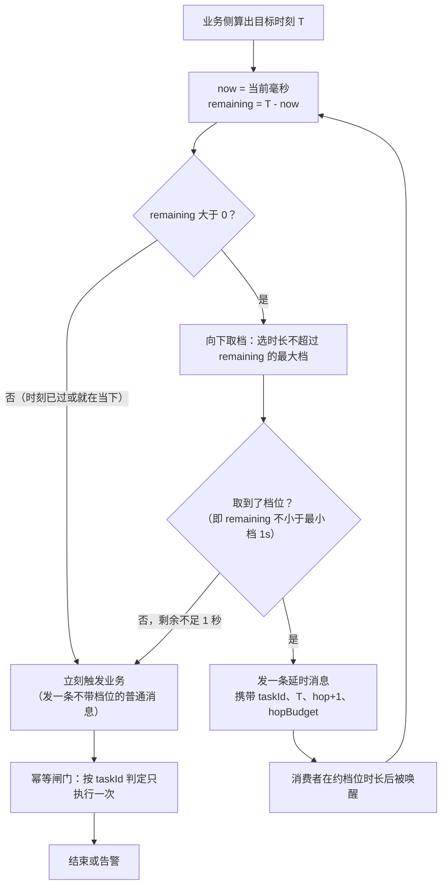

> [!NOTE] 证据口径
> 本篇不搭建、不运行任何真实工程。文中出现的「实测」一律指**静态取证**——读 `rocketmq-spring` 仓库 tag
> `rocketmq-spring-all-2.2.3` 的源码行号、扫 `rocketmq-all-4.9.8-bin-release` 发行包里 jar 的类结构与常量池；
> 不是运行读数。代码块里的 `// 预期输出:` 是按源码签名与上游文档结构推定的结果，不代表本机跑过。

## 为什么「任意时刻投递」在 4.9.8 上根本不成立？（痛点引入）

先看两类需求原话，它们在评审会上永远长一个样：

- **对账**：「每天 02:00 整开始拉昨天的账单，早一分钟上游还没出文件，晚一分钟 SLA 就破。」
- **会议提醒**：「会议 09:00 开始，提醒消息必须在 09:00 前后 10 秒内到达，不能提前，也不能拖到 09:05。」

这两句话的关键词是**绝对时刻**（deliver at T），而 RocketMQ 4.x 的延时能力从头到尾只在讲**相对时长档位**（delay level）。需求侧把它们统称「定时消息」，供给侧 4.x 里却没有对应入口——这个错位就是本篇要拆的东西。

更要命的是，Spring Boot 开发者很容易以为自己已经有解了：`rocketmq-spring-boot-starter` 2.2.3 的 `RocketMQTemplate` 明晃晃摆着三个方法 `syncSendDelayTimeSeconds` / `syncSendDelayTimeMills` / `syncSendDeliverTimeMills`，最后那个名字里就写着 deliver time。IDE 会自动补全、能编译、参数类型还是一个 `long` 时间戳——看上去就是为「09:00 整投递」准备的。**本篇的结论是：这三个方法在 Broker 4.9.8 上不构成可用方案**，而且这条结论不需要任何想象，starter 的 javadoc 原文与 4.9.8 发行包里的字节码就已经把它钉死了。

类比先行：4.x 的延时档位像老式微波炉的预设按键——「解冻 10 秒」「 popcorn 2 分钟」，你只能按已有的 18 个键；「任意时刻投递」像手机闹钟，要的是「明早 09:00 响」。现在手里只有微波炉，而 starter 递给你一份「闹钟说明书」，说明书第一页写着「本功能仅在 5.0 及以上 Broker 有效」。本篇就做三件事：把说明书那句话逐条读给你听（为什么不能按微波炉当闹钟用），再给出两条在只有微波炉时也能吃到准点早餐的做法（接力重投 / 落库扫描）。

> ### 💡 新人小结：本篇不教你「怎么调那三个方法」，教你怎么判断一个 API 在你的版本上到底存不存在
>
> - 能编译 ≠ 能运行：starter 是按 5.0.0 客户端编译的，你把客户端降到 4.9.8，调用点在运行时就没有那个方法；
> - 能调用 ≠ 有效果：即使属性写得出去，服务端有没有读它的代码是另一回事，判据是服务端类里有没有对应的键与入口；
> - 官方 javadoc 里的「only valid when the broker version is 5.0 or above」不是客套话，而是一条**适用前提**，前提不满足就没有可承诺的行为；
> - 版本不匹配时，工程上正确的动作不是「先试一把看会不会炸」，而是换一条当前版本能自证成立的路径。
>
> **一句话总结：本篇的证据全部来自源码、javadoc 原文与发行包字节码，一条运行读数都没有——因为本轮没有搭工程、没有跑代码。**

**本文路线**：4.x 能力边界（①）→ starter 三方法的官方声明（②）→ 4.9.8 客户端 setter 缺失的字节码证据（③）→ 4.9.8 属性键集合与定时入口缺失（④）→ 口径限定（⑤）→ 路径 A 向下取档 + 到期接力 → 路径 B 落库扫描 + MQ 仅作触发器 → 取舍对比 → 5.0 升级后的正解 → ❌ 三条错路。

档位表本体、4.x 与 5.0 定时的机制差异不在本篇重抄，一律以站内专文为准并链过去：[普通消息与定时延时消息](/docs/04-message-features/消息类型/普通消息与定时延时消息/)（该页含完整 18 级延迟投递表与新旧写法逐维度对照表）。Spring Boot 侧的档位用法见[延时消息与订单超时关单](/docs/11-springboot-integration/六种消息实战/延时消息与订单超时关单/)。

环境口径按站内基线：Spring Boot Web 2.7.18 + JDK 8 + Apache RocketMQ 4.9.8 + rocketmq-spring-boot-starter 2.2.3；starter 2.2.3 的**构建基线**是 Boot 2.5.9 / Spring 5.3.20 / 客户端 5.0.0 / JDK 1.8（依据 `org.apache.rocketmq:rocketmq-spring-boot-parent:2.2.3` 的 pom 属性），Boot 2.7.18 属同一大版本内的向后兼容使用。本文所有代码只用于讲解落地形态，**本轮没有搭建、也没有运行任何工程**，代码块里的 `// 预期输出:` 一律是「按源码路径与代码逻辑推定」的结构说明，不是本机运行读数；毫秒数、msgId 这类随机数值本文一概不写。

---

## 术语表（先对齐名词，再读正文）

| 术语 | 全称 / 出处 | 通俗含义（用自己的话） | 在本文中的角色 |
|------|-------------|------------------------|----------------|
| 绝对时刻投递 | deliver at absolute time，形如「09:00:00 触发」 | 「几点几分响」的闹钟语义，参数是一个时间戳 | 本文要满足的需求 |
| 延时时长 | delay duration，形如「延后 15 秒」 | 「从现在起等多久」，参数是一段时长 | 4.x 档位能表达的唯一形态 |
| delayLevel | 投递等级 / 延时档位，4.x 取值 1~18 | 微波炉的预设按键号，不是秒数 | 路径 A 的落地工具 |
| `MessageConst` | `org.apache.rocketmq.common.message.MessageConst`，4.9.8 在 `lib/rocketmq-common-4.9.8.jar` 内 | 消息属性键的「系统字典」，字典里没有的键服务端不会去查 | ④ 的判据来源 |
| `TIMER` 前缀 | 本文用来做判据的搜索关键字 | 「定时」这一族属性键在命名上的共同前缀 | 4.9.8 侧从客户端到服务端整串搜不到（④ 的实测项） |
| DelayMode | starter `support/DelayMode.java`，仅 3 个枚举值 | starter 内部区分三种定时语义的开关 | 把公开方法连到具体 setter |
| `setDelayTimeSec` / `setDelayTimeMs` / `setDeliverTimeMs` | 5.0.0 客户端 `Message` 上的三个 setter，starter L642/L645/L648 调用 | 把「秒」「毫秒时长」「绝对毫秒时刻」写进消息属性的三只手 | 4.9.8 客户端不存在（③ 的判据） |
| `ScheduleMessageService` | 4.9.8 `lib/rocketmq-store-4.9.8.jar` 内 `org/apache/rocketmq/store/schedule/` | 服务端真正执行「按档位压单」的那段代码 | 证明 4.9.8 的定时机制只有档位这条路 |
| 接力重投 | relay / re-schedule：到点后如果发现还早，就再发一跳 | 长跑接力里把剩余里程交给下一棒 | 路径 A 的核心动作 |
| 向下取档 | floor-level：选「时长不超过剩余等待量」的最大档位 | 宁可少等一点，绝不一次跨过目标时刻 | 路径 A 的取档策略 |
| 落库扫描补偿 | DB 记 fire_at，定时扫描兜住所有到期任务 | 把「记账」与「催办」分开，记账的一定对，催办可以漏 | 路径 B 的核心设计 |
| 触发器消息 | MQ 只负责「提前唤醒一次扫描」，不负责保证时机 | 门铃，按不按都行，巡逻的人照样到点巡逻 | 路径 B 里 MQ 的真实角色 |

---

## ① 4.x 只有 18 级固定档位：档位外时长与绝对时刻都不在能力面内

上游 4.x《延迟消息发送》（`docs/02-producer/04message3.md`）对延时消息的定义只有一句话，而且这句话里没有「时刻」这个词：

> 延迟消息发送是指消息发送到 Apache RocketMQ 后，并不期望立马投递这条消息，而是延迟一定时间后才投递到 Consumer 进行消费。
>
> —— `docs/02-producer/04message3.md`「延时消息介绍」

紧接着的《延时消息约束》给出了能力全貌：**Apache RocketMQ 一共支持 18 个等级的延迟投递**，并列出档位表。站内专文已经完整照录过这张 18 行表，本篇只取与论证相关的三档，口径与该页一致（[普通消息与定时延时消息](/docs/04-message-features/消息类型/普通消息与定时延时消息/)《使用限制：18 级延迟投递表》一节，L273-288）：

| 档位号 | 延时时长 | 与本篇的关系 | 出处 |
|--------|----------|--------------|------|
| 1 | 1s | 4.x 的最小档，路径 A 的「剩余时长够不够一跳」判据下限 | `docs/02-producer/04message3.md` 18 级表第 1 行 |
| 3 | 10s | 官方示例用的档位（等级 3 = 10s）；❌ 它既不是 3 秒也不是 15 秒 | 同上表 + 该文档 tip「设置的等级是3，也就是发送者发送后，10s后消费者才能收到消息」 |
| 4 | 30s | 档位 3 与 4 之间没有任何档位，「15 秒」在 4.x 无处安放 | 同上表 |
| 18 | 2h | 4.x 单条延时的上限，超过 2 小时的目标时刻必须拆成多跳 | 同上表末行；站内 04 页同值 |

由此得出两条与「任意时刻」直接相关的结论，都不需要推测：

1. **档位只能表达「从现在起多久」，不能表达「在哪个时刻」。** 入参是一个整数行号，服务端拿它去 `messageDelayLevel` 这张表里换时长；起算点是消息到达服务端的一刻（定义句「消息发送到 Apache RocketMQ 后」）。所以「今天 19:20:00 投递」这句话在 4.x 的参数形态里根本写不出来——你只能写「从现在开始按第 16 档等」。
2. **表里没有的时长不存在。**「延后 15 秒」在 3 档（10s）与 4 档（30s）之间，4.x 侧没有任何合法值可表达。站内 04 页的排查清单也把「想延时 15 秒在 4.x 里做不到」列为最常见诡异现象之一，原因写的是「只有 18 个固定档位，无此档」。

4.9.8 服务端到底怎么实现这套档位，本篇也在发行包里对了一眼（下一节给方法），能确定的是执行者是 `ScheduleMessageService`：它内部是 `ConcurrentMap<Integer, Long> delayLevelTable`（档位号 → 时长）、`int maxDelayLevel`、`queueId2DelayLevel(int)` / `delayLevel2QueueId(int)` 与投递中转主题 `SCHEDULE_TOPIC_XXXX`，读取的属性键就是 `DELAY`（javap 常量池可见的字符串只有 `DELAY`、`REAL_TOPIC`、`REAL_QID`、`SCHEDULE_TOPIC_XXXX` 这一组）。**一句话概括：4.9.8 服务端的定时执行路径是「档位号 → 专用队列 → 到点回写普通主题」，输入域就是那张表的行号，行号之外的东西没有代码路径。** 完整机制在站内专文，不在此重抄。

> ### 💡 新人小结：18 个档位是「18 个预设按键」，不是「18 秒到 18 分钟」
>
> - 按键号是**行号**：3 号键写着 10 秒，你按 3 得到的是「第 3 行」，不是「3 秒」；
> - 键与键之间没有半按：10 秒和 30 秒之间不存在 15 秒，微波炉不会因为你按住不放就给你 20 秒；
> - 最远的键只到 2 小时：一天的定时不是一跳，是若干跳或换方案；
> - 起算点是「机器开始工作的那一刻」（消息到服务端），不是你按下按钮的那一刻（业务代码执行到一半）。

---

## ② starter 的三个定时方法：官方 javadoc 逐条写着「仅 Broker 5.0+ 有效」

下面这张表是 `rocketmq-spring` 仓库 tag `rocketmq-spring-all-2.2.3` 的文件 `rocketmq-spring-boot/src/main/java/org/apache/rocketmq/spring/core/RocketMQTemplate.java` 的实测行号，六个公开重载 + 一个私有实现，一个不漏：

| 公开方法（重载） | 声明行 | `DelayMode` 实参 | 私有实现里落到哪个 setter |
|------------------|--------|------------------|---------------------------|
| `syncSendDelayTimeSeconds(String, Message<?>, long)` | L548 | `DELAY_SECONDS` | `setDelayTimeSec` |
| `syncSendDelayTimeSeconds(String, Object, long)` | L561 | `DELAY_SECONDS` | `setDelayTimeSec` |
| `syncSendDelayTimeMills(String, Message<?>, long)` | L575 | `DELAY_MILLISECONDS` | `setDelayTimeMs` |
| `syncSendDelayTimeMills(String, Object, long)` | L588 | `DELAY_MILLISECONDS` | `setDelayTimeMs` |
| `syncSendDeliverTimeMills(String, Message<?>, long)` | L603 | `DELIVER_TIME_MILLISECONDS` | `setDeliverTimeMs` |
| `syncSendDeliverTimeMills(String, Object, long)` | L616 | `DELIVER_TIME_MILLISECONDS` | `setDeliverTimeMs` |
| `private syncSend(String, Message<?>, long, long, DelayMode)` | L631-664 | 按 `mode` 分支 | L642 / L645 / L648 三行 setter |

`DelayMode` 本体在 `support/DelayMode.java`，只有三个枚举值：`DELAY_SECONDS`、`DELAY_MILLISECONDS`、`DELIVER_TIME_MILLISECONDS`（L20-24），也就是说这套定时语义的全部出口就是上面三个 setter，没有第四条路。

关键在于**适用前提写在 javadoc 原文里**。这六个公开方法的注释块，以及它们共同委托的那个私有实现的注释块，一共七处出现同一句话（实测行号 L541、L554、L568、L581、L596、L609、L623），原文照抄：

```java
/**
 * Same to {@link #syncSend(String, Message)} with send delay time specified in addition.
 * This function is only valid when the broker version is 5.0 or above
 *
 * @param destination formats: `topicName:tags`
 * @param message {@link org.springframework.messaging.Message}
 * @param deliverTimeMills delivered time in millisecond for message
 * @return {@link SendResult}
 */
public SendResult syncSendDeliverTimeMills(String destination, Message<?> message, long deliverTimeMills) {  // L603
    return syncSend(destination, message, producer.getSendMsgTimeout(), deliverTimeMills, DelayMode.DELIVER_TIME_MILLISECONDS);
}
```

出处：`RocketMQTemplate.java` L594-605（tag `rocketmq-spring-all-2.2.3`），`This function is only valid when the broker version is 5.0 or above` 就是 L596 那一行。注意 L623：连那七个代码路径共用的私有实现 `syncSend(..., DelayMode mode)` 的注释都写着同一句——**作者在最内侧也留了这句话，说明这不是某个重载的漏改，而是整套设计的前提。**

私有实现（L631-664）中与定时相关的骨架是这样：

```java
private SendResult syncSend(String destination, Message<?> message, long timeout, long delayTime, DelayMode mode) {  // L631
    // ... L632-635：message 或 payload 为 null 时抛 IllegalArgumentException("`message` and `message.payload` cannot be null")
    long now = System.currentTimeMillis();
    org.apache.rocketmq.common.message.Message rocketMsg = this.createRocketMqMessage(destination, message);
    if (delayTime > 0 && Objects.nonNull(mode)) {          // L639
        switch (mode) {
            case DELAY_SECONDS:            rocketMsg.setDelayTimeSec(delayTime); break;   // L642
            case DELAY_MILLISECONDS:       rocketMsg.setDelayTimeMs(delayTime); break;    // L645
            case DELIVER_TIME_MILLISECONDS:rocketMsg.setDeliverTimeMs(delayTime); break;  // L648
            default: log.warn("delay mode: {} not support", mode);
        }
    }
    SendResult sendResult = producer.send(rocketMsg, timeout);   // L654
    // ... L660-663：任何异常统一包成 MessagingException 抛出
}
```

三点源码事实顺带记下，它们在下一节的降级讨论里都会用到：

- 三只手就是三行 setter（L642/L645/L648），**这套语义完全依赖 5.0.0 客户端 `Message` 上的这三个方法**（starter 2.2.3 的 pom 里 `rocketmq.version=5.0.0`，见第 2.1 节口径）；
- L639 的条件是 `delayTime > 0`：传 0 或负数时 `switch` 整块不执行，属性一个都不写，这条调用退化成普通同步发送；
- `syncSendDeliverTimeMills` 的入参形态是**绝对时刻**（注释原文 `delivered time in millisecond`，5.0 侧对应「毫秒级 Unix 时间戳」），而另外两个是时长。三者的参数名同为 `long`，但语义量纲不同，这是最容易写错的一格（❌ 段落里会重敲这一钉）。

对比一下 4.x 唯一合法的延时入口在同一个文件里的样子：`syncSend(String destination, Message<?> message, long timeout, int delayLevel)`（L677），内部只有 `if (delayLevel > 0) { rocketMsg.setDelayTimeLevel(delayLevel); }`（L685-687）。**四参版走的是 `setDelayTimeLevel`（档位），五参私有版走的是三个 5.x setter（时长/时刻）——两套语义在 starter 里物理上就是分开的两条代码路径。** 这也是为什么本篇的结论可以只靠源码给出。

---

## ③ 字节码实测：把客户端降到 4.9.8，那三个 setter 根本不存在

starter 是按 5.0.0 客户端编译的；本工程的运行基线是 4.9.8。如果按站内基线篇的口径把客户端显式降到 4.9.8（写 `<dependency>` 指定 4.9.8，或 exclude 掉 starter 自带的 5.0.0），下面这份扫描结果就是硬约束。

扫描对象：`rocketmq-all-4.9.8-bin-release` 发行包的 `lib/rocketmq-common-4.9.8.jar`，条目 `org/apache/rocketmq/common/message/Message.class`（6517 字节，本机 Dragonwell 8 的 `javap` 可用，同时用 python 的 zipfile 直读常量池可打印字符串做交叉印证）。

**实测数字（本文自己扫的，可复现）**：

| 被搜符号 | 出现位置 | 4.9.8 实际命中 | 结论 |
|----------|----------|----------------|------|
| `setDelayTimeLevel` / `getDelayTimeLevel` | `Message.class` 方法表 | 命中，且是唯一与延时相关的一对方法 | 4.x 侧延时的唯一旋钮 |
| `setDelayTimeSec` | 整个 `lib/` 下 58 个 jar 的全部 `.class` | **0 个文件命中** | 4.9.8 没有这个 setter |
| `setDelayTimeMs` | 同上 | **0 个文件命中** | 同上 |
| `setDeliverTimeMs` | 同上 | **0 个文件命中** | 同上 |
| `DELAY`（属性键字符串） | `Message.class` / `MessageConst.class` | 命中 | 档位号最终写进的键 |

`javap -c` 还能看到 `setDelayTimeLevel` 干的事只有一行属性写入：

```text
public void setDelayTimeLevel(int);
  Code:
     1: ldc  #37   // String DELAY
     4: invokestatic  // java/lang/String.valueOf:(I)Ljava/lang/String;
     7: invokevirtual // putProperty:(Ljava/lang/String;Ljava/lang/String;)V
// 结构说明（非运行读数）：4.x 客户端把「档位」表达成属性键 DELAY 上的一个整数值字符串，仅此而已
```

由此得到 ③ 的确切结论：**4.9.8 客户端的 `Message` 类里不存在 `setDelayTimeSec` / `setDelayTimeMs` / `setDeliverTimeMs` 这三个方法**。starter 的 `syncSendDelayTimeSeconds/Mills/DeliverTimeMills` 三条路径全部要靠它们（L642/L645/L648）。因此：

- 客户端 = 5.0.0（starter 默认带的）时，这三个方法**能编译能调用**，属性写得出去，但服务端是 4.9.8 —— 见 ④；
- 客户端被降到 4.9.8 时，调用点在运行时**找不到这个方法**（源码级事实：目标类里没有该符号）。结构上这是链接层面的缺失，不是业务分支里的失败；本文不断言它在你的机器上以哪种异常文案出现，因为那取决于打包与类加载形态，本轮没有运行过任何工程。

能确定的只有一件事，也是本节要给工程实践的那句话：**在 4.9.8 这一侧，这三条 API 路径要么缺方法、要么缺服务端入口，不存在「完整成立」的组合。** 类比一下：你手里那本说明书（starter 2.2.3）确实教你怎么设闹钟，但说明书是按带闹钟的机型写的；你家电饭煲上没有那个芯片，照说明书按下去，机器要么根本没那个键（客户端 4.9.8），要么键按下去了机器里没接这条线（服务端 4.9.8）。

---

## ④ 属性键集合实测：4.9.8 侧连「定时」这个键空间都不存在

③ 说的是客户端的手没了，④ 说的是服务端的耳也没有。判据是同发行包的 `lib/rocketmq-common-4.9.8.jar` 中 `org/apache/rocketmq/common/message/MessageConst.class`（3236 字节）的 `javap -constants` 输出——**下列 35 个键就是 4.9.8 的全部系统属性键，实测逐条抄录，没有第 36 个**：

| # | 键 | # | 键 | # | 键 |
|---|----|---|----|---|----|
| 1 | `KEYS` | 13 | `TRANSFER_FLAG` | 25 | `CHECK_IMMUNITY_TIME_IN_SECONDS` |
| 2 | `TAGS` | 14 | `CORRECTION_FLAG` | 26 | `INSTANCE_ID` |
| 3 | `WAIT` | 15 | `MQ2_FLAG` | 27 | `CORRELATION_ID` |
| 4 | `DELAY` | 16 | `RECONSUME_TIME` | 28 | `REPLY_TO_CLIENT` |
| 5 | `RETRY_TOPIC` | 17 | `MSG_REGION` | 29 | `TTL` |
| 6 | `REAL_TOPIC` | 18 | `TRACE_ON` | 30 | `ARRIVE_TIME` |
| 7 | `REAL_QID` | 19 | `UNIQ_KEY` | 31 | `PUSH_REPLY_TIME` |
| 8 | `TRAN_MSG` | 20 | `MAX_RECONSUME_TIMES` | 32 | `CLUSTER` |
| 9 | `PGROUP` | 21 | `CONSUME_START_TIME` | 33 | `MSG_TYPE` |
| 10 | `MIN_OFFSET` | 22 | `TRAN_PREPARED_QUEUE_OFFSET` | 34 | `INNER_MULTI_DISPATCH` |
| 11 | `MAX_OFFSET` | 23 | `TRANSACTION_CHECK_TIMES` | 35 | `INNER_MULTI_QUEUE_OFFSET` |
| 12 | `BUYER_ID` | 24 | `ORIGIN_MESSAGE_ID` | —— | —— |

与延时/定时相关的只有一个：**第 4 个 `DELAY`（对应字段 `PROPERTY_DELAY_TIME_LEVEL`，即档位）**。这份清单里：

- 没有任何 `TIMER` 前缀的键——`MessageConst.class` 的字节里连 `TIMER` 这个子串都搜不到（实测：`b'TIMER' in 该 class 字节 == False`）；
- 也没有任何表达「绝对投递时刻」的键（既没有 `DELAY` 之外的时长键，也没有 `deliver`/`fire`/`schedule` 一类命名）。
- 把搜索面放到整个发行包：58 个 jar 里含 `TIMER` 子串的类文件只有 4 个，其中属于 RocketMQ 的是 `rocketmq-client-4.9.8.jar` 的 `trace/TraceConstants.class`（字符串 `ROCKETMQ_RETRY_TIMERS`，重试次数统计用的追踪常量）与 `rocketmq-store-4.9.8.jar` 的 `store/stats/BrokerStatsManager$StatsType`（字符串 `SEND_TIMER`，发送耗时统计项）——**两者都不是消息属性键，也不是定时入口**；另外 2 个来自第三方（netty 的 `EpollEventLoop`、bouncycastle 的 `EACTags`），与 RocketMQ 语义无关。
- `rocketmq-store-4.9.8.jar` 与 `rocketmq-broker-4.9.8.jar` 里没有任何类名含定时轮/定时器消息存储的组件（搜 `TimerMessageStore` 全库 **0 命中**）；`store/schedule/` 包下只有档位机制的 `ScheduleMessageService` 与它的内部类 `DeliverDelayedMessageTimerTask`（线程名 `ScheduleMessageTimerThread_`，是「按档位投递」的执行线程，不是任意时刻定时）。

还有一个细节值得记下来，它能挡住一种「绕过 starter」的歪招。4.9.8 的 `Message.putUserProperty(String, String)` 在字节码里做的事是：先查 `MessageConst.STRING_HASH_SET`，命中就抛 `RuntimeException("The Property<%s> is used by system, input another please")`，否则当作普通用户属性写入。既然 `TIMER_*` 不在 4.9.8 的系统键字典里，那么**手工** `putUserProperty("TIMER_XXX", "1699999999999")` 这种写法不会撞那条黑名单，它会作为一种无名用户属性随消息一起存出去——「写得进去」和「有人读」是两件事：`MessageConst` 里没有这个键、`ScheduleMessageService` 只认 `DELAY`、broker/store 侧没有读这类属性的代码路径，所以这条属性对投递时机不产生任何作用。

于是 ④ 的确切结论是：**4.9.8 侧不存在这套属性键，也就不存在档位之外的定时入口。** 用类比说：`MessageConst` 是快递站的「可识别便签栏清单」，清单上只有「压单档期」（DELAY）这一栏跟时间有关；你自己在包裹上贴一张「务必 09:00 派送」的手写条，快递站的扫描流程里没有识别这一栏的程序，那张纸跟着包裹一路走完全程，却从没被任何一道工序读进分拣逻辑。

---

## ⑤ 结论口径：能说「不成立 / 无入口 / 官方声明不适用」，不能说的两句话

把 ①②③④ 串成一条链，本篇的技术结论只有下面这些，每一个都能在本文找到出处：

| 断言 | 依据（一句话） |
|------|----------------|
| 「4.9.8 的定时能力只有 18 级固定档位，档位外时长与绝对时刻都不在能力面内」 | 上游 `docs/02-producer/04message3.md` 的定义句 + 18 级约束表；站内 04 页同表 |
| 「`syncSendDelayTimeSeconds/Mills/DeliverTimeMills` 在 Broker 4.9.8 上不满足官方适用前提」 | `RocketMQTemplate.java` 七处 javadoc 原文 `This function is only valid when the broker version is 5.0 or above`（L541/L554/L568/L581/L596/L609/L623） |
| 「4.9.8 客户端不存在这三个 setter，客户端降到 4.9.8 后这三条调用路径缺方法」 | `lib/rocketmq-common-4.9.8.jar` 的 `Message.class` 方法表 + 全库 58 jar 扫描 0 命中（③ 的表） |
| 「4.9.8 没有与这三个 setter 对应的属性键与服务端定时入口」 | `MessageConst.class` 的 35 键实测清单不含 `TIMER_*`；`ScheduleMessageService` 只读 `DELAY`；`TimerMessageStore` 全库 0 命中（④） |
| 「4.9.8 上可行的两条路是向下取档接力重投 / 落库扫描补偿」 | 二者只使用 ① 的档位能力与本地 DB 能力，不依赖任何 5.x 特性（本文路径 A、B） |

**明确不说的两句话**（因为本文手里的材料都给不出这个结论）：

- ❌ 不写「Broker 会给这条消息报错」。4.x 文档与 4.9.8 代码都没有定义「收到一个自己不认识的属性」该如何处置，本文不替服务端编造行为。
- ❌ 不写「消息被静默丢弃且毫无痕迹」。同样没有依据；本文只说「没有对应的读取路径，因此对投递时机不产生作用」，并保留一句提醒：站内〈组件架构与部署形态详解〉在版本对照里给过一条「同一份代码在 4.9.8 上会立刻投递」的表述（该文件 L527），**那是该页的推定口径，不是本文的判据**，本篇一律以 javadoc 原文与字节码为准，把「服务端到底怎么处置未知属性」记为官方未定义。
- 也不写任何运行读数（异常文案、耗时、msgId、Broker 日志片段）：本轮没有搭建工程、没有运行代码。

这条口径限定本身就是本篇的一个交付物：**版本能力判定要落在「有出处的否证」上，而不是落在「我猜它会报错」上。**

---

## 路径 A：向下取档 + 到期接力重投（只用 4.x 档位能力）

**设计**：把「目标时刻 T」变成一个可迭代的相对量。每跳只做三件事：算剩余 `remaining = T - now`；从 18 档里选**时长不超过 remaining 的最大档**（向下取档）；发一条带该档位的消息。到点被消费时重新算剩余：还够一档就再发一跳，不够就直接触发业务。

决策流程如下（对应需求原话「目标时刻 - 现在 = 剩余时长 → 取档 → 是否小于最小档 → 接力 or 触发」）：



图后三点解读：

1. 回路只有一条（`H → B`），且每绕一圈 `remaining` 至少减掉 1 秒（能取到档位就意味着至少取了最小档 1s），所以这条边不会白走；
2. 分叉只有一处真判据：`remaining` 是否还够下一档；够就接力，不够就触发——**判据用的是墙上时钟（T 与 now），不是「我收到了一条延时消息」这个事件本身**；
3. 出口 `G` 之后必须接幂等闸门：路径 A 会产生多条消息（一跳一条），业务只能执行一次。

**为什么不会无限循环**（这段是路径 A 的正当性核心，不是修辞）：

- **有界性来自「每跳必有正消耗」**：只要 `remaining ≥ 1000ms` 就一定能取到档位（最小档 1s），于是每绕一圈 `remaining` 至少减少 1000ms；循环体内没有任何让 `remaining` 回升的分支，所以有限步内必然落到 `remaining < 1s` 或 `remaining ≤ 0` 这两个出口之一。这就排除了无限循环。
- **跳数还有一条能算的上界，而且是分段的**（分段这件事直接决定路径 A 适合什么跨度）：
  - `R ≥ 2h` 时，向下取档必然取到 18 档（2 小时，表里最长的一档），这一段每跳固定消耗 2h，跳数与跨度成**线性**关系，约为 `⌊R / 2h⌋`；
  - `R < 2h` 时进入尾段，18 档表里相邻两档的最大比值是 5（1s → 5s），其余是 2、3 或更小，所以「不超过 R 的最大档」`L > R/5`，下一跳剩余 `≤ 0.8R`——尾段每次至少打八折，从 2h 折到 1s 以内所需跳数是有界的；
  - 合起来：`总跳数 ≤ ⌊R₀ / 2h⌋ + 尾段最坏跳数`。对 18 档表逐毫秒穷举这套贪心过程（**纯算术推演，不是运行读数**）得到尾段最坏是 **12 跳**，出现在 `R₀ = 6 119 000ms ≈ 1.7 小时` 处：贪心先吃掉 `1h + 30min + 10min + 1min + 30s + 10s + 10s`（7 跳），剩下的 9 秒只能用 `5s + 1s×4`（5 跳）收掉，合计 12 跳——**最坏情形来自「贪心之后剩一小截碎数」，而不是跨度本身很大**。
- 几个具体跨度的跳数（同一套贪心推演，起算值即目标跨度）：

| 目标跨度 | 接力跳数 | 拆档过程 |
|----------|----------|----------|
| 25 分钟 | 2 跳 | 20min（15 档）+ 5min（9 档） |
| 1 小时 | 1 跳 | 档位 17 正好是 1h，一跳到位 |
| 1 天（24h） | 12 跳 | 每跳都是 18 档（2h），12 跳归零 |
| 25 小时 | 13 跳 | 12 跳 2h，再 1 跳 1h（档位 17） |
| 3 天 | 36 跳 | 跨度翻几倍、消息翻几倍，线性增长 |
| 7 天 | 84 跳 | 叠上尾段最坏 12 跳，上界约 96 跳 |

- 实际只会比这张表更省：档位时长是下界（分发、同刻挤压、消费重试都只会让唤醒更晚，见[延时消息与订单超时关单](/docs/11-springboot-integration/六种消息实战/延时消息与订单超时关单/)的同刻挤压一节），每次唤醒时 `now` 推进得比 `L` 多，`remaining` 收敛更快、跳数只会更少。
- **这张跳数表同时标出了路径 A 的适用边界**：小时级到 1 天的任务跳数很少，完全可用；跨天以上每 2 小时就产生一条接力消息，消息量与跨度成正比，中间任一跳被误投或误消费都会让链条整体延后——那种需求应该走路径 B。
- 兜底守卫是必需的，不是多余的：`hopCount >= hopBudget` 时无条件走触发分支并打告警。预算按上面的上界现算（`跨度 / 2h + 尾段最坏 12 + 余量`），它挡的是「`T` 被写成不可能的未来值」「`messageDelayLevel` 被运维改动导致 `L` 计算失真」「消息体里 `hopCount` 丢失或被污染」这类**上界推导失效**的情形——守卫负责让系统在有界时间内收敛，算术负责说明正常情况下用不着它。

```java
package demo.timed.mq;

import java.util.Optional;
import org.apache.rocketmq.spring.core.RocketMQTemplate;
import org.apache.rocketmq.spring.support.RocketMQHeaders;
import org.springframework.messaging.Message;
import org.springframework.messaging.support.MessageBuilder;

/**
 * 路径 A 的发送侧：向下取档 + 到期接力。
 * 只使用 4.x 唯一合法延时入口 syncSend(destination, message, timeout, delayLevel)
 * （RocketMQTemplate.java L677，内部 if (delayLevel > 0) setDelayTimeLevel，L685-687）。
 * DelayLevel 枚举与 nearestLevelAtLeast 的定义见〈延时消息与订单超时关单〉一文，
 * 本篇还需要一个方向相反的方法：floorLevelAtMost（向上取会跨过目标时刻，这里必须向下取）。
 */
@Service
public class AbsoluteTimeRelaySender {

    /** 18 档里最长的一档（档位 18 = 2h）的毫秒数，用于按跨度现算跳数预算。 */
    private static final long MAX_LEVEL_MILLIS = 7_200_000L;
    /** 尾段最坏 12 跳（对 18 档表穷举贪心过程推得）+ 余量 8，构成跳数预算的固定加数。 */
    private static final int TAIL_WORST_HOPS_WITH_MARGIN = 20;
    private static final long SEND_TIMEOUT_MS = 3000L;   // rocketmq.producer.sendMessageTimeout 默认值

    private final RocketMQTemplate rocketMQTemplate;

    public AbsoluteTimeRelaySender(RocketMQTemplate rocketMQTemplate) {
        this.rocketMQTemplate = rocketMQTemplate;
    }

    /** 首次调用：业务侧给出目标时刻 T（毫秒时间戳）；跳数预算在这里一次算定，随消息一路带着走。 */
    public void scheduleAt(String taskId, long deliverAtEpochMillis, Object payload) {
        long remainingMillis = deliverAtEpochMillis - System.currentTimeMillis();
        int hopBudget = (int) (Math.max(0L, remainingMillis) / MAX_LEVEL_MILLIS) + TAIL_WORST_HOPS_WITH_MARGIN;
        relay(taskId, deliverAtEpochMillis, payload, 0, hopBudget);
    }

    /** 每一跳都重新按「T - now」取档：remaining 越小，取到的档位越低，最终落到触发分支。 */
    public void relay(String taskId, long deliverAtEpochMillis, Object payload,
                      int hopCount, int hopBudget) {
        long remainingMillis = deliverAtEpochMillis - System.currentTimeMillis();

        // 守卫一：跳数预算耗尽（挡的是上界推导失效）。守卫二：剩余时长非正（时刻已过/就在当下）。
        if (hopCount >= hopBudget || remainingMillis <= 0L) {
            fireNow(taskId, deliverAtEpochMillis, payload, hopCount,
                    hopCount >= hopBudget ? "HOPS_GUARD" : "TIME_REACHED");
            return;
        }

        // 向下取档：选「时长不超过 remainingMillis」的最大档
        Optional<DelayLevel> level = DelayLevel.floorLevelAtMost(remainingMillis);
        if (!level.isPresent()) {
            // 剩余不足最小档 1s：已经够接近目标时刻，直接触发
            fireNow(taskId, deliverAtEpochMillis, payload, hopCount, "TAIL_BELOW_MIN_LEVEL");
            return;
        }

        RelayCommand cmd = new RelayCommand(taskId, deliverAtEpochMillis, hopCount + 1, hopBudget, payload);
        Message<RelayCommand> message = MessageBuilder.withPayload(cmd)
                .setHeader(RocketMQHeaders.KEYS, taskId)          // 发侧被显式识别的头之一，便于按业务号回查
                .setHeader("X-Relay-Hop", String.valueOf(hopCount + 1))
                .build();

        rocketMQTemplate.syncSend("TIMED_RELAY_TOPIC:relay", message,
                SEND_TIMEOUT_MS, level.get().level());
        // 结构说明（按 L677→L685-687 代码路径推定，非运行读数）：
        // 这一跳的消息属性里带着键 DELAY=<档位号>，除档位外没有任何 5.x 定时属性。
    }

    /** 终跳：发一条不带延时属性的普通消息，让消费端去做真正的业务与幂等判定。 */
    private void fireNow(String taskId, long deliverAtEpochMillis, Object payload,
                         int hopCount, String reason) {
        FireCommand cmd = new FireCommand(taskId, deliverAtEpochMillis, hopCount, reason, payload);
        rocketMQTemplate.syncSend("TIMED_FIRE_TOPIC:fire",
                MessageBuilder.withPayload(cmd).setHeader(RocketMQHeaders.KEYS, taskId).build());
        // 结构说明：终跳走的是不带档位入参的 syncSend（L475 → L476 → L487 → 四参版收到 delayLevel=0，
        //           L488-489），L685 的 if (delayLevel > 0) 不成立，消息不带延时属性、立刻可见；
        //           reason 会随消息体进入业务侧留痕（HOPS_GUARD 要接告警，其余两个出口属正常收敛）。
    }
}
```

`DelayLevel` 里新增的那个方法（方向与关单篇的 `nearestLevelAtLeast` 相反，务必分清）：

```java
    /**
     * 向下取档：第一个时长 <= target 的档位（含相等）。
     * target 小于最小档 1s 时返回 Optional.empty()，调用方据此走「直接触发」分支。
     * 关单场景要的是「至少等这么久」所以向上取；接力场景必须「绝不跨过目标时刻」所以向下取。
     */
    public static Optional<DelayLevel> floorLevelAtMost(long targetMillis) {
        DelayLevel best = null;
        for (DelayLevel candidate : values()) {   // 声明顺序即时长升序
            if (candidate.duration().toMillis() <= targetMillis) {
                best = candidate;                 // 一直覆盖，循环结束即是「不超过 target 的最大档」
            } else {
                break;                            // 后面只会更大，不必再看
            }
        }
        return Optional.ofNullable(best);
    }
```

按上面逻辑推演（**以下全部是按代码逻辑推定的结构结论，不是本机运行读数**）：

```java
// 预期输出: remaining=25min -> floorLevelAtMost 取到 20min（档位 15）；下一跳剩余 5min，取到 5min（档位 9），再下一跳剩余 0 -> fireNow
// 预期输出: remaining=12s  -> 取 10s（档位 3）；剩余 2s -> 取 1s（档位 1）；剩余 1s -> 再取 1s（档位 1）；剩余 0 -> fireNow(reason=TIME_REACHED)，共 3 跳
// 预期输出: remaining=700ms -> floorLevelAtMost 返回 Optional.empty()（小于最小档 1s），直接 fireNow(reason=TAIL_BELOW_MIN_LEVEL)
// 预期输出: remaining<=0（目标时刻已被跨过）-> 直接 fireNow(reason=TIME_REACHED)，绝不倒着等
// 预期输出: hopBudget 耗尽 -> 直接 fireNow(reason=HOPS_GUARD)，该 reason 必须接告警：它意味着上面的上界推演失效了
```

接力消费者（接力跳次与终跳分属两个主题、两个消费者组：`TIMED_RELAY_TOPIC:relay` 只续里程，`TIMED_FIRE_TOPIC:fire` 才做业务与幂等。同一个组内所有实例的订阅关系必须一致，别把两种 tag 混在一个组里，口径见[基本最佳实践订阅一致性与JVM调优](/docs/08-best-practice/使用规范与调优/基本最佳实践订阅一致性与JVM调优/)。下面给 relay 侧）：

```java
@RocketMQMessageListener(
        topic = "TIMED_RELAY_TOPIC",
        selectorExpression = "relay",              // 本组只订阅接力这一种消息，终跳消息不会流到这里
        consumerGroup = "timed-relay-hop-group",
        consumeThreadNumber = 20)                  // consumeThreadMax 已 @Deprecated，控制并发用它
public class RelayHopConsumer implements RocketMQListener<RelayCommand> {

    private final AbsoluteTimeRelaySender sender;

    public RelayHopConsumer(AbsoluteTimeRelaySender sender) {
        this.sender = sender;
    }

    @Override
    public void onMessage(RelayCommand cmd) {
        // 关键：这里不「执行业务」，只把剩余里程再算一遍，交给发送侧决定接力还是触发。
        sender.relay(cmd.getTaskId(), cmd.getDeliverAtEpochMillis(), cmd.getPayload(),
                cmd.getHopCount(), cmd.getHopBudget());
    }
}
```

**精度与偏差方向**（这里必须说清，因为「向下取档」的偏差方向和关单场景相反）：

| 偏差方向 | 会不会发生 | 量级 | 兜法 |
|----------|-----------|------|------|
| 早于目标时刻 T | 会，但被取档方向限制在「不足一个最小档」以内 | 尾段提前量上界 < 1s（最小档就是 1s） | 业务侧仍要判 `deliverAtEpochMillis <= now`；要求「绝不早于 T」就把终止条件改成 `remaining <= 0`，让最后一跳跨过 T |
| 晚于目标时刻 T | 会，且没有上界承诺 | 分发延迟、同刻挤压、消费重试都往晚的一侧叠加 | 档位时长本来就是下界；对账类需求用路径 B 的账本判定，不指望消息准点 |
| 累计等待跨过 T（多等过头） | 不会 | 取档规则保证每跳 `L ≤ remaining`，累计计划等待量 ≤ 初始剩余 | 这正是向下取档的意义；向上取档会在第一跳就跨过 T |


> ### 💡 新人小结：路径 A 是「多次短等」，不是「一次长等」
>
> - 4.x 单条最多 2 小时，目标时刻在 3 天后就得拆成若干跳，像接力而不像一人跑完；
> - 取档方向决定安全性：关单要「至少等 30 分钟」所以向上取，接力要「绝不跨过 T」所以向下取，同一个枚举两个方法别混；
> - 每一跳都重新看墙钟，所以前面几跳晚到了多少，后面几跳会自动少等一点，误差不会累积成漂移；
> - 守卫（最大跳数）不是数学需要，是工程需要：它保证「材料之外的意外」也能在有界时间内收敛。

---

## 路径 B：定时落库 + 扫描补偿 + MQ 仅作触发器

**设计**：把「什么时候该做」这件事的记录权从 MQ 收回本地数据库，MQ 降级成一个可选的加速器。DB 是唯一账本，扫描器是权威触发源，MQ 消息只是「提前叫扫描器看一眼」的门铃——门铃丢了，巡逻照样到点。

账本表与索引（MySQL 5.7 / JDK 8 年代可用语法，字段命名与关单篇的 `pay_expire_time` 保持同一量纲：毫秒时间戳 BIGINT）：

```sql
CREATE TABLE scheduled_task (
  id             BIGINT UNSIGNED NOT NULL AUTO_INCREMENT,
  task_type      VARCHAR(32)  NOT NULL COMMENT '业务类别：recon-daily / meeting-remind',
  task_id        VARCHAR(64)  NOT NULL COMMENT '业务唯一键，例：账期+商户号、会议ID',
  fire_at        BIGINT       NOT NULL COMMENT '目标触发时刻，毫秒 Unix 时间戳（与 5.0 侧同一量纲）',
  status         TINYINT      NOT NULL DEFAULT 0 COMMENT '0 PENDING 1 FIRED 2 DONE 3 FAILED',
  fire_token     VARCHAR(64)  DEFAULT NULL COMMENT '本次抢占凭据，回写与排查用',
  attempt_times  INT          NOT NULL DEFAULT 0 COMMENT '已触发次数，含重投',
  payload        TEXT         NOT NULL COMMENT '触发所需最小上下文（别塞大对象，回查靠它）',
  gmt_create     DATETIME     NOT NULL,
  gmt_modified   DATETIME     NOT NULL,
  PRIMARY KEY (id),
  UNIQUE KEY uk_type_task (task_type, task_id),      -- 幂等的最终防线：同一业务任务只能有一行
  KEY idx_status_fire_at (status, fire_at)           -- 扫描 SQL 的覆盖索引：先按状态收窄，再按时刻排序
) COMMENT='定时任务账本：MQ 只是触发器，这张表才是事实来源';
```

索引不是装饰：扫描条件固定是「`status = 0` 且落在一个时间窗内」，`idx_status_fire_at` 让这一句走等值 + 范围的最左前缀；漏了这个索引，扫描就会退化成随表长大的全表扫，路径 B 的全部代价问题都出在这里。

扫描与抢占（两条 SQL 一起看：先圈候选，再用 CAS 抢，抢到才动业务）：

```sql
-- ① 圈候选：窗口 = [now - lookback, now]，一次最多 batchSize 条
--    lookback 的作用：把「早就逾期没跑」的历史留在告警通道里反复可见，而不是让它们无限堆在扫描结果前排
SELECT id, task_type, task_id, fire_at, attempt_times
  FROM scheduled_task
 WHERE status = 0
   AND fire_at <= #{nowMillis}
   AND fire_at >  #{nowMillis} - #{lookbackMillis}
 ORDER BY fire_at
 LIMIT #{batchSize};

-- ② 抢占（多实例并发安全的关键）：状态条件写在 WHERE，靠影响行数裁决
UPDATE scheduled_task
   SET status = 1, fire_token = #{token}, attempt_times = attempt_times + 1, gmt_modified = NOW()
 WHERE id = #{id} AND status = 0;      -- 影响 1 行 = 我抢到；影响 0 行 = 别的实例抢走了，直接跳过

-- ③ 业务成功收尾
UPDATE scheduled_task SET status = 2, gmt_modified = NOW() WHERE id = #{id} AND fire_token = #{token};

-- ④ 逾期与卡死的可见性（不看运行日志也能查账）
SELECT task_type, COUNT(*) AS overdue_cnt, MIN(fire_at) AS oldest_fire_at
  FROM scheduled_task
 WHERE status IN (0, 1) AND fire_at <= #{nowMillis} - #{lookbackMillis}
 GROUP BY task_type;
```

扫描器与双写顺序（`@Scheduled` 在这里是合法的，因为它驱动的是**本地账本**，不是替下游记时间）：

```java
package demo.timed.scan;

@Component
public class ScheduledTaskScanner {

    private static final Logger log = LoggerFactory.getLogger(ScheduledTaskScanner.class);
    /** 扫描窗口参数：周期与回看量都写在配置里，便于按业务允许的误差调节。 */
    private static final long LOOKBACK_MILLIS = 3_600_000L;   // 回看 1 小时：逾期任务在这一小时内每轮都可见
    private static final int  BATCH_SIZE = 200;
    private static final long SEND_TIMEOUT_MS = 3000L;

    private final ScheduledTaskMapper mapper;
    private final RocketMQTemplate rocketMQTemplate;
    private final TaskExecutor executor;         // 真正的业务执行器（本地服务或远程调用）

    public ScheduledTaskScanner(ScheduledTaskMapper mapper, RocketMQTemplate rocketMQTemplate,
                               TaskExecutor executor) {
        this.mapper = mapper;
        this.rocketMQTemplate = rocketMQTemplate;
        this.executor = executor;
    }

    /** 固定周期扫账本。周期就是路径 B 的精度下界（外加分发与执行耗时），必须写进配置评审。 */
    @Scheduled(fixedDelayString = "${timed-task.scan-interval-millis:5000}")
    public void scan() {
        long now = System.currentTimeMillis();
        for (ScheduledTaskRow row : mapper.selectDueCandidates(now, LOOKBACK_MILLIS, BATCH_SIZE)) {
            String token = UUID.randomUUID().toString();
            if (mapper.claim(row.getId(), token) == 0) {
                continue;                        // 被其他实例抢走：正常现象，不算失败
            }
            try {
                executor.run(row.getTaskType(), row.getTaskId(), row.getPayload());
                mapper.markDone(row.getId(), token);
            } catch (RuntimeException ex) {
                mapper.markFailed(row.getId(), token);
                log.error("scheduled task failed, taskType={}, taskId={}", row.getTaskType(), row.getTaskId(), ex);
                // 不重投：下一次业务动作由人工/补偿任务按 status=3 决定，避免把「业务失败」混进「定时失败」
            }
        }
    }
}
```

MQ 触发器的写法（可选加速器；**它不能是唯一触发源**，理由就是扫描窗口已经覆盖了这个时刻。注意发送时机：账本插入与 MQ 发送不能挤在同一个本地事务里，否则事务回滚时提示已经飞出去了——用 `afterCommit` 把发送推到提交之后）：

```java
/**
 * 落库为主、提交后发提示：MQ 只让「到点响应」更快一点，不参与正确性。
 * 依赖 org.springframework.transaction.support.TransactionSynchronizationManager
 * 与 TransactionSynchronization（Spring 5.3.20 提供，starter 2.2.3 的构建基线版本）。
 */
@Transactional(rollbackFor = Exception.class)
public void createTask(String taskType, String taskId, long fireAt, Object payload) {
    int inserted = mapper.insertPending(taskType, taskId, fireAt, serialize(payload));
    if (inserted == 0) {
        // uk_type_task 命中：同一业务任务只登记一次（登记层的幂等闸门），不重复登记也不重复提示。
        return;
    }
    final DueHint hint = new DueHint(taskType, taskId, fireAt);
    if (TransactionSynchronizationManager.isSynchronizationActive()) {
        // ✅ 推荐形态：本地事务提交成功后再发提示；回滚则一条都不发，不会出现「凭空的触发」。
        TransactionSynchronizationManager.registerSynchronization(new TransactionSynchronization() {
            @Override
            public void afterCommit() {
                sendDueHint(hint);
            }
        });
    } else {
        // 无事务上下文时（例如被非事务方法直接调用）退化为「提交后立刻发」，语义与上面一致。
        sendDueHint(hint);
    }
}

private void sendDueHint(DueHint hint) {
    try {
        rocketMQTemplate.syncSend("TIMED_FIRE_TOPIC:due",
                MessageBuilder.withPayload(hint)
                        .setHeader(RocketMQHeaders.KEYS, hint.getTaskId()).build(),
                SEND_TIMEOUT_MS);
    } catch (RuntimeException ex) {
        // 关键分支：门铃没响不等于没人巡逻。这里只记日志、绝不向上抛，
        // 因为账本已经落库，扫描器仍会在回看窗口内触发这一条任务。
        log.warn("trigger hint send failed, scanning will still cover it, taskId={}", hint.getTaskId(), ex);
    }
}
```

```java
// 预期输出（按代码路径推定，非运行读数）：
// 1. 正常路径：账本插入 status=0 -> 事务提交 -> afterCommit 发出提示 -> 消费者按 task_id 回查账本
//              -> status=0 才抢占执行；
// 2. 提示发送失败：sendDueHint 的 catch 只记 warn，账本已提交、状态仍是 0，下一轮扫描照常覆盖；
// 3. 事务回滚：afterCommit 根本不会被回调，一条提示都不会发出去（这就是把发送推到提交之后的意义）；
// 4. MQ 提示与扫描器同时到达：两条路都要走 claim 的 CAS（WHERE id = ? AND status = 0），
//    只有一方拿到影响 1 行，另一方拿到 0 行后跳过 —— 这就是「双写不会双执行」的原因；
// 5. 消费者回查账本却查不到（历史脏提示、或任务已被人工删除）：直接确认消费，不做业务。
```

**双写账本的一致性怎么保证**（路径 B 最容易被评审追问的一格）：

| 写入顺序 | 失败点 | 后果 | 本篇建议 |
|----------|--------|------|----------|
| ① 落库与发提示挤在同一本地事务里 | 事务回滚但提示已出去 | 出现「孤儿提示」：消费者回查账本查不到，必须能安全忽略 | ❌ 不要用这种形态（本文代码用 `afterCommit` 避开它） |
| ② 事务提交后再发提示（`afterCommit`） | 提示发送失败 | 只是少了加速器，扫描窗口仍会触发，正确性不受损 | ✅ 推荐，本文代码即此形态：发送失败只记 warn、绝不向上抛 |
| ③ 先发提示 → 再落库 | 落库失败 | 消息已出去而账本没有记录，语义上「凭空的触发」 | ❌ 不要用 |
| ④ 落库与投递要求强一致 | —— | 需要事务消息的四步语义与回查设计 | 对照[事务消息](/docs/04-message-features/消息类型/事务消息/)；路径 B 的设计目标是「不引入事务消息也能对账」，因此**把正确性压在 DB 一侧**，提示只可丢 |

幂等落在三层，缺一层就会在压测或故障期出事：`uk_type_task`（登记层，同一业务任务只有一行）、`status` 的 CAS 抢占（触发层，同一行只被一个实例/一次提示抢走）、业务自身的状态条件（执行层，口径同[消费重试与死信队列](/docs/05-consumption/均衡进度与重试/消费重试与死信队列/)）。

**积压与运维**：扫描器单轮 `LIMIT` 与周期共同决定最大消化速率，超出就会积压。所以路径 B 必须配三个可观测项：`status=0 AND fire_at <= now` 的行数（未触发积压）、`status=1 AND gmt_modified` 早于阈值（抢占后卡死）、第 ④ 条 SQL 的逾期分组。存储侧的清理口径与位点管理在站内已有专文，本文不重复。

---

## 两条路径的取舍：精度、积压、复杂度、对 4.9.8 的依赖、故障恢复

| 对比维度 | 路径 A：向下取档 + 接力重投 | 路径 B：落库扫描 + MQ 仅作触发器 |
|----------|------------------------------|----------------------------------|
| 触发精度 | 尾段提前量有上界（< 一个最小档 1s），延后量无承诺；实际到点通常偏晚 | 由扫描周期决定（示例默认 5000ms），周期可直接调，粒度更可控 |
| 是否依赖 4.x 档位能力 | **强依赖**：18 档表与 `messageDelayLevel` 取值决定每跳时长；表被改动会连带改变接力节奏 | 几乎不依赖：MQ 只当门铃，档位一次都不用（也可以完全不发 MQ） |
| 消息量与积压 | 每个任务产生「跳数 + 1」条消息，跳数随跨度**线性增长**（1 天 12 跳、3 天 36 跳，见上节推演表）；压力集中在 relay 主题的消费与再生产 | 表行数 = 任务数，积压体现在 `status=0` 未触发计数；MQ 消息量 = 任务数（一条提示，可整个关掉） |
| 实现复杂度 | 低：一个枚举两个取档方法 + 一个接力消费者，无新增存储 | 中：新表 + 索引 + 扫描器 + 抢占 CAS + 逾期查询 + 三项可观测 |
| 状态可查性 | 弱：中间态散在 Broker 队列里，只能按 `KEYS`（taskId）逐条回查，无法回答「还有多少没跑」 | 强：`scheduled_task` 就是账本，任何时刻能回答「有多少没跑、最早什么时候的」 |
| 故障恢复 | 已在 Broker 里的那一跳不怕应用重启（未确认的消息会重投）；**真正的软肋是「接力消息消费成功、但续投下一条时进程挂掉」——链条就此断掉且无人知道**，只能靠 `HOPS_GUARD` 之外的对账（例如终跳必须回写一条完成记录）兜住 | 扫描器无状态，实例重启只是让下一轮扫描晚一点；漏掉的窗口由回看量 `lookback` 与「`fire_at <= now`」的条件天然补上，任务不会凭空消失 |
| 时钟与顺序要求 | 依赖发送实例与消费实例对「现在」的一致理解（跨实例时钟漂移会直接改变跳数） | 只要求写入 `fire_at` 与扫描读取 `now` 的口径一致，DB 可作统一时钟源 |
| 升 5.0 后的迁移 | 接力逻辑可整体退役，换成一次 `setDeliveryTimestamp`；改造集中在发送侧 | 表与账本可保留（用它做业务状态机更长期），MQ 那一路换成任意时刻定时消息 |
| 适合的场景 | 跳数少、无需查账、不想引入新表的轻量绝对时刻触发（提醒类） | 必须可对账、量大、允许秒级精度的批处理触发（日终对账、结算、报表类） |
| 不适合的场景 | 需要「随时改期 / 撤销」的任务（已发出的消息收不回，只能靠消费端判定作废） | 亚秒级精度要求（精度天花板就是扫描周期） |

一句话取向：**要看得到账、允许改期，就选 B；只想少写代码、量不大，就选 A。** 两者都只用 4.x 的既有能力，都不碰 ②③④ 那条走不通的路。

---

## 升级 5.0 之后：任意时刻定时的正解与主题属性

5.0 侧的口径与 4.x 是换语义而不是换参数，依据是上游特性文档 `versioned_docs/version-5.0/04-featureBehavior/02delaymessage.md`，该文档里查得到的结论逐条列在这里（引 04 页对照表口径，不与之冲突）：

| 要点（5.0 特性文档原文口径） | 对本文需求的意义 |
|------------------------------|------------------|
| 「定时消息和延时消息本质相同，都是服务端根据消息设置的定时时间在某一固定时刻将消息投递给消费者消费」，统一用定时消息描述 | 「延后 15 秒」也要先换算成时刻：不存在时长入参 |
| 定时时间是**预期触发的系统时间戳**，格式为毫秒级 Unix 时间戳 | 与本文 `fire_at` / `deliverAtEpochMillis` 同一量纲，路径 B 的字段可直接复用 |
| 定时时间必须设置在过去时刻之后、且在定时时长范围内；否则定时不生效，服务端会立即投递消息 | 5.0 的非法输入是「立即投递」而不是报错，这一条必须在业务侧靠 `fire_at` 判定兜住 |
| 定时时长最大值默认为 24 小时，不支持自定义修改（特性文档口径；领域模型文档另有 40 天口径，站内 04 页已并列两处出处） | 「每天 02:00 对账」在 5.0 里是直发；跨度更长的任务仍需分阶段或保留账本 |
| 定时时长参数精确到毫秒级，但默认精度为 1000ms（秒级精度） | 亚秒级需求仍需应用侧处理，别指望 Broker |
| 定时消息仅支持 MessageType 为 Delay 的主题，消息类型必须和主题类型一致 | **必须先给主题加属性**，否则发不进去；这是升 5.0 后最常见的落地拦点 |
| 状态支持持久化存储，系统故障重启后仍按原定时时间触发投递；存储系统异常重启可能导致投递出现一定延迟 | 路径 A 的接力链在 5.0 可以退役，可靠性交给服务端 |
| 避免把大量消息设为同一时刻：同刻集中会造成系统压力过大、分发延迟、影响定时精度 | 上游同一条提示 4.x/5.0 都有，路径选型时都成立 |

主题属性与发送写法（照该文档的命令与示例，只留本文用得上的两行）：

```bash
# 5.0：定时消息要求主题是 DELAY 类型（-a 追加属性 message.type=DELAY）
sh mqadmin updateTopic -n 127.0.0.1:9876 -c DefaultCluster -t TIMED_DELIVER_TOPIC -a +message.type=DELAY
# 参数与更多队列/权限选项口径见〈mqadmin命令参考-主题集群与Broker〉
# 注意主题要新开一个：本文路径 A/B 用的 TIMED_RELAY_TOPIC、TIMED_FIRE_TOPIC 发的都是普通消息，
# 而 5.0 侧「一个主题只允许一种消息类型」并默认强制校验，DELAY 类型主题不能与普通提示消息混用。
```

```java
// 5.0 原生写法（Java 侧示例为该文档的 MessageBuilder 形态；此处只给结构，不猜数值）
Long deliverTimeStamp = /* 目标时刻 T 的毫秒时间戳，由业务侧算出，不再是时长 */;
Message message = messageBuilder.setTopic("TIMED_DELIVER_TOPIC")
        .setKeys(taskId)
        .setDeliveryTimestamp(deliverTimeStamp)   // 传「时刻」，不是档位号
        .setBody(payload.getBytes(StandardCharsets.UTF_8))
        .build();
SendReceipt sendReceipt = producer.send(message);
// 结构说明（非运行读数）：到点前消息处于「定时中」，按该文档描述单独存于定时存储、不构建普通消息索引。
```

Spring Boot 侧的落点很清楚：②③④ 那三个方法的官方前提（Broker 5.0+）在升级后被满足，`syncSendDeliverTimeMills(destination, payload, deliverTimeMills)` 才是「任意时刻投递」在 starter 里的正确入口——**先满足前提，再谈用法，顺序不可颠倒**。主题类型属性、消息大小按类型收紧等 5.0 侧限制，与迁移期的语义回归清单见[4x与5x差异及迁移选型](/docs/01-overview/版本演进与限制/4x与5x差异及迁移选型/)。

> ### 💡 新人小结：什么时候真的该升级到 5.0
>
> - 需求里出现「绝对时刻 + 秒级以内抖动 + 量大」三件套时，路径 A 的跳数与路径 B 的扫描周期都会开始疼，这才是升级的动因；
> - 升级不是换个依赖版本号：主题要先补 `message.type=DELAY`，消息要按类型分主题，过去的/超范围的会被「立即投递」；
> - 站内 04 页那句对比表里写得很直白：「4.x 传档位号、5.0 传时刻戳」；本篇补一句：**starter 那三个方法属于后者，别在 4.9.8 上提前用它们。**

---

## ❌ 不推荐写法：三条最容易「看起来对」的错路

❌ **错路一：直接对 Broker 4.9.8 调 `syncSendDeliverTimeMills` 当定时消息用。**

```java
// ❌ 需求：09:00 整投递。环境：Broker 4.9.8 + starter 2.2.3（客户端仍是 starter 自带的 5.0.0）
long deliverAt = todayAt0900.toInstant(ZoneOffset.ofHours(8)).toEpochMilli();
rocketMQTemplate.syncSendDeliverTimeMills("MEETING_REMIND_TOPIC:remind", cmd, deliverAt);
// 错在哪（每条都有出处，不掺想象）：
//   1) 官方 javadoc 原文写着 This function is only valid when the broker version is 5.0 or above
//      （RocketMQTemplate.java L596 / L609），Broker 4.9.8 不满足这条适用前提；
//   2) 它走的是 setDeliverTimeMs（L648），而 lib/rocketmq-common-4.9.8.jar 的 Message.class 里
//      没有这个方法（③ 的实测），把客户端降到 4.9.8 就是「目标符号不存在」；
//   3) 4.9.8 的 MessageConst 里没有任何 TIMER_* 键，档位键只有 DELAY（④ 的 35 键清单），
//      服务端侧不存在读这类属性的定时入口。
// 结论口径：这条路在 4.9.8 上「前提不成立 + 客户端缺手 + 服务端无入口」，
//           不是「会报错」也不是「会被静默丢弃」——服务端如何处置未知属性，官方未定义，本文不断言。
// 正确做法：路径 A 或路径 B；等 Broker 真升到 5.0 并给主题加上 message.type=DELAY 之后再用它。
```

顺带把参数形态钉一下，因为这个方法的三种叫法极易混用：`syncSendDelayTimeSeconds` 传**秒级时长**、`syncSendDelayTimeMills` 传**毫秒级时长**、`syncSendDeliverTimeMills` 传**毫秒级绝对时刻**（javadoc 分别是 `delay time in seconds` / `delay time in millisecond` / `delivered time in millisecond`）。三者入参类型都是 `long`，编译器不会替你区分量纲；而且 L639 的条件是 `delayTime > 0`，传 0 或负数时三个 setter 一个都不执行，调用直接退化成普通发送。

❌ **错路二：用 `Thread.sleep` / 裸 `@Scheduled` 替下游记时间。**

```java
// ❌ 「09:00 提醒」的实现：业务线程睡到点再发
executor.submit(() -> {
    Thread.sleep(deliverAt - System.currentTimeMillis());   // 进程重启 = 这次提醒永久消失
    rocketMQTemplate.syncSend("MEETING_REMIND_TOPIC:remind", cmd);
});
// 错在哪：
//   1) 计时状态只活在内存里：实例重启、发布、被扩容干掉，这一条提醒不会再有任何人负责；
//   2) 占用线程/连接资源，任务数直接决定线程数，横向扩容时线程也在翻倍，重复提醒也翻倍；
//   3) @Scheduled 裸用同样有问题：它是「每个实例各自到点跑一次」，多实例就会重复触发，
//      除非把抢占条件写进 DB（那就必须是路径 B 的 CAS + 唯一键，而不是一个注解了事）；
//   4) 与延时消息的定位相反：上游把「分布式定时调度、任务超时处理」列为消息能力的场景，
//      就是为了把计时从应用进程搬走（docs/02-producer/04message3.md 介绍段）。
// 正确做法：要「丢了也没事」的加速用 MQ 触发器；要「一条都不能丢」的定时，账本必须落在能查的地方 —— 路径 B。
```

❌ **错路三：把档位 3 当 15 秒（顺带把档位当秒数）。**

```java
// ❌ 想「延后 15 秒」，于是挑了个「看起来居中」的档位 3
rocketMQTemplate.syncSend("TIMED_RELAY_TOPIC:relay", message, 3000L, 3);
// 错在哪：档位 3 = 10s（4.x 18 级表第 3 行，站内 04 页同值；官方 tip 原文就是「等级是3……10s后消费者才能收到消息」）；
//         15 秒在档位表里不存在，3 档给的是 10 秒，4 档给的是 30 秒。
//         接力场景把 10 秒当成 15 秒，累计计划等待会偏短，最终触发时刻随之偏早；
//         若同一段代码被复用到「关单」（那里要的是向上取档），偏差方向又反过来 —— 两个方向必须由方法名区分。
// 另一个变体：把时长当档位（传 15 意为 15 秒）。starter 只有 if (delayLevel > 0)（L685-687），
//            不做上界校验，15 会被原样写成 DELAY=15 交给服务端按第 15 行去理解（第 15 行是 20min）。
// 正确做法：走枚举取档（向上 / 向下两个方法分开命名），别让调用方拿裸 int 猜语义。
```

---

## 配置与前置准备

两条路径需要的配置项不同：路径 A 只要生产者与主题，路径 B 另需数据源与扫描周期。`rocketmq.*` 的键与默认值取自 tag `rocketmq-spring-all-2.2.3` 的 `autoconfigure/RocketMQProperties.java`。

```yaml
rocketmq:
  name-server: 127.0.0.1:9876        # 与 producer.group 共同决定生产者 Bean 是否装配
  producer:
    group: timed-task-producer       # 必填；starter 断言原文 [rocketmq.producer.group] must not be null
    sendMessageTimeout: 3000         # 默认 3000 毫秒：接力发送与触发提示都吃这个值
    retryTimesWhenSendFailed: 2      # 默认 2：客户端内部重试会带来重复投递，幂等闸门必须存在

timed-task:
  scan-interval-millis: 5000         # 路径 B 的精度下界；这个数值必须由业务确认，不能沿用示例
  lookback-millis: 3600000           # 回看窗口：逾期任务在这段时间内每轮都可见，过后转入告警查询
  batch-size: 200                    # 单轮上限，与周期共同决定积压消化速率
  relay-tail-hop-margin: 20          # 路径 A 跳数预算的固定加数（尾段最坏 12 跳 + 余量 8）；代码里对应 TAIL_WORST_HOPS_WITH_MARGIN，落地建议按此键外部化
```

```bash
# 主题必须提前创建；4.x 的 relay/fire 主题按普通主题建（延时能力靠消息属性，不靠主题类型属性）
sh bin/mqadmin updateTopic -n 127.0.0.1:9876 -c DefaultCluster -t TIMED_RELAY_TOPIC
sh bin/mqadmin updateTopic -n 127.0.0.1:9876 -c DefaultCluster -t TIMED_FIRE_TOPIC
# 参数全表与队列数、权限相关选项见〈mqadmin命令参考-主题集群与Broker〉
```

三条前置提醒：其一，上游要求不同**消息类型**用不同主题、不要在同一个主题里混用多种消息类型（`docs/02-producer/01concept1.md` 的 note，站内 04 页与[4x与5x差异及迁移选型](/docs/01-overview/版本演进与限制/4x与5x差异及迁移选型/) 同口径）；本文把接力消息与终跳消息分成 `TIMED_RELAY_TOPIC` 与 `TIMED_FIRE_TOPIC` 两个主题，正是为了让「带档位的那一批」和「立即投递的那一批」各归各位，事务消息、顺序消息则要再各自独立主题；其二，`messageDelayLevel` 是档位号到时长的唯一真源，接力节奏的计算完全依赖它，改表会让所有在途接力链的偏差一起变（该键本机取值见[组件架构与部署形态详解](/docs/01-overview/认识RocketMQ/组件架构与部署形态详解/)）；其三，接力消息消费失败会走消费重投阶梯（由监听器注解上的 `delayLevelWhenNextConsume` 与 `maxReconsumeTimes` 两个旋钮决定节奏与次数，属性默认值见[延时消息与订单超时关单](/docs/11-springboot-integration/六种消息实战/延时消息与订单超时关单/)），阶梯口径见[消费重试与死信队列](/docs/05-consumption/均衡进度与重试/消费重试与死信队列/)——这也是路径 A 里「一跳晚点」的另一种来源，只会往晚的一侧偏。

---

## 要点总结

1. **4.x 的定时能力面只有 18 级固定档位**：入参是档位号、起算点是消息到达服务端；「15 秒」这类档位外时长与「今天 19:20 整」这类绝对时刻都不在参数形态里（`docs/02-producer/04message3.md` 定义句与约束表 + 站内 [普通消息与定时延时消息](/docs/04-message-features/消息类型/普通消息与定时延时消息/) 的 18 级表，档位 3=10s、档位 4=30s、档位 18=2h）。
2. **starter 2.2.3 的三个定时方法自带官方前提**：六个公开重载（L548/L561/L575/L588/L603/L616）与私有实现（L631-664）的 javadoc 共七处原文 `This function is only valid when the broker version is 5.0 or above`（L541/L554/L568/L581/L596/L609/L623）；Broker 4.9.8 不满足前提。
3. **4.9.8 客户端没有那三只手**：`lib/rocketmq-common-4.9.8.jar` 的 `Message.class` 里延时相关符号只有 `getDelayTimeLevel` / `setDelayTimeLevel` 与键 `DELAY`；`setDelayTimeSec` / `setDelayTimeMs` / `setDeliverTimeMs` 在整个 `lib/` 的 58 个 jar 中 **0 命中**。客户端降到 4.9.8 时，这三条路径是「目标符号不存在」。
4. **4.9.8 服务端也没有对应入口**：`MessageConst.class` 实测的 35 个系统属性键里与时间相关的只有 `DELAY`，`TIMER` 子串在该类字节中不存在；`TimerMessageStore` 全库 0 命中；`ScheduleMessageService` 只按 `DELAY` 走「档位 → SCHEDULE_TOPIC_XXXX → 到点回写」。手工 `putUserProperty` 写得进未知名属性（黑名单只挡字典里的键），但对投递时机没有读取路径。
5. **结论口径限定**：能说「前提不成立 / 属性键与定时入口不存在 / 官方声明不适用」；不能说「Broker 会报错」，也不能说「静默丢弃且毫无痕迹」——服务端如何处置未知属性，4.x 文档与本机代码都未定义。本文亦不含任何运行读数。
6. **路径 A：向下取档 + 到期接力**。每跳按 `T - now` 选「时长不超过剩余」的最大档，剩余不足最小档 1s 或非正时直接触发；终止判据是墙钟（`T` 与 `now`）而不是「收到了一条延时消息」，跳数守卫按 `跨度 / 2h + 尾段最坏 12 跳 + 余量` 现算成 `hopBudget` 带在消息里。有界性来自「只要剩余 ≥ 1s 就必取到档位、每跳至少消耗 1s，且 `remaining` 单调下降」；跨度量的跳数按 18 档表可穷举推演（1 天 12 跳、3 天 36 跳、尾段最坏 12 跳），跨天以上消息量线性上涨，就该换路径 B。
7. **路径 B：定时落库 + 扫描补偿 + MQ 仅作触发器**。`scheduled_task` 是唯一账本（`uk_type_task` 幂等、`idx_status_fire_at` 支撑扫描窗口）；触发用 `status` 的 CAS 抢占，MQ 只是可选的加速器，发送失败只记日志不回滚账本；三层幂等（登记唯一键 / 触发 CAS / 执行状态条件）缺一不可，「双写不双执行」正是靠第二层。
8. **升 5.0 才有正解**：任意时刻定时要求主题带属性 `message.type=DELAY`（`mqadmin updateTopic ... -a +message.type=DELAY`），发送传毫秒时间戳 `setDeliveryTimestamp`；过去时刻或超范围会「定时不生效、立即投递」，默认精度 1000ms，同刻集中仍会挤压精度（`versioned_docs/version-5.0/04-featureBehavior/02delaymessage.md`）。

> ### 💡 新人小结：定时消息与任意时刻投递学完了，记住这 5 点
>
> 1. **先问「我的版本里有没有这个键」**：判 API 能不能用，最硬的不是博客文章，而是发行包里的类符号与属性键清单，本篇的 35 键表与 0 命中就是可以拿去复现的证据；
> 2. **官方前提写在你手边的注释里**：`only valid when the broker version is 5.0 or above` 出现七次，看到这种句子就当成契约——前提不满足，行为不可承诺；
> 3. **档位只有 18 行**：15 秒没有、2 小时封顶、绝对时刻表达不了；要在 4.9.8 做「某时刻」，只能把它拆成多跳或落进自己的账本；
> 4. **接力要向下取档、关单要向上取档**：同一个「取最近档」动作在两种需求里方向相反，命名要分开写清楚，否则误差会朝危险那一侧偏；
> 5. **计时与记账别交给同一个不可靠的人**：MQ 适合「到点叫你」，不适合「替你记住你到底做没做过」；要做对账，`fire_at` 必须有一行可查的记录 + 一个能抢占的状态位。
>
> **一句话总结：4.9.8 上没有「任意时刻投递」，只有「用档位逼近某个时刻」和「用账本保证某个时刻一定要做」——把这两句写在设计文档里，评审就不会再问「为什么不直接调那个方法」。**

**延伸路径**：档位表与 4.x/5.0 定时机制本体 → [普通消息与定时延时消息](/docs/04-message-features/消息类型/普通消息与定时延时消息/)；档位入参与关单落地 → [延时消息与订单超时关单](/docs/11-springboot-integration/六种消息实战/延时消息与订单超时关单/)；starter 依赖与降级基线 → [SpringBoot集成方案与版本基线](/docs/11-springboot-integration/集成基线/SpringBoot集成方案与版本基线/)；升级 5.0 的语义变化与迁移清单 → [4x与5x差异及迁移选型](/docs/01-overview/版本演进与限制/4x与5x差异及迁移选型/)；扫描与消费失败的重投阶梯 → [消费重试与死信队列](/docs/05-consumption/均衡进度与重试/消费重试与死信队列/)。
